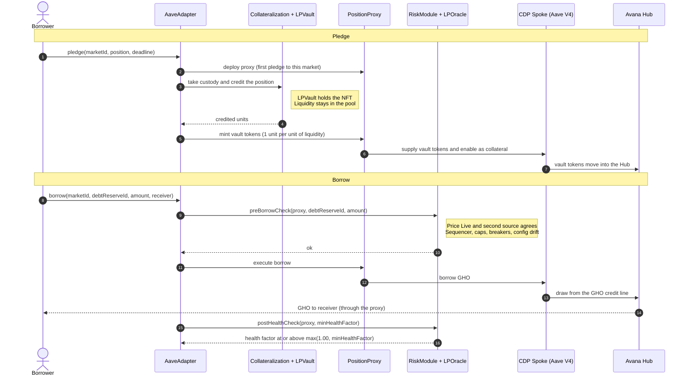

# Avana Monorepo
<div align="center">


</div>

Avana lets a liquidity provider borrow against a liquidity position in a listed AMM pool without taking the liquidity out of the pool. It runs on several chains, Hubs and AMM protocols: at launch on Ethereum (Uniswap v3) and Base (Aerodrome Slipstream), each with an Avana Stable LP Hub; the core also supports Uniswap v2, Curve, Balancer and Uniswap v4 once each passes its listing guards. GHO is the first debt asset, and any asset can become borrowable through its own credit line.


Each AMM protocol has an immutable LPVault per chain that holds its positions, and one AMM-neutral Collateralization ledger per chain records the units each position backs; a transfer-restricted vault token per market represents those units one for one. A market is one (chain, AMM protocol, pool, exact position shape). Every borrower action goes through the chain's AaveAdapter, which mints the vault token and supplies it from the borrower's own PositionProxy, a logic-free immutable account per (wallet, CDP Spoke, market), to a CDP Spoke: a standard, unmodified Aave V4 Spoke per (chain, Hub, AMM protocol, risk tier), owned by the Aave DAO. Every market therefore has its own health factor. Aave V4 values the collateral through Avana's LPOracle (fair composition at the oracle price), lends each debt asset from a DAO credit line, tracks the health factor and sizes liquidations. Avana's LPVaultSwap settles each liquidation in one transaction: it flash-borrows the debt asset from the Aave V3 Pool, repays, receives the seized vault tokens, removes exactly the seized units from the position and swaps them back into the debt asset. The vault token accepts seized collateral only to LPVaultSwap, and three settings set in each listing (`receiveSharesEnabled = false`, `liquidationFee = 0`, no reinvestment controller) keep that rule the only path, so no address can liquidate an Avana account except through LPVaultSwap; approved keepers use it, and any address can through a permissionless fallback. The borrower keeps the rest of the position and its trading fees.

Each chain has its own AvanaTimelock: every privileged change there is scheduled by that chain's 4-of-7 governance multisig or the Aave governance executor, executable by anyone after 5 days (never less than 4; 12 hours for risk-reducing changes and stops of new activity), and cancellable in the meantime by the governance multisig, the 3-of-5 Emergency Guardian, the Aave Protocol Guardian and the Aave governance executor, with role changes and operations that restore reviewed configuration cancellable only by the Aave governance executor. Exits and liquidation never depend on a pause, circuit breaker or address freeze.

## Repository map

| Folder | Contents |
|---|---|
| [`spec/`](spec/) | The protocol specification: architecture, one page per contract, one page per operation, invariants, attack scenarios, external dependencies, design decisions, and the spec-stage verification models |
| [`contracts/`](contracts/) | Foundry workspace with the Solidity contracts, unit, fuzz, fork and invariant tests, deployment scripts and Certora specifications |
| [`packages/`](packages/) | `protocol/`: ABIs, verified deployment manifests and calldata builders shared by the apps and services |
| [`apps/`](apps/) | `web/`: the web app; `backend/convex/`: its Convex backend for app data, sessions and intent tracking |
| [`services/`](services/) | `indexer/`: the Ponder indexer of Avana and Aave events; `keeper/`: the liquidation keeper |
| [`deployments/`](deployments/) | Release manifests: `proposed/` for governance inputs, `verified/` for deployments whose bytecode and live configuration have been checked |
| [`governance/`](governance/) | Aave DAO payloads (deployment, listing, collateral-factor, credit-line and refresh AIPs) and the AvanaTimelock operations scheduled by the governance multisig |
| [`audit/`](audit/) | Audit scope, external reports, formal-verification reports and evidence cited by findings |

## Toolchain

| Area | Stack |
|---|---|
| Contracts | [Foundry](https://getfoundry.sh) 1.9.0 (pinned in `contracts/.foundry-version`) with Soldeer (dependencies locked in `contracts/soldeer.lock`), Solidity 0.8.28, EVM `cancun`; Aave V4 pinned at `a3ef63ea6415d25237a9775bf66e76e9993561c2`, the Aave V3 Pool interfaces, Uniswap v3-core and v3-periphery, Aerodrome Slipstream, gho-core and OpenZeppelin Contracts pinned by commit. The workspace builds independently of the TypeScript code. |
| Web app and backend | The stack of the [Avana sandbox](https://github.com/Avana-Labs/avana-sandbox): Next.js and React, wagmi + viem for wallets and typed transactions, Convex for the backend, Sign-In with Ethereum (EIP-4361) sessions |
| Indexer | Ponder with Postgres |
| Keeper | Reads chain state over RPC, sizes liquidations by simulating the deployed Spoke, submits through private builder RPCs |
| TypeScript workspace | npm, with one `package-lock.json` at the root (`Q-027`); Node 22.18.0, pinned in `.nvmrc` for local use and every workflow |
| Repository hygiene | `.editorconfig`; `lefthook.yml` pre-commit checks (`forge fmt --check`, file sizes, `trace.py`), installed with `lefthook install` |
| Contract security tools | Slither 0.11.6 with crytic-compile 0.4.2, Halmos 0.3.3 and certora-cli 8.20.3 in `contracts/.venv`; Mythril 0.24.8 in `contracts/.venv-mythril`; solhint 6.2.5 through npm; Echidna 2.3.3, Medusa 1.5.1, Aderyn 0.6.8 and hevm 0.58.0 as release binaries in `contracts/tools/bin/`, each checked by sha256; Gambit from the certora-cli 8.20.3 wheel, linked as `contracts/tools/bin/gambit`; Java 21 in `contracts/tools/jdk-21/` for the Certora Prover. All installed by `contracts/script/install-security-tools.sh` (Python 3.11 through uv) |
| Spec verification | Python 3 with Z3 4.13, SymPy 1.13.3, Hypothesis 6.112.5 and pytest 8.3.3; Quint 0.22.4 through npm |

Test environments: a local Anvil chain and Sepolia, each with Avana's own deployment of the pinned Aave V4; an Ethereum fork at a pinned block for Uniswap v3, Chainlink and the Aave V3 Pool; and a Base fork at a pinned block for Aerodrome Slipstream, Chainlink, the sequencer-uptime feed and the Aave V3 Base Pool. One deploy script per chain deploys Aave V4 and Avana on its fork and writes that chain's release manifest, which the contracts, web app, indexer and keeper all use.

## How Avana is verified

Every rule is checked twice: once on the design, by models written from the pages in `spec/01`–`04`, and once on the Solidity in `contracts/`, by tests, symbolic execution, prover rules, fuzzing campaigns and static analysis. Each check carries a `<CHECK-ID> verifies: <ID>, …` tag, `trace.py` links every requirement to its checks and to the code that implements it, and every failed check becomes a `FINDING-…` in [5.3 Audit Findings](spec/05-verification/03-audit-findings.md). The latest results of each check and the per-contract review reports are under [`audit/`](audit/), indexed in [`audit/README.md`](audit/README.md).

| Layer | What it establishes | Tools | Results |
|---|---|---|---|
| Specification models | Every formula holds with exact rounding and Solidity bit widths; the cross-contract state machine keeps every invariant, with honest and hostile components; the launch parameters survive economic stress | Z3, SymPy, Quint, Hypothesis, Python simulations; the custody, control and liquidation formal-verification areas | [`z3/`](audit/z3/), [`sympy/`](audit/sympy/), [`quint/`](audit/quint/), [`hypothesis/`](audit/hypothesis/), [`simulation/`](audit/simulation/), [`spec-essentials/`](audit/spec-essentials/) |
| Contract tests | Each `TEST-NNN` of [5.1](spec/05-verification/01-test-requirements.md) passes on the real Aave V4 release; math libraries equal an exact Python reference; the suites are strong enough to catch mutated code | Foundry unit, fuzz, integration, invariant, differential and fork suites; coverage gate, mutation testing, Necessist | [`foundry-tests/`](audit/foundry-tests/), [`fork-tests/`](audit/fork-tests/), [`coverage/`](audit/coverage/), [`mutation/`](audit/mutation/), [`necessist/`](audit/necessist/) |
| Symbolic execution | Properties hold for every input, not only sampled ones | Halmos, hevm, Mythril | [`halmos/`](audit/halmos/), [`hevm/`](audit/hevm/), [`mythril/`](audit/mythril/) |
| Formal verification | The `PROP-NNN` rows of [5.2](spec/05-verification/02-formal-properties.md) hold on the compiled contracts over unbounded integers | Certora Prover (CVL), Solidity SMTChecker | [`certora/`](audit/certora/), [`smtchecker/`](audit/smtchecker/) |
| Fuzzing campaigns | No call sequence breaks a harness property or reaches a failing assertion | Echidna, Medusa | [`echidna/`](audit/echidna/), [`medusa/`](audit/medusa/) |
| Static analysis | No untriaged detector finding at or above each tool's gate | Slither, Aderyn, solhint, `forge lint`, Mythril, Semgrep, 4naly3er | [`slither/`](audit/slither/), [`aderyn/`](audit/aderyn/), [`solhint-and-lint/`](audit/solhint-and-lint/), [`semgrep/`](audit/semgrep/), [`4naly3er/`](audit/4naly3er/) |
| Upgrade safety | Every UUPS contract initializes once, keeps its ERC-7201 layout across releases and upgrades only through the AvanaTimelock | `slither-check-upgradeability`, storage-layout check, Certora and control-area rules | [`upgrade-safety/`](audit/upgrade-safety/) |
| Traceability | Every requirement has a check and a Solidity link; a changed requirement fails until its checks are re-run | `trace.py`, `contract_checklist.py` | [`traceability/`](audit/traceability/) |
| Review process | Every contract passes an independent adversarial review; every finding is fixed or triaged with a reason | Per-contract and per-layer gates | [`reviews/`](audit/reviews/) |

### Gates and review

A contract is accepted only when all of these pass: `forge build --force -D warnings`; its unit, fuzz and invariant tests; the file-size check; `trace.py` with 0 errors and `contract_checklist.py <Contract> --check` with every ID linked; the fast security tier with zero untriaged findings; every Halmos `check_`; its Echidna and Medusa harness written; its Certora confs compiling with `--compilation_steps_only`; the differential run for math contracts; and an independent adversarial review that reads only the contract's spec page and code. Every review finding is fixed or answered in writing.

After each layer of dependent contracts, the layer gate runs the slow tier at full budget over everything written so far (Echidna, Medusa, hevm, Mythril, SMTChecker), Certora mutation testing with `certoraMutate` on every contract whose rules verify, Foundry-suite mutation testing with `slither-mutate` (statement mutants) and Gambit (expression mutants), Necessist, the integration tests across the layer, `spec/05-verification/run_all.sh`, the three `audit/formal-verification/*/run.sh` and the size check over all of `src/`.

Triage rule: a real finding is fixed. A false positive goes into the tool's file in `contracts/security/` (`slither-triage.json`, `slither-upgradeability-triage.json`, `aderyn-triage.json`, `mythril-triage.json`, `semgrep-triage.json`, `4naly3er-triage.json`, and `gambit-triage.json` for a surviving mutant whose change cannot be observed) with a one-line reason and its approval; `contracts/script/security-gate.py` fails the run on any finding that is neither fixed nor accepted, and on any entry or disabled detector without a reason.

## Smart-contract checks

Every command below runs from `contracts/`. The security runners write their reports to `contracts/out-security/` and never touch `out/` or `cache/`. Fixtures deploy the pinned Aave V4 from `out-aave/`, so build it once before testing:

```bash
FOUNDRY_PROFILE=aave forge build
```

### Build, format and size

| Check | What it proves | Command | Results |
|---|---|---|---|
| Build, warnings as errors | `src/` compiles with zero warnings and every runtime code is within EIP-170's 24,576 bytes | `script/security-fast.sh build` | `out-security/build-src.txt` |
| Format | Every file matches `foundry.toml` `[fmt]` | `forge fmt --check` | console |
| File sizes (`Q-240`) | Every implementation file has at most 500 lines of code and every interface file at most 300 lines; at the latest run the largest are `AvanaTimelock.sol` (346 lines of code) and `IAaveV4Spoke.sol` (266 lines) | `script/check-file-size.sh` | console |

### Foundry tests

| Suite | What it proves | Scale |
|---|---|---|
| Unit (`test/unit/`) | Happy paths, rejections, access control, selector inventories and boundaries of each function, on the local Aave V4 deployment | 39 files |
| Fuzz (`test/fuzz/`) | Rounding direction, overflow inside listing bounds, splitting, tiny positions, dust | 7 files |
| Integration (`test/integration/`) | Multi-contract flows with every Avana and Aave V4 contract real | 1 file |
| Invariant (`test/invariant/`) | Global invariants after every call of every actor handler | 3 suites with their handlers |
| Differential (`test/differential/`) | LPPriceMath, RouteMath and SettlementMath equal the exact Python reference `test/differential/reference/avana_reference.py` (integers and `fractions.Fraction`, called over FFI with `contracts/.venv/bin/python`) | 22 tests in 4 suites |
| Fork (`test/fork/`) | Behaviour against the deployed Uniswap v3, Aerodrome Slipstream, Chainlink and Aave V3 Pool at a pinned block | fork profile |

Latest run of the default profile: 644 tests in 52 suites, plus the 22 differential tests. Test names carry their row (`test_TEST_NNN_…`, `testFuzz_TEST_NNN_…`, `invariant_TEST_NNN_…`); the full map is in [`contracts/test/README.md`](contracts/test/README.md).

| Profile | Runs | Command |
|---|---|---|
| `default` | everything except fork and differential; fuzz 1,000 runs with a fixed seed, invariant 64 runs × depth 64 | `forge test` |
| `ci` | as default; fuzz 10,000 runs, invariant 10,000 runs × depth 100 (`TEST-007`) | `FOUNDRY_PROFILE=ci forge test` |
| `invariant` | `test/invariant/**` only, 2,000 runs × depth 400 for long histories (delays, grace periods, the oracle latch) | `FOUNDRY_PROFILE=invariant forge test` |
| `differential` | `test/differential/**`, FFI on, 2,000 runs | `FOUNDRY_PROFILE=differential forge test` |
| `fork` | `test/fork/**`, fuzz 256 runs, RPC responses cached per block in `~/.foundry/cache/rpc` | `MAINNET_FORK_BLOCK=<block> FOUNDRY_PROFILE=fork forge test` |
| `coverage` | unit, fuzz and integration suites without the optimizer, for exact source maps | `FOUNDRY_PROFILE=coverage forge coverage --report lcov` |

One row: `forge test --match-test 'TEST_057_'`. The fork profile reads `RPC_MAINNET` (and `RPC_BASE` for the `base` endpoint) from `contracts/.env`, which Foundry loads automatically; `MAINNET_FORK_BLOCK` pins the block so every run sees the same state. Coverage writes `lcov.info`, and CI enforces a per-contract branch-coverage minimum on it.

### Symbolic execution

Halmos proves the `check_PROP_NNN_…` functions in `test/halmos/` for every input, with loops unrolled to 8: 95 checks in 17 files. Dynamic test linking turns `new C(...)` into a cheatcode Halmos lacks, so it runs with that linking off:

```bash
FOUNDRY_DYNAMIC_TEST_LINKING=false .venv/bin/halmos --root . --match-contract 'HalmosTest$' --loop 8 --solver-timeout-assertion 0
```

hevm proves every assertion entry point of every property harness reaches QED (a partial exploration fails), checks that the runtime code of every `src/` contract and library has no reachable assertion violation, and runs every `prove_` test in `test/symbolic/`. Reports land in `out-security/hevm/`.

```bash
script/security-slow.sh build hevm
```

Mythril analyzes the runtime bytecode of every `src/` contract and library (settings in `security/mythril.conf`) and gates at Low and above. Reports land in `out-security/mythril/`, `out-security/mythril.json` and `out-security/mythril-gate.txt`.

```bash
script/security-slow.sh build mythril
```

### Formal verification

The Certora rules in [`contracts/certora/`](contracts/certora/): 27 confs, 25 contract specs and 5 shared ghost models, 302 rules and invariants, with every `PROP` row of 5.2 carried by at least one tagged rule. The methods check proves that every `methods` entry names a function, with its parameter and return types, that exists in the compiled interfaces (latest run: 678 entries in 30 spec files, 0 errors); it runs in the fast tier:

```bash
script/security-fast.sh cvl
```

The prover needs Java 21 in `contracts/tools/jdk-21/`, `solc-0.8.28` from `contracts/tools/bin/`, and `CERTORAKEY` in `contracts/.env`. Both `.env` and `tools/jdk-21/` are ignored by the root `.gitignore`; the key is never committed. Set up the shell (macOS JDK layout):

```bash
export JAVA_HOME="$PWD/tools/jdk-21/Contents/Home" PATH="$PWD/tools/jdk-21/Contents/Home/bin:$PWD/tools/bin:$PATH"
```

```bash
set -a; . ./.env; set +a
```

Type-check one conf without a cloud job, run one conf, then every conf:

```bash
.venv/bin/certoraRun certora/conf/Lock.conf --compilation_steps_only
```

```bash
.venv/bin/certoraRun certora/conf/Lock.conf
```

```bash
for conf in certora/conf/*.conf; do .venv/bin/certoraRun "$conf" --wait_for_results all; done
```

Each run prints its prover job URL; [`contracts/certora/RUNS.md`](contracts/certora/RUNS.md) logs every run with command, versions, counts and exit code, and a counterexample becomes a `FINDING-…` in 5.3.

The Solidity SMTChecker (CHC engine) model-checks 19 contracts: the immutable contracts and the MarketRegistry (`PROP-043`), and LPOracle, DebtOracle, LPVaultSwap, the RiskModule, the ParameterStore and the three swap-route contracts (`PROP-044`), for assertion failures, overflow, underflow, division by zero, constant conditions, empty-array pops, out-of-bounds access and balance, with contract and reentrancy invariants reported. A counterexample reads "happens here" and fails the check:

```bash
FOUNDRY_PROFILE=smt forge build --force 2>&1 | tee smt.log
```

```bash
! grep -q 'happens here' smt.log
```

### Fuzzing campaigns

Echidna and Medusa run every `*Properties` harness in `test/invariant/echidna/` (Medusa also `test/invariant/medusa/`): 19 harnesses, one per contract or library, with 68 `property_` functions plus assertion entry points. Echidna runs each harness in property mode and in assertion mode; time jumps of up to 14 days per call let one sequence cross the 12-hour and 5-day delays and the 14-day grace period. Corpora persist in `out-security/corpus/`, so each campaign starts from every sequence that reached new coverage before; logs land in `out-security/echidna/` and `out-security/medusa/`. The default budget is 900 seconds per harness and mode; the nightly budget is `ECHIDNA_TEST_LIMIT=1000000`, `ECHIDNA_TIMEOUT=1800` and `MEDUSA_TIMEOUT=1800`. Before the external audit each layer also gets a 24-hour Echidna and Medusa campaign whose corpus is replayed in CI.

```bash
script/security-slow.sh build echidna
```

```bash
script/security-slow.sh build medusa
```

### Static analysis

| Tool | Configuration | Gate | Command | Report |
|---|---|---|---|---|
| Slither | `slither.config.json`, `security/slither-triage.json` | High, Medium, Low and Informational | `script/security-fast.sh slither` | `out-security/slither.json`, `slither.sarif`, `slither-gate.txt` |
| Aderyn | `aderyn.toml`, `security/aderyn-triage.json` | High and Low | `script/security-fast.sh aderyn` | `out-security/aderyn.json`, `aderyn.sarif`, `aderyn-gate.txt` |
| solhint | `.solhint.json`, `.solhintignore` | any warning or error | `script/security-fast.sh solhint` | `out-security/solhint.txt` |
| `forge lint` | `foundry.toml` `[lint]`, every severity | any finding (`-D notes`) | `script/security-fast.sh lint` | `out-security/forge-lint.txt` |
| Mythril | `security/mythril.conf`, `security/mythril-triage.json` | High, Medium and Low | `script/security-slow.sh build mythril` | `out-security/mythril-gate.txt` |

The fast tier is extended with Semgrep (smart-contract rules) and 4naly3er under the same triage gate. `script/security-gate.py` prints every finding with a fingerprint, so each one is fixed or accepted by fingerprint or by detector and file pattern.

### Upgrade safety

`slither-check-upgradeability` checks initializers, storage collisions and function-ID clashes of every deployable `src/` contract that inherits `Initializable` or `UUPSUpgradeable`; reports land in `out-security/upgradeability/<Contract>.json`.

```bash
script/security-fast.sh upgradeability
```

CI also runs a storage-layout check on every UUPS contract: OpenZeppelin Upgrades validation plus a layout diff against the last release. The Certora rules and the control-area models (`audit/formal-verification/control/fv_ctl_upgrade_lens.py`) prove that each initializer runs once, that `APPLICATION_ADMIN` is held only by the AvanaTimelock, and that the PositionProxy has no upgrade path.

### Security tiers

The two runners analyze everything under `src/` and every harness under `test/`, found through the build rather than a list of files, so a new contract or harness is checked on the next run. Every step runs even after an earlier one fails, and the runner exits 1 if any step failed. Each runner also takes step names.

| Tier | Steps, in order | When |
|---|---|---|
| Fast, `script/security-fast.sh` | `fmt` (`forge fmt --check`), `size` (`script/check-file-size.sh`), `lint` (`forge lint -D notes`), `build` (warnings denied, `--sizes`), `cvl` (Certora methods check), `solhint`, `slither`, `upgradeability` (`slither-check-upgradeability`), `aderyn` | every push and pull request |
| Slow, `script/security-slow.sh` | `build` (`src/`, `test/` and `script/` with build info, warnings denied), `echidna`, `medusa`, `halmos`, `hevm`, `mythril` | on demand (locally, or `workflow_dispatch` with `suite: slow`) and before every release |
| Layer gate, `script/security-slow.sh mutate gambit necessist` | `mutate` (`slither-mutate` statement mutants), `gambit` (`script/security-gambit.sh`: Gambit expression mutants, each run against its Foundry tests with a per-mutant timeout; fails on any survivor not accepted in `security/gambit-triage.json`), `necessist`; targets in `security/mutation-layers.json` | at each layer gate |

```bash
script/security-fast.sh
```

```bash
script/security-slow.sh
```

```bash
MUTATE_LAYERS=2.1 script/security-slow.sh mutate gambit necessist
```

```bash
MUTATE_LAYERS=2.2 MUTATE_CONTRACTS=ClPriceMath GAMBIT_TIMEOUT=600 script/security-gambit.sh
```

Slow-tier budgets come from the environment: `ECHIDNA_TEST_LIMIT`, `ECHIDNA_TIMEOUT` and `MEDUSA_TIMEOUT` (900 seconds per harness and mode by default), `MEDUSA_TEST_LIMIT`, `HEVM_SMT_TIMEOUT` (300 seconds per query) and `HALMOS_LOOP` (8); layer-gate budgets are `MUTATE_LAYERS` and `MUTATE_CONTRACTS` (targets), `MUTATE_TIMEOUT` and `GAMBIT_TIMEOUT` (300 seconds per mutant test run) and `MUTATE_FUZZ_RUNS` (256). Manticore, MythX and Kontrol do not run: Manticore is archived, the MythX service has shut down, and Kontrol needs the K framework; hevm, Halmos and Mythril cover what they provided.

## Specification checks

Every command below runs from `spec/05-verification/`, on the `.venv` that `run_all.sh` creates from `requirements.txt` and the Quint installed from `package.json`. A model script exits non-zero only when a result differs from the one it records, so a run flags drift; deliberate counterexamples (wrong readings and boundaries the spec rules out) are recorded as such.

### Z3

Every formula in exact integers, or Solidity bit widths where overflow or truncation is the question; a property is proved when its negation is unsat, and every worked example on the spec pages is recomputed.

| Folder | Covers | Scripts | Proved | Counterexamples (deliberate) | Computed |
|---|---|---|---|---|---|
| [`z3/units-oracle/`](spec/05-verification/z3/units-oracle/) | Vault-token units and decimals, LPOracle and DebtOracle math, price states, backing ledger, cap counters | 13 | 183 | 31 | 21 |
| [`z3/aave-risk/`](spec/05-verification/z3/aave-risk/) | Health factor on Aave V4 `a3ef63e`, opening gate, liquidation sizing and bonus, repay, risk premium, caps, breakers, wind-down ramp | 13 | 144 | 12 | 53 |
| [`z3/settlement/`](spec/05-verification/z3/settlement/) | Net bonus and slippage, recovery floor, per-leg minimums, caller top-up, waterfall, payout escrow, First-Loss coverage | 16 | 228 | 56 | 31 |
| [`z3/governance/`](spec/05-verification/z3/governance/) | Timelock delays, execution window and expiry, delay floor, short-delay allowlist, cancel rights, pause state | 2 | 27 | 3 | — |
| [`z3/amm-pricing/`](spec/05-verification/z3/amm-pricing/) | Fair-composition LP pricing for concentrated liquidity, constant product, StableSwap and weighted pools | 3 | 39 Z3 queries plus exact-integer runs, each with its recorded result in the folder's README | — | — |

```bash
.venv/bin/python z3/settlement/st03_waterfall.py
```

### SymPy, Hypothesis, Quint and simulations

| Check | What it proves | Scale | Command |
|---|---|---|---|
| SymPy (`sympy/`) | Each formula equals the rule it implements, exactly and before rounding; closed forms; worked examples in exact rationals | 10 scripts, 230 checks: 229 hold, 1 deliberate wrong reading; 16 derived closed forms | `.venv/bin/python sympy/sym05_settlement.py` |
| Hypothesis (`hypothesis/`) | Generated action sequences and numeric edge cases against an executable integer model of Avana, Aave V4 and Uniswap v3; global invariants, solvency per debt asset included, after every step; LP pricing under swaps, donations, mints and burns | 5 files, 81 tests | `.venv/bin/python -m pytest -q hypothesis` |
| Quint scenarios | Named cross-contract scenarios replay deterministically | `avana_tests.qnt`: 50 scenarios; `topology_tests.qnt`: 20 multi-Hub, multi-Spoke scenarios | `npx quint test quint/avana_tests.qnt` |
| Quint invariant runs | No random trace violates an invariant, honest or with hostile components; witness runs show the traces reach seizures, deficits, rescues and timelock operations | `avana.qnt`: 58 invariants, 96 simulator checks at 500 traces × 20 steps (10,000 × 20 with `QUINT_FULL=1`); `topology.qnt`: 15 invariants at 1,000 traces × 25 steps | `quint/run.sh` |
| Simulations (`simulation/`) | Depegs, oracle outages, correlated drops, keeper outages, gas and dust, route stress and interest accrual against the launch parameters | 8 seeded, reproducible scenarios | `.venv/bin/python simulation/sim01_depeg.py` |

Deeper runs: `AVANA_HYP_SCALE=5 .venv/bin/python -m pytest -q hypothesis`, `QUINT_FULL=1 quint/run.sh`, `npx quint test quint/topology_tests.qnt` and `quint/topology_run.sh`.

### Formal-verification areas

Three areas in [`audit/formal-verification/`](audit/formal-verification/) model the protocol by concern with Z3 and Quint, each checking that every spec ID it cites is defined. Run them from the repository root; each writes its run log to `RUNS.md` and its findings to `report.md` in its folder.

| Area | Covers | Latest counted run |
|---|---|---|
| Control | Access control, the timelock, pause, gates, parameters, registry, oracle, upgrades, Lens, breakers, AMM listing | 175 properties verified, 0 violated; 6 Quint invariants with no violation in 10,000 samples × 12 steps; 422 cited spec IDs defined |
| Custody | Collateralization, the vault token and factory, each LPVault, the Adapter's mint and burn paths, solvency | 532 checks verified, 0 violated, 0 vacuous; 2 Quint runs of 10,000 samples × 20 steps |
| Liquidation | LPVaultSwap and SettlementMath, routes, flash funding, caller top-up, Coverage Spokes, PayoutEscrow | 271 checks passed, including 9 Quint checks (10,000 traces × 25 steps by default) |

```bash
audit/formal-verification/control/run.sh
```

```bash
audit/formal-verification/custody/run.sh
```

```bash
audit/formal-verification/liquidation/run.sh
```

### `run_all.sh`

One script runs every Z3, SymPy and simulation script, the Hypothesis suite, Quint typecheck and tests of every model, the Quint simulator checks of `quint/run.sh`, then `trace.py`, and prints the exit status of each step. On first run it creates `.venv/` and installs Quint. `--nightly` adds the topology simulator runs.

```bash
spec/05-verification/run_all.sh
```

```bash
spec/05-verification/run_all.sh --nightly
```

### Traceability

[`trace.py`](spec/05-verification/trace.py) builds the matrix requirement → check → implementation in [`traceability.md`](spec/05-verification/traceability.md) (3,476 requirements at the latest run). It scans the spec models, `contracts/test/`, `contracts/certora/` and the `/// @custom:spec <ID>` tags in `contracts/src/`. [`traceability.lock.json`](spec/05-verification/traceability.lock.json) stores a hash of each requirement's text and the checks accepted for it (3,454 entries). `trace.py` fails on a duplicate ID, a link to an undefined ID, a requirement whose text changed since its checks were accepted, an ID that disappeared without `retired_to`, or an AMM integration marked `listed` without its four listing methods. `--strict` also fails on a requirement with no check or no Solidity link. After re-running the checks of a changed requirement, `--accept <ID>` records it.

```bash
.venv/bin/python trace.py
```

```bash
.venv/bin/python trace.py --strict
```

[`contract_checklist.py`](spec/05-verification/contract_checklist.py) lists, for one of the 25 contracts, every REQ/SPEC ID of its page, its TEST and PROP rows, and the INV and ATTACK rows that name it, each ticked when a tag in `contracts/test` or `contracts/certora` links it; `--check` exits 1 while any is unlinked. Run it from the repository root:

```bash
spec/05-verification/.venv/bin/python spec/05-verification/contract_checklist.py --list
```

```bash
spec/05-verification/.venv/bin/python spec/05-verification/contract_checklist.py Lock --check
```

## Run everything

Prerequisites: [Foundry](https://getfoundry.sh) through `foundryup`, [uv](https://docs.astral.sh/uv/), Node.js with npm, and Python 3. From the repository root:

```bash
foundryup --install 1.9.0
```

```bash
cd contracts
```

```bash
forge soldeer install
```

```bash
script/install-security-tools.sh
```

```bash
FOUNDRY_PROFILE=aave forge build
```

```bash
script/security-fast.sh
```

```bash
FOUNDRY_PROFILE=ci forge test
```

```bash
FOUNDRY_PROFILE=invariant forge test
```

```bash
FOUNDRY_PROFILE=differential forge test
```

```bash
FOUNDRY_DYNAMIC_TEST_LINKING=false .venv/bin/halmos --root . --match-contract 'HalmosTest$' --loop 8 --solver-timeout-assertion 0
```

```bash
FOUNDRY_PROFILE=smt forge build --force 2>&1 | tee smt.log
```

```bash
! grep -q 'happens here' smt.log
```

```bash
script/security-slow.sh
```

```bash
cd ..
```

```bash
spec/05-verification/run_all.sh --nightly
```

```bash
audit/formal-verification/control/run.sh
```

```bash
audit/formal-verification/custody/run.sh
```

```bash
audit/formal-verification/liquidation/run.sh
```

Everything above runs offline once the tools are installed (the first `run_all.sh` installs its own `.venv` and Quint). Two checks need keys or RPCs from `contracts/.env`:

| Check | Needs | Command, from `contracts/` |
|---|---|---|
| Fork tests | `RPC_MAINNET` and `RPC_BASE` (archive endpoints) in `contracts/.env` (names in `contracts/.env.example`); blocks pinned in `contracts/test/utils/fixtures/ForkConstants.sol` | `FOUNDRY_PROFILE=fork forge test` |
| Certora Prover | `CERTORAKEY` in `contracts/.env`, Java 21 in `contracts/tools/jdk-21/` | the shell setup and conf loop under [Formal verification](#formal-verification) |

## Continuous integration

[`.github/workflows/contracts.yml`](.github/workflows/contracts.yml) runs the light set (`build`, `test`, `coverage`, `traceability`, `fast-security`) on every pull request and every push to `main` that touches `contracts/**`, `spec/05-verification/trace.py` or the workflow, with Foundry v1.9.0 and dependencies from `soldeer.lock`. The long jobs (`invariant`, `fork`, `differential`, `halmos`, `smtchecker`, `certora`) run only on `workflow_dispatch` with `suite: full`, which also runs the light set:

| Job | Runs |
|---|---|
| `build` | `forge soldeer install` (fails if `foundry.toml` and `soldeer.lock` disagree), `forge fmt --check`, `script/check-file-size.sh`, `forge lint src`, the Foundry version against `contracts/.foundry-version`, `forge build --sizes`, `script/check-sizes.sh` (EIP-170 minus `security/size-margins.json`, with the change against `main` in the job summary), `FOUNDRY_PROFILE=aave forge build` |
| `test` | `ci` profile with a fresh fuzz seed per run, printed for reproduction; then the `gas` profile against the committed `contracts/snapshots/` |
| `invariant` | `invariant` profile, 2,000 runs × depth 400 |
| `fork` | `fork` profile and the hostile-component tests on the fork at the pinned blocks (`RPC_MAINNET` and `RPC_BASE` secrets); RPC cache keyed on `ForkConstants.sol`; skipped on pull requests from other repositories, which receive no secrets |
| `differential` | `differential` profile against the Python reference on Python 3.12 |
| `halmos` | every `check_` in `test/halmos/` on Python 3.12 |
| `smtchecker` | `smt` profile; fails on any counterexample |
| `certora` | every conf in `certora/conf/` with `--wait_for_results all`, Java 21 and the static solc 0.8.28; runs when the `CERTORAKEY` secret is set |
| `traceability` | `trace.py`; the `--strict` gap list goes to the job summary |
| `fast-security` | `script/security-fast.sh`; uploads the Slither and Aderyn SARIF to code scanning and the reports as an artifact |

`workflow_dispatch` with `suite: slow` runs only `slow-security`, one job per tool with the slow-tier budgets (`ECHIDNA_TEST_LIMIT=1000000`, `ECHIDNA_TIMEOUT=1800`, `MEDUSA_TIMEOUT=1800`, `HEVM_SMT_TIMEOUT=600`, `HALMOS_LOOP=16`): Echidna and Medusa 300 minutes each, with their corpora restored from earlier runs, Halmos and Mythril 240, hevm 180. Each uploads its reports. There is no schedule. `workflow_dispatch` with the `layer` input (for example `2.1`) runs only `layer-gate`, one job each for `mutate`, `gambit` and `necessist` over that layer's contracts (360 minutes each), uploading `out-security/mutation`, `out-security/gambit` and `out-security/necessist`.

[`.github/workflows/spec.yml`](.github/workflows/spec.yml) runs `spec/05-verification/run_all.sh` on every change to `spec/`, `contracts/src/`, `contracts/test/` or `contracts/certora/`. [`.github/workflows/dependency-review.yml`](.github/workflows/dependency-review.yml) fails a pull request that adds an npm or pip dependency with a known vulnerability of moderate severity or above, and [`.github/workflows/protocol.yml`](.github/workflows/protocol.yml) fails when the address libraries in `packages/protocol/sol/` differ from `deployments/verified/`. Every action is pinned by commit SHA, checkouts keep no credentials, and Dependency versions change only by a reviewed pull request; Dependabot is off.

## Security, releases and contributions

- Contributing: [`CONTRIBUTING.md`](CONTRIBUTING.md) gives the setup, build, test and security-tier commands and the licence of contributions.
- Vulnerabilities: [`SECURITY.md`](SECURITY.md); reports go to support@avana.cc, and the bug bounty is at [avana.cc/developers/safety/bug-bounty](https://www.avana.cc/developers/safety/bug-bounty). External audit reports are indexed in [`audit/external/`](audit/external/index.md).
- Releases: annotated tags `vX.Y.Z`, each with a section in [`CHANGELOG.md`](CHANGELOG.md). The tag is the deploy scripts' `AVANA_RELEASE`, which feeds the CREATE2 and CREATE3 salts, so a tag is never moved or reused.
- Reviews: [`.github/CODEOWNERS`](.github/CODEOWNERS) names the team that approves each path; [`.github/PULL_REQUEST_TEMPLATE.md`](.github/PULL_REQUEST_TEMPLATE.md) is the checklist every pull request completes. The repository is planned as `Avana-Labs/avana-monorepo` in the [Avana-Labs](https://github.com/Avana-Labs) GitHub organisation.
- Governance changes: one folder per operation in [`governance/operations/`](governance/README.md#operation-folders).

## Licence

Avana's code is licensed under the Business Source License 1.1 ([`LICENSE`](LICENSE)): Licensor Avana Labs, no Additional Use Grant, Change License MIT, Change Date the earlier of three years after Avana's official Ethereum mainnet launch and four years after the first public distribution of the version. Until then, copying, modifying, redistributing and non-production use are free, and production use needs a commercial licence from Avana Labs (support@avana.cc).

Files that contain third-party code keep its licence: `contracts/src/amm/concentrated-liquidity/ClPriceMath.sol` and three Python models of the Uniswap v3 math are GPL-2.0-or-later; four Python models of Aave V4 arithmetic are under the Aave V4 licence, for test environments only; the third-party interfaces in `contracts/src/interfaces/external/` keep their origin's GPL-2.0-or-later, AGPL-3.0, AGPL-3.0-or-later or MIT identifier. Dependencies and tools are not committed and keep their own licences. The file-by-file list is in [`LICENSING.md`](LICENSING.md), the components and their licence texts in [`THIRD_PARTY_LICENSES.md`](THIRD_PARTY_LICENSES.md) and [`LICENSES/`](LICENSES/), and the attribution notices in [`NOTICE`](NOTICE).

## Where to start reading

1. [`spec/README.md`](spec/README.md): how the specification is organised, the ID scheme and the units.
2. [1.1 Protocol Overview](spec/01-architecture/01-protocol-overview.md): participants, the collateral path and what is in scope.
3. [1.2 Contract Relationships](spec/01-architecture/02-contract-relationships.md): every contract, its form (immutable or upgradeable), every call between contracts and where assets sit.
4. The operation pages in [`spec/03-operations/`](spec/03-operations/), starting with deposit, borrow and liquidation.
5. [4.4 Design Decisions](spec/04-security/04-design-decisions.md): every decision `Q-001` onward with its resolution.
6. [`spec/05-verification/README.md`](spec/05-verification/README.md): how each rule is checked.

Contracts are written from the specification. When code and specification disagree, the specification is changed first, through the change control described in [`spec/README.md`](spec/README.md#traceability-and-change-control), and the code follows.
