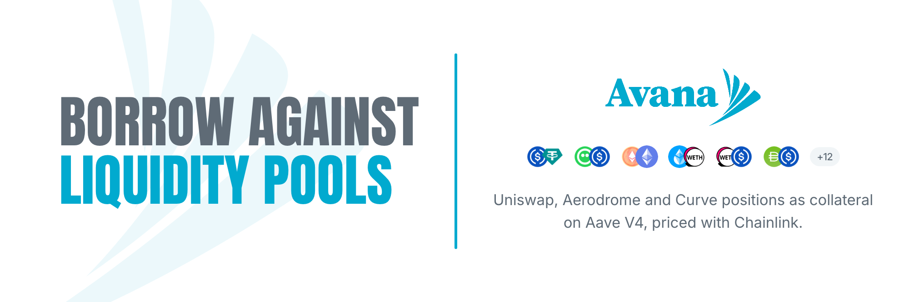

# Avana

<div align="center">



</div>

Avana lets a liquidity provider borrow on Aave V4 against a concentrated-liquidity position, without taking the liquidity out of the pool. The position stays in an Avana vault, keeps earning fees, and backs an ERC-20 vault token that Aave sees as ordinary collateral.

## Core contracts

Seven contracts, each in its own folder under [`contracts/src/`](contracts/src/). Each folder has a `DESIGN.md` with the decisions behind it.

| Contract | Folder | Role |
|---|---|---|
| AaveAdapter | [`adapter`](contracts/src/adapter/) | User entry point: pledge, add liquidity, borrow, repay, withdraw, collect fees. Holds one thin Aave account proxy per user and routes each pledge to its market. |
| RiskModule | [`risk`](contracts/src/risk/) | Lists pools and their two band markets, registers Spokes and debt reserves, checks every borrow and sets the fee share and keepers. |
| LPVault | [`vault`](contracts/src/vault/) | Holds the NFTs, credits each position its floor credit at pledge and unwinds liquidity on liquidation. |
| VaultToken | [`token`](contracts/src/token/) | ERC-20 collateral, one unit per unit of floor credit; transfers only along the pledge and liquidation paths. |
| LPOracle | [`oracle`](contracts/src/oracle/) | Stateless price of one band market's vault token; Aave V4 reads it as the reserve's price source. |
| LiquidationModule | [`liquidation`](contracts/src/liquidation/) | Runs Aave's `liquidationCall`, burns the seized units, unwinds only that much liquidity and pays the liquidator in kind. |
| FirstLossReserve | [`reserve`](contracts/src/reserve/) | Covers Spoke deficits: Avana's reserve first, then the DAO Deficit Offset. |

Outside the core:

| Component | Folder | Role |
|---|---|---|
| FlashloanRepay | [`contracts/src/periphery`](contracts/src/periphery/) | Repay with collateral through an Aave V3 flash loan and a one-call withdraw allowance. |
| AMM integrations | [`contracts/src/integrations`](contracts/src/integrations/) | Uniswap v3, Uniswap v4 and Aerodrome Slipstream position math. |
| Liquidator | [`liquidator/`](liquidator/) | `FlashLiquidator` contract and the TypeScript liquidation bot. |

Flows end to end: [`contracts/LIFECYCLES.md`](contracts/LIFECYCLES.md).

## Repository

| Folder | Contents |
|---|---|
| [`contracts/`](contracts/) | Foundry workspace: sources, tests, deploy scripts, Certora specs, security tooling |
| [`liquidator/`](liquidator/) | Flash liquidator contract and bot (npm workspace `@avana/liquidator`) |
| [`services/`](services/) | Indexer, keeper host, monitor, Convex backend, faucet, dashboards |
| [`packages/`](packages/) | `@avana/protocol` ABIs and calldata, export reader, shared RPC manager |
| [`deployments/`](deployments/) | Release manifests and their schema |
| [`address-book/`](address-book/) | Generated address, parameter and access-control pages |
| [`docs/`](docs/) | Governance payloads and operations, audit evidence, release process |
| [`infra/`](infra/) | Service configuration templates |
| [`webapp/`](webapp/) | Next.js app |

## Quick start

Requirements: Foundry 1.9.0 (`contracts/.foundry-version`), Node 22.18.0 (`.nvmrc`), uv and Python 3.

```bash
foundryup --install 1.9.0
cd contracts && forge soldeer install
forge build
forge test -j 2
```

```bash
npm ci
npm test
```

Security tools (Slither, Halmos, Echidna, Medusa, hevm, Mythril, Aderyn, Semgrep, certora-cli): `contracts/script/install-security-tools.sh`. Fork tests read `RPC_MAINNET` and `RPC_BASE`; [`contracts/.env.example`](contracts/.env.example) lists every variable.

## Verification

| Check | Where | When |
|---|---|---|
| Unit, fuzz, integration, invariant tests | `contracts/test/` | Every PR |
| Core size report (≤ 800 lines per contract, ≤ 4,000 core) | `contracts/script/check-core-size.sh` | Every PR |
| Gas snapshots, generated ABIs | `contracts/snapshots/`, `packages/protocol` | Every PR |
| Branch coverage, ≥ 80% per file | `contracts/script/check-coverage.sh` | Full suite |
| Slither, Aderyn, Semgrep, solhint, 4naly3er | `contracts/script/security-fast.sh` | Full suite |
| Deep invariants, fork, differential, SMTChecker | `contracts.yml` long suite | Manual |
| Halmos, Echidna, Medusa, hevm, Mythril | `security-slow.yml` | Manual |
| Mutation (slither-mutate, Gambit, Necessist) | `mutation-gate.yml` | Manual |
| Certora Prover | [`contracts/certora/`](contracts/certora/) | Locally in WSL |

## CI

| Workflow | Trigger | Scope |
|---|---|---|
| [`contracts.yml`](.github/workflows/contracts.yml) | PR, manual | Build, tests, size, gas, ABIs, liquidator; `full` and `long` suites by hand |
| [`security-slow.yml`](.github/workflows/security-slow.yml) | Manual | Slow security tier on the current contracts |
| [`mutation-gate.yml`](.github/workflows/mutation-gate.yml) | Manual | Mutation testing per layer |
| [`services.yml`](.github/workflows/services.yml) | PR | One job per affected package |
| [`e2e-local.yml`](.github/workflows/e2e-local.yml) | Manual | Local chain end to end |
| [`gitleaks.yml`](.github/workflows/gitleaks.yml), [`dependency-review.yml`](.github/workflows/dependency-review.yml) | PR | Secrets and vulnerable dependencies |

## More

- [Contributing](CONTRIBUTING.md) · [Security](SECURITY.md) · [Changelog](CHANGELOG.md) · [Release process](docs/release.md)
- [Governance](docs/governance/README.md) · [Audit evidence](docs/audit/README.md)
- Licence: Business Source License 1.1 ([`LICENSE`](LICENSE)); third-party code keeps its licence ([`NOTICE`](NOTICE), [`THIRD_PARTY_LICENSES.md`](THIRD_PARTY_LICENSES.md)).
