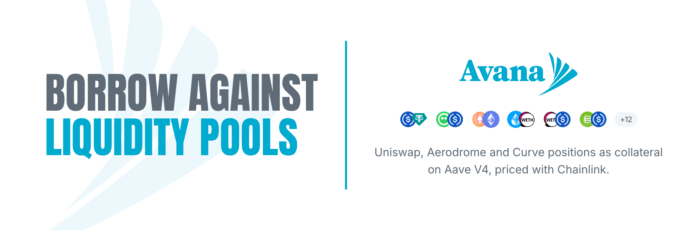
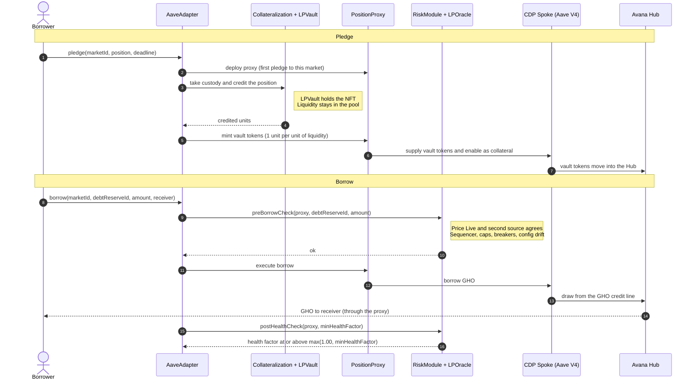

# Avana Monorepo
<div align="center">



</div>

Avana lets a liquidity provider borrow against a liquidity position in a listed AMM pool without taking the liquidity out of the pool. It runs on several chains, Hubs and AMM protocols: at launch on Ethereum (Uniswap v3) and Base (Aerodrome Slipstream), each with an Avana Stable LP Hub; the core also supports Uniswap v2, Curve, Balancer and Uniswap v4 once each passes its listing guards. The Aave DAO decides which assets are borrowable; on a Stable LP Hub they are stable debt assets it approves (for example GHO, USDC, USDT), each with its own credit line, draw cap, price source, swap routes and two loss layers: the Avana-funded Avana Umbrella, then a DAO deficit offset funded by the Aave DAO treasury. Each lend asset's rate follows Aave V4's standard utilization curve. The diagram below borrows GHO as an example.


Each AMM protocol has one immutable LPVault per chain that holds its positions, and one AMM-neutral Collateralization ledger per chain records the units each position backs. A transfer-restricted vault token per market represents those units one for one. A market is one (chain, AMM protocol, pool, exact position shape).

Every borrower action goes through the chain's AaveAdapter. The Adapter mints the vault token and supplies it from the borrower's own PositionProxy, a logic-free immutable account per (wallet, CDP Spoke, market), to a CDP Spoke: a standard, unmodified Aave V4 Spoke per (chain, Hub, AMM protocol, risk tier), owned by the Aave DAO. Every market therefore has its own health factor. Aave V4 values the collateral through Avana's LPOracle (fair composition at the oracle price), lends each debt asset within a DAO-approved credit line out of what lenders supply, tracks the health factor and sizes liquidations. Lending is public: on the app's Lend page any wallet supplies a listed asset (GHO, USDT, USDC) to the chain's Lend Spoke and withdraws it with Aave's standard `supply` and `withdraw` (wallet → Lend Spoke → Hub, no Avana contract in the path), earning the Hub supply rate beside the Aave DAO's bootstrap supply; the Borrow page goes wallet → AaveAdapter → PositionProxy → CDP Spoke → Hub, and its borrowable assets are the Lend page's assets on the same (Hub, asset).

Avana's LPVaultSwap settles each liquidation in one transaction: it flash-borrows the debt asset from the Aave V3 Pool, repays, receives the seized vault tokens, removes exactly the seized units from the position and swaps them back into the debt asset. The vault token accepts seized collateral only to LPVaultSwap, and three settings in each listing (`receiveSharesEnabled = false`, `liquidationFee = 0`, no reinvestment controller) keep that the only path, so no address can liquidate an Avana account except through LPVaultSwap. Approved keepers use it, and any address can through a permissionless fallback. The borrower keeps the rest of the position and its trading fees.

Each chain has its own AvanaTimelock. Every privileged change there is scheduled by that chain's 4-of-7 governance multisig or the Aave governance executor and can be executed by anyone after 5 days (never less than 4; 12 hours for risk-reducing changes and stops of new activity). Until then the governance multisig, the 3-of-5 Emergency Guardian, the Aave Protocol Guardian and the Aave governance executor can cancel it; role changes and operations that restore reviewed configuration can be cancelled only by the Aave governance executor. Exits and liquidation never depend on a pause, circuit breaker or address freeze.

## Repository map

| Folder | Contents |
|---|---|
| [`spec/`](spec/) | The protocol specification: architecture, one page per contract, one page per operation, invariants, attack scenarios, external dependencies, design decisions, and the spec-stage verification models |
| [`contracts/`](contracts/) | Foundry workspace with the Solidity contracts, unit, fuzz, fork and invariant tests, deployment scripts and Certora specifications |
| [`services/`](services/) | `indexer/`: the Ponder indexer of Avana and Aave events; `keeper/`: the liquidation keeper; `convex/`: the Convex backend and the design of its import; `common/`: chains, manifest view and export types shared by the services |
| [`governance/`](governance/) | Aave DAO payloads (deployment, listing, collateral-factor, credit-line and refresh AIPs) and the AvanaTimelock operations scheduled by the governance multisig |
| [`audit/`](audit/) | Audit scope, external reports, formal-verification reports and the evidence cited by findings |

## Toolchain

| Area | Stack |
|---|---|
| Contracts | [Foundry](https://getfoundry.sh) 1.9.0 (pinned in `contracts/.foundry-version`) with Soldeer (dependencies locked in `contracts/soldeer.lock`), Solidity 0.8.28, EVM `cancun`; Aave V4 pinned at `a3ef63ea6415d25237a9775bf66e76e9993561c2`, the Aave V3 Pool interfaces, Uniswap v3-core and v3-periphery, Aerodrome Slipstream, gho-core and OpenZeppelin Contracts pinned by commit. The workspace builds independently of the TypeScript code. |
| Web app and backend | The stack of the [Avana sandbox](https://github.com/Avana-Labs/avana-sandbox): Next.js and React, wagmi + viem for wallets and typed transactions, Convex for the backend, Sign-In with Ethereum (EIP-4361) sessions |
| Indexer | Ponder with Postgres |
| Keeper | Reads chain state over RPC, sizes liquidations by simulating the deployed Spoke, submits through private builder RPCs |
| TypeScript workspace | npm (`Q-027`); Node 22.18.0, pinned in `.nvmrc` and used by every workflow that installs Node |
| Repository hygiene | `.editorconfig`; `lefthook.yml` pre-commit checks (`forge fmt --check`, file sizes, licence headers, `trace.py`), installed with `lefthook install` |
| Contract security tools | Slither 0.11.6 with crytic-compile 0.4.2, Halmos 0.3.3, Semgrep 1.182.1 and certora-cli 8.20.3 in `contracts/.venv`; Mythril 0.24.8 in `contracts/.venv-mythril`; solhint 6.2.5 through npm; Echidna 2.3.3, Medusa 1.5.1, Aderyn 0.6.8 and hevm 0.58.0 as release binaries, each checked by sha256; Gambit from the certora-cli 8.20.3 wheel; Necessist 4.1.0 built with cargo. `contracts/script/install-security-tools.sh` installs all of them (Python 3.11 through uv). The Certora Prover also needs Java 21. |
| Spec verification | Python 3 with Z3 4.13, SymPy 1.13.3, Hypothesis 6.112.5 and pytest 8.3.3; Quint 0.22.4 through npm |

Test environments: a local Anvil chain and Sepolia, each with Avana's own deployment of the pinned Aave V4; an Ethereum fork at a pinned block for Uniswap v3, Chainlink and the Aave V3 Pool; and a Base fork at a pinned block for Aerodrome Slipstream, Chainlink, the sequencer-uptime feed and the Aave V3 Base Pool. One deploy script per chain deploys Aave V4 and Avana on its fork and writes that chain's release manifest, which the contracts, web app, indexer and keeper all use.

## How Avana is verified

Every rule is checked twice. Models written from the pages in `spec/01`–`04` check the design; tests, symbolic execution, prover rules, fuzzing campaigns and static analysis check the Solidity in `contracts/`. Each check carries a `<CHECK-ID> verifies: <ID>, …` tag, `trace.py` links every requirement to its checks and to the code that implements it, and every failed check becomes a `FINDING-…` in [5.3 Audit Findings](spec/05-verification/03-audit-findings.md). The latest result of each check and the per-contract review reports are under [`audit/`](audit/), indexed in [`audit/README.md`](audit/README.md).

| Layer | What it establishes | Tools | Results |
|---|---|---|---|
| Specification models | Every formula holds with exact rounding and Solidity bit widths; the cross-contract state machine keeps every invariant, with honest and hostile components; the launch parameters survive economic stress | Z3, SymPy, Quint, Hypothesis, Python simulations; the custody, control and liquidation formal-verification areas | [`z3/`](audit/z3/), [`sympy/`](audit/sympy/), [`quint/`](audit/quint/), [`hypothesis/`](audit/hypothesis/), [`simulation/`](audit/simulation/), [`spec-essentials/`](audit/spec-essentials/) |
| Contract tests | Each `TEST-NNN` of [5.1](spec/05-verification/01-test-requirements.md) has a test named for it that runs and passes, on the pinned Aave V4 release where the row needs Aave; the math libraries equal an exact Python reference; mutation testing measures whether the suites catch mutated code. The CI evidence job reports, per contract, which rows a test that ran and passed checks; the fork rows have not run yet (the fork blocks are not pinned), and no mutation campaign result is recorded yet | Foundry unit, fuzz, integration, invariant, differential and fork suites; coverage gate, mutation testing, Necessist | [`foundry-tests/`](audit/foundry-tests/), [`fork-tests/`](audit/fork-tests/), [`coverage/`](audit/coverage/), [`mutation/`](audit/mutation/), [`necessist/`](audit/necessist/) |
| Symbolic execution | Properties hold for every input, not only sampled ones | Halmos, hevm, Mythril | [`halmos/`](audit/halmos/), [`hevm/`](audit/hevm/), [`mythril/`](audit/mythril/) |
| Formal verification | The `PROP-NNN` rows of [5.2](spec/05-verification/02-formal-properties.md) hold on the compiled contracts over unbounded integers | Certora Prover (CVL), Solidity SMTChecker | [`certora/`](audit/certora/), [`smtchecker/`](audit/smtchecker/) |
| Fuzzing campaigns | No call sequence breaks a harness property or reaches a failing assertion | Echidna, Medusa | [`echidna/`](audit/echidna/), [`medusa/`](audit/medusa/) |
| Static analysis | No untriaged detector finding at or above each tool's gate | Slither, Aderyn, solhint, `forge lint`, Mythril, Semgrep, 4naly3er | [`slither/`](audit/slither/), [`aderyn/`](audit/aderyn/), [`solhint-and-lint/`](audit/solhint-and-lint/), [`semgrep/`](audit/semgrep/), [`4naly3er/`](audit/4naly3er/) |
| Upgrade safety | Every UUPS contract initializes once, keeps its ERC-7201 layout across releases and upgrades only through the AvanaTimelock | `slither-check-upgradeability`, storage-layout check, Certora and control-area rules | [`upgrade-safety/`](audit/upgrade-safety/) |
| Traceability | Every requirement links to its checks and its Solidity; a test counts for a row only when its tag sits on a test of that row, the test ran and passed in the run's results and it uses the real contract, not a harness or mock standing in for it; a changed requirement fails until its checks are re-run | `trace.py`, `contract_checklist.py` | [`traceability/`](audit/traceability/) |
| Review process | Every contract passes an independent adversarial review; every finding is fixed or triaged with a reason | Per-contract and per-layer gates | [`reviews/`](audit/reviews/) |

### Gates and review

A contract is accepted only when all of these pass: `forge build --force -D warnings`; its unit, fuzz and invariant tests; the file-size check; `trace.py` with 0 errors and `contract_checklist.py <Contract> --check --results <run>` with every row verified by a test that ran and passed; the fast security tier with zero untriaged findings; every Halmos `check_`; its Echidna and Medusa harness written; its Certora confs compiling with `--compilation_steps_only`; the differential run for math contracts; and an independent adversarial review that reads only the contract's spec page and code. Every review finding is fixed or answered in writing.

Contracts are written in dependent layers (2.1 to 2.6). After each layer, the layer gate runs over everything written so far: the slow tier at full budget (Echidna, Medusa, hevm, Mythril, SMTChecker), Certora mutation testing with `certoraMutate` on every contract whose rules verify, mutation testing of the Foundry suites with `slither-mutate` (statement mutants) and Gambit (expression mutants), Necessist, the integration tests across the layer, `spec/05-verification/run_all.sh`, the three `audit/formal-verification/*/run.sh` and the size check over all of `src/`.

Triage: a real finding is fixed. A false positive is accepted in the tool's file in `contracts/security/` (`slither-triage.json`, `slither-upgradeability-triage.json`, `aderyn-triage.json`, `mythril-triage.json`, `semgrep-triage.json`, `4naly3er-triage.json`, and `gambit-triage.json` for a surviving mutant whose change cannot be observed) with a one-line reason and its approval. `contracts/script/security-gate.py` fails the run on any finding that is neither fixed nor accepted, and on any entry or disabled detector without a reason.

## Getting started

The contract checks need [Foundry](https://getfoundry.sh) 1.9.0, [uv](https://docs.astral.sh/uv/) (it installs Python 3.11 for the security tools), Node.js 22.18.0 with npm, and Python 3. Soldeer installs the Solidity dependencies at the versions locked in `contracts/soldeer.lock`, and `forge soldeer install` fails if `foundry.toml` and the lock file disagree. From the repository root:

```bash
foundryup --install 1.9.0
```

```bash
cd contracts && forge soldeer install
```

```bash
cd contracts && script/install-security-tools.sh
```

The install script adds Slither, Halmos, Semgrep, certora-cli, Gambit, Mythril, solhint, Echidna, Medusa, Aderyn, hevm, the Semgrep smart-contract rules and 4naly3er; `--necessist` also builds Necessist, which needs cargo.

Two checks need credentials, read from the environment: fork tests read the archive RPC endpoints `RPC_MAINNET` and `RPC_BASE`, and Certora runs need a Certora API key in `CERTORAKEY`. [`contracts/.env.example`](contracts/.env.example) lists every variable the contracts workspace reads. Everything else runs offline once the tools are installed.

## Smart-contract checks

Every command in this section runs from `contracts/`. The security runners write their reports to `contracts/out-security/` and never touch `out/` or `cache/`. The test fixtures deploy the pinned Aave V4 from `out-aave/`, which the `aave` profile builds with Aave's own compiler settings:

```bash
FOUNDRY_PROFILE=aave forge build
```

### Build, format and size

| Check | What it proves | Command | Results |
|---|---|---|---|
| Build, warnings as errors | `src/` compiles with zero warnings, and every contract's runtime code fits EIP-170's 24,576 bytes | `script/security-fast.sh build` | `out-security/build-src.txt` |
| Format | Every file matches the `[fmt]` settings of `foundry.toml` | `forge fmt --check` | console |
| File sizes (`Q-240`) | Every implementation file has at most 500 lines of code and every interface file at most 300 | `script/check-file-size.sh` | console |
| Size margins | Every contract's runtime code stays below EIP-170 minus its margin in `security/size-margins.json` | `script/check-sizes.sh` | console |

### Foundry tests

| Suite | What it proves | Scale |
|---|---|---|
| Unit (`test/unit/`) | Happy paths, rejections, access control, selector inventories and boundaries of each function, on the local Aave V4 deployment | 167 test files |
| Fuzz (`test/fuzz/`) | Rounding direction, overflow inside listing bounds, splitting, tiny positions, dust | 16 test files |
| Integration (`test/integration/`) | Multi-contract flows with every Avana and Aave V4 contract real | 7 test files |
| Invariant (`test/invariant/`) | Global invariants after every call of every actor handler | 23 suites with their handlers |
| Differential (`test/differential/`) | ClPriceMath, LPPriceMath, RouteMath and SettlementMath equal the exact Python reference `test/differential/reference/avana_reference.py` (integers and `fractions.Fraction`, called over FFI) | 26 tests in 5 suites |
| Fork (`test/fork/`) | Behaviour against the deployed Uniswap v3, Aerodrome Slipstream, Chainlink and Aave V3 Pool at a pinned block | 6 test files; none has run yet: the fork blocks in `ForkConstants.sol` are 0, so every fork test skips |

Test names carry their row of 5.1 (`test_TEST_NNN_…`, `testFuzz_TEST_NNN_…`, `invariant_TEST_NNN_…`); 81 of the 3,113 test functions do not yet. A `TEST-NNN verifies:` tag on a test named for another row counts for nothing unless the tag gives `shared: <reason>`, and `trace.py --strict` lists every such tag. The full map is in [`contracts/test/README.md`](contracts/test/README.md), and the counts of the latest run are in [`audit/foundry-tests/`](audit/foundry-tests/).

| Profile | Runs | Command |
|---|---|---|
| `default` | everything except fork and differential; fuzz 1,000 runs with a fixed seed, invariant 64 runs × depth 64 | `forge test` |
| `ci` | as default; fuzz 10,000 runs, invariant 10,000 runs × depth 100 (`TEST-007`) | `FOUNDRY_PROFILE=ci forge test` |
| `lite` | as default, for the edit-and-rerun loop: optimizer off outside the via-IR files, no size limit, own `out-lite/` and `cache-lite/`; a full build in about 1.5 minutes, a rebuild after an edit in seconds. Gas, sizes and every gate use `default` | `FOUNDRY_PROFILE=lite forge test --match-path <suite>` |
| `invariant` | `test/invariant/**` only, 2,000 runs × depth 400 for long histories (delays, grace periods, the oracle latch) | `FOUNDRY_PROFILE=invariant forge test` |
| `differential` | `test/differential/**`, FFI on, 2,000 runs | `FOUNDRY_PROFILE=differential forge test` |
| `fork` | `test/fork/**` at the blocks pinned in `test/utils/fixtures/ForkConstants.sol`, fuzz 256 runs, RPC responses cached per block in `~/.foundry/cache/rpc`; reads `RPC_MAINNET` and `RPC_BASE` | `FOUNDRY_PROFILE=fork forge test` |
| `coverage` | unit, fuzz and integration suites without the optimizer, for exact source maps | `FOUNDRY_PROFILE=coverage forge coverage --report lcov` |

To run one row of 5.1: `forge test --match-test 'TEST_057_'`. Because the fork blocks are pinned in code, every fork run sees the same chain state. The coverage profile writes `lcov.info`, on which CI enforces a per-contract branch-coverage minimum.

### Symbolic execution

Halmos proves each `check_PROP_NNN_…` function in `test/halmos/` for every input: 148 checks in 26 files. The recorded runs ([`audit/halmos/`](audit/halmos/README.md)) include checks that time out (LPPriceMath, SettlementMath, AvanaFirstLossReserve); a check without a pass counts as not run. In CI each check runs in a job of its own in the slow security tier, with loops unrolled to 16, every night, on every release tag and by hand, in a job of 6 hours (GitHub's maximum job time) with a wall-clock budget of 5 hours: Halmos runs a contract's checks one after another without a time bound of its own, so a slow check would otherwise hold up the rest. A counterexample always fails. The checks that do not finish within GitHub's limit (23 were cancelled at 6 hours in run 43492412351) are listed, each with its budget and a reason, in [`contracts/security/halmos-bounds.json`](contracts/security/halmos-bounds.json); when the budget or a solver timeout ends a listed check without a counterexample, its job passes and reports it as "bounded, no violation found", which is not a proof: the outcome is printed, written to the job summary and to `out-security/halmos-outcome.json`, and raised as a warning on the run. A check not in the file that runs out of budget fails, so a new slow check is noticed; an entry whose check no longer exists fails the plan, and an entry whose check passes is reported as removable. The properties' fuzz twins run at 10,000 runs on every pull request. Halmos has no cheatcode for the `new C(...)` calls that dynamic test linking produces, so it runs with that linking off:

```bash
FOUNDRY_DYNAMIC_TEST_LINKING=false .venv/bin/halmos --root . --match-contract 'HalmosTest$' --loop 8 --solver-timeout-assertion 0
```

hevm runs against a local anvil chain. It deploys each property harness there, so its constructor deploys and configures the contracts it tests, and proves that every assertion entry point reaches QED from that state (a partial exploration fails). It places the runtime code of every `src/` contract and library on the chain with its address immutables filled, as a constructor fills them, and checks that no assertion of the contract's own code is reachable; every address it was built with holds code there that reverts with empty data, and an address a caller passes resolves only to accounts on the chain, so a call to another contract cannot hand back revert data that reads as an assertion failure. It also runs every `prove_` test in `test/symbolic/`. Reports go to `out-security/hevm/`.

```bash
script/security-slow.sh build hevm
```

Mythril analyzes the runtime bytecode of every `src/` contract and library (settings in `security/mythril.conf`) and fails on any untriaged finding of Low severity or above. Mythril runs the code at address 0, so each address immutable is first filled with an address of its own (`script/security-targets.py runtime-code`); left at zero, every call the contract makes to the contracts it was built with would call the contract itself. Reports go to `out-security/mythril/`, `out-security/mythril.json` and `out-security/mythril-gate.txt`.

```bash
script/security-slow.sh build mythril
```

### Formal verification

The Certora Prover checks the CVL rules in [`contracts/certora/`](contracts/certora/) against the compiled contracts, over unbounded integers and every call sequence: 31 confs and 27 spec files, with 6 shared models in `certora/specs/setup/`, holding 329 rules and invariants. Every `PROP` row of 5.2 is carried by at least one tagged rule, and every conf runs with sanity checks, so a vacuous rule counts as failed.

Before any prover job, the methods check confirms that every `methods` entry of every spec names a function, with its parameter and return types, that exists in the compiled interfaces (latest recorded run: 694 entries in 30 spec files, 0 errors). It runs in the fast tier:

```bash
script/security-fast.sh cvl
```

Prover runs need a Certora API key in the `CERTORAKEY` environment variable, Java 21, and solc 0.8.28 on `PATH` under the name `solc-0.8.28`, the compiler name the confs use. Type-check one conf without a cloud job, run one conf, then every conf:

```bash
.venv/bin/certoraRun certora/conf/Lock.conf --compilation_steps_only
```

```bash
.venv/bin/certoraRun certora/conf/Lock.conf
```

```bash
for conf in certora/conf/*.conf; do .venv/bin/certoraRun "$conf" --wait_for_results all; done
```

Each run prints its prover job URL. [`contracts/certora/RUNS.md`](contracts/certora/RUNS.md) logs every run with its command, tool versions, counts and exit code, and a counterexample becomes a `FINDING-…` in 5.3.

The Solidity SMTChecker (CHC engine) model-checks 19 contracts: the immutable contracts and the MarketRegistry (`PROP-043`), and LPOracle, DebtOracle, LPVaultSwap, the RiskModule, the ParameterStore and the three swap-route contracts (`PROP-044`). It looks for assertion failures, overflow, underflow, division by zero, constant conditions, empty-array pops, out-of-bounds access and balance errors, and reports contract and reentrancy invariants. A counterexample prints "happens here", which fails the check:

```bash
FOUNDRY_PROFILE=smt forge build --force 2>&1 | tee smt.log
```

```bash
! grep -q 'happens here' smt.log
```

### Fuzzing campaigns

Echidna and Medusa run every `*Properties` harness in `test/invariant/echidna/` (Medusa also any harness in `test/invariant/medusa/`): 27 harnesses with 94 `property_` functions, plus assertion entry points. Echidna runs each harness in property mode and in assertion mode, on a build of the harness's own sources and imports (on the build of the whole workspace a harness held about 2.2 GB of live heap before its first call, against 28 MB on its own build), with its heap bounded by `ECHIDNA_MAX_HEAP` (8 GB). Time jumps of up to 14 days per call let one call sequence cross the 12-hour and 5-day timelock delays and the 14-day grace period. Corpora persist in `out-security/corpus/`, so each campaign starts from every sequence that reached new coverage before; logs go to `out-security/echidna/` and `out-security/medusa/`.

The default budget is 900 seconds per harness and mode. The `security-slow` workflow raises it to `ECHIDNA_TEST_LIMIT=1000000`, `ECHIDNA_TIMEOUT=1800` and `MEDUSA_TIMEOUT=1800`. Before the external audit, each layer also gets a 24-hour Echidna and Medusa campaign whose corpus is replayed in CI.

```bash
script/security-slow.sh build echidna
```

```bash
script/security-slow.sh build medusa
```

### Static analysis

| Tool | Configuration | Fails on | Command | Report |
|---|---|---|---|---|
| Slither | `slither.config.json`, `security/slither-triage.json` | High, Medium, Low and Informational | `script/security-fast.sh slither` | `out-security/slither.json`, `slither.sarif`, `slither-gate.txt` |
| Aderyn | `aderyn.toml`, `security/aderyn-triage.json` | High and Low | `script/security-fast.sh aderyn` | `out-security/aderyn.json`, `aderyn.sarif`, `aderyn-gate.txt` |
| solhint | `.solhint.json`, `.solhintignore` | any warning or error | `script/security-fast.sh solhint` | `out-security/solhint.txt` |
| `forge lint` | `foundry.toml` `[lint]`, every severity | any finding (`-D notes`) | `script/security-fast.sh lint` | `out-security/forge-lint.txt` |
| Mythril | `security/mythril.conf`, `security/mythril-triage.json` | High, Medium and Low | `script/security-slow.sh build mythril` | `out-security/mythril-gate.txt` |
| Semgrep (pinned smart-contract rules in `tools/semgrep-smart-contracts/solidity`) | `security/semgrep-triage.json` | High, Medium and Low; any Semgrep error | `script/security-fast.sh semgrep` | `out-security/semgrep.json`, `semgrep.sarif`, `semgrep-gate.txt` |
| 4naly3er (`tools/4naly3er`, one run per `src/` area) | `security/4naly3er-triage.json` | High, Medium and Low (NC and GAS reported only) | `script/security-fast.sh 4naly3er` | `out-security/4naly3er.md`, `4naly3er-gate.txt` |

Every untriaged finding at or above a tool's threshold fails the run. `script/security-gate.py` prints each finding with a fingerprint, so a finding is accepted either by fingerprint or by detector and file pattern.

### Upgrade safety

`slither-check-upgradeability` checks initializers, storage collisions and function-ID clashes of every deployable `src/` contract that inherits `Initializable` or `UUPSUpgradeable`. Reports go to `out-security/upgradeability/<Contract>.json`.

```bash
script/security-fast.sh upgradeability
```

The storage-layout check runs OpenZeppelin Upgrades validation on every UUPS contract and diffs each ERC-7201 layout against the last release. It fails when an existing field moves, changes type or size, or a new field overlaps an old slot range. It reads the output of the fast tier's `build` step (`script/security-fast.sh build layout`); snapshots are in `security/storage-layout/`, and the report is `out-security/storage-layout.txt`. A reviewed layout change is recorded with:

```bash
node script/storage-layout.js out-security/build/src --snapshots security/storage-layout --update
```

The branch-coverage gate runs `forge coverage --report lcov` in the `coverage` profile and requires a per-file minimum for every `src/` file with branches (`security/coverage-thresholds.json`), never below the floor of 80 % branch coverage; a branch that cannot be reached leaves a file's count only through the file's `unreachable` list, with the reason and the tests of the reachable side. `--update` raises the minimums to the measured values and never lowers them.

```bash
script/check-coverage.sh
```

The Certora rules and the control-area models (`audit/formal-verification/control/fv_ctl_upgrade_lens.py`) prove that each initializer runs once, that `APPLICATION_ADMIN` is held only by the AvanaTimelock, and that the PositionProxy has no upgrade path.

### Security tiers

The runners analyze everything under `src/` and every harness under `test/`, found through the build rather than a list of files, so a new contract or harness is checked on the next run. Every step runs even after an earlier one fails, and the runner exits 1 if any step failed. Given step names, a runner runs only those steps.

| Tier | Steps, in order | When |
|---|---|---|
| Fast, `script/security-fast.sh` | `fmt` (`forge fmt --check`), `size` (`script/check-file-size.sh`), `licence` (`script/check-licence.sh`), `lint` (`forge lint -D notes`), `build` (warnings denied, `--sizes`), `cvl` (Certora methods check), `solhint`, `slither`, `upgradeability` (`slither-check-upgradeability`), `aderyn`, `semgrep`, `4naly3er`, `layout` (storage-layout check) | every pull request and push to `main` |
| Coverage, `script/check-coverage.sh` | `forge coverage` in the `coverage` profile, then the per-file branch-coverage minimum | every pull request and push to `main` |
| Slow, `script/security-slow.sh` | `build` (`forge build -D warnings` of `src/` and of each `test/` folder, a folder of more than 60 files in alphabetical chunks of 60 so no compile reaches solc's limit of 256 warnings, then `src/`, `test/` and `script/` with build info; any warning fails), `echidna`, `medusa`, `halmos`, `hevm`, `mythril`, then the three layer-gate steps below; with no step names it runs all nine | every night on `main`, on every release tag and by hand (`security-slow.yml` and `mutation-gate.yml`) |
| Layer gate, `script/security-slow.sh mutate gambit necessist` | `mutate` (`slither-mutate` statement mutants), `gambit` (`script/security-gambit.sh`: Gambit expression mutants, each run against its Foundry tests with a per-mutant timeout; fails on any survivor not accepted in `security/gambit-triage.json`), `necessist` (statements whose removal leaves the tests passing); targets in `security/mutation-layers.json` | at each layer gate |

The whole fast tier:

```bash
script/security-fast.sh
```

The Semgrep, 4naly3er and storage-layout steps after a build:

```bash
script/security-fast.sh build semgrep 4naly3er layout
```

The whole slow tier:

```bash
script/security-slow.sh
```

The layer gate of layer 2.1, and Gambit alone on one contract of layer 2.2:

```bash
MUTATE_LAYERS=2.1 script/security-slow.sh mutate gambit necessist
```

```bash
MUTATE_LAYERS=2.2 MUTATE_CONTRACTS=ClPriceMath GAMBIT_TIMEOUT=600 script/security-gambit.sh
```

Slow-tier budgets come from the environment: `ECHIDNA_TEST_LIMIT`, `ECHIDNA_TIMEOUT` and `MEDUSA_TIMEOUT` (900 seconds per harness and mode by default), `MEDUSA_TEST_LIMIT`, `HEVM_SMT_TIMEOUT` (300 seconds per query) and `HALMOS_LOOP` (8). Layer-gate targets are `MUTATE_LAYERS` and `MUTATE_CONTRACTS`, and its budgets `MUTATE_TIMEOUT` and `GAMBIT_TIMEOUT` (300 seconds per mutant test run) and `MUTATE_FUZZ_RUNS` (256). Manticore, MythX and Kontrol are not used: Manticore is archived, the MythX service has shut down, and Kontrol needs the K framework. hevm, Halmos and Mythril cover what they provided.

## Specification checks

Every command in this section runs from `spec/05-verification/`, on the `.venv` that `run_all.sh` creates from `requirements.txt` and the Quint installed from `package.json`. A model script exits non-zero only when a result differs from the one it records, so any drift between the spec and its models fails the run. Deliberate counterexamples (wrong readings and boundaries the spec rules out) are recorded as expected results.

### Z3

Z3 checks every formula in exact integers, or at Solidity bit widths where overflow or truncation is the question. A property is proved when its negation is unsat, and every worked example on the spec pages is recomputed. Counts from the latest run, recorded in [`z3/README.md`](spec/05-verification/z3/README.md#results):

| Folder | Covers | Scripts | Proved | Counterexamples (deliberate) | Computed |
|---|---|---|---|---|---|
| [`z3/units-oracle/`](spec/05-verification/z3/units-oracle/) | Vault-token units and decimals, LPOracle and DebtOracle math, price states, backing ledger, cap counters | 16 | 212 | 40 | 27 |
| [`z3/aave-risk/`](spec/05-verification/z3/aave-risk/) | Health factor on Aave V4 `a3ef63e`, opening gate, liquidation sizing and bonus, repay, risk premium, caps, breakers, offboarding target | 13 | 149 | 12 | 55 |
| [`z3/settlement/`](spec/05-verification/z3/settlement/) | Net bonus and slippage, recovery floor, per-leg minimums, caller top-up, waterfall, payout escrow, First-Loss coverage | 17 | 199 | 58 | 33 |
| [`z3/governance/`](spec/05-verification/z3/governance/) | Timelock delays, execution window and expiry, delay floor, short-delay allowlist, cancel rights, pause state, market-count limit | 3 | 31 | 4 | — |
| [`z3/amm-pricing/`](spec/05-verification/z3/amm-pricing/) | Fair-composition LP pricing for concentrated liquidity, constant product, StableSwap and weighted pools | 3 | 50 | 9 | 16 |

One script:

```bash
.venv/bin/python z3/settlement/st03_waterfall.py
```

### SymPy, Hypothesis, Quint and simulations

| Check | What it proves | Scale | Command |
|---|---|---|---|
| SymPy (`sympy/`) | Each formula equals the rule it implements, exactly and before rounding; closed forms; worked examples in exact rationals | 10 scripts; at the recorded run 230 checks: 229 hold, 1 deliberate wrong reading; 16 derived closed forms | `.venv/bin/python sympy/sym05_settlement.py` |
| Hypothesis (`hypothesis/`) | Generated action sequences and numeric edge cases against an executable integer model of Avana, Aave V4 and Uniswap v3; global invariants, including solvency per debt asset, after every step; LP pricing under swaps, donations, mints and burns | 6 test files; none has run yet: the fork blocks in `ForkConstants.sol` are 0, so every fork test skips | `.venv/bin/python -m pytest -q hypothesis` |
| Quint scenarios | Named cross-contract scenarios replay deterministically | `avana_tests.qnt`: 50 scenarios; `topology_tests.qnt`: 20 multi-Hub, multi-Spoke scenarios | `npx quint test quint/avana_tests.qnt` |
| Quint invariant runs | No random trace violates an invariant, with honest or hostile components; witness runs show that traces reach seizures, deficits, rescues and timelock operations | `avana.qnt`: 58 invariants, 96 simulator checks at 500 traces × 20 steps (10,000 × 20 with `QUINT_FULL=1`); `topology.qnt`: 15 invariants at 1,000 traces × 25 steps | `quint/run.sh` |
| Simulations (`simulation/`) | Depegs, oracle outages, correlated drops, keeper outages, gas and dust, route stress and interest accrual against the launch parameters | 8 seeded, reproducible scenarios | `.venv/bin/python simulation/sim01_depeg.py` |

Deeper runs: `AVANA_HYP_SCALE=5 .venv/bin/python -m pytest -q hypothesis`, `QUINT_FULL=1 quint/run.sh`, `npx quint test quint/topology_tests.qnt` and `quint/topology_run.sh`.

### Formal-verification areas

Three areas in [`audit/formal-verification/`](audit/formal-verification/) model the protocol by concern with Z3 and Quint, and each checks that every spec ID it cites is defined. They run from the repository root; each writes its run log to `RUNS.md` and its findings to `report.md` in its folder.

| Area | Covers | Latest full run |
|---|---|---|
| Control | Access control, the timelock, pause, gates, parameters, registry, oracle, upgrades, Lens, breakers, AMM listing | 175 properties verified, 0 violated; 6 Quint invariants with no violation in 10,000 samples; 422 cited spec IDs defined |
| Custody | Collateralization, the vault token and factory, each LPVault, the Adapter's mint and burn paths, solvency | 532 checks verified, 0 violated, 0 vacuous; 2 Quint runs of 10,000 samples |
| Liquidation | LPVaultSwap and SettlementMath, routes, flash funding, caller top-up, First-Loss Reserves, PayoutEscrow | 277 checks passed, Quint checks at 2,000 traces × 25 steps |

```bash
audit/formal-verification/control/run.sh
```

```bash
audit/formal-verification/custody/run.sh
```

```bash
audit/formal-verification/liquidation/run.sh
```

### `run_all.sh`

One script runs every Z3, SymPy and simulation script, the Hypothesis suite, the Quint typecheck and tests of every model, the Quint simulator checks of `quint/run.sh` and `trace.py`, then prints the exit status of each step. The first run creates `.venv/` and installs Quint. `--nightly` adds the topology simulator runs. A part name runs one part of the same checks (`z3/<folder>`, `sympy`, `simulation`, `hypothesis`, `quint`, `trace`; `--list` prints them); CI runs one part per job.

```bash
spec/05-verification/run_all.sh
```

```bash
spec/05-verification/run_all.sh --nightly
```

### Traceability

[`trace.py`](spec/05-verification/trace.py) builds the matrix requirement → check → implementation in [`traceability.md`](spec/05-verification/traceability.md) (3,558 requirements at the latest run). It scans the spec models, `contracts/test/`, `contracts/certora/` and the `/// @custom:spec <ID>` tags in `contracts/src/`. [`traceability.lock.json`](spec/05-verification/traceability.lock.json) stores a hash of each requirement's text and the checks accepted for it (3,458 entries).

Each row's implementation state is **Verified** (a test or property that counts ran and passed), **Failed**, **Not run** (counting tests exist, none has a result) or **Unlinked** (none counts). A `TEST-`/`PROP-` tag counts only when it sits directly above a test function or CVL rule, the test carries the tag's own row, and its test file uses no harness or mock that stands in for a contract whose page defines the row (`evidence.py`, `STAND_INS`): a test of the LPOracle base runs on `LPOracleHarness`, which replaces the pricing hooks, so it does not count for the LPOracle's rows. Results come from `--results` (`forge test --json-file` output and Halmos logs) and, for CVL rules, from a prover result with a job id in `contracts/certora/RUNS.md` or a CI result file. The committed `traceability.md` is written without run results, so its Foundry rows read Not run; the CI evidence job writes the same matrix from the run's results. A `@custom:spec` tag on an interface, a function without a body or an abstract contract that no concrete contract inherits is shown as a declaration and is not an implementation link.

`trace.py` fails on a duplicate ID, a link to an undefined ID, a requirement whose text changed since its checks were accepted, an ID that disappeared without `retired_to`, or an AMM integration marked `listed` without its four listing methods. `--strict` also fails on a requirement with no spec-stage check, no counting implementation check, only declaration Solidity links, a check that did not run or failed (with `--results`), and on a tag placed on another row's test. After the checks of a changed requirement are re-run, `--accept <ID>` records the new text.

```bash
.venv/bin/python trace.py
```

```bash
.venv/bin/python trace.py --strict
```

With a run's results (from `contracts/`, `forge test --json-file out-results/run.json`):

```bash
.venv/bin/python trace.py --strict --results ../../contracts/out-results --out /tmp/traceability-run.md
```

[`contract_checklist.py`](spec/05-verification/contract_checklist.py) lists, for one of the 26 contracts, every REQ and SPEC ID of its page, its TEST and PROP rows, and the INV and ATTACK rows that name it, each marked verified `[x]`, failed `[!]`, not run `[~]` or unlinked `[ ]` by the rules above. `--check --results <run>` exits 1 while a row in scope is not verified; `--check --links-only` (no run) exits 1 on unlinked and failed rows. `--all` runs every contract and `--uncovered` lists the TEST rows on no contract's checklist, which fail unless verified or listed in `OUTSIDE_CONTRACTS` with the reason (keeper, off-chain and CI-tool rows). It runs from the repository root:

```bash
spec/05-verification/.venv/bin/python spec/05-verification/contract_checklist.py --list
```

```bash
spec/05-verification/.venv/bin/python spec/05-verification/contract_checklist.py Lock --check --links-only
```

```bash
spec/05-verification/.venv/bin/python spec/05-verification/contract_checklist.py --all --check --results contracts/out-results
```

## Run everything

After [Getting started](#getting-started), these commands run every check above. From `contracts/`:

```bash
FOUNDRY_PROFILE=aave forge build
```

```bash
script/security-fast.sh
```

```bash
script/check-coverage.sh
```

```bash
FOUNDRY_PROFILE=ci forge test
```

```bash
FOUNDRY_PROFILE=invariant forge test
```

```bash
FOUNDRY_PROFILE=differential forge test
```

```bash
FOUNDRY_PROFILE=fork forge test
```

```bash
FOUNDRY_DYNAMIC_TEST_LINKING=false .venv/bin/halmos --root . --match-contract 'HalmosTest$' --loop 8 --solver-timeout-assertion 0
```

```bash
FOUNDRY_PROFILE=smt forge build --force 2>&1 | tee smt.log
```

```bash
! grep -q 'happens here' smt.log
```

```bash
for conf in certora/conf/*.conf; do .venv/bin/certoraRun "$conf" --wait_for_results all; done
```

```bash
script/security-slow.sh
```

From the repository root:

```bash
spec/05-verification/run_all.sh --nightly
```

```bash
audit/formal-verification/control/run.sh
```

```bash
audit/formal-verification/custody/run.sh
```

```bash
audit/formal-verification/liquidation/run.sh
```

The fork tests need `RPC_MAINNET` and `RPC_BASE`, and the Certora loop needs `CERTORAKEY`, Java 21 and `solc-0.8.28`; every other command runs offline.

## Continuous integration

[`.github/workflows/contracts.yml`](.github/workflows/contracts.yml) runs on every pull request and every push to `main` that touches `contracts/**`, `audit/**/*.sol`, `spec/05-verification/trace.py`, `evidence.py`, `contract_checklist.py` or the workflow, and can be started by hand. A pull request runs the short set in about 10 minutes (`build`, `test`, `gas`, `abis`, `traceability`, `evidence`, `coverage`, `fast-security`); a pull request labelled `hotfix` adds `hotfix-plan` and `hotfix`. A push to `main` runs the same set with the tests at full depth in 20 shards of about 30 minutes each. The long checks (`plan`, `invariant`, `fork`, `differential`, `smtchecker`, `certora`) run every night at 06:00 UTC on `main`, on every release tag (`v*`) and by hand; a run on `main` is never cancelled by the next push. `gate` lists the long checks as not due outside those runs and requires every job in them; a due check that did not run (a missing secret, an unpinned fork block, every fork test skipped) fails it. It uses the Foundry release in `contracts/.foundry-version` and the dependencies in `soldeer.lock`.

| Job | Runs |
|---|---|
| `build` | `forge soldeer install` (fails if `foundry.toml` and `soldeer.lock` disagree), `forge fmt --check`, `script/check-file-size.sh`, `script/check-licence.sh`, `forge lint src`, the Foundry version against `contracts/.foundry-version`, `forge build --sizes`, `script/check-sizes.sh` (EIP-170 minus `security/size-margins.json`, with the change against `main` in the job summary), `FOUNDRY_PROFILE=aave forge build` |
| `test` | shards side by side, 10 on a pull request and 20 elsewhere (`script/test-shard.sh K N`: every test file except fork and differential, split into shards of about equal run time from the measured times in `script/test-timings.json`, each unit in exactly one shard; a file of `test/invariant/` is one unit, since Foundry runs all invariants of a test contract in one campaign of runs × depth handler calls, and a campaign over 30 minutes is split into run segments `<file>@<k>/<m>` of `ceil(runs / m)` runs each at the same depth, each with its own seed, so every shard fits its 60 minutes), `ci` profile with a fresh fuzz seed per run and shard, printed for reproduction; a pull request runs the invariant suites as a short check (256 runs at depth 64), every other run at the full 10,000 runs at depth 100; each shard reuses the `build` job's compiled output |
| `hotfix-plan`, `hotfix` | only on a pull request labelled `hotfix` (playbook P-05): `script/hotfix-units.py` lists the invariant campaigns (or run segments of a long one) of the contracts the pull request touches, and each runs at the full `ci` profile in its own job (`script/test-shard.sh --unit`) |
| `gas` | the `gas` profile over `test/gas/`; a measured value that differs from its committed snapshot fails |
| `abis` | `packages/protocol/scripts/generate-abis.mjs --check`: the committed ABIs equal the ones generated from this build |
| `plan` | lists the targets of the four jobs below that run one job per target (`script/ci-shards.py`), so a new file, contract or conf joins on the next run |
| `invariant` | `invariant` profile, 2,000 runs × depth 400; one job per file of `test/invariant/`, each with up to 6 hours |
| `fork` | `fork` profile at the pinned blocks, plus the hostile-component tests on the fork; needs the `RPC_MAINNET` and `RPC_BASE` secrets and both blocks pinned; without them, or when no fork test passes (all skipped), it writes "not run" and why to its summary and the gate fails; RPC cache keyed on the pinned blocks |
| `differential` | `differential` profile against the Python reference on Python 3.12 |
| `smtchecker` | `smt` profile; fails on any counterexample; one job per contract of `[profile.smt.model_checker]` |
| `certora` | one job per conf in `certora/conf/` (six at a time) with `--wait_for_results all`, on Java 21 and the static solc 0.8.28; needs the `CERTORAKEY` secret: without it each job writes "not run" and fails; a passing job uploads its result (the conf, the job link) for the evidence report |
| `traceability` | `trace.py`: every tag names a defined ID and sits on a test or rule |
| `evidence` | reads every shard's results (`forge test --json-file`, written by `script/test-shard.sh`), and in a nightly, release or manual run also the fork, differential and Certora results: `contract_checklist.py --all --check` (every contract, and the TEST rows on no checklist), `trace.py` with the run's results; report only, not required by `gate` |
| `coverage` | `script/check-coverage.sh`: the per-file branch-coverage minimums, none below 80 % |
| `fast-security` | `script/security-fast.sh`; uploads the Slither, Aderyn and Semgrep SARIF to code scanning and the reports as an artifact |
| `gate` | passes only when every job and every matrix leg above passed; the one check branch protection requires |

Every job of every workflow is bounded at 4 hours, except the Halmos jobs (one check each) and the deep invariant campaign jobs (one file each; ProxyManager's takes about 3 hours) at GitHub's maximum of 6 hours; a check that takes longer runs as one job per target, listed by a `plan` job from the checked-out repository with [`contracts/script/ci-shards.py`](contracts/script/ci-shards.py), and each workflow's final gate job passes only when every job passed.

Two more workflows run every night at 06:00 UTC on `main`, on every release tag (`v*`) and by hand (`workflow_dispatch`); pull requests and pushes do not run them. [`.github/workflows/security-slow.yml`](.github/workflows/security-slow.yml) builds once (`script/security-slow.sh build` and the build Halmos runs) and runs every target on that build in its own job with the slow-tier budgets (`ECHIDNA_TEST_LIMIT=1000000`, `ECHIDNA_TIMEOUT=1800`, `MEDUSA_TIMEOUT=1800`, `HEVM_SMT_TIMEOUT=600`, `HALMOS_LOOP=16`): one job per Echidna harness (property and assertion mode, about 70 minutes), one per Medusa harness (about 45 minutes), one per Halmos check at loop 16 (up to 6 hours each), one per hevm target (each harness's assertion entry points, each `src/` contract) and one per group of eight `src/` contracts for Mythril (at most 2 hours of symbolic execution). Each harness keeps its Echidna and Medusa corpus between runs, each job uploads its reports, and `slow-gate` passes only when every job passed. Started by hand with `campaign` set to a layer, it runs that layer's 24-hour pre-audit campaign instead: eight 3-hour jobs per harness and mode with fresh seeds, then `campaign-merge` joins their corpora into each harness's stored corpus. [`.github/workflows/mutation-gate.yml`](.github/workflows/mutation-gate.yml) runs, for all six layers (or one, by hand), `slither-mutate` per contract and mutator group, Gambit per contract, Necessist per test file and `certoraMutate` per Certora conf (needs `CERTORAKEY`; without it each job writes "not run" and fails), uploads `out-security/mutation`, `out-security/gambit`, `out-security/necessist` and `out-security/certora-mutate`, and `mutation-summary` passes only when every job passed.

[`.github/workflows/services.yml`](.github/workflows/services.yml) runs on every pull request and push to `main` that changes `services/`, `packages/protocol/` or the root npm files, with one job per package (`services/common`, `services/indexer`, `services/keeper`, `packages/protocol`): it installs the package's dependencies, runs Ponder codegen for the indexer, then the package's `typecheck` and `test` scripts, and its `services-gate` job passes only when every package passed. [`.github/workflows/models.yml`](.github/workflows/models.yml) runs on every pull request and push to `main` that touches the models, the spec or the contracts: each formal-verification area's `run.sh` (control, custody, liquidation), the user simulation (the reported variants and seeds and the topology grid, failing on any invariant violation) and `contract_checklist.py --all --check --links-only` (every contract key and the TEST rows on no checklist: every row linked by a test of its own that uses the real contract); every night, on every release tag and by hand it also runs the Quint topology simulator checks of `spec/05-verification/quint/topology_run.sh`, which `run_all.sh --nightly` adds to the quick path, and its `models-gate` job passes only when every job passed.

[`.github/workflows/ci-failure-report.yml`](.github/workflows/ci-failure-report.yml) records why a run of `contracts`, `spec`, `security-slow`, `mutation-gate`, `gitleaks`, `services` or `models` failed. A failure on `main` opens an issue labelled `ci-failure` with the failed jobs and steps, GitHub's annotations, the error lines and log tail of each failed step, and links to the run and its artifacts; the next success of that workflow on `main` closes it. A failure on a pull request adds the same report as a comment.

[`.github/workflows/spec.yml`](.github/workflows/spec.yml) runs `spec/05-verification/run_all.sh` on every change to `spec/`, `contracts/src/`, `contracts/test/` or `contracts/certora/`, one part per job in parallel (`run_all.sh --list`). The `trace` part (the licence-header check, `trace.py` and a check that the committed `traceability.md` is current) runs on every such pull request and push. The model parts (each `z3/` folder, SymPy, the simulations, Hypothesis and Quint, each bounded at 4 hours) run every night on `main`, on every release tag and by hand. `spec-gate` passes only when `trace` passed and, in those runs, every model part passed; elsewhere it accepts the skipped model parts. [`.github/workflows/dependency-review.yml`](.github/workflows/dependency-review.yml) fails a pull request that adds an npm or pip dependency with a known vulnerability of moderate severity or above. [`.github/workflows/gitleaks.yml`](.github/workflows/gitleaks.yml) scans the full git history, every branch and tag, for committed secrets with Gitleaks 8.30.1 (checksum-verified CLI, the upstream rules plus the allowlist in [`.gitleaks.toml`](.gitleaks.toml)) on every pull request, every push to `main` and every Monday; findings are redacted in the log and uploaded to code scanning. The same scan runs locally with `gitleaks git . --config .gitleaks.toml --log-opts="--all"`. Every action is pinned by commit SHA, checkouts keep no credentials, and dependency versions change only by a reviewed pull request; Dependabot is off.

## Security, releases and contributions

- Contributing: [`CONTRIBUTING.md`](CONTRIBUTING.md) gives the setup, build, test and security-tier commands and the licence of contributions.
- Vulnerabilities: [`SECURITY.md`](SECURITY.md); reports go to support@avana.cc, and the bug bounty is at [avana.cc/developers/safety/bug-bounty](https://www.avana.cc/developers/safety/bug-bounty). External audit reports are indexed in [`audit/external/`](audit/external/index.md).
- Releases: annotated tags `vX.Y.Z`, each with a section in [`CHANGELOG.md`](CHANGELOG.md). The tag is the deploy scripts' `AVANA_RELEASE`, which feeds the CREATE2 and CREATE3 salts, so a tag is never moved or reused. A tag starts every long check; an upgrade is scheduled from a tag and executes only when they passed, so they run during the timelock delay ([governance](governance/README.md#releases-and-emergency-fixes)).
- Emergency fixes: a pull request labelled `hotfix` runs the short set plus the touched contracts' invariant campaigns at full depth, one campaign or run segment per job, each at most about 30 minutes (playbook P-05 in [3.6](spec/03-operations/06-emergency-operations.md)). The guardians' pause protects funds at once; the fix then follows the release path.
- Reviews: [`.github/CODEOWNERS`](.github/CODEOWNERS) names the team that approves each path; [`.github/PULL_REQUEST_TEMPLATE.md`](.github/PULL_REQUEST_TEMPLATE.md) is the checklist every pull request completes. The repository is `Avana-Labs/avana-monorepo` in the [Avana-Labs](https://github.com/Avana-Labs) GitHub organisation.
- Governance changes: one folder per operation in [`governance/operations/`](governance/README.md#operation-folders).

## Licence

Avana's code is licensed under the Business Source License 1.1 ([`LICENSE`](LICENSE)): Licensor Avana Labs, no Additional Use Grant, Change License MIT, Change Date the earlier of three years after Avana's official Ethereum mainnet launch and four years after the first public distribution of the version. Until then, copying, modifying, redistributing and non-production use are free, and production use needs a commercial licence from Avana Labs (support@avana.cc).

Files that contain third-party code keep its licence: `contracts/src/amm/concentrated-liquidity/ClTickMath.sol` (Uniswap v4-core `TickMath`) is MIT; three Python models of the Uniswap v3 math are GPL-2.0-or-later; four Python models of Aave V4 arithmetic are under the Aave V4 licence, for test environments only; the third-party interfaces in `contracts/src/interfaces/external/` keep their origin's GPL-2.0-or-later, AGPL-3.0, AGPL-3.0-or-later or MIT identifier. Dependencies and tools are not committed and keep their own licences. The file-by-file list is in [`LICENSING.md`](LICENSING.md), the components and their licence texts in [`THIRD_PARTY_LICENSES.md`](THIRD_PARTY_LICENSES.md) and [`LICENSES/`](LICENSES/), and the attribution notices in [`NOTICE`](NOTICE).

## Where to start reading

1. [`spec/README.md`](spec/README.md): how the specification is organised, the ID scheme and the units.
2. [1.1 Protocol Overview](spec/01-architecture/01-protocol-overview.md): participants, the collateral path and what is in scope.
3. [1.2 Contract Relationships](spec/01-architecture/02-contract-relationships.md): every contract, its form (immutable or upgradeable), every call between contracts and where assets sit.
4. The operation pages in [`spec/03-operations/`](spec/03-operations/), starting with deposit, borrow and liquidation.
5. [4.4 Design Decisions](spec/04-security/04-design-decisions.md): every decision `Q-001` onward with its resolution.
6. [`spec/05-verification/README.md`](spec/05-verification/README.md): how each rule is checked.

Contracts are written from the specification. When code and specification disagree, the specification is changed first, through the change control described in [`spec/README.md`](spec/README.md#traceability-and-change-control), and the code follows.
