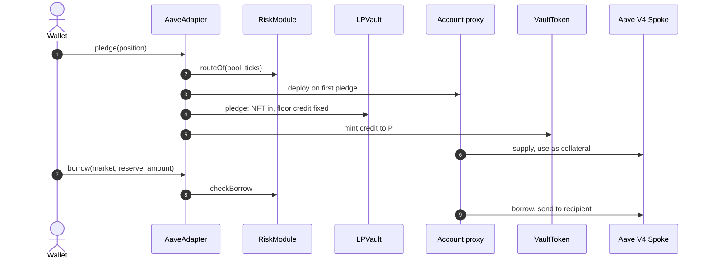

# End-to-end flows

Who calls what, in order. Per-contract detail:

| Contract | Lifecycle | Design |
|---|---|---|
| AaveAdapter | — | [DESIGN](src/adapter/DESIGN.md) |
| RiskModule | [LIFECYCLE](src/risk/LIFECYCLE.md) | [DESIGN](src/risk/DESIGN.md) |
| LPVault | [LIFECYCLE](src/vault/LIFECYCLE.md) | [DESIGN](src/vault/DESIGN.md), [proof](src/vault/FLOOR-CREDIT-PROOF.md) |
| VaultToken | [LIFECYCLE](src/token/LIFECYCLE.md) | — |
| LPOracle | [LIFECYCLE](src/oracle/LIFECYCLE.md) | [DESIGN](src/oracle/DESIGN.md) |
| LiquidationModule | — | [DESIGN](src/liquidation/DESIGN.md) |
| FirstLossReserve | — | [DESIGN](src/reserve/DESIGN.md) |
| FlashloanRepay | — | [DESIGN](src/periphery/DESIGN.md) |
| AMM parts | [LIFECYCLE](src/integrations/LIFECYCLE.md) | — |

## 1. Listing (DAO)

1. RiskModule [`registerSpoke`](src/risk/interfaces/IRiskModule.sol), [`setDebtReserve`](src/risk/interfaces/IRiskModule.sol), [`setCoverageRatio`](src/risk/interfaces/IRiskModule.sol), [`setFee`](src/risk/interfaces/IRiskModule.sol), [`addKeeper`](src/risk/interfaces/IRiskModule.sol).
2. RiskModule [`listPool`](src/risk/interfaces/IRiskModule.sol): two band markets per pool, Full range and Custom range, at one LTV. LPVault [`listMarket`](src/vault/interfaces/ILPVault.sol) binds each band once.
3. Deploy one VaultToken and one LPOracle per market; Aave lists the reserve with the LPOracle as its price source.
4. RiskModule [`activateMarket`](src/risk/interfaces/IRiskModule.sol) checks the wiring and opens the market.

## 2. Pledge

1. Wallet approves the LPVault on the position manager, then calls AaveAdapter [`pledge`](src/adapter/interfaces/IAaveAdapter.sol).
2. RiskModule [`routeOf`](src/risk/interfaces/IRiskModule.sol) picks the market the ticks fit; none fits → `NoMarketFits`.
3. First pledge in the market deploys the wallet's account proxy (`AccountCreated`).
4. LPVault [`pledge`](src/vault/interfaces/ILPVault.sol) takes the NFT and fixes its floor credit. Liquidity stays in the pool.
5. VaultToken [`mint`](src/token/interfaces/IVaultToken.sol) credit to the proxy; the proxy supplies it to the Spoke as collateral. Event `Pledged`.

## 3. Add liquidity

AaveAdapter [`addLiquidity`](src/adapter/interfaces/IAaveAdapter.sol) → LPVault [`addLiquidity`](src/vault/interfaces/ILPVault.sol) → new credit minted and supplied. Event `LiquidityAdded`.

## 4. Borrow

1. AaveAdapter [`borrow`](src/adapter/interfaces/IAaveAdapter.sol).
2. RiskModule [`checkBorrow`](src/risk/interfaces/IRiskModule.sol): reserve registered, a keeper exists, First-Loss coverage holds.
3. The proxy borrows on the Spoke; Aave enforces the health factor. Event `Borrowed`.

## 5. Repay

AaveAdapter [`repay`](src/adapter/interfaces/IAaveAdapter.sol) for any wallet, paid by the caller. No pause, price or freeze gate. Event `Repaid`.

## 6. Withdraw

1. AaveAdapter [`withdraw`](src/adapter/interfaces/IAaveAdapter.sol): whole NFT (`liquidity == 0`) or part as tokens.
2. The proxy withdraws the matching vault tokens from the Spoke; VaultToken [`burn`](src/token/interfaces/IVaultToken.sol).
3. LPVault [`release`](src/vault/interfaces/ILPVault.sol) (NFT and held fees) or [`removeLiquidity`](src/vault/interfaces/ILPVault.sol) (tokens, credit lowered in proportion).
4. Aave rejects a withdrawal that breaks the health factor. Event `Withdrawn`.

## 7. Collect fees

AaveAdapter [`collectFees`](src/adapter/interfaces/IAaveAdapter.sol) → LPVault [`collectFees`](src/vault/interfaces/ILPVault.sol). Fees never count as credit; units, debt and health factor are unchanged.

## 8. Repay with collateral

1. Wallet → AaveAdapter [`allowWithdraw`](src/adapter/interfaces/IAaveAdapter.sol)`(FlashloanRepay, positionKey, maxLiquidity, data)`: one call, one position, part only.
2. FlashloanRepay flash-borrows the debt asset from the Aave V3 Pool, repays through the adapter, withdraws the allowed liquidity, runs the wallet's swaps and repays the flash loan.
3. Everything left goes to the wallet. The adapter reverts `HealthFactorDecreased` if the health factor ends lower.

## 9. Liquidation

1. Anyone → LiquidationModule [`liquidate`](src/liquidation/interfaces/ILiquidationModule.sol) when the health factor is below 1.
2. The module calls the Spoke's `liquidationCall`; Aave sizes the repay and the bonus. Only the module may receive seized vault tokens.
3. Seized units are burned. LPVault [`unwind`](src/vault/interfaces/ILPVault.sol) removes only liquidity worth those units, lowest excess per credit first; the borrower keeps the rest and all fees.
4. Both pool tokens go to the liquidator; Avana's share of the bonus goes to the fee recipient in kind. Events `Liquidated`, `FeePaid`.
5. [`previewUnwind`](src/liquidation/interfaces/ILiquidationModule.sol) gives the plan off-chain. The [`packages/liquidator/`](../packages/liquidator/) bot runs this flow with an Aave V3 flash loan.

## 10. Deficit coverage

A Spoke deficit is covered by FirstLossReserve [`coverDeficit`](src/reserve/interfaces/IFirstLossReserve.sol): Avana's reserve first, then the DAO Deficit Offset, then Aave suppliers. Funding: [`fund`](src/reserve/interfaces/IFirstLossReserve.sol); withdrawals wait `WITHDRAWAL_DELAY`.

## 11. Depeg or drift

The steward freezes the market's Aave reserves on a depeg. A drifted pool gets a new listing; existing markets keep their bands and positions.
