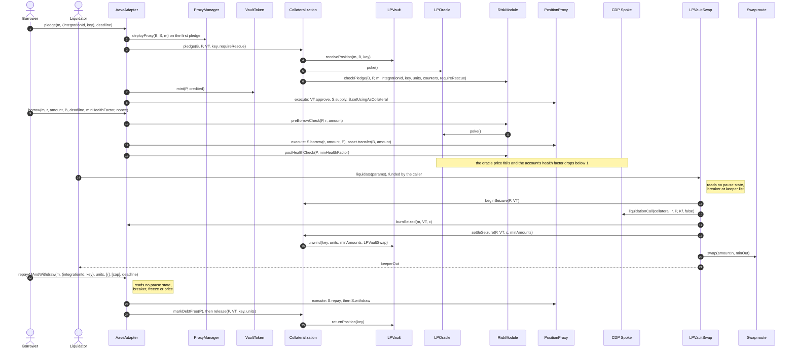

Function links point to the interface that declares each function.

# End-to-end flows

Each flow lists who calls what, in order. Every step links the contract's walkthrough and the exact interface function. Per-contract walkthroughs:

| Area | Walkthroughs |
|---|---|
| Custody | [Collateralization](src/custody/collateralization/LIFECYCLE.md), [LPVault](src/custody/lp-vault/LIFECYCLE.md) |
| Policy | [AaveAdapter](src/policy/aave-adapter/LIFECYCLE.md), [RiskModule](src/policy/risk-module/LIFECYCLE.md), [MarketRegistry](src/policy/market-registry/LIFECYCLE.md), [ParameterStore](src/policy/parameter-store/LIFECYCLE.md) |
| Liquidation | [LPVaultSwap](src/liquidation/lp-vault-swap/LIFECYCLE.md), [Swap routes](src/liquidation/settlement-routes/LIFECYCLE.md), [Payout escrow](src/liquidation/payout-escrow/LIFECYCLE.md), [Flash source](src/flash/LIFECYCLE.md) |
| Oracles | [LPOracle](src/oracle/lp-oracle/LIFECYCLE.md), [DebtOracle](src/oracle/debt-oracle/LIFECYCLE.md) |
| Accounts and tokens | [PositionProxy](src/proxy/position-proxy/LIFECYCLE.md), [ProxyManager](src/proxy/proxy-manager/LIFECYCLE.md), [VaultToken](src/vault-token/vault-token/LIFECYCLE.md), [VaultTokenFactory](src/vault-token/vault-token-factory/LIFECYCLE.md) |
| AMM integrations | [Interface](src/amm/LIFECYCLE.md), [Uniswap v3](src/amm/uniswap-v3/LIFECYCLE.md), [Aerodrome Slipstream](src/amm/slipstream/LIFECYCLE.md) |
| Infrastructure | [Lens](src/lens/lens/LIFECYCLE.md), [Lock](src/lock/lock/LIFECYCLE.md), [AvanaTimelock](src/governance/timelock/LIFECYCLE.md) |

Common setup for flows 1 to 7 (Base, from spec 3.1 `DEP-029`, 3.2 `BOR-022`, 3.4 `WDR-045`): market 3 is a USDC/USDT Aerodrome Slipstream market on the "Aerodrome Slipstream Stable" CDP Spoke `S`; one whole vault token (10^6 units) is worth $2.00; `CF_LP = 3,120` bps; the minimum pledge is $10 and an account holds at most 16 records per market; there is no minimum debt and no hard health floor; USDC is priced at $0.9999. Every user call takes the [Lock](src/lock/lock/LIFECYCLE.md) through [`acquire`](src/lock/lock/ILock.sol#L64) first and [`release`](src/lock/lock/ILock.sol#L70) last.

## 1. Pledge

Carol pledges an unstaked Slipstream NFT `key1` with `L = 10,000,000,000` (about 10,000 USDC + 10,000 USDT).

1. App → [Lens](src/lens/lens/LIFECYCLE.md) [`getPriceState`](src/lens/lens/ILensLiquidation.sol#L22)`(3)` (Live), [`getCapHeadroom`](src/lens/lens/ILensMarket.sol#L53)`(3, Carol)` ($4,000,000 room, minimum $10), [`predictProxy`](src/lens/lens/ILensAccount.sol#L20)`(Carol, 3)`.
2. Carol approves the Slipstream LPVault on the NFPM, then → [AaveAdapter](src/policy/aave-adapter/LIFECYCLE.md) [`pledge`](src/policy/aave-adapter/IAaveAdapterUser.sol#L38)`(3, (integrationId, key1), now + 600)`.
3. AaveAdapter → [ProxyManager](src/proxy/proxy-manager/LIFECYCLE.md) [`deployProxy`](src/proxy/proxy-manager/IProxyManager.sol#L75)`(Carol, S, 3)` → proxy `P`; → [VaultToken](src/vault-token/vault-token/LIFECYCLE.md) [`addValidProxy`](src/vault-token/vault-token/IVaultToken.sol#L120)`(P)`.
4. AaveAdapter → [Collateralization](src/custody/collateralization/LIFECYCLE.md) [`pledge`](src/custody/collateralization/ICollateralizationAdapter.sol#L49)`(Carol, P, VT, key1, false)` → [LPVault](src/custody/lp-vault/LIFECYCLE.md) [`receivePosition`](src/amm/IAmmIntegration.sol#L90) (exact range, NFT into custody, 10,000,000,000 units) → [LPOracle](src/oracle/lp-oracle/LIFECYCLE.md) [`poke`](src/oracle/lp-oracle/ILPOracle.sol#L162) → [RiskModule](src/policy/risk-module/LIFECYCLE.md) [`checkPledge`](src/policy/risk-module/IRiskModuleChecks.sol#L58): value $20,000 ≥ $10, charge $20,000, pool share 2.05% ≤ 10%, record 1 of 16.
5. AaveAdapter → VaultToken [`mint`](src/vault-token/vault-token/IVaultToken.sol#L67)`(P, 10,000,000,000)` → [PositionProxy](src/proxy/position-proxy/LIFECYCLE.md) [`execute`](src/proxy/position-proxy/IPositionProxy.sol#L59): `Spoke.supply`, `setUsingAsCollateral`.
6. Events: `ProxyDeployed`, `UserProxyCreated`, `ProxyAdded`, `PositionReceived`, `CollateralPledged`, `CollateralSupplied`, `CollateralAdded`. Lens [`getAccount`](src/lens/lens/ILensAccount.sol#L32): collateral $20,000, CF-weighted $6,240.
7. Failures: an $8 NFT reverts `BelowMinPledge(800,000,000, 1,000,000,000)`; a 17th record `TooManyRecords`; a gauge-staked NFT `NotPositionOwner`; a `[−10, 10]` range `RangeMismatch`. The NFT stays with Carol.

## 2. Borrow

1. App → Lens [`previewBorrowRecommended`](src/lens/lens/ILensPreview.sol#L42)`(Carol, 3, r_USDC, now + 600)`: recommended 5,673.29 USDC (HF 1.10), maximum 6,209.56 USDC (HF 1.00).
2. Carol → AaveAdapter [`borrow`](src/policy/aave-adapter/IAaveAdapterUser.sol#L65)`(3, r_USDC, 5,000e6, Carol, now + 600, 1.20e18, 0)`.
3. AaveAdapter → RiskModule [`preBorrowCheck`](src/policy/risk-module/IRiskModuleChecks.sol#L91) → LPOracle [`poke`](src/oracle/lp-oracle/ILPOracle.sol#L162), [DebtOracle](src/oracle/debt-oracle/LIFECYCLE.md) [`poke`](src/oracle/debt-oracle/IDebtOracle.sol#L117) (round 30,000 s old ≤ 88,200 s), breakers, `activeKeeperCount ≥ 1`.
4. AaveAdapter → Collateralization [`markIndebted`](src/custody/collateralization/ICollateralizationDebtMark.sol#L19)`(P)` → PositionProxy [`execute`](src/proxy/position-proxy/IPositionProxy.sol#L59): `Spoke.borrow(r_USDC, 5,000e6, P)`, `USDC.transfer(Carol, 5,000e6)`.
5. AaveAdapter → RiskModule [`postHealthCheck`](src/policy/risk-module/IRiskModuleChecks.sol#L117)`(P, 1.20e18)`: `6,240 / 4,999.50 = 1.2481`. Event `Borrowed`; `borrowNonce` 0 → 1.
6. Failures: 5,700 USDC gives HF 1.0948 and reverts `HealthFactorTooLow` against Carol's 1.20; a round 88,300 s old `DebtPriceTooOld`; Hub Frozen or Paused `ApplicationFrozen` / `ApplicationPaused`; a tripped breaker `BreakerTripped`.

## 3. Repay (anyone, through the Adapter)

1. App → Lens [`quoteRepayAll`](src/lens/lens/ILensPreview.sol#L57)`(Carol, 3, r_USDC, now + 600)` = 5,029,687,935 (debt 5,024,657,535 after 30 days at 6%).
2. Carol approves the AaveAdapter for 5,029,687,935 → AaveAdapter [`repay`](src/policy/aave-adapter/IAaveAdapterUser.sol#L93)`(Carol, 3, r_USDC, 5,029,687,935, true, now + 600)`. No pause state, breaker, freeze, price or sequencer gate is read.
3. AaveAdapter pulls 5,029,687,935 into `P` → PositionProxy [`execute`](src/proxy/position-proxy/IPositionProxy.sol#L59): `Spoke.repay`; Aave takes 5,024,657,573 at inclusion; 5,030,362 returned to Carol.
4. `borrowCount = 0` → Collateralization [`markDebtFree`](src/custody/collateralization/ICollateralizationDebtMark.sol#L32)`(P)`. Event `Repaid`.
5. Third-party payer (spec 3.3, Ethereum): a rescue service `R` calls [`repay`](src/policy/aave-adapter/IAaveAdapterUser.sol#L93)`(W, m_A, r_GHO, 3,000e18, false, now + 600)` while the Hub is `Paused(MintPathSuspect)`, a GHO breaker is tripped and `W` is frozen: 3,000 GHO are pulled from `R`, `W`'s debt falls to 5,032.88 GHO, `Repaid(R, W, …)`.
6. Failures: `RepayExceedsMax(5,024,657,535, 5,020,000,000)` before any transfer; `DebtRemaining` for a repay-all that leaves debt.

## 4. Withdraw

Carol holds `key1` and a top-up `keyB` (2,500,000,000 units, $5,000): collateral $25,000, CF-weighted $7,800, debt 5,000 USDC, HF 1.5602.

1. App → Lens [`getAccount`](src/lens/lens/ILensAccount.sol#L32) and [`getPriceState`](src/lens/lens/ILensLiquidation.sol#L22): removing `keyB` leaves HF 1.2481.
2. Carol → AaveAdapter [`withdraw`](src/policy/aave-adapter/IAaveAdapterUser.sol#L119)`(3, (I, keyB), 2,500,000,000, now + 600, 1.20e18)`; `units` comes from Collateralization [`previewRelease`](src/custody/collateralization/ICollateralizationViews.sol#L176).
3. With debt: pause state None, Carol not frozen → RiskModule [`preWithdrawCheck`](src/policy/risk-module/IRiskModuleChecks.sol#L103) (sequencer Up, oracles Live, no breaker).
4. PositionProxy [`execute`](src/proxy/position-proxy/IPositionProxy.sol#L59): `Spoke.withdraw(reserveId, 2,500,000,000, P)` → VaultToken [`burn`](src/vault-token/vault-token/IVaultToken.sol#L106)`(P, 2,500,000,000)`.
5. Collateralization [`release`](src/custody/collateralization/ICollateralizationAdapter.sol#L68)`(P, VT, keyB, 2,500,000,000)`: $5,000 charge released → LPVault [`returnPosition`](src/amm/IAmmIntegration.sol#L102)`(keyB)`: NFT and its fees to Carol.
6. RiskModule [`postHealthCheck`](src/policy/risk-module/IRiskModuleChecks.sol#L117): 1.2481. Events `PositionReturned`, `CollateralReleased`, `CollateralWithdrawn`.
7. Debt-free exit: [`repayAllAndWithdraw`](src/policy/aave-adapter/IAaveAdapterUser.sol#L142)`(3, (I, keyB), 2,500,000,000, [r_USDC], [cap], now + 600)` repays and returns the NFT in one call, reading no pause state, breaker, freeze, price or sequencer gate. Withdrawing `key1` with debt instead leaves HF 0.3120 and Aave reverts `HealthFactorBelowThreshold`.

## 5. Partial liquidity removal

Same two-record account as flow 4 (HF 1.5602). Carol removes 2,000 whole tokens (about 2,000 USDC + 2,000 USDT) from `key1` and keeps the NFT pledged.

1. Carol → AaveAdapter [`removeLiquidity`](src/policy/aave-adapter/IAaveAdapterCollateral.sol#L32)`(3, (I, key1), 2,000,000,000, [1,990e6, 1,990e6], now + 600, 1.20e18)`.
2. With debt → RiskModule [`preWithdrawCheck`](src/policy/risk-module/IRiskModuleChecks.sol#L103).
3. PositionProxy [`execute`](src/proxy/position-proxy/IPositionProxy.sol#L59): `Spoke.withdraw(…, 2,000,000,000, P)` → VaultToken [`burn`](src/vault-token/vault-token/IVaultToken.sol#L106).
4. Collateralization [`releasePartial`](src/custody/collateralization/ICollateralizationAdapter.sol#L85): record debited to 8,000,000,000 units, `$20,000 × 2 / 10 = $4,000` released → LPVault [`releaseToDepositor`](src/amm/IAmmIntegration.sol#L193): about 2,000 USDC + 2,000 USDT to Carol, each ≥ 1,990.
5. RiskModule [`checkRemainingRecord`](src/policy/risk-module/IRiskModuleChecks.sol#L188) ($16,000 ≥ $10) → [`postHealthCheck`](src/policy/risk-module/IRiskModuleChecks.sol#L117): collateral $21,000, CF-weighted $6,552, `6,552 / 4,999.50 = 1.3105 ≥ 1.20`.
6. Events `RecordReduced`, `UnitsReleased`, `CollateralReduced`. Failures: `PartialRemovalTooLarge` for units ≥ credited, `BelowMinimum` under the minimums, `RecordBelowMinPledge`, `HealthFactorTooLow`. Debt-free, the call reads no MarketRegistry state, pause, freeze, breaker or price.

## 6. Collect fees

1. App simulates AaveAdapter `collectFees`: 16.50 USDC and 15.95 USDT owed on `key1` after 30 days.
2. Carol → AaveAdapter [`collectFees`](src/policy/aave-adapter/IAaveAdapterUser.sol#L179)`(3, (I, key1), now + 600)` (works during a sequencer outage through L1 forced inclusion).
3. AaveAdapter → Collateralization [`collectFees`](src/custody/collateralization/ICollateralizationUser.sol#L40)`(Carol, VT, key1)` → LPVault [`collectFees`](src/amm/IAmmIntegration.sol#L209)`(key1, Carol)`: the NFPM's `collect` pays Carol directly.
4. Units, supply, caps, debt and HF 1.2420 are unchanged. Event `FeesCollected(key1, Carol, [16,500,000, 15,950,000])`. Failures: `NotDepositor`; `FeesRolledIn` for AMMs that compound fees.

## 7. Repay with collateral

Ethereum (spec 3.3): V owes 10,000 USDC with CF-weighted collateral $12,000 (HF 1.20); record #31 is a Uniswap v3 USDC/USDT position at $2.00 per token; premium 5 bps.

1. App → Lens [`previewRepayWithCollateral`](src/lens/lens/ILensPreview.sol#L91)`(V, m_A, key31, 1,500,000,000, r_USDC)`: repays 2,968.505747 USDC, 29.41 USDC to V, HF 1.5735.
2. V → AaveAdapter [`repayWithCollateral`](src/policy/aave-adapter/IAaveAdapterCollateral.sol#L79)`({units: 1,500,000,000, minAmounts: [1,490e6, 1,490e6], minDebtRepaid: 2,950e6, minHealthFactor: 1.30e18, …})`.
3. AaveAdapter → [LPVaultSwap](src/liquidation/lp-vault-swap/LIFECYCLE.md) [`deleverage`](src/liquidation/lp-vault-swap/ILPVaultSwapDeleverage.sol#L32): `x = min(10,000, ⌊2,969.99 × 10^4 / 10,005⌋) = 2,968.505747` → [Flash source](src/flash/LIFECYCLE.md) [`flashLoan`](src/flash/IFlashSource.sol#L92) (premium 1.484253) → [`onFlashLoan`](src/flash/IFlashReceiver.sol#L24).
4. LPVaultSwap → AaveAdapter [`deleverageRepay`](src/policy/aave-adapter/IAaveAdapterSettlement.sol#L40): debt falls to 7,031.494253 USDC.
5. LPVaultSwap → AaveAdapter [`deleverageRelease`](src/policy/aave-adapter/IAaveAdapterSettlement.sol#L59) → Collateralization [`releaseForDeleverage`](src/custody/collateralization/ICollateralizationAdapter.sol#L129) → LPVault [`unwind`](src/amm/IAmmIntegration.sol#L181): 1,500 USDC + 1,500 USDT.
6. LPVaultSwap → [Swap route](src/liquidation/settlement-routes/LIFECYCLE.md) [`swap`](src/liquidation/settlement-routes/ISettlementRoute.sol#L91): USDT → 1,499.40 USDC (minimum 1,485); `R = 2,999.40 ≥ x + φ`; flash repaid; 29.41 USDC to V.
7. AaveAdapter: `hfAfter = 11,064 / 7,031.494253 = 1.5735 ≥ max(1.20, 1.30)`. Events `Deleveraged`, `RepaidWithCollateral`. Failures: `DeleverageTooSmall(2,968,505,747, 3,000,000,000)`, `HealthFactorNotImproved`, `MinOutNotMet`, `ApplicationPaused` under `MintPathSuspect` only.

## 8. Liquidation, Uniswap v3 on Ethereum

Uniswap v3 on Ethereum (Bob, USDC debt; spec 3.5 `LIQ-069`). Setup: Bob pledged a USDC/USDT position; each vault token is priced at $2.10; he borrowed USDC; HF < 1.

LPVaultSwap has one liquidation entry point, [`liquidate`](src/liquidation/lp-vault-swap/ILPVaultSwapLiquidation.sol#L48), open to every address that is not frozen. The caller funds the repayment itself: LPVaultSwap pulls `debtToCover` from `msg.sender`, takes no flash loan and checks no keeper list. A caller without the debt asset borrows it through the [flash liquidation helper](src/periphery/flash-liquidator/LIFECYCLE.md), periphery outside the core, which is an ordinary caller of `liquidate`.

1. A caller K1 calls [Lens](src/lens/lens/LIFECYCLE.md) [`previewLiquidation`](src/lens/lens/ILensLiquidation.sol#L84): repay 1,950 USDC, `keeperOut` 2,020.8 USDC.
2. K1 → the public helper [`flashLiquidate`](src/periphery/flash-liquidator/IFlashLiquidator.sol#L58)`({params: {proxy: Q, marketId: m, debtReserveId: 2, debtToCover: 1,950e6, routeMode: PrimaryThenBackup, minPayout: 0, maxShortfall: 0, …}, flashAmount: 1,950e6, maxPremium: 975,000, maxTopUp: 0, minPayout: 69e6})`: the helper flash-borrows 1,950 USDC from the Aave V3 Pool (premium 5 bps = 0.975 USDC, within `maxFlashFeeBps` 10) and, inside the Pool's callback, calls `liquidate(params)`.
3. [LPVaultSwap](src/liquidation/lp-vault-swap/LIFECYCLE.md) `liquidate`: deadline, caller not frozen, Lock, `marketId == Q.MARKET_ID()`, debt reserve enabled, HF < 1, Hub shares == assets, `poke()` on the market's LPOracle and the price rules for the market and the repaid USDC reserve (its DebtOracle must be Live); no pause state, breaker or keeper list is read. It pulls `Kf = 1,950` USDC from the helper and measures it by balance delta.
4. Collateralization [`beginSeizure`](src/custody/collateralization/ICollateralizationSeizure.sol#L24); [`Spoke.liquidationCall`](src/interfaces/external/aave/IAaveV4Spoke.sol#L126)`(collateral, debt, Q, 1,950e6, false)`: Aave repays the debt and sends 975 vault tokens (1,950 × 1.05 ÷ 2.10) to LPVaultSwap.
5. [`AaveAdapter.burnSeized`](src/policy/aave-adapter/IAaveAdapterSettlement.sol#L24); [`Collateralization.settleSeizure`](src/custody/collateralization/ICollateralizationSeizure.sol#L48) → LPVault [`unwind`](src/amm/IAmmIntegration.sol#L181) returns about 1,030.25 USDC + 1,010 USDT.
6. Swap USDT→USDC with a per-leg oracle minimum ([`swap`](src/liquidation/settlement-routes/ISettlementRoute.sol#L91)); recovery `R` 2,040.30 USDC ≥ the floor 2,026.02.
7. Waterfall (no flash term): `G = 2,047.5 − 1,950 = 97.5`; Avana fee `A` 19.5 USDC (20% of `G`); keeper reward 70.8; borrower surplus 0; `keeperOut = 1,950 + 2,040.3 − 1,950 − 19.5 = 2,020.8` USDC to the helper. Failed fee or surplus payouts go to the escrow ([`deposit`](src/liquidation/payout-escrow/IPayoutEscrow.sol#L113)); `keeperOut` is never escrowed. The helper repays the Pool 1,950.975 USDC and pays K1 69.825 USDC. Events `SeizedUnitsBurned`, `RecordDebited`, `SeizureSettled`, `UnitsUnwound`, `LiquidationSettled`, then the helper's `FlashLiquidated`.

## 9. Liquidation, Aerodrome Slipstream on Base

Aerodrome Slipstream on Base (Carol, USDC debt; spec 3.5 `LIQ-089`). Setup: market 3 at $2.00 per vault token; Carol owes 20,000 USDC; the Base sequencer restarted at 10:00:00; Aave's bonus is 2%; the Base Pool charges 5 bps.

1. At 10:20 Carol's account is at HF 0.9997; a caller's [`liquidate`](src/liquidation/lp-vault-swap/ILPVaultSwapLiquidation.sol#L48) reverts `SequencerGrace` (0.9997 ≥ `graceHealthFactor` 0.95).
2. At 11:00:02 the caller K2 calls Lens [`previewLiquidation`](src/lens/lens/ILensLiquidation.sol#L84): repay 2,000 USDC.
3. K2 → the public helper [`flashLiquidate`](src/periphery/flash-liquidator/IFlashLiquidator.sol#L58)`({params: {debtToCover: 2,000e6, minPayout: 0, maxShortfall: 0, …}, flashAmount: 2,000e6, maxPremium: 1,000,000, …})`: the helper flash-borrows 2,000 USDC from the Base Aave V3 Pool (premium 1 USDC, `1,000,000 × 10^4 ≤ 10 × 2,000,000,000`) and calls LPVaultSwap `liquidate`, which pulls `Kf = 2,000` USDC from the helper.
4. Collateralization [`beginSeizure`](src/custody/collateralization/ICollateralizationSeizure.sol#L24); [`Spoke.liquidationCall`](src/interfaces/external/aave/IAaveV4Spoke.sol#L126): Aave repays 2,000 USDC and sends 1,020 vault tokens (2,000 × 1.02 ÷ 2.00) to LPVaultSwap.
5. [`AaveAdapter.burnSeized`](src/policy/aave-adapter/IAaveAdapterSettlement.sol#L24); [`Collateralization.settleSeizure`](src/custody/collateralization/ICollateralizationSeizure.sol#L48) → [Slipstream LPVault](src/amm/slipstream/LIFECYCLE.md) [`unwind`](src/amm/IAmmIntegration.sol#L181) (lock check on Slipstream's own `slot0()` layout) returns about 1,020 USDC + 1,020 USDT.
6. Swap USDT→USDC ([`swap`](src/liquidation/settlement-routes/ISettlementRoute.sol#L91)) returns 1,018.50 USDC; recovery 2,038.50 USDC ≥ the floor 2,018.60.
7. Waterfall: Avana fee 8 USDC (20% of `G = 40`); keeper reward 30.5; borrower surplus 0; `keeperOut` 2,030.5 USDC to the helper, which repays the Pool 2,001 USDC and pays K2 29.5 USDC. If the fee recipient is blocklisted, the 8 USDC go to the escrow ([`deposit`](src/liquidation/payout-escrow/IPayoutEscrow.sol#L113)) and are claimed later with [`claim`](src/liquidation/payout-escrow/IPayoutEscrow.sol#L135).

## 10. Caller-funded liquidation

Bob's account of flow 8, liquidated by any address E that already holds USDC, with no helper and no flash loan.

1. E → Lens [`previewLiquidation`](src/lens/lens/ILensLiquidation.sol#L84)`(Q, 2, now + 120)`: repay 1,950 USDC, `routeMode = PrimaryThenBackup`.
2. E approves LPVaultSwap for `debtToCover + maxShortfall` (1,955 USDC) → [`liquidate`](src/liquidation/lp-vault-swap/ILPVaultSwapLiquidation.sol#L48)`({proxy: Q, marketId: m, debtReserveId: 2, debtToCover: 1,950e6, routeMode: PrimaryThenBackup, minAmounts: [], deadline: now + 120, minPayout: 2,019e6, maxShortfall: 5e6})`. The same entry point as flow 8; a frozen E reverts `AddressIsFrozen`. LPVaultSwap pulls `Kf = 1,950` USDC from E.
3. Steps 4 to 6 of flow 8 run unchanged: 975 vault tokens seized and unwound, swaps.
4. Shortfall rule: with `R = 2,040.30` no shortfall is pulled. Had the USDT leg returned 994 USDC (`R = 2,024.25`), LPVaultSwap would pull 1.774998 USDC from E to reach the floor 2,026.024998; Avana's fee is unchanged. Above `maxShortfall` it reverts `RecoveryBelowFloor`.
5. Payout: Avana fee 19.5, `keeperOut` 2,020.8 USDC to E (its 1,950 back plus 70.8). Event `LiquidationSettled`. With no usable route it reverts `NoRouteAvailable`.
6. Stranded units: anyone → LPVaultSwap [`settlePending`](src/liquidation/lp-vault-swap/ILPVaultSwapLiquidation.sol#L76)`(m, r)` burns vault tokens left by an unsettled seizure → Collateralization [`settlePending`](src/custody/collateralization/ICollateralizationSeizure.sol#L67) → swaps → the First-Loss Reserve's `fund(R)`.

## 11. Emergency

Repayment, debt-free exits, fee collection and eligible liquidations stay available through every state below.

### 11a. Circuit breaker

1. Avana's keeper → [RiskModule](src/policy/risk-module/LIFECYCLE.md) [`pokeBreakers`](src/policy/risk-module/IRiskModuleChecks.sol#L168)`(1)` every block: Avana's share of market 1's pool across all Spokes is 1,040 bps > 1,000, the pool's illustrative per-pool cap → [MarketRegistry](src/policy/market-registry/LIFECYCLE.md) [`recordBreach`](src/policy/market-registry/IMarketRegistryBreakers.sol#L28) at `t = 1,000`; event `GateBreached`.
2. V → AaveAdapter [`borrow`](src/policy/aave-adapter/IAaveAdapterUser.sol#L65) reverts `BreakerTripped(1, POOL_SHARE)`; a pledge that raises pool exposure passes only as a rescue top-up. V can still repay, and LPVaultSwap never reads breakers.
3. The share falls below the cap; with [`gateRecoverySeconds`](src/policy/parameter-store/IParameterStoreBreakers.sol#L36) = 1,800 the gate reopens at 2,800. Lens [`getBreakerStatus`](src/lens/lens/ILensRisk.sol#L21) shows it as recovering until then.
4. Aave records a 10,000 GHO deficit on the CDP Spoke's GHO reserve (= [`breakerDeficitMax`](src/policy/parameter-store/IParameterStoreBreakers.sol#L27)): `pokeBreakers` latches `DEFICIT` (`BreakerLatched`); GHO borrows revert `DebtBreakerTripped`. Lens [`uncoveredDeficit`](src/lens/lens/ILensRisk.sol#L59) shows the amount.
5. After the deficit is covered, the Emergency Guardian → [`resetDebtBreaker`](src/policy/market-registry/IMarketRegistryBreakers.sol#L69)`(S, r_GHO)` (`BreakerReset`); while the deficit remains it reverts `ConditionStillHolds`.
6. Alerts only, with no on-chain trip: a 3% price drop in 2 hours, more than 20% of a market seized in 1 hour, 3 swap-route failures in 1 hour. Once routes are confirmed unable to settle at size, the guardian calls [`tripMarketBreaker`](src/policy/market-registry/IMarketRegistryBreakers.sol#L39).

### 11b. Guardian pause

1. A mint-path exploit is suspected. The Emergency Guardian → MarketRegistry [`pause`](src/policy/market-registry/IMarketRegistryPause.sol#L37)`(hub, MintPathSuspect)` (immediate). Events `PauseStateChanged`, `PauseReasonChanged`.
2. App → Lens [`getApplicationState`](src/lens/lens/ILensLiquidation.sol#L44), [`getPauseReason`](src/lens/lens/ILensLiquidation.sol#L54): Paused, `MintPathSuspect`.
3. AaveAdapter [`pledge`](src/policy/aave-adapter/IAaveAdapterUser.sol#L38), [`recredit`](src/policy/aave-adapter/IAaveAdapterCollateral.sol#L57), [`borrow`](src/policy/aave-adapter/IAaveAdapterUser.sol#L65) and [`repayWithCollateral`](src/policy/aave-adapter/IAaveAdapterCollateral.sol#L79) revert `ApplicationPaused`.
4. Still open: [`repay`](src/policy/aave-adapter/IAaveAdapterUser.sol#L93) by anyone, [`collectFees`](src/policy/aave-adapter/IAaveAdapterUser.sol#L179), [`repayAllAndWithdraw`](src/policy/aave-adapter/IAaveAdapterUser.sol#L142), LPVaultSwap [`liquidate`](src/liquidation/lp-vault-swap/ILPVaultSwapLiquidation.sol#L48).
5. Once the mint path is cleared, the guardian moves the reason to `General` with [`pause`](src/policy/market-registry/IMarketRegistryPause.sol#L37)`(hub, General)`: rescue top-ups and repay with collateral reopen.
6. Recovery: [`unpause`](src/policy/market-registry/IMarketRegistryPause.sol#L74)`(hub)` by the pause guardian, or by the [AvanaTimelock](src/governance/timelock/LIFECYCLE.md) at the normal delay. A milder incident uses [`freeze`](src/policy/market-registry/IMarketRegistryPause.sol#L27) (stops new-account pledges and borrowing) and a single wallet [`freezeAddress`](src/policy/market-registry/IMarketRegistryFreeze.sol#L22).

### 11c. Oracle expiry

USDT/USD has an 86,400 s heartbeat, fresh for 88,200 s; `cachedWindow` 1 h; `graceDuration` 30 min; `graceHealthFactor` 0.95.

1. Both USDT routes stop publishing. 88,200 s after the last round, [LPOracle](src/oracle/lp-oracle/LIFECYCLE.md) [`poke`](src/oracle/lp-oracle/ILPOracle.sol#L162) finds the leg stale: Cached, serving the cached $2.00 (`FailureRecorded`).
2. RiskModule [`preBorrowCheck`](src/policy/risk-module/IRiskModuleChecks.sol#L91) refuses borrows and withdrawals with debt (`PriceNotLive`); LPVaultSwap refuses to seize the market (`StalePrice`); repay and debt-free withdrawal continue.
3. After 1 h of Cached the market is Expired: [`latestAnswer`](src/oracle/lp-oracle/ILPOracle.sol#L87) serves 1 (10^-8 USD per vault token), so Aave counts the collateral as worthless while repay and exits keep working (`OutageExpiredLatched`). Operators follow playbook P-02 and may switch to the standby route with MarketRegistry [`useStandbyRoute`](src/policy/market-registry/IMarketRegistryStandby.sol#L32).
4. The feed publishes again; the next `poke` accepts it: `GraceStarted(recoveredAt, recoveredAt + 1,800, true)`.
5. For 30 minutes LPVaultSwap [`liquidate`](src/liquidation/lp-vault-swap/ILPVaultSwapLiquidation.sol#L48) seizes only accounts below HF 0.95 (`GraceHealthFactor` for an account at 0.97); then every account below 1.00. Lens [`getPriceState`](src/lens/lens/ILensLiquidation.sol#L22) shows the state and grace end throughout.
6. A debt asset behaves the same through its [DebtOracle](src/oracle/debt-oracle/LIFECYCLE.md) [`poke`](src/oracle/debt-oracle/IDebtOracle.sol#L117), except that it serves the accepted price raised by `debtStressRiseBps` when Expired, so debt is never undervalued.

## Spec

[3.1 Deposit](../spec/03-operations/01-deposit.md), [3.2 Borrow](../spec/03-operations/02-borrow.md), [3.3 Repay](../spec/03-operations/03-repay.md), [3.4 Withdraw](../spec/03-operations/04-withdraw.md), [3.5 Liquidation](../spec/03-operations/05-liquidation.md), [3.6 Emergency operations](../spec/03-operations/06-emergency-operations.md), [3.7 Collect fees](../spec/03-operations/07-collect-fees.md), [3.8 Market lifecycle](../spec/03-operations/08-market-lifecycle.md), [1.5 Parameters](../spec/01-architecture/05-parameters.md).
