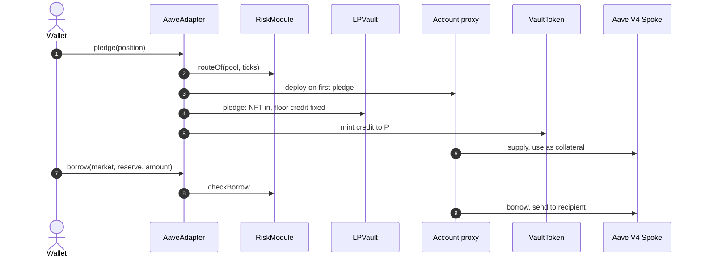

# Design records

What Avana Labs decided for each part of the contracts in `contracts/src`, and why. Each record gives the decisions, the alternatives with worked examples, the objections considered and, where the part has one, its lifecycle. A change to a decision updates its record in the same pull request.

| Record | Contract | What it covers |
|---|---|---|
| [adapter.md](adapter.md) | AaveAdapter | Thin account proxies as position managers and automatic routing of a pledge to its market. |
| [risk.md](risk.md) | RiskModule | Two markets per pool, the lower-of-two LTV, fixed bands, the depeg freeze; lifecycle from setup to activation. |
| [vault.md](vault.md) | LPVault | Floor credit over a fixed band and the market count per pool; lifecycle of a pledged NFT; appendix with the floor credit proof. |
| [token.md](token.md) | VaultToken | Lifecycle of a band market's collateral token and the only paths it may move along. |
| [oracle.md](oracle.md) | LPOracle | Stateless vault-token price from Aave's own token prices, clamped to the band; lifecycle of a read. |
| [liquidation.md](liquidation.md) | LiquidationModule | Partial in-kind liquidation, the fee size and the liquidation settings copied from Aave. |
| [reserve.md](reserve.md) | FirstLossReserve | Avana's first-loss layer and the DAO Deficit Offset of one Hub asset in one contract. |
| [periphery.md](periphery.md) | FlashloanRepay | Repay with collateral through an Aave V3 flash loan and a one-call withdraw allowance. |
| [integrations.md](integrations.md) | AMM parts | What each AMM part (Uniswap v2, v3, v4, Slipstream) adds to the shared LPVault base. |
| [uniswap-v2.md](uniswap-v2.md) | UniswapV2Integration | Full range markets for Uniswap v2 LP tokens through an ERC-721 wrapper. |

Below the index: the end-to-end flows across contracts, then the protocol lifecycle model and its external assumptions.

## End-to-end flows

Who calls what, in order. Per-contract detail is in the records indexed above.

### 1. Listing (DAO)

1. RiskModule [`registerSpoke`](../src/interfaces/IRiskModule.sol), [`setDebtReserve`](../src/interfaces/IRiskModule.sol), [`setCoverageRatio`](../src/interfaces/IRiskModule.sol), [`setFee`](../src/interfaces/IRiskModule.sol), [`addKeeper`](../src/interfaces/IRiskModule.sol).
2. RiskModule [`listPool`](../src/interfaces/IRiskModule.sol): two band markets per pool, Full range and Custom range, at one LTV. LPVault [`listMarket`](../src/interfaces/ILPVault.sol) binds each band once.
3. Deploy one VaultToken and one LPOracle per market; Aave lists the reserve with the LPOracle as its price source.
4. RiskModule [`activateMarket`](../src/interfaces/IRiskModule.sol) checks the wiring and opens the market.

### 2. Pledge

1. Wallet approves the LPVault on the position manager, then calls AaveAdapter [`pledge`](../src/interfaces/IAaveAdapter.sol).
2. RiskModule [`routeOf`](../src/interfaces/IRiskModule.sol) picks the market the ticks fit; none fits → `NoMarketFits`.
3. First pledge in the market deploys the wallet's account proxy (`AccountCreated`).
4. LPVault [`pledge`](../src/interfaces/ILPVault.sol) takes the NFT and fixes its floor credit. Liquidity stays in the pool.
5. VaultToken [`mint`](../src/interfaces/IVaultToken.sol) credit to the proxy; the proxy supplies it to the Spoke as collateral. Event `Pledged`.

### 3. Add liquidity

AaveAdapter [`addLiquidity`](../src/interfaces/IAaveAdapter.sol) → LPVault [`addLiquidity`](../src/interfaces/ILPVault.sol) → new credit minted and supplied. Event `LiquidityAdded`.

### 4. Borrow

1. AaveAdapter [`borrow`](../src/interfaces/IAaveAdapter.sol).
2. RiskModule [`checkBorrow`](../src/interfaces/IRiskModule.sol): reserve registered, a keeper exists, First-Loss coverage holds.
3. The proxy borrows on the Spoke; Aave enforces the health factor. Event `Borrowed`.

### 5. Repay

AaveAdapter [`repay`](../src/interfaces/IAaveAdapter.sol) for any wallet, paid by the caller. No pause, price or freeze gate. Event `Repaid`.

### 6. Withdraw

1. AaveAdapter [`withdraw`](../src/interfaces/IAaveAdapter.sol): whole NFT (`liquidity == 0`) or part as tokens.
2. The proxy withdraws the matching vault tokens from the Spoke; VaultToken [`burn`](../src/interfaces/IVaultToken.sol).
3. LPVault [`release`](../src/interfaces/ILPVault.sol) (NFT and held fees) or [`removeLiquidity`](../src/interfaces/ILPVault.sol) (tokens, credit lowered in proportion).
4. Aave rejects a withdrawal that breaks the health factor. Event `Withdrawn`.

### 7. Collect fees

AaveAdapter [`collectFees`](../src/interfaces/IAaveAdapter.sol) → LPVault [`collectFees`](../src/interfaces/ILPVault.sol). Fees never count as credit; units, debt and health factor are unchanged.

### 8. Repay with collateral

1. Wallet → AaveAdapter [`allowWithdraw`](../src/interfaces/IAaveAdapter.sol)`(FlashloanRepay, positionKey, maxLiquidity, data)`: one call, one position, part only.
2. FlashloanRepay flash-borrows the debt asset from the Aave V3 Pool, repays through the adapter, withdraws the allowed liquidity, runs the wallet's swaps and repays the flash loan.
3. Everything left goes to the wallet. The adapter reverts `HealthFactorDecreased` if the health factor ends lower.

### 9. Liquidation

1. Anyone → LiquidationModule [`liquidate`](../src/interfaces/ILiquidationModule.sol) when the health factor is below 1.
2. The module calls the Spoke's `liquidationCall`; Aave sizes the repay and the bonus. Only the module may receive seized vault tokens.
3. Seized units are burned. LPVault [`unwind`](../src/interfaces/ILPVault.sol) removes only liquidity worth those units, lowest excess per credit first; the borrower keeps the rest and all fees.
4. Both pool tokens go to the liquidator; Avana's share of the bonus goes to the fee recipient in kind. Events `Liquidated`, `FeePaid`.
5. [`previewUnwind`](../src/interfaces/ILiquidationModule.sol) gives the plan off-chain. The [`packages/liquidator/`](../../packages/liquidator) bot runs this flow with an Aave V3 flash loan.

### 10. Deficit coverage

A Spoke deficit is covered by FirstLossReserve [`coverDeficit`](../src/interfaces/IFirstLossReserve.sol): Avana's reserve first, then the DAO Deficit Offset, then Aave suppliers. Funding: [`fund`](../src/interfaces/IFirstLossReserve.sol); withdrawals wait `WITHDRAWAL_DELAY`.

### 11. Depeg or drift

The Aave Protocol Guardian freezes the market's Aave reserves on a depeg. A drifted pool gets a new listing; existing markets keep their bands and positions.

## Protocol lifecycle model and external assumptions

Baseline: default branch `d46ebd3be35e0b686fb38d3161e1908166650beb`. This is a design and threat model for Phase 2 Step 2; it does not claim that the transitions below have the Step 3 adversarial tests. Contract behavior is taken from the end-to-end flows above, the linked implementation and interfaces, deployment scripts/configuration, `foundry.toml`, and `soldeer.lock`. A pinned source is identified by its lock revision; deployment-specific addresses and DAO parameters are not inferred from local Anvil configuration.

### State and global transaction rule

For each pledged position key, LPVault records `(account, market, liquidity, floorCredit)` and holds its NFT (or v2 wrapper NFT). RiskModule records Spoke, market bands, LTV, debt reserve and activation. AaveAdapter maps owner to account proxy; VaultToken supply is backed by LPVault aggregate floor credit, with units supplied to the Hub. Aave owns debt and collateral accounting. FirstLossReserve tracks funded balance, coverage layers and delayed withdrawals. LPOracle is stateless and reads its configured feed routes on every call.

Every transition is one EVM transaction. A reverting internal or external call reverts prior EVM storage writes, token transfers, approvals and NFT movements in that transaction. This does not roll back off-chain observation, a prior transaction, or a non-standard external system's behavior outside EVM state. State-write ordering still matters for reentrancy; guards and authorization must cover all reachable callbacks. Expected postconditions below are conditional on successful compliant external calls.

### Transition model

| Transition / caller | Preconditions and inputs | Writes, token/NFT flows, external calls | Success postconditions | Failure and rollback |
|---|---|---|---|---|
| DAO setup and pool listing / AccessManager-authorized governance | Correct Hub/Spoke kind, debt reserve and FirstLossReserve; valid pool/token pair and feeds; Full/Custom band width and listing price valid; no prior binding | RiskModule registers Spoke, reserve, coverage, fee, keeper, then `listPool`; LPVault binds immutable market IDs/bands; external feed reads and LPVault listing calls | Unique market routing and fixed bands; later deploy VaultToken/LPOracle, configure Aave reserve and activate only after wiring/decimal/LTV checks | Bad role, duplicate, mismatched feed/token/decimals, tick spacing, band or price reverts. Deployment is multi-transaction: partial setup can remain inactive and needs governance recovery; do not assume cross-transaction atomicity |
| Market activation / governance | Listed market; VaultToken market, Hub, LiquidationModule, decimals and LPOracle match; Aave reserve uses the expected source, LTV, draw cap, receive-shares and liquidation fee settings | RiskModule reads Aave reserve configuration and marks market active | Adapter can route to market and collateral token is priced/configured as intended | Any mismatch rejects activation. Activation write rolls back on a reverting check; preceding deployment/config transactions remain |
| Position mint and v2 wrapping / wallet via AMM position manager or v2 wrapper | Canonical factory/pool, ordered tokens, supported fee/hook, valid ticks, nonzero liquidity; sufficient allowance/balance; quote/slippage bounds | AMM manager pulls tokens, mints NFT / v2 wrapper takes LP token and mints position NFT; refund paths may transfer unused tokens/WETH | NFT identifies actual pool, range and liquidity; payer gets position ownership or wrapper ownership | Invalid pool/params, callback, token transfer or slippage failure reverts mint and transfers. Approval established in an earlier tx remains. Transfer-fee/rebase token compatibility is not implied |
| Pledge / position owner through AaveAdapter | Active unambiguous market route; caller owns NFT; position ticks inside fixed band; position count below 16; not already pledged; approval to LPVault | Adapter may create/register account proxy; RiskModule routes by pool/ticks; LPVault checks position, takes NFT, records owner/market/liquidity/floor credit; VaultToken registers proxy, mints credit, proxy supplies to Hub/Spoke | NFT custody and record agree; minted/supplied VaultToken equals floor credit; Aave collateral belongs to the owner's proxy | Wrong owner/generation/pool, spoofed manager, staked or duplicate NFT, no market, supply failure or callback revert atomically unwinds account creation, custody, record and mint within this tx |
| Add liquidity / position owner through adapter | Existing owned pledge; correct market/range, payer and token approvals; valid min amounts; account remains within position bound | Adapter/LPVault invokes AMM increase; unused token refunds; records actual liquidity and added floor credit; mints and supplies matching VaultToken | New liquidity and credit increase consistently; pre-existing fees remain isolated/held, not credited as new principal | Manager/token/refund/supply failure reverts all transaction state and movements. Any earlier approvals persist. Verify payer authorization separately from NFT ownership |
| Borrow / account owner through adapter | Active market; Spoke/reserve registered; keeper and reserve coverage pass `checkBorrow`; amount <= remaining conservative floor-credit capacity, reserve draw cap and Aave health limit; fresh valid prices | Adapter calls RiskModule; account proxy borrows from Aave Spoke and transfers debt asset to requested recipient; debt/cap accounting is external Aave state | Debt rises by actual borrowed amount; recipient gets amount; remaining collateral remains healthy | Any policy/Aave/token failure reverts borrow/debt/transfer. Stale/malicious oracle can produce accepted wrong valuation unless source semantics and operational monitoring hold |
| Repay / any payer through adapter | Correct account and debt reserve; payer approval/balance; no pause/oracle dependency by documented policy | Transfer debt asset to account/Spoke and repay; Aave updates debt and interest/share units | Debt reduced by actual accepted repayment; collateral is unchanged; Avana adds no pause or freeze gate (an Aave Spoke pause still blocks it) | Transfer/Spoke failure rolls back payment and debt mutation. Partial amount/unit rounding must follow actual pinned Spoke semantics |
| Partial withdrawal / full release / authorized owner or allowance operator | Correct position/account; withdrawal permission; partial credit reduction remains safe under Aave health check; full release requires zero residual debt/collateral constraints | Adapter trims matching VaultToken supply from Spoke, burns units; LPVault decreases liquidity/collects principal or releases NFT and held fees; transfers assets to authorized recipient; health checked after operation | Remaining supplied VaultTokens do not exceed recorded remaining credit; full exit returns NFT and fees; recipient receives only authorized assets | Failed health check, AMM unwind, token transfer or NFT transfer reverts the whole tx. External unwind before final health check is transactionally rolled back on EVM revert |
| Fee collection / position owner through adapter | Position exists and belongs to account; valid keys/batch and recipient; manager generation supported | LPVault reads/collects AMM fees (v4 separately collects before liquidity change); fee counters/held balances update and tokens transfer | Fees paid once to entitled recipient; no change to debt, liquidity credit or collateral | Manager/hook/transfer failure rolls back collection and bookkeeping. `feesOf` is a view estimate whose correspondence to collect depends on exact AMM fee-growth semantics |
| Repay with collateral / owner authorizes FlashloanRepay via adapter, then Aave V3 callback | One authorized position and bounded liquidity; authenticated Pool, initiator, asset, amount, premium, account and pending operation; swaps bounded by supplied data/slippage | Aave V3 flash loan invokes `executeOperation`; helper repays V4 debt through adapter, withdraws allowed liquidity, executes user swaps, sweeps surplus, approves repayment plus premium | Debt reduced; flash loan plus premium returned; approvals cleared; remaining NFT/liquidity and surplus stay with owner; adapter health-factor check passes | Direct/replayed callback, wrong initiator/asset/amount/premium, short proceeds, swap or repay failure reverts entire flashloan transaction and all EVM state. Aave V3 is distinct from V4 Hub/Spoke; callback authentication must match pinned Pool interface |
| Liquidation and unwind / any liquidator | Aave health factor below 1 for correct Spoke/account; eligible debt reserve; seized amount determined by Aave; unwind can satisfy token minimums | Module calls Spoke liquidation; receives only authorized seized VaultToken; burns it; selects positions by excess credit; LPVault removes liquidity; sends both pool tokens to liquidator and Avana bonus share to fee recipient | Debt repaid and collateral seized within Aave close factor/bonus; only proportional liquidity is unwound; borrower retains remainder and fees; deficit recorded if uncovered | Any failed liquidation/unwind/payout reverts transaction atomically. A hostile manager/pool can block that attempt; liveness depends on another valid unwind path and gas-bounded bounded-position iteration |
| Deficit coverage / authorized keeper or Spoke | Verified deficit/debt data; correct layer order and available reserve/DAO offset; no disallowed withdrawal while deficit exists | FirstLossReserve reads Spoke deficit, transfers funds through waterfall (Avana reserve, DAO offset, then Aave supplier backstop); updates drawn balances/coverage; emits alert if under minimum | Deficit decreases by amounts paid in defined order; no tranche double-counted; coverage observable | Unauthorized, stale data, insufficient balance or transfer failure reverts writes and transfers. Competing calls serialize by transaction order; off-chain alerts are monitoring only |
| Depeg/drift, freeze and recovery / steward or Aave governance | Configured feed health and market policy; independent evidence for recovery; existing position unwind path remains available (see Market freeze and deprecation) | Oracle calls Chainlink; monitor/keeper observes depeg or drift; steward freezes Aave reserve; governance may replace oracle/update source or unfreeze | New borrowing/supply is restricted per freeze policy; repayment and documented safe unwind remain possible; existing bands/positions retain defined valuation | Oracle invalid answer reverts reads; it does not automatically freeze. Detection, freeze latency, feed integrity and keeper availability are monitored/trusted. Unsafe unfreeze is an administrative risk |
| Pause, role changes, upgrade/admin action / AccessManager roles and Aave governance | Correct timelock/guardian/steward role, delay and target; scoped role grants; contracts without proxy upgrade path are immutable | AccessManager role/timelock state; Aave reserve freeze/config changes; role grants/revocations; no in-protocol upgrade unless a deployed target is explicitly upgradeable | Only authorized changes take effect; emergency containment does not silently change LPVault bands or token identity | Unauthorized/early timelock action reverts. Aave governance/admin compromise can reconfigure external policy. Confirm deployed bytecode/admin path per chain before relying on immutability |

### Market freeze and deprecation

Avana has no market switch of its own: `RiskModule.activateMarket` only sets `active`, nothing clears it, and relisting a drifted pool only redirects new pledges (`routeOf`). Existing positions keep their market ID, band and credit. Freezing or deprecating a market is done in Aave on the market's Spoke: freeze the VaultToken reserve to stop new collateral, and add a dynamic config with collateral factor 0 to stop new borrowing against existing collateral (Aave's freeze plus LTV 0 pattern).

| Action on an existing position | Frozen and collateral factor 0 | Why (pinned Aave V4 `a3ef63e` and Avana code) |
|---|---|---|
| Pledge, add liquidity | Blocked | Both supply VaultToken; `Spoke._validateSupply` rejects a frozen reserve |
| Borrow | Blocked by the collateral factor cut | `Spoke._validateBorrow` checks only the debt reserve's flags, so a frozen VaultToken reserve alone does not stop it; borrow refreshes to the latest collateral factor, and at 0 the health check fails |
| Repay | Allowed | `Spoke._validateRepay` checks only `paused`; `AaveAdapter.repay` has no market check |
| Partial withdrawal, full release | Allowed once debt-free | `Spoke._validateWithdraw` checks only `paused`. Withdraw refreshes to the latest collateral factor, so a borrower repays first; a debt-free account always exits |
| Fee collection | Allowed | `LPVault.collectFees` does not touch the Spoke |
| Liquidation and unwind | Allowed | `LiquidationModule` calls `liquidationCall` with `receiveShares = false`, so a frozen collateral reserve does not block it; the account keeps its earlier collateral factor (Aave keeps historical ones above 0, and a refresh to 0 with debt fails its own health check), and `active` cannot be cleared |

Spoke `paused`, a Hub `halted` Spoke or an inactive Hub Spoke blocks repay, withdraw and liquidation alike, so they are emergency stops, not a deprecation path. Test assertions for the later step: after a freeze and collateral factor cut, pledge, top-up and borrow revert, while repay, debt-free withdrawal and release, fee collection and liquidation of an unhealthy account succeed with unchanged accounting.

### Required threat and coverage matrix

`Enforced` means checked on-chain in the stated transition; `Monitored` requires an off-chain keeper/alert/operational response; `Trusted` is an external implementation, governance, or configuration dependency. The entries describe model coverage and candidate test assertions, not evidence that tests already exist. Every row needs success, unauthorized/boundary, hostile input, external-call revert/atomicity, and adjacent-transition sequence coverage in the later test step.

| Threat family | Attacks and expected invariant | Assumption classification / later test assertion |
|---|---|---|
| DAO setup, listing, activation | Wrong Hub/Spoke/reserve, token/feed or decimals mismatch, stale/inverted route, bad band rounding/spacing/width/price, wrong LTV/token/oracle binding, duplicate setup, unauthorized governance, timelock/pause/recovery misuse. Assert exact wiring and unique immutable market-band binding. | Enforced: roles, duplicates, widths, activation wiring. Trusted: DAO key/timelock and Aave config. Monitored: feed freshness/drift where not checked. Revert each external read/listing and assert no half-activated state. |
| Position create/approval | Wrong factory/pool/fee/token order, malformed/zero liquidity NFT, boundary tick rounding, inadequate approval, fee-on-transfer/rebase, lost native/WETH refund, moved price, callback reentrancy/gas. Assert actual position tuple and balance deltas. | Enforced: supported manager/pool/range/minimums to extent implementation checks. Trusted: ERC20/NFT and AMM behavior. Test unsupported token classes explicitly; do not infer compatibility from interface conformance. |
| Pledge and routing | Spoofed `ownerOf`, wrong pool/generation, staked/other-account/duplicate NFT, ambiguous route, band edge, spot manipulation, wrong Spoke, reentrancy, record without custody or custody without credit. Assert floor credit + custody + supply move together. | Enforced: caller, route, band, position count, transfer and transaction atomicity. Trusted: canonical manager identity and token callbacks. Test actual pinned managers and malicious fixtures. |
| Top-up | Payer differs from owner, price/slippage shift, partial use/refund loss, old fees subsidize liquidity, wrong range/credit, callback, stuck approval. Assert credit uses actual liquidity and fees are not new credit. | Enforced: position owner/market/credit math and transaction revert. Trusted: AMM return values/token behavior. Compare before/after position liquidity, fees and balances. |
| Borrow | Excess floor credit/debt cap, manipulated/stale price or decimals, wrong reserve/account, reused collateral/concurrency, frozen/paused market bypass, absent first-loss coverage, one-unit rounding overborrow. Assert borrower, Hub debt, market totals and reserve draw bounds. | Enforced: RiskModule and Aave checks. Trusted: Spoke oracle/reserve implementation and configured feed. Monitored: keeper and reserve coverage state. Exercise same-block price/debt sequences. |
| Repay | Wrong units/shares, partial rounding, transfer failure, debt/collateral desync, outage/freeze blocks safe repayment, replay/reentrancy. Assert debt reduction matches Aave accepted amount while collateral remains unchanged. | Enforced: transfer and Spoke call atomicity; repay is documented ungated. Trusted: Spoke debt semantics/token. Test pause, stale oracle and failed transfer. |
| Withdraw/release | Wrong credit debit order, rounding dust, stale health check, reused allowance/wrong recipient, token/NFT mismatch, failed transfer with changed accounting. Assert remaining collateral <= remaining LP credit and unauthorized recipients receive nothing. | Enforced: adapter ownership/allowance, credit math, post-operation health check, EVM rollback. Trusted: Aave health and AMM unwind results. Cover partial/full boundaries and adjacent borrow/repay. |
| Fee collection | `feesOf` mismatch around below/inside/above range, both-direction crossings, liquidity change, wraparound/partial collection; wrong recipient/double collect/duplicate keys/batch truncation/hook reentrancy/principal as fees. Assert actual token deltas and debt/credit unchanged. | Trusted: pinned pool fee-growth and manager semantics. Enforced: custody/key authorization/batch limit where implemented. Differentially compare pinned implementation; hostile call rollback. |
| Aave V3 flashloan repay | Callback spoof/replay, unauthenticated initiator/token/amount/premium, wrong debt account/reserve, manipulated quote, short proceeds, unpaid flash loan, residual approvals, diverted NFT/proceeds/surplus, inconsistent Aave state. Assert exact Pool repayment plus premium and cleared approvals. | Enforced: callback sender/context and adapter allowance/health policy if implemented. Trusted: pinned V3 Pool callback/fee semantics and user swap targets. Any callback failure must revert loan, repay and withdrawal. |
| Liquidation/unwind | Healthy liquidation or unhealthy non-liquidation, wrong HF/reserve/market, close-factor/bonus/dust rounding in liquidator favor, excess liquidity removal, MEV price change, hostile manager, stolen surplus, duplicate/hidden deficit. Assert Aave seizure bounds, position credit, token payouts, fee and recorded residual deficit. | Enforced: Aave eligibility/seizure, module-only token receipt, bounded position set and unwind accounting. Trusted: Aave liquidation semantics and AMM unwind. Test competing liquidators and failed unwind atomicity. |
| Deficit/first-loss | Miscomputed cross-Spoke caps/coverage, double-counted funds, withdrawal during deficit, unauthorized caller, stale debt, transfer failure/race, reserve drain, wrong waterfall order. Assert per-layer balance deltas and no overdraw. | Enforced: roles, delay, layer order, cap checks. Trusted: Spoke deficit data and DAO offset. Monitored: minimum balance alerts. Test interleavings and token failure. |
| Depeg/oracle drift/freeze/recovery | Zero/negative/stale feed, off-peg stablecoin, changed decimals/route, Chainlink vs pool disagreement, out-of-band drift, delayed/griefed monitoring, keeper outage, freeze blocking repayment/unwind, unsafe unfreeze. Assert documented existing-position valuation and continued safe exits. | Enforced: answer validity and feed scaling as implemented; freeze is administrative. Monitored: divergence, freshness if round timestamp is not checked, keeper health. Trusted: Chainlink integrity, feed configuration, steward response. |
| Cross-transition accounting and liveness | Borrow/repay/withdraw/fee/liquidation interleavings, callbacks, flash loans, same-block swaps; borrower/LP/liquidator/reserve balances, NFT owner, debt, supply, credit, market totals and events; gas/DoS through batches, 16 positions and external calls. | Enforced: per-transaction atomicity, access controls, bounded-position cap and reentrancy guards where present. Trusted/monitored: external call availability and keeper operation. Sequence assertions must reconcile every asset and event. |

### Pinned external contracts and assumptions

| Integration | Lock pin / local interface surface | Assumptions to verify against that revision |
|---|---|---|
| Aave V4 | `aave-v4` `a3ef63ea6415d25237a9775bf66e76e9993561c2`; local `IAaveV4Hub`, `IAaveV4Spoke`, `IAaveV4Oracle`, `IAaveV4PriceFeed` | Hub/Spoke account identity, supply/withdraw/borrow/repay units, collateral factor and health factor, reserve freeze/config, liquidation seizure/close factor, deficit reporting and price source behavior. Hub/Spoke caller authorization is external policy. |
| Aave V3 flashloan | `aave-v3-origin` `cff15de6d1271b0c800fc001f4aea4c263e8a597`; local `IAaveV3Pool`, `IAaveV3FlashLoanReceiver`, provider interfaces | `flashLoanSimple` callback sender/initiator/asset/amount/premium, premium calculation and pull repayment/allowance semantics. Never conflate V3 callback with V4 Spoke state. |
| Uniswap v2 | Pinned Soldeer Uniswap v2 dependency in `contracts/soldeer.lock`; local pair/factory interfaces and `UniswapV2Positions` | Pair token ordering, reserves/supply, LP token transfer/mint/burn, fee accrual in reserves, wrapper's `L = lp * sqrt(k) / supply` floor rounding and full-range-only semantics. |
| Uniswap v3 | Core `5ea68a77cb541c6b3812df783be71ba8c081e25f`; periphery `24ccf014fe7f81d74a14c1689d6fdf123f280e45`; local pool/factory/NFPM interfaces | NFT manager generation, token ordering, fee tier/spacing, tick bounds/rounding, `decreaseLiquidity` principal caps, fee growth inside/outside wraparound and `collect` behavior. |
| Uniswap v4 | Core `e50237c43811bd9b526eff40f26772152a42daba`; periphery `ea2bf2e1ba6863bb809fc2ff791744f308c4a26d`; local `IUniswapV4PoolManager` and `IUniswapV4PositionManager` | Singleton PoolManager, PoolId/key encoding, PositionManager batch/callback semantics, hooks, token ordering, tick spacing, fee accounting and collect ordering. Integration states hookless-pool support; hook-bearing pools must reject or be proven supported explicitly. |
| Aerodrome Slipstream | Contracts `1e08fb9765ec7ccf5946cd4eb041bd25f76e872d`; Slipstream pins `37eead2c7e5302a204dec78bfa0775bbb8ff48a2` and `f8717faaae6e6717db3c8e3850149c01a79c0603`; local integration | Each manager generation's NFT key encoding, factory/pool identity, tick spacing, fee growth and collect/decrease semantics, staked gauge custody and transfer behavior. Generation byte is not proof of canonical manager. |
| Chainlink | `libocr` `199a6f17c59863999480e990c7c0b6ba7796ec92`; local Chainlink proxy/aggregator interfaces | Feed decimals, answer sign/zero, round timestamps/answered-in-round, proxy upgrade behavior and heartbeat. LPOracle lifecycle states it does not read round time: freshness is therefore an operational assumption unless implementation says otherwise. |
| ERC20 / access / timelock | OpenZeppelin Contracts `5.1.0`; access and token interfaces in source | Safe transfer does not make fee-on-transfer, rebasing or callback tokens economically compatible. Governance key security, timelock operations and emergency role separation are trusted configuration. |

Pins above are reproducibility identifiers, not a substitute for verifying source behavior. The checked-in interfaces and lockfile define the audit baseline; deployment manifests must pin addresses and chain-specific feeds separately. Full dependency revisions are recorded in `contracts/soldeer.lock`.
