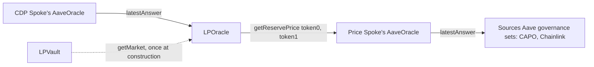

# LPOracle design record

This record sets out how Avana Labs decided to price a band market's vault token for Aave V4: the decisions, every option weighed, the strongest objections Avana Labs considered with its answer to each, worked examples and the final reasons. The code is [`LPOracle.sol`](../src/LPOracle.sol) with [`LPPriceMath.sol`](../src/libraries/LPPriceMath.sol). The credit it multiplies is in [`FloorCreditMath.sol`](../src/libraries/FloorCreditMath.sol); the vault token is [`VaultToken.sol`](../src/VaultToken.sol).

## What is priced

A band market is one pool and fixed band ticks `[A, B]`. Each pool has two: **Full range** (the band is the pool's usable tick range) and **Custom range** (Stable ±1%, Correlated ±5%, Volatile 0.345x–2.898x of the listing price). An NFT fully inside the band is credited once, at pledge:

```
credit = L · min( (1/√a − 1/√b) / (1/√A − 1/√B),  (√b − √a) / (√B − √A) )     (exactly L when [a, b] = [A, B])
```

One credit unit is one unit of liquidity spread over the band, and one vault-token base unit is one credit unit. So the oracle must answer one question: **what is one unit of band liquidity worth now?**

```
s      = √P,  P = (price0 / 10^d0) / (price1 / 10^d1)      fair price from Aave V4's own prices of token0, token1
s'     = clamp(s, √A, √B)                                    the AMM's own composition outside the band
amount0 = U · (1/s' − 1/√B),  amount1 = U · (s' − √A)        U = 10^unitDecimals (one whole vault token)
answer = amount0 · price0 / 10^d0 + amount1 · price1 / 10^d1   USD, 8 decimals, rounded down, at least 1
```

Amounts use Uniswap v4-core `SqrtPriceMath` and `ClTickMath` (the repo's own copies), the same functions the LPVault credits with; no external Uniswap contract is called and nothing depends on the AMM, so one oracle serves Uniswap v3, v4 and Slipstream alike. For the Full range market `amount1 ≈ U·√P` and `amount0·P ≈ U·√P`, so one unit is worth `2·√P` in token1, and the clamp never binds.

The guarantee the whole credit design rests on: for every NFT inside the band and every price, **`credit × answer / U ≤ the NFT's value at the same price`**. FloorCreditMath proves the inequality for exact math (the position's value over the unit's is lowest at a band edge, and the credit is that lowest ratio). The oracle keeps it because every step rounds down. [`LPOracle.FloorCredit.fuzz.t.sol`](../test/fuzz/LPOracle.FloorCredit.fuzz.t.sol) checks it through the deployed contract for random bands, positions, prices and decimals, and for the full range, with the pool's own rounding (one smallest unit of each token) as the only slack.

## Decisions

| # | Decision | Chosen | Rejected |
|---|---|---|---|
| 1 | Source of the price | Aave V4's own price of each token, read live: `AaveOracle.getReservePrice` of the token's reserve on the CDP Spoke's price Spoke (since Phase 2; before, Avana's own Chainlink routes with a $1 stablecoin cap) | Pool spot (`slot0`); pool TWAP; TWAP + Chainlink hybrid; spot with a deviation guard; Avana's own Chainlink routes |
| 1b | Which Aave price | One price Spoke per CDP Spoke, fixed at registration: the Spoke whose token collateral factors the LP's collateral factor copies; reserve IDs per pool, checked against the pool's tokens | The CDP Spoke's own oracle with price-only reserves; a snapshot of the source address; a price Spoke per pool; own routes without the cap |
| 2 | Outside the band | Clamp `√P` to `[√A, √B]`: the unit is all token0 below, all token1 above, valued at the feed prices | No clamp (in-range formula everywhere); revert or price 0 outside; graded haircut outside |
| 3 | Granularity | One immutable oracle per market, band and tokens read once from the LPVault | One shared registry oracle; one per pool for both markets |
| 4 | Price checks | Aave's own: `getReservePrice` reverts on a source answering 0 or below. Avana adds only the overflow bound (token price ≤ $10^10). No round-time check | A single max-age check; the old borrow/liquidation freshness flags with a parameter store |
| 5 | Answer of 0 | Served as 1 | Revert |

## Options weighed

**1. Price source.**
- *Pool spot.* Free and always available, but one flash loan moves it inside a transaction: an attacker inflates the price, borrows, and lets it fall back. Rejected outright; Aave never prices collateral from an AMM spot price.
- *Pool TWAP (e.g. 30 min).* Every pool has one, so long-tail tokens could be listed. Moving a deep pool's TWAP is expensive, but a shallow pool's is not, and the oracle would then need per-pool liquidity checks, observation-buffer checks and a window per chain (the old code had all of these: `minObservations`, block-time rules). A TWAP also lags a real crash by its window, exactly when liquidations need the current price. Uniswap v4 pools have no built-in oracle at all, so v4 would need a hook.
- *Hybrid (Chainlink, bounded by a TWAP).* Catches a single bad feed, but adds the TWAP's machinery and a second failure mode: when the two differ, which one blocks what? Pausing or taking the min also stops liquidations during the dislocation it detects.
- *Chainlink fair price (chosen until Phase 2).* The same source Aave uses for every other reserve, already trusted by Aave governance and risk providers, unmovable by flash loans, available on every chain Avana targets for the tokens in scope. Pool-neutral: the oracle never touches the pool.
- *Aave's own price of each token (chosen in Phase 2).* The rule of Phase 2 is to copy Aave wherever it has a deployed, audited way. Aave prices a token as collateral with `AaveOracle.getReservePrice(reserveId)`: the source Aave governance set for that reserve (on Aave V3 today a CAPO adapter for stablecoins and LSTs and a Chainlink feed otherwise; the V4 core oracle takes whatever 8-decimal source governance sets), its `latestAnswer`, and `require(price > 0)`. Reading that same call keeps every property of the Chainlink choice and adds three: Aave's caps apply (CAPO), a source Aave swaps is followed on the next read with no new LPOracle and no Avana vote, and the LP can never be priced from a different source than its own tokens are on Aave. It retires Avana's own route code and its fixed $1 stablecoin ceiling, which was Avana's rule, not Aave's (Aave V3 caps a stablecoin at a governance-set CAPO price, about $1.04 for USDC, never at $1).

**1b. Which Aave price.**

`AaveOracle` is per Spoke (its sources are keyed by the Spoke's reserve IDs), so the choice is which Spoke's oracle, and how the oracle is tied to it.

- *A. One price Spoke per CDP Spoke (chosen).* `registerSpoke` records, once and for good, the Aave V4 Spoke whose token collateral factors the CDP Spoke's LP markets copy: Aave's main Spoke for Volatile, its correlated (E-Mode-style) Spoke for Correlated, its stablecoin Spoke or the main one for Stable. `listPool` names token0's and token1's reserve IDs there. The RiskModule and the LPOracle constructor both check that each reserve's underlying is the market's token in pool order, that the reserve's decimals are the token's, and that the Spoke's `ORACLE()` is an 8-decimal `AaveOracle` bound to that Spoke (`spoke()`), then read both prices once (as `AaveOracle.setReserveSource` reads a new source once). Every `latestAnswer` calls `getReservePrice` for both reserves; `Spoke.ORACLE` is immutable, so the oracle address is kept. Step B of Phase 2 copies the liquidation settings from the same Spoke, so price, collateral factor and bonus all come from one place.
- *B. The CDP Spoke's own oracle, with token0 and token1 listed there as price-only reserves.* No second Spoke is read, and the CDP Spoke's governance controls its own sources. But each pool token must become a Hub asset and a reserve on every CDP Spoke just to carry a price, sources are copied once at listing and drift from Aave's main Spoke the first time Aave swaps one there, and each new CDP Spoke needs its own listing vote for the same tokens.
- *C. Read the source address from the price Spoke at construction and call it directly.* One hop cheaper and immune to a later repoint, but it is a snapshot: a deprecated or broken source keeps being read after Aave has replaced it, which is the failure the old routes had. It also skips Aave's `> 0` check unless re-implemented.
- *D. A price Spoke named per pool.* Lets a pair whose tokens are best listed on different Spokes pick its own. But every listing becomes a place to name the wrong Spoke, and a CDP Spoke's liquidation config (Spoke-wide in V4) could no longer be copied from one source.
- *E. Keep the routes, drop only the cap.* Smallest code change, no dependency on another Spoke, but it keeps Avana's own route code, a feed change still needs a new LPOracle and a vote, and it gives up the parity the Phase 2 rule asks for.

**2. Outside the band.**
- *No clamp.* The in-range formula past the band gives negative token amounts; the value is below the true value (the composition at the fair price minimises value) and can reach 0, which Aave refuses, so liquidations would stop in exactly the crash that needs them.
- *Revert or 0 outside.* Same failure: Aave reverts every health check of the reserve.
- *Graded haircut outside.* De-risks automatically, but the haircut is a second risk parameter on top of the LTV and threshold the DAO already votes per reserve, and it breaks the floor-credit identity (credit × price would be below what the NFT holds, so a healthy borrower could be liquidated by a parameter, not by a loss).
- *Clamp (chosen).* It is not an approximation: outside the band the AMM really holds only token0 (below) or only token1 (above), so the clamped amounts valued at the feed prices are the unit's true value. Risk outside the band is handled where Aave handles it: the LTV and threshold, the monitor alert, and the Protocol Guardian freezing the reserve.

**3. Granularity.**
- *Shared registry oracle.* One transaction updates a feed for every market, but it is a mutable, governed contract between Aave and every Avana reserve: one key compromise or bad update misprices them all at once, and Aave would read a price whose route can change without an Aave vote.
- *One per pool, serving both markets.* Saves one deployment per pool, but the two markets have different bands, so the contract needs a market index the Aave source interface cannot pass; it becomes two oracles in one.
- *One immutable per market (chosen).* Matches Aave's model (one source per reserve, changed only by an Aave vote), has no roles and no storage writes, and is audited once for all markets. Reading the band and tokens from the LPVault at construction rules out the worst misconfiguration: an oracle band that differs from the credit band.

**4. Price checks.**
- *Freshness flags (old design).* Borrow and liquidation age limits per feed in a parameter store, with a `getPriceStatus` view the gates read. Cut in the policy audit: two extra contracts on the price path, per-feed parameters to govern, and a status Aave itself never reads.
- *A single max-age check that reverts.* Aave V4's `AaveOracle` calls only `latestAnswer()` and requires `> 0`. A revert on age would block liquidations as well as borrows, during an outage that is precisely when stale collateral must be liquidatable.
- *Aave's `> 0` only (chosen).* Required: a negative answer cast to unsigned would be a huge price, and 0 would make Aave revert anyway. Since Phase 2 the check is Aave's own, inside `getReservePrice`; the LPOracle adds only `price ≤ MAX_PRICE` ($10^10 per token), the bound the square-root and value math are sized for. Whether new borrows should also stop on an old round was left to the RiskModule and closed in Phase 2: no, as in Aave (see "No staleness or sequencer check").

**5. Answer of 0.** A vault token whose whole unit is worth under $10^-8 is a misconfigured market (the RiskModule chooses decimals so a whole token is worth at least $1 at listing). Serving 1 keeps Aave's health checks and liquidations working; the overstatement is at most $10^-8 per whole token. Reverting would freeze the reserve.

## Objections considered

Avana Labs tested each decision against the strongest case for the alternatives. Each case is kept in full substance below, followed by Avana Labs' answer. The first (Phase 2) is on decision 1b; the others predate it and were weighed against the Chainlink design it replaced, whose reasoning still holds for Aave's Chainlink-based sources.

### One price Spoke per CDP Spoke vs the alternatives (Phase 2)

**The case against.** The price Spoke's governance can repoint a source in a routine "tune the main Spoke" vote with no thought for Avana; a repoint to a source with other economics changes every Avana LP price at once, and the construction checks prove the reserve ID is right today, not that the source stays right. A wrong reserve ID whose underlying matches passes the checks (a second, legacy reserve of the same token), and its source can go stale with nobody watching, since freezing a reserve leaves its price live. A source that reverts or returns 0 reverts `latestAnswer` for every LP market holding that token, so liquidations on Avana's CDP Spokes revert while the price moves. Dropping the $1 cap values a Full range USDC/USDT $10,000 position at $10,198 with USDC at its $1.04 CAPO cap (+2%), at $10,099.50 at $1.02, on Stable collateral whose collateral factor may sit at 95%, and CAPO's cap was chosen for lending, not LP valuation. Gas: two oracle reads per answer. B keeps sources under the CDP Spoke's own governance; C is the most predictable under attack; D lets a pair spanning categories use the right reference Spoke; E has the smallest blast radius. *Strongest point:* A hands Avana's solvency to a Spoke whose governance can repoint or break a token's source at any time with no Avana review, and a bad source there freezes liquidation of every LP market holding that token.

**Why Avana Labs chose A.** One source of truth: the LP is priced by the oracle that prices its own tokens as collateral on the Spoke whose collateral factors it already copies, so the trust is already given, and a fix or cap Aave applies there reaches the LP in the same transaction. Both Spokes are Aave V4 Spokes governed by the Aave DAO, the same governance that sets every Avana reserve's caps, factors and price source; "no Avana review" is the design, not a gap. B, C and E copy Aave's addresses anyway; C and E freeze a snapshot, so a deprecated or depegged source keeps being read after Aave has fixed it, which is worse than a revert. Freezing or pausing a reserve does not touch `getReservePrice`, a repoint is followed, and `AaveOracle.setReserveSource` refuses a source with other than 8 decimals or a price of 0, so governance cannot leave the LPOracle on a dead source by mistake. A source answering 0 breaks Aave's own reserve of that token too; a zero price must revert, since rounding it would make a free LP. The cap's cost is real but bounded by the band clamp: in a Stable ±1% band USDC read at $1.02 or $1.04 is worth what the unit holds at the band's edge, +0.25% ($10,024.94), not +2%; the Full range exposure is the one Aave's own USDC collateral already has. Reserve-ID misconfiguration is the main new risk, and both the RiskModule and the constructor refuse a reserve that is not the token in pool order with its decimals. Per CDP Spoke beats per pool: one choice per Spoke instead of one per listing, and Phase 2 step B copies the Spoke-wide liquidation config from it. *Strongest point:* A's price cannot diverge from the price Aave itself uses for those tokens, because it reads the same live source.

**Decision: A.** Each point of the case against is answered or kept:
- *Governance coupling:* accepted as the point of the design; it is the same Aave DAO on both sides. *Kept:* the monitor reads the age of every source the LPOracles read (M-03, from the manifest's `getReserveSource` at production) and pages when an LPOracle stops answering (M-01).
- *A second reserve of the same token:* the deploy script picks a token's reserve only when the price Spoke has exactly one reserve of that underlying, and refuses otherwise; the DAO's listing payload names the IDs voters see.
- *Revert coupling:* the same shared fate every Aave reserve of that token has; Aave's remedy (repoint the source) repairs the LP in the same vote.
- *No $1 cap:* kept as a known cost, bounded by the clamp in Custom range bands and by CAPO's cap in Full range markets; the LTV is set knowing it.
- *Gas:* `ORACLE()` is read once (immutable on the Spoke); the two reads cost one cross-call each, about 5–10k gas more per answer than direct feeds, small beside a health check.
- *D:* a pair whose tokens are not both on the CDP Spoke's price Spoke is not listed on that CDP Spoke; that is the "copy Aave" listing rule.

### Chainlink vs pool TWAP vs spot

**The case against.** Chainlink covers only a few dozen Base assets, while most Slipstream volume is AERO, VIRTUAL, LSTs and new tokens; requiring two USD routes shuts out most pools, whereas a 30-minute TWAP exists for every pool with observations. The NFT's composition and the liquidation both follow the pool's price; Chainlink's 0.5% deviation and 20 min–24 h heartbeats leave 0.5–2% windows, a quarter of a ±1% band. The route is 2–4 feeds with no cross-check (LUNA's minAnswer floor in 2022, frozen deprecated feeds); a hybrid with a TWAP bound would catch a single-source failure. Moving a 30-minute TWAP on a deep Base pool costs millions, more than a capped $10,000 position returns. *Strongest point:* the design limits listings to Chainlink tokens and never checks the price against the pool where the collateral is held and liquidated.

**Why Avana Labs kept Chainlink (before Phase 2).** Coverage is a listing limit by intent: Avana lists pools whose tokens Aave already accepts as reserves, and those have Chainlink routes (two-leg routes cover LSTs, such as wstETH/ETH × ETH/USD). The gap between the feed and the pool does not create bad debt by itself, because the floor credit holds at *any* price: the NFT is worth at least `credit × unit value` whether the composition follows the pool or the feed. The gap only matters for the liquidator's execution, which the liquidation bonus covers (and the bonus is sized for the same Chainlink lag every Aave reserve has). A TWAP is cheap to move on exactly the shallow pools coverage would add, needs v4 hooks, and lags crashes. A hybrid's "which wins" rule would stop liquidations in the dislocation it detects. *Kept from the case against:* the listing analysis it asks for (share of target TVL with Chainlink routes on both tokens) belongs in each pool's ARFC; and the monitor compares feed and pool prices off-chain and alerts.

### Clamp vs no clamp

**The case against.** Leaving the band almost always means a regime change (depeg, peg break, crash past 0.345x), and the clamp keeps reporting full value until a human freezes the reserve; a graded haircut would act automatically. Below a USDC/USDT band every vault token is 100% of the falling coin, sold into a one-sided book. Every NFT of a Custom range market leaves the band at once, concentrating liquidation supply where liquidity is thinnest. Reverting or 0 is agreed to be wrong. *Strongest point:* out of band is a regime the band was not sized for, and nothing reacts until a human does.

**Why Avana Labs kept the clamp.** The clamp reports the true value of what is held, nothing more: at ETH $541 (0.3x) the Volatile unit is all ETH and priced at $541 per ETH, the same price every other Aave ETH reserve uses. A haircut inside the oracle would be an unvoted risk parameter that liquidates healthy borrowers. The concentration point is real and is handled by caps and the threshold: the DAO's LTV for a Custom range market is set knowing the collateral becomes one token at the band edge (the RiskModule's "lower of the two tokens' LTVs" rule). Depegs are handled by freezing, which Avana Labs adopted (RiskModule record, Decision 4). *Kept:* the monitor's band-edge alert fires before the edge, not after.

### One oracle per market vs shared

**The case against.** A feed used in 30 pools means 60 deployments and 60 repoints, each a week of Aave governance, during which reserves read a frozen price. A pool's two markets can read different feed versions mid-migration, so a user picks the friendlier one. Two markets of one pool read the same feeds twice in a health check (5–10k gas per cold read). 100+ hand-configured deployments are 100+ chances for a wrong route. *Strongest point:* one feed deprecation becomes dozens of week-long governance actions.

**Why Avana Labs kept one oracle per market.** Chainlink announces deprecations months ahead, and an Aave payload repoints any number of reserves in one proposal, so the count of reserves does not change the number of votes. A mutable shared oracle would let one key or one bad update misprice every Avana reserve at once, and would let Avana change an Aave price without an Aave vote; immutability is worth more than the deploy count. Two markets of one pool are deployed in the same listing payload from the same reserves, and `reserveIds` (formerly `feedsOf`) makes the check mechanical. The double read costs a few thousand gas only for an account holding both markets. *Kept, and done:* the activation check (`AaveConfigLogic.checkActivation`) compares every oracle's LPVault, market ID, unit decimals, price Spoke and `reserveIds` with what was listed; its band and tokens follow from the LPVault market it read at construction. Since Phase 2 a source change needs no new oracle at all: Aave repoints the token's reserve.

### No staleness check vs a max-age check

**The case against.** Aave V3's no-check rule covers one direct feed; here up to four legs compose one price, some with 24 h heartbeats. With a frozen ETH feed and ETH down 10%, a $10,000 full-range position is worth $10,000·√0.9 = $9,487 but is priced $10,000, a $513 (5.4%) overvaluation that new borrowers can draw against until a repoint a week later. No sequencer-uptime check is visible. Avana's own borrow path can refuse new borrows when a leg is older than 3× its heartbeat while `latestAnswer()` keeps answering, so liquidations never stop; the old flags did exactly that. *Strongest point:* a borrow-only freshness gate blocks the stale-price exploit without any risk to liquidations.

**Why Avana Labs added no check.** The oracle is the wrong place: Aave reads only `latestAnswer()`, so any check here either reverts (stopping liquidations) or does nothing. The objection itself puts the check in the borrow path, not the oracle, and that is where it would go. The $513 scenario is the same exposure every Aave reserve priced by that feed has during the same freeze, and the steward freezes reserves on a stale-feed alert. *Closed in Phase 2:* the RiskModule gates borrows on neither the source's age nor the L2 sequencer feed, because Aave V4 has no such gate and Aave removed its sequencer sentinel in v3.7 (see "No staleness or sequencer check").

## Worked examples

Base ETH/USDC, 0.05% pool (tick spacing 10). WETH is token0 (18 decimals), USDC token1 (6 decimals), ETH = $1,803.33 from the ETH/USD feed, USDC = $1.00. Every vault token has 18 decimals, so one whole token is 10^18 liquidity units. Bands: **Full range** ticks [−887,270, 887,270]; **Volatile Custom range** 0.345x–2.898x = ticks [−211,990, −190,700] ($622.09–$5,229.00). **Stable** USDC/USDT ±1% = ticks [−101, 100]. Unit prices are the contract's answers (`LPOracle.unit.t.sol` checks each to one part in 10^9).

**Price of one whole vault token**

| ETH price | Full range | Volatile 0.345x–2.898x | What one Volatile unit holds |
|---|---:|---:|---|
| $1,803.33 (listing) | $84,931,266 | $35,051,327 | 9,719 ETH + $17.5M USDC |
| $1,262.33 (−30%) | $71,058,596 | $28,660,132 | 14,317 ETH + $10.6M USDC |
| $2,705.00 (+50%) | $104,019,133 | $41,670,066 | 5,398 ETH + $27.1M USDC |
| $541.00 (0.3x, below the band) | $46,518,770 | $14,209,079 | 26,265 ETH, no USDC (clamped) |
| $5,770.66 (3.2x, above the band) | $151,929,668 | $47,370,112 | no ETH, $47.4M USDC (clamped) |

Stable USDC/USDT ±1%: $10,024,291,047 per whole token at the peg; $9,993,089,013 with USDC at $0.995; $9,748,297,320 with USDC at $0.97 (below the band: all USDC, clamped). Above the peg, Aave's price is used as served (no $1 cap of Avana's own since Phase 2): USDC at $1.005 puts the unit inside the band at +0.19%; at $1.02 or at the CAPO cap of about $1.04 the unit is all USDT at the band's top edge, +0.25%.

**Removing the $1 cap, on $10,000 positions** (USDC token0, USDT token1, both $1 at listing)

| USDC price served by Aave | Stable ±1% band, with the old cap | Stable ±1% band, Aave's price | Full range USDC/USDT, old cap | Full range, Aave's price |
|---|---:|---:|---:|---:|
| $1.000 | $10,000.00 | $10,000.00 | $10,000.00 | $10,000.00 |
| $1.005 | $10,000.00 | $10,018.66 | $10,000.00 | $10,024.97 |
| $1.02 | $10,000.00 | $10,024.94 (clamped: all USDT) | $10,000.00 | $10,099.50 |
| $1.04 (about USDC's CAPO cap) | $10,000.00 | $10,024.94 | $10,000.00 | $10,198.04 |
| $0.97 | $9,724.68 | $9,724.68 | $9,848.86 | $9,848.86 |

Below the peg nothing changes (the cap only ever bound above $1). Above it, a Custom range market gains at most a quarter of a percent, because past the band's top edge the unit holds only the other token; a Full range market tracks `√p` of the overprice, up to +2% at the CAPO cap, the same exposure Aave's own USDC collateral has at that price. An ETH/USDC Full range $10,000 position with USDC read at $1.02 is $10,099.50.

**A source Aave governance swaps.** Aave repoints USDC's reserve on the price Spoke from a Chainlink feed to a CAPO adapter reading $0.98: the next `latestAnswer` of every LP market holding USDC uses $0.98, and a full-range ETH/USDC $10,000 position reads $9,899.49 (`√0.98`). Before Phase 2 the LPOracle kept reading its own route until a new LPOracle was deployed and the DAO repointed the vault-token reserve, about a week.

**$10,000 positions** (collateral = credit × unit price; position = what the NFT holds at that price)

| Position (market) | Credit / L | Listing | −30% | +50% |
|---|---:|---|---|---|
| Full range NFT (Full range) | 100% | $10,000 / $10,000 | $8,366.60 / $8,366.60 | $12,247.45 / $12,247.45 |
| Band-wide 0.345x–2.898x (Volatile) | 100% | $10,000 / $10,000 | $8,176.62 / $8,176.62 | $11,888.30 / $11,888.30 |
| Uniswap "Wide"-like 0.5x–2x (Volatile) | 63.4% | $8,933 / $10,000 | $7,304 / $8,044 | $10,620 / $11,638 |
| Narrow 0.9x–1.1x (Volatile) | 9.0% | $7,571 / $10,000 | $6,191 / $7,201 | $9,001 / $10,232 |

Read as "collateral / position". Collateral never exceeds the position; it equals it for an NFT on exactly its market's band, at any price. Past the band edge it converges to equality (0.5x–2x at ETH $541: $3,621.41 / $3,621.41). Stable ±1%: a band-wide $10,000 NFT is $10,000 / $10,000 at the peg and $9,724.68 / $9,724.68 with USDC at $0.97; a ±0.5% NFT gets 49.75% of L as credit and $9,987 / $10,000 at the peg.

**What the borrower sees.** At an LTV of 70% the full-range $10,000 NFT borrows up to $7,000. At −30% its collateral is $8,366.60, so a $7,000 debt is at 83.7% of collateral and liquidation starts at the DAO's threshold; at +50% the room grows to $8,573. The narrow NFT borrows 70% × $7,571 = $5,300 at listing: the floor credit trades borrowing power for a guarantee that holds at every price.

## Final reasons

1. **Aave's own price, never the pool.** Each token is priced by `AaveOracle.getReservePrice` on the Spoke whose collateral factors the LP copies: a flash loan cannot move it, Aave's caps and source changes apply at once, and the floor credit makes the pool-vs-price gap harmless to solvency.
2. **Clamp to the band.** It is the AMM's real composition, so the price is exact outside the band, never negative, never zero; risk past the edge belongs to the LTV, the threshold and the Protocol Guardian's freeze, all Aave-native.
3. **One immutable oracle per market.** Aave's one-source-per-reserve model, no roles, no state, and the band read from the LPVault so price and credit cannot describe different liquidity.
4. **Only Aave's `> 0`, plus the overflow bound.** Aave reads nothing else; a revert on age would stop liquidations. No borrow-side age or sequencer gate either: Aave V4 has none and Aave removed its sentinel in v3.7.
5. **Rounding down everywhere, floor of 1.** The fuzz bound `credit × answer ≤ position value` holds through the deployed contract; the floor of 1 keeps Aave reading a misconfigured market instead of freezing it.

## Divergences from Aave

Where the LPOracle does something Aave's own reserves do not, and why:

| Divergence | Why it cannot be avoided |
|---|---|
| A token price above $10^10 (`MAX_PRICE`, 1e18 at 8 decimals) reverts `PriceAboveBound` | The square-root and value math (`LPPriceMath`) is proved and fuzzed for prices up to 1e18; a larger answer could overflow the products. No listable token is near it. Aave's own reserves need no bound because they multiply one price by one amount. |
| A whole vault token worth under $10^-8 is served as 1 | Aave refuses 0 (`require(price > 0)` in `getReservePrice`), so a 0 would freeze the reserve; see decision 5. |
| The reserve's underlying, decimals and oracle binding are checked at construction and at listing | Aave's own reserve listing ties a source to its reserve by construction; an LPOracle names two reserves of another Spoke, so it checks that they are the market's tokens in pool order. |
| The Spoke's `ORACLE()` is read once | Equivalent: `Spoke.ORACLE` is immutable in Aave V4, so each read reaches the same `AaveOracle` Aave's reserves read. |

## No staleness or sequencer check

Decided in Phase 2: there is no round-age check and no L2 sequencer-uptime check, in the oracle or in the borrow path. This copies Aave:

- **Aave V4 has none.** The pinned `AaveOracle.getReservePrice` reads only the source's `latestAnswer` and requires it to be above 0; no Spoke check reads a round time or a sequencer feed. Every other reserve on the same Spoke is priced that way.
- **Aave removed the one it had.** Aave V3 gated borrows and liquidations on L2s with `PriceOracleSentinel` (sequencer down or in its grace period). Aave v3.7 removed it (`aave-v3-origin` `docs/3.7/sentinel-removal.md`) because uptime signals differ by network and gave false positives, which blocked liquidations of unhealthy positions exactly when they were needed and blocked borrows while prices were fine; its 0.95 health-factor carve-out for liquidations was itself a workaround for that danger.
- **A gate here would be worse than Aave's was.** A revert in `latestAnswer` stops liquidations as well as borrows (Aave reads one price for both), and a borrow-only gate in Avana's `checkBorrow` would block borrowing that Aave itself allows on the same Spoke for the same tokens.

A stale or stopped source is handled as Aave handles it for its own reserves: the monitor pages on source age (M-03) and on an LPOracle that stops answering (M-01), and the Protocol Guardian freezes the affected reserves while Aave governance repoints the source.

## Lifecycle

Function links point to the interface that declares each function. Why the oracle is built this way: the decisions above.

Avana prices two things, and only one of them needs its own contract.

- **Debt assets** (USDC, USDT, WETH): Aave V4 reads each asset's own price source, the same source Aave uses on its other markets. GHO keeps Aave's fixed $1 source. Avana adds no contract here.
- **Vault tokens** (one per band market): Aave V4 reads the market's [`LPOracle`](../src/LPOracle.sol), an immutable contract with no stored state.

### LPOracle



1. **Deploy** after the LPVault lists the market, with the LPVault, the market ID, the vault token's decimals, the CDP Spoke's price Spoke (the Aave V4 Spoke whose token collateral factors the market copies) and token0's and token1's reserve IDs there. The constructor reads the band ticks and tokens from the LPVault's market, each token's decimals and the price Spoke's `ORACLE()`; it refuses an unlisted market, decimals above 18 or vault-token decimals outside [6, 18], a reserve that is not the market's token in pool order with the token's decimals, or an oracle that is not the Spoke's 8-decimal `AaveOracle` (`InvalidParams`), and reads both prices once.
2. **Every read** ([`latestAnswer`](../src/interfaces/ILPOracle.sol#L48)) takes both tokens' prices from Aave V4 (`getReservePrice`, whatever source Aave governance has set), takes the fair square-root price of the two, clamps it to the band, and values the amounts one whole vault token (`10^unitDecimals` liquidity units) holds there, rounded down; the answer is never below 1. Aave's own check reverts the read when a source answers zero or below; a price above $10^10 reverts `PriceAboveBound`. The round's time is not read.
3. **Other readers** use [`getPrices`](../src/interfaces/ILPOracle.sol#L58) (both token prices and the fair square-root price) and [`getUnitAmounts`](../src/interfaces/ILPOracle.sol#L61) (what one whole vault token holds now).
4. **A token's source changes** when Aave governance repoints the token's reserve on the price Spoke (`Spoke.updateReservePriceSource`); the next read uses it, with no new LPOracle. A new LPOracle (and an Aave vote pointing the vault-token reserve at it, `Spoke.updateReservePriceSource` on the CDP Spoke) is needed only to change the price Spoke or a reserve ID.

There is nothing to poke, cache, recover or fail over: the oracle has no state between reads.

### Worked example

Base ETH/USDC Full range market, vault token with 18 decimals, ETH at $1,803.33: `latestAnswer` = 8,493,126,632,754,271 ($84,931,266 per 10^18 liquidity units). A $10,000 full-range NFT has L ≈ 1.177 × 10^14 and is credited L, so Aave counts 0.0001177 vault tokens × $84.93M = $10,000. More in [Worked examples](#worked-examples).
