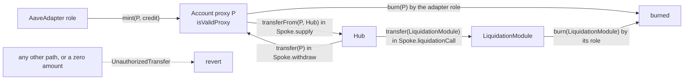

# VaultToken lifecycle

A VaultToken is one band market's Aave collateral asset: one base unit is one unit of credit, which is one unit of liquidity spread over the market's band. Its price comes from the market's [LPOracle](oracle.md#lifecycle). The AccessManager decides who mints, burns and registers proxies (the AaveAdapter role, and the LiquidationModule role for seized tokens). Tokens move only from a registered proxy to the Hub, from the Hub to a registered proxy, and from the Hub to the LiquidationModule.

1. **Deploy** ([`VaultToken`](../src/VaultToken.sol)) with name, symbol, decimals in [6, 18], the LPVault market ID, the Hub, the LiquidationModule and the AccessManager. No owner, setter or pause; a new adapter needs a role grant, not a new token. Errors: [`ZeroAddress`](../src/interfaces/IVaultToken.sol), [`InvalidDeployment`](../src/interfaces/IVaultToken.sol).
2. **Register** ([`addValidProxy`](../src/interfaces/IVaultToken.sol)) each account proxy at its first pledge; append-only. The Hub, the LiquidationModule, the AccessManager and the token are refused ([`ReservedAddress`](../src/interfaces/IVaultToken.sol)).
3. **Pledge**: the adapter mints the NFT's credit to the proxy ([`mint`](../src/interfaces/IVaultToken.sol); any other recipient fails [`UnauthorizedRecipient`](../src/interfaces/IVaultToken.sol)), and `Spoke.supply` moves it to the Hub.
4. **Withdraw**: `Spoke.withdraw` pays the proxy from the Hub, then the adapter burns ([`burn`](../src/interfaces/IVaultToken.sol)) the credit the LPVault released.
5. **Liquidate**: `Spoke.liquidationCall` pays the seized tokens from the Hub. Only the LiquidationModule can receive them: any other liquidator's call reverts on the transfer. The LiquidationModule burns them and unwinds the liquidity worth that credit. The reserve's `liquidationFee` is 0 and receive-shares is off, so a seizure always moves tokens.
6. **Anything else** (proxy to proxy, wallet to anyone, LiquidationModule to the Hub, a zero amount on any path) reverts [`UnauthorizedTransfer`](../src/interfaces/IVaultToken.sol): vault tokens never leave Avana's accounts, so the supply stays at or below the LPVault's total credit.

Worked example: a $10,000 full-range ETH/USDC NFT with L = 117,742,300,000,000 is credited L, so the adapter mints 117,742,300,000,000 base units (0.0001177 whole tokens at 18 decimals) and Aave values them at $84.93M per whole token: $10,000.

Tests: [`VaultToken.unit.t.sol`](../test/unit/VaultToken.unit.t.sol), and the real Aave V4 Hub and Spoke in [`VaultToken.AaveV4.integration.t.sol`](../test/integration/VaultToken.AaveV4.integration.t.sol).
