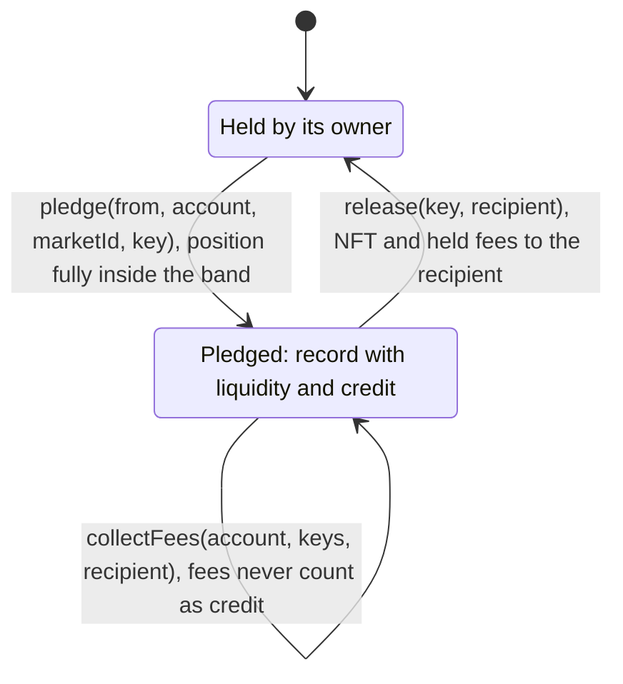

# LP-vault credit: design record

**Status: decided (2026-11-19).** What Avana Labs decided and why, in order: the thesis, the reasoning behind it, every alternative argued on its merits with its own worked example, the conclusion, and how the math is checked. Lifecycle: [below](#lifecycle). Proof: [appendix](#appendix-floor-credit-proof).

**How to read the numbers.** Every example is a $10,000 position at 75% LTV. A table cell is the borrowing power and, in brackets, its share of the position's value; 75% is the most any position can get. Columns are where the price is, relative to the listing price, when the position is minted; positions are Uniswap's five strategies minted around that price: Full range, Wide (−50% / +100%), Stable (±0.3%), One-sided lower (−50% to the price), One-sided upper (the price to +100%). Volatile pool unless stated. Every number comes from the floor-credit formula in a short script; the library's integer credit is at most these, and below them by at most 2 base units of the token.

## Thesis

Each pool gets **two ERC-20 collateral markets, Full range and Custom range**, listed by **one DAO vote at one LTV and never changed**. A position's collateral is its **floor credit**, fixed at pledge: `credit = L × min(r0, r1)` band units, what the position holds at each band edge divided by what one band unit holds there.

| Market | Band | Accepts | Credit |
|---|---|---|---|
| Full range | The lowest and highest usable ticks | Full-range positions | `L`: 75% |
| Custom range | Around the listing price, width by Spoke | Any range inside the band | `L × min(r0, r1)` |

| Spoke | Custom range band |
|---|---|
| Stable LP | ±1% |
| Correlated LP | ±5% |
| Volatile LP | "Wide 67%": 0.345× to 2.898× the listing price (Uniswap's Wide strategy gets exactly 67% in it on listing day) |

The AaveAdapter routes automatically: a full-range position to Full range; otherwise to Custom range if it fits the band; otherwise it is rejected and the UI suggests Full range. In a depeg (monitor alert above 1%) the Aave Protocol Guardian freezes the reserves. Pairs that drift slowly by design (wstETH/ETH, about +3% a year) get a routine re-listing; on volatile pools governance lists a new Custom range market (`listPool`, a governance-role function) when the price drifts toward the band's edge.

## Reasoning

| Constraint | Consequence |
|---|---|
| Aave lists one fungible ERC-20 per collateral market | Every position in a market must be counted in one unit, so a market needs one band and a credit in that band's units |
| An Aave collateral balance must not change by itself | The credit is fixed at pledge and reads no pool price |
| Never lend against value that is not there | The credit must be worth no more than the position at every price. The floor credit is: the least ratio of the two values is at a band edge, where the `min` is taken (proof, Sections 1–2) |
| Every market costs governance work: a reserve, an oracle, caps and monitoring | As few markets per pool as serve users well |
| Uniswap users pick one of five strategies, as percentages of the price at minting | Markets must accept ranges they did not anticipate, so a band that admits any range inside it |
| Full range is the most common position and loses nothing to a band | Full range gets its own market at full credit |

Ownership: `FloorCreditMath` and the LPVault say how many band units a position is worth ([`libraries/FloorCreditMath.sol`](../src/libraries/FloorCreditMath.sol)); the LPOracle says how many dollars a band unit is worth ([oracle lifecycle](oracle.md#lifecycle)); the RiskModule sets the LTV and the markets of each pool ([risk-module lifecycle](risk.md#lifecycle)).

### The chosen design, worked

Volatile pool, two markets (Full range, Custom range "Wide 67%"):

| Uniswap strategy | −30% | −15% | Listing | +20% | +30% |
|---|---|---|---|---|---|
| Full range | $7,500 (75%) | $7,500 (75%) | $7,500 (75%) | $7,500 (75%) | $7,500 (75%) |
| Wide | $5,480 (55%) | $6,150 (61%) | $6,700 (67%) | $6,080 (61%) | $5,800 (58%) |
| Stable ±0.3% | $4,540 (45%) | $5,100 (51%) | $5,550 (56%) | $5,040 (50%) | $4,810 (48%) |
| One-sided lower | $4,540 (45%) | $5,090 (51%) | $5,550 (56%) | $6,040 (60%) | $6,250 (63%) |
| One-sided upper | $6,420 (64%) | $5,990 (60%) | $5,550 (56%) | $5,040 (50%) | $4,810 (48%) |

From −31% / +45% the Wide strategy no longer fits the band (One-sided lower stops fitting at −31%, One-sided upper at +45%; Stable lasts much longer); a new Custom range market is then due.

Real pool on listing day: Base ETH/USDC Uniswap v3 0.05% at $1,803.33, Custom range band $622.09 – $5,223.77 (ticks snapped to the nearest usable tick, spacing 10, as Uniswap's interface does): Full range $7,500, Wide $6,699, Stable $5,555, One-sided lower $5,552, One-sided upper $5,550. The shares are the same in every pool on listing day, up to tick rounding.

Stable and Correlated Spokes on peg, Stable ±0.3% position: ±1% band $7,490 (74.9%); ±5% band $7,410 (74.1%).

Real LTVs, for a $10,000 position credited at its full value (an LP position's LTV is the lower of its two tokens'):

| Pair | LTV | Borrowing power |
|---|---|---|
| Stablecoins (E-Mode) | 93% | about $9,300 |
| WBTC/ETH | 73% | $7,300 |
| AAVE or LINK pairs | 66% | $6,600 |
| Memecoins (estimate) | 25–30% | $2,500 – $3,000 |

## Alternatives

### 1. One market per exact range (the original design)

**What.** A market for each exact tick range; a position is accepted only if its range matches a market's exactly, and then gets credit `L`.

**Why attractive.** Every accepted position gets the full 75%, and the credit needs no band math.

| Uniswap strategy | −30% | −15% | Listing | +20% | +30% |
|---|---|---|---|---|---|
| Full range | $7,500 (75%) | $7,500 (75%) | $7,500 (75%) | $7,500 (75%) | $7,500 (75%) |
| Wide | rejected | rejected | $7,500 (75%) | rejected | rejected |
| Stable ±0.3% | rejected | rejected | $7,500 (75%) | rejected | rejected |
| One-sided lower | rejected | rejected | $7,500 (75%) | rejected | rejected |
| One-sided upper | rejected | rejected | $7,500 (75%) | rejected | rejected |

**Why it lost.** *User upside:* Uniswap's strategies are percentages of the price at minting, so after any move a new position matches nothing; only listing-day positions and full range are served. *Management cost:* serving the five strategies at all needs a market per strategy per price, an unbounded number of reserves.

### 2. One band, 0.25× to 5× (the earlier default)

**What.** One Custom-range-style market with a very wide band and no Full range market.

**Why attractive.** One market per pool, and a wide band survives large drifts without a new listing.

| Uniswap strategy | −30% | −15% | Listing | +20% | +30% |
|---|---|---|---|---|---|
| Full range | rejected | rejected | rejected | rejected | rejected |
| Wide | $4,490 (45%) | $5,030 (50%) | $5,490 (55%) | $5,610 (56%) | $5,380 (54%) |
| Stable ±0.3% | $3,720 (37%) | $4,170 (42%) | $4,550 (46%) | $4,650 (46%) | $4,460 (45%) |
| One-sided lower | $3,720 (37%) | $4,160 (42%) | $4,550 (45%) | $4,990 (50%) | $5,180 (52%) |
| One-sided upper | $5,260 (53%) | $5,480 (55%) | $5,080 (51%) | $4,650 (46%) | $4,450 (45%) |

**Why it lost.** *User upside:* full-range positions, the most common kind, have no market, and every other strategy gets 5–12 points less than in the chosen design on listing day (Wide 55% against 67%, Stable 46% against 56%). *Management cost:* it saves one market per pool, which does not pay for losing full range.

### 3. Live credit, re-marked to the position's value

**What.** The collateral balance follows the position's live value, re-marked by the protocol as prices move.

**Why attractive.** Every strategy gets close to the full 75% at every price, with no bands at all.

| Uniswap strategy | Any price |
|---|---|
| Every strategy | about $7,300 – $7,500 (73–75%; an estimate: the credit follows the value, less a re-mark buffer) |

**Why it lost.** *It does not work in the moment it matters:* in a crash, marking balances down lowers health factors, and Aave's health-factor check blocks the very balance change that would do it. *Management cost:* risk providers would not accept an Aave collateral balance that an outside protocol changes, so the market could not be listed on the terms that make it worth having.

### 4. Five markets per pool

**What.** Full range, Wide 67%, and three Narrow markets, each ±20% (from `c / 1.2` to `c × 1.2`) around 0.75×, 1× and 1.33× the listing price. A position goes to the market where it earns the most.

**Why attractive.** Narrow positions get a band close to their own width.

| Uniswap strategy | −30% | −15% | Listing | +20% | +30% |
|---|---|---|---|---|---|
| Full range | $7,500 (75%) | $7,500 (75%) | $7,500 (75%) | $7,500 (75%) | $7,500 (75%) |
| Wide | $5,480 (55%) | $6,150 (61%) | $6,700 (67%) | $6,080 (61%) | $5,800 (58%) |
| Stable ±0.3% | $6,880 (69%) | $6,590 (66%) | $7,160 (72%) | $6,700 (67%) | $7,070 (71%) |
| One-sided lower | $4,540 (45%) | $5,090 (51%) | $5,550 (56%) | $6,040 (60%) | $6,250 (63%) |
| One-sided upper | $6,420 (64%) | $5,990 (60%) | $5,550 (56%) | $5,040 (50%) | $4,810 (48%) |

**Why it lost.** *User upside:* only Stable gains, 72% against 56% on listing day and 66–71% against 45–51% within ±30% (65–72% over every price in that range); every other number is identical to the chosen design. *Management cost:* three more reserves, oracles, caps and monitors per pool, for one strategy.

### 5. Seven or nine markets per pool

**What.** Full range, the three Narrow markets, and narrower Wide-style bands at several centers so that Wide and one-sided positions also fit tightly. Layouts used here: seven = Full + 3 Narrow + 3 "Wide 70%" bands (0.397× to 2.517× around 0.75×, 1×, 1.33×); nine = Full + 3 Narrow + 5 "Wide 73%" bands (0.456× to 2.191× around 0.75×, 0.87×, 1×, 1.15×, 1.33×).

**Why attractive.** Every strategy gets more, not only Stable.

Seven markets:

| Uniswap strategy | −30% | −15% | Listing | +20% | +30% |
|---|---|---|---|---|---|
| Full range | $7,500 (75%) | $7,500 (75%) | $7,500 (75%) | $7,500 (75%) | $7,500 (75%) |
| Wide | $6,760 (68%) | $6,550 (66%) | $7,000 (70%) | $6,630 (66%) | $6,910 (69%) |
| Stable ±0.3% | $6,880 (69%) | $6,590 (66%) | $7,160 (72%) | $6,700 (67%) | $7,070 (71%) |
| One-sided lower | $5,600 (56%) | $6,150 (62%) | $6,580 (66%) | $6,310 (63%) | $6,520 (65%) |
| One-sided upper | $6,680 (67%) | $6,260 (63%) | $6,580 (66%) | $6,100 (61%) | $5,870 (59%) |

Nine markets:

| Uniswap strategy | −30% | −15% | Listing | +20% | +30% |
|---|---|---|---|---|---|
| Full range | $7,500 (75%) | $7,500 (75%) | $7,500 (75%) | $7,500 (75%) | $7,500 (75%) |
| Wide | $7,040 (70%) | $7,220 (72%) | $7,300 (73%) | $7,140 (71%) | $7,210 (72%) |
| Stable ±0.3% | $6,880 (69%) | $6,590 (66%) | $7,160 (72%) | $6,700 (67%) | $7,070 (71%) |
| One-sided lower | $5,840 (58%) | $6,410 (64%) | $6,830 (68%) | $6,910 (69%) | $6,770 (68%) |
| One-sided upper | $6,920 (69%) | $6,870 (69%) | $6,830 (68%) | $6,360 (64%) | $6,120 (61%) |

**Why it lost.** *User upside:* on listing day Wide rises from 67% to 70–73% and one-sided from 56% to 66–68%: 3–12 points, and anyone who wants the full 75% already has it with a full-range position. *Management cost:* five to seven more reserves, oracles, caps and monitors per pool than the chosen design, liquidity split across them, and narrower bands that need re-listing sooner. The gain does not pay for that.

### 6. Three markets per pool (the strongest rejected alternative)

**What.** On stable pools, a third market (a Wide 67% band) next to Full range and the ±1% Custom range.

**Why attractive.** It serves Wide and one-sided users on stable pairs and keeps Stable users borrowing through a depeg.

Stable pool, three markets (Full, ±1%, Wide 67%):

| Uniswap strategy | On peg | 1% depeg | 2% depeg | 4% depeg |
|---|---|---|---|---|
| Full range | $7,500 (75%) | $7,500 (75%) | $7,500 (75%) | $7,500 (75%) |
| Wide | $6,700 (67%) | $6,670 (67%) | $6,630 (66%) | $6,560 (66%) |
| Stable ±0.3% | $7,490 (75%) | $5,530 (55%) | $5,500 (55%) | $5,440 (54%) |
| One-sided lower | $5,550 (56%) | $5,520 (55%) | $5,490 (55%) | $5,440 (54%) |
| One-sided upper | $5,550 (56%) | $5,580 (56%) | $5,610 (56%) | $5,660 (57%) |

The same pool with the chosen two markets (Full, ±1%):

| Uniswap strategy | On peg | 1% depeg | 2% depeg | 4% depeg |
|---|---|---|---|---|
| Full range | $7,500 (75%) | $7,500 (75%) | $7,500 (75%) | $7,500 (75%) |
| Wide | rejected | rejected | rejected | rejected |
| Stable ±0.3% | $7,490 (75%) | rejected | rejected | rejected |
| One-sided lower | rejected | rejected | rejected | rejected |
| One-sided upper | rejected | rejected | rejected | rejected |

The case for each, as Avana Labs weighed it:

| For three markets | For two markets |
|---|---|
| The Stable Spoke rejects Wide and one-sided positions even on day one | Wide and one-sided positions on a stable pair behave like full range; a full-range position gets 75% in Full range, more than any band gives them (56–67%) |
| A 2% depeg rejects Stable users exactly when demand peaks; a third market keeps them at 55% | Widening fixes depegs better than a third market: a ±5% band keeps 72–74% through a 4% depeg (alternative 7) |
| Correlated pairs have the same problem at a 10% move | Stable pairs hold mostly narrow positions (Flipside data), which a tight band credits at about 75% |
| Existing users are unaffected either way | |
| Concedes that volatile pools need only two | |

**Resolution, and why it lost.** In a depeg no new loans should go out at all; Aave's practice is to freeze the reserve, and the Protocol Guardian does. That removes the depeg argument. What remains is Wide and one-sided users on stable pairs, who get more from Full range. *Management cost:* one more reserve, oracle, cap and monitor per stable pool, for users better served by Full range.

### 7. A wider second market for depegs (±5% Stable, ±15% Correlated)

**What.** Keep two markets, but make the Custom range band wide enough to survive a depeg.

**Why attractive.** No third market, and Stable users keep borrowing through a depeg.

Stable pool, two markets (Full, ±5%):

| Uniswap strategy | On peg | 1% depeg | 2% depeg | 4% depeg |
|---|---|---|---|---|
| Full range | $7,500 (75%) | $7,500 (75%) | $7,500 (75%) | $7,500 (75%) |
| Wide | rejected | rejected | rejected | rejected |
| Stable ±0.3% | $7,410 (74%) | $7,380 (74%) | $7,330 (73%) | $7,210 (72%) |
| One-sided lower | rejected | rejected | rejected | rejected |
| One-sided upper | rejected | rejected | rejected | rejected |

Correlated pool, Stable ±0.3% position: ±5% band 74.1% on peg, rejected after a 5% move; ±15% band 71.8% on peg, 70.6% after 5%, 67.9% after 10%.

**Why it lost.** *User upside:* it buys borrowing during a depeg, which the reserve freeze is there to stop, and costs every Stable user about a point on peg (74.1% against 74.9%; Correlated 71.8% against 74.1%). *Management cost:* none saved; the freeze and the monitor are needed either way.

### 8. Other Wide widths: 67%, 65%, 63%, 60%

**What.** The Volatile band's width, named by what Uniswap's Wide strategy gets in it on listing day. A wider band survives more drift before a re-listing.

| Width | Band (× listing price) | Wide strategy fits after a move of |
|---|---|---|
| 67% | 0.345 – 2.898 | −31% / +45% |
| 65% | 0.314 – 3.188 | −37% / +59% |
| 63% | 0.285 – 3.512 | −43% / +76% |
| 60% | 0.246 – 4.071 | −51% / +104% |

**Why attractive.** Fewer re-listings.

65%:

| Uniswap strategy | −30% | −15% | Listing | +20% | +30% |
|---|---|---|---|---|---|
| Full range | $7,500 (75%) | $7,500 (75%) | $7,500 (75%) | $7,500 (75%) | $7,500 (75%) |
| Wide | $5,330 (53%) | $5,970 (60%) | $6,500 (65%) | $5,900 (59%) | $5,640 (56%) |
| Stable ±0.3% | $4,420 (44%) | $4,950 (49%) | $5,390 (54%) | $4,890 (49%) | $4,670 (47%) |
| One-sided lower | $4,410 (44%) | $4,940 (49%) | $5,390 (54%) | $5,870 (59%) | $6,070 (61%) |
| One-sided upper | $6,240 (62%) | $5,820 (58%) | $5,390 (54%) | $4,890 (49%) | $4,670 (47%) |

63%:

| Uniswap strategy | −30% | −15% | Listing | +20% | +30% |
|---|---|---|---|---|---|
| Full range | $7,500 (75%) | $7,500 (75%) | $7,500 (75%) | $7,500 (75%) | $7,500 (75%) |
| Wide | $5,170 (52%) | $5,790 (58%) | $6,300 (63%) | $5,720 (57%) | $5,470 (55%) |
| Stable ±0.3% | $4,290 (43%) | $4,800 (48%) | $5,220 (52%) | $4,750 (47%) | $4,540 (45%) |
| One-sided lower | $4,290 (43%) | $4,790 (48%) | $5,220 (52%) | $5,690 (57%) | $5,890 (59%) |
| One-sided upper | $6,060 (61%) | $5,640 (56%) | $5,220 (52%) | $4,740 (47%) | $4,530 (45%) |

60%:

| Uniswap strategy | −30% | −15% | Listing | +20% | +30% |
|---|---|---|---|---|---|
| Full range | $7,500 (75%) | $7,500 (75%) | $7,500 (75%) | $7,500 (75%) | $7,500 (75%) |
| Wide | $4,940 (49%) | $5,510 (55%) | $6,000 (60%) | $5,460 (55%) | $5,220 (52%) |
| Stable ±0.3% | $4,100 (41%) | $4,570 (46%) | $4,970 (50%) | $4,520 (45%) | $4,330 (43%) |
| One-sided lower | $4,090 (41%) | $4,570 (46%) | $4,970 (50%) | $5,420 (54%) | $5,620 (56%) |
| One-sided upper | $5,790 (58%) | $5,370 (54%) | $4,970 (50%) | $4,520 (45%) | $4,320 (43%) |

**Why 67%.** *User upside:* every step wider costs every Custom range user on every day, about 2 points per step (Wide 67% → 65% → 63% → 60%; Stable 56% → 54% → 52% → 50%). *Management cost:* the wider bands only save re-listings, and governance lists a new Custom range market when the price drifts, so a re-listing is a routine proposal. −31% / +45% covers ordinary moves of a volatile pair between re-listings.

## Governance mistakes

| Mistake | Effect |
|---|---|
| A band width that is silly | Cannot cause bad debt: the floor credit is never worth more than the position at any price, whatever the band. Too wide gives little credit; too narrow lets few positions fit. Both are lost business, not losses. |
| A wrong LTV | The only dangerous knob. Aave validates the collateral factor below 100% and the liquidation bonus at or above 100%; the LTV goes through ARFC review and the timelock. |

Guards (done, in `RiskModule.listPool`): the band must contain the listing price (Aave's, since Phase 2; `PriceOutsideBand`); it must be at least `MIN_BAND_SPACINGS` (4) tick spacings wide (`BandTooNarrow`); it must be narrower than full range (`BandNotNarrowerThanFullRange`). Spoke widths are DAO-changeable defaults with an optional per-pool override; a market, once listed, keeps its band for life.

## Conclusion

Two markets per pool, Full range and Custom range, with tight Spoke widths, is the least governance that serves every Uniswap strategy: full range at the full 75%, every custom range that fits at its floor credit, and nothing lent against value that is not there. The alternatives either reject most positions (1, 2), cannot be operated on Aave (3), multiply markets for a few points on some strategies (4, 5), or keep lending into depegs that the reserve freeze is meant to stop (6, 7). 67% is the widest Volatile band that keeps Wide at two thirds of the full credit while a routine re-listing handles drift.

## Assurance

| Tool | What it shows | Where |
|---|---|---|
| Paper proof | The floor at every price (concavity inside the position), the minimum at a band edge, partial liquidation stays safe | [Appendix: floor credit proof](#appendix-floor-credit-proof) |
| Certora | The formula's math as pure numbers, over unbounded integers (rules below) | [`certora/specs/FloorCreditMath.spec`](../certora/specs/FloorCreditMath.spec) |
| Halmos | The code computes the formula (`check_creditMatchesReference`, bounded) | [`test/halmos/FloorCreditMath.halmos.t.sol`](../test/halmos/FloorCreditMath.halmos.t.sol) |
| Fuzz | Rounding and overflow over the whole tick and liquidity domain; the code against the ratio formula: never above it, below it by at most 2 base units of the token's value | [`test/fuzz/FloorCreditMath.fuzz.t.sol`](../test/fuzz/FloorCreditMath.fuzz.t.sol) |

Certora rules (local Prover; supplementary, not a merge gate). 6 of 7 verified:

| Rule | Shows | Result |
|---|---|---|
| `creditAtMostToken1Ratio` | credit ≤ L·r1 (upper edge) | Verified |
| `creditAtMostToken0Ratio` | credit ≤ L·r0 (lower edge) | Verified |
| `creditMonotoneInLiquidity` | more liquidity never earns less credit | Verified |
| `creditValueCoveredBelowPosition` | value floor, prices below the position | Verified |
| `creditValueCoveredAbovePosition` | value floor, prices above the position | Verified |
| `creditValueCoveredInsidePosition` | value floor, prices inside the position | Timeout after 64 min, no counterexample: rests on the paper proof (concavity) and the fuzz test |
| `creditRevertsOutsideTheBand` | a position outside its band gets no credit | Verified |

Related lifecycles: [LP vault](#lifecycle), [Uniswap v3 integration](integrations.md), [oracle](oracle.md#lifecycle), [risk module](risk.md#lifecycle), [AaveAdapter](adapter.md).

## Lifecycle

Function links point to the interface that declares each function.

The LPVault holds concentrated-liquidity NFTs pledged to band markets, one record per NFT: owner account, market,
liquidity and floor credit. [`LPVault`](../src/LPVault.sol) is the shared base; each AMM part (Uniswap v3, Slipstream,
Uniswap v4) supplies the position reads and the liquidity calls. Every mutating function in
[`ILPVault`](../src/interfaces/ILPVault.sol) is restricted through the AccessManager and runs under one transient reentrancy guard.



- **Markets.** `listMarket(marketId, pool, bandLower, bandUpper)` binds one band to one pool, once. Bands are fixed.
- **Band check and credit.** A position is accepted only if `bandLower ≤ tickLower < tickUpper ≤ bandUpper`, whatever
  the pool price. Its credit is `FloorCreditMath.credit(tickLower, tickUpper, bandLower, bandUpper, liquidity)`,
  fixed at pledge; no pool price is read.
- **No policy.** The LPVault applies no health check. The adapter checks the account after a removal or release.
- **Fees.** Fees an AMM pays out with a liquidity change are held per position and paid by `collectFees` or `release`.
- **Limits.** At most `MAX_POSITIONS` (16) positions per account.

## Appendix: floor credit proof

Paper proof behind `FloorCreditMath`. Machine-checked by `certora/conf/FloorCreditMath.conf`, the Halmos check and the fuzz suite.

A band market accepts any concentrated-liquidity position that sits fully inside its band of ticks `[A, B]`, and credits it a fixed number of **band units**, where one band unit is one unit of liquidity spread over the whole band. The credit is computed once, at pledge, by [`FloorCreditMath`](../src/libraries/FloorCreditMath.sol), and reads no pool price. It is what the position holds at each band edge divided by what one band unit holds there, the lesser of the two, which is

```
credit = L · min(r0, r1)
r0 = (1/√a − 1/√b) / (1/√A − 1/√B)        token0 side
r1 = (√b − √a)     / (√B − √A)            token1 side
```

for a position of liquidity `L` on the ticks `[a, b]` with `A ≤ a < b ≤ B`. Here and below `√x` is the square-root price of tick `x` as Uniswap's `TickMath` returns it (Q64.96; the scale `2^96` cancels in both ratios). This appendix proves three facts:

1. **Floor.** At every pool price, the position is worth at least `credit` band units.
2. **Edge minimum.** The least ratio of the two values, over all prices, is reached at a band edge (and at every price outside the band).
3. **Partial liquidation.** Unwinding from the position the liquidity worth the seized credit, at the oracle price, leaves remaining floor credit at least the remaining credit.

It then states what the integer code adds (rounding) and how each fact is established.

### Notation

Write `x = √a, y = √b, X = √A, Y = √B`, so `0 < X ≤ x < y ≤ Y`, and let `s > 0` be the square root of the pool price (token1 per token0). Uniswap's amounts for liquidity `L` on `[x, y]` at `s` are

| price | amount0 | amount1 |
|---|---|---|
| `s ≤ x` | `L (1/x − 1/y)` | `0` |
| `x < s < y` | `L (1/s − 1/y)` | `L (s − x)` |
| `s ≥ y` | `0` | `L (y − x)` |

and their value in token1 is `amount1 + s²·amount0`. For one unit of liquidity on `[x, y]` this value is

```
V_[x,y](s) = ∫_x^y h_s(u) du,      h_s(u) = min(1, s²/u²)
```

(check: for `s ≥ y` every `u ≤ s`, so `h = 1` and the integral is `y − x`; for `s ≤ x`, `h = s²/u²` and the integral is `s²(1/x − 1/y)`; in between it is `(s − x) + s²(1/s − 1/y)`). Write

```
ℓ(I) = ∫_I du,    κ(I) = ∫_I u⁻² du
r1 = ℓ([x,y]) / ℓ([X,Y]),    r0 = κ([x,y]) / κ([X,Y]),    m = min(r0, r1)
```

so the credit is `C = m·L`. Because `[x, y] ⊆ [X, Y]`, `r1 ≤ 1` and `r0 ≤ 1`, hence `m ≤ 1` and `C ≤ L`.

The NFT's value is `L·V_[x,y](s)`; the value of its credit is `C·V_[X,Y](s)`.

### 1. Floor: `C·V_[X,Y](s) ≤ L·V_[x,y](s)` for every `s > 0`

Dividing by `L`, it suffices to show `φ(s) := V_[x,y](s) − m·V_[X,Y](s) ≥ 0`. The key bound is that `h_s(u) = min(1, s²/u²)` is at most each of its two terms, so for every interval `I`

```
V_I(s) ≤ ℓ(I)         and         V_I(s) ≤ s²·κ(I).                         (★)
```

**Case `s ≤ x`.** Every `u ∈ [x, y]` has `u ≥ s`, so `V_[x,y](s) = s²·κ([x,y]) = r0·s²·κ([X,Y])`. By (★), `s²·κ([X,Y]) ≥ V_[X,Y](s)`, so `V_[x,y](s) ≥ r0·V_[X,Y](s) ≥ m·V_[X,Y](s)`.

**Case `s ≥ y`.** Every `u ∈ [x, y]` has `u ≤ s`, so `V_[x,y](s) = ℓ([x,y]) = r1·ℓ([X,Y]) ≥ r1·V_[X,Y](s) ≥ m·V_[X,Y](s)` by (★).

**Case `x < s < y`.** Here `X ≤ x < s < y ≤ Y`, so both positions are in range and

```
V_[x,y](s) = 2s − x − s²/y,        V_[X,Y](s) = 2s − X − s²/Y
φ(s)       = 2(1 − m)s − x + mX − s²·(1/y − m/Y)
φ''(s)     = −2·(1/y − m/Y) ≤ 0          since m ≤ 1 and y ≤ Y.
```

`φ` is concave on `[x, y]`, so it attains its minimum there at an endpoint; `φ(x) ≥ 0` and `φ(y) ≥ 0` by the two cases above (they include `s = x` and `s = y`, and every `V` is continuous). Hence `φ ≥ 0` on the whole interval. ∎

The three cases cover every `s > 0`: prices below the band (`s < X`), inside the band but outside the position, inside the position, and above the band.

### 2. Edge minimum

Let `g(s) = V_[x,y](s) / V_[X,Y](s)` (both are positive for `s > 0`). Section 1 shows `g(s) ≥ m` everywhere. For `s ≤ X` both positions hold only token0, so `g(s) = κ([x,y])/κ([X,Y]) = r0`; for `s ≥ Y` both hold only token1, so `g(s) = r1`. So

```
min over s > 0 of g(s) = min(r0, r1) = m,
```

reached at the lower band edge `s = X` when `r0 ≤ r1`, at the upper edge `s = Y` otherwise (and at every price beyond that edge). No price inside the band gives a lower ratio, which is why the credit is the minimum of exactly these two ratios: any larger credit would be under-collateralised at one of the two edges, and any smaller one would leave value unused.

Consequences used by the fuzz tests:

- A position equal to the band (`x = X, y = Y`) gets `r0 = r1 = 1`, credit `L`.
- A near-full-range band (`X` near `MIN_SQRT_PRICE`, `Y` near `MAX_SQRT_PRICE`) has `ℓ([X,Y]) ≈ 2^160` in Q96 units, so `r1 = (y − x)/(Y − X)` is near 0 for any position that is not itself near full range: the band unit is worth almost nothing at most prices, and the credit, in those units, is correspondingly tiny.
- The credit is linear in `L`, hence non-decreasing in `L`.

### 3. Partial liquidation

Let a position of liquidity `L` carry credit `C ≤ m·L`. A liquidation at oracle price `s` seizes `c ≤ C` credit, valued at `c·V_[X,Y](s)`, by unwinding liquidity `λ` from the position whose value equals the seized value:

```
λ·V_[x,y](s) = c·V_[X,Y](s).
```

By Section 1, `V_[x,y](s) ≥ m·V_[X,Y](s)`, so `λ ≤ c/m`. The position keeps liquidity `L − λ ≥ L − c/m`, and its floor credit is

```
m·(L − λ) ≥ m·L − c ≥ C − c,
```

the remaining credit. So after any sequence of partial liquidations (each at its own oracle price) every position's floor still covers its remaining credit, and Section 1 applied to `L − λ` shows the remainder is still worth at least its remaining credit at every price. The same argument covers a withdrawal of liquidity `λ` that releases credit `c ≥ m·λ`, and a top-up that adds liquidity `λ` and credit `m·λ` (credit is linear in `L`).

### Integer arithmetic

`FloorCreditMath.credit` takes ticks and liquidity only. It converts the ticks with `ClTickMath.getSqrtPriceAtTick` and computes each ratio as what the position holds at a band edge divided by what one band unit holds there, with Uniswap v4-core `SqrtPriceMath.getAmount0Delta` and `getAmount1Delta` (the amount math of Uniswap's `getAmountsForLiquidity`). With `U = 2^128 − 1` band units measuring one unit precisely:

```
a0 = getAmount0Delta(x, y, L, down)  = floor(L·2^96·Δ / (x·y))        token0 at √A (position)
u0 = getAmount0Delta(X, Y, U, up)    = ceil (U·2^96·D / (X·Y))        token0 at √A (U band units)
a1 = getAmount1Delta(x, y, L, down)  = floor(L·Δ / 2^96)              token1 at √B (position)
u1 = getAmount1Delta(X, Y, U, up)    = ceil (U·D / 2^96)              token1 at √B (U band units)
credit = min( floor(a0·U / u0), floor(a1·U / u1) )
```

with `Δ = y − x` and `D = Y − X`. Exactly, `a0·U/u0 = L·r0` and `a1·U/u1 = L·r1`; the position's amounts round down and the band unit's round up, so each side is at most its exact value:

- **Rounding favours the protocol:** `credit ≤ L·m`, the exact credit, so Sections 1–3 hold for the integer credit with room to spare.
- **Rounding is small in value:** the round-down of `a` costs less than one base unit of the token, and the round-up of `u` costs less than `L·r/U < 1` base unit, so the credit falls short of the exact formula by at most 2 base units of the token's value at the binding edge, plus one band unit. Counted in band units the shortfall can be large where one band unit holds far less than a base unit (a narrow band at low square-root prices); it is still worth at most 2 base units.
- **Monotone in `L`:** each step is a non-decreasing function of `L`, so the integer credit is too.
- **No overflow:** each amount is below `2^192` (`L·2^96·Δ/(x·y) < 2^128·2^96·2^160/2^64`), `mulDiv` keeps the 512-bit products, and each side is at most `L·r ≤ L`, so the result fits `uint128`. `credit` reverts unless `A ≤ a < b ≤ B`, because outside the band the formula over-credits (Section 1's first two cases use `[x, y] ⊆ [X, Y]`).

Two integer effects are left to the caller (LPVault, step 2 of the refactor) and are not covered by this library:

- **Token amounts.** Burning returns amounts rounded down. The floor compares exact values; a caller that compares rounded token amounts must allow one base unit per token.
- **Unwound liquidity.** Section 3 uses the exact `λ`. Rounded to an integer, `λ` should be rounded up (the liquidator receives at least the seized value), and the remaining credit should be stored as `min(C − c, credit(L − λ))`. That keeps "credit ≤ floor credit" true by construction; Section 3 shows the `min` takes `C − c` up to the rounding of `λ` and of the credit.

### How each fact is established

The inequality is proven on paper, above: Section 1 (the floor at every price, through (★) and the concavity of `φ` inside the position), Section 2 (the edge minimum) and Section 3 (partial liquidation). The code is checked against the formula, and its rounding and overflow are checked by fuzzing:

| Fact | Check |
|---|---|
| Floor at every price, edge minimum, partial liquidation | Proof, Sections 1–3 |
| The code computes the formula of the previous section | `test/halmos/FloorCreditMath.halmos.t.sol` (`check_creditMatchesReference`): bounded symbolic, five fixed shapes near `MIN_TICK`, `L < 2^64` |
| The amounts-based credit equals the ratio formula `L·min(r0, r1)`, never above it, within 2 base units of value | `test/fuzz/FloorCreditMath.fuzz.t.sol` (`testFuzz_creditMatchesRatioFormula`, `testFuzz_creditRoundsDown`), exact rational comparison over the whole tick and liquidity domain |
| Floor at every price, below, inside and above the band | `testFuzz_valueCoversCreditAtAnyPrice`, `testFuzz_valueCoversCreditAtEdges`, exact integer cross-multiplication |
| No overflow | every fuzz test, over `L` up to `2^128 − 1` and ticks across `[MIN_TICK, MAX_TICK]` |
| Monotone in `L` | `testFuzz_creditMonotoneInLiquidity` |
| Revert outside the band | `testFuzz_revertsOutsideBand` |
| A position equal to its band gets its liquidity, up to rounding | `testFuzz_fullBandPositionGetsItsLiquidity` |
| Near-full-range band gives near-0 credit | `testFuzz_nearFullRangeBandGivesNearZeroCredit` |
| Partial liquidation | `testFuzz_partialLiquidationKeepsFloor` |

Supplementary, not a merge gate: `contracts/certora/specs/FloorCreditMath.spec` (`certora/conf/FloorCreditMath.conf`) restates Sections 1–2 and the integer bounds as Certora rules over unbounded integers: the credit is at most `L·r0` and `L·r1`, is monotone in `L`, every credit within both edge bounds is worth at most the position at every price in the band (the inside case by Section 1's concavity argument), and `credit` reverts outside the band.
