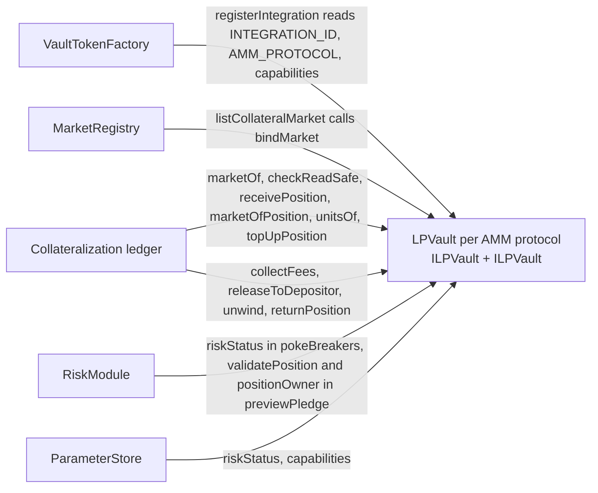

Function links point to the interface that declares each function.

# AMM integration lifecycle

`ILPVault` and `ILPVault` are the AMM-neutral surface every LPVault implements, so Collateralization, the LPOracle, the RiskModule and the Lens handle a Uniswap v3 NFT, a Uniswap v4 PositionManager NFT, a Slipstream NFT or a fungible LP share the same way: a position is `(integrationId, positionKey)` and every amount is an array in the market's token order.

## Walkthrough

Setup (Ethereum market 1, Uniswap v3 USDC/USDT 0.01%, exact range `[−887,272, 887,272]`, `tokens = [USDC, USDT]`, from 3.1).

1. **VaultTokenFactory `registerIntegration`** reads [`INTEGRATION_ID`](../custody/lp-vault/ILPVault.sol#L40), [`AMM_PROTOCOL`](../custody/lp-vault/ILPVault.sol#L43) (`keccak256("UNISWAP_V3")`) and [`capabilities`](../custody/lp-vault/ILPVault.sol#L46).
2. **MarketRegistry → [`bindMarket`](../custody/lp-vault/ILPVault.sol#L57)** at listing; [`marketOf`](../custody/lp-vault/ILPVault.sol#L60) returns the pool, shape and tokens afterwards. [`riskMetadata`](../custody/lp-vault/ILPVault.sol#L133) is a view for off-chain listing review; no Avana contract calls it.
3. **RiskModule `previewPledge` → [`positionOwner`](../custody/lp-vault/ILPVault.sol#L90), then [`validatePosition`](../custody/lp-vault/ILPVault.sol#L95)`(1, W, key)`**: the owner must be `W`; 25,000,000,000 units for the NFT on the exact range; a `[−10, 10]` NFT is refused because it would be credited about 2,000 times its value. The app may also call `validatePosition` directly.
4. **Collateralization → [`checkReadSafe`](../custody/lp-vault/ILPVault.sol#L169), [`receivePosition`](../custody/lp-vault/ILPVault.sol#L72)**; afterwards [`depositorOf`](../custody/lp-vault/ILPVault.sol#L145), [`marketOfPosition`](../custody/lp-vault/ILPVault.sol#L152) and [`unitsOf`](../custody/lp-vault/ILPVault.sol#L157) answer for the key.
5. **The LPOracle prices the market with its own pricing module**, not through the integration: its `_composition` gives about 1 USDC + 1 USDT per whole vault token at `[1e8, 1e8]` (each floored, less 1 raw unit), so $2.00, and its `_consistency` compares the pool's time-weighted price with the oracle within `consistencyToleranceBps` (0.5%). The integration's [`composition`](../custody/lp-vault/ILPVault.sol#L108), [`consistencyDeviation`](../custody/lp-vault/ILPVault.sol#L176), [`effectiveSupply`](../custody/lp-vault/ILPVault.sol#L197) and [`rateProviders`](../custody/lp-vault/ILPVault.sol#L183) are views of the integration; no Avana contract calls them.
6. **RiskModule → [`riskStatus`](../custody/lp-vault/ILPVault.sol#L142)** over `twapWindow` (30 min): in-range liquidity 40,000,000,000,000, so Avana's 1,525,000,000,000 units are 3.81% of the pool, under an illustrative per-pool cap of 10% (`poolShareMaxBpsOf`; default 10,000 bps, off).
7. **Collateralization → [`collectFees`](../custody/lp-vault/ILPVault.sol#L132), [`releaseToDepositor`](../custody/lp-vault/ILPVault.sol#L120), [`unwind`](../custody/lp-vault/ILPVault.sol#L116), [`topUpPosition`](../custody/lp-vault/ILPVault.sol#L87), [`returnPosition`](../custody/lp-vault/ILPVault.sol#L76)** for fees (41.25 USDC + 39.87 USDT after 30 days), partial removal, liquidation unwind (Alice's 4,998 vault tokens give about 4,998 USDC + 4,998 USDT), fungible-share top-ups and exit.
8. **Native ETH legs and pool hooks**: [`wrappedNative`](../custody/lp-vault/ILPVault.sol#L189) names the wrapped token an integration uses for a native ETH leg, and [`isAllowedPoolHook`](../custody/lp-vault/ILPVault.sol#L192) reports whether a pool hook is allowlisted; both are views no Avana contract calls today. Uniswap v3 and Slipstream have neither native legs nor hooks; the Uniswap v4 LPVault returns WETH9 and allows only `address(0)`, so only hookless pools are listed, and a native ETH leg is paid as WETH.

Protocol-specific steps: [Uniswap v3](uniswap-v3/LIFECYCLE.md), [Uniswap v4](uniswap-v4/LIFECYCLE.md), [Aerodrome Slipstream](slipstream/LIFECYCLE.md); the custody side is in [LPVault](../custody/lp-vault/LIFECYCLE.md).

## What the UI reads and calls

- Lens: [`getRecords`](../lens/lens/ILensAccount.sol#L29), [`checkRecordBacking`](../lens/lens/ILensMarket.sol#L21), [`getCapHeadroom`](../lens/lens/ILensMarket.sol#L33); direct [`validatePosition`](../custody/lp-vault/ILPVault.sol#L95) before a pledge.
- Events to index: the LPVault's events ([ILPVaultBase.sol](../custody/lp-vault/ILPVaultBase.sol)).
- User calls: none.

## Spec

- [2.19 AMM Integration Interface](../../../docs/spec/02-contracts/19-amm-integration-interface.md): `REQ-AMM-CORE-001`–`REQ-AMM-CORE-012`, `SPEC-ORC-007` (composition).
- [2.23 Uniswap v4 Integration](../../../docs/spec/02-contracts/23-uniswap-v4-integration.md).
- [2.22 AMM Integration Readiness](../../../docs/spec/02-contracts/22-amm-integration-readiness.md) for Uniswap v2, Curve and Balancer.
