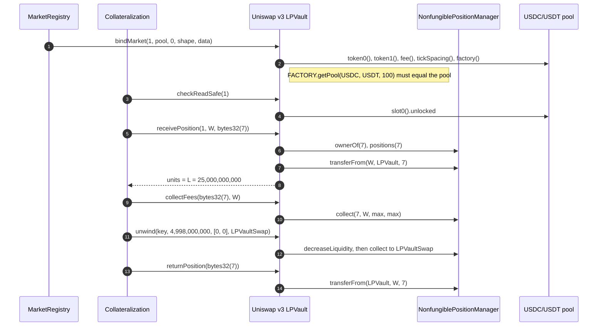

# Uniswap v3 LPVault lifecycle

The contract is [`UniswapV3Integration`](UniswapV3Integration.sol) on the shared concentrated-liquidity base ([`ClLPVaultCustody`](../concentrated-liquidity/ClLPVaultCustody.sol), [`ClLPVaultMarkets`](../concentrated-liquidity/ClLPVaultMarkets.sol), [`ClPriceMath`](../concentrated-liquidity/ClPriceMath.sol)), which the Slipstream LPVault reuses.

The Uniswap v3 LPVault on Ethereum custodies canonical NonfungiblePositionManager positions in exact-range markets; `positionKey = bytes32(tokenId)` and a position's units are its liquidity `L`.

## Walkthrough

Setup (Ethereum market 1, USDC/USDT 0.01% pool, `tickSpacing = 1`, exact range `[−887,272, 887,272]`, vault token 6 decimals, $2.00 per whole token, from 3.1 and 3.7). Wallet `W` holds NFT #7 with `L = 25,000,000,000`.

1. **MarketRegistry → [`bindMarket`](../concentrated-liquidity/ClLPVaultMarkets.sol#L42)** stores the pool from [`FACTORY`](UniswapV3Integration.sol#L76)`.getPool(USDC, USDT, 100)` and the range; [`clMarket`](../concentrated-liquidity/ClLPVaultMarkets.sol#L94) returns it.
2. **W approves the LPVault on [`NFPM`](UniswapV3Integration.sol#L70); Collateralization → [`receivePosition`](../concentrated-liquidity/ClLPVaultCustody.sol#L33)`(1, W, bytes32(7))`.** The LPVault reads `NFPM.positions(7)` (token pair, fee, `tickLower == −887,272`, `tickUpper == 887,272`), pulls the NFT and returns 25,000,000,000. [`tokenIdOf`](../concentrated-liquidity/ClLPVaultMarkets.sol#L117)`(key) = 7`. Errors: `PoolMismatch`, `RangeMismatch`, `NotTokenOwner`.
3. **[`checkReadSafe`](../concentrated-liquidity/ClLPVaultMarkets.sol#L213)** reads `slot0().unlocked` with the v3 layout before every custody change; `PoolLocked` inside a pool callback.
4. **LPOracle → [`oracleSqrtPrice`](../concentrated-liquidity/ClLPVaultMarkets.sol#L154)** computes the oracle sqrt price from Chainlink USDC/USD and USDT/USD and clamps it to the range; [`composition`](../concentrated-liquidity/ClLPVaultMarkets.sol#L129) then gives 1 USDC + 1 USDT per whole vault token.
5. **Collateralization → [`collectFees`](../concentrated-liquidity/ClLPVaultCustody.sol#L131)`(bytes32(7), W)`** after 30 days: the LPVault makes one `NFPM.collect` with both caps at `type(uint128).max` and the depositor as recipient (the NFPM updates the position's fee growth itself), paying 41.25 USDC and 39.87 USDT to W. Liquidity and credited units stay 25,000,000,000.
6. **Liquidation (Alice, GHO debt, 3.5 `LIQ-068`) → [`unwind`](../concentrated-liquidity/ClLPVaultCustody.sol#L98)`(key, 4,998,000,000, [0, 0], LPVaultSwap)`:** `NFPM.decreaseLiquidity` then `collect` capped at that principal, about 4,998 USDC + 4,998 USDT to LPVaultSwap; Alice keeps 136,234 vault tokens and all fees.
7. **W → AaveAdapter `withdraw`; Collateralization → [`returnPosition`](../concentrated-liquidity/ClLPVaultCustody.sol#L69)`(bytes32(7))`** sends the NFT back to W with its owed fees.
8. **NFT sent outside a pledge:** [`onERC721Received`](../concentrated-liquidity/ClLPVaultCustody.sol#L172) records it as stray (only from the bound NFPM, else `UnsupportedNft`); the AvanaTimelock returns it with [`returnStray`](../concentrated-liquidity/ClLPVaultCustody.sol#L157).

## What the UI reads and calls

- Lens: [`getRecords`](../../lens/lens/ILensAccount.sol#L47), [`checkRecordBacking`](../../lens/lens/ILensMarket.sol#L33); direct [`validatePosition`](../concentrated-liquidity/ClLPVaultCustody.sol#L54), [`tokenIdOf`](../concentrated-liquidity/ClLPVaultMarkets.sol#L117).
- Events to index: LPVault `PositionReceived`, `PositionReturned`, `UnitsUnwound`, `UnitsReleased`, `FeesCollected` ([ILPVaultEvents.sol](../../custody/lp-vault/ILPVaultEvents.sol)); Uniswap's `DecreaseLiquidity` and `Collect`.
- User calls: the depositor approves the LPVault on the NFPM, and adds liquidity with `NFPM.increaseLiquidity` before AaveAdapter `recredit`.

## Spec

- [2.20 Uniswap v3 Integration](../../../../spec/02-contracts/20-uniswap-v3-integration.md): `REQ-VAULT-008`, `REQ-VAULT-009`, `REQ-VAULT-011`, `REQ-VAULT-057`, `REQ-VAULT-058`, `REQ-VAULT-065`, `REQ-VAULT-147`–`REQ-VAULT-149`, `REQ-AMM-V3-001`, `REQ-AMM-V3-003`, `REQ-AMM-V3-004`, `SPEC-BACK-008`.
- Flows: [3.1](../../../../spec/03-operations/01-deposit.md) worked example, [3.5](../../../../spec/03-operations/05-liquidation.md) `LIQ-023`, `LIQ-068`, [3.7](../../../../spec/03-operations/07-collect-fees.md) worked example.
