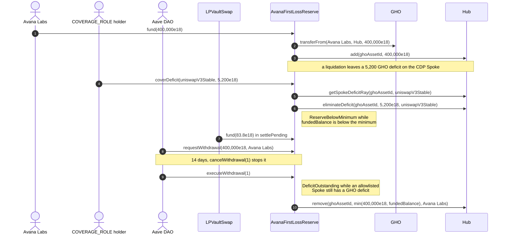

# Avana Umbrella (First-Loss Reserve) lifecycle

The First-Loss Reserve holds the First-Loss Reserve of one `(Hub, debt asset)` as Hub added shares. Avana Labs funds it, the Aave DAO controls it through its AccessManager, and its shares leave only to eliminate a recorded deficit of an allowlisted CDP Spoke on its own asset, or through a DAO withdrawal after 14 days.

## Walkthrough

Ethereum GHO instance on the Stable LP Hub (illustrative 400,000 GHO minimum; the funding ARFC sets the real one).

1. **Avana deploys [`AvanaFirstLossReserve`](AvanaFirstLossReserve.sol#L93)`(hub, GHO, ghoAssetId, aaveAccessManager, 1,209,600)`** after the Hub lists GHO. The constructor fixes [`HUB`](AvanaFirstLossReserve.sol#L269), [`ASSET`](AvanaFirstLossReserve.sol#L263), [`ASSET_ID`](AvanaFirstLossReserve.sol#L275) and [`RESERVE_WITHDRAWAL_DELAY`](AvanaFirstLossReserve.sol#L281). Errors: [`ZeroAddress`](IAvanaFirstLossReserveErrors.sol#L13), [`InvalidHubAsset`](IAvanaFirstLossReserveErrors.sol#L18) (the Hub does not list GHO with its 18 decimals under that ID), [`InvalidWithdrawalDelay`](IAvanaFirstLossReserveErrors.sol#L23).
2. **The Aave DAO's payload** registers it on GHO with `drawCap = 0` and `addCap = MAX_ALLOWED_SPOKE_CAP` (so yield can never fill a cap and stop `fund`), grants it `HUB_DEFICIT_ELIMINATOR_ROLE`, maps `coverDeficit` to `COVERAGE_ROLE` (granted to Avana's Emergency Guardian and the Aave Protocol Guardian, either able to cover within 72 hours) and the DAO functions to `RESERVE_ADMIN_ROLE`, then calls [`setAllowedBorrowSpoke`](AvanaFirstLossReserve.sol#L160)`(uniswapV3Stable, true)` and [`setFirstLossReserveMinimum`](AvanaFirstLossReserve.sol#L175)`(400,000e18)`. Events: [`BorrowSpokeAllowlistUpdated`](IAvanaFirstLossReserveAdmin.sol#L16), [`FirstLossReserveMinimumUpdated`](IAvanaFirstLossReserveAdmin.sol#L22). Error: [`BorrowSpokeNotListed`](IAvanaFirstLossReserveErrors.sol#L48) for a Spoke the Hub does not list on GHO.
3. **Avana Labs → [`fund`](AvanaFirstLossReserve.sol#L116)`(400,000e18)`** after approving it. The 400,000 GHO move straight to the Hub, `Hub.add` credits the shares to the First-Loss Reserve, and the Hub's balance rise must equal the amount. Event: [`ReserveFunded`](IAvanaFirstLossReserve.sol#L31). Errors: [`ZeroAmount`](IAvanaFirstLossReserveErrors.sol#L27), [`TransferAmountMismatch`](IAvanaFirstLossReserveErrors.sol#L33); the Hub's `SpokeHalted`, `SpokeNotActive` and, for an amount below one share's value, `InvalidShares`. `enableDebtReserve` can now name the instance and the GHO `drawCap` can rise.
4. **A liquidation leaves an account with no collateral**; the CDP Spoke reports a 5,200 GHO deficit to the Hub.
5. **`COVERAGE_ROLE` → [`coverDeficit`](AvanaFirstLossReserve.sol#L136)`(uniswapV3Stable, 5,200e18)`.** Amount `= min(5,200, ceil(deficitRay / RAY), fundedBalance()) = 5,200 GHO`; `Hub.eliminateDeficit` burns the matching shares, rounded up, and clears the deficit. Event: [`DeficitCovered`](IAvanaFirstLossReserve.sol#L42), then [`ReserveBelowMinimum`](IAvanaFirstLossReserve.sol#L56)`(394,800e18, 400,000e18)`. Errors: [`SpokeNotAllowlisted`](IAvanaFirstLossReserveErrors.sol#L38), [`NothingToCover`](IAvanaFirstLossReserveErrors.sol#L43), the AccessManager's `AccessManagedUnauthorized`. It works while either Spoke is halted.
6. **Monitoring pages on the alert** ([`isBelowMinimum`](AvanaFirstLossReserve.sol#L243) is true); GHO borrows continue unless a guardian trips the debt breaker. Avana Labs calls [`fund`](AvanaFirstLossReserve.sol#L116)`(5,200e18)` and the alert clears with no reset call.
7. **Pending settlement.** LPVaultSwap's [`settlePending`](../../liquidation/lp-vault-swap/ILPVaultSwapLiquidation.sol#L76) recovers 83.8 GHO and calls [`fund`](AvanaFirstLossReserve.sol#L116)`(83.8e18)` like any funder; `ReserveFunded` names LPVaultSwap. An amount below one share's value would revert `InvalidShares`, so `settlePending` carries such an amount to the next settlement instead.
8. **Credit line closed.** The DAO calls [`requestWithdrawal`](AvanaFirstLossReserve.sol#L186)`(400,000e18, avanaLabs)` at `1,780,000,000`; it is executable from `1,781,209,600`. Event: [`WithdrawalRequested`](IAvanaFirstLossReserve.sol#L64). Errors: [`ZeroAmount`](IAvanaFirstLossReserveErrors.sol#L27), [`InvalidRecipient`](IAvanaFirstLossReserveErrors.sol#L53). [`cancelWithdrawal`](AvanaFirstLossReserve.sol#L202) stops a Pending request ([`WithdrawalCancelled`](IAvanaFirstLossReserve.sol#L69)).
9. **After 14 days, the DAO → [`executeWithdrawal`](AvanaFirstLossReserve.sol#L214)`(1)`.** It withdraws `min(400,000e18, fundedBalance())` from the Hub straight to Avana Labs. Event: [`WithdrawalExecuted`](IAvanaFirstLossReserve.sol#L78) and, below the minimum, [`ReserveBelowMinimum`](IAvanaFirstLossReserve.sol#L56). Errors: [`WithdrawalNotPending`](IAvanaFirstLossReserveErrors.sol#L58), [`WithdrawalNotReady`](IAvanaFirstLossReserveErrors.sol#L64), [`DeficitOutstanding`](IAvanaFirstLossReserveErrors.sol#L70) while an allowlisted Spoke still has a recorded GHO deficit (coverage comes first); the Hub's `InsufficientLiquidity`, `SpokeHalted` and `InvalidAmount`. Every revert leaves the request Pending. The totals are signed: with a year of yield the reserve can cover more than was ever funded.

## What the UI reads and calls

- Lens: [`getTailCoverage`](../../lens/lens/ILensRisk.sol#L50)`(asset)`, [`uncoveredDeficit`](../../lens/lens/ILensRisk.sol#L59)`(hub, asset)`.
- Views: [`fundedBalance`](AvanaFirstLossReserve.sol#L237), [`isBelowMinimum`](AvanaFirstLossReserve.sol#L243), [`firstLossReserveMinimum`](IAvanaFirstLossReserve.sol#L142), [`fundedShares`](AvanaFirstLossReserve.sol#L249), [`getWithdrawal`](AvanaFirstLossReserve.sol#L255), [`allowedBorrowSpoke`](IAvanaFirstLossReserveViews.sol#L23).
- Events to index: `ReserveFunded`, `DeficitCovered`, `ReserveBelowMinimum`, `WithdrawalRequested`, `WithdrawalCancelled`, `WithdrawalExecuted`, `BorrowSpokeAllowlistUpdated`, `FirstLossReserveMinimumUpdated`.
- User calls: none; [`fund`](AvanaFirstLossReserve.sol#L116) is open to anyone but has no user flow.

## Spec

- [2.14 First-Loss Reserve](../../../../docs/spec/02-contracts/14-first-loss-reserve.md): `REQ-FLR-001`–`REQ-FLR-045`, `SPEC-FLR-001`–`SPEC-FLR-003`.
- Flow: [3.9 Deficit Coverage](../../../../docs/spec/03-operations/09-deficit-coverage.md) `DEF-009`, `DEF-011`, `DEF-015`, `DEF-016`, `DEF-017`.
