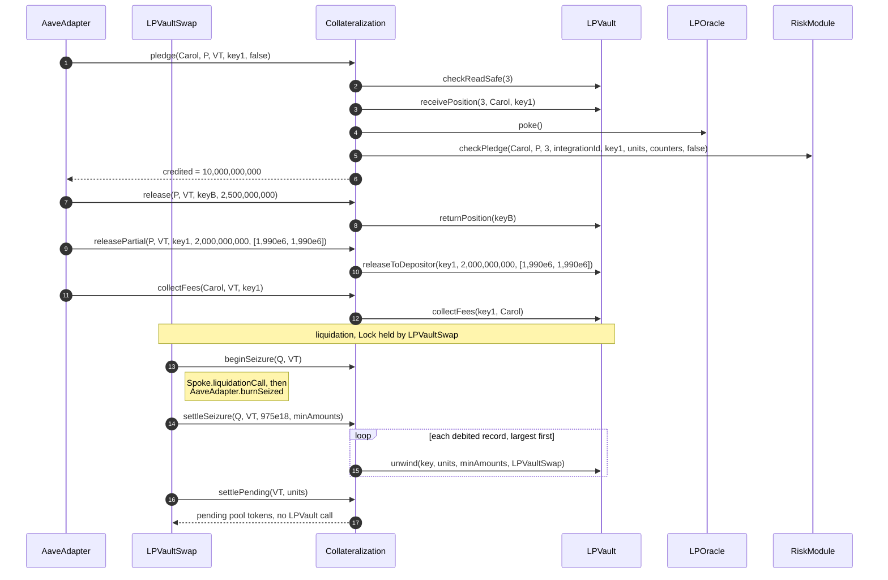

# Collateralization lifecycle

Collateralization is the immutable backing ledger: it holds one record per pledged position, books the RiskModule's cap charge, decides which records a seizure debits, and keeps every market's vault-token supply at or below credited plus pending units.

## Walkthrough

Setup (Base market 3, from 3.1 `DEP-029` and 3.4 `WDR-045`): one whole vault token (10^6 units) is worth $2.00; `marketUsdCap = $5,000,000` with $1,000,000 booked in `Regular`; at most 16 open records per account and market. Every call below comes from the AaveAdapter or LPVaultSwap while it holds the Lock.

1. **AaveAdapter → [`pledge`](CollateralizationPledge.sol#L27)`(Carol, P, VT, key1, false)`.** Checks the vault token, `isValidProxy(P)`, no open record for the key, fewer than 16 records, the pool lock (`checkReadSafe`); calls LPVault [`receivePosition`](../../amm/IAmmIntegration.sol#L47) (units 10,000,000,000), LPOracle [`poke`](../../oracle/lp-oracle/ILPOracle.sol#L59) and RiskModule [`checkPledge`](../../policy/risk-module/IRiskModuleChecks.sol#L23), which returns a $20,000 charge with `sliceUsd = 0`. Writes record 1, inserts it largest-first, adds $20,000 to `Regular` and the USDC and USDT counters, and returns `credited = 10,000,000,000`. Event: [`CollateralPledged`](ICollateralizationEvents.sol#L14). Errors: [`InvalidDepositor`](ICollateralizationErrors.sol#L70), [`InvalidVaultToken`](ICollateralizationErrors.sol#L18), [`UnknownProxy`](ICollateralizationErrors.sol#L20), [`AlreadyPledged`](ICollateralizationErrors.sol#L28), [`TooManyRecords`](ICollateralizationErrors.sol#L22), [`InvalidCharge`](ICollateralizationErrors.sol#L34); RiskModule errors pass through unchanged.
2. **AaveAdapter → [`pledge`](CollateralizationPledge.sol#L27) of `keyB` (2,500,000,000 units, $5,000).** Record 2 of 16; the account's credited units are 12,500,000,000. A borrow in between only set the indebted mark through [`markIndebted`](CollateralizationDebtMark.sol#L14); it booked no charge.
3. **AaveAdapter → [`recredit`](CollateralizationPledge.sol#L97)** (Ethereum example of 3.1): after `increaseLiquidity`, `added = live − credited = 27,500,000,000 − 25,000,000,000 = 2,500,000,000`; charge $5,000; the record's basis becomes 27,500,000,000 units and $55,000 and it keeps its list position. Event: [`RecordRecredited`](ICollateralizationEvents.sol#L75). Errors: [`NothingToRecredit`](ICollateralizationErrors.sol#L78), [`NotDepositor`](ICollateralizationErrors.sol#L43).
4. **AaveAdapter → [`release`](CollateralizationRelease.sol#L25)`(P, VT, keyB, 2,500,000,000)`** after the Adapter burned the units. Reconciles first against the proxy's supplied shares, requires `units == credited`, releases the $5,000 charge, closes the record, then calls LPVault [`returnPosition`](../../amm/IAmmIntegration.sol#L52). Event: [`CollateralReleased`](ICollateralizationEvents.sol#L28). Errors: [`RecordNotFound`](ICollateralizationErrors.sol#L36), [`NotRecordProxy`](ICollateralizationErrors.sol#L38), [`UnitsMismatch`](ICollateralizationErrors.sol#L41).
5. **AaveAdapter → [`releasePartial`](CollateralizationRelease.sol#L40)`(P, VT, key1, 2,000,000,000, [1,990e6, 1,990e6])`.** Requires `0 < units < credited`; debits in place to 8,000,000,000 units, releases `$20,000 × 2 / 10 = $4,000`, then calls LPVault [`releaseToDepositor`](../../amm/IAmmIntegration.sol#L96), which pays about 2,000 USDC + 2,000 USDT to Carol. Event: [`RecordReduced`](ICollateralizationEvents.sol#L72). Errors: [`PartialRemovalTooLarge`](ICollateralizationErrors.sol#L77), [`BelowMinimum`](ICollateralizationErrors.sol#L26).
6. **AaveAdapter → [`collectFees`](CollateralizationRelease.sol#L104)`(Carol, VT, key1)`.** The LPVault's [`collectFees`](../../amm/IAmmIntegration.sol#L106) pays 16.50 USDC and 15.95 USDT to Carol; no unit or counter changes. Error: [`NotDepositor`](ICollateralizationErrors.sol#L43).
7. **LPVaultSwap → [`beginSeizure`](CollateralizationSeizure.sol#L17)`(Q, VT)`** before `Spoke.liquidationCall` on Bob's account (3.5 `LIQ-069`). Stores `sharesBefore` and `supplyBefore` in transient storage. Errors: [`SharesNotEqualAssets`](ICollateralizationErrors.sol#L47), [`SeizureActive`](ICollateralizationErrors.sol#L49).
8. **LPVaultSwap → [`settleSeizure`](CollateralizationSeizure.sol#L32)`(Q, VT, 975e18, minAmounts)`** after the AaveAdapter's `burnSeized`. Checks supply drop = 975e18 and share drop ≥ 975e18 (with Aave's `liquidationFee` at 0 the two are equal; a fee's extra share drop is reconciled into the pending balance, `REQ-VAULT-176`), reconciles, debits 975 vault tokens from the head of the largest-first list, releases exposure, and calls LPVault [`unwind`](../../amm/IAmmIntegration.sol#L92) for each debited record: about 1,030 USDC + 1,010 USDT reach LPVaultSwap; fees stay with the position. Events: [`RecordDebited`](ICollateralizationEvents.sol#L40), [`SeizureSettled`](ICollateralizationEvents.sol#L52), [`SeizureReconciled`](ICollateralizationEvents.sol#L57) when a shortfall is reconciled. Errors: [`SeizureMismatch`](ICollateralizationErrors.sol#L52), [`DebitMismatch`](ICollateralizationErrors.sol#L55), [`SupplyDropMismatch`](ICollateralizationErrors.sol#L59), [`InsufficientCredit`](ICollateralizationErrors.sol#L61), [`BelowMinimum`](ICollateralizationErrors.sol#L26).
9. **Pending balance.** If a seizure is never settled, the next reconcile (3.4 worked example) moves the 12,000,000,000 missing units of `key7` into `pending[VT] = {12,000,000,000; [11,998.500187 USDC, 12,001.5 USDT]}`. Anyone then calls LPVaultSwap `settlePending`, which calls [`settlePending`](CollateralizationPending.sol#L23)`(VT, units)`; 300 of 1,000 pending units pay `[180, 120]` of `[600, 401]`. Event: [`PendingSettled`](ICollateralizationEvents.sol#L60). Errors: [`PendingExceeded`](ICollateralizationErrors.sol#L64), [`SupplyDropMismatch`](ICollateralizationErrors.sol#L59).
10. **AaveAdapter → [`releaseForDeleverage`](CollateralizationRelease.sol#L64)** inside a repay with collateral: debits 1,500,000,000 units of record #31 and unwinds them to LPVaultSwap; closes the record when credited reaches 0. Then [`markDebtFree`](CollateralizationDebtMark.sol#L26) clears the mark once Aave reports `borrowCount == 0` (a read that fails with under 50,000 gas left reverts [`InsufficientGas`](ICollateralizationErrors.sol#L73); one that fails with more keeps the mark, and anyone clears it later through the AaveAdapter's [`refreshDebtMark`](../../policy/aave-adapter/IAaveAdapterUser.sol#L87)); [`releaseZeroCredit`](CollateralizationRelease.sol#L86) returns a record a seizure took to 0 (error [`RecordHasCredit`](ICollateralizationErrors.sol#L45) otherwise).

## What the UI reads and calls

- Lens: [`getRecords`](../../lens/lens/ILensAccount.sol#L29), [`getAccount`](../../lens/lens/ILensAccount.sol#L20), [`checkBacking`](../../lens/lens/ILensMarket.sol#L15), [`checkRecordBacking`](../../lens/lens/ILensMarket.sol#L21), [`getPendingSettlement`](../../lens/lens/ILensMarket.sol#L28), [`getCapHeadroom`](../../lens/lens/ILensMarket.sol#L33); direct views [`previewRelease`](CollateralizationViews.sol#L130) (the `units` argument of `withdraw`), [`previewRecredit`](CollateralizationViews.sol#L140), [`getAccountRecords`](CollateralizationViews.sol#L41), [`getPending`](CollateralizationViews.sol#L86).
- Events to index: [ICollateralizationEvents.sol](ICollateralizationEvents.sol): `CollateralPledged`, `CollateralReleased`, `RecordReduced`, `RecordRecredited`, `RecordDebited`, `SeizureSettled`, `SeizureReconciled`, `PendingSettled`, `CounterSaturated`.
- User calls: none directly; users reach it through the AaveAdapter (`pledge`, `withdraw`, `removeLiquidity`, `recredit`, `collectFees`, `releaseZeroCredit`).

## Spec

- [2.3 Collateralization](../../../../docs/spec/02-contracts/03-collateralization.md): `REQ-VAULT-007`–`REQ-VAULT-019` (pledge), `REQ-VAULT-046`–`REQ-VAULT-063` (seizure), `REQ-VAULT-137`–`REQ-VAULT-146` (pending), `REQ-COLL-014`–`REQ-COLL-017`, `REQ-COLL-038`–`REQ-COLL-040`, `SPEC-BACK-004`–`SPEC-BACK-009`, `SPEC-BACK-011`–`SPEC-BACK-014`.
- Flows: [3.1](../../../../docs/spec/03-operations/01-deposit.md) `DEP-012`, [3.4](../../../../docs/spec/03-operations/04-withdraw.md) `WDR-025`–`WDR-028`, [3.5](../../../../docs/spec/03-operations/05-liquidation.md) `LIQ-020`–`LIQ-024`, `LIQ-057`.
