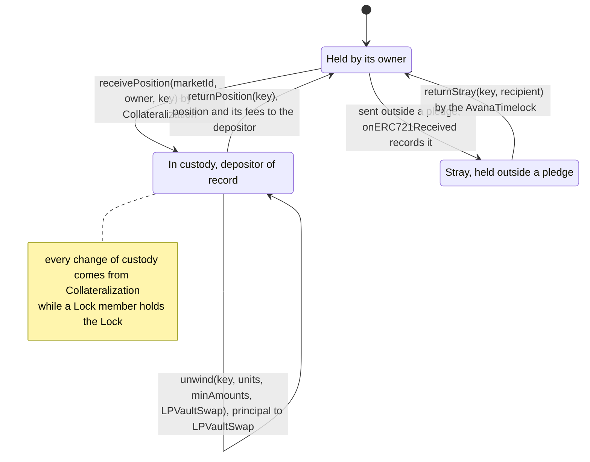

Function links point to the interface that declares each function.

# LPVault lifecycle

The LPVault is the immutable custodian of one AMM protocol's positions on one chain: it binds each market to its pool and exact shape, holds pledged positions, removes exactly the units Collateralization names, and pays fees and principal only to the depositor of record or LPVaultSwap. `ILPVault` extends [`ILPVault`](ILPVault.sol) and [`ILPVault`](ILPVault.sol).

## Walkthrough

Setup (Base market 3, Aerodrome Slipstream USDC/USDT, tick spacing 1, exact range `[−887,272, 887,272]`, from 3.1 `DEP-029`). Every state-changing call except `bindMarket` and `returnStray` comes from Collateralization while the Lock is held.

1. **MarketRegistry → [`bindMarket`](ILPVault.sol#L57)** inside `listCollateralMarket`: stores pool, shape and tokens `[USDC, USDT]` for market 3, once. Event: [`MarketBound`](ILPVaultBase.sol#L14). Errors: [`NotMarketRegistry`](ILPVaultBase.sol#L42), [`MarketBinding`](ILPVaultBase.sol#L45), [`InvalidPool`](ILPVaultBase.sol#L48), [`InvalidShape`](ILPVaultBase.sol#L51).
2. **RiskModule `previewPledge` (and the app directly) → [`validatePosition`](ILPVault.sol#L95)** before Carol signs: checks owner, pool, exact ticks, gauge staking and returns 10,000,000,000 units without moving anything.
3. **Collateralization → [`checkReadSafe`](ILPVault.sol#L169), then [`receivePosition`](ILPVault.sol#L72)`(3, Carol, key1)`.** Pulls the NFT from Carol (she approved the LPVault on the NFPM), re-reads units after custody and records Carol as depositor. Event: [`PositionReceived`](ILPVaultBase.sol#L16). Errors: [`PoolLocked`](ILPVaultBase.sol#L60), [`NotTokenOwner`](ILPVaultBase.sol#L63), [`PoolMismatch`](ILPVaultBase.sol#L53), [`RangeMismatch`](ILPVaultBase.sol#L58) (a `[−10, 10]` range would be credited about 2,000 times its value), [`PositionEncumbered`](ILPVaultBase.sol#L66).
4. **Pricing:** the LPOracle computes the composition with its own pricing module on every price evaluation, without calling the LPVault (its [`composition`](ILPVault.sol#L108) view is called by no Avana contract): 1 whole vault token holds 1 USDC + 1 USDT at the oracle price vector, so $2.00. **RiskModule → [`riskStatus`](ILPVault.sol#L142)** for the pool-share and depth checks (Avana holds 2.05% of the pool after Carol's pledge).
5. **Collateralization → [`collectFees`](ILPVault.sol#L132)`(key1, Carol)`.** Calls the NFPM's `collect` with Carol as recipient: 16.50 USDC and 15.95 USDT; liquidity unchanged. Event: [`FeesCollected`](ILPVaultBase.sol#L29). Errors: [`NotDepositor`](ILPVaultBase.sol#L72), [`FeesRolledIn`](ILPVaultBase.sol#L90) for AMMs that compound fees.
6. **Collateralization → [`releaseToDepositor`](ILPVault.sol#L120)`(key1, 2,000,000,000, [1,990e6, 1,990e6])`** for a partial removal: `decreaseLiquidity` then `collect` capped at that principal, about 2,000 USDC + 2,000 USDT to Carol. Event: [`UnitsReleased`](ILPVaultBase.sol#L27). Errors: [`BelowMinimum`](ILPVaultBase.sol#L87), [`ZeroUnits`](ILPVaultBase.sol#L68).
7. **Collateralization → [`unwind`](ILPVault.sol#L116)`(key, 1,020,000,000, [0, 0], LPVaultSwap)`** in Carol's liquidation (3.5 `LIQ-089`): reads Slipstream's own `slot0()` layout for the lock check, removes exactly 1,020 vault tokens of liquidity and sends about 1,020 USDC + 1,020 USDT to LPVaultSwap; owed fees stay with the position for Carol. Event: [`UnitsUnwound`](ILPVaultBase.sol#L24). Error: [`NotInCustody`](ILPVaultBase.sol#L70).
8. **Collateralization → [`topUpPosition`](ILPVault.sol#L87)** for fungible-share AMMs only; NFT integrations revert [`TopUpNotSupported`](ILPVaultBase.sol#L99) and take units through the NFPM's `increaseLiquidity` instead.
9. **Collateralization → [`returnPosition`](ILPVault.sol#L76)`(keyB)`** when Carol withdraws: the NFT goes back to Carol with every fee it accrued. Event: [`PositionReturned`](ILPVaultBase.sol#L21).
10. **AvanaTimelock → [`returnStray`](ILPVault.sol#L16)** for an NFT sent to the LPVault outside a pledge (recorded by `onERC721Received` as [`StrayReceived`](ILPVaultBase.sol#L32)); normal delay. Event: [`StrayReturned`](ILPVaultBase.sol#L35). Errors: [`NotTimelock`](ILPVaultBase.sol#L83), [`NotStray`](ILPVaultBase.sol#L75).

The Uniswap v4 LPVault runs the same steps through the v4 PositionManager ([Uniswap v4 lifecycle](../../amm/uniswap-v4/LIFECYCLE.md)). Steps 5 to 7 are each one `modifyLiquidities` batch that pays the fees to the depositor before any principal moves, because a v4 decrease pays both in one delta. A native ETH leg arrives as WETH. An account holds at most 8 open records in a v4 market (`REQ-AMM-V4-012`), against 16 for Uniswap v3 and Slipstream.

## What the UI reads and calls

- Lens: [`getRecords`](../../lens/lens/ILensAccount.sol#L28), [`checkRecordBacking`](../../lens/lens/ILensMarket.sol#L20) (custody and live liquidity per record); direct views [`validatePosition`](ILPVault.sol#L95), [`isInCustody`](ILPVault.sol#L23), [`depositorOf`](ILPVault.sol#L145), [`unitsOf`](ILPVault.sol#L157) (all revert `Locked` while the Lock is held).
- Events to index: [ILPVaultBase.sol](ILPVaultBase.sol): `PositionReceived`, `PositionReturned`, `UnitsUnwound`, `UnitsReleased`, `FeesCollected`, `StrayReceived`, `StrayReturned`, `MarketBound`.
- User calls: none; the depositor approves the LPVault on the NFPM before `AaveAdapter.pledge`.

## Spec

- [2.2 LP Vault](../../../../docs/spec/02-contracts/02-lp-vault.md): `REQ-VAULT-010`, `REQ-VAULT-031`, `REQ-VAULT-064`–`REQ-VAULT-066`, `REQ-AMM-CORE-007`, `REQ-AMM-CORE-011`, `SPEC-BACK-008`.
- [2.19 AMM Integration Interface](../../../../docs/spec/02-contracts/19-amm-integration-interface.md), [2.20 Uniswap v3](../../../../docs/spec/02-contracts/20-uniswap-v3-integration.md), [2.23 Uniswap v4](../../../../docs/spec/02-contracts/23-uniswap-v4-integration.md), [2.21 Aerodrome Slipstream](../../../../docs/spec/02-contracts/21-aerodrome-slipstream-integration.md).
