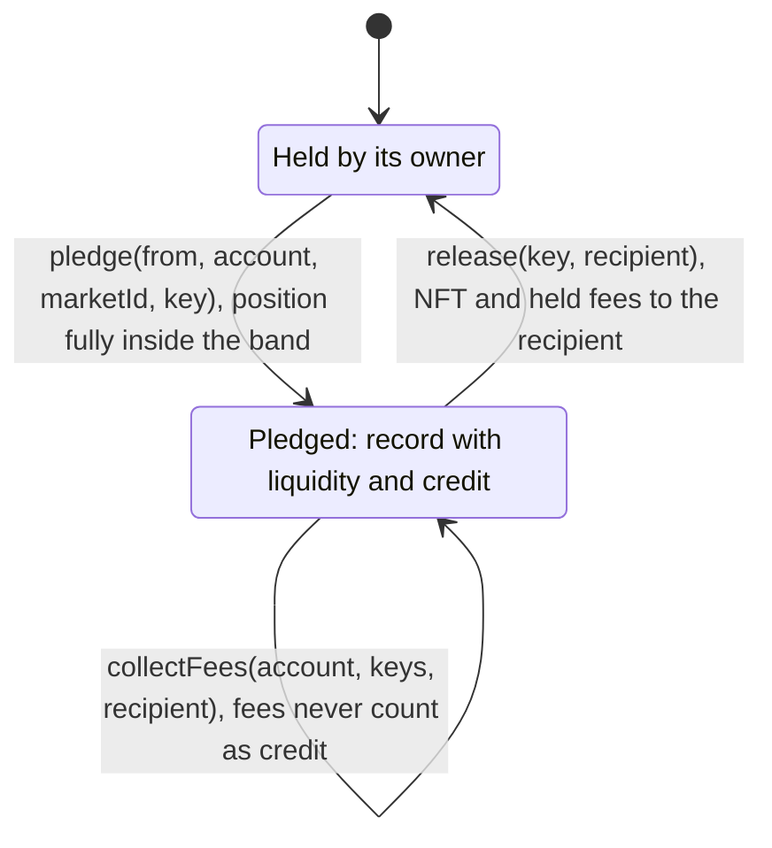

Function links point to the interface that declares each function.

# LPVault lifecycle

The LPVault holds concentrated-liquidity NFTs pledged to band markets, one record per NFT: owner account, market,
liquidity and floor credit. [`LPVault`](LPVault.sol) is the shared base; each AMM part (Uniswap v3, Slipstream,
Uniswap v4) supplies the position reads and the liquidity calls. Every mutating function in
[`ILPVault`](ILPVault.sol) is restricted through the AccessManager and runs under one transient reentrancy guard.

- **Markets.** `listMarket(marketId, pool, bandLower, bandUpper)` binds one band to one pool, once. Bands are fixed.
- **Band check and credit.** A position is accepted only if `bandLower ≤ tickLower < tickUpper ≤ bandUpper`, whatever
  the pool price. Its credit is `FloorCreditMath.credit(tickLower, tickUpper, bandLower, bandUpper, liquidity)`,
  fixed at pledge; no pool price is read.
- **No policy.** The LPVault applies no health check. The adapter checks the account after a removal or release.
- **Fees.** Fees an AMM pays out with a liquidity change are held per position and paid by `collectFees` or `release`.
- **Limits.** At most `MAX_POSITIONS` (16) positions per account.
