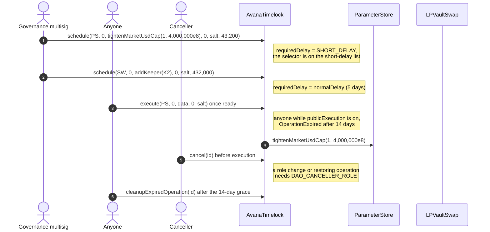

Function links point to the interface that declares each function.

# AvanaTimelock lifecycle

The AvanaTimelock is the one executor of every privileged change to Avana on its chain: an OpenZeppelin `TimelockController` with a 12-hour short delay for tightenings and safety actions, a 4-to-5-day normal delay for everything else, a 14-day grace window and a DAO-only cancel for role changes and restorations.

## Walkthrough

Setup (Ethereum; proposers: the 4-of-7 governance multisig and the Aave governance executor; `normalDelay` 432,000 s).

1. **Multisig → `schedule`(ParameterStore, `tightenMarketUsdCap(1, 4,000,000e8)`, delay 43,200).** [`requiredDelay`](IAvanaTimelock.sol#L132) is [`SHORT_DELAY`](IAvanaTimelock.sol#L96) because the selector is on the short-delay list ([`isShortDelaySelector`](IAvanaTimelock.sol#L111)). Error: [`DelayBelowRequired`](IAvanaTimelock.sol#L12) for a shorter delay.
2. **Multisig → `schedule`(LPVaultSwap, `addKeeper(K2)`, delay 432,000).** Not on the short list, so it waits [`normalDelay`](IAvanaTimelock.sol#L108) = 5 days, long enough for every borrower to exit first.
3. **Anyone → `execute`** once ready, while [`publicExecution`](IAvanaTimelock.sol#L138) is on; the target sees `msg.sender == TIMELOCK` (or `APPLICATION_ADMIN`). Error: [`ExecutionNotPublic`](IAvanaTimelock.sol#L33) while off, [`OperationExpired`](IAvanaTimelock.sol#L18) after [`GRACE_PERIOD`](IAvanaTimelock.sol#L105) (14 days).
4. **A canceller → `cancel`.** Any `CANCELLER_ROLE` holder cancels an ordinary operation. A role change ([`isRoleChangeOperation`](IAvanaTimelock.sol#L147)) or a restoring operation such as `unfreezeAddress` or `restorePriceRoute` ([`isRestoringOperation`](IAvanaTimelock.sol#L153)) needs `DAO_CANCELLER_ROLE`. Errors: [`RoleChangeCancelRestricted`](IAvanaTimelock.sol#L24), [`RestoringCancelRestricted`](IAvanaTimelock.sol#L27).
5. **Timelock → [`setNormalDelay`](IAvanaTimelock.sol#L71)** through its own operation, within [`MIN_NORMAL_DELAY`](IAvanaTimelock.sol#L102) (4 days) and [`MAX_DELAY`](IAvanaTimelock.sol#L99) (5 days). Event: [`NormalDelayChanged`](IAvanaTimelock.sol#L58). Errors: [`DelayOutOfBounds`](IAvanaTimelock.sol#L15); OpenZeppelin `updateDelay` reverts [`UpdateDelayDisabled`](IAvanaTimelock.sol#L36).
6. **Timelock → [`setShortDelaySelector`](IAvanaTimelock.sol#L77)** adds or removes a pair only inside the immutable `SHORT_ELIGIBLE` set ([`isShortEligible`](IAvanaTimelock.sol#L118)). Event: [`ShortDelaySelectorSet`](IAvanaTimelock.sol#L61). Error: [`InvalidShortDelaySelector`](IAvanaTimelock.sol#L39).
7. **Timelock → [`togglePublicExecution`](IAvanaTimelock.sol#L85).** Event: [`PublicExecutionToggled`](IAvanaTimelock.sol#L64).
8. **Anyone → [`cleanupExpiredOperation`](IAvanaTimelock.sol#L91)`(id)`** after the 14-day grace, so the same calls can be scheduled again. Event: [`ExpiredOperationCleaned`](IAvanaTimelock.sol#L67). Error: [`OperationNotExpired`](IAvanaTimelock.sol#L21).
9. **Guardians act without the timelock** for emergency actions (MarketRegistry `freeze`, `pause`, `freezeAddress`, `tripMarketBreaker`, `useStandbyRoute`); the timelock can do the same at the short delay and lifts restrictions at the normal delay.

## What the UI reads and calls

- Lens: none; a governance UI reads [`requiredDelay`](IAvanaTimelock.sol#L132), [`isOperationExpired`](IAvanaTimelock.sol#L141) and OpenZeppelin `getOperationState`.
- Events to index: OpenZeppelin `CallScheduled`, `CallExecuted`, `Cancelled`; [`NormalDelayChanged`](IAvanaTimelock.sol#L58), [`ShortDelaySelectorSet`](IAvanaTimelock.sol#L61), [`PublicExecutionToggled`](IAvanaTimelock.sol#L64), [`ExpiredOperationCleaned`](IAvanaTimelock.sol#L67). Borrowers watch `CallScheduled` for normal-delay operations to decide whether to exit.
- User calls: `execute` (anyone while public execution is on), [`cleanupExpiredOperation`](IAvanaTimelock.sol#L91).

## Spec

- [2.15 Governance and Timelock](../../../../docs/spec/02-contracts/15-governance-and-timelock.md): `REQ-ACCESS-001`, `REQ-ACCESS-029`, `REQ-ACCESS-125`, `REQ-ACCESS-126`, `REQ-ACCESS-140`–`REQ-ACCESS-144`, `REQ-ACCESS-152`–`REQ-ACCESS-155`, `SPEC-GOV-001`–`SPEC-GOV-003`, `SPEC-GOV-013`, `SPEC-GOV-015`.
- [1.4 Permissions and roles](../../../../docs/spec/01-architecture/04-permissions-and-roles.md) for delay classes.
