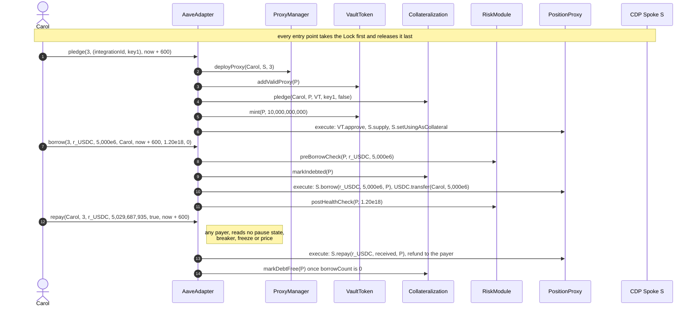
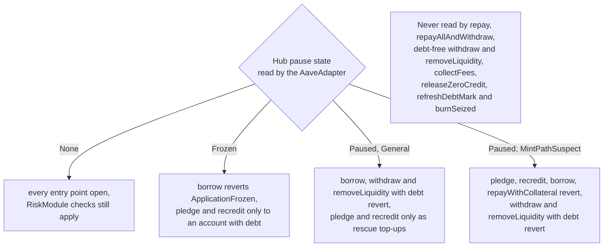

Function links point to the interface that declares each function.

# AaveAdapter lifecycle

The AaveAdapter is the borrower's only entry point: it takes the Lock, deploys and drives the wallet's PositionProxy, mints and burns vault tokens, and calls Collateralization and the RiskModule around each Aave V4 Spoke call. The router [`AaveAdapter`](AaveAdapter.sol) holds the roles, the views and the upgrade gate and delegatecalls each entry point's body in one of four immutable logic contracts ([`AaveAdapterUserLogic`](AaveAdapterUserLogic.sol), [`AaveAdapterExitLogic`](AaveAdapterExitLogic.sol), [`AaveAdapterCollateralLogic`](AaveAdapterCollateralLogic.sol), [`AaveAdapterSettlementLogic`](AaveAdapterSettlementLogic.sol)); the account steps through `execute` are in [`AaveAdapterSteps`](AaveAdapterSteps.sol). Each step below links the interface function and its body. Steps 1–3, 5, 6, 8 and 11 are reproduced with these numbers by `test/unit/AaveAdapter.Lifecycle.unit.t.sol`.

## Walkthrough

Setup (Base, from 3.1 `DEP-029`, 3.2 `BOR-022`, 3.4 `WDR-045`): market 3 is a USDC/USDT Aerodrome Slipstream market on the "Aerodrome Slipstream Stable" CDP Spoke `S`; one whole vault token (10^6 units) is worth $2.00; `CF_LP = 3,120` bps; `minPledgeUsd = $10`; USDC is priced at $0.9999. Carol holds an unstaked NFT `key1` with `L = 10,000,000,000`.

1. **Carol → [`pledge`](IAaveAdapter.sol#L78) ([body](AaveAdapterUserLogic.sol#L40))`(3, (integrationId, key1), now + 600)`.** First pledge, so the Adapter calls ProxyManager [`deployProxy`](../../proxy/proxy-manager/IProxyManager.sol#L32)`(Carol, S, 3)` and VaultToken [`addValidProxy`](../../vault-token/vault-token/VaultToken.sol#L82), then Collateralization [`pledge`](../../custody/collateralization/ICollateralization.sol#L17), which custodies the NFT and returns `credited = 10,000,000,000` ($20,000). The Adapter calls VaultToken [`mint`](../../vault-token/vault-token/VaultToken.sol#L64)`(P, 10,000,000,000)` and, through PositionProxy [`execute`](../../proxy/position-proxy/IPositionProxy.sol#L25), `Spoke.supply` and `setUsingAsCollateral`. Collateral $20,000, CF-weighted $6,240. Events: [`UserProxyCreated`](IAaveAdapterBase.sol#L109), [`CollateralSupplied`](IAaveAdapterBase.sol#L204), [`CollateralAdded`](IAaveAdapterBase.sol#L112). Errors: [`DeadlineExpired`](IAaveAdapterBase.sol#L16), [`ApplicationPaused`](IAaveAdapterBase.sol#L13) (`MintPathSuspect`), [`ApplicationFrozen`](IAaveAdapterBase.sol#L10) (Frozen, no debt), [`UnknownMarket`](IAaveAdapterBase.sol#L37), [`IntegrationMismatch`](IAaveAdapterBase.sol#L40), [`SupplyIncomplete`](IAaveAdapterBase.sol#L62), [`BackingMismatch`](IAaveAdapterBase.sol#L59); from below `BelowMinPledge` (an $8 NFT), `TooManyRecords` (a 17th record), `AlreadyPledged`.
2. **Carol → [`borrow`](IAaveAdapter.sol#L87) ([body](AaveAdapterUserLogic.sol#L125))`(3, r_USDC, 5,000e6, Carol, now + 600, 1.20e18, 0)`.** The app first read Lens `previewBorrowRecommended`: 5,673.29 USDC at HF 1.10, maximum 6,209.56 at HF 1.00. The Adapter consumes nonce 0 (`borrowNonce` becomes 1), calls RiskModule [`preBorrowCheck`](../risk-module/IRiskModule.sol#L45), Collateralization [`markIndebted`](../../custody/collateralization/ICollateralization.sol#L68), `Spoke.borrow` and the 5,000 USDC transfer to Carol, then [`postHealthCheck`](../risk-module/IRiskModule.sol#L46): `hf = 6,240 / 4,999.50 = 1.2481 ≥ max(1.00, 1.20)`. Event: [`Borrowed`](IAaveAdapterBase.sol#L125). Errors: [`ZeroAmount`](IAaveAdapterBase.sol#L22), [`NoProxy`](IAaveAdapterBase.sol#L28), [`InvalidReceiver`](IAaveAdapterBase.sol#L25), [`AddressIsFrozen`](IAaveAdapterBase.sol#L71), [`BadNonce`](IAaveAdapterBase.sol#L19); from the RiskModule `HealthFactorTooLow` (5,700 USDC gives 1.0948 < 1.20), `BreakerTripped`, `DebtPriceTooOld`, `SequencerGrace`, and from the MarketRegistry coverage check `CoverageBelowRatio` (the USDC draw caps above first-loss cover). There is no minimum debt.
3. **Carol → [`pledge`](IAaveAdapter.sol#L78) ([body](AaveAdapterUserLogic.sol#L40)) of `keyB` (`L = 2,500,000,000`, $5,000).** A top-up to her existing proxy: record 2 of 16; collateral $25,000, CF-weighted $7,800, `hf = 7,800 / 4,999.50 = 1.5602`.
4. **W2 → [`recredit`](IAaveAdapter.sol#L36) ([body](AaveAdapterCollateralLogic.sol#L95))`(m, (I, key), "", now + 600)`** (Ethereum example of 3.1). After `increaseLiquidity` on the NFPM, Collateralization [`recredit`](../../custody/collateralization/ICollateralization.sol#L46) returns `added = 2,500,000,000`; the Adapter mints and supplies them. Event: [`CollateralRecredited`](IAaveAdapterBase.sol#L163). Errors: `NothingToRecredit`, [`ApplicationPaused`](IAaveAdapterBase.sol#L13) under `MintPathSuspect`.
5. **Carol → [`withdraw`](IAaveAdapter.sol#L113) ([body](AaveAdapterExitLogic.sol#L31))`(3, (I, keyB), 2,500,000,000, now + 600, 1.20e18)`.** With debt, the Adapter checks the pause state and freeze and calls [`preWithdrawCheck`](../risk-module/IRiskModule.sol#L54); the proxy withdraws, the Adapter calls VaultToken [`burn`](../../vault-token/vault-token/VaultToken.sol#L73) and Collateralization [`release`](../../custody/collateralization/ICollateralization.sol#L27), which returns the NFT; `postHealthCheck` reads 1.2481. Event: [`CollateralWithdrawn`](IAaveAdapterBase.sol#L150). Errors: [`ApplicationPaused`](IAaveAdapterBase.sol#L13), [`AddressIsFrozen`](IAaveAdapterBase.sol#L71), [`UnitsMismatch`](IAaveAdapterBase.sol#L56); Aave's `HealthFactorBelowThreshold` if she withdraws `key1` instead (HF 0.3120).
6. **Anyone → [`repay`](IAaveAdapter.sol#L101) ([body](AaveAdapterUserLogic.sol#L214)).** 30 days later Carol's debt is 5,024.657535 USDC. She reads Lens `quoteRepayAll` = 5,029,687,935, approves the Adapter and calls `repay(Carol, 3, r_USDC, 5,029,687,935, true, now + 600)`. Aave takes 5,024,657,573 at inclusion; the proxy refunds 5,030,362 to her; `borrowCount = 0`, so the Adapter calls [`markDebtFree`](../../custody/collateralization/ICollateralization.sol#L74). Event: [`Repaid`](IAaveAdapterBase.sol#L138). Errors: [`RepayExceedsMax`](IAaveAdapterBase.sol#L50), [`DebtRemaining`](IAaveAdapterBase.sol#L53). Any payer may call it for any borrower; it reads no pause state, breaker, freeze or price.
7. **Carol → [`collectFees`](IAaveAdapter.sol#L145) ([body](AaveAdapterExitLogic.sol#L112))`(3, (I, key1), now + 600)`.** Collateralization [`collectFees`](../../custody/collateralization/ICollateralization.sol#L112) has the LPVault pay 16.50 USDC and 15.95 USDT to Carol; units, supply and health factor are unchanged. Event: LPVault [`FeesCollected`](../../custody/lp-vault/ILPVaultBase.sol#L29). Error: `NotDepositor`, `FeesRolledIn` (rolled-in AMMs).
8. **Carol → [`removeLiquidity`](IAaveAdapter.sol#L24) ([body](AaveAdapterCollateralLogic.sol#L46))`(3, (I, key1), 2,000,000,000, [1,990e6, 1,990e6], now + 600, 0)`.** Debt-free, so no MarketRegistry, pause, freeze, breaker or price is read. The Adapter burns 2,000,000,000 units and calls Collateralization [`releasePartial`](../../custody/collateralization/ICollateralization.sol#L36); the LPVault pays about 2,000 USDC + 2,000 USDT to Carol and the record keeps 8,000,000,000 units ($16,000). Event: [`CollateralReduced`](IAaveAdapterBase.sol#L176). Errors: `PartialRemovalTooLarge` (units ≥ credited), `BelowMinimum`; with debt, `RecordBelowMinPledge` and `HealthFactorTooLow`.
9. **V → [`repayWithCollateral`](IAaveAdapter.sol#L45) ([body](AaveAdapterCollateralLogic.sol#L158))** (Ethereum example of 3.3): debt 10,000 USDC, HF 1.20, units 1,500,000,000, `minDebtRepaid = 2,950e6`, `minAssetOut = 29e6`, `minHealthFactor = 1.30e18`, `minAmounts` empty (the session binds two zeros, as LPVaultSwap passes them). The Adapter opens a session and calls LPVaultSwap [`deleverage`](../../liquidation/lp-vault-swap/ILPVaultSwap.sol#L35), which calls back [`deleverageRepay`](IAaveAdapter.sol#L60) ([body](AaveAdapterSettlementLogic.sol#L52)) (records `hfBefore` = 1.20, read after LPVaultSwap has poked both oracles, then repays 2,968.505747 USDC) and [`deleverageRelease`](IAaveAdapter.sol#L69) ([body](AaveAdapterSettlementLogic.sol#L72)) (burns and unwinds 1,500 vault tokens); V receives 29.41 USDC, above `minAssetOut`; `hfAfter = 1.5735`; a call that repays the last debt also clears the account's indebted mark ([`markDebtFree`](../../custody/collateralization/ICollateralization.sol#L74)). Event: [`RepaidWithCollateral`](IAaveAdapterBase.sol#L190). Errors: [`NothingToRepay`](IAaveAdapterBase.sol#L74), [`HealthFactorNotImproved`](IAaveAdapterBase.sol#L77), `NoDeleverageSession`, [`AssetOutBelowMinimum`](IAaveAdapterBase.sol#L81) (with `minAssetOut = 30e6`), `DeleverageTooSmall` (with `minDebtRepaid = 3,000e6`).
10. **LPVaultSwap → [`burnSeized`](IAaveAdapter.sol#L51) ([body](AaveAdapterSettlementLogic.sol#L35))** inside a liquidation: Bob's 975 seized vault tokens are burned from LPVaultSwap's balance between `beginSeizure` and `settleSeizure`. Event: [`SeizedUnitsBurned`](IAaveAdapterBase.sol#L160). Error: [`NotLPVaultSwap`](IAaveAdapterBase.sol#L43). It reads no pause state, so liquidation runs in every state.
11. **Carol → [`repayAllAndWithdraw`](IAaveAdapter.sol#L125) ([body](AaveAdapterExitLogic.sol#L50))** or [`withdraw`](IAaveAdapter.sol#L113) ([body](AaveAdapterExitLogic.sol#L31)) of the last 8,000,000,000 units closes the account; [`releaseZeroCredit`](IAaveAdapter.sol#L136) ([body](AaveAdapterExitLogic.sol#L124)) returns a record whose credit a seizure took to 0.
12. **Anyone → [`refreshDebtMark`](IAaveAdapter.sol#L152) ([body](AaveAdapterExitLogic.sol#L136))`(P)`.** If Carol's last debt had left without an Avana call, or in a repay whose Spoke read failed, her account would keep its indebted mark and `closeMarket` would wait on it; a keeper's `refreshDebtMark(P)` takes the Lock, has Collateralization [`markDebtFree`](../../custody/collateralization/ICollateralization.sol#L74) read `borrowCount = 0` on the Spoke and clear the mark. It moves no asset and reads no MarketRegistry state, so it works in every market status. On an account still owing 1 GHO it changes nothing.

## What the UI reads and calls

- Lens: [`predictProxy`](../../lens/lens/ILensAccount.sol#L13), [`getAccount`](../../lens/lens/ILensAccount.sol#L19), [`getRecords`](../../lens/lens/ILensAccount.sol#L28), [`getCapHeadroom`](../../lens/lens/ILensMarket.sol#L32), [`getPriceState`](../../lens/lens/ILens.sol#L81), [`getDebtPriceState`](../../lens/lens/ILens.sol#L87), [`getApplicationState`](../../lens/lens/ILens.sol#L95), [`previewBorrowRecommended`](../../lens/lens/ILensPreview.sol#L22), [`previewBorrowMax`](../../lens/lens/ILensPreview.sol#L12), [`quoteRepayAll`](../../lens/lens/ILensPreview.sol#L32), [`previewRecredit`](../../lens/lens/ILensPreview.sol#L42), [`previewRepayWithCollateral`](../../lens/lens/ILensPreview.sol#L52); Adapter views [`proxyOf`](IAaveAdapter.sol#L158), [`borrowNonce`](IAaveAdapter.sol#L183).
- Events to index: `UserProxyCreated`, `CollateralAdded`, `CollateralSupplied`, `Borrowed`, `Repaid`, `CollateralWithdrawn`, `CollateralRecredited`, `CollateralReduced`, `RepaidWithCollateral`, `CollateralDisabled`, `SeizedUnitsBurned` ([IAaveAdapterBase.sol](IAaveAdapterBase.sol)).
- User calls: `pledge`, `borrow`, `repay`, `withdraw`, `repayAllAndWithdraw`, `releaseZeroCredit`, `collectFees`, `refreshDebtMark` ([IAaveAdapter.sol](IAaveAdapter.sol)); `removeLiquidity`, `recredit`, `repayWithCollateral` ([IAaveAdapter.sol](IAaveAdapter.sol)).

## Spec

- [2.6 Aave Adapter](../../../../docs/spec/02-contracts/06-aave-adapter.md): `REQ-ADAPTER-065`–`REQ-ADAPTER-092`, `REQ-PROXY-015`–`REQ-PROXY-039`, `REQ-PROXY-083`, `SPEC-PROXY-003`, `SPEC-PROXY-007`, `SPEC-PROXY-008`, `SPEC-PROXY-009`.
- Flows: [3.1 Deposit](../../../../docs/spec/03-operations/01-deposit.md) `DEP-029`, [3.2 Borrow](../../../../docs/spec/03-operations/02-borrow.md) `BOR-022`, [3.3 Repay](../../../../docs/spec/03-operations/03-repay.md) `REP-024`, [3.4 Withdraw](../../../../docs/spec/03-operations/04-withdraw.md) `WDR-045`, [3.7 Collect fees](../../../../docs/spec/03-operations/07-collect-fees.md) `FEE-009`.
