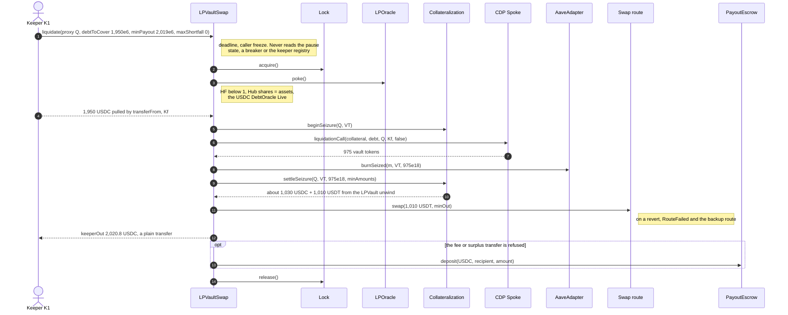

Function links point to the interface that declares each function.

# LPVaultSwap lifecycle

LPVaultSwap is Avana's only liquidator: it pulls the repayment from its caller, repays an unhealthy account's debt on the Aave V4 Spoke, receives the seized vault tokens, has them burned and unwound into pool tokens, swaps those into the debt asset and pays Avana's fee, the borrower and the caller, all in one call. It takes no flash loan in a liquidation; a caller without the debt asset uses the [flash liquidation helper](../../periphery/flash-liquidator/LIFECYCLE.md).

## Walkthrough

Uniswap v3 on Ethereum (Bob, USDC debt, 3.5 `LIQ-069`). Setup: Bob pledged a USDC/USDT position; each vault token is priced at $2.10; he borrowed USDC; HF < 1; Aave's bonus is 5%; `slippageAllowanceBps = 100`; `floorRoundingAllowance` = 1 USDC.

1. **Avana's keeper K1 → Lens [`previewLiquidation`](../../lens/lens/ILensLiquidation.sol#L84)`(Q, 2, now + 120)`:** repay 1,950 USDC, `expectedPayout = 2,028` USDC at the oracle value (1,950 funding back plus 78), `expectedCallerLoss = 0`.
2. **K1 → [`liquidate`](ILPVaultSwapLiquidation.sol#L48)`({proxy: Q, marketId: m, debtReserveId: 2, debtToCover: 1,950e6, routeMode: PrimaryThenBackup, minAmounts: [], deadline: now + 120, minPayout: 2,019e6, maxShortfall: 0})`**, directly or through its [helper](../../periphery/flash-liquidator/IFlashLiquidator.sol#L58). Implementation: [`LPVaultSwap.liquidate`](LPVaultSwap.sol#L65) delegates to [`LPVaultSwapLiquidationLogic.liquidate`](LPVaultSwapLiquidationLogic.sol#L77); the checks are [`_entryChecks`](LPVaultSwapLiquidationLogic.sol#L94), [`_checkCollateralPrice`](LPVaultSwapSettlement.sol#L112) and [`_checkDebtPrice`](LPVaultSwapSettlement.sol#L132). Checks the deadline and the caller's freeze (no keeper check), takes Lock [`acquire`](../../lock/lock/ILock.sol#L64), checks the proxy, `HF < 1`, Hub shares = assets, pokes the market's LPOracle and checks that the repaid reserve's USDC DebtOracle is Live within `liquidationPriceMaxAge` (`DebtPriceStale` otherwise). It never reads the pause state, a breaker or the committed-operator registry. Errors: [`DeadlineExpired`](ILPVaultSwapErrors.sol#L144), [`AddressIsFrozen`](ILPVaultSwapErrors.sol#L166), [`LockHeld`](ILPVaultSwapErrors.sol#L16), [`InvalidAmount`](ILPVaultSwapErrors.sol#L35), [`NotLiquidatable`](ILPVaultSwapErrors.sol#L39), [`SharesNotEqualAssets`](ILPVaultSwapErrors.sol#L43), [`StalePrice`](ILPVaultSwapErrors.sol#L49), [`DebtPriceStale`](ILPVaultSwapErrors.sol#L55), [`GraceHealthFactor`](ILPVaultSwapErrors.sol#L59).
3. **Caller funding ([`_fund`](LPVaultSwapLiquidationLogic.sol#L114)):** `transferFrom(K1, LPVaultSwap, 1,950e6)` measured by balance delta, `Kf = 1,950` USDC. Error: [`FundingMismatch`](ILPVaultSwapErrors.sol#L64) unless `0 < Kf ≤ debtToCover`.
4. **[`_seize`](LPVaultSwapLiquidationLogic.sol#L129): Collateralization [`beginSeizure`](../../custody/collateralization/ICollateralizationSeizure.sol#L24)`(Q, VT)`, then [`Spoke.liquidationCall`](../../interfaces/external/aave/IAaveV4Spoke.sol#L126)`(collateral, debt, Q, Kf, false)`:** Aave repays the debt and sends 975 vault tokens (1,950 × 1.05 ÷ 2.10) to LPVaultSwap; the vault token's transfer rule ([`isAllowedTransfer`](../../vault-token/vault-token/VaultToken.sol#L171)) admits no other liquidator.
5. **[`_unwindAndSwap`](LPVaultSwapLiquidationLogic.sol#L158): AaveAdapter [`burnSeized`](../../policy/aave-adapter/IAaveAdapterSettlement.sol#L24); Collateralization [`settleSeizure`](../../custody/collateralization/ICollateralizationSeizure.sol#L48)** → LPVault [`unwind`](../../amm/IAmmIntegration.sol#L181) returns about 1,030 USDC + 1,010 USDT. Error: [`NothingSeized`](ILPVaultSwapErrors.sol#L91).
6. **Swap USDT→USDC with a per-leg oracle minimum** ([`_swapLeg`](LPVaultSwapSettlement.sol#L270), [`_tryRoute`](LPVaultSwapSettlement.sol#L290)) through [`ISettlementRoute.swap`](../settlement-routes/ISettlementRoute.sol#L91); the backup runs if the primary reverts ([`RouteFailed`](ILPVaultSwapEvents.sol#L56)). Recovery 2,040.30 USDC ≥ the floor 2,026.02; settlement gap `g = max(0, 1,950 + 19.5 − 1,950 − 2,040.30) = 0`. Errors: [`NoRouteAvailable`](ILPVaultSwapErrors.sol#L95), [`RecoveryBelowFloor`](ILPVaultSwapErrors.sol#L107) (only when `R` plus a top-up up to `maxShortfall` stays below the floor), [`InsufficientProceeds`](ILPVaultSwapErrors.sol#L114) (defensive).
7. **[`_waterfall`](LPVaultSwapLiquidationLogic.sol#L206): Avana fee 19.5 (20% of the oracle gain `2,047.50 − 1,950 = 97.5`); keeper reward 70.8; borrower surplus 0; `keeperOut = 1,950 + 70.8 = 2,020.8` USDC to K1.** The fee and any borrower surplus are gas-limited transfers ([`_deliver`](LPVaultSwapSettlement.sol#L355): a gas check right before a 100,000-gas call, the amount that left LPVaultSwap measured, the rest escrowed); a refused one goes to PayoutEscrow [`deposit`](../payout-escrow/IPayoutEscrow.sol#L113) credited to its recipient. `keeperOut` is a plain transfer: if it fails, the whole call reverts. Lock [`release`](../../lock/lock/ILock.sol#L70). Events: [`LiquidationSettled`](ILPVaultSwapEvents.sol#L22), [`BorrowerSurplusPaid`](ILPVaultSwapEvents.sol#L34) when `B > 0`, [`ResidueReturned`](ILPVaultSwapEvents.sol#L65) when a route leaves input. Error: [`PayoutTooLow`](ILPVaultSwapErrors.sol#L151) (routes returning 2,035 USDC give 2,015.5 < 2,019).
8. **Any address → [`liquidate`](ILPVaultSwapLiquidation.sol#L48)** runs the same steps with either route mode; a frozen address can still go through the public helper, which LPVaultSwap sees as the caller.
9. **Any address → [`settlePending`](ILPVaultSwapLiquidation.sol#L76)`(m, r)`** (implementation [`LPVaultSwap.settlePending`](LPVaultSwap.sol#L73) → [`LPVaultSwapPendingLogic.settlePending`](LPVaultSwapPendingLogic.sol#L70), [`_fundCoverage`](LPVaultSwapPendingLogic.sol#L179)) burns vault tokens left at LPVaultSwap by an unsettled seizure, has Collateralization pay the pending pool tokens, swaps them and adds `R` to the First-Loss Reserve of `(funding Hub, settlement asset)` through `fund(R)`, or carries it while it is worth less than one Hub share. Event: [`PendingSettlementForwarded`](ILPVaultSwapEvents.sol#L93). Errors: [`NothingPending`](ILPVaultSwapErrors.sol#L138), [`FundingMismatch`](ILPVaultSwapErrors.sol#L64).
10. **AaveAdapter → [`deleverage`](ILPVaultSwapDeleverage.sol#L32)** (implementation [`LPVaultSwap.deleverage`](LPVaultSwap.sol#L82) → [`LPVaultSwapDeleverageLogic.deleverage`](LPVaultSwapDeleverageLogic.sol#L100); callback [`LPVaultSwap.onFlashLoan`](LPVaultSwap.sol#L90) → [`LPVaultSwapDeleverageLogic.onFlashLoan`](LPVaultSwapDeleverageLogic.sol#L144)) for a repay with collateral, the only path with a flash loan (through the core [`IFlashSource`](../../flash/IFlashSource.sol#L92), callback [`onFlashLoan`](../../flash/IFlashReceiver.sol#L26)): V's 1,500 vault tokens repay 2,968.505747 USDC, premium 1.484253, 29.41 USDC to V, no bonus and no Avana fee. Events: [`FlashLoanUsed`](ILPVaultSwapEvents.sol#L46), [`Deleveraged`](ILPVaultSwapEvents.sol#L118). Errors: [`NotAdapter`](ILPVaultSwapErrors.sol#L183), [`DeleverageTooSmall`](ILPVaultSwapErrors.sol#L172), [`DeleverageShortfall`](ILPVaultSwapErrors.sol#L178), [`FlashLiquidityShort`](ILPVaultSwapErrors.sol#L102), [`FlashFeeTooHigh`](ILPVaultSwapErrors.sol#L69), [`FlashSourceIsHub`](ILPVaultSwapErrors.sol#L74), [`InvalidFlashCallback`](ILPVaultSwapErrors.sol#L87).
11. **AvanaTimelock → [`addKeeper`](ILPVaultSwapAdmin.sol#L38)** (normal delay; implementation [`LPVaultSwap.addKeeper`](LPVaultSwap.sol#L123)) / [`removeKeeper`](ILPVaultSwapAdmin.sol#L49) (short delay; [`LPVaultSwap.removeKeeper`](LPVaultSwap.sol#L135)): the committed-operator registry. Launch registry: Avana's own keeper (`KEEPER_FLOOR = 1`, `MAX_KEEPERS = 32`); it gates no call, and new borrowing halts only when [`activeKeeperCount`](ILPVaultSwapViews.sol#L29) ([`LPVaultSwap.activeKeeperCount`](LPVaultSwap.sol#L173)) is 0. Events: [`KeeperAdded`](ILPVaultSwapEvents.sol#L70), [`KeeperRemoved`](ILPVaultSwapEvents.sol#L75). Errors: [`KeeperFloor`](ILPVaultSwapErrors.sol#L129), [`TooManyKeepers`](ILPVaultSwapErrors.sol#L134), [`InvalidKeeper`](ILPVaultSwapErrors.sol#L123).

## What the UI reads and calls

- Lens: [`previewLiquidation`](../../lens/lens/ILensLiquidation.sol#L84) (returns `LiquidationParams` ready to send), [`getPriceState`](../../lens/lens/ILensLiquidation.sol#L22), [`getDebtPriceState`](../../lens/lens/ILensLiquidation.sol#L34), [`getPendingSettlement`](../../lens/lens/ILensMarket.sol#L43), [`previewRepayWithCollateral`](../../lens/lens/ILensPreview.sol#L91), [`getEscrowClaimable`](../../lens/lens/ILensAccount.sol#L63); registry views [`getKeepers`](ILPVaultSwapViews.sol#L41), [`activeKeeperCount`](ILPVaultSwapViews.sol#L29); the helper's quotes [`maxFlashLoan`](../../periphery/flash-liquidator/IFlashLiquidator.sol#L103) and [`flashPremium`](../../periphery/flash-liquidator/IFlashLiquidator.sol#L115).
- Events to index: [ILPVaultSwapEvents.sol](ILPVaultSwapEvents.sol): `LiquidationSettled`, `BorrowerSurplusPaid`, `FlashLoanUsed`, `RouteFailed`, `ResidueReturned`, `PendingSettlementForwarded`, `Deleveraged`, `KeeperAdded`, `KeeperRemoved`.
- User calls: `liquidate` and `settlePending` (anyone); the flash liquidation helper's `flashLiquidate` (anyone, public instance).

## Spec

- [2.11 LPVaultSwap](../../../../spec/02-contracts/11-lpvaultswap.md): `REQ-SWAP-001`–`REQ-SWAP-016`, `REQ-SWAP-026`, `REQ-SWAP-032`–`REQ-SWAP-038`, `REQ-SWAP-042`–`REQ-SWAP-045`, `REQ-SWAP-072`–`REQ-SWAP-076`, `REQ-SWAP-100`, `REQ-SWAP-101`, `REQ-SWAP-105`, `REQ-SWAP-106`, `REQ-FLASH-001`–`REQ-FLASH-006`, `SPEC-LIQ-009`, `SPEC-LIQ-010`, `SPEC-LIQ-014`, `SPEC-LIQ-018`–`SPEC-LIQ-020`.
- Flow: [3.5 Liquidation](../../../../spec/03-operations/05-liquidation.md) `LIQ-011`, `LIQ-030`, `LIQ-041`, `LIQ-061`, `LIQ-062`, `LIQ-068`, `LIQ-069`, `LIQ-089`.
