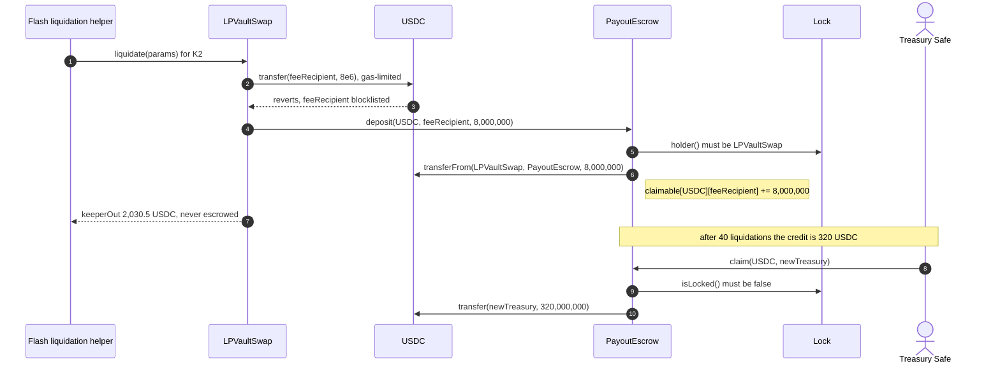

# Payout escrow (PayoutEscrow) lifecycle

The PayoutEscrow is the payout escrow: an immutable contract that holds a liquidation payout LPVaultSwap could not deliver (Avana's fee, the borrower's surplus, a route residue or a dust leg; never the caller's `keeperOut`) until its recipient claims it, so a recipient a token refuses never blocks a liquidation.

## Walkthrough

Aerodrome Slipstream on Base (Carol, USDC debt, 3.6 `EMG-113`). Setup: Circle blocklists Avana's treasury Safe, the chain's `feeRecipient`, on Base; Carol's liquidation is the one of 3.5 `LIQ-089`. The escrow was deployed after the Lock; its constructor reverts `LockMismatch` unless the Lock names the same LPVaultSwap.

1. **K2 → LPVaultSwap [`liquidate`](../lp-vault-swap/ILPVaultSwapLiquidation.sol#L48)** for 2,000 USDC through the public flash liquidation helper. Seizure, unwind and swaps run as in `LIQ-089`; the helper repays the Aave V3 Pool 2,001 USDC after `liquidate` returns.
2. **LPVaultSwap sends `A = 8` USDC to `feeRecipient` with a gas-limited transfer;** USDC reverts it.
3. **LPVaultSwap → [`deposit`](PayoutEscrow.sol#L77)`(USDC, feeRecipient, 8,000,000)`** after approving exactly 8 USDC. The escrow pulls it, measures the balance rise and credits it, capped at the 8,000,000 requested (a fee-taking token credits what arrived; a rise above the request leaves the surplus as a donation): `claimable[USDC][feeRecipient] += 8,000,000`. Event: [`RemainderEscrowed`](IPayoutEscrow.sol#L38). Errors: [`NotLPVaultSwap`](IPayoutEscrow.sol#L50), [`NotLocked`](IPayoutEscrow.sol#L54), [`ZeroAmount`](IPayoutEscrow.sol#L59), [`InvalidAccount`](IPayoutEscrow.sol#L63), [`TransferMismatch`](IPayoutEscrow.sol#L68), [`Reentrancy`](IPayoutEscrow.sol#L85). A revert here reverts the whole liquidation.
4. **LPVaultSwap pays K2's helper `keeperOut = 2,030.5` USDC directly** (never escrowed; a failed transfer of it would revert the call) and emits [`LiquidationSettled`](../lp-vault-swap/ILPVaultSwapEvents.sol#L22); the helper repays 2,001 USDC and pays K2 29.5 USDC, and Carol sees the same result as in `LIQ-089`.
5. **After 40 liquidations of this size** the Safe's credit is `40 × 8 = 320` USDC: [`claimable`](PayoutEscrow.sol#L41)`(USDC, feeRecipient)` = 320,000,000 and [`totalClaimable`](PayoutEscrow.sol#L44)`(USDC)` covers it.
6. **AvanaTimelock → ParameterStore [`setFeeRecipient`](../../policy/parameter-store/IParameterStoreAdmin.sol#L91)`(newTreasury)`** at the normal delay; later fees go there.
7. **The Safe → [`claim`](PayoutEscrow.sol#L106)`(USDC, newTreasury)`.** Clears the credit, then transfers 320 USDC to `newTreasury` and reverts [`TransferMismatch`](IPayoutEscrow.sol#L68) if its own balance fell by more than 320 USDC (a fee taken from the sender would otherwise come out of other credits). Event: [`RemainderClaimed`](IPayoutEscrow.sol#L46). Errors: [`LockHeld`](IPayoutEscrow.sol#L72) (no claim inside an Avana call), [`InvalidRecipient`](IPayoutEscrow.sol#L76), [`NothingToClaim`](IPayoutEscrow.sol#L80). If the token refuses the recipient, the call reverts and the credit stays for another recipient.
8. **Borrower surplus.** In Bob's variant where routes return 2,052 USDC, `B = 4.5` USDC goes to Bob's wallet; if Bob's wallet refused USDC, the 4.5 USDC would be credited to Bob here and Bob would claim it himself. Credits never expire and only the credited account can claim.

## What the UI reads and calls

- Lens: [`getEscrowClaimable`](../../lens/lens/ILensAccount.sol#L63)`(account, [USDC, …])`.
- Events to index: [`RemainderEscrowed`](IPayoutEscrow.sol#L38), [`RemainderClaimed`](IPayoutEscrow.sol#L46).
- User calls: [`claim`](PayoutEscrow.sol#L106) (the credited account only).

## Spec

- [2.18 Payout Escrow (PayoutEscrow)](../../../../docs/spec/02-contracts/18-payout-escrow.md): `REQ-ESCROW-001`–`REQ-ESCROW-019`, `REQ-SWAP-076`, `REQ-SWAP-082`.
- Flows: [3.5](../../../../docs/spec/03-operations/05-liquidation.md) `LIQ-048a`, `LIQ-085`; [3.6](../../../../docs/spec/03-operations/06-emergency-operations.md) `EMG-105` (P-21), `EMG-113`.
