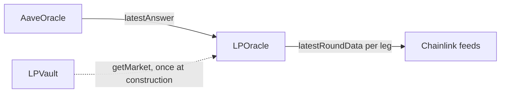

Function links point to the interface that declares each function. Why the oracle is built this way: [DESIGN.md](DESIGN.md).

# Oracle lifecycle

Avana prices two things, and only one of them needs its own contract.

- **Debt assets** (USDC, USDT, WETH): Aave V4 reads each asset's own Chainlink USD feed, the same source Aave uses on its other markets. GHO keeps Aave's fixed $1 source. Avana adds no contract here.
- **Vault tokens** (one per band market): Aave V4 reads the market's [`LPOracle`](LPOracle.sol), an immutable contract with no stored state.

## LPOracle

1. **Deploy** after the LPVault lists the market, with the LPVault, the market ID, the vault token's decimals and each token's Chainlink route (one feed, or two multiplied). The constructor reads the band ticks and tokens from the LPVault's market and the decimals of each token and feed; it refuses an unlisted market, a route of zero or more than two feeds, a zero feed, decimals above 18 or vault-token decimals outside [6, 18] (`InvalidParams`).
2. **Every read** ([`latestAnswer`](ILPOracle.sol#L50)) prices both tokens through their routes, caps a USD stablecoin at $1, takes the fair square-root price of the two, clamps it to the band, and values the amounts one whole vault token (`10^unitDecimals` liquidity units) holds there, rounded down; the answer is never below 1. A leg answering zero or below reverts `InvalidPrice`, as an unreadable Chainlink source does for Aave. The round's time is not read.
3. **Other readers** use [`getPrices`](ILPOracle.sol#L60) (both token prices and the fair square-root price) and [`getUnitAmounts`](ILPOracle.sol#L63) (what one whole vault token holds now).
4. **Changing a feed** deploys a new LPOracle; the Aave DAO points the reserve at it (`Spoke.updateReservePriceSource`).

There is nothing to poke, cache, recover or fail over: the oracle has no state between reads.

## Worked example

Base ETH/USDC Full range market, vault token with 18 decimals, ETH at $1,803.33: `latestAnswer` = 8,493,126,632,754,271 ($84,931,266 per 10^18 liquidity units). A $10,000 full-range NFT has L ≈ 1.177 × 10^14 and is credited L, so Aave counts 0.0001177 vault tokens × $84.93M = $10,000. More in [DESIGN.md](DESIGN.md#worked-examples).
