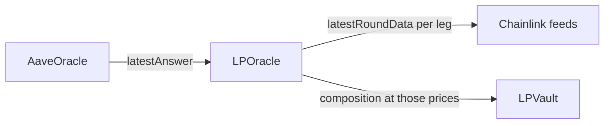

Function links point to the interface that declares each function.

# Oracle lifecycle

Avana prices two things, and only one of them needs its own contract.

- **Debt assets** (USDC, USDT, WETH): Aave V4 reads each asset's own Chainlink USD feed, the same source Aave uses on its other markets. GHO keeps Aave's fixed $1 source. Avana adds no contract here; its borrow and liquidation gates read the feed's round age through [`ChainlinkPrice`](ChainlinkPrice.sol).
- **Vault tokens** (one per LP market): Aave V4 reads the market's [`LPOracle`](LPOracle.sol), an immutable contract with no stored state.

## LPOracle

1. **Deploy** with the market ID, the LPVault, the ParameterStore, the vault token's decimals and each token's Chainlink route (one leg, or two multiplied). The constructor reads each token's and feed's decimals and refuses a duplicate token, an empty route or a route of more than two legs (`InvalidMarket`).
2. **Every read** ([`latestAnswer`](ILPOracle.sol#L58), [`latestRoundData`](ILPOracle.sol#L67)) prices each token through its route, caps a USD stablecoin at $1, asks the LPVault for the tokens one whole vault token holds at those prices, and sums their value rounded down; the answer is never below 1. A leg answering zero or below, or a round from the future, reverts `InvalidPrice`, as an unreadable Chainlink source does for Aave.
3. **Gates** read [`getPriceStatus`](ILPOracle.sol#L76): every leg within its ParameterStore `borrowPriceMaxAge` for a borrow or a withdrawal that leaves debt, within its `liquidationPriceMaxAge` for a liquidation. The price is still served when a leg is old; only the actions that depend on a fresh price stop.
4. **Changing a feed** deploys a new LPOracle; the Aave DAO points the reserve at it (`Spoke.updateReservePriceSource`) and the MarketRegistry records it.

There is nothing to poke, cache, recover or fail over: the oracle has no state between reads.
