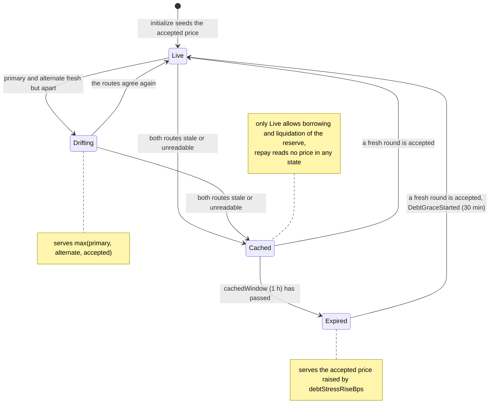

Function links point to the interface that declares each function.

# DebtOracle lifecycle

A DebtOracle is the Aave price source of one debt asset with a market price (USDC, USDT, WETH; GHO uses Aave's fixed $1 source): it serves the USD price with 8 decimals, keeps a cached price through outages, and reports whether borrowing and liquidation of that reserve may use it.

## Walkthrough

Setup (Base, `r_USDC` on the "Aerodrome Slipstream Stable" CDP Spoke, from 3.2 `BOR-022`): Chainlink USDC/USD with an 86,400 s heartbeat (fresh until 88,200 s), reading $0.9999, and a second source that agrees.

1. **Listing → [`initialize`](IDebtOracle.sol#L44)** fixes [`ASSET`](IDebtOracle.sol#L140) = USDC and seeds the accepted price. Event: [`DebtPriceSeeded`](IDebtOracleEvents.sol#L17). Error: [`NotDebtAsset`](IDebtOracleErrors.sol#L26).
2. **Aave reads [`latestAnswer`](IDebtOracle.sol#L55) / [`latestRoundData`](IDebtOracle.sol#L77)**: 99,990,000 ($0.9999). Carol's 5,000 USDC debt is valued at $4,999.50.
3. **RiskModule `preBorrowCheck` → [`poke`](IDebtOracle.sol#L121)** before Carol's borrow: round 30,000 s old ≤ 88,200 s, Live. Events: [`DebtPriceAccepted`](IDebtOracleEvents.sol#L24). Error: [`InsufficientGas`](IDebtOracleErrors.sol#L14).
4. **Borrow age limit.** [`borrowPriceMaxAge`](IDebtOracle.sol#L101) bounds the borrow side: a round 88,300 s old makes Carol's borrow revert `DebtPriceTooOld`. On an L2 a borrow also needs the served round newer than the sequencer's last restart: after a restart at 1,010,000 with a 3,600 s grace period, a round published at 1,009,000 keeps `borrowAllowed` false at 1,013,600 while liquidation and repayment run on it.
5. **LPVaultSwap reads the DebtOracle** in a liquidation repaying USDC: it pokes only the market's LPOracle and requires this oracle to be Live within [`liquidationPriceMaxAge`](IDebtOracle.sol#L109), which bounds the liquidation side. A price that is not Live reverts LPVaultSwap with `DebtPriceStale(r)`. [`poke`](IDebtOracle.sol#L121) is called by the RiskModule on borrow and withdraw-with-debt, and by anyone.
6. **Disagreement.** Primary and alternate both fresh and apart beyond `feedAgreementToleranceBps`: the oracle records the start and serves `max(primary, alternate, accepted)`, so debt is never undervalued; `latestRoundData().updatedAt`, the age limits and the reported legs are those of the route whose value is served, or the accepted price's timestamp with no legs when the accepted price is served. Liquidation of the reserve pauses in every state except Live (`liquidationPaused = state != Live`, also set while the alternate is past its borrow age or the sequencer is down), so it pauses while Drifting too; borrowing stops as well, and repay continues. Events: [`DebtDisagreementRecorded`](IDebtOracleEvents.sol#L56), [`DebtDisagreementCleared`](IDebtOracleEvents.sol#L62).
7. **Outage and expiry.** Both routes stale: Cached (serves the accepted $0.9999), then after 1 h Expired (serves `ceil(accepted × (10^4 + debtStressRiseBps) / 10^4)`, never below the accepted price and never above 1.5 × it: the oracle reads the stress rise into [100, 5,000] bps and, if the read fails, keeps the value the last `poke` read). Borrowing and liquidation of the reserve stop; repay continues. Events: [`DebtFailureRecorded`](IDebtOracleEvents.sol#L43), [`DebtOutageExpiredLatched`](IDebtOracleEvents.sol#L68), [`DebtPriceStateChanged`](IDebtOracleEvents.sol#L31).
8. **Recovery.** The first fresh round starts a 30-minute grace. Events: [`DebtGraceStarted`](IDebtOracleEvents.sol#L75), [`DebtFailureCleared`](IDebtOracleEvents.sol#L49). A standby switch in the MarketRegistry shows up as [`DebtRouteVersionObserved`](IDebtOracleEvents.sol#L81).
9. **AvanaTimelock → [`setPokeMinGas`](IDebtOracle.sol#L128)** at the normal delay. Event: [`PokeMinGasUpdated`](IDebtOracleEvents.sol#L87). Error: [`PokeMinGasOutOfBounds`](IDebtOracleErrors.sol#L31).

## What the UI reads and calls

- Lens: [`getDebtPriceState`](../../lens/lens/ILensLiquidation.sol#L34)`(spoke, debtReserveId)`; direct [`getPriceState`](IDebtOracle.sol#L87).
- Events to index: `DebtPriceStateChanged`, `DebtPriceAccepted`, `DebtFailureRecorded`, `DebtFailureCleared`, `DebtDisagreementRecorded`, `DebtOutageExpiredLatched`, `DebtGraceStarted` ([IDebtOracleEvents.sol](IDebtOracleEvents.sol)).
- User calls: [`poke`](IDebtOracle.sol#L121) (anyone).

## Spec

- [2.10 LPOracle, LPPriceMath and DebtOracle](../../../../docs/spec/02-contracts/10-lp-oracle.md): `REQ-ORACLE-089`–`REQ-ORACLE-098`, `SPEC-ORC-015`, `SPEC-ORC-018`.
- Flows: [3.2](../../../../docs/spec/03-operations/02-borrow.md) `BOR-006`, `BOR-022`; [3.5](../../../../docs/spec/03-operations/05-liquidation.md) `LIQ-073`; [3.6](../../../../docs/spec/03-operations/06-emergency-operations.md) `EMG-020`.
