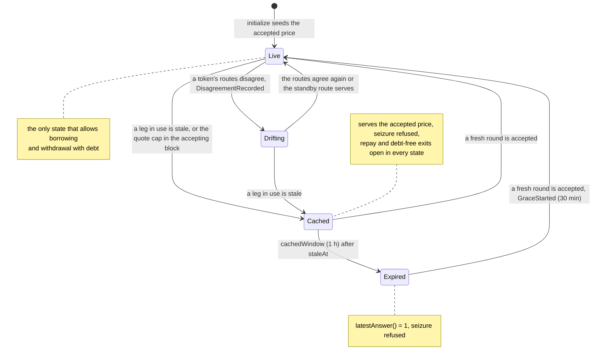

# LPOracle lifecycle

The LPOracle is one market's Aave price source: it serves the USD value of one whole vault token with 8 decimals from the composition of the position at Chainlink prices, keeps a cached price through short outages, and tells Avana's contracts whether the price is Live, Drifting, Cached or Expired.

## Walkthrough

Setup (Ethereum market 1, Uniswap v3 USDC/USDT 0.01%, exact range; USDC/USD and USDT/USD heartbeats 86,400 s, so a leg is fresh for `86,400 + 1,800 = 88,200` s; `cachedWindow` 1 h, `disagreementPauseMax` 1 h, `graceDuration` 30 min, `graceHealthFactor` 0.95).

1. **Avana operators deploy the proxy → [`initialize`](LPOracle.sol#L87)** (market part in [`initializeMarket`](LPOracleListingLogic.sol#L39)) in its deployment transaction, before the listing batch is scheduled (`MKT-019`), with the market's tokens, integration, pool and shape and its oracle configuration as arguments; the batch's `listCollateralMarket` later checks the feed's `marketId()` and `integration()`. `initialize` runs [`checkConfig`](LPOracleListingLogic.sol#L31) and seeds the accepted price; among its checks, a pool-TWAP second source on the market's own pool fails `CHECK_SECOND_SOURCE` ([`_secondSourceDeviation`](LPOracleListing.sol#L223)), and the ParameterStore runs the same `checkConfig` with each token's recorded second source and again with its standby in force whenever it records them. At $1.00 per token, one whole vault token holds 1 USDC + 1 USDT, so `price8 = 200,000,000` ($2.00). Event: [`PriceSeeded`](ILPOracleEvents.sol#L19). Error: [`ConfigCheckFailed`](ILPOracleErrors.sol#L20).
2. **Aave and Avana read [`latestAnswer`](LPOracle.sol#L157) / [`latestRoundData`](LPOracle.sol#L176)** (always ≥ 1, never reverts) and [`getPriceState`](LPOracle.sol#L188) for the state, served price and ages; [`getClPriceState`](ILPOracleCL.sol#L21) adds the concentrated-liquidity sqrt prices. Each view runs in the view logic by one delegatecall ([`_forward`](LPOracle.sol#L259)), reads its whole configuration in one [`getOracleInputs`](../../policy/parameter-store/ParameterStoreViews.sol#L88) call ([`_loadInputs`](LPOracleConfig.sol#L62): 84 words for this market, the routes in force read by the store from the MarketRegistry in the same call), then its legs; `latestAnswer` skips the two second sources, which change only `borrowAllowed`, and `getPriceState` reads them. A cold `AaveOracle.getReservePrice` of this market costs about 383,000 gas, a warm one about 143,000.
3. **Keeper or any Avana call → [`poke`](LPOracle.sol#L221)** (writes in [`_poke`](LPOraclePoke.sol#L29), run by the poke logic). Reads every token's `decimals()` against the stored values ([`_verifyDecimals`](LPOracleConfig.sol#L308), [`_writeDecimals`](LPOraclePoke.sol#L55)), then stores the accepted price, the Cached start, the disagreement start and the grace latch. Collateralization pokes before each pledge; the RiskModule before each borrow and withdrawal with debt; LPVaultSwap before each liquidation. Events: [`PriceAccepted`](ILPOracleEvents.sol#L26), [`PriceStateChanged`](ILPOracleEvents.sol#L34), [`PriceCheckpointed`](ILPOracleEvents.sol#L99). Error: [`InsufficientGas`](ILPOracleErrors.sol#L15) (at entry below `pokeMinGas`, and before any read below its pre-call bound, [`staticRead`](LPOracleCalls.sol#L31)).
4. **Disagreement (3.6 `EMG-107`).** At 09:00 USDT's primary reads $0.9900 and its alternate $0.9998: `98 > 60 × 0.9900 = 59.4`, so [`_writeDisagreement`](LPOraclePoke.sol#L115) records the start and the market is Drifting ([`_decideLive`](LPOracleEval.sol#L311)). Borrows revert `PriceNotLive(1, Drifting)`; liquidation of market 1 waits (`StalePrice`). After the guardian's standby switch the next `poke` serves Live. Events: [`DisagreementRecorded`](ILPOracleEvents.sol#L60), [`DisagreementCleared`](ILPOracleEvents.sol#L66), [`PriceRouteVersionObserved`](ILPOracleEvents.sol#L121).
5. **Outage.** Both USDT routes stop publishing. 88,200 s after the last round the leg is stale: the market is Cached and serves the cached $2.00; the Cached window starts at the first second both routes were stale, `staleAt`, read from the source timestamps ([`_decideFailed`](LPOracleEval.sol#L292), [`_writeFailure`](LPOraclePoke.sol#L98)). Event: [`FailureRecorded`](ILPOracleEvents.sol#L47). Borrowing and withdrawals with debt stop; repay and debt-free withdrawal continue.
6. **Expiry.** After `cachedWindow` (1 h) of Cached the market is Expired ([`_writeLatch`](LPOraclePoke.sol#L175) latches the outage from the source timestamps): `latestAnswer() = 1` (10^-8 USD per vault token), so the market's collateral counts as worthless for Aave while repay and debt-free exits keep working; LPVaultSwap refuses to seize this market (`StalePrice`). Event: [`OutageExpiredLatched`](ILPOracleEvents.sol#L73).
7. **Recovery.** The first fresh round is accepted by [`_writeAccepted`](LPOraclePoke.sol#L144); [`_startGrace`](LPOraclePoke.sol#L210) opens the window from the latch or from Chainlink's round history ([`_recoveryEvidence`](LPOracleRecovery.sol#L37)): [`GraceStarted`](ILPOracleEvents.sol#L80)`(recoveredAt, recoveredAt + 1,800, true)` and [`FailureCleared`](ILPOracleEvents.sol#L53). For 30 minutes LPVaultSwap liquidates only accounts below HF 0.95 (`GraceHealthFactor` for an account at 0.97); then every account below 1.00.
8. **Quote cap.** A fair price more than `maxQuoteChangeBps` (1%) away from an accepted price stored in the same block is refused: the market reads Cached for that block at the accepted price, reason bit 18 ([`_quoteCapped`](LPOracleEval.sol#L336)), and a later block accepts it. Event: [`QuoteChangeCapped`](ILPOracleEvents.sol#L87).
9. **Freshness for callers.** [`borrowPriceMaxAge`](LPOracle.sol#L207) and [`liquidationPriceMaxAge`](LPOracle.sol#L214) give the deadline of the served price; [`getTokenPrices`](LPOracle.sol#L195) gives LPVaultSwap the per-token prices for the per-leg minimums; [`lastAcceptedPrice`](LPOracle.sol#L229) is the price caps and `minPledgeUsd` use.
10. **Second source and token decimals.** USDT's second source returns an out-of-range word ([`_setSecond`](LPOracleConfig.sol#L180)) or stops updating: USDT is unconfirmed (token bit 5), `borrowAllowed` is false, and the market stays Live at the same price, timers untouched; repay and liquidation go on. If USDT upgrades to 18 decimals, views still price with the stored 6 until the next poke, which fails the market (reason bit 1, Cached at $2.00, then Expired) and emits [`TokenDecimalsMismatch`](ILPOracleEvents.sol#L109)`(1, 6, 18, true)`, so borrowing, withdraw-with-debt and seizure of the market stop while repay and debt-free exits stay open; the stored 6 is never replaced, and a poke that reads 6 again emits [`TokenDecimalsRestored`](ILPOracleEvents.sol#L114). With no poke for more than 7,200 s, `borrowAllowed` is false (reason bit 19) until the next poke. [`decimalsStatus`](LPOracle.sol#L362) returns the stored result.
11. **AvanaTimelock → [`setPokeMinGas`](LPOracle.sol#L324)** at the normal delay. Error: [`PokeMinGasOutOfBounds`](ILPOracleErrors.sol#L31).

## LPPriceMath (internal library) in one evaluation

The arithmetic of every step below is in [`LPPriceMath`](LPPriceMath.sol); the LPOracle core reads the feeds and decides the state, the pricing module supplies the composition. Example: Uniswap v3 USDC/USDT on `[-10, 10]`, `d = 10`.

1. **Legs → [`normalizeAnswer`](LPPriceMath.sol#L78).** USDC/USD answers 99,987,000 (8 decimals): `n = 99,987,000`. An 18-decimal feed's 999,870,000,000,000,000 gives the same; a tiny 18-decimal answer floors to 0, and a negative or oversize answer gives 0, both failures.
2. **Routes → [`routeValue`](LPPriceMath.sol#L93), [`routeTimestamp`](LPPriceMath.sol#L128).** USDT's alternate USDT/ETH × ETH/USD: `⌊3.333e14 × 3e11 / 1e18⌋ = 99,990,000`, timestamped at its older leg.
3. **Agreement → [`routesAgree`](LPPriceMath.sol#L153).** `T = 225`: 100,010,000 against 99,900,000 agrees; against 97,500,000 it disagrees and the market is Drifting.
4. **Ceiling → [`valuationPrice`](LPPriceMath.sol#L191).** GHO at 100,300,000 is valued at 100,000,000.
5. **Price → [`lpPrice`](LPPriceMath.sol#L212).** The composition `(5,648,563, 4,348,479)` at `v = (99,987,000, 10^8)` gives `564,782,768 + 434,847,800 = 999,630,568` ($9.99630568). A composition of the wrong length or outside the bounds returns `valid = false`, and the market fails with reason bit 1.
6. **Band → [`inUsdBand`](LPPriceMath.sol#L261).** `99,987,000 ⊗ 100,010,000 = 99,996,998 ≥ 90,000,000 ⊗ 90,000,000 = 81,000,000`: in band; [`usdLevel`](LPPriceMath.sol#L283) reports 99,998,499, the largest level whose fixed-point square is at most 99,996,998.
7. **Served → [`servedPrice`](LPPriceMath.sol#L403), [`servedTimestamp`](LPPriceMath.sol#L346), [`ageLimits`](LPPriceMath.sol#L369).** Live serves 999,630,568 at the oldest input; a disagreement the lower-route price, never above the fresh or accepted price; Cached the accepted price; Expired 1. With an hourly ETH/USD leg in use, both age limits are 50,400 s.
8. **Borrow gates → [`secondSourceAgrees`](LPPriceMath.sol#L166), [`sequencerStatus`](LPPriceMath.sol#L452).** `S = 100`: a second source at 99,400,000 confirms a quote of 100,020,000; on Base, a restart at 1,010,000 keeps borrowing closed until 1,013,600, and after that until every leg in use has a round newer than 1,010,000 (liquidation is not held back by that rule).
9. **Listing → [`vaultDecimals`](LPPriceMath.sol#L237), [`minObservations`](LPPriceMath.sol#L473), [`gasForCall`](LPPriceMath.sol#L487).** `d = 10` (`d = 9` is worth $0.9996); 151 observations for a 1,800 s window on Ethereum; 55,794 gas before a 50,000-gas feed read; [`pokeMinGasFloor`](LPPriceMath.sol#L501) gives one read's term of the poke floor: a feed read after 718,836 gas of a two-token worst-case poke needs 774,630 at entry; the whole poke with its two token-decimals reads, 830,781 gas, binds, so the two-token floor is 900,000 (provisional until the fork calibration). The floor is the gas left at the entry check: a caller sending exactly 900,000 to the proxy is refused, about 915,000 passes.
10. **DebtOracle → [`debtServedPrice`](LPPriceMath.sol#L427).** USDC accepted at 99,990,000 with `δ = 500` serves 104,989,500 once Expired.

## What the UI reads and calls

- Lens: [`getPriceState`](../../lens/lens/ILensLiquidation.sol#L22)`(marketId)`; the app shows the state, the served price and each leg's age against 88,200 s.
- Events to index: `PriceStateChanged`, `PriceAccepted`, `FailureRecorded`, `FailureCleared`, `DisagreementRecorded`, `DisagreementCleared`, `OutageExpiredLatched`, `GraceStarted`, `QuoteChangeCapped`, `RouteChanged`, `TokenDecimalsMismatch`, `TokenDecimalsRestored` ([ILPOracleEvents.sol](ILPOracleEvents.sol)).
- User calls: [`poke`](LPOracle.sol#L221) (anyone; Avana's keeper every heartbeat).

## Spec

- [2.10 LPOracle, LPPriceMath and DebtOracle](../../../../spec/02-contracts/10-lp-oracle.md): `REQ-ORACLE-010`–`REQ-ORACLE-045`, `REQ-ORACLE-085`–`REQ-ORACLE-090`, `REQ-ORACLE-100`, `REQ-ORACLE-107`, `SPEC-ORC-004`, `SPEC-ORC-007`, `SPEC-ORC-015`, `SPEC-ORC-017`.
- Flows: [3.6 Emergency](../../../../spec/03-operations/06-emergency-operations.md) `EMG-007`, `EMG-030`–`EMG-036`, `EMG-076` (P-02), `EMG-107`.
