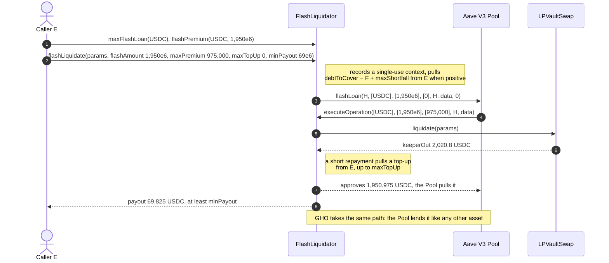

# Flash liquidation helper lifecycle

The flash liquidation helper lets a caller that holds no debt asset liquidate an Avana account. It is periphery, outside the audited core ([`FlashLiquidator`](FlashLiquidator.sol) is the public instance, [`OperatorFlashLiquidator`](OperatorFlashLiquidator.sol) the operator variant, both over [`FlashLiquidatorBase`](FlashLiquidatorBase.sol) and its lenders in [`FlashLiquidatorLenders`](FlashLiquidatorLenders.sol)): public, immutable, with no owner, and holding no funds or allowances between transactions. It borrows every debt asset, GHO included, from the chain's Aave V3 Pool, its only lender, calls [`LPVaultSwap.liquidate`](../../liquidation/lp-vault-swap/ILPVaultSwapLiquidation.sol#L48) inside the Pool's callback, repays the Pool from the payout and pays its caller after the loan returns. LPVaultSwap sees the helper as an ordinary caller.

## Walkthrough

Uniswap v3 on Ethereum (Bob, USDC debt, 3.5 `LIQ-069`), through the public helper before Aave grants it `FLASH_BORROWER` (5 bps premium).

1. **Caller E → [`maxFlashLoan`](FlashLiquidatorLenders.sol#L58)`(USDC)` and [`flashPremium`](FlashLiquidatorLenders.sol#L72)`(USDC, 1,950e6)`:** the Pool's idle USDC and the ceiling quote 975,000 (0.975 USDC). GHO is quoted the same way, from the Pool's GHO reserve.
2. **E → [`flashLiquidate`](FlashLiquidatorBase.sol#L99)`({params, flashAmount: 1,950e6, maxPremium: 975,000, maxTopUp: 0, minPayout: 69e6})`**, with `params` from Lens `previewLiquidation` and `params.minPayout = 0`. The helper refuses a nested call ([`ContextActive`](IFlashLiquidatorErrors.sol#L26)), a flash amount outside `(0, debtToCover]` (`[0, debtToCover]` on an operator helper) ([`InvalidFlashAmount`](IFlashLiquidatorErrors.sol#L36)), a Pool recorded as a Hub ([`FlashSourceIsHub`](IFlashLiquidatorErrors.sol#L22)), a loan above the Pool's idle liquidity ([`InsufficientFlashLiquidity`](IFlashLiquidatorErrors.sol#L41)) and a quoted premium above `maxFlashFeeBps` ([`FlashFeeTooHigh`](IFlashLiquidatorErrors.sol#L59)); it records a single-use context (lender, initiator, asset, amount, premium bound, top-up bound, `params` hash, payer, recipient), pulls `debtToCover − F + params.maxShortfall` from E when positive (here 0) and calls `Pool.flashLoan`, for GHO as for every asset.
3. **Pool → [`executeOperation`](FlashLiquidatorBase.sol#L155)** (the helper's only lender callback; it has no ERC-3156 `onFlashLoan`): the helper checks the Pool, itself as initiator, one asset, the asset, amount and data hash, an active unused context ([`InvalidFlashCallback`](IFlashLiquidatorErrors.sol#L47)), the premium against `maxPremium` ([`PremiumTooHigh`](IFlashLiquidatorErrors.sol#L53)) and `maxFlashFeeBps` ([`FlashFeeTooHigh`](IFlashLiquidatorErrors.sol#L59)), marks the context used ([`_runLoan`](FlashLiquidatorBase.sol#L271)), approves LPVaultSwap for exactly `debtToCover + maxShortfall` = 1,950 USDC and calls `liquidate`; it measures `keeperOut` as its balance rise plus what LPVaultSwap pulled, read as the allowance consumed ([`_liquidate`](FlashLiquidatorBase.sol#L301)), and reads the debt repaid `D` from the result.
4. **LPVaultSwap** pulls 1,950 USDC from the helper (and, when the routes recover below the floor, the shortfall within `maxShortfall`), settles, pays Avana 19.5 USDC and pays the helper `keeperOut = 2,020.8` USDC directly.
5. **Repayment ([`_repay`](FlashLiquidatorBase.sol#L324)):** `keeperOut` plus the unused shortfall budget is at least `F + φ = 1,950.975`, so no top-up; the helper approves the Pool for exactly 1,950.975 USDC and returns. A smaller amount pulls the difference from E up to `maxTopUp`, else [`TopUpExceeded`](IFlashLiquidatorErrors.sol#L66) reverts the whole liquidation.
6. **Payout after the loan returns ([`_payOut`](FlashLiquidatorBase.sol#L356)):** the rise of the helper's balance over the call, 69.825 USDC ≥ `minPayout` ([`PayoutTooLow`](IFlashLiquidatorErrors.sol#L91) otherwise), to E, with any market token LPVaultSwap paid it; event [`FlashLiquidated`](IFlashLiquidatorEvents.sol#L19). The context is cleared only after the payout, so a call re-entered from a token transfer reverts `ContextActive`.
7. **Floor shortfall:** with `debtToCover = F = 12,000` USDC, `maxShortfall = 200` USDC and routes returning 12,174 USDC against a 12,297.373998 USDC floor, the helper pulls E's 200 USDC first, LPVaultSwap pulls 12,000 and then the 123.373998 USDC gap, and E receives 368 USDC (the unused 76.626002 USDC included): a net 168 USDC.
8. **Escrowed residue ([`claimEscrowed`](FlashLiquidatorBase.sol#L175)):** a market token whose issuer blocks the public helper leaves its residue credited to the helper in the PayoutEscrow; anyone calls `claimEscrowed(token)` and it goes to `feeRecipient` ([`InvalidFeeRecipient`](IFlashLiquidatorErrors.sol#L85) while unset). On an operator helper only the signer claims, to the Safe.
9. **Operator variant ([`OperatorFlashLiquidator`](OperatorFlashLiquidator.sol)):** only the bound signer may call ([`NotSigner`](IFlashLiquidatorErrors.sol#L30)); inventory, shortfall budgets and top-ups come from, and payouts go to, the operator's funding Safe. With `D` the debt repaid, a loan above `⌈D × 1.05⌉` reverts ([`FlashAmountAboveNeed`](IFlashLiquidatorErrors.sol#L73), [`_checkLoanNeed`](OperatorFlashLiquidator.sol#L118)), each top-up is capped at `⌊D × MAX_TOP_UP_BPS / 10⁴⌋`, and a call that would cost the Safe more than that net reverts ([`OutlayExceeded`](IFlashLiquidatorErrors.sol#L81), [`_checkOutlay`](OperatorFlashLiquidator.sol#L131)). Bob's example at `MAX_TOP_UP_BPS = 100`: at most 2,047.5 USDC borrowed and 19.5 USDC lost per call, whatever the signer sends. With `flashAmount = 0` the operator helper takes no loan: the Pool is not read or called, the Safe pays `debtToCover + maxShortfall`, `liquidate` runs directly, and the same `minPayout` and outlay bounds apply (Bob's example: the Safe pays 1,950 USDC and receives 2,020.8 USDC), so a paused or empty Pool reserve does not stop the operator.

## What the UI reads and calls

- Quotes: [`maxFlashLoan`](FlashLiquidatorLenders.sol#L58), [`flashPremium`](FlashLiquidatorLenders.sol#L72); immutables `POOL`, `LP_VAULT_SWAP`, `MARKET_REGISTRY`, `PARAMETER_STORE`.
- Event to index: [`FlashLiquidated`](IFlashLiquidatorEvents.sol#L19).
- User calls: [`flashLiquidate`](FlashLiquidatorBase.sol#L99) (anyone on the public instance; the signer on an operator instance); [`claimEscrowed`](FlashLiquidatorBase.sol#L175) (anyone on the public instance; the signer on an operator instance).

## Spec

- [2.11 Flash liquidation helper](../../../../spec/02-contracts/11-lpvaultswap.md#flash-liquidation-helper): `REQ-HELPER-001`–`REQ-HELPER-016`, `SPEC-LIQ-015`, `SPEC-LIQ-019`, `REQ-SWAP-012`, `REQ-SWAP-105`, `REQ-FLASH-010`.
- Flow: [3.5 Flash-funded calls](../../../../spec/03-operations/05-liquidation.md#flash-funded-calls) `LIQ-036`–`LIQ-040`, `LIQ-083`, `LIQ-084`.
