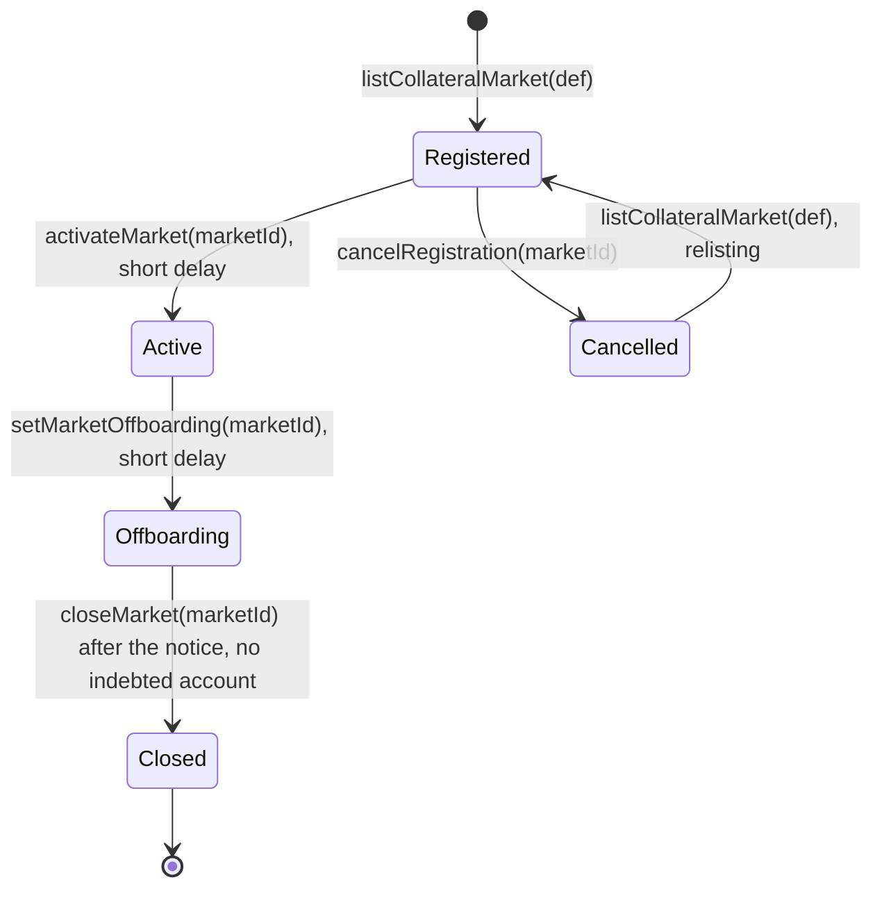
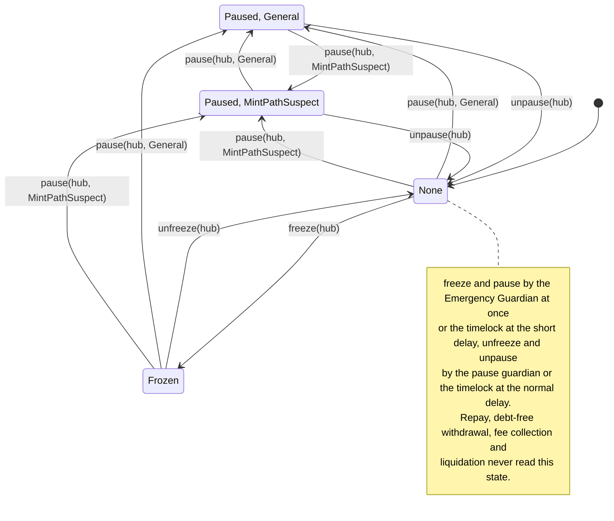

Function links point to the interface that declares each function.

# MarketRegistry lifecycle

The MarketRegistry is the chain's directory and safety switchboard: it records Hubs, CDP Spokes, debt reserves, tokens, markets and swap routes through timelock operations, and holds each Hub's pause state, the address freeze and the breaker latches that stop new activity.

## Walkthrough

Setup (Ethereum market 1: Uniswap v3 USDC/USDT 0.01%, exact range, on the "Uniswap v3 Stable" CDP Spoke `S` of the Stable LP Hub). Normal delay 5 days, short delay 12 hours.

1. **AvanaTimelock → [`approveSpokeCodeHash`](IMarketRegistry.sol#L505) (the reviewed hash of `S`'s implementation; every Aave V4 Spoke implementation has its own), [`deployCdpSpoke`](IMarketRegistry.sol#L25), [`recordIntegrationContracts`](IMarketRegistry.sol#L523) (the Uniswap v3 NonfungiblePositionManager and factory, now protected from the address freeze) and [`finalizeIntegrationContracts`](IMarketRegistry.sol#L530) (from here the integration's routes can be set; a later addition disables at once any route that runs through it, `RouteDisabled`), [`enableDebtReserve`](IMarketRegistry.sol#L31) (GHO, USDC), [`listToken`](IMarketRegistry.sol#L45) (USDC with `PausedFlag` and USDT with the combined `UsdtFeeRateAndPaused` probe, each with primary, alternate and standby routes; GHO, a fixed-price debt asset that is no pool token, with its GHO/USD monitoring feed only)** at the normal delay. Enabling a reserve checks the draw cap against the credit line ([`recordCreditLine`](IMarketRegistry.sol#L426)) and that a swap route of each pool token passes its depth test. Every debt asset, GHO included, is a listed token with its issuer probe; a monitoring-only listing serves only a fixed-price reserve and is refused as a pool token (`ListingCheckFailed("routeLength")`) until `setPriceSource` gives it three routes. Events: [`SpokeCodeHashApproved`](IMarketRegistry.sol#L492), [`SpokeApproved`](IMarketRegistryBase.sol#L112), [`IntegrationContractsRecorded`](IMarketRegistry.sol#L495), [`IntegrationContractsFinalized`](IMarketRegistry.sol#L498), [`DebtReserveApproved`](IMarketRegistryBase.sol#L121), [`CreditLineSet`](IMarketRegistry.sol#L407), [`TokenListed`](IMarketRegistryBase.sol#L136). Errors: [`InvalidSpokeCodeHash`](IMarketRegistry.sol#L501), [`InvalidSpoke`](IMarketRegistryBase.sol#L33), [`InvalidDebtReserve`](IMarketRegistryBase.sol#L47), [`ListingCheckFailed`](IMarketRegistryBase.sol#L38), [`LivenessBound`](IMarketRegistryBase.sol#L103).
2. **AvanaTimelock → VaultTokenFactory `deployVaultToken` and the LPOracle proxy, earlier in the same normal-delay batch as separate timelock calls; then [`listCollateralMarket`](IMarketRegistry.sol#L62)**, which checks `VaultTokenFactory.tokenOf(spoke, marketKey)` against the vault token and its immutables (`VaultTokenMismatch`), calls the LPVault's `bindMarket` for a new market and runs `RiskModule.checkAaveConfig(spoke, [])`; market 1 is `Registered` (a new market past [`MAX_MARKET_COUNT`](IMarketRegistry.sol#L595) reverts [`MarketCountLimit`](IMarketRegistryBase.sol#L109); Closed and Cancelled markets count, a relisting does not). Then [`setRoute`](IMarketRegistryRoutes.sol#L12) sets the primary and backup USDT→USDC and USDC/USDT→GHO swap routes. Events: [`MarketRegistered`](IMarketRegistryBase.sol#L147), [`RouteSet`](IMarketRegistryBase.sol#L171). Errors: [`DuplicateMarketKey`](IMarketRegistryBase.sol#L14), [`InvalidRoute`](IMarketRegistryBase.sol#L19) (a route calling market 1's own pool or a recorded Uniswap v3 contract, or any route before the integration's record is finalized).
3. **AvanaTimelock → [`activateMarket`](IMarketRegistry.sol#L68)** (short delay) after ParameterStore `setInitialMarketParams` and caps: runs the activation checks (Hub shares equal assets, Aave config, oracle Live). Event: [`MarketActivated`](IMarketRegistryBase.sol#L159). Error: [`ActivationCheckFailed`](IMarketRegistryBase.sol#L40).
4. **RiskModule → [`recordBreach`](IMarketRegistry.sol#L301)** from the keeper's `pokeBreakers`: Avana holds 1,040 bps of the pool (illustrative per-pool cap 1,000 bps) at `t = 1,000`, so `lastBreachAt = 1,000` and new borrowing and pool-increasing pledges stop; with `gateRecoverySeconds = 1,800` the gate reopens at 2,800 if the share stays below 10%. A 10,000 GHO deficit latches `DEFICIT` on the GHO reserve. Events: [`GateBreached`](IMarketRegistryBase.sol#L198), [`BreakerLatched`](IMarketRegistryBase.sol#L194). Error: [`NotRiskModule`](IMarketRegistryBase.sol#L88).
5. **Emergency Guardian → [`tripMarketBreaker`](IMarketRegistry.sol#L308)`(1)`** once monitoring confirms the approved swap routes cannot settle liquidations at size (3 route failures in 1 hour is an alert, not a trip). Adds `MANUAL`. Later [`resetMarketBreaker`](IMarketRegistry.sol#L321) or [`resetDebtBreaker`](IMarketRegistry.sol#L327) clears latches. Event: [`BreakerReset`](IMarketRegistryBase.sol#L200). Errors: [`Unauthorized`](IMarketRegistryBase.sol#L65), [`NothingToReset`](IMarketRegistryBase.sol#L83), [`ConditionStillHolds`](IMarketRegistryBase.sol#L86).
6. **Emergency Guardian → [`freeze`](IMarketRegistry.sol#L228)`(hub)` or [`pause`](IMarketRegistry.sol#L234)`(hub, General)`** (immediate; the timelock at the short delay). Frozen stops new-account pledges and borrowing; `Paused(General)` also stops non-rescue top-ups and withdrawals with debt; `Paused(MintPathSuspect)` stops every mint. Repay, debt-free withdrawal, fee collection and liquidation never read it. [`unfreeze`](IMarketRegistry.sol#L251) / [`unpause`](IMarketRegistry.sol#L257) by the pause guardian or the timelock at the normal delay. Events: [`PauseStateChanged`](IMarketRegistryBase.sol#L182), [`PauseReasonChanged`](IMarketRegistryBase.sol#L186). Errors: [`AlreadyPaused`](IMarketRegistryBase.sol#L53), [`NotPaused`](IMarketRegistryBase.sol#L59), [`CannotUnfreezeWhilePaused`](IMarketRegistryBase.sol#L62).
7. **Emergency Guardian → [`freezeAddress`](IMarketRegistry.sol#L275)`(X)`**: X can no longer borrow, pledge a non-rescue top-up or call `liquidate`; X can still repay and exit debt-free. At most 20 freezes per caller in the 24 one-hour buckets ending with the current hour. The Aave V3 Pool behind the flash source and every recorded AMM contract are protected. Event: [`AddressFrozen`](IMarketRegistryBase.sol#L188). Errors: [`ProtectedAddress`](IMarketRegistryBase.sol#L71), [`FreezeLimitReached`](IMarketRegistryBase.sol#L80).
8. **Emergency Guardian → [`useStandbyRoute`](IMarketRegistry.sol#L365)`(USDT, Primary)`** at 09:12 when USDT's primary ($0.9900) and alternate ($0.9998) disagree (3.6 `EMG-107`); the standby reads $0.9997 and the next LPOracle `poke` serves Live. [`restorePriceRoute`](IMarketRegistry.sol#L378) later at the normal delay. If the Aave governance executor instead calls [`cancelStandbySwitch`](IMarketRegistry.sol#L372), no guardian can switch USDT again for 5 days ([`StandbySwitchLocked`](IMarketRegistry.sol#L361), [`standbySwitchLockedUntil`](IMarketRegistry.sol#L390)); the timelock's own switch or `setPriceSource` ends the lock. Events: [`StandbyRouteActivated`](IMarketRegistryBase.sol#L203), [`PriceRouteRestored`](IMarketRegistryBase.sol#L209).
9. **AvanaTimelock → [`disableRoute`](IMarketRegistryRoutes.sol#L20) / [`restoreRoute`](IMarketRegistryRoutes.sol#L31)** (short delay) for a failing swap route; LPVaultSwap falls back to the backup. Event: [`RouteDisabled`](IMarketRegistryBase.sol#L175).
10. **End of life:** [`setMarketOffboarding`](IMarketRegistry.sol#L79) (short delay) records the threshold `LT0` and publishes the target `⌊LT0 × 5,000 / 10,000⌋` (7,500 → 3,750 bps) and the earliest date, 5 days later, in [`windDownState`](IMarketRegistry.sol#L475); after that date the Aave DAO lowers the reserve's threshold once, to the target, in its own payload; [`closeMarket`](IMarketRegistry.sol#L469) ([body](MarketRegistryWindDownLogic.sol)) once the 5-day notice has run and Collateralization reports no indebted account. Events: [`MarketOffboarding`](IMarketRegistryBase.sol#L167), [`MarketClosed`](IMarketRegistry.sol#L454). Errors: [`OffboardNoticeRunning`](IMarketRegistry.sol#L462), [`MarketHasDebt`](IMarketRegistry.sol#L465).

## What the UI reads and calls

- Lens: [`getApplicationState`](../../lens/lens/ILensLiquidation.sol#L29), [`getPauseReason`](../../lens/lens/ILensLiquidation.sol#L35), [`getBreakerStatus`](../../lens/lens/ILensRisk.sol#L14), [`getDebtBreakerStatus`](../../lens/lens/ILensRisk.sol#L19), [`isFrozenAddress`](../../lens/lens/ILensRisk.sol#L25), [`getTailCoverage`](../../lens/lens/ILensRisk.sol#L31), [`getHubAssetExposure`](../../lens/lens/ILensRisk.sol#L43); direct views [`spokeImplementationStatus`](IMarketRegistry.sol#L517), [`creditLineCoverage`](IMarketRegistry.sol#L449), [`windDownState`](IMarketRegistry.sol#L481), [`getMarket`](IMarketRegistry.sol#L540), [`getRoute`](IMarketRegistry.sol#L660), [`activePriceRoutes`](IMarketRegistry.sol#L384).
- Events to index: `SpokeCodeHashApproved`, `IntegrationContractsRecorded`, `IntegrationContractsFinalized`, `FlashSourceSet`, `CreditLineSet`, `PauseStateChanged`, `PauseReasonChanged`, `AddressFrozen`, `AddressUnfrozen`, `BreakerLatched`, `GateBreached`, `BreakerReset`, `StandbyRouteActivated`, `MarketActivated`, `MarketOffboarding`, `MarketClosed`, `RouteDisabled`.
- User calls: [`closeMarket`](IMarketRegistry.sol#L469) (anyone); everything else is governance or guardian.

## Spec

- [2.8 Market Registry](../../../../docs/spec/02-contracts/08-market-registry.md): `REQ-MREG-006`–`REQ-MREG-010`, `REQ-MREG-024`–`REQ-MREG-027`, `REQ-MREG-030`–`REQ-MREG-035`, `REQ-CONFIG-016`–`REQ-CONFIG-048`, `REQ-CONFIG-080`, `REQ-CONFIG-081`, `SPEC-BRK-005`–`SPEC-BRK-008`, `SPEC-CAP-010`.
- Flows: [3.6 Emergency](../../../../docs/spec/03-operations/06-emergency-operations.md) `EMG-041`, `EMG-057`, `EMG-107`; [3.8 Market lifecycle](../../../../docs/spec/03-operations/08-market-lifecycle.md) `MKT-049`, `MKT-057`, `MKT-059`.
