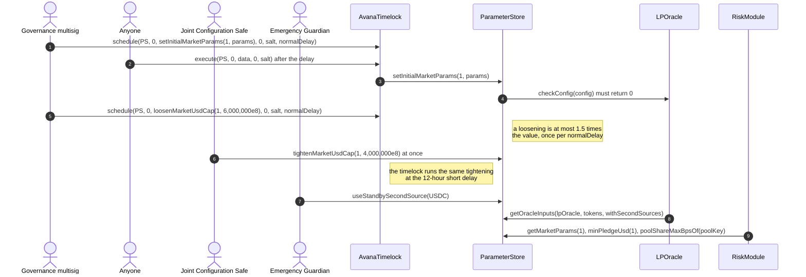

# ParameterStore lifecycle

The ParameterStore holds every risk and oracle parameter Avana reads (its views and role checks in [`ParameterStore`](ParameterStore.sol), each setter body in one of five logic contracts it delegatecalls, each refusing a direct call), written by the AvanaTimelock: listing values at the normal delay, tightenings at the short delay (12 hours) and step-limited loosenings at the normal delay (5 days). The Joint Configuration Safe (2-of-3: Avana Labs, Aave Labs, LlamaRisk) holds `APPLICATION_RISK_STEWARD` and calls the same tighten setters and `setAvanaFeeShareBps` (within 0–5,000 bps) at once.

## Walkthrough

Setup (Ethereum market 1, Uniswap v3 USDC/USDT; proposed defaults from 1.5, final values set in the listing or funding ARFC).

1. **AvanaTimelock → [`setFeed`](ParameterStoreListingLogic.sol#L169)** for USDC/USD and USDT/USD: heartbeat 86,400 s, so a leg is fresh for `86,400 + heartbeatMargin 1,800 = 88,200` s; `maxAnswerCap` at its largest value, since the aggregators' own bounds keep each route below `MAX_ROUTE_ANSWER`. A token's tolerance must cover every route pair a standby switch can put in force: with 25 bps on USDC's primary, alternate and standby and a 50 bps margin, `max(50, 50, 50) + 50 = 100` bps. Event: [`FeedConfigured`](IParameterStoreEvents.sol#L82). Error: [`InvalidFeed`](IParameterStoreErrors.sol#L61).
2. **AvanaTimelock → [`setInitialMarketParams`](ParameterStoreListingLogic.sol#L64)** while market 1 is `Registered`: `twapWindow` 30 min (on Base at most the 1-hour sequencer grace, set first by `setSequencer`; neither USDC's nor USDT's second source may read this market's pool), `consistencyToleranceBps` 50, `slippageAllowanceBps` 100, `poolRiskFactor` 4,000, `minPledgeUsd` $10; the LPOracle's `checkConfig` must return 0. Events: [`ParameterSet`](IParameterStoreEvents.sol#L42), [`MinPledgeUsdSet`](IParameterStoreEvents.sol#L113). Errors: [`NotInListing`](IParameterStoreErrors.sol#L71), [`OracleConfigRejected`](IParameterStoreErrors.sol#L86).
3. **AvanaTimelock → [`setInitialMarketCaps`](ParameterStoreListingLogic.sol#L100)**: `marketUsdCap` $5,000,000, so [`topUpSliceUsd`](ParameterStoreViews.sol#L290) is $500,000 (10%); `depositorUsdCap` $1,000,000; `poolShareMaxBps` 10,000 (chain default, off, Q-403; [`tightenPoolShareMaxBpsOf`](ParameterStoreTightenLogic.sol#L284) sets an optional per-pool cap). The market has no Hub asset yet, so `activateMarket` checks that the Hub `addCap` covers `⌈(marketUsdCap + topUpSliceUsd) / stressFloorUsd⌉` = 5,500,000 whole vault tokens; after activation [`loosenMarketUsdCap`](ParameterStoreLoosenLogic.sol#L122) reverts [`AddCapTooSmall`](IParameterStoreErrors.sol#L75) when it would not.
4. **AvanaTimelock → [`setMaxFlashFeeBps`](ParameterStoreAdminOracleLogic.sol#L234)`(10)`** per chain while Avana lacks the Aave V3 Pool's `FLASH_BORROWER` role (premium 5 bps); once granted, [`tightenMaxFlashFeeBps`](ParameterStoreTightenLogic.sol#L365)`(0)` at the short delay. Read by IFlashSource as [`maxFlashFeeBps`](ParameterStoreViews.sol#L170): Bob's 0.975 USDC premium on 1,950 USDC passes `975,000 × 10^4 ≤ 10 × 1,950,000,000`. Error: [`LivenessBound`](IParameterStoreErrors.sol#L35).
5. **Breaker values:** [`breakerDeficitMax`](ParameterStore.sol#L121) is 10,000 GHO for the GHO reserve; [`gateRecoverySeconds`](ParameterStore.sol#L130) is 1,800 (30 minutes, provisional). [`tightenBreakerDeficitMax`](ParameterStoreTightenLogic.sol#L341) and [`tightenGateRecoverySeconds`](ParameterStoreTightenLogic.sol#L328) run at the short delay; the loosen setters at the normal delay. Price drop (3% in 2 h), seizure (20% in 1 h) and route failures (3 in 1 h) are monitoring alerts with no on-chain value.
6. **AvanaTimelock (short delay) or Joint Configuration Safe (at once) → [`tightenMarketUsdCap`](ParameterStoreTightenLogic.sol#L195)`(1, 4,000,000e8)`** : existing records stay; new pledges see less room; `caller` is the timelock or the Safe. Event: [`CapTightened`](IParameterStoreEvents.sol#L51). Error: [`NotStricter`](IParameterStoreErrors.sol#L23).
7. **AvanaTimelock → [`loosenMarketUsdCap`](ParameterStoreLoosenLogic.sol#L122)`(1, 6,000,000e8)`** (normal delay): at most 1.5 times the current value and once per `normalDelay`. Event: [`CapLoosened`](IParameterStoreEvents.sol#L60). Errors: [`NotLooser`](IParameterStoreErrors.sol#L27), [`LoosenStepTooLarge`](IParameterStoreErrors.sol#L92), [`LoosenTooSoon`](IParameterStoreErrors.sol#L98).
8. **Optional hard floor:** [`hardHealthFloor`](ParameterStoreViews.sol#L126) is 0 (off) at launch. Only if stress tests justify it, [`tightenHardHealthFloor`](ParameterStoreTightenLogic.sol#L54)`(1, 1.10e18)` turns it on; [`loosenHardHealthFloor`](ParameterStoreLoosenLogic.sol#L52) lowers it by at most 0.03e18 per step (1.10 → 1.07 succeeds, 1.10 → 1.06 reverts `LoosenStepTooLarge`).
9. **Emergency Guardian → [`useStandbySecondSource`](ParameterStoreAdminRiskLogic.sol#L182)`(USDC)`** when USDC's second source stops reading and borrows revert `SecondSourceDisagrees(USDC)`; the switch is refused (`OutOfBounds`) if a route change since `setSecondSource` made the standby share a feed with USDC's routes, and (`OracleConfigRejected`) if the LPOracle of a USDC market fails `checkConfig` with the standby in force; the tighten setters that re-run `checkConfig` check each standby the same way, so a tightening never leaves this switch refused. [`restoreSecondSource`](ParameterStoreAdminRiskLogic.sol#L200) later through the timelock re-runs `checkConfig` for every USDC market and emits only when the standby was in force. Event: [`SecondSourceSwitched`](IParameterStoreEvents.sol#L16). Errors: [`NoStandby`](IParameterStoreErrors.sol#L14), [`StandbyActive`](IParameterStoreErrors.sol#L19).
10. **Readers:** the RiskModule reads [`getMarketParams`](ParameterStoreViews.sol#L29), [`minPledgeUsd`](ParameterStoreViews.sol#L329), [`poolShareMaxBpsOf`](ParameterStoreViews.sol#L362) (the pool override, else the chain default [`poolShareMaxBps`](ParameterStoreViews.sol#L323)); LPVaultSwap reads [`avanaFeeShareBps`](ParameterStoreViews.sol#L176) (20%), [`feeRecipient`](ParameterStoreViews.sol#L182), [`maxShortfallBps`](ParameterStore.sol#L91) (10%), [`graceHealthFactor`](ParameterStoreViews.sol#L164) (0.95). [`aaveTargetHealthFactor`](ParameterStore.sol#L105) (1.10) and [`minLiquidationBonus`](ParameterStore.sol#L113) (2%) record Avana's recommendation for the listing AIP; the Aave DAO sets the Spoke. Every LPOracle evaluation reads [`getOracleInputs`](ParameterStoreViews.sol#L88)`(lpOracle, tokens, withSecondSources)`: one call returning the market's settings, each token's routes in force and route version (read from the MarketRegistry in the same call), every leg's feed definition and, for `getPriceState` and `poke`, the second source; `getOracleConfig` (built in [`ParameterStoreAdminOracleLogic`](ParameterStoreAdminOracleLogic.sol#L30)) serves the listing checks.

## What the UI reads and calls

- Lens: [`getCapHeadroom`](../../lens/lens/ILensMarket.sol#L53) (caps and `minPledgeUsd`), [`getPriceState`](../../lens/lens/ILensLiquidation.sol#L22) (feed ages against these limits), [`previewBorrowMax`](../../lens/lens/ILensPreview.sol#L21) (uses `hardHealthFloor`).
- Events to index: `ParameterSet`, `ParameterTightened`, `ParameterLoosened`, `CapTightened`, `CapLoosened`, `MinPledgeUsdSet`, `FeedConfigured`, `SecondSourceSwitched` ([IParameterStoreEvents.sol](IParameterStoreEvents.sol)).
- User calls: none.

## Spec

- [2.9 Parameter Store](../../../../spec/02-contracts/09-parameter-store.md): `REQ-PSTORE-016`, `REQ-PSTORE-017`, `REQ-PSTORE-030`, `REQ-PSTORE-031`, `REQ-CONFIG-049`–`REQ-CONFIG-053`, `REQ-RISK-042`–`REQ-RISK-044`, `SPEC-BRK-004`, `SPEC-CAP-006`.
- [1.5 Parameters](../../../../spec/01-architecture/05-parameters.md) for every value and bound.
