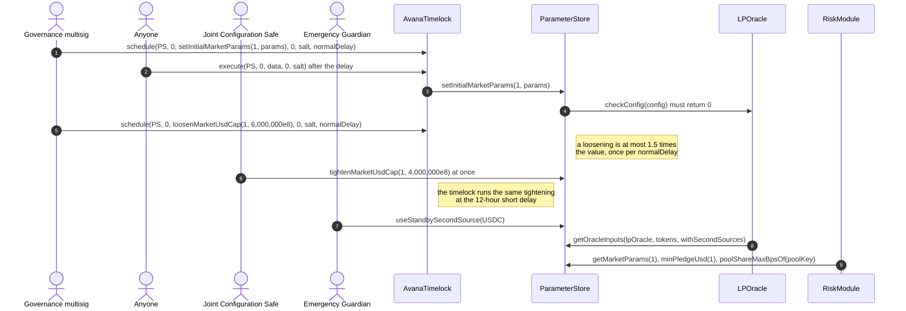

# ParameterStore lifecycle

The ParameterStore holds every risk and oracle parameter Avana reads (its views and role checks in [`ParameterStore`](ParameterStore.sol), each setter body in one of five logic contracts it delegatecalls, each refusing a direct call), written by the AvanaTimelock: listing values at the normal delay, tightenings at the short delay (12 hours) and step-limited loosenings at the normal delay (5 days). The Joint Configuration Safe (2-of-3) holds `APPLICATION_RISK_STEWARD` and calls the same tighten setters and `setAvanaFeeShareBps` (within 0–5,000 bps) at once.

## Walkthrough

Setup (Ethereum market 1, Uniswap v3 USDC/USDT; proposed defaults from 1.5, final values set in the listing or funding ARFC).

1. **AvanaTimelock → [`setFeed`](ParameterStoreListingLogic.sol#L146)** for USDC/USD and USDT/USD: heartbeat 86,400 s, so a leg is fresh for `86,400 + heartbeatMargin 1,800 = 88,200` s; `maxAnswerCap` at its largest value, since the aggregators' own bounds keep each route below `MAX_ROUTE_ANSWER`. A token's tolerance must cover every route pair a standby switch can put in force: with 25 bps on USDC's primary, alternate and standby and a 50 bps margin, `max(50, 50, 50) + 50 = 100` bps. Event: [`FeedConfigured`](IParameterStoreBase.sol#L118). Error: [`InvalidFeed`](IParameterStoreBase.sol#L40).
2. **AvanaTimelock → [`setInitialMarketParams`](ParameterStoreListingLogic.sol#L49)** while market 1 is `Registered`: `twapWindow` 30 min (on Base at most the 1-hour sequencer grace, set first by `setSequencer`; neither USDC's nor USDT's second source may read this market's pool), `consistencyToleranceBps` 50, `slippageAllowanceBps` 100, `poolRiskFactor` 4,000, `minPledgeUsd` $10; the LPOracle's `checkConfig` must return 0. Events: [`ParameterSet`](IParameterStoreBase.sol#L95), [`MinPledgeUsdSet`](IParameterStoreBase.sol#L145). Errors: [`NotInListing`](IParameterStoreBase.sol#L46), [`OracleConfigRejected`](IParameterStoreBase.sol#L56).
3. **AvanaTimelock → [`setInitialMarketCaps`](ParameterStoreListingLogic.sol#L86)**: `marketUsdCap` $5,000,000, so [`topUpSliceUsd`](ParameterStore.sol#L253) is $500,000 (10%); `poolShareMaxBps` 10,000 (chain default, off, Q-403; [`tightenPoolShareMaxBpsOf`](ParameterStoreTightenLogic.sol#L256) sets an optional per-pool cap). The market has no Hub asset yet, so `activateMarket` checks that the Hub `addCap` covers `⌈(marketUsdCap + topUpSliceUsd) / stressFloorUsd⌉` = 5,500,000 whole vault tokens; after activation [`loosenMarketUsdCap`](ParameterStoreLoosenLogic.sol#L111) reverts [`AddCapTooSmall`](IParameterStoreBase.sol#L49) when it would not.
4. **AvanaTimelock → [`setMaxFlashFeeBps`](ParameterStoreAdminOracleLogic.sol#L204)`(10)`** per chain while Avana lacks the Aave V3 Pool's `FLASH_BORROWER` role (premium 5 bps); once granted, [`tightenMaxFlashFeeBps`](ParameterStoreTightenLogic.sol#L329)`(0)` at the short delay. Read by IFlashSource as [`maxFlashFeeBps`](ParameterStore.sol#L151): Bob's 0.975 USDC premium on 1,950 USDC passes `975,000 × 10^4 ≤ 10 × 1,950,000,000`. Error: [`LivenessBound`](IParameterStoreBase.sol#L25).
5. **Breaker values:** [`breakerDeficitMax`](ParameterStore.sol#L424) is 10,000 GHO for the GHO reserve; [`gateRecoverySeconds`](ParameterStore.sol#L432) is 1,800 (30 minutes, provisional). [`tightenBreakerDeficitMax`](ParameterStoreTightenLogic.sol#L308) and [`tightenGateRecoverySeconds`](ParameterStoreTightenLogic.sol#L296) run at the short delay; the loosen setters at the normal delay. Price drop (3% in 2 h), seizure (20% in 1 h) and route failures (3 in 1 h) are monitoring alerts with no on-chain value.
6. **AvanaTimelock (short delay) or Joint Configuration Safe (at once) → [`tightenMarketUsdCap`](ParameterStoreTightenLogic.sol#L175)`(1, 4,000,000e8)`** : existing records stay; new pledges see less room; `caller` is the timelock or the Safe. Event: [`CapTightened`](IParameterStoreBase.sol#L100). Error: [`NotStricter`](IParameterStoreBase.sol#L16).
7. **AvanaTimelock → [`loosenMarketUsdCap`](ParameterStoreLoosenLogic.sol#L111)`(1, 6,000,000e8)`** (normal delay): at most 1.5 times the current value and once per `normalDelay`. Event: [`CapLoosened`](IParameterStoreBase.sol#L104). Errors: [`NotLooser`](IParameterStoreBase.sol#L19), [`LoosenStepTooLarge`](IParameterStoreBase.sol#L60), [`LoosenTooSoon`](IParameterStoreBase.sol#L65).
8. **Optional hard floor:** [`hardHealthFloor`](ParameterStore.sol#L114) is 0 (off) by default. Only if stress tests justify it, [`tightenHardHealthFloor`](ParameterStoreTightenLogic.sol#L43)`(1, 1.10e18)` turns it on; [`loosenHardHealthFloor`](ParameterStoreLoosenLogic.sol#L42) lowers it by at most 0.03e18 per step (1.10 → 1.07 succeeds, 1.10 → 1.06 reverts `LoosenStepTooLarge`).
9. **Emergency Guardian → [`useStandbySecondSource`](ParameterStoreAdminRiskLogic.sol#L147)`(USDC)`** when USDC's second source stops reading and borrows revert `SecondSourceDisagrees(USDC)`; the switch is refused (`OutOfBounds`) if a route change since `setSecondSource` made the standby share a feed with USDC's routes, and (`OracleConfigRejected`) if the LPOracle of a USDC market fails `checkConfig` with the standby in force; the tighten setters that re-run `checkConfig` check each standby the same way, so a tightening never leaves this switch refused. [`restoreSecondSource`](ParameterStoreAdminRiskLogic.sol#L162) later through the timelock re-runs `checkConfig` for every USDC market and emits only when the standby was in force. Event: [`SecondSourceSwitched`](IParameterStoreBase.sol#L82). Errors: [`NoStandby`](IParameterStoreBase.sol#L10), [`StandbyActive`](IParameterStoreBase.sol#L13).
10. **Readers:** the RiskModule reads [`getMarketParams`](ParameterStore.sol#L28), [`minPledgeUsd`](ParameterStore.sol#L287), [`poolShareMaxBpsOf`](ParameterStore.sol#L316) (the pool override, else the chain default [`poolShareMaxBps`](ParameterStore.sol#L282)); LPVaultSwap reads [`avanaFeeShareBps`](ParameterStore.sol#L156) (20%), [`feeRecipient`](ParameterStore.sol#L161), [`maxShortfallBps`](ParameterStore.sol#L398) (10%), [`graceHealthFactor`](ParameterStore.sol#L146) (0.95). [`aaveTargetHealthFactor`](ParameterStore.sol#L410) (1.10) and [`minLiquidationBonus`](ParameterStore.sol#L417) (2%) record Avana's recommendation for the listing AIP; the Aave DAO sets the Spoke. Every LPOracle evaluation reads [`getOracleInputs`](ParameterStore.sol#L79)`(lpOracle, tokens, withSecondSources)`: one call returning the market's settings, each token's routes in force and route version (read from the MarketRegistry in the same call), every leg's feed definition and, for `getPriceState` and `poke`, the second source; `getOracleConfig` (built in [`ParameterStoreAdminOracleLogic`](ParameterStoreAdminOracleLogic.sol#L21)) serves the listing checks.
11. **Speed limits** (Q-411). In market 1's listing batch the AvanaTimelock calls [`loosenMarketSpeedLimits`](ParameterStoreLoosenLogic.sol#L270)`(1, {21,600, 2,500, 2,500, 250,000e8, 2,500,000e8, 1,000,000e8, 10,000,000e8})`, a loosening of the never-written all-zero value; the first `enableDebtReserve` batch of (Stable LP Hub, GHO) calls [`loosenDebtSpeedLimit`](ParameterStoreLoosenLogic.sol#L285)`(hub, GHO, {2,500, 21,600, 500,000e18, 5,000,000e18})`. The Joint Configuration Safe lowers the market's `borrowMaxUsd` to $1,000,000 at once with [`tightenMarketSpeedLimits`](ParameterStoreTightenLogic.sol#L342); raising it back is a loosening at the normal delay, which is also the large-borrow path. A change that tightens one field and loosens another reverts (`NotStricter`, `NotLooser`); a window outside 3,600 – 604,800 s, a rate above 10,000 bps or a minimum above its maximum reverts `OutOfBounds`. Events: [`MarketSpeedLimitsSet`](IParameterStore.sol#L410), [`DebtSpeedLimitSet`](IParameterStore.sol#L415). The RiskModule reads [`marketSpeedLimits`](ParameterStoreForwardRisk.sol#L17) and [`debtSpeedLimit`](ParameterStoreForwardRisk.sol#L24).

## What the UI reads and calls

- Lens: [`getCapHeadroom`](../../lens/lens/ILensMarket.sol#L32) (caps and `minPledgeUsd`), [`getPriceState`](../../lens/lens/ILens.sol#L81) (feed ages against these limits), [`previewBorrowMax`](../../lens/lens/ILensPreview.sol#L12) (uses `hardHealthFloor`).
- Events to index: `ParameterSet`, `ParameterTightened`, `ParameterLoosened`, `CapTightened`, `CapLoosened`, `MinPledgeUsdSet`, `MarketSpeedLimitsSet`, `DebtSpeedLimitSet`, `FeedConfigured`, `SecondSourceSwitched` ([IParameterStoreBase.sol](IParameterStoreBase.sol)).
- User calls: none.

## Spec

- [2.9 Parameter Store](../../../../docs/spec/02-contracts/09-parameter-store.md): `REQ-PSTORE-016`, `REQ-PSTORE-017`, `REQ-PSTORE-030`, `REQ-PSTORE-035`, `REQ-PSTORE-036`, `REQ-PSTORE-031`, `REQ-CONFIG-049`–`REQ-CONFIG-053`, `REQ-RISK-042`–`REQ-RISK-044`, `SPEC-BRK-004`, `SPEC-CAP-006`.
- [1.5 Parameters](../../../../docs/spec/01-architecture/05-parameters.md) for every value and bound.
