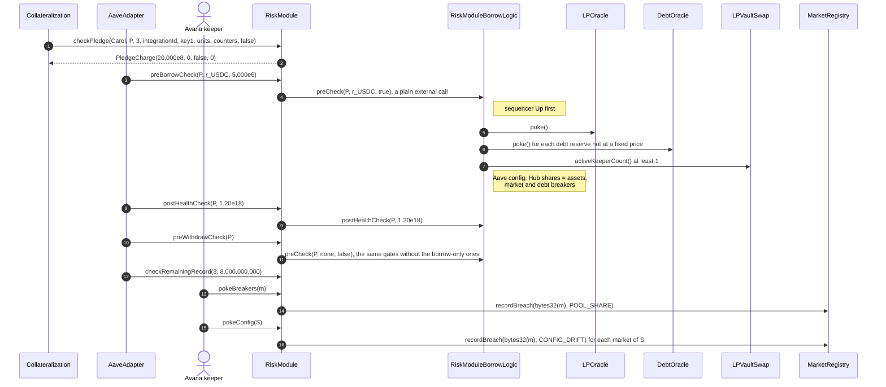

# RiskModule lifecycle

The RiskModule decides whether new risk may open: it checks every pledge, borrow and withdrawal with debt against prices, caps, pool share, breakers and Aave's configuration, and books no state of its own except the speed windows ([`RiskModuleSpeed`](RiskModuleSpeed.sol)) and breaker observations through the MarketRegistry. Its check bodies run in six stateless logic contracts: [`RiskModuleDriftLogic`](RiskModuleDriftLogic.sol), [`RiskModuleBreakerLogic`](RiskModuleBreakerLogic.sol), [`RiskModulePledgeLogic`](RiskModulePledgeLogic.sol), [`RiskModuleBorrowLogic`](RiskModuleBorrowLogic.sol), [`RiskModuleStatusLogic`](RiskModuleStatusLogic.sol) and [`RiskModuleSpeedLogic`](RiskModuleSpeedLogic.sol), with the formulas in [`RiskModuleMath`](RiskModuleMath.sol).

## Walkthrough

Setup (Base market 3, from 3.1 `DEP-029` and 3.2 `BOR-022`): $2.00 per whole vault token, `CF_LP = 3,120` bps, `minPledgeUsd = $10`, `marketUsdCap = $5,000,000` with $1,000,000 in `Regular`, `poolShareMaxBpsOf(poolKey) = 1,000` (illustrative per-pool cap), market supply 400,000,000,000 units, pool in-range liquidity 20,000,000,000,000; sequencer gate `Up`. No hard health floor (`hardHealthFloor = 0`) and no minimum debt.

1. **App → [`previewPledge`](RiskModule.sol#L242)** for Carol's NFT: the same checks as `checkPledge`, returned without reverting.
2. **Collateralization → [`checkPledge`](RiskModule.sol#L112)**`(Carol, P, 3, integrationId, key1, 10,000,000,000, counters, false)`. Value `⌊10,000,000,000 × 200,000,000 / 10^6⌋` = $20,000 ≥ $10; charge $20,000 fits $4,000,000 of `Regular` room; pool share `(400,000,000,000 + 10,000,000,000) × 10^4 = 4.1 × 10^15 ≤ 1,000 × 2 × 10^13` (2.05%); Collateralization refuses a 17th record itself. Returns `PledgeCharge{20,000e8, 0, false, 0}`. Errors: [`MarketNotActive`](IRiskModuleErrors.sol#L15), [`IntegrationMismatch`](IRiskModuleErrors.sol#L213), [`BelowMinPledge`](IRiskModuleErrors.sol#L86) (`800,000,000 < 1,000,000,000` for an $8 NFT), [`CapExceeded`](IRiskModuleErrors.sol#L65), [`PoolShareExceeded`](IRiskModuleErrors.sol#L79), [`PriceNotLive`](IRiskModuleErrors.sol#L119), [`SequencerGrace`](IRiskModuleErrors.sol#L222).
3. **AaveAdapter → [`preBorrowCheck`](RiskModule.sol#L134)`(P, r_USDC, 5,000e6)`.** The RiskModule calls `RiskModuleBorrowLogic.preCheck` by a plain external call (not a delegatecall), so the borrow logic contract is the caller of each `poke()`. It checks the sequencer first, pokes the LPOracle and the USDC DebtOracle (both Live, round 30,000 s old ≤ 88,200 s), runs [`checkAaveConfig`](RiskModule.sol#L163), [`isHubSharesEqualAssets`](RiskModule.sol#L220), the market and debt breakers and the keeper count (`activeKeeperCount() ≥ 1`). Errors: [`PriceTooOld`](IRiskModuleErrors.sol#L126), [`DebtPriceTooOld`](IRiskModuleErrors.sol#L134), [`SecondSourceDisagrees`](IRiskModuleErrors.sol#L229), [`ConfigDrift`](IRiskModuleErrors.sol#L113), [`BreakerTripped`](IRiskModuleErrors.sol#L173), [`DebtBreakerTripped`](IRiskModuleErrors.sol#L180), [`LiquidationHalted`](IRiskModuleErrors.sol#L91) (no active keeper), [`DebtLiquidationHalted`](IRiskModuleErrors.sol#L97) (a pool token with no usable route into USDC), [`SequencerDown`](IRiskModuleErrors.sol#L217).
4. **AaveAdapter → [`postHealthCheck`](RiskModule.sol#L154)`(P, 1.20e18)`.** Rescue-excluded `hfEx = ⌊6,240 / 4,999.50 × 10^18⌋ = 1,248,124,812,481,248,124 ≥ max(1e18, hardHealthFloor = 0, 1.20e18)`. Error: [`HealthFactorTooLow`](IRiskModuleErrors.sol#L167) (5,700 USDC gives 1.0948).
5. **AaveAdapter → [`preWithdrawCheck`](RiskModule.sol#L146)`(P)`** for Carol's withdrawal of `keyB` with debt: sequencer, LPOracle and DebtOracle pokes, breakers; then `postHealthCheck` again (1.2481).
6. **AaveAdapter → [`checkRemainingRecord`](RiskModule.sol#L228)** after a partial removal with debt: the remaining 8,000,000,000 units are worth $16,000 ≥ $10. Error: [`RecordBelowMinPledge`](IRiskModuleErrors.sol#L193).
7. **Rescue top-up** (Ethereum example of 3.1): the account owes 15,000 GHO with HF 1.04 and `Regular` room is 0. [`usdToRestore`](RiskModule.sol#L293) = `(1.10 − 1.04) × 15,000 / 0.3120` = $2,884.62. `checkPledge` books a $2,000 NFT in the slice and marks all its units rescue units; HF after 1.0816. A non-rescue pledge in the same state reverts [`NotRescueTopUp`](IRiskModuleErrors.sol#L187).
8. **Avana's keeper → [`pokeBreakers`](RiskModule.sol#L195)`(m)` every block.** Avana's credited liquidity reaches 1,040 bps of market A's pool, listed with an illustrative 1,000 bps per-pool cap: the call records `POOL_SHARE` through MarketRegistry `recordBreach` (`lastBreachAt = t`) and emits [`BreakersPoked`](IRiskModuleChecks.sol#L24). Borrows revert `BreakerTripped(A, POOL_SHARE)` while the share is above 10% and `BreakerTripped(A, ORACLE | POOL_SHARE | POOL_DEPTH)` for 30 minutes (`gateRecoverySeconds`) after the last poke that saw it (the registry keeps one breach time per market). A 10,000 GHO deficit latches `DEFICIT` on the GHO reserve.
9. **Avana's keeper → [`pokeConfig`](RiskModule.sol#L174)`(S)` every block.** If the Aave DAO turns on `receiveSharesEnabled`, it emits [`ConfigDriftDetected`](IRiskModuleChecks.sol#L18) instead of reverting; borrows revert `ConfigDrift(A, ReceiveSharesOn)`, and once the poke latches `CONFIG_DRIFT` they revert `BreakerTripped(A, CONFIG_DRIFT)` until an authorized reset.
10. **Account status → [`getAccountGateStatus`](RiskModule.sol#L263)`(P)`.** The status body runs the same gates as `preBorrowCheck` and `preWithdrawCheck` without poking and reads no pause state; a separate read of the Hub's pause fills `pauseState` and `pauseReason` only. With the USDC debt breaker tripped it reports `breakerDebtReserveId = USDC`, `borrowAllowed = true` (the status does not know which reserve will be borrowed) and `withdrawWithDebtAllowed = false`. If either read reverts, [`_unavailable`](RiskModule.sol#L281) returns `statusUnavailable = true` with every reserve field at `type(uint256).max` and both flags false; the app shows "Risk status unavailable. Refresh and try again."
11. **Cross-Hub borrow and Spoke implementation.** A DAI borrow funded by a second Hub passes only with cross-Hub lines on, the draw-cap sum within the line and the line covered: with 1,000,000 DAI at 2,000 bps, `2×10^23` funded passes and one base unit less reverts [`CoverageBelowRatio`](../market-registry/IMarketRegistryCreditLines.sol#L45). After an Aave DAO upgrade of the Spoke proxy, `MarketRegistry.spokeImplementationStatus` reports `current = false` and every borrow reverts [`ConfigDrift`](IRiskModuleErrors.sol#L113)`(0, SpokeImplementation)` until `deployCdpSpoke` re-approves the revalidated implementation.
12. **Speed limits** (launch values: τ = 21,600 s; borrow 2,500 bps within $250,000 .. $2,500,000; pledge 2,500 bps within $1,000,000 .. $10,000,000; USDC (Hub, asset) 2,500 bps within 500,000 .. 5,000,000 USDC). The CDP Spoke owes the Hub 1,000,000 GHO and 2,400,000 USDC at $1.00, so the market's base is $3,400,000 and its window allows $850,000. AaveAdapter → [`preBorrowCheck`](RiskModule.sol#L134)`(P, r_USDC, 600,000e6)`: after every gate, [`RiskModuleSpeedLogic.borrowInputs`](RiskModuleSpeedLogic.sol#L49) reads the Spoke's owed amounts and the AaveOracle prices, and [`_chargeBorrow`](RiskModuleSpeed.sol#L44) charges $600,000 to the market window and 600,000 USDC to the (Hub, USDC) window, because the caller is the AaveAdapter. Aave now books 3,000,000 USDC; at $0.9999 the base is $3,399,700, `L = $849,925` and $249,925 is free, so a 300,000 USDC borrow ($299,970.00) reverts [`BorrowSpeedExceeded`](IRiskModuleErrors.sol#L248)`(m, 24,992,500,000,000, t0 + 43,200)`; a (Hub, asset) overrun reverts [`DebtSpeedExceeded`](IRiskModuleErrors.sol#L257). Collateralization → [`checkPledge`](RiskModule.sol#L112) of a $20,000 non-rescue pledge into a market with $6,000,000 booked charges the pledge window ([`_chargePledge`](RiskModuleSpeed.sol#L71), `L = $1,500,000`); a rescue top-up is neither tested nor charged; over the window it reverts [`PledgeSpeedExceeded`](IRiskModuleErrors.sol#L265). A call by anyone else answers the same and writes nothing. Repay, withdrawal and liquidation never meet a window. Window math: [`SpeedLimitMath`](SpeedLimitMath.sol#L16) (`roll`, `limit`, `fits`, `moreAt`).
13. **Views for monitoring:** [`getBreakerStatus`](RiskModule.sol#L310), [`getDebtBreakerStatus`](RiskModule.sol#L323), [`getAccountGateStatus`](RiskModule.sol#L263), [`expectedCollateralFactorBps`](RiskModule.sol#L301) (`⌊7,800 × 4,000 / 10^4⌋ = 3,120`).

## What the UI reads and calls

- Speed views: [`getBorrowSpeed`](RiskModule.sol#L371), [`getPledgeSpeed`](RiskModule.sol#L386); the Lens module [`LensSpeedModule.getBorrowSpeed`](../../lens/lens/LensSpeedModule.sol#L32) turns them into "available to borrow now" in the asset and the time more frees up.
- Lens: [`getBreakerStatus`](../../lens/lens/ILensRisk.sol#L21), [`getDebtBreakerStatus`](../../lens/lens/ILensRisk.sol#L31), [`getCapHeadroom`](../../lens/lens/ILensMarket.sol#L54), [`previewBorrowRecommended`](../../lens/lens/ILensPreview.sol#L42), [`previewRecredit`](../../lens/lens/ILensPreview.sol#L73); direct views [`previewPledge`](RiskModule.sol#L242), [`usdToRestore`](RiskModule.sol#L293), [`getAccountGateStatus`](RiskModule.sol#L263).
- Events to index: [`BreakersPoked`](IRiskModuleChecks.sol#L24), [`ConfigDriftDetected`](IRiskModuleChecks.sol#L18).
- User calls: none; `pokeBreakers` and `pokeConfig` are open to anyone and run by Avana's keeper.

## Spec

- [2.7 Risk Module](../../../../spec/02-contracts/07-risk-module.md): `REQ-RISK-006`–`REQ-RISK-025` (pledge), `REQ-RISK-066`, `REQ-RISK-070`, `REQ-RISK-078`, `REQ-RISK-082`, `REQ-RISK-088`, `REQ-RISK-090`, `REQ-RISK-091`, `REQ-ADAPTER-038`, `REQ-ADAPTER-063`, `SPEC-CAP-001`–`SPEC-CAP-005`, `SPEC-CAP-011`–`SPEC-CAP-013`, `REQ-RISK-092`–`REQ-RISK-099`, `SPEC-BRK-004`–`SPEC-BRK-008`.
- Flows: [3.1](../../../../spec/03-operations/01-deposit.md) `DEP-029`, [3.2](../../../../spec/03-operations/02-borrow.md) `BOR-011`, `BOR-017`, `BOR-022`, `BOR-023`, `BOR-024`, [3.6](../../../../spec/03-operations/06-emergency-operations.md) circuit breakers.
