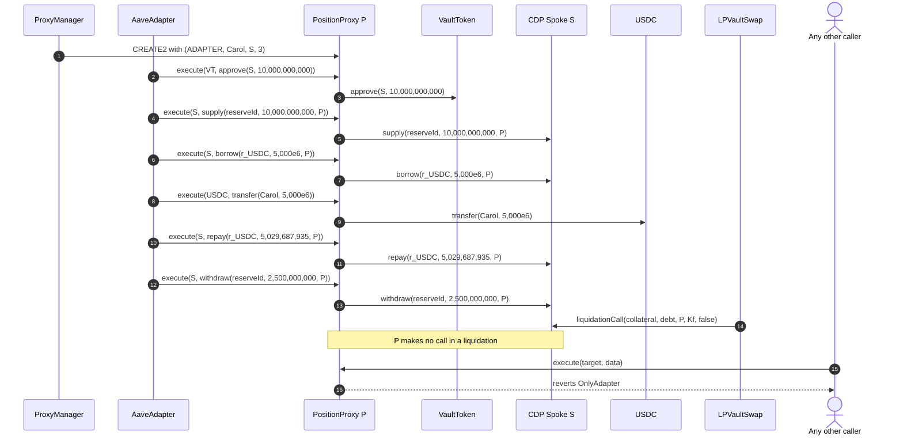

# PositionProxy lifecycle

A PositionProxy is the Aave V4 account of one wallet in one market on one CDP Spoke: a logic-free, immutable contract that executes only calls the AaveAdapter sends it, so each market's collateral and debt stay isolated in their own account.

## Walkthrough

Setup (Base market 3, Carol, from 3.1 `DEP-029`, 3.2 `BOR-022`, 3.3 `REP-024`): `P = proxyOf[Carol][3]` on the "Aerodrome Slipstream Stable" Spoke `S`.

1. **ProxyManager [`deployProxy`](../proxy-manager/ProxyManager.sol#L46)`(Carol, S, 3)`** creates `P` with CREATE2 at the address Lens `predictProxy` showed. Its immutables are fixed for life: [`ADAPTER`](PositionProxy.sol#L82), [`WALLET`](PositionProxy.sol#L88) = Carol, [`SPOKE`](PositionProxy.sol#L94) = `S`, [`MARKET_ID`](PositionProxy.sol#L100) = 3. The [constructor](PositionProxy.sol#L41) reverts [`ZeroAddress`](IPositionProxy.sol#L47) for a zero address or market 0, and keeps its creator, the ProxyManager, as a fifth immutable that is not a constructor argument (the address is unchanged). There is no initializer, owner, upgrade or code replacement. At this first pledge the Adapter also checks that `P`'s account on `S` holds no collateral and no debt, since a proxy would inherit state placed at its address before deployment (`REQ-PROXY-055`).
2. **AaveAdapter → [`execute`](PositionProxy.sol#L59)** in `pledge`: `VT.approve(S, 10,000,000,000)`, `S.supply(reserveId, 10,000,000,000, P)`, `VT.approve(S, 0)`, `S.setUsingAsCollateral(reserveId, true, P)`. `P` now holds $20,000 of collateral on Aave.
3. **AaveAdapter → `execute`** in `borrow`: `S.borrow(r_USDC, 5,000e6, P)` then `USDC.transfer(Carol, 5,000e6)`; `P` ends with a zero USDC balance and 5,000 USDC of debt.
4. **AaveAdapter → `execute`** in `repay` (any payer): the Adapter moves 5,029,687,935 USDC base units into `P`; `P` approves `S`, calls `S.repay(r_USDC, 5,029,687,935, P)` (Aave takes 5,024,657,573), resets the approval and returns 5,030,362 to the payer.
5. **AaveAdapter → `execute`** in `withdraw`: `S.withdraw(reserveId, 2,500,000,000, P)`; the units return to `P` and the Adapter burns them from `P`.
6. **Liquidation.** LPVaultSwap calls `S.liquidationCall(…, P, …)` directly; `P` makes no call. The Hub's seized vault tokens go only to LPVaultSwap.
7. **Anyone else → [`execute`](PositionProxy.sol#L59)** reverts [`OnlyAdapter`](IPositionProxy.sol#L31). A target of `address(0)`, `P` itself, the AaveAdapter, the ProxyManager or an address with no code reverts [`InvalidTarget`](IPositionProxy.sol#L37); a callee that reverts without data reverts [`CallFailed`](IPositionProxy.sol#L43) (with data, the data passes through).

## What the UI reads and calls

- Lens: [`predictProxy`](../../lens/lens/ILensAccount.sol#L20) (address and whether deployed), [`getAccount`](../../lens/lens/ILensAccount.sol#L32) (the account's collateral, debt and health factor read from `P` on the Spoke).
- Events to index: none of its own; index ProxyManager `ProxyDeployed`, AaveAdapter `UserProxyCreated` and the Spoke's `Supply`, `Borrow`, `Repay`, `Withdraw` and `LiquidationCall` events for `P`.
- User calls: none; the wallet calls the AaveAdapter.

## Spec

- [2.5 Position Proxy and Proxy Manager](../../../../spec/02-contracts/05-position-proxy-and-proxy-manager.md): `REQ-PROXY-001`–`REQ-PROXY-014`, `REQ-PROXY-040`, `REQ-PROXY-078`, `REQ-PROXY-087`–`REQ-PROXY-091`, `INV-012`, `INV-016`, `INV-017`.
