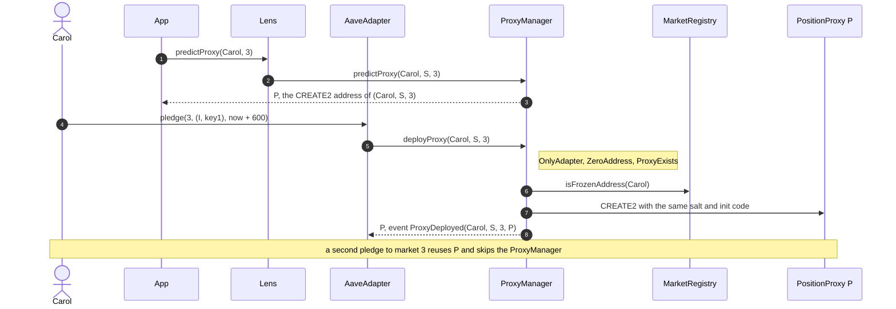

# ProxyManager lifecycle

The ProxyManager is the immutable CREATE2 factory of PositionProxies: one per wallet × CDP Spoke × market, deployed only by the AaveAdapter at a wallet's first pledge to a market.

## Walkthrough

Setup (Base market 3 on Spoke `S`, Carol's first pledge, 3.1 `DEP-029`).

1. **App → Lens [`predictProxy`](../../lens/lens/ILensAccount.sol#L20)`(Carol, 3)`**, backed by [`predictProxy`](ProxyManager.sol#L69)`(Carol, S, 3)`: `Create2.computeAddress(keccak256(abi.encode(Carol, S, 3)), keccak256(type(PositionProxy).creationCode ‖ abi.encode(ADAPTER, Carol, S, 3)))`, built by [`_salt`](ProxyManager.sol#L112) and [`_initCode`](ProxyManager.sol#L122), the only two places the key `(wallet, spoke, marketId)` is encoded. The app shows this address before Carol signs; it never changes because the ProxyManager is immutable. A zero wallet, Spoke or market reverts [`ZeroAddress`](IProxyManager.sol#L49): no such proxy can exist.
2. **Carol → AaveAdapter [`pledge`](../../policy/aave-adapter/IAaveAdapterUser.sol#L38)`(3, …)`** with no proxy for market 3.
3. **AaveAdapter → [`deployProxy`](ProxyManager.sol#L46)`(Carol, S, 3)`** creates `P` with CREATE2 from the same salt and init-code bytes the prediction hashed; [`PROXY_CREATION_CODE_HASH`](ProxyManager.sol#L80) is the manifest's record of the creation code. Event: [`ProxyDeployed`](IProxyManager.sol#L28)`(Carol, S, 3, P)`, then the Adapter's `UserProxyCreated` and VaultToken `ProxyAdded(P)`. Errors: [`OnlyAdapter`](IProxyManager.sol#L32), [`ZeroAddress`](IProxyManager.sol#L49), [`ProxyExists`](IProxyManager.sol#L39), [`AddressIsFrozen`](IProxyManager.sol#L44) (a frozen wallet gets no new account), in that order of checks (freeze last, after `ProxyExists`); OpenZeppelin's `FailedDeployment()` if the predicted address already has a nonce or storage (only through an address collision, `REQ-PROXY-055`); [`ProxyAddressMismatch`](IProxyManager.sol#L57) guards the CREATE2 result and cannot fire while the EVM rule holds.
4. **Carol's second pledge to market 3** finds `proxyOf[Carol][3] = P` and does not call the ProxyManager.
5. **Carol pledges to market B on the same Spoke**: a second proxy `P_B` at `predictProxy(Carol, S, m_B)`. A liquidation of `P_B` never seizes market 3's collateral.

## What the UI reads and calls

- Lens: [`predictProxy`](../../lens/lens/ILensAccount.sol#L20); AaveAdapter [`proxyOf`](../../policy/aave-adapter/IAaveAdapterViews.sol#L14).
- Events to index: [`ProxyDeployed`](IProxyManager.sol#L28).
- User calls: none.

## Spec

- [2.5 Position Proxy and Proxy Manager](../../../../docs/spec/02-contracts/05-position-proxy-and-proxy-manager.md): `REQ-PROXY-050`–`REQ-PROXY-056`, `REQ-PROXY-085`, `REQ-PROXY-097`–`REQ-PROXY-102`, `INV-012`.
- Flow: [3.1](../../../../docs/spec/03-operations/01-deposit.md) `DEP-029` steps 1 and 4.
