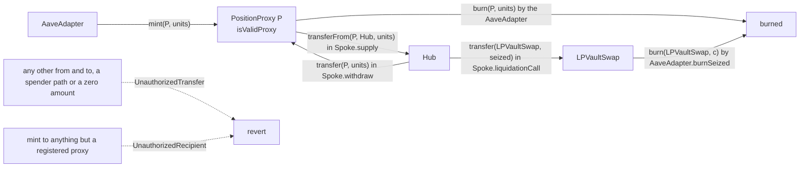

# VaultToken lifecycle

A VaultToken is one market's Aave collateral asset: one base unit is one credited unit of a pledged position, minted and burned only by the AaveAdapter, and moved only from a registered proxy to the market's Hub, from the Hub to a registered proxy, and from the Hub to LPVaultSwap.

## Walkthrough

Setup (Base market 3: vault token `VT` with 6 decimals, $2.00 per whole token, from 3.1 `DEP-029`, 3.4 `WDR-045`, 3.5 `LIQ-089`).

1. **VaultTokenFactory `deployVaultToken` → [`constructor`](VaultToken.sol#L62)** inside `listCollateralMarket` fixes [`marketKey`](VaultToken.sol#L180), [`integrationId`](VaultToken.sol#L186), [`integration`](VaultToken.sol#L192), [`hub`](VaultToken.sol#L198), [`spoke`](VaultToken.sol#L204), [`marketId`](VaultToken.sol#L210), [`lpOracle`](VaultToken.sol#L216), [`adapter`](VaultToken.sol#L222), [`lpVaultSwap`](VaultToken.sol#L228), [`collateralization`](VaultToken.sol#L234) and [`decimals`](VaultToken.sol#L157) from one `VaultTokenBindings` struct, with the symbol `avLP-3` and the market's full description as name. No owner, setter or pause. Errors: [`ZeroAddress`](IVaultToken.sol#L69) (checked first), [`InvalidBinding`](IVaultToken.sol#L80) (two equal addresses, an address equal to the token's own, a zero ID, key or market, or decimals outside [6, 18]).
2. **AaveAdapter → [`addValidProxy`](VaultToken.sol#L115)`(P)`** at Carol's first pledge. Event: [`ProxyAdded`](IVaultToken.sol#L50). Errors: [`OnlyAdapter`](IVaultToken.sol#L54), [`ZeroAddress`](IVaultToken.sol#L69), [`ReservedAddress`](IVaultToken.sol#L75) for the Hub, the Spoke, the Adapter, LPVaultSwap, Collateralization, the LPVault, the LPOracle or the token.
3. **AaveAdapter → [`mint`](VaultToken.sol#L95)`(P, 10,000,000,000)`**, then `P` approves the Spoke and `Spoke.supply` calls [`transferFrom`](VaultToken.sol#L141)`(P, hub, 10,000,000,000)`; the Hub holds the 10,000 whole tokens and the allowance ends at 0. [`isAllowedTransfer`](VaultToken.sol#L171)`(P, hub)` is true. Supply 400,000,000,000 → 410,000,000,000. A mint to anything but a registered proxy fails with [`UnauthorizedRecipient`](IVaultToken.sol#L59).
4. **Withdrawal of `keyB`.** `P` calls `Spoke.withdraw`; the Hub's [`transfer`](VaultToken.sol#L129)`(P, 2,500,000,000)` pays the proxy; then **AaveAdapter → [`burn`](VaultToken.sol#L105)`(P, 2,500,000,000)`** retires the units without an allowance.
5. **Liquidation (Carol owes 20,000 USDC, `LIQ-089`).** In `Spoke.liquidationCall` the Hub's [`transfer`](VaultToken.sol#L129) of 1,020 seized tokens goes to LPVaultSwap, the only recipient besides registered proxies that [`isAllowedRecipient`](VaultToken.sol#L163) admits. Any other liquidator calling the Spoke directly, the Adapter included, fails with [`UnauthorizedTransfer`](IVaultToken.sol#L65)`(hub, liquidator)` and the whole call reverts whenever it seizes at least one unit; a dust call whose seizure rounds to zero shares moves no token and takes nothing. The reserve's `liquidationFee` is 0, so the share drop equals the 1,020 tokens LPVaultSwap receives.
6. **AaveAdapter `burnSeized` → [`burn`](VaultToken.sol#L105)`(LPVaultSwap, 1,020,000,000)`**; Collateralization then checks that the supply fell by exactly 1,020,000,000. A burn from the Hub fails with [`UnauthorizedTransfer`](IVaultToken.sol#L65)`(hub, address(0))`.
7. **Any other transfer** (proxy to proxy, LPVaultSwap to the Hub, wallet to anyone, spender transfers, and a zero amount on any path, the allowed ones included) reverts [`UnauthorizedTransfer`](IVaultToken.sol#L65) before any allowance is read: vault tokens never leave Avana's accounts, so the market's supply stays at or below credited plus pending units.

## What the UI reads and calls

- Lens: [`getAccount`](../../lens/lens/ILensAccount.sol#L32) (collateral in vault tokens and USD), [`checkBacking`](../../lens/lens/ILensMarket.sol#L20) (supply against credited plus pending).
- Events to index: ERC-20 `Transfer` and `Approval`, [`ProxyAdded`](IVaultToken.sol#L50).
- User calls: none.

## Spec

- [2.4 Vault Tokens](../../../../spec/02-contracts/04-vault-tokens.md): `REQ-VTOKEN-006`–`REQ-VTOKEN-015`, `REQ-VTOKEN-025`, `REQ-VTOKEN-030`–`REQ-VTOKEN-048`, `REQ-VTOKEN-050`, `SPEC-UNIT-001`, `INV-009`, `INV-010`, `INV-011`, `INV-012`.
