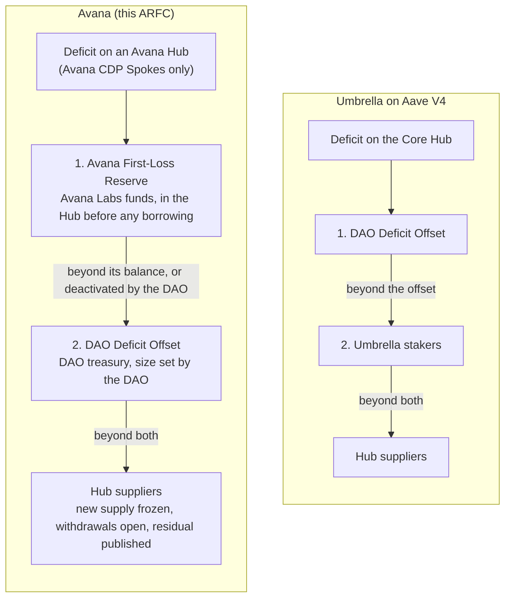

# [ARFC] Onboard AMM LP Positions as Collateral on Aave V4 via Avana

Governance, New Market
Author: @avana
Created: 2026-11-04 · Updated: 2026-11-23

## At a glance

| | |
|---|---|
| What Avana is | Contracts that let liquidity providers borrow stablecoins such as GHO against AMM positions without removing their liquidity from the pool. Avana holds the position and issues a transfer-restricted vault token for its floor credit, which is the collateral on a standard, unmodified Aave V4 Spoke owned by the Aave DAO. |
| Deployment | Ethereum (Uniswap v2, v3 and v4) and Base (Aero Slipstream), with one Avana Hub on each chain: "Avana Ethereum Hub" and "Avana Base Hub". Each Hub holds one Lend Spoke, every CDP Spoke on its chain, and an Avana First-Loss Reserve and a DAO Deficit Offset per debt asset. CDP Spokes are grouped by AMM and Spoke kind: Stable, Correlated and Volatile. The pools are named in the deployment ARFC. |
| Markets | Two per pool, listed in one DAO call: Full range, and Custom range, a fixed band around the listing price (Stable ±1%, Correlated ±5%, Volatile 0.345x–2.898x). |
| Pricing | Each token at Aave V4's own price, `AaveOracle.getReservePrice` on the CDP Spoke's price Spoke, read live. Avana adds no price source, staleness check or sequencer check of its own, as in Aave V4. |
| Lending | Public from day one, beside the Aave DAO's bootstrap supply. Lenders earn the Hub supply rate, set by Aave V4's standard utilization curve. |
| Borrowing | Stable debt assets the Aave DAO approves (for example GHO, USDC, USDT), each with its own draw caps and Avana First-Loss Reserve. For GHO, proposed draw caps summing to 2M GHO on Ethereum to start; every other asset's draw caps are set in the funding ARFC. |
| Collateral factor | A DAO parameter. Avana proposes the lower of the two tokens' collateral factors on the price Spoke, or the E-Mode-style Spoke's factor for correlated pairs. |
| Liquidation | Aave's standard `liquidationCall` with Aave V4's dynamic bonus, settings copied from the price Spoke. Only the seized share of the position is unwound, and the liquidator is paid in the two pool tokens. Avana swaps nothing. |
| Avana's revenue | No share of interest. The Avana app charges 10 bps on every app action (ceiling 25 bps without a new ARFC), and Avana takes 20% of each liquidation's bonus, in kind. Neither changes an interest rate or the Aave DAO's revenue. |
| Loss coverage | Per Hub and debt asset: first the Avana First-Loss Reserve, funded by Avana and controlled by the DAO, then a DAO Deficit Offset funded by the Aave DAO treasury, then the Hub. A loss beyond both layers is disclosed, not shared. |
| Governance | The Aave DAO owns and configures every Avana Hub and Spoke. Avana's own settings change through a per-chain AccessManager with execution delays: 12 hours for a change that only reduces risk, 4 to 5 days for any other, 14 days for a First-Loss Reserve withdrawal. Avana's core contracts have no upgrade path and no pause of their own. |
| Status | Contracts implemented and verified as recorded under Evidence. An internal audit is under way: an internal manual review and an automated review. The audit opens to external auditors and the public when those steps finish; there has been no external audit yet. The bug bounty has not started and will be announced. |

## What this ARFC asks

1. Support for a technical and risk assessment of Avana with Aave DAO service providers on Ethereum and Base: custody, valuation, liquidation, Aave V4 integration, governance roles, loss allocation and economic terms.
2. Support for preparing capped borrowing requests (draw caps) for the stable debt assets the Aave DAO chooses to list (for example GHO, USDC, USDT). For GHO, a proposed 2M GHO on Ethereum to start, growing toward 10M GHO only as live performance criteria are met.

If this ARFC passes, two follow-up ARFCs would ask the Aave DAO for the following.

**Deployment ARFC**, per chain
- The Hub, the Lend Spoke and each CDP Spoke as standard Aave V4 contracts. Each CDP Spoke names a price Spoke, the Aave V4 Spoke whose prices, collateral factors and liquidation settings its markets copy, and copies that Spoke's target health factor, health factor for the max bonus and bonus factor.
- On every vault-token reserve: draw cap 0, `receiveSharesEnabled = false`, `liquidationFee = 0`, the market's LPOracle as price source, the listed collateral factor, and as max liquidation bonus the higher of the two tokens' on the price Spoke. `activateMarket` refuses a market until each of these holds (see Activation checks).
- The pools to list, two markets each, with any per-pool band width that differs from its Spoke kind's default.
- An Avana First-Loss Reserve for each approved debt asset on each Hub, and behind each one a DAO Deficit Offset, both holding the Hub's deficit-eliminator role, with their role holders named.
- `FLASH_BORROWER` on the Aave V3 Pool for Avana's operator flash liquidators, so their flash loans carry no premium.
- The holders of Avana's AccessManager roles on each chain.

**Funding ARFC**, per chain
- Which stable assets are listed and borrowable, and each one's draw caps (for example a proposed 2M GHO in total on Ethereum), sized to the depth of the pool tokens' markets and to the coverage bound.
- The Lend Spoke supply caps and the DAO's bootstrap supply.
- Each Avana First-Loss Reserve's coverage ratio and minimum.
- Each DAO Deficit Offset's size per Hub and debt asset, funded from the DAO treasury. Caps are sized so the modelled tail loss fits within the First-Loss Reserve's minimum plus this offset; Avana proposes no fixed figure, because the offset is the part of that need the DAO chooses to carry above Avana's reserve.
- Each lend asset's utilization curve, Aave V4's standard kinked interest-rate strategy; for GHO the DAO may keep the curve's base rate at or above the Core Hub GHO base rate.

Mainnet deployment follows the internal audit, the external audit that opens after it, and governance approval.

- Website: https://avana.cc
- Sandbox (borrow and liquidation flows with simulated assets, no onchain transactions): https://app.avana.cc
- X: @avana_labs

## Motivation

Aave has $30B in deposits but only $12B in active loans. Billions of dollars in AMM liquidity earn trading fees, yet liquidity providers who want to borrow against their positions usually have to withdraw, giving up fees and, for concentrated liquidity, their chosen price range. We estimate addressable AMM LP collateral across Ethereum, Avalanche, Arbitrum and Base could reach $8 billion by 2028.

Aave was early to this market: Aave V1's Uniswap Market accepted Uniswap v1 LP tokens in 2020, and from 2021 the AMM Market accepted Uniswap v2 LP tokens and later wrapped Uniswap v3 positions. In 2025 a proposal for GHO borrowing against Uniswap v4 positions asked the Uniswap DAO for a $3.3M development grant plus 1.2M UNI released as borrowing reached $50M, $100M, $300M and $500M. That proposal did not advance past the RFC and Temp Check stage.

Aave V4's Hub-and-Spoke design lets an LP collateral market run with its own risk parameters and caps, isolated from Aave's core markets. Avana connects liquidity already deployed on established AMMs to Aave V4 and copies Aave wherever Aave has a deployed, audited way: its prices, its collateral factors, its liquidation bonus and its deficit mechanism. That gives GHO new borrowing demand backed by productive collateral, with no new oracle or liquidation machinery for the DAO to trust.

## Architecture

### Design overview

Every Aave V4 contract stays unmodified; custody and valuation sit in Avana's own contracts. Aave V4 accepts collateral only as ERC-20 reserves, and most AMM positions are NFTs, so the LPVault holds the position and a transfer-restricted vault token represents its credit on Aave V4. Uniswap v2 LP tokens are wrapped into position NFTs first and treated as Full range positions. The vault token moves only between the Hub, the AaveAdapter and the LiquidationModule, and every vault token is backed by the credit the LPVault records.

Each wallet gets one thin account proxy per market, created on its first pledge, with the AaveAdapter as its Aave position manager. Each market therefore has its own health factor and nothing is cross-collateralized: a price move in one market never liquidates a position in another. An account holds at most 16 positions.

### Markets and floor credit

A market is one pool and one fixed tick band. Each pool has two:

- **Full range:** the pool's usable tick range. A full-range position gets credit equal to its liquidity.
- **Custom range:** a band around the listing price, with the width set by the CDP Spoke's kind: Stable ±1%, Correlated ±5%, Volatile 0.345x–2.898x. The DAO can change a kind's default or override it for one pool in its listing; a listed band never changes.

A pledge names only the NFT. The adapter routes a full-range position to Full range, any other position to Custom range if it lies fully inside the band, and refuses anything else.

A position's collateral is its **floor credit**, fixed at pledge: `credit = L × min(r0, r1)`, what the position holds at each band edge divided by what one band unit holds there. Floor credit at the oracle price is never worth more than the position at any price, so a narrow position is credited less than its value, never more. Example on Base ETH/USDC 0.05%, at an illustrative 75% LTV: a $10,000 Full range position borrows up to $7,500; a $10,000 Uniswap "Wide" position in the Volatile band $6,700; a $10,000 ±0.3% position $5,555.

`listPool` refuses a Custom range band that does not contain Aave's price at execution, that is narrower than four tick spacings, or that is as wide as full range.

### How the Spokes are set up

Each chain has one Avana Hub. The money sits in the Hub; Spokes are entry points into it.

- **Lend Spoke, one per Hub.** Single assets go in: GHO, USDT, USDC and the like. Its draw cap is 0 on every asset, so nobody can borrow through it. Lenders use Aave's standard `supply` and `withdraw`, with no Avana contract in the path.
- **CDP Spokes (borrow side), by AMM and Spoke kind.** For example "Uniswap v3 Stable" on Ethereum and "Slipstream Volatile" on Base. On each CDP Spoke the vault tokens are the only collateral, each with a draw cap of 0, so they can be supplied as collateral but never borrowed. The debt reserves (the stable assets the DAO approves) take no supply on the CDP Spoke, so borrowing liquidity comes only from the Hub, which the Lend Spoke fills.
- **Avana First-Loss Reserve, one per Hub and debt asset.** A contract the Hub lists with a draw cap of 0, holding Hub shares of that asset. Avana Labs funds it to its minimum before any draw cap on that asset rises above 0, and the Aave DAO controls it. It spends funds only to eliminate a recorded deficit in its own asset.
- **DAO Deficit Offset, one per Hub and debt asset.** The same contract, funded by the Aave DAO treasury and controlled by the DAO, which pays only the part of a deficit beyond what the Avana First-Loss Reserve holds.
- **Borrowers reach the CDP Spoke only through Avana:** wallet → AaveAdapter → the wallet's account proxy for that market → CDP Spoke.

### Listing rules

Both pool tokens must be listed on the CDP Spoke's price Spoke, with exactly one reserve each. Fee-on-transfer and rebasing tokens are excluded, Uniswap v4 pools must be hookless, and Slipstream positions must be unstaked. Aerodrome basic pools are out of scope.

## Lending

Public lending is open from day one. Anyone can supply a listed asset through the Lend Spoke, beside the Aave DAO's bootstrap supply, which the funding ARFC sizes and which is in place before any draw cap on that asset is raised.

- **What lenders earn:** the Hub supply rate. Interest paid by Avana borrowers on that asset, less the liquidity fee the DAO sets, is shared among all suppliers in proportion to their supply: the DAO, public lenders and the loss layers alike.
- **What lenders risk:** a deficit beyond both loss layers. Aave V4 has no way to write such a residual down across suppliers: it stays on the Hub, the supply share price does not fall, and withdrawals are paid in full, first come first served, while liquidity lasts. Once every borrower has repaid, the lenders who withdraw last hold claims with nothing behind them until either layer is topped up and covers the residual. While a residual is outstanding, new supply into that asset stops (the app builds none and the Lend Spoke reserve is frozen), withdrawals stay open, and the app shows every lender the residual and the backed value per share before each withdrawal. Example: lenders supply 2,000,000 GHO, the First-Loss Reserve holds 100,000 GHO and the DAO offset 150,000 GHO; a 300,000 GHO loss is covered 100,000 then 150,000; the remaining 50,000 GHO means the first 1,950,000 GHO withdrawn is paid in full and the last 50,000 GHO of claims waits for a top-up. Caps are sized so that this needs a loss beyond the modelled tail.
- **Withdrawals:** a lender can withdraw only idle liquidity. At high utilization, a withdrawal waits until borrowers repay or are liquidated.

Borrowing is bounded by the CDP Spokes' draw caps, which the DAO sets, and by the liquidity lenders have supplied. The Lend Spoke's supply cap, also set by the DAO, bounds total supply.

## GHO opportunity

### Revenue

Interest goes to the Hub's suppliers in proportion to their supply, after the DAO's liquidity fee, which goes to the Aave DAO treasury. Every lend asset uses Aave V4's standard kinked utilization curve, whose values the Aave DAO sets, with each borrower's risk premium added. For GHO the DAO may keep the curve's base rate at or above the Core Hub's GHO base rate, so Avana is never the cheaper way to borrow GHO.

Avana takes no share of interest. It has two sources of revenue:

- **App (frontend) fee.** The Avana app charges 10 bps on every action it builds: supply, withdraw, pledge, withdraw collateral, borrow, repay and repay with collateral. The basis is the action's amount; for an LP position it is the position's oracle value, paid in the market's debt stablecoin, rounded down. The app adds the fee transfer to the same transaction batch as the action. No contract charges or enforces it: a user who calls the contracts directly pays none, and liquidations pay none. Avana commits to a ceiling of 25 bps without a new ARFC.
- **Liquidation fee share.** 20% of Aave's liquidation bonus, `seized × (bonus − 1) / bonus × 20%`, paid in the same two pool tokens as the liquidator's payout. The RiskModule caps the share at 50%, and governance can lower it or switch it off.

### Capacity

| Phase | Proposed capacity | Conditions for expansion |
|---|---|---|
| Start | Proposed 2M GHO on Ethereum; Base draw caps set in the funding ARFC | Audits complete; borrowing and liquidation performance reported to governance |
| Initial target | Up to 10M GHO | Demonstrated demand, acceptable concentration and liquidation costs, and a risk reviewer recommendation |
| Expansion | 50M GHO or more | Operation within approved limits and further governance approval |

The funding ARFC defines the thresholds and who can adjust capacity. At every phase the First-Loss Reserve must cover the summed draw caps: `fundedBalance ≥ coverageRatioBps × Σ drawCap / 10⁴`. As an illustration only, a 20% ratio on 2M GHO of draw caps requires a 400,000 GHO reserve; the funding ARFC sets the ratio and minimum with Aave's service providers.

### Revenue scenarios

Annual gross borrower interest at constant all-in rates of 4.5% and 9%, assuming GHO at $1 and debt equal to 25% of LP collateral value (a scenario assumption, not a proposed collateral factor). The interest is shared among the Hub's suppliers after the DAO's liquidity fee.

| Outstanding borrowing | LP collateral | Interest at 4.5% | Interest at 9% |
|---|---|---|---|
| 2M GHO | $8M | $90,000 | $180,000 |
| 10M GHO | $40M | $450,000 | $900,000 |
| 50M GHO | $200M | $2.25M | $4.5M |
| 500M GHO | $2B | $22.5M | $45M |

## Pricing, borrowing and liquidation

### Oracle and pricing

Each market has one immutable LPOracle, the price source of its vault-token reserve. It prices one unit of band liquidity at the fair price:

```
P       = (price0 / 10^d0) / (price1 / 10^d1)       each token's price from Aave V4's AaveOracle
s'      = clamp(√P, √A, √B)                          the band [A, B]
amount0 = U · (1/s' − 1/√B),  amount1 = U · (s' − √A)
answer  = amount0 · price0 / 10^d0 + amount1 · price1 / 10^d1     USD, 8 decimals, rounded down
```

- **Aave's price, read live.** Each token's price is `AaveOracle.getReservePrice` of its reserve on the CDP Spoke's price Spoke, the same call Aave uses to price that token as collateral, so Aave's CAPO caps apply and a source Aave repoints is followed on the next read. Aave's `price > 0` check is the only check; Avana adds an overflow bound ($10¹⁰ per token).
- **No staleness or sequencer check.** As in Aave V4, which reads no round time, and as Aave did when it removed the V3 sentinel in v3.7. A check that reverts would stop liquidations as well as borrows. A stale source is handled as for Aave's own reserves: monitoring alerts on source age, the risk steward freezes, and Aave governance repoints the source.
- **Pool-neutral.** The price never comes from the pool, so a trade or flash loan cannot move it. Outside the band the clamp gives the AMM's real one-token composition.
- **Uniswap v2.** The wrapped LP's liquidity is `lp · √(r0 · r1) / supply`, priced by the Full range formula: Aave's geometric LP formula, `2 · √(v0 · v1) / supply`, used at every price. A swap or donation cannot raise the credit.

Without Avana's former $1 stablecoin cap, a stablecoin above $1 is priced as Aave serves it. In a Stable ±1% band the effect is at most +0.25%; in a Full range USDC/USDT market it follows √p, about +2% at a $1.04 CAPO cap, the exposure Aave's own USDC collateral has at that price.

### Collateral factor and health

`Borrowing Capacity = Floor Credit × LPOracle Price × LP Collateral Factor`

The LP collateral factor is a DAO parameter. Avana proposes the lower of the two tokens' collateral factors on the price Spoke, because at a band edge an LP holds only one token and must not borrow more than that token could; correlated pairs use an E-Mode-style Spoke and its factor. The position's shape is already priced by the floor credit, so no second haircut is added. The listing records the LTV, and activation requires the Aave reserve's collateral factor to equal it; the lower-of-two rule itself is a listing convention, not an on-chain check.

Aave's health factor of 1.00 is the only on-chain borrowing limit; the app recommends borrowing to 1.10.

### Borrowing and repayment

- **Pledge.** The position moves into the LPVault; its liquidity stays in the pool. It must fit an active market. There is no borrower allowlist and no minimum debt.
- **Borrow.** `checkBorrow` passes only when the debt reserve is registered, at least one keeper is registered, and the First-Loss Reserve covers the summed draw caps. Aave checks the health factor.
- **Rate.** `Borrowing Rate = Drawn Rate × (1 + User Risk Premium)`, where the drawn rate comes from the asset's utilization curve.
- **Repay.** Anyone can repay any account's debt at any time. Avana adds no gate to repayment; only an Aave-side pause of the Spoke or a Hub halt can block it.
- **Repay with collateral.** In one transaction a helper flash-borrows the debt asset from the Aave V3 Pool, repays, withdraws part of one position, runs the wallet's swaps and repays the loan. The allowance lasts one call, covers part of one position, and reverts unless the health factor ends at least where it started.
- **Withdraw.** The position returns with its uncollected fees. A withdrawal that leaves debt must pass Aave's health check; a debt-free account always exits.

### Liquidation

An account is liquidatable when its health factor falls below 1. Every liquidation is one transaction through Avana's LiquidationModule:

1. **Standard liquidation.** Any address calls the module, which calls the CDP Spoke's `liquidationCall`. Aave sizes the repayment toward the target health factor and applies its dynamic bonus.
2. **Burn.** The seized vault tokens are burned. They can go only to the module, so a direct `liquidationCall` from any other address reverts.
3. **Unwind.** Only liquidity worth the seized units at LPOracle prices is removed, from the position with the least excess credit first. The borrower keeps the rest of every NFT and all its fees, including Uniswap v2 fee growth since the pledge.
4. **Payout in kind.** Both pool tokens go to the liquidator, less Avana's 20% share of the bonus in the same proportion. A rounding gap comes out of the liquidator's payout, never the borrower's or the reserve's.

Because the liquidity is sized at the oracle price and a concentrated position is worth least when the pool sits at that price, a moved pool never shortens the liquidator's payout. Avana owns no swap route that could block a liquidation.

**Liquidation settings copied from Aave.** Each vault-token reserve's max liquidation bonus is the higher of its two tokens' on the price Spoke, since the liquidator may end up holding either; the CDP Spoke's target health factor, health factor for the max bonus and bonus factor are the price Spoke's. Activation checks both once; later changes on either Spoke are the DAO's.

**Example (USDC/USDT Custom range market).** Alice holds a band-wide position (A, $6,000, credit $6,000) and a ±0.1% position (B, $4,000, credit $3,600): $9,600 of credit at an 80% collateral factor, against 7,700 GHO of debt. A small move takes her health factor to 0.997, where Aave's bonus is 2%. Aave repays $1,000 and seizes $1,020 of vault tokens. All $1,020 is unwound from A; B is untouched. The liquidator receives about 510 USDC and 510 USDT, less Avana's $4 (2 USDC and 2 USDT), netting $1,016 for $1,000 repaid. Alice keeps $8,580 of credit against $6,700 of debt; she lost exactly the seized value.

**Committed operators.** Any address can liquidate. Avana's keeper liquidates every account below health factor 1 whatever its size and whether or not the bonus covers gas, and Avana pays its gas. Up to 16 keepers can be registered per chain; with none registered, new borrowing stops.

**What can stop liquidation.** No Avana control: Avana has no pause, and freezing a vault-token reserve or cutting its collateral factor leaves liquidation open. It stops only on an Aave-side Spoke pause or Hub halt, or while a token's Aave price source answers 0 or below, which stops Aave's own reserve of that token too and is repaired by repointing the source.

## Risk management

### Governance and controls

- **Aave DAO:** owns and configures every Avana Hub and Spoke and holds every Aave-side control: caps, collateral factors, bonuses, rate models, reserve freeze and pause, and Hub halt. Avana holds no role on any of them.
- **Avana settings:** Spoke registration, band defaults, pool listing, activation, debt reserves, the coverage ratio, the fee share and recipient, and keepers. Each goes through Avana's AccessManager on that chain: 12 hours for a change that only reduces risk (the risk steward holds that role with no delay), 4 to 5 days for any other, 14 days for a First-Loss Reserve withdrawal. No role on one chain can act on another.
- **No upgrades, no Avana pause.** Avana's core contracts are immutable. Repayment, fee collection, debt-free withdrawal and liquidation are never stopped by an Avana control.

### Activation checks

`RiskModule.activateMarket` refuses a market, with a named reason, unless (`AaveConfigLogic.checkActivation`):

- the LPOracle prices this market from the CDP Spoke's price Spoke and the reserves and decimals named at listing;
- the Spoke reserve holds the vault token on the Spoke's Hub, recorded at the vault token's decimals;
- the vault token's draw cap is 0;
- receive-shares is off;
- the liquidation fee is 0;
- the collateral factor equals the market's listed LTV;
- the max liquidation bonus is the higher token's on the price Spoke, and the CDP Spoke's liquidation settings are the price Spoke's;
- the reserve's price source is the market's LPOracle.

An active market cannot be deactivated by Avana; later Aave-side changes are the DAO's.

### Market lifecycle

Avana has no market switch of its own. A market is frozen or deprecated on Aave, with Aave's freeze plus collateral-factor-0 pattern:

| Action | Frozen, collateral factor 0 |
|---|---|
| Pledge, add liquidity | Blocked (the frozen reserve refuses supply) |
| Borrow | Blocked by the collateral factor of 0 |
| Repay | Allowed |
| Withdrawal, release | Allowed once debt-free |
| Fee collection | Allowed |
| Liquidation | Allowed (Aave keeps the account's earlier collateral factor) |

A Spoke pause or a Hub halt blocks repayment, withdrawal and liquidation alike, so they are emergency stops, not a deprecation path. A depeg above 1% raises an alert and the Aave Protocol Guardian freezes the pool's reserves until the peg returns, with the `freezeReserve` it already holds on every Spoke. Re-listing a drifted pool is a governance call; existing positions keep their market and band.

### Deficits and first-loss coverage

If a liquidation empties an account while debt remains, Aave records the remainder as a deficit on the Hub, in the debt asset. The coverage role calls the Avana First-Loss Reserve, then the DAO Deficit Offset, within 72 hours. A deficit is never covered with another asset's, Hub's or chain's reserve.

**Loss order**, per Hub and debt asset:

1. the Avana First-Loss Reserve, funded by Avana Labs;
2. the DAO Deficit Offset, funded by the Aave DAO treasury. It pays only the part of a deficit beyond what the Avana layer holds, so one wei in an emptied Avana layer cannot block it. If the DAO deactivates the Avana layer, the offset pays at once;
3. the Hub: a residual stays recorded and is disclosed, as under Lending.

Each layer pays `min(cap, deficit, balance)`, never past the recorded deficit. It holds its funds as Hub shares, the only form `Hub.eliminateDeficit` can burn, and earns the supply rate. Money leaves only by coverage or by a withdrawal at a 14-day delay, which reverts while a covered Spoke has a recorded deficit.

**Coverage bounds borrowing, in code.** `checkBorrow` refuses every new borrow of an asset while the First-Loss Reserve holds less than `coverageRatioBps × Σ drawCap / 10⁴`, where `Σ drawCap` is the live draw caps of every Avana CDP Spoke borrowing that asset on that Hub. A draw-cap raise past the cover stops new borrowing until the reserve is topped up or the cap is cut; repayment, withdrawal and liquidation stay open.

#### How this relates to Umbrella on Aave V4

Avana's layers use the mechanism Aave V4 and `UmbrellaSpoke` (aave-dao/aave-umbrella#4) already define: a contract listed on the Hub with no draw capacity, holding the deficit-eliminator role, burning its own Hub shares against another Spoke's recorded deficit, per Hub and asset, triggered only by a role the DAO grants. One layer is a DAO-funded Deficit Offset, as in TokenLogic's ARFC "Umbrella on Aave V4" (2026-09-11).



Where Avana differs, and why:

1. **The party that brings the risk pays first.** Avana brings a new collateral class onto its own Hub, so Avana's capital stands first and the DAO's only behind it.
2. **Avana's Hubs stay outside Umbrella.** Umbrella's stakers never priced LP collateral, so Avana brings its own coverage.
3. **Pre-funded and locked.** The reserve is funded before any draw cap is above 0, held as Hub shares, and withdrawable only with DAO approval after 14 days.
4. **Borrowing is capped by the reserve, in code**, through the coverage check above.
5. **The order between two payers is enforced in code**, by amount.
6. **No ongoing cost to the DAO.** No staker emissions; the offset's size is the DAO's choice and can be 0 until it funds it.

### Reporting

Avana Labs publishes weekly usage and monthly revenue reports per chain: debt and collateral by market, concentration, health factors, liquidations, loss-layer usage, bad debt, price-source alerts, freezes, draw-cap and supply usage, and fees earned. Each quarter it also reports frontend-fee revenue per chain, separately from the liquidation fee share.

## Evidence

Every check below is on `main`. Tests run on a local deployment of the pinned Aave V4 release (`a3ef63e`); Aave V4 is never mocked.

| Check | What it covers | Source |
|---|---|---|
| Certora Prover | 13 gate confs: AaveAdapterAccounts, AaveAdapterRouting, FirstLossReserve, FloorCreditMath, Hub, LPOracle, LPVaultV2, LPVaultV3, LiquidationModule, PlatformFlow, RiskModuleActivation, RiskModuleBands, VaultToken. Every rule verified with its vacuity check | [`contracts/certora/conf`](../../contracts/certora/conf), [`contracts/certora/README.md`](../../contracts/certora/README.md) |
| CI gates | `contracts` (long suite: deep invariants, fork, differential, SMTChecker), `security-slow` and `mutation-gate` | [`.github/workflows`](../../.github/workflows) |
| Branch coverage | 100% minimum for every file in `contracts/src`; two branches recorded as unreachable, each with its reason | [`coverage-thresholds.json`](../../.github/security/coverage-thresholds.json) |
| Differential tests | Uniswap v2 LP value against Aave's `UniswapV2PriceProvider` geometric price; the `mulDiv` and `sqrt` facts the Certora specs assume, against an exact reference | [`contracts/test/differential`](../../contracts/test/differential) |

### Bugs found and fixed while hardening

| PR | Bug | Fix |
|---|---|---|
| #367 | A Uniswap v4 top-up netted tokens already sitting in the PositionManager against the payer's spend, so the minimums misfired and a stray balance could revert every top-up | Count the PositionManager's prior balance |
| #367 | A Uniswap v2 unwind burned a share of all the LP the NFT held, including LP sent straight to the wrapper | Burn only the record's LP |
| #372 | A front-run liquidation of a now-healthy account panicked in the bonus curve instead of returning Aave's own refusal | Read the bonus only below health factor 1 |
| #374 | A Uniswap v2 protocol fee switched on after a pledge could leave the credit above the LP | Count the pending fee whenever `kLast` is set |
| #378 | One wei in an emptied Avana layer blocked the DAO Deficit Offset | Keep the loss order by amount (caught by Certora `oneWeiCannotBlockTheOffset`) |
| #382 | A partial Uniswap v2 liquidation paid the borrower's fee growth to the liquidator | Burn only the LP that holds the unwound liquidity now |

### Limits

- **Fork tests have not run yet.** The fork pins are still 0, so the fork tests skip; they run on each chain's fork before that chain's deployment.
- **SMTChecker is report-only for AaveAdapter and LiquidationModule.** Both run out of time or memory on a hosted runner. Their properties are carried by Certora, the fuzz and the invariant tests.
- **Library facts are assumed.** The Certora specs summarize `mulDiv` and `sqrt` as exact floor division and integer square root, as Aave's own V4 library verification does for `mulDiv`. A differential test checks them against an exact reference, including the 512-bit path.
- **Audit.** The internal audit is under way; there has been no external audit and the bug bounty has not started. Vulnerability reports follow [`SECURITY.md`](../../SECURITY.md).

## Next steps

1. **Snapshot on this ARFC.** If feedback is positive, this ARFC goes to a Snapshot vote to confirm support for the assessment.
2. **Deployment and funding ARFCs,** as listed under What this ARFC asks, each with its own Snapshot, risk parameters and audit reports. Borrowing activates only when both pass and every security and risk prerequisite is met.
3. **AIPs.** If both Snapshots pass, the proposals go onchain as AIPs. Aave-side actions on Base go through the Aave DAO's Base executor. Each further chain needs its own ARFC.

## Conclusion

Avana turns active AMM liquidity into collateral and borrowing demand for Aave V4, with Aave's own prices, collateral factors and liquidation bonus, and Avana's capital first in line for losses. Liquidity providers borrow GHO and the other stablecoins the DAO approves without leaving their pools or giving up trading fees, and the Hub's suppliers, the Aave DAO among them, earn the interest. Avana Labs will share further details and accountable contacts with Aave's service providers during the review.

## Disclosure

Avana Labs is the author of this proposal. We have not been compensated by any third party to publish it. This ARFC gathers community feedback on Avana and potential GHO borrowing capacity ahead of a mainnet deployment. Nothing here is legal, financial, tax or professional advice.

## References

Avana design records, in the public repository:
- [LP-vault credit](../../contracts/design/vault.md), [LPOracle](../../contracts/design/oracle.md), [RiskModule](../../contracts/design/risk.md), [AaveAdapter](../../contracts/design/adapter.md)
- [LiquidationModule](../../contracts/design/liquidation.md), [repay with collateral](../../contracts/design/periphery.md), [FirstLossReserve](../../contracts/design/reserve.md), [Uniswap v2 markets](../../contracts/design/uniswap-v2.md)
- [Lifecycle model and external assumptions](../../contracts/design/README.md)

Related discussions:
- [Temp Check] Aave's CDP for Uniswap V4 Positions: https://governance.aave.com/t/temp-check-aave-s-cdp-for-uniswap-v4-positions/21980
- [RFC] Aave's CDP for Uniswap V4 Positions (Uniswap forum): https://gov.uniswap.org/t/rfc-aave-s-cdp-for-uniswap-v4-positions/25568
- Gauntlet: Market Risks of Listing LP Tokens as Collateral: https://governance.aave.com/t/gauntlet-analysis-market-risks-of-listing-lp-tokens-as-collateral/10573

Aave deficit coverage (Umbrella):
- TokenLogic, [ARFC] Umbrella on Aave V4: Coverage Framework and Initial Market Parametrization: https://governance.aave.com/t/arfc-umbrella-on-aave-v4-coverage-framework-and-initial-market-parametrization/25623
- BGD Labs, UmbrellaSpoke for Aave V4 (aave-dao/aave-umbrella#4): https://github.com/aave-dao/aave-umbrella/pull/4
- LlamaRisk, Umbrella coverage principles and slashing logic: https://governance.aave.com/t/llamarisk-insights-umbrella-coverage-principles-and-slashing-logic/23527
- Chaos Labs, [ARFC] Revenue-indexed deficit offsets for Umbrella: https://governance.aave.com/t/arfc-revenue-indexed-deficit-offsets-for-umbrella/24000

Prior LP collateral work and research:
- https://medium.com/aave/the-uniswap-market-is-live-on-aave-protocol-12b5a4cc5e2
- https://governance.aave.com/t/renew-the-amm-market-assets/4918
- https://governance.aave.com/t/arc-add-support-for-defi-pulse-index-dpi/3576/22?
- https://governance.aave.com/t/limitations-of-a-market-for-uni-v2-collateral-be-created/545/2?u
- https://governance.aave.com/t/limitations-of-a-market-for-uni-v2-collateral-be-created/545/9?u
- https://governance.aave.com/t/arc-add-gelato-s-g-uni-erc20-uniswap-v3-positions-as-collateral-to-aave-s-amm-market/5687
- https://twitter.com/haydenzadams/status/1440461089133645835?s=20
- https://governance.aave.com/t/arc-implement-a-uni-v2-liquidity-pool-token-market-initial-discussion/645
- https://governance.aave.com/t/adding-uniswap-v3-nfts-as-collateral/11569
- https://governance.aave.com/t/arc-uniswap-v3-nft-as-collateral-for-minting-gho/10708
- https://governance.aave.com/t/arc-onboard-gamma-strategies-usdc-gho-uni-v3-collateral-to-mint-gho/10733
- https://governance.aave.com/t/arc-staked-atokens-a-new-aave-primitive-exploring-vote-escrow-economies/10406
- https://governance.aave.com/t/arc-erc4626-strategies-as-productive-collateral/10337
- https://governance.aave.com/t/arfc-strategic-opportunity-framework-for-friendly-forks-and-whitelabel-instances/21961
- https://governance.aave.com/t/direct-to-aip-onboard-usde-september-expiry-pt-tokens-on-aave-v3-core-instance/22620
- https://x.com/aave/status/1371761919682617347
- https://governance.aave.com/t/gauntlet-s-market-risk-assessment/3814
- https://www.comp.xyz/t/add-market-g-uni-erc20-uniswap-v3-positions/2324
- https://forum.sky.money/tags/c/collateral-onboarding/domain-work/28/uni-lp

## Copyright

Copyright and related rights waived via CC0.
