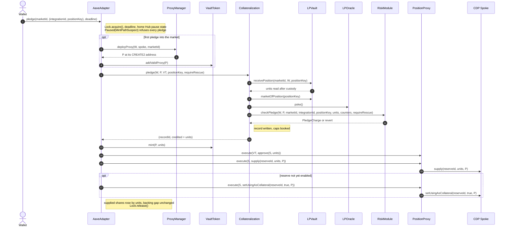

# 3.1 Deposit (FLOW-001)

> **Status:** In review · **Owner:** Avana Labs · **Last reviewed:** 2026-11-10
>
> **Step prefix:** `DEP-NNN`

The ARFC calls this action a **Pledge**: custody of an AMM position moves to the LPVault of its AMM protocol on the chain; the liquidity stays in the pool and keeps earning fees for the depositor.

A market is one (chain, AMM protocol, pool, exact position shape). For concentrated liquidity (Uniswap v3 on Ethereum, Aerodrome Slipstream on Base) the shape is the exact `[tickLower, tickUpper]` range, and a pledge is accepted only when the position's range equals the market's range tick for tick (`AMMN-RT-01`). Each market is one collateral reserve on one CDP Spoke, the Spoke for its (chain, Hub, AMM protocol, risk tier). The wallet calls the chain's AaveAdapter, which creates the wallet's PositionProxy for that (CDP Spoke, market) on the first pledge and reuses it afterwards, so every market has its own Aave account and health factor and nothing is cross-collateralized (`Q-223`, `Q-225`, `Q-349`).

The Adapter runs the whole pledge in one transaction under the protocol lock: Collateralization (one AMM-neutral ledger per chain) has the LPVault validate the position against the market and take custody, then records the backing; the Adapter mints exactly the credited units to the proxy and has the proxy supply them. Record layout and credit rules belong to [2.3 Collateralization][2.3]; custody and the AMM integration's position checks to [2.2 LP Vault][2.2] and the AMM integration interface page; the entry point, call bounds, pause gate, mint and post-checks to [2.6 Aave Adapter][2.6]; the eligibility checks, `minPledgeUsd`, the cap charge and its budget split to [2.7 Risk Module][2.7]; the proxy and its supply step to [2.5 Position Proxy and Proxy Manager][2.5]; the pause state and market status to [2.8 Market Registry][2.8]; parameter values to [2.9 Parameter Store][2.9]; price state and the sequencer gate to [2.10 LP Oracle][2.10]; the lock to [2.16 Lock][2.16]; vault tokens to [2.4 Vault Tokens][2.4]. Parameters are named as in [1.5][1.5].

## Objective

Take custody of one AMM position from its owner, record its units as backing exactly once, mint exactly that many vault-token base units to the owner's PositionProxy for (CDP Spoke, market), and have the proxy supply them to the Spoke and enable them as collateral, all in one atomic transaction (`Q-066`, `Q-223`, `Q-224`).

A position is named by `positionKey` (`bytes32`) together with the market's `integrationId`; for Uniswap v3, `positionKey = bytes32(tokenId)` of the position NFT, and for Slipstream `positionKey = bytes32((uint256(generation) << 248) | tokenId)`, with the generation of the position manager and factory pair the market pins in the high byte, because token IDs repeat across Slipstream's three position managers on Base ([2.19] `SPEC-AMM-CORE-002`). For example, Slipstream NFT 1,234,567 of generation 2 has `positionKey = 0x02000000…0012d687`. Its units are the integration's unit of liquidity (concentrated liquidity `L` for v3 and Slipstream), and the market's LPOracle values one unit from the AMM integration's composition at the oracle price vector: `value = Σᵢ amountᵢ(oracle prices) × priceᵢ` over the market's `n` tokens, never spot reserves and never fixed weights.

Three kinds of pledge use the same entry point:

- **New-account pledge**: the wallet has no proxy for (Spoke, market), or its proxy has zero debt on every debt reserve at the time of the call (this includes a first pledge and more collateral for a debt-free account).
- **Top-up**: the proxy has non-zero debt on at least one debt reserve at the time of the call. Top-ups pass the application Frozen state (`DEP-004`), the sequencer gate's `Down` and `Grace` states, and skip the new-account checks of `DEP-011` (`Q-132`, `Q-227`, `Q-234`, `Q-357`).
- **Rescue top-up**: a top-up into an account whose health factor before the pledge is below the rescue target health factor of 1.10, whose booked charge is at most the USD that restores it, and whose value is at least `min(minPledgeUsd, $10)`. The 1.10 rescue target is the HF the Lens recommends borrowing to; it is not an opening floor, which Avana does not enforce (`Q-398`). It is the only pledge admitted under `Paused` with reason `General`, for a frozen wallet, while a rescue-only market circuit breaker is tripped, above the pool-share cap, or below `minPledgeUsd`; its units, and the slice part of any top-up, are rescue units that never support new debt. Under `Paused` with reason `MintPathSuspect` no pledge runs, because every pledge mints vault tokens (`Q-157`, `Q-241`, `Q-242`, `Q-252`, `Q-253`, `Q-398`).

Where the AMM protocol lets anyone add liquidity to a held position (Uniswap v3 and Slipstream `increaseLiquidity`), a depositor credits liquidity added to a pledged position with `AaveAdapter.recredit`, which runs every check of a top-up of that size and mints exactly the added units (steps `DEP-019`…`DEP-025`, `Q-254`). For AMM protocols whose positions are fungible LP shares, the integration's `topUpPosition` pulls the added LP amount from the depositor into the same position during the re-credit, so an account never needs a new record to add collateral.

A debt-free account's charge stays in the market's `Regular` budget until it withdraws: the idle-collateral mechanism does not exist (`Q-396`). Cap squatting by a non-borrowing LP (`AMMN-FLOW-16`) is an accepted risk, handled by the caps set at listing and by monitoring (steps `DEP-026`…`DEP-028`).

## Initiator

Any wallet that currently owns the position (EOA or smart-contract wallet). An approved operator of the owner cannot pledge for the owner: the LPVault takes the position only from the calling wallet. No role is required. There is no `tx.origin`, `extcodesize` or EOA-only check; an NFT position moves with `transferFrom`, so Safes without a receiver hook work; and the proxy is keyed to `(msg.sender, marketId)` (with the market's CDP Spoke in its CREATE2 salt), so a smart account can create its proxy and pledge in one user operation. Receipts are matched on the Avana events (wallet, Spoke, market, proxy), not on `tx.from` (`Q-067`, `Q-075`, `Q-119`, `Q-225`).

There is no `releaseIdle` call (`DEP-026`, `Q-396`).

## Inputs

| Input | Type | Description | Validation |
|---|---|---|---|
| `marketId` | `uint256` | The market `m` (chain, AMM protocol, pool, exact shape); its vault token `VT = MR.getMarket(m).vaultToken` and CDP Spoke `S = VT.spoke()` follow from it | Registered and active, `VT` bound to an approved Spoke (`DEP-002`); valid for Collateralization; the position matches its pool and shape (`DEP-006`, `DEP-007`) |
| `integrationId` | `uint32` | The market's AMM integration; with `positionKey` it names the position (`PositionRef` in the compiled interface) | Equals `VT.integrationId()` (`IntegrationMismatch(m, integrationId)`, `DEP-002`) |
| `positionKey` | `bytes32` | The position in the market's AMM integration (`bytes32(tokenId)` for Uniswap v3; `bytes32((uint256(generation) << 248) | tokenId)` for Slipstream) | Caller owns it; exact pool and shape match; units `> 0` (`DEP-007`…`DEP-009`) |
| `deadline` | `uint256` | Last valid `block.timestamp` | `block.timestamp ≤ deadline` (`DEP-002`) |

Returns `(proxy, recordId, credited)`. There is no proxy, amount, depositor or recipient argument: the proxy is resolved from `(msg.sender, marketId)`, the credited units are read from the AMM integration after custody, and the depositor of record is `msg.sender`. Collateralization moves the record from None to Active and the mint equals the units it read itself, so no caller-supplied amount can inflate backing (`Q-067`, `Q-075`, `Q-224`). `recredit(marketId, integrationId, positionKey, topUp, deadline)` takes the same inputs plus `topUp` (the LP amount for a fungible-share integration, empty for NFT integrations), names a position the caller already pledged, and returns the `added` units; the amount is again read by Collateralization, never supplied (`Q-254`). There is no `releaseIdle` entry point (`Q-396`).

## Preconditions

- The wallet `W` owns the position and has approved the market's LPVault for exactly that position (for an NFT, a per-token `approve` or a `permit` sent before the pledge). App calldata never uses `setApprovalForAll`. The approval goes to the immutable LPVault, which moves a position only on Collateralization's instruction, and Collateralization records `W` as depositor, so the position can only ever return to `W` (`Q-073`, `Q-144`, `Q-224`).
- For Slipstream, the NFT is unstaked: a gauge-staked NFT is owned by the gauge, so `W` cannot pledge it, and the integration refuses any position whose owner is a gauge.
- The market was listed and activated through the market lifecycle ([3.8 Market Lifecycle][3.8]): `listCollateralMarket` deployed the vault token and LPOracle, fixed the exact range or shape and wired the reserve in one timelock batch at the normal delay; the Aave DAO payload configured the Spoke reserve and Hub asset with the standard-Spoke settings (`receiveSharesEnabled = false`, `liquidationFee = 0`, no reinvestment controller); the market was activated at the short delay after the on-chain match check; and a valid price was seeded (`Q-114`, `Q-128`, `Q-228`, `Q-352`).
- No Avana call is in progress in the same transaction (the lock is free) (`Q-148`).

Each precondition is re-checked on-chain in the steps below; none is assumed.

## Execution Steps

In exact execution order. `W` is the calling wallet, `m` the `marketId` argument, `VT = MR.getMarket(m).vaultToken` the market's vault token, `S = VT.spoke()` the CDP Spoke, `HD` the Spoke's home Hub, `P = proxyOf[W][m]`, `I` the market's AMM integration (`VT.integrationId()`), `LV` the LPVault of that AMM protocol on this chain (`VT.integration()`), `n` the market's token count, `O` the market's LPOracle (the Spoke oracle's price source for the `VT` reserve), `AD` the AaveAdapter, `CO` Collateralization, `RM` the RiskModule, `MR` the MarketRegistry, `PM` the ProxyManager.

| Step | Action | Contract (msg.sender) | Notes |
|---|---|---|---|
| `DEP-001` | `W` calls `AD.pledge(m, (integrationId, positionKey), deadline)` | AaveAdapter (`W`) | The outer entry point acquires the protocol lock; `Lock.acquire` reverts with `LockHeld(holder)` if it is held. The Lock has exactly two members, the AaveAdapter and LPVaultSwap, and every LPVault and Collateralization entry point that moves value is reachable only through them, so a Spoke or market added later needs no Lock change. Owned by [2.6], [2.16]. (Source: Q-148, Q-223) |
| `DEP-002` | Call bounds, pause state and reason, Spoke and market | AaveAdapter → `MR.getMarket(m).vaultToken`, `VT.spoke()`, `VT.integrationId()`, `MR.pauseState(HD)`, `MR.pauseReason(HD)`, `MR.getSpoke(S)` (views) | `block.timestamp ≤ deadline` (`DeadlineExpired`). `VT = MR.getMarket(m).vaultToken` is non-zero (`UnknownMarket(m)`) and `VT.integrationId() == integrationId` (`IntegrationMismatch(m, integrationId)`). The pause state is read for the Spoke's home Hub on this chain. `Paused` with reason `MintPathSuspect` refuses every pledge (`ApplicationPaused`), because every pledge mints vault tokens. `S = VT.spoke()` is an approved CDP Spoke (`UnknownSpoke`). Whether the market is active and not `Offboarding` or `Closed` is checked by the RiskModule in `DEP-011`. Owned by [2.6], [2.8]. (Source: Q-075, Q-223, Q-227, Q-252) |
| `DEP-003` | Get or create the proxy | AaveAdapter → `PM.deployProxy(W, S, m)` (first pledge into market `m` only) | If `proxyOf[W][m] == 0`, the ProxyManager deploys a logic-free immutable PositionProxy with CREATE2 and salt `keccak256(abi.encode(W, S, m))`, so its address equals `predictProxy(W, S, m)`; the wallet, Spoke and market are constructor immutables, and the proxy executes only calls from the chain's AaveAdapter. There is no implementation pointer and no upgrade: all logic lives in the Adapter, which upgrades through the chain's Timelock, so every exit works for every proxy ever deployed (`Q-349`). `PM` emits `ProxyDeployed(W, S, m, P)`; the Adapter stores the binding (`proxyOf[W][m]`, `walletOf[P]`, `spokeOf[P]`, `marketOf[P]`) and emits `UserProxyCreated(W, S, m, P)`. The binding never changes. Only the chain's single AaveAdapter can call `deployProxy`, so no other contract can deploy a proxy address first. The ProxyManager refuses to deploy a proxy for a frozen wallet (`AddressIsFrozen(W)`), so a frozen wallet without an account cannot open one. A wallet using two markets has two proxies and two health factors. Owned by [2.5], [2.6]. (Source: Q-223, Q-225, Q-242, Q-349) |
| `DEP-004` | Frozen gate and rescue requirement | AaveAdapter → `S.getUserAccountData(P)`, `MR.isFrozenAddress(W)` (views) | If the application state is `Frozen` and the account is a new account (`S.getUserAccountData(P).borrowCount == 0`, which includes a proxy deployed in `DEP-003`), the pledge reverts with `ApplicationFrozen`. Every top-up of an indebted account passes Frozen, rescue or not, because adding collateral only lowers the account's risk. `Paused` with reason `General` and a frozen wallet `W` each set `requireRescue = true`, so only a rescue top-up can pass `DEP-011`. Owned by [2.6]. (Source: Q-227, Q-234, Q-242, Q-252, Q-260) |
| `DEP-005` | Register the proxy in the market's token | AaveAdapter → `VT.isValidProxy(P)`; `VT.addValidProxy(P)` if false | First pledge of `P` only (a proxy belongs to one market, so it is registered in exactly one vault token); the token sets `isValidProxy[P]` and emits `ProxyAdded(P)`. Later pledges find it valid and skip the call. The Adapter then reads the market's backing gap `gapBefore = totalCredited + pending.units − totalSupply` (`VT.totalSupply()`, `CO.getTotalCredited(VT)`, `CO.getPending(VT)`), before any call into Collateralization, mint or burn (`SPEC-BACK-009`). Owned by [2.4], [2.6]. (Source: Q-224, Q-225, Q-257) |
| `DEP-006` | Ask Collateralization to pledge | AaveAdapter → `CO.pledge(W, P, VT, positionKey, requireRescue)` | `CO` requires `msg.sender == ADAPTER` (`NotAdapter`) and `LOCK.holder() == ADAPTER` (`LockNotHeld`); requires the depositor `W` to be neither an LPVault nor Collateralization (`InvalidDepositor(W)`), so a stray position an LPVault holds can never be pledged; validates `VT`: the vault-token factory maps `(VT.spoke(), VT.marketKey())` to `VT`, `VT.collateralization() == CO`, `VT.adapter() == AD`, `VT.lpVaultSwap() == LP_VAULT_SWAP`, and `VT.integration()` equals the vault-token factory's write-once `lpVaultOf[VT.integrationId()]` for this chain (`InvalidVaultToken`); requires `VT.isValidProxy(P)` (`UnknownProxy`); requires the account-market's open records (its seizure list plus its zero-credit list) to number fewer than `MAX_RECORDS_PER_ACCOUNT_MARKET` (16) (`TooManyRecords`), so liquidating any account walks at most 16 records (`AMMN-GAS-01`). Market identity (`integrationId`, `lpVault`, `pool`, shape, `hub`, `spoke`, `marketId`, `lpOracle`) comes only from `VT`'s immutables, never from the MarketRegistry, so a registry upgrade cannot repoint the pledge to another market, vault or feed. Owned by [2.3]. (Source: Q-068, Q-226, Q-224, Q-258) |
| `DEP-007` | Take custody and check the exact shape | Collateralization → `LV.receivePosition(m, W, positionKey)` → for an NFT, `NFPM.transferFrom(W, LV, tokenId)` | The Adapter forwards the position named by `positionKey` (for NFT integrations the NFT's `tokenId` in the low 248 bits, and for Slipstream the generation in the high byte, which must be the market's generation, `PoolMismatch` otherwise). `LV` requires `msg.sender == COLLATERALIZATION` and the lock held (`NotCollateralization`, `LockNotHeld`), the market registered (`UnknownMarket`), the pool's own reentrancy lock free (`PoolLocked`), so a pledge never runs inside a pool callback, and `W` the position's current owner and not the LPVault (`NotPositionOwner`). It requires the position's pool, derived through the market's pinned factory, to equal the market's pool, and its shape to equal the market's stored shape exactly (`ShapeMismatch`): for concentrated liquidity `tickLower == market.tickLower` and `tickUpper == market.tickUpper`, by exact equality of signed ticks, so a narrower range cannot be credited at the market's per-unit value (`AMMN-RT-01`). It then pulls the position without a receiver hook (an NFT with `transferFrom`, never `safeTransferFrom`; `onERC721Received` records nothing, so custody can only come through this step), requires that it now owns it, sets `depositorOf[positionKey] = W` and `marketOf[positionKey] = VT.marketKey()`, reads the units it holds and returns `(positionKey, units)`. Integration specifics: Uniswap v3 derives the pool with `factory.getPool(token0, token1, fee)` from the canonical NFPM's `positions()` and reads `slot0.unlocked`; Slipstream derives it with `factory.getPool(token0, token1, tickSpacing)` (its NFPM returns `tickSpacing` where v3 returns `fee`), reads `unlocked` from its six-field `slot0`, and accepts only the NFPM and factory generation pinned for the market; a gauge-staked Slipstream NFT is owned by the gauge, so it fails the owner check. Any other position contract, including forks of either AMM protocol, is rejected. Requires `W`'s approval from the preconditions. Owned by [2.2], the AMM integration interface and its integration pages. (Source: Q-017, Q-054, Q-067, Q-073, Q-119, Q-144, Q-224, Q-258) |
| `DEP-008` | Refuse a second record, then repeat the market check after custody | Collateralization → `LV.checkReadSafe(m)` before `DEP-007`; `LV.marketOfPosition(positionKey)` after it (views; readable by Collateralization while the lock is held) | Before custody, in this order: no open record for `(integrationId, positionKey)` (`AlreadyPledged`), fewer than 16 open records for the account-market (`TooManyRecords`, `DEP-006`), then the integration's read-safety check `checkReadSafe(m)` (the pool's own reentrancy lock free); only then `receivePosition` (`DEP-007`). After custody Collateralization independently requires `LV.marketOfPosition(positionKey) == m` (`ShapeMismatch`), so a faulty integration cannot attach a position to another market. Owned by [2.3]. (Source: Q-067, Q-144, Q-224) |
| `DEP-009` | Check the credited units read after custody | Collateralization | `units` is the value `receivePosition` read after custody (concentrated liquidity `L` for v3 and Slipstream), so no code of `W` can change it before the record is written; `units > 0` (`ZeroLiquidity`); `units ≤ MAX_CREDITED_UNITS` (`LiquidityAboveBound`). The units are never caller-supplied (`SPEC-BACK-002`). Where the AMM protocol keeps fees apart from liquidity (v3 and Slipstream `tokensOwed`), amounts already owed to the position (uncollected fees and any principal removed earlier without a `collect`) are never credited; they stay owed to the position and `collectFees` pays them to the depositor ([3.7](07-collect-fees.md) `FEE-007`). Where fees roll into the position (Uniswap v2, Curve, Balancer), the unit count is fixed and accrued fees raise the value of each unit, which the LPOracle's composition reads. Owned by [2.3]. (Source: Q-066, Q-067, Q-218) |
| `DEP-010` | Poke the price and gather the counters | Collateralization → `O.poke()`; own storage | `O.poke()` stores a feed disagreement, a feed failure or a sequencer restart first seen by this pledge as the start of its window, even though `checkPledge` is a `view` (`Q-199`). Collateralization packs `PledgeCounters{regularUsed = marketUsd[VT][Regular], sliceUsed = marketUsd[VT][Slice], tokenUsed[i] = tokenUsd[HD][tokens[i]] for i < n, depositorUsed = depositorUsd[HD][W]}` and passes them as arguments, because its own views revert while the lock is held. Token and depositor counters are kept once per Hub in the chain's one ledger, so adding Spokes or markets never multiplies them (`AMMN-RT-05`). Owned by [2.3], [2.10]. (Source: Q-158, Q-199, Q-209) |
| `DEP-011` | Eligibility, minimum value, caps, breakers and rescue | Collateralization → `RM.checkPledge(W, P, m, integrationId, positionKey, units, counters, requireRescue)` (view) | The upgradeable RiskModule either returns `PledgeCharge{usdCharge, sliceUsd, rescue, rescueUnits}` or reverts, and its error propagates unchanged. It decides from `S.getUserAccountData(P).borrowCount > 0` whether the pledge is a top-up or a new-account pledge, then checks: (a) market active in the MarketRegistry and not `Offboarding` or `Closed`; (b) the chain's sequencer gate from `O`: under `Down` a new-account pledge reverts `SequencerDown` and under `Grace` it reverts `SequencerGrace`; top-ups pass both (Ethereum's gate is always `Up`, `Q-357`); (c) price state from the LPOracle, with every feed fresh while its age is at most its own `feedHeartbeat + heartbeatMargin` (a 24 h stablecoin feed with an 86,400 s heartbeat is fresh for 88,200 s): a new-account pledge needs Live, or Drifting caused only by a USD-band breach; a top-up needs Live or Drifting; Cached and Expired are refused; (d) Aave state: vault-token reserve not paused or frozen, the home Hub's entry for that Spoke and asset active and not halted, `addCap` room for `units`, the per-user reserve limit, and for a new account no approved debt reserve paused; (e) for a new account only, the Aave configuration drift list (including the standard-Spoke settings of `Q-352`: `receiveSharesEnabled = false`, `liquidationFee = 0`, `reinvestmentController = address(0)`, the vault-token asset on no other Spoke, no position-manager approval on `P`; and `SpokeHalted`, `Q-351`) and Hub shares equal to assets for `VT` (not for a top-up, so drift never stops a top-up or a rescue); (f) the rescue decision (`Q-252`): the pledge needs an exemption if `requireRescue` is set, a rescue-only market breaker is tripped (latched, pool depth or issuer, `Q-241`, `Q-350`, `Q-399`), Avana's combined credited units of the pool across all borrowers, Spokes and markets on the chain (`poolUnits`) would exceed `poolShareMaxBpsOf(poolKey)` (default 10,000 bps, off; a per-pool cap only where its listing sets one, `Q-403`; merged with the former `breakerPoolShareBps`, `Q-399`) of the pool's time-weighted depth from `LV.riskStatus(m, twapWindow)`, with `depthAvailable = false` counted as above the cap (`SPEC-CAP-005`), or `pledgeUsd = mulDiv(units, price8, 10^d, Floor) < minPledgeUsd[m]` with the served LPOracle price; such a pledge passes only as a rescue top-up, which requires debt, a health factor below the rescue target health factor of 1.10, a charge at most the USD that restores it, and `pledgeUsd ≥ min(minPledgeUsd[m], $10)` (`NotRescueTopUp`, or `BelowMinPledge` below that floor), and all of its units become rescue units; (g) caps against post-pledge totals with the charge `usdCharge` of `SPEC-CAP-001` (8 decimals, rounded up, priced at no less than `stressFloorUsd`): `marketUsdCap` for the `Regular` part, `tokenUsdCap` for each of the `n` pool tokens and `depositorUsdCap` (both counting the regular part only), and the pool share for every pledge that is not a rescue top-up, measured by the integration over `twapWindow`, never from spot liquidity; (h) top-up slice: a new-account pledge must fit the `Regular` budget; a top-up may book `sliceUsd > 0` from `topUpSliceUsd` only while the account's HF is below the rescue target health factor of 1.10 and only up to the USD value that restores it (`SPEC-CAP-003`), and the slice part's units, `⌈units × sliceUsd / usdCharge⌉`, are rescue units (`SPEC-BACK-014`). Every pledge's regular part books into `Regular`, including a debt-free account's, and stays there until withdrawal (`Q-396`). Avana sets no cap on markets per wallet. Owned by [2.7], values in [2.9]. Checked by HYP-22, HYP-55, QNT-25, MATH-UO-27, MATH-UO-28, TEST-235. (Source: Q-054, Q-055, Q-132, Q-150, Q-157, Q-175, Q-193, Q-194, Q-195, Q-199, Q-229, Q-230, Q-234, Q-241, Q-252, Q-253, Q-351, Q-352, Q-354, Q-357, Q-396, Q-398, Q-399) |
| `DEP-012` | Write the record, the order and the counters | Collateralization | Requires `0 < usdCharge < 2^64` (charges are stored as `uint64`), `sliceUsd ≤ usdCharge` and `rescueUnits ≤ units`, with `rescueUnits == units` for a rescue pledge (`InvalidCharge`). Record `recordId = nextRecordId++` for `(integrationId, positionKey)`: depositor `W`, proxy `P`, `VT`, credited units `units`, original units, original and current USD charge `usdCharge`, pledge time, rescue units `rescueUnits` (added to `accountRescueUnits[P][VT]`, `SPEC-BACK-014`); `depositor`, `proxy` and `VT` never change while the record is open. The record is inserted into `P`'s seizure list in largest-credited-first order (ties by lowest record ID); `W` pays the insertion gas, at most 16 entries. Booking: `marketUsd[VT][Regular] += usdCharge − sliceUsd`, `marketUsd[VT][Slice] += sliceUsd`, and `tokenUsd[HD][tokens[i]]` for each `i < n` and `depositorUsd[HD][W]` each `+= usdCharge`; `totalCredited[VT] += units`; `accountCredited[P][VT] += units`; `poolUnits(poolKey) += units`. Collateralization keeps no per-account budget counter and no per-account pledge time; the account's open-record count is the length of its two lists. Emits `CollateralPledged(recordId, integrationId, positionKey, W, P, VT, units, usdCharge, sliceUsd)` and returns `(recordId, credited = units)`. Owned by [2.3]; split and rescue units owned by [2.7]. (Source: Q-055, Q-158, Q-194, Q-174, Q-175, Q-201, Q-224, Q-253, Q-354) |
| `DEP-013` | Mint to the proxy | AaveAdapter → `VT.mint(P, units)` | Exactly `credited = units` base units from 0 to `P`. The Adapter is the only minter; the token accepts `P` because it is registered (`DEP-005`). Owned by [2.4], [2.6]. (Source: Q-066, Q-224) |
| `DEP-014` | Have the proxy approve the Spoke | AaveAdapter → `P.execute(VT, approve(S, units))` | `P` executes only calls from the chain's AaveAdapter (`OnlyAdapter`) and has no logic of its own; the Adapter builds the call, deriving the reserve from `VT`'s immutables, and approves exactly `units`. Every Avana contract checks amounts received or spent within the call (before/after deltas), never absolute balances, and resets exact approvals to 0, so no Avana-originated balance or allowance remains between transactions. Owned by [2.5], [2.6]. (Source: Q-035, Q-124, Q-223, Q-225, Q-349) |
| `DEP-015` | Supply | `P` → `S.supply(reserveId, units, P)` (`P`, on the Adapter's instruction) | Aave checks the reserve is not paused or frozen, pulls `units` from `P` to `HD` with `transferFrom` (the vault token's transfer rule allows a registered proxy to its home Hub), and `HD.add` checks the Spoke is active, not halted and within `addCap`. The Hub `addCap` for the vault-token asset is set in whole tokens above Avana's `Regular` and `Slice` budgets at the stress floor (`SPEC-UNIT-005`), so a pledge inside the Avana budget fits under it. `P`'s supplied shares increase. (Source: Q-054, Q-055, Q-066, Q-070, Q-175, Q-352, Q-354) |
| `DEP-016` | Enable as collateral | `P` → `S.setUsingAsCollateral(reserveId, true, P)` (`P`, on the Adapter's instruction) | Called only if the reserve is not yet enabled; on first enable Aave checks the reserve is not paused or frozen and that the account stays within `spokeUserReservesLimit`. The Adapter then reads the flag back and requires it enabled (`CollateralNotEnabled`). Every pledge ends with the reserve enabled. Owned by [2.5], [2.6]. (Source: Q-193, Q-225, Q-234) |
| `DEP-017` | Proxy post-checks | AaveAdapter → `VT.allowance(P, S)`, `VT.balanceOf(P)` (views); `P.execute(VT, approve(S, 0))` if needed | The Adapter requires `P`'s allowance back at 0 and its vault-token balance back at its value before the mint (`BalanceDeltaMismatch`), and emits `CollateralSupplied(P, m, units, shares)`. The checks live in the Adapter because the proxy has no logic. Owned by [2.6]. (Source: Q-076, Q-124, Q-225, Q-349) |
| `DEP-018` | Adapter post-checks, event, unlock | AaveAdapter → Spoke `getUserSuppliedShares`; `VT.totalSupply()`; `CO.getTotalCredited(VT)`, `CO.getPending(VT)` (views; readable by the lock holder, [2.3] `REQ-VAULT-091`) | `P`'s supplied shares rose by exactly `credited` (`SupplyIncomplete`); `VT.totalSupply() ≤ totalCredited[VT] + pending[VT].units` and the backing gap equals `gapBefore` from `DEP-005` (`BackingMismatch`, `SPEC-BACK-009`): the record and the mint both added `units`. A gap left earlier by a non-conforming LPVaultSwap's unsettled burn does not block the pledge (`Q-257`). Emits `CollateralAdded(W, m, P, recordId, integrationId, positionKey, units)`; releases the lock. Any failure in `DEP-001` to `DEP-018` reverts the whole transaction. Owned by [2.6]. (Source: Q-076, Q-124, Q-148, Q-224, Q-257) |

### Re-credit of added liquidity

Where the AMM protocol lets any address add liquidity to an existing position (Uniswap v3 and Slipstream `increaseLiquidity`), liquidity added to a pledged position stays with it uncredited until the depositor of record calls `AD.recredit(m, (integrationId, positionKey), topUp, deadline)`, which books exactly the live units above the record's credited units as a top-up of that size and mints them to the proxy (`Q-254`). An account at 16 records adds collateral this way instead of with a new position. The steps preserve:

- **Backing:** the record and `totalCredited` rise by `added` and the Adapter mints exactly `added`, so the backing gap is unchanged (`SPEC-BACK-009`).
- **Live units cover credit:** after the call `credited == live` (`SPEC-BACK-010`).
- **Exposure:** the added units are booked at their own charge and the record's basis is rebased so later exits release exactly what was booked (`SPEC-BACK-013`).
- **Rescue:** units admitted through the slice or a rescue exemption are rescue units and never support new debt (`SPEC-BACK-014`).

| Step | Action | Contract (msg.sender) | Notes |
|---|---|---|---|
| `DEP-019` | `W` calls `AD.recredit(m, (integrationId, positionKey), topUp, deadline)` | AaveAdapter (`W`) | Acquires the protocol lock (`LockHeld`); `block.timestamp ≤ deadline` (`DeadlineExpired`); `P = proxyOf[W][m]` exists (`NoProxy(W, m)`); `VT = MR.getMarket(m).vaultToken` is non-zero (`UnknownMarket(m)`) and `VT.integrationId() == integrationId` (`IntegrationMismatch`). Owned by [2.6], [2.16]. (Source: Q-148, Q-223, Q-254) |
| `DEP-020` | Pause reason, address freeze, Frozen and backing gap | AaveAdapter → `MR.pauseState(HD)`, `MR.pauseReason(HD)`, `MR.isFrozenAddress(W)`, Spoke `getUserAccountData(P)`; `VT.totalSupply()`, `CO.getTotalCredited(VT)`, `CO.getPending(VT)` (views) | `Paused(MintPathSuspect)` refuses it (`ApplicationPaused`); `Paused(General)` or a frozen `W` sets `requireRescue = true`; `Frozen` with no debt refuses it (`ApplicationFrozen`). Reads `gapBefore`. Owned by [2.6]. (Source: Q-227, Q-242, Q-252, Q-254, Q-257) |
| `DEP-021` | Reconcile and measure the added units | AaveAdapter → `CO.recredit(W, P, VT, positionKey, topUp, requireRescue)` → `LV.unitsOf(positionKey)` | `CO` checks caller and lock, the vault token, an open record for `(integrationId, positionKey)` whose proxy is `P`, market is `VT` and depositor is `W` (`RecordNotFound`, `NotRecordProxy`, `InvalidVaultToken`, `NotDepositor`) and the pool's reentrancy lock free (`PoolLocked`); reconciles the account; reads `live` and sets `added = live − credited` (`NothingToRecredit` if the record is at 0 credited units or `added == 0`; `LiquidityAboveBound` above `MAX_CREDITED_UNITS`). For a fungible-share integration, Collateralization first calls `LV.topUpPosition(positionKey, W, topUp)`, with `topUp` the LP amount the depositor passes to `recredit`, which pulls exactly the encoded LP amount from `W` into the same position and returns the units added, measured as the LPVault's own balance delta; NFT integrations revert `topUpPosition` with `TopUpNotSupported` and credit the live units above `credited` instead. Owned by [2.3], [2.2]. (Source: Q-201, Q-254) |
| `DEP-022` | Poke and check as a top-up of `added` units | Collateralization → `O.poke()`; `RM.checkPledge(W, P, m, integrationId, positionKey, added, counters, requireRescue)` (view) | Every check of `DEP-011` for a pledge of `added` units into the same account, including the sequencer gate and the rescue decision; its error propagates unchanged. Owned by [2.7], [2.10]. (Source: Q-199, Q-252, Q-254, Q-357) |
| `DEP-023` | Rebase and book | Collateralization | Validates the charge as `DEP-012`; rebases the record to `U0' = credited + added` units and `C0' = currentUsdCharge + usdCharge` (`SPEC-BACK-013`); adds `added` to `credited`, `totalCredited[VT]` and `accountCredited[P][VT]`; books the counters per `SPEC-BACK-004` (regular part into `Regular`, slice part into `Slice`) and the rescue units per `SPEC-BACK-014`; the record keeps its place in the seizure list; emits `RecordRecredited(recordId, added, usdCharge, rescueUnits)`. Owned by [2.3]. (Source: Q-174, Q-253, Q-254, Q-354) |
| `DEP-024` | Mint and supply | AaveAdapter → `VT.mint(P, added)`; `P.execute(VT, approve(S, added))`; `P` → `S.supply(reserveId, added, P)` | As `DEP-013`…`DEP-017` with `added` in place of `units`; the reserve is already enabled as collateral. Owned by [2.4], [2.5], [2.6]. (Source: Q-066, Q-224, Q-254) |
| `DEP-025` | Post-checks, event, unlock | AaveAdapter | `P`'s supplied shares rose by exactly `added` (`SupplyIncomplete`); `VT.totalSupply() ≤ totalCredited + pending.units` and the gap equals `gapBefore` (`BackingMismatch`); emits `CollateralRecredited(W, m, recordId, integrationId, positionKey, added, rescueUnits)`; releases the lock. Any failure reverts the whole call: nothing is minted or booked and the added liquidity stays with the position uncredited. Owned by [2.6]. (Source: Q-124, Q-148, Q-254, Q-257) |

### Debt-free charge (no `Idle` budget)

A market's USD cap budget has two parts (`Q-396`):

- **`Regular`**, bounded by `marketUsdCap[m]`: the charge of every account, borrowing or not, from pledge to release. Every pledge's regular part books here.
- **`Slice`**, bounded by `topUpSliceUsd[m]` (10% of `marketUsdCap[m]`): the slice part of rescue-eligible top-ups.

The token caps and `depositorUsdCap` count the regular part, and the pool-share cap counts the credited units of every account. A borrow books no charge and needs no cap room ([3.2 Borrow][3.2]).

**Accepted risk (`AMMN-FLOW-16`, `Q-396`).** A debt-free holder, or a set of sybil wallets each under `depositorUsdCap`, can pledge, keep earning fees and fill `Regular`, leaving borrowers no cap room. Avana accepts this: the market cap is set at listing for the market's borrowing demand, monitoring alerts when a market's `Regular` use passes its alert level while utilisation stays low, and the timelock can raise `marketUsdCap` (normal delay) within the pool-share and token caps. Why: the removed idle mechanism needed a dormancy rule, a second budget and a permissionless mover, and still let a holder keep its room with a fresh pledge each week; the risk it addressed costs borrowers availability, never solvency.

**Example.** `marketUsdCap = $5,000,000`. A wallet pledges $2,000,000 on day 0 and borrows nothing; `Regular` is $4,800,000 with the other accounts. A borrower's $250,000 new-account pledge reverts with `CapExceeded(MARKET)` because `$4,800,000 + $250,000 > $5,000,000`; a $200,000 pledge fits exactly. Monitoring reports the market at 96% of its cap with low utilisation, and the risk provider proposes a cap raise.

| Step | Action | Contract (msg.sender) | Notes |
|---|---|---|---|
| `DEP-026` | No idle release | None | `AaveAdapter.releaseIdle` does not exist (`Q-396`): there is no call that moves a debt-free account's charge out of `Regular`. (Source: Q-354, Q-396) |
| `DEP-027` | No dormancy check | None | There is no `isIdleUtilization`, `idleBookingSeconds`, `IDLE_UTILIZATION_BPS` or `idleUsdCap`; a debt-free account is treated like any other (`Q-396`). (Source: Q-354, Q-384, Q-396) |
| `DEP-028` | No charge move | None | A charge leaves `Regular` only through a withdrawal, a release or a liquidation that reduces the record's units (`SPEC-CAP-004`), never by an idle move; `IdleChargeReleased` does not exist (`Q-396`). (Source: Q-354, Q-396) |

### Pledge availability by state

`DEP-002`, `DEP-004`, `DEP-006` and `DEP-011` give these outcomes for the three pledge kinds; a re-credit (`DEP-019`…`DEP-025`) gets the outcome of a pledge of its `added` units into the same account. A rescue-eligible top-up is one into an account with debt whose health factor is below the rescue target health factor of 1.10 and whose charge is at most the USD that restores it. With several states at once, the most restrictive applies. Each market is its own account, so a wallet's other markets never gate a pledge (`Q-121`).

| State of the target market, the wallet, the Hub or the chain | New-account pledge | Top-up (account has debt) | Rescue-eligible top-up |
|---|---|---|---|
| Application state None, price Live (including on the alternate feed route, `Q-130`), sequencer gate `Up` | Allowed | Allowed | Allowed |
| Application state Frozen | Refused (`ApplicationFrozen`) | Allowed (`Q-227`) | Allowed |
| Application state `Paused`, reason `General` | Refused (`NotRescueTopUp`) | Refused (`NotRescueTopUp`) | Allowed (`Q-252`) |
| Application state `Paused`, reason `MintPathSuspect` | Refused (`ApplicationPaused`) | Refused (`ApplicationPaused`) | Refused (`ApplicationPaused`, `Q-252`) |
| Wallet `W` address-frozen | Refused (`AddressIsFrozen` without a proxy, else `NotRescueTopUp`) | Refused (`NotRescueTopUp`) | Allowed (`Q-242`) |
| Sequencer gate `Down` (Base) | Refused (`SequencerDown`) | Allowed while the price is still Live or Drifting | Allowed while the price is still Live or Drifting (`Q-357`) |
| Sequencer gate `Grace`, within `sequencerGraceSeconds` of restart (Base) | Refused (`SequencerGrace`) | Allowed | Allowed (`Q-357`) |
| Rescue-only market breaker tripped (latched, pool depth or issuer), or Avana's combined pool share on the chain above the pool's listed cap (none unless its listing sets one, `Q-403`) | Refused | Refused | Allowed (`Q-241`, `Q-350`, `Q-399`) |
| Price drop of 3% in 2 hours, seizure surge or route-failure alert with no guardian trip | Allowed | Allowed | Allowed: monitoring alerts only (`Q-399`) |
| Avana's pool share above `poolShareMaxBps` after the pledge | Refused (`PoolShareExceeded`) | Refused | Allowed (`Q-252`) |
| Drifting from TWAP or feed disagreement | Refused | Allowed | Allowed |
| USD band breach only (`Q-195`) | Allowed | Allowed | Allowed |
| Cached | Refused | Refused | Refused |
| Expired (including a feed older than its own `feedHeartbeat + heartbeatMargin`, and persistent route disagreement after `disagreementPauseMax`, `Q-208`) | Refused | Refused | Refused |
| Market not active, `Offboarding` or `Closed` | Refused | Refused | Refused (`Q-227`, `Q-355`) |
| Aave config drift (including the standard-Spoke settings, breaker `CONFIG_DRIFT`), Hub shares ≠ assets | Refused | Allowed (`Q-144`, `Q-352`) | Allowed |
| Aave vault-token reserve paused or frozen (per-market containment) | Refused | Refused | Refused |
| Any approved debt reserve paused | Refused | Allowed | Allowed |
| A debt reserve frozen, a credit line exhausted, the flash source short or paused, or a swap route unavailable | Allowed | Allowed | Allowed |
| Home Hub halts or deactivates the Spoke (drift reason `SpokeHalted`) | Refused | Refused | Refused (`Q-140`, `Q-351`) |
| Account already holds 16 open records in the market | Refused (`TooManyRecords`) | Refused; add units with `recredit` instead | Refused; add units with `recredit` instead (`AMMN-GAS-01`) |
| Position's range or shape differs from the market's exact shape | Refused (`ShapeMismatch`) | Refused | Refused (`AMMN-RT-01`) |
| Slipstream NFT staked in a gauge | Refused (`NotPositionOwner`) | Refused | Refused |
| Pledge value below `minPledgeUsd` | Refused (`BelowMinPledge`) | Refused | Allowed down to `min(minPledgeUsd, $10)` (`Q-230`, `Q-252`) |
| `Regular` budget full | Refused (`CapExceeded`) | Refused (`CapExceeded`) | Allowed from `topUpSliceUsd`, up to the amount restoring HF 1.10 (`Q-157`) |

## Contract Interactions

| Caller → callee.function() | Step | msg.sender at callee | Tokens moved |
|---|---|---|---|
| `W` → `AD.pledge(m, (integrationId, positionKey), deadline)` | `DEP-001` | `W` | None |
| AaveAdapter → `Lock.acquire()` / `Lock.release()` | `DEP-001`, `DEP-018` | AaveAdapter | None |
| AaveAdapter → `MR.pauseState(HD)`, `MR.pauseReason(HD)`, `MR.getSpoke`, `MR.getMarket(m).vaultToken`, `VT.spoke()` | `DEP-002` | AaveAdapter | None |
| AaveAdapter → `PM.deployProxy(W, S, m)` (CREATE2, first pledge into market `m`) | `DEP-003` | AaveAdapter | None (deploys `P`) |
| AaveAdapter → `S.getUserAccountData(P)`, `MR.isFrozenAddress(W)` | `DEP-004` | AaveAdapter | None |
| AaveAdapter → `VT.isValidProxy(P)`, `VT.addValidProxy(P)`; `VT.totalSupply()`, `CO.getTotalCredited`, `CO.getPending` | `DEP-005` | AaveAdapter | None |
| AaveAdapter → `CO.pledge(W, P, VT, positionKey, requireRescue)` | `DEP-006` | AaveAdapter | None |
| Collateralization → vault-token factory registry; `VT` immutables | `DEP-006` | Collateralization | None |
| Collateralization → `LV.receivePosition(m, W, positionKey)` → position contract and pool views (v3: NFPM `positions`, `factory.getPool(t0, t1, fee)`, `slot0`; Slipstream: NFPM `positions`, `factory.getPool(t0, t1, tickSpacing)`, six-field `slot0`), then `NFPM.transferFrom(W, LV, tokenId)` | `DEP-007` | Collateralization; LPVault at the NFPM | Position `W` → LPVault |
| Collateralization → `LV.marketOfPosition(positionKey)` | `DEP-008` | Collateralization | None |
| Collateralization → `O.poke()` (reads feeds and, on Base, the sequencer-uptime feed) | `DEP-010` | Collateralization | None |
| Collateralization → `RM.checkPledge` → LPOracle price, state, sequencer gate and checkpoint, MarketRegistry breaker and ParameterStore views, `LV.riskStatus(m, twapWindow)` (time-weighted pool depth), gas-limited issuer probes of the pool tokens, Spoke and Hub views | `DEP-011` | Collateralization, then RiskModule | None |
| AaveAdapter → `VT.mint(P, units)` | `DEP-013` | AaveAdapter | `VT` 0 → `P`, `units` |
| AaveAdapter → `P.execute(VT, approve(S, units))` | `DEP-014` | AaveAdapter; `P` at `VT` | None |
| `P` → `S.supply(reserveId, units, P)` → `VT.transferFrom(P, HD, units)`; `HD.add` | `DEP-015` | `P`; Spoke at `VT` and `HD` | `VT` `P` → `HD`, `units` |
| `P` → `S.setUsingAsCollateral(reserveId, true, P)` | `DEP-016` | `P` | None |
| AaveAdapter → `VT.allowance`, `VT.balanceOf`, `S.getUserSuppliedShares`, `VT.totalSupply`, `CO.getTotalCredited`, `CO.getPending` | `DEP-017`, `DEP-018` | AaveAdapter | None |
| `W` → `AD.recredit(m, (integrationId, positionKey), topUp, deadline)`; AaveAdapter → `MR` and Spoke views | `DEP-019`, `DEP-020` | `W`; AaveAdapter | None |
| AaveAdapter → `CO.recredit(W, P, VT, positionKey, topUp, requireRescue)` → `LV.unitsOf(positionKey)`; `O.poke()`; `RM.checkPledge` | `DEP-021`…`DEP-023` | AaveAdapter; Collateralization | None |
| AaveAdapter → `VT.mint(P, added)`; `P.execute(VT, approve(S, added))`; `P` → `S.supply` → `VT.transferFrom(P, HD, added)` | `DEP-024` | AaveAdapter; `P`; Spoke | `VT` 0 → `P` → `HD`, `added` |

## State Changes

| Contract | Step | Storage / balance | Before → After |
|---|---|---|---|
| Lock | `DEP-001`, `DEP-018` | Lock holder (transient) | Free → AaveAdapter → free |
| AaveAdapter | `DEP-003` | `proxyOf[W][m]`, `walletOf[P]`, `accountOf[P]` | Unset → `P`, `W`, (`S`, `m`, `VT`, the vault-token reserve ID) (first pledge into market `m` only) |
| PositionProxy | `DEP-003` | Code and immutables (wallet, Spoke, market, Adapter) | Not deployed → deployed (first pledge only; never changes afterwards) |
| `VT` | `DEP-005` | `isValidProxy[P]` | false → true (first pledge of `P` only) |
| Position contract (NFPM for v3 and Slipstream) | `DEP-007` | Owner of the position, per-position approval | `W`, LPVault approved → LPVault, approval cleared |
| LPVault | `DEP-007` | `depositorOf[positionKey]`, `marketOf[positionKey]` | 0 → `W`, `VT.marketKey()` |
| LPOracle | `DEP-010` | `disagreeSince`, `failedSince`, sequencer restart time, accepted price | Updated by `poke()` per [2.10] |
| Collateralization | `DEP-012` | Record of `(integrationId, positionKey)` | None → Active, credited `units` |
| Collateralization | `DEP-012` | `P`'s seizure list (open records: seizure list plus zero-credit list) | k open records → k + 1 (k + 1 ≤ 16); the new record inserted before the first with fewer credited units |
| Collateralization | `DEP-012` | `marketUsd[VT][Regular]`, `marketUsd[VT][Slice]` | R, Sl → R + (`usdCharge` − `sliceUsd`), Sl + `sliceUsd` |
| Collateralization | `DEP-012` | `tokenUsd[HD][tokens[i]]` for each `i < n`, `depositorUsd[HD][W]` | Each C → C + `usdCharge` |
| Collateralization | `DEP-012` | `totalCredited[VT]`, `accountCredited[P][VT]` | T, A → T + `units`, A + `units` |
| Collateralization | `DEP-012` | Record's `rescueUnits`, `accountRescueUnits[P][VT]` | 0, R → `rescueUnits`, R + `rescueUnits` (0 unless the pledge used the slice or a rescue exemption) |
| `VT` | `DEP-013` | `totalSupply`, `balanceOf(P)` | Σ, b → Σ + `units`, b + `units` |
| `VT` | `DEP-015` | `balanceOf(P)`, `balanceOf(HD)`, `allowance(P, S)` | b + `units`, h, `units` → b, h + `units`, 0 |
| Home Hub | `DEP-015` | Added shares of `S` for the `VT` asset | a → a + shares for `units` |
| CDP Spoke | `DEP-015` | `P`'s supplied shares in the reserve | s → s + shares for `units` |
| CDP Spoke | `DEP-016` | `P`'s collateral flag and dynamic config key for the reserve | Off → on, key refreshed (first enable only) |
| Collateralization | `DEP-023` | Record's `credited`, `originalUnits`, `originalUsdCharge`, `currentUsdCharge`, `rescueUnits`; totals and counters | `u`, `U0`, `V0`, `c`, `r` → `u + added`, `u + added`, `c + usdCharge`, `c + usdCharge`, `r + rescueUnits`; totals `+ added`; counters per `SPEC-BACK-004` |
| `VT`, Hub, CDP Spoke | `DEP-024` | Supply, Hub added shares, `P`'s supplied shares | Each `+ added` |

## External Calls

Trust boundaries are defined in [1.3 Trust Boundaries][1.3] and [4.3 External Dependencies][4.3].

| External contract | Step | Function | Trust assumption |
|---|---|---|---|
| AMM protocol position contract (canonical address recorded per market: Uniswap v3 NFPM on Ethereum; the Slipstream NFPM generation recorded for the market on Base) | `DEP-007`…`DEP-009`, `DEP-021` | `positions`, `ownerOf`, `transferFrom` | Trusted for ownership and position data; no callback on `transferFrom` |
| AMM protocol factory and pool | `DEP-007`, `DEP-011` | Pool lookup (`getPool` by fee or by `tickSpacing`), reentrancy-lock read, `observe` | Read only; a reverting pool reverts the pledge |
| LPOracle (Avana, upgradeable) and the chain's sequencer-uptime feed (Base) | `DEP-010`, `DEP-011` | `poke`, price, state and sequencer gate | Never reverts on a bad feed; `poke()` takes no lock and makes only static calls, so it cannot re-enter |
| AaveAdapter, ProxyManager (Avana, upgradeable behind the chain's Timelock) | `DEP-001`…`DEP-006`, `DEP-013`…`DEP-018`, `DEP-026` | As listed | Reviewed implementation, trusted for custody of proxy positions (`Q-223`); whatever it does, the position returns only to `W` |
| PositionProxy (Avana, immutable, logic-free) | `DEP-014`…`DEP-016` | `execute` from the Adapter only | Holds no logic; cannot be upgraded (`Q-349`) |
| RiskModule, MarketRegistry, ParameterStore (Avana, upgradeable) | `DEP-002`, `DEP-004`, `DEP-011` | Views | Can only refuse; cannot take custody, choose `units` or redirect the position |
| Collateralization, LPVault, vault token, Lock (Avana, immutable) | `DEP-005`…`DEP-013`, `DEP-027`, `DEP-028` | As listed | Fixed code |
| Aave V4 CDP Spoke (standard Spoke with the settings of `Q-352`) and home Hub (Aave DAO) | `DEP-004`, `DEP-011`, `DEP-015`, `DEP-016`, `DEP-018`, `DEP-027` | `getUserAccountData`, `supply`, `setUsingAsCollateral`, `getUserSuppliedShares` | Trusted accounting; pause, freeze, halt and caps can block the pledge |

## Events

In emission order.

| Contract | Step | Event |
|---|---|---|
| ProxyManager, AaveAdapter | `DEP-003` | `ProxyDeployed(W, S, m, P)`, `UserProxyCreated(W, S, m, P)` (first pledge into market `m` only; always before `P`'s first `Supply`) |
| `VT` | `DEP-005` | `ProxyAdded(P)` (first pledge of `P` only) |
| Position contract, LPVault | `DEP-007` | For an NFT: `Approval(W, 0, tokenId)`, `Transfer(W, LPVault, tokenId)`; then the LPVault's custody event ([2.2]) |
| LPOracle | `DEP-010` | `PriceAccepted`, `PriceStateChanged`, `FailureRecorded`, `DisagreementRecorded`, `SequencerRestartRecorded` or `GraceStarted` when `poke()` changes stored state ([2.10]) |
| Collateralization | `DEP-012` | `CollateralPledged(recordId, integrationId, positionKey, W, P, VT, units, usdCharge, sliceUsd)` |
| `VT` | `DEP-013` | `Transfer(0, P, units)` |
| `VT` | `DEP-014` | `Approval(P, S, units)` |
| `VT`, Hub, Spoke | `DEP-015` | `Transfer(P, HD, units)`; Hub `Add(assetId, S, shares, units)` with Hub rate update events; Spoke `Supply(reserveId, P, P, shares, units)` |
| Spoke | `DEP-016` | `RefreshSingleUserDynamicConfig(P, reserveId)`, `SetUsingAsCollateral(reserveId, P, P, true)` (first enable only) |
| AaveAdapter | `DEP-017` | `CollateralSupplied(P, m, units, shares)` |
| AaveAdapter | `DEP-018` | `CollateralAdded(W, m, P, recordId, integrationId, positionKey, units)` |
| Collateralization | `DEP-023` | `RecordRecredited(recordId, added, usdCharge, rescueUnits)` (re-credit) |
| `VT`, Hub, Spoke, AaveAdapter | `DEP-024` | `Transfer(0, P, added)`, `Approval(P, S, added)`, `Transfer(P, HD, added)`, Hub `Add`, Spoke `Supply`, `CollateralSupplied` (re-credit) |
| AaveAdapter | `DEP-025` | `CollateralRecredited(W, m, recordId, integrationId, positionKey, added, rescueUnits)` (re-credit) |

Indexers key positions by `(chainId, integrationId, positionKey)` and attribute Spoke events only to proxies announced by the Adapter's `UserProxyCreated`, which is emitted before the first supply in the same transaction (`Q-119`, `Q-225`).

## Failure Conditions

Every failure reverts the whole transaction: the position stays with `W`, and no record, counter, mint, supply, registration or proxy deployment persists. Avana gate errors are declared on the owning contract page. Upstream errors from the position contract, pool, Spoke and Hub pass through unchanged, Avana custom errors are used only for Avana's own gates, and `packages/protocol` ships the upstream error ABIs so the app can decode them (`Q-119`).

| ID | Step | Condition | Result |
|---|---|---|---|
| `DEP-F-001` | `DEP-001` | Lock already held | Reverts with `LockHeld(holder)` ([2.16]) (Source: Q-148) |
| `DEP-F-002` | `DEP-002` | `block.timestamp > deadline` | Reverts with `DeadlineExpired` ([2.6]) (Source: Q-075) |
| `DEP-F-003` | `DEP-002` | Application state of the home Hub `Paused` with reason `MintPathSuspect` | Reverts with `ApplicationPaused` ([2.6]); under reason `General` only a rescue top-up passes (`DEP-F-026`) (Source: Q-227, Q-252) |
| `DEP-F-004` | `DEP-002` | No vault token for `m` in the MarketRegistry, `integrationId` other than `VT.integrationId()`, or `S = VT.spoke()` not an approved CDP Spoke | Reverts with `UnknownMarket(m)`, `IntegrationMismatch(m, integrationId)` or `UnknownSpoke(S)` ([2.6]) (Source: Q-223, Q-239) |
| `DEP-F-005` | `DEP-003` | The ProxyManager's CREATE2 deployment reverts (including `AddressIsFrozen(W)`) | The error passes through ([2.5]); no binding is stored (Source: Q-225, Q-242, Q-349) |
| `DEP-F-006` | `DEP-004` | Application state `Frozen` and the pledge is a new-account pledge | Reverts with `ApplicationFrozen` ([2.6]) (Source: Q-227, Q-234) |
| `DEP-F-007` | `DEP-006` | `VT` not in the vault-token factory registry for `(VT.spoke(), VT.marketKey())`, bound to another Collateralization, Adapter, LPVaultSwap or an LPVault not registered for its integration; `P` not registered in `VT`; or the account already holds 16 open records in the market | Reverts with `InvalidVaultToken`, `UnknownProxy(P)` or `TooManyRecords(P, VT)` ([2.3]) (Source: Q-068, Q-224) |
| `DEP-F-008` | `DEP-007` | The position does not exist in the market's position contract, or the market is not registered in the integration | Position-contract error passes through, or `UnknownMarket` (Source: Q-054, Q-119) |
| `DEP-F-009` | `DEP-007`, `DEP-008` | The position's pool differs from the market's pool, its range or shape is not exactly the market's, or `LV.marketOfPosition(positionKey) != VT.marketKey()` | Reverts with `ShapeMismatch` (AMM integration, [2.3]) (Source: Q-017, Q-075) |
| `DEP-F-010` | `DEP-007`, `DEP-008` | The pool's reentrancy lock is held, or an open record already exists for `(integrationId, positionKey)` | Reverts with `PoolLocked` or `AlreadyPledged` ([2.3]) (Source: Q-067, Q-144) |
| `DEP-F-011` | `DEP-007` | The position's owner is not `W` (including a Slipstream NFT held by a gauge), or the LPVault is not approved for it | Reverts with `NotPositionOwner` (AMM integration) or the position-contract error (Source: Q-067, Q-073) |
| `DEP-F-012` | `DEP-009` | `units == 0` or `units > MAX_CREDITED_UNITS` | Reverts with `ZeroLiquidity` or `LiquidityAboveBound` ([2.3]) (Source: Q-066, Q-224) |
| `DEP-F-013` | `DEP-010` | The LPOracle `poke()` reverts, including with `InsufficientGas` | The revert propagates unchanged; the caller retries with more gas (Source: Q-199) |
| `DEP-F-014` | `DEP-011` | Market not active, `Offboarding` or `Closed` | Reverts with `MarketNotActive(marketId)` or `MarketOffboarding(marketId)` ([2.7]) (Source: Q-227, Q-355) |
| `DEP-F-015` | `DEP-011` | New-account pledge into a market that is neither Live nor Drifting only from a USD-band breach, or top-up into a market that is Cached or Expired (including a feed older than its `feedHeartbeat + heartbeatMargin`) | Reverts with `PriceNotAccepted(state)` ([2.7]) (Source: Q-132, Q-121, Q-195, Q-357) |
| `DEP-F-016` | `DEP-011` | Vault-token reserve paused or frozen, Hub entry inactive or halted, `addCap` reached, per-user reserve limit reached, or (new account) an approved debt reserve paused | Reverts with `AaveReserveUnavailable`, `HubSpokeUnavailable`, `HubAddCapReached`, `UserReservesLimit` or `DebtReservePaused(debtReserveId)` ([2.7]) (Source: Q-140, Q-193, Q-234, Q-351) |
| `DEP-F-017` | `DEP-011` | New-account pledge while the Aave configuration has drifted (including any standard-Spoke setting of `Q-352` or `SpokeHalted`) or Hub shares ≠ assets for `VT` | Reverts with `ConfigDrift(marketId, reason)` or `HubSharesNotEqualAssets(marketId)` ([2.7]) (Source: Q-080, Q-103, Q-144, Q-351, Q-352) |
| `DEP-F-018` | `DEP-011` | `mulDiv(units, price8, 10^d, Floor) < minPledgeUsd[m]` and the pledge is not a rescue top-up, or a rescue top-up below `min(minPledgeUsd[m], $10)` | Reverts with `BelowMinPledge(pledgeUsd, required)`, `required` being `minPledgeUsd[m]` or, for a rescue top-up, `min(minPledgeUsd[m], $10)` ([2.7] `REQ-RISK-057`, `REQ-RISK-066`); a value below the applicable minimum never reverts `NotRescueTopUp` (Source: Q-230, Q-252) |
| `DEP-F-019` | `DEP-011` | Post-pledge total above `marketUsdCap` for the `Regular` part, above `tokenUsdCap` for any pool token or above `depositorUsdCap`, Avana's pool share above `poolShareMaxBps` for a pledge that is not a rescue top-up, or the pool's observation history does not cover `twapWindow` | Reverts with `CapExceeded(capKind)`, `PoolShareExceeded`, `NotRescueTopUp` or `PoolShareUnavailable` ([2.7]) (Source: Q-055, Q-175, Q-252) |
| `DEP-F-020` | `DEP-011` | Pledge needs the top-up slice and is a new-account pledge, or the account's HF ≥ 1.10, or the slice part exceeds the USD that restores HF 1.10, or `topUpSliceUsd` is exhausted | Reverts with `SliceNotAvailable` or `CapExceeded(capKind)` ([2.7]) (Source: Q-150, Q-157, Q-175) |
| `DEP-F-021` | `DEP-012` | `checkPledge` returned `usdCharge == 0`, `usdCharge ≥ 2^64`, `sliceUsd > usdCharge`, `rescueUnits > units`, or `rescueUnits < units` for a rescue pledge | Reverts with `InvalidCharge` ([2.3]) (Source: Q-175, Q-209, Q-253) |
| `DEP-F-022` | `DEP-015` | Aave rejects the supply | `ReservePaused`, `ReserveFrozen`, `SpokeNotActive`, `SpokeHalted` or `AddCapExceeded` passes through (Source: Q-119, Q-140) |
| `DEP-F-023` | `DEP-016`, `DEP-017` | Aave rejects the collateral enable (including `spokeUserReservesLimit`), the reserve is not enabled afterwards, or `P`'s balance or allowance is not back to its value before the mint | `ReservePaused`, `ReserveFrozen` or `MaximumUserReservesExceeded` passes through, or the Adapter reverts with `CollateralNotEnabled` or `BalanceDeltaMismatch` ([2.6]) (Source: Q-124, Q-193, Q-349) |
| `DEP-F-024` | `DEP-018` | `P`'s supplied shares did not rise by `credited`, `VT.totalSupply()` exceeds `totalCredited + pending.units`, or the backing gap differs from `gapBefore` | Reverts with `SupplyIncomplete` or `BackingMismatch` ([2.6]) (Source: Q-124, Q-224, Q-257) |
| `DEP-F-025` | `DEP-006`…`DEP-014` | An inner call arrives from the wrong caller or without the expected lock holder (a faulty Adapter implementation), or a call to `P` comes from any address other than the chain's AaveAdapter | Collateralization reverts with `NotAdapter` or `LockNotHeld`, the LPVault with `NotCollateralization` or `LockNotHeld`, the vault token with `OnlyAdapter` or `UnauthorizedRecipient(P)`, the proxy with `OnlyAdapter` (Source: Q-148, Q-224, Q-349) |
| `DEP-F-026` | `DEP-011` | The pledge needs a rescue exemption (`Paused(General)`, a frozen `W`, a tripped rescue-only market breaker, the pool share above `poolShareMaxBps`, or a value below `minPledgeUsd`) and is not a rescue top-up: no debt, HF ≥ 1.10, charge above the restore amount, or value below `min(minPledgeUsd, $10)` | Reverts with `NotRescueTopUp(healthFactor, usdCharge, restoreBooked)`, `BreakerTripped(marketId, reasons)` or `BelowMinPledge` ([2.7]) (Source: Q-241, Q-242, Q-252) |
| `DEP-F-027` | `DEP-006`, `DEP-007` | The depositor named is an LPVault or Collateralization (only a faulty Adapter can pass one) | Collateralization reverts with `InvalidDepositor(depositor)`, or the LPVault with `NotPositionOwner`; a stray position stays stray (Source: Q-258) |
| `DEP-F-028` | `DEP-019` | `W` has no proxy for market `m`, `m` has no vault token or `integrationId` is not the market's, the lock is held or the deadline passed | Reverts with `NoProxy(W, m)`, `UnknownMarket(m)`, `IntegrationMismatch(m, integrationId)`, `LockHeld(holder)` or `DeadlineExpired` ([2.6]) (Source: Q-075, Q-148, Q-254) |
| `DEP-F-029` | `DEP-020` | `Paused(MintPathSuspect)`, or `Frozen` while the account has no debt | Reverts with `ApplicationPaused` or `ApplicationFrozen` ([2.6]) (Source: Q-227, Q-252, Q-254) |
| `DEP-F-030` | `DEP-021` | No open record for `(integrationId, positionKey)`, a record of another proxy, market or depositor, the pool inside a callback, a record at 0 credited units, no units above `credited`, or `credited + added` above `MAX_CREDITED_UNITS` | Reverts with `RecordNotFound`, `NotRecordProxy`, `InvalidVaultToken`, `NotDepositor`, `PoolLocked`, `NothingToRecredit(positionKey)` or `LiquidityAboveBound` ([2.3]) (Source: Q-134, Q-254) |
| `DEP-F-031` | `DEP-022` | `checkPledge` refuses a top-up of `added` units (any refusal of `DEP-F-014`…`DEP-F-020`, `DEP-F-026`, `DEP-F-033`) | The RiskModule's error passes through unchanged; the added liquidity stays uncredited (Source: Q-252, Q-254) |
| `DEP-F-032` | `DEP-025` | `P`'s supplied shares did not rise by `added`, or the backing-gap check fails | Reverts with `SupplyIncomplete` or `BackingMismatch` ([2.6]) (Source: Q-254, Q-257) |
| `DEP-F-033` | `DEP-011` | New-account pledge while the chain's sequencer gate is `Down` or `Grace` | Reverts with `SequencerDown` or `SequencerGrace(graceEndsAt)` ([2.7]); top-ups are not affected (Source: Q-357) |
| `DEP-F-034` | `DEP-026`, `DEP-027` | None: `releaseIdle` does not exist, so no idle-release failure can occur (`Q-396`) | No failure (Source: Q-354, Q-384, Q-396) |

## Worked Example

**Ethereum, Uniswap v3.** Market: USDC/USDT 0.01% pool (`tickSpacing = 1`), both tokens 6 decimals, `n = 2`, exact range `[−887,272, 887,272]`, so `positionKey = bytes32(tokenId)` and the units are the NFT's liquidity `L`. The vault token has `d = 6`, so one whole vault token is `10^6` units. At a price of 1, one unit of liquidity on this range holds `10^-6` USDC and `10^-6` USDT (composition at the oracle price vector), so one whole vault token is worth $2.00 and the LPOracle serves `price8 = 200,000,000`. Launch parameters from [1.5][1.5]: `stressFloorUsd = 100,000,000` ($1.00), `minPledgeUsd = 1,000,000,000` ($10), `poolShareMaxBpsOf(poolKey) = 1,000` (illustrative per-pool cap set at listing; the chain default 10,000 sets no limit, `Q-403`), rescue target HF 1.10 (no opening floor, `Q-398`), `topUpSliceUsd` = 10% of `marketUsdCap`. Risk-provider values: `marketUsdCap = $5,000,000`, so `topUpSliceUsd = $500,000`; `tokenUsdCap = $20,000,000` per token on the Stable LP Hub; `depositorUsdCap = $1,000,000`; token collateral factors 78% and `poolRiskFactor = 0.40`, so `CF_LP = floor(7,800 × 4,000 / 10^4) = 3,120` bps. The application state is None and the sequencer gate is `Up`.

**New-account pledge.** `W` has no proxy for market `m`. `W` pledges an NFT with `L = 25,000,000,000` (25,000 whole vault tokens, about 25,000 USDC and 25,000 USDT) and range `[−887,272, 887,272]`. The Adapter deploys `P` at `predictProxy(W, S, m)` and registers it in `VT`. Before the call: `Regular` $3,000,000, `Slice` $40,000, USDC and USDT counters on the Hub $12,000,000 each, depositor counter $200,000, market supply `1,500,000,000,000` units, and the pool's harmonic-mean in-range liquidity over `twapWindow` is `40,000,000,000,000`.

| Quantity | Computation | Result |
|---|---|---|
| Shape match (`DEP-007`) | `tickLower == −887,272` and `tickUpper == 887,272` | Pass |
| Pledge value (`Q-230`) | `floor(25,000,000,000 × 200,000,000 / 10^6)` | `5,000,000,000,000` = $50,000 ≥ $10: pass |
| Charge (`SPEC-CAP-001`) | `ceil(25,000,000,000 × max(200,000,000, 100,000,000) / 10^6)` | `5,000,000,000,000` = $50,000.00000000 |
| `Regular` room (`SPEC-CAP-002`) | $5,000,000 − $3,000,000 | $2,000,000 ≥ $50,000, so `sliceUsd = 0` |
| Token caps | $12,000,000 + $50,000 ≤ $20,000,000 | Pass for USDC and USDT |
| Depositor cap | $200,000 + $50,000 ≤ $1,000,000 | Pass |
| Pool share (`SPEC-CAP-005`) | `(1,500,000,000,000 + 25,000,000,000) × 10^4 ≤ 1,000 × 40,000,000,000,000` | `1.525 × 10^16 ≤ 4 × 10^16`: pass (Avana holds 3.81% of the pool) |
| Record count | 0 < 16 | Pass |
| Booking (`DEP-012`) | `Regular` +$50,000; `Slice` +$0; USDC, USDT, depositor +$50,000 each | `Regular` $3,050,000; depositor $250,000 |
| Mint and supply | `VT.mint(P, 25,000,000,000)`; `S.supply(reserveId, 25,000,000,000, P)` | `P`'s collateral $50,000; borrowing capacity at HF 1 = $50,000 × 31.20% = $15,600 |
| Backing check (`DEP-018`) | `gapBefore = 1,500,000,000,000 − 1,500,000,000,000 = 0`; after: `totalSupply = 1,525,000,000,000 ≤ totalCredited + pending.units = 1,525,000,000,000`, gap 0 | Pass |

The charge is booked at the larger of the oracle price and the stress floor, so a pledge made while the pool trades low still consumes cap at no less than $1.00 per whole token; this keeps the Hub `addCap` (sized at the floor) above every booked market. The minimum value uses the served price rounded down, so it never accepts a pledge the oracle values below $10.

**Narrow range refused (`AMMN-RT-01`).** Another wallet holds an NFT in the same pool on range `[−10, 10]`, worth $10,000. On that range one unit of liquidity holds `1 − 1.0001^−5 = 0.00049985` raw units of each token at price 1, against 1 raw unit each on the market's range, so the NFT has `L = 10,000 / (2 × 0.00049985 × 10^−6) ≈ 1.0003 × 10^13` units. Credited at the market's per-unit value it would be worth `1.0003 × 10^13 × 2 × 10^−6 ≈ $20,006,000`, about 2,000 times its value. `LV.receivePosition` compares the ticks exactly and reverts `ShapeMismatch`; the NFT stays with its owner.

**Re-credit after adding liquidity.** Another wallet `W2`, with no debt, has an NFT pledged in the same market and credited at 25,000,000,000 units with a $50,000 charge. `W2` adds 2,500,000,000 units to it with `increaseLiquidity` (about 2,500 USDC and 2,500 USDT). The NFT's live liquidity is 27,500,000,000 while the record still credits 25,000,000,000, so `previewRecredit` returns 2,500,000,000. `W2` calls `AD.recredit(m, (integrationId, positionKey), topUp, deadline)`; the account has no debt, so the added units are checked as a new-account pledge of 2,500,000,000 units: value $5,000 ≥ $10, charge `⌈2,500,000,000 × 200,000,000 / 10^6⌉ = 500,000,000,000` ($5,000) inside the `Regular` room, pool share `(1,525,000,000,000 + 2,500,000,000) × 10^4 ≤ 1,000 × 40,000,000,000,000`. The record becomes 27,500,000,000 credited units with a basis of $55,000 (`SPEC-BACK-013`), the counters rise by $5,000, the Adapter mints and supplies 2,500,000,000 units to `W2`'s proxy, and the gap stays 0 (`DEP-025`).

**Dust pledge refused.** The same wallet pledges an NFT with `L = 4,000,000` (4 whole tokens): `pledgeUsd = floor(4,000,000 × 200,000,000 / 10^6) = 800,000,000` ($8) `< 1,000,000,000`, so `checkPledge` reverts `BelowMinPledge(800,000,000, 1,000,000,000)` and the NFT stays with `W`.

**Top-up from the slice.** Later the same account owes 15,000 GHO (its debt asset) and its collateral is still $50,000, so `HF = 15,600 / 15,000 = 1.04 < 1.10`. The market's `Regular` counter has reached `marketUsdCap`, so `Regular` room is 0. The Emergency Guardian has frozen the Stable LP Hub's application state (Frozen); the pledge is a top-up, so `DEP-004` passes. `W` pledges a second NFT on the market's range with `L = 1,000,000,000` (1,000 whole tokens); `P` is already registered, so `DEP-003` and `DEP-005` change nothing and the account now holds 2 of its 16 records.

| Quantity | Computation | Result |
|---|---|---|
| Pledge value | `floor(1,000,000,000 × 200,000,000 / 10^6)` | $2,000 ≥ $10: pass |
| Charge | `ceil(1,000,000,000 × 200,000,000 / 10^6)` | $2,000.00000000 |
| Missing CF-weighted value (`SPEC-CAP-003`) | `(1.10 − 1.04) × 15,000` | $900 |
| USD to restore | `ceil(900 / 0.3120)` at 8 decimals | $2,884.61538462 |
| Slice part | Charge − `Regular` room = $2,000 − $0 | $2,000 ≤ $2,884.61538462, and $40,000 + $2,000 ≤ $500,000: pass |
| Booking | `Regular` +$0; `Slice` +$2,000; USDC, USDT, depositor +$2,000 each | Token and depositor tests use `c − sliceUsd = 0`, so they pass |
| Rescue units (`SPEC-BACK-014`) | `⌈1,000,000,000 × 2,000 / 2,000⌉` | 1,000,000,000: the whole NFT came from the slice, so it never supports new debt |
| Health after | Collateral $52,000 × 31.20% / 15,000 | HF 1.0816 |

A top-up of `L = 2,000,000,000` ($4,000) in the same state reverts with `SliceNotAvailable`, because its slice part exceeds the $2,884.61538462 that restores HF 1.10: the slice exists to rescue an account up to the HF the Lens recommends, not to grow it past the `Regular` budget.

**Rescue top-up under `Paused(General)`.** The guardian then pauses the Stable LP Hub with reason `General`. The account's HF is 1.0816, so `(1.10 − 1.0816) × 15,000 = $276` of CF-weighted value is missing and `⌈276 / 0.3120⌉ = $884.61538462` restores it. `DEP-004` sets `requireRescue = true`. A pledge of `L = 400,000,000` ($800) is a rescue top-up: the account has debt, HF < 1.10, the charge $800 ≤ $884.61538462 and $800 ≥ `min($10, $10)`; it books $800 from the slice ($42,000 + $800 ≤ $500,000) and 400,000,000 rescue units, and HF becomes `$52,800 × 31.20% / 15,000 = 1.0982`. A pledge of `L = 500,000,000` ($1,000) in the same state reverts `NotRescueTopUp`, and a new-account pledge by another wallet reverts `NotRescueTopUp` too. Had the reason been `MintPathSuspect`, every pledge would revert at `DEP-002` with `ApplicationPaused`, because every pledge mints vault tokens.

**Base, Aerodrome Slipstream.** Market: a Slipstream stable pool on Base (`tickSpacing = 1`, both tokens 6 decimals), exact range `[−887,272, 887,272]`, NFPM and factory generation recorded at listing, on the Base Stable LP Hub's "Aerodrome Slipstream Stable" CDP Spoke. The integration derives the pool with `factory.getPool(token0, token1, 1)` from the `tickSpacing` the NFPM returns and reads `unlocked` from the six-field `slot0`. The USDC/USD feed on Base has an 86,400 s heartbeat, so with `heartbeatMargin = 1,800` it is fresh for 88,200 s: a pledge 20 hours (72,000 s) after the feed's last update sees a Live price and passes. Base produces a block every 2 s, so a `twapWindow` of 1,800 s spans 900 blocks and the pool must hold at least 900 observations plus margin for the pool-share check (`PoolShareUnavailable` otherwise). The sequencer restarts at 12:00 after an outage; with `sequencerGraceSeconds = 3,600`, a new-account pledge at 12:30 reverts `SequencerGrace(13:00)`, while `W`'s top-up into its indebted account at 12:30 passes, since added collateral only lowers risk. A gauge-staked NFT is owned by the gauge, so its staker's pledge reverts `NotPositionOwner`.

**No release to `Idle` (`Q-396`).** On Ethereum, `W2` has had no debt and no pledge for 7 days and 1 second. Its record's $55,000 charge stays in `Regular` ($3,050,000); no call moves it, and it leaves `Regular` only when `W2` withdraws.

**Walkthrough.**

- `DEP-029` Aerodrome Slipstream on Base (Carol, first pledge). Setup: market 3 is a USDC/USDT Slipstream market (tick spacing 1, exact range `[−887,272, 887,272]`) on the "Aerodrome Slipstream Stable" CDP Spoke of the Base Stable LP Hub. The vault token has 6 decimals and the LPOracle serves $2.00 per whole vault token (`price8 = 200,000,000`); `CF_LP = 3,120` bps, `minPledgeUsd = $10`, `marketUsdCap = $5,000,000` with $1,000,000 booked in `Regular`, `poolShareMaxBpsOf(poolKey) = 1,000` (illustrative per-pool cap), market supply 400,000,000,000 units and pool in-range liquidity 20,000,000,000,000. Carol has no proxy in market 3 and holds an unstaked Slipstream NFT with `L = 10,000,000,000` (about 10,000 USDC and 10,000 USDT). The Hub's state is `None` and the sequencer gate is `Up`.
  1. Carol's app calls `Lens.getPriceState(3)` and `Lens.getCapHeadroom(3, Carol)` ([2.17](../02-contracts/17-lens.md)): the market is Live, the USDC/USD feed last published 72,000 s ago (fresh until `86,400 + 1,800 = 88,200` s), `Regular` headroom is $4,000,000 and the minimum pledge is $10. The app shows the proxy address from `ProxyManager.predictProxy(Carol, S, 3)` ([2.5](../02-contracts/05-position-proxy-and-proxy-manager.md)).
  2. Carol approves the Slipstream LPVault for her NFT on the Slipstream NFPM.
  3. Carol calls `AaveAdapter.pledge(3, (integrationId, positionKey), now + 600)` ([2.6](../02-contracts/06-aave-adapter.md)); 600 s is 300 Base blocks. The Adapter takes the Lock and reads the deadline, the Hub's pause state (`None`) and the market.
  4. `ProxyManager.deployProxy(Carol, S, 3)` ([2.5](../02-contracts/05-position-proxy-and-proxy-manager.md)) creates Carol's proxy `P` at the predicted address and `VT.addValidProxy(P)` ([2.4](../02-contracts/04-vault-tokens.md)) registers it. The app sees `ProxyDeployed`, `UserProxyCreated` and `ProxyAdded(P)`.
  5. `Collateralization.pledge(Carol, P, VT, positionKey, false)` ([2.3](../02-contracts/03-collateralization.md)) calls `LPVault.receivePosition(3, Carol, positionKey)` ([2.21](../02-contracts/21-aerodrome-slipstream-integration.md)): the key's generation byte matches the market, `CLFactory.getPool(USDC, USDT, 1)` gives market 3's pool, the ticks match the range exactly, and the NFT moves to the LPVault. The credited units are the NFT's liquidity, 10,000,000,000.
  6. `LPOracle.poke()` ([2.10](../02-contracts/10-lp-oracle.md)) and `RiskModule.checkPledge` ([2.7](../02-contracts/07-risk-module.md)): value `⌊10,000,000,000 × 200,000,000 / 10^6⌋ = 2,000,000,000,000` ($20,000) ≥ $10; charge $20,000 fits the $4,000,000 `Regular` room; pool share `(400,000,000,000 + 10,000,000,000) × 10^4 = 4.1 × 10^15 ≤ 1,000 × 2 × 10^13`, so Avana holds 2.05% of the pool; record count 0 < 16. The sequencer gate is `Up`, so no `SequencerGrace`.
  7. Collateralization writes record 1 of Carol's 16 and books $20,000 in `Regular` and in the USDC, USDT and depositor counters. Event: `CollateralPledged(recordId, integrationId, positionKey, Carol, P, VT, 10,000,000,000, 2,000,000,000,000, 0)`.
  8. `VT.mint(P, 10,000,000,000)` ([2.4](../02-contracts/04-vault-tokens.md)); the proxy approves the Spoke, supplies the units to the Base Stable LP Hub with `Spoke.supply` and enables them as collateral with `setUsingAsCollateral`. Events: `Transfer(0, P, …)`, Hub `Add`, Spoke `Supply`, `SetUsingAsCollateral`.
  9. The Adapter checks the proxy's allowance is 0, its supplied shares rose by 10,000,000,000 and the market's backing gap is unchanged, emits `CollateralSupplied` and `CollateralAdded(Carol, 3, P, recordId, integrationId, positionKey, 10,000,000,000)`, and releases the Lock.
  10. The app reads `Lens.getAccount(Carol, 3)` ([2.17](../02-contracts/17-lens.md)): collateral $20,000, CF-weighted $6,240, no debt, so the Lens recommends borrowing up to `6,240 / 1.10 = $5,672.73` of debt value (HF 1.10) and shows the protocol maximum of $6,240 (HF 1.00) (`Q-398`).
  11. Variants: an NFT with `L = 4,000,000` ($8) reverts `BelowMinPledge(800,000,000, 1,000,000,000)`; a gauge-staked NFT reverts `NotPositionOwner`; a 17th record reverts `TooManyRecords`; the same first pledge 1,800 s after a sequencer restart reverts `SequencerGrace`. In each case the NFT stays with Carol.

  Checked by: SYM-137, MATH-AR-45, MATH-UO-27, MATH-AR-49; arithmetic re-computed.

## Postconditions

- `DEP-POST-001` — The position is held by the LPVault of the market's AMM protocol with `depositorOf[positionKey] == W`, and Collateralization holds exactly one open record for `(integrationId, positionKey)`: depositor `W`, proxy `P`, vault token `VT`, credited units `units`, status Active; the position's pool and exact shape equal the market's. Checked by QNT-01, QNT-02. (Source: Q-067, Q-224)
- `DEP-POST-002` — The market's vault-token supply rose by exactly `units`, all of it held by the home Hub for `P`'s Spoke position, `totalSupply ≤ totalCredited + pending.units`, and the backing gap is what it was before the call; `P`, the Adapter, Collateralization and the LPVault hold no vault tokens from this call and no allowance is left. Checked by QNT-03, QNT-06, HYP-44, TEST-241. (Source: Q-066, Q-124, Q-224, Q-257)
- `DEP-POST-003` — `P`'s supplied vault tokens in the reserve rose by `units` and the reserve is enabled as collateral for `P`. (Source: Q-076, Q-225)
- `DEP-POST-004` — The per-Hub token counters of every pool token and the depositor counter rose by the pledge's full USD charge, the market counters by its regular and slice parts; a new-account pledge used only the `Regular` budget; slice use happened only for a top-up while HF < 1.10; the pledge's value at the served price was at least `minPledgeUsd`, or at least `min(minPledgeUsd, $10)` for a rescue top-up. Checked by HYP-10, HYP-55. (Source: Q-055, Q-157, Q-175, Q-230, Q-252)
- `DEP-POST-005` — `P` exists at `predictProxy(W, S, m)`, is bound to `(W, S, m)` in the Adapter and registered in `VT`, carries no upgrade path, and executes only the chain's AaveAdapter's calls; `UserProxyCreated` was emitted once per `(W, S, m)`, before `P`'s first `Supply`, and `ProxyAdded` once per `P`. Checked by QNT-08. (Source: Q-224, Q-225, Q-349)
- `DEP-POST-006` — The new record is inserted in `P`'s record list for the market before the first record with fewer credited units, ties by lowest record ID, so the list is largest-first at insertion; records whose credited units a partial change altered keep their place, so the list is in insertion order, not necessarily credited-descending. It holds at most 16 records. Checked by HYP-45. (Source: Q-194)
- `DEP-POST-007` — No debt asset moved and `P`'s debt on every debt reserve is unchanged; the position's liquidity stays in the pool and, where the AMM protocol separates fees, its uncollected fees remain claimable by `W`. (Source: Q-009, Q-030, Q-067)
- `DEP-POST-008` — `accountCredited[P][VT]` rose by exactly `units` and equals the sum of credited units of `P`'s open records. (Source: Q-201)
- `DEP-POST-009` — The record's rescue units equal `units` for a pledge admitted through a rescue exemption, `⌈units × sliceUsd / usdCharge⌉` for a top-up that used the slice, and 0 otherwise; `accountRescueUnits[P][VT]` rose by the same amount. Under `Paused(General)`, for a frozen wallet, under a tripped rescue-only market breaker or above the pool-share cap, only a rescue top-up succeeded; under `Paused(MintPathSuspect)` no pledge succeeded. Checked by TEST-235, TEST-236. (Source: Q-241, Q-242, Q-252, Q-253)
- `DEP-POST-010` — After a re-credit the record's credited units equal the position's live units, the record and `totalCredited` rose by exactly the `added` units the Adapter minted and `P` supplied, the record's charge basis is `(credited, currentUsdCharge)` per `SPEC-BACK-013`, and only the depositor of record could make the call. Checked by TEST-238. (Source: Q-254)
- `DEP-POST-011` — The depositor of record is never an LPVault or Collateralization, so no stray position is ever pledged. Checked by TEST-252. (Source: Q-258)
- `DEP-POST-012` — No new-account pledge succeeded while the chain's sequencer gate was `Down` or `Grace`, and every price the pledge used came from feeds no older than their own `feedHeartbeat + heartbeatMargin`. (Source: Q-357)
- `DEP-POST-013` — No pledge, re-credit or other call moved a charge out of `Regular` other than a withdrawal, release or liquidation reducing the record's units; no `Idle` budget exists (`Q-396`). (Source: Q-354, Q-396)

## Related

- Invariants this flow must preserve ([4.1 Global Invariants][4.1]): vault-token supply at most credited backing plus pending-settlement backing per market, with the gap unchanged by every pledge and re-credit; rescue units never support new debt; the pause state, breakers and address freeze never block a rescue top-up except under `MintPathSuspect`; each record's live units are at least its credited units; one open record per position and custody iff an open record; vault tokens are received only by allowed recipients; a proxy's binding never changes; the Hub's vault-token balance equals Spoke-supplied units; `minPledgeUsd` at every pledge; at most 16 records per account per market.
- Attack scenarios ([4.2][4.2]): pledging a position the caller does not own, double-crediting one position, crediting a narrow-range position at the market's per-unit value, a faulty Adapter minting against fake backing, crediting a victim's approved position to another proxy or pledging a stray position, cap bypass through the top-up slice, the slice re-leverage loop, re-credit of donated liquidity to use cap space, debt-free pledges filling the borrowers' cap, pool-share manipulation with same-block liquidity, dust positions that cost more to liquidate than they are worth, record lists too long to liquidate.
- Decisions: `Q-017`, `Q-054`, `Q-055`, `Q-066`, `Q-067`, `Q-119`, `Q-124`, `Q-132`, `Q-144`, `Q-148`, `Q-157`, `Q-158`, `Q-175`, `Q-193`, `Q-194`, `Q-195`, `Q-199`, `Q-201`, `Q-223`, `Q-224`, `Q-225`, `Q-227`, `Q-229`, `Q-230`, `Q-234`, `Q-241`, `Q-242`, `Q-252`, `Q-253`, `Q-254`, `Q-257`, `Q-258`, `Q-349`, `Q-350`, `Q-351`, `Q-352`, `Q-354`, `Q-355`, `Q-357` in [4.4][4.4].
- Next flows: [3.2 Borrow][3.2], [3.4 Withdraw][3.4], [3.7 Collect Fees][3.7].

[1.3]: ../01-architecture/03-trust-boundaries.md
[1.5]: ../01-architecture/05-parameters.md
[2.2]: ../02-contracts/02-lp-vault.md
[2.3]: ../02-contracts/03-collateralization.md
[2.4]: ../02-contracts/04-vault-tokens.md
[2.5]: ../02-contracts/05-position-proxy-and-proxy-manager.md
[2.6]: ../02-contracts/06-aave-adapter.md
[2.7]: ../02-contracts/07-risk-module.md
[2.8]: ../02-contracts/08-market-registry.md
[2.9]: ../02-contracts/09-parameter-store.md
[2.10]: ../02-contracts/10-lp-oracle.md
[2.16]: ../02-contracts/16-lock.md
[2.19]: ../02-contracts/19-amm-integration-interface.md
[3.2]: 02-borrow.md
[3.4]: 04-withdraw.md
[3.7]: 07-collect-fees.md
[3.8]: 08-market-lifecycle.md
[4.1]: ../04-security/01-global-invariants.md
[4.2]: ../04-security/02-attack-scenarios.md
[4.3]: ../04-security/03-external-dependencies.md
[4.4]: ../04-security/04-design-decisions.md
