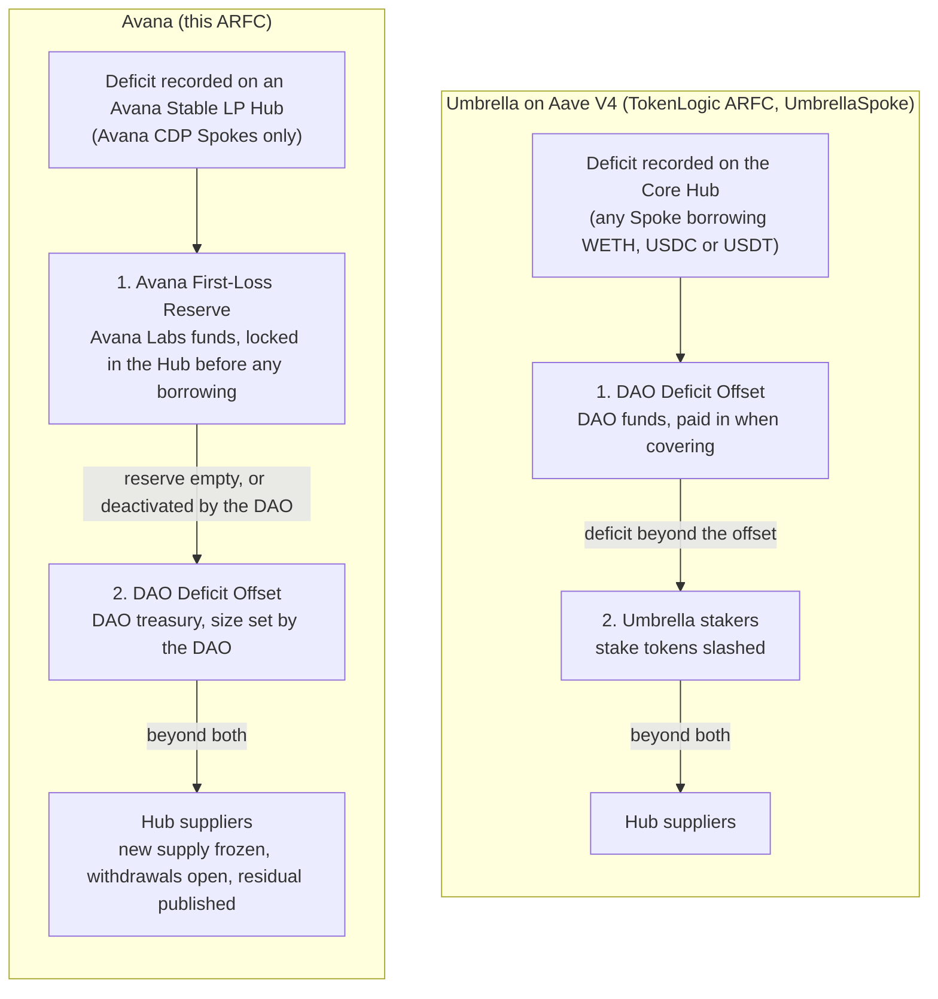
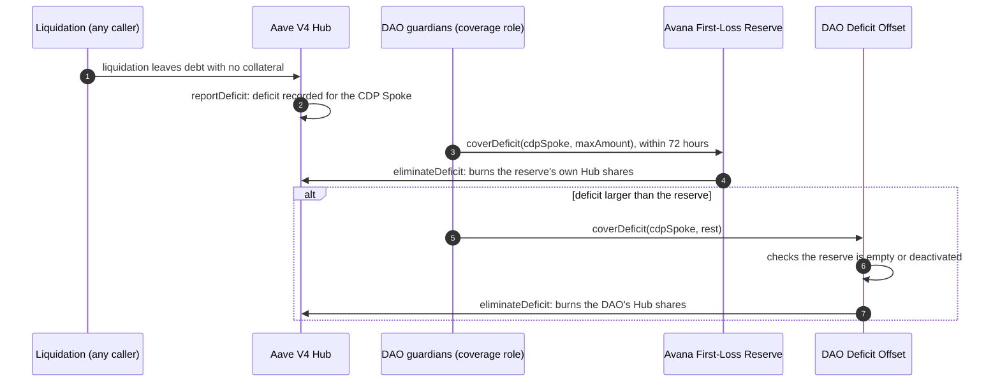

# [ARFC] Onboard AMM LP Positions as Collateral on Aave V4 via Avana

Governance, New Market
Author: @avana
Created: 2026-11-04 · Updated: 2026-11-12

## At a glance

| | |
|---|---|
| What Avana is | Contracts that let liquidity providers borrow stablecoins such as GHO against AMM positions without removing their liquidity from the pool. Avana holds the position and issues a transfer-restricted vault token for it, which is the collateral on a standard, unmodified Aave V4 Spoke owned by the Aave DAO. |
| Launch | Ethereum (Uniswap v3) and Base (Aerodrome Slipstream) together, one Avana Stable LP Hub on each. Stablecoin pools only, such as USDC/USDT and pools containing GHO. |
| Lending | Public from day one, beside the Aave DAO's bootstrap supply. Lenders earn the Hub supply rate, set by Aave V4's standard utilization curve. |
| Borrowing | Stable debt assets the Aave DAO approves (for example GHO, USDC, USDT), each with its own line, draw cap, price source, swap routes and Avana First-Loss Reserve. For GHO, a proposed 2M GHO line on Ethereum to start; every other line is set in the funding ARFC. |
| Collateral factor | Lowest Core Hub collateral factor among the pool's tokens × a pool risk factor of at most 40%. |
| Liquidation | Aave's standard `liquidationCall`, always partial. Only the seized share of the position is unwound and sold, in one transaction, and the debt is repaid in the debt asset. |
| Avana's revenue | No share of interest. The Avana app charges 10 bps on every app action (ceiling 25 bps without a new ARFC), and Avana's contracts take 20% of each liquidation's surplus. Both go to one timelocked fee recipient; neither changes an interest rate or the Aave DAO's revenue. |
| Loss coverage | Two layers per Hub and debt asset: first the Avana First-Loss Reserve, funded by Avana and controlled by the DAO, then a DAO Deficit Offset funded by the Aave DAO treasury and spent only once the First-Loss Reserve is empty or deactivated by the DAO. A loss beyond both is disclosed, not shared. |
| Governance | The Aave DAO owns and configures every Avana Hub and Spoke. Changes to Avana's own contracts go through a per-chain timelock (5 days, 12 hours for risk-reducing changes) that the Aave governance executor can propose to and cancel. |
| Status | Specification, contract interfaces and formal models complete; interfaces compile. Contract implementations and independent audits come next. |

## What this ARFC asks

1. Support for a technical and risk assessment of Avana with Aave DAO service providers on Ethereum and Base: custody, valuation, liquidation, Aave V4 integration, governance roles, loss allocation and economic terms.
2. Support for preparing capped credit line requests for the stable debt assets the Aave DAO chooses to list (for example GHO, USDC, USDT), each within that asset's flash liquidity in the chain's Aave V3 Pool and the depth of its swap routes. For GHO, a proposed 2M GHO on Ethereum to start, growing toward 10M GHO only as live performance criteria are met.

If this ARFC passes, two follow-up ARFCs would ask the Aave DAO for the following.

**Deployment ARFC**
- List each CDP Spoke as a standard Aave V4 Spoke, with three settings on every Avana collateral reserve: `receiveSharesEnabled = false`, `liquidationFee = 0` and no reinvestment controller. Avana recommends a target health factor of 1.10 and a minimum liquidation bonus of at least 2%; the DAO decides both.
- Grant Avana's public flash liquidation helper and Avana's flash source the `FLASH_BORROWER` role on the Aave V3 Pool on Ethereum and Base, so their flash loans carry no premium.
- Register an Avana First-Loss Reserve for each approved debt asset on each chain's Stable LP Hub and name its role holders, and behind each one a DAO Deficit Offset: the same contract, registered the same way, which can spend only once the First-Loss Reserve in front of it is empty, or while the DAO keeps that First-Loss Reserve deactivated.
- Add each chain's Aave governance executor as proposer and canceller on that chain's Avana timelock, and the Aave Protocol Guardian as guardian and canceller.
- Let the Aave Protocol Guardian freeze Lend Spoke reserves as well as CDP Spoke reserves. A freeze stops new supply and never stops withdrawals; unfreezing stays with the DAO.

**Funding ARFC**, per chain
- Which stable assets are listed and borrowable, and each one's credit line and draw caps (for example a proposed 2M GHO on Ethereum), each within flash liquidity, route depth and the coverage bound.
- The Lend Spoke supply caps and the DAO's bootstrap supply.
- Each Avana First-Loss Reserve's coverage ratio and minimum.
- Each DAO Deficit Offset's size per Hub and debt asset, funded from the DAO treasury. Caps and credit lines are sized so the modelled tail loss fits within the First-Loss Reserve's minimum plus this offset; Avana proposes no fixed figure, because the offset is the part of that need the DAO chooses to carry above Avana's reserve.
- Each lend asset's utilization curve, Aave V4's standard kinked interest-rate strategy; for GHO the DAO may keep the curve's base rate at or above the Core Hub GHO base rate.

Mainnet launch follows independent audits of every contract and governance approval.

- Website: https://avana.cc
- Sandbox (borrow and liquidation flows with simulated assets, no onchain transactions): https://app.avana.cc
- X: @avana_labs

## Motivation

Aave has $30B in deposits but only $12B in active loans. Billions of dollars in AMM liquidity earn trading fees, yet liquidity providers who want to borrow against their positions usually have to withdraw, giving up fees and, for concentrated liquidity, their chosen price range. We estimate addressable AMM LP collateral across Ethereum, Avalanche, Arbitrum and Base could reach $8 billion by 2028.

Aave was early to this market: Aave V1's Uniswap Market accepted Uniswap v1 LP tokens in 2020, and from 2021 the AMM Market accepted Uniswap v2 LP tokens and later wrapped Uniswap v3 positions. In 2025 Aave Labs proposed GHO borrowing against Uniswap v4 positions and asked the Uniswap DAO for a $3.3M development grant plus 1.2M UNI released as borrowing reached $50M, $100M, $300M and $500M. That proposal did not advance past the RFC and Temp Check stage.

Aave V4's Hub-and-Spoke design lets an LP collateral market run with its own risk parameters and caps, isolated from Aave's core markets, and oracle and liquidation infrastructure has improved since those attempts. Avana connects liquidity already deployed on established AMMs to Aave V4, which gives GHO new borrowing demand backed by productive collateral.

## Architecture

### Design overview

Every Aave V4 contract stays unmodified; custody, valuation and liquidation settlement sit in Avana's own contracts. Aave V4 accepts collateral only as ERC-20 reserves, and most AMM positions are NFTs, so an Avana vault holds the position and a transfer-restricted vault token represents its liquidity on Aave V4, one base unit per unit of liquidity. Anyone can check on-chain that every vault token is backed 1:1.

Each wallet gets one immutable position proxy per market, so each market has its own health factor and nothing is cross-collateralized: a price move in one market never liquidates a position in another.

### How the Spokes are set up

Each chain has one Avana Stable LP Hub. The money sits in the Hub; Spokes are entry points into it.

- **Lend Spoke.** Single assets go in: GHO, USDT, USDC and the like. Its draw cap is 0 on every asset, so nobody can borrow through it. Lenders use Aave's standard `supply` and `withdraw`, with no Avana contract in the path.
- **CDP Spoke (borrow side), one per AMM protocol.** "Uniswap v3 Stable" on Ethereum and "Aerodrome Slipstream Stable" on Base. The Avana vault token is the only collateral. Each vault-token reserve has a draw cap of 0, so the vault token can be supplied as collateral but never borrowed. Each debt reserve (the stable debt assets the Aave DAO approves, for example GHO, USDC, USDT) is borrowable with a collateral factor of 0, and the CDP Spoke's supply cap on that asset is 0. So USDC cannot be supplied there and cannot count as collateral, and borrowing liquidity comes only from the Hub, which the Lend Spoke fills.
- **Avana First-Loss Reserve, one per Hub and debt asset.** A supply-only Spoke with no draw capacity that holds that pair's first-loss reserve. Avana Labs funds it in the debt asset to its minimum before any draw cap on that asset rises above 0, and the Aave DAO controls it. It spends funds only to eliminate a recorded deficit in its own asset.
- **DAO Deficit Offset, one per Hub and debt asset.** The same kind of Spoke, funded by the Aave DAO treasury and controlled by the DAO. It eliminates a deficit only once the Avana First-Loss Reserve of the same pair is empty, so Avana's capital is spent first whenever the First-Loss Reserve can pay. If the DAO deactivates the First-Loss Reserve, the offset pays instead, so a deficit is never left waiting; each layer keeps its own funds, coverage and withdrawals.
- **Avana checks the same settings.** Its risk module reads these Aave settings at activation and on every pledge and borrow. If one drifts, for example a debt reserve's collateral factor stops being 0, a breaker trips and new borrowing stops until an authorized reset. Repayment, exits and liquidation stay open.
- **Borrowers reach the CDP Spoke only through Avana:** wallet → Avana adapter → the user's position proxy → CDP Spoke. The vault token can only be held by those proxies, the Hub and Avana's own contracts, so it cannot be taken outside Avana.

The Aave DAO sets how much each CDP Spoke can draw. Each draw cap stays within the chain's flash liquidity of that asset and the depth of its swap routes, so every borrowed amount can be liquidated in one transaction. Correlated LP and Volatile LP Hubs, with stricter limits, can be added later.

### Initial scope

- **Pools:** stablecoin pools that meet the listing rules, including USDC/USDT and pools containing GHO.
- **Markets:** a market is one pool with one exact price range; a position must match it exactly. Slipstream positions must be unstaked.
- **Listing requirements per pool:** sufficient liquidity history, Chainlink price routes for each token, an independent second price source, and a primary and a backup swap route into each debt asset that never trade through the pool itself. Fee-on-transfer, rebasing and hook tokens are excluded.
- **Later:** the core also supports Uniswap v2, Uniswap v4 and other AMM designs. Each needs its own integration, fork tests, gas measurements, risk review and governance approval before its first listing.

## Lending

Public lending is open from day one. Anyone can supply a listed asset through the Lend Spoke, beside the Aave DAO's bootstrap supply. As an illustration only, the DAO might supply $1M GHO and $1M USDT at launch; the funding ARFC sets the actual amounts. The DAO's bootstrap supply is in place before any draw cap on that asset is raised.

- **What lenders earn:** the Hub supply rate. Interest paid by Avana borrowers on that asset, less the liquidity fee the DAO sets, is shared among all suppliers in proportion to their supply: the DAO, public lenders and the Coverage Spoke alike.
- **What lenders risk:** a deficit beyond both loss layers, the Avana First-Loss Reserve and then the DAO Deficit Offset. Aave V4 has no way to write such a residual down across suppliers: it stays on the Hub, the supply share price does not fall, and withdrawals are paid in full, first come first served, while liquidity lasts. Once every borrower has repaid, the lenders who withdraw last hold claims with nothing behind them until either layer is topped up and covers the residual. While a residual is outstanding, new supply into that asset stops (the app builds none and the Aave Protocol Guardian freezes the Lend Spoke reserve), withdrawals stay open, and the app shows every lender the residual and the backed value per share before each withdrawal. Example: lenders supply 2,000,000 GHO, the First-Loss Reserve holds 100,000 GHO and the DAO offset 150,000 GHO; a 300,000 GHO loss is covered 100,000 then 150,000; the remaining 50,000 GHO means the first 1,950,000 GHO withdrawn is paid in full and the last 50,000 GHO of claims waits for a top-up. Caps are sized so that this needs a loss beyond the modelled tail.
- **Withdrawals:** a lender can withdraw only idle liquidity. At high utilization, a withdrawal waits until borrowers repay or are liquidated. Example: the DAO supplies 1,000,000 GHO, a public lender 500,000 GHO and the Coverage Spoke 300,000 GHO, and 1,600,000 GHO is borrowed. The public lender can withdraw at most the 200,000 GHO that is idle now, and the rest as borrowers repay.

Borrowing is bounded by the CDP Spokes' draw caps, which the DAO sets, and by the liquidity lenders have supplied. The Lend Spoke's supply cap, also set by the DAO, bounds total supply; it is separate from the credit line.

## GHO opportunity

### Revenue

Interest goes to the Hub's suppliers in proportion to their supply, the DAO and public lenders alike, after the DAO's liquidity fee, which goes to the Aave DAO treasury. Every lend asset uses Aave V4's standard kinked utilization curve, whose values the Aave DAO sets, with each borrower's risk premium added. High utilization raises the borrow rate, which draws new supply and pushes borrowers to repay. For GHO the DAO may keep the curve's base rate at or above the Core Hub's GHO base rate, so Avana is never the cheaper way to borrow GHO. As an illustration only, a GHO curve with a 5.50% base, 3.60% of growth up to 90% utilization and 50% above it charges 7.50% at 50% utilization and 34.10% at 95%.

Avana takes no share of interest, and its fees change no interest rate and no Aave DAO revenue. Avana has two sources of revenue, both paid to one address, the `feeRecipient` set in Avana's contracts, which changes only through the timelock:

- **App (frontend) fee.** The Avana app charges 10 bps on every action it builds: supply, withdraw, pledge, withdraw collateral, borrow, repay, repay with collateral, deleverage, and swap if the app offers it. The basis is the action's amount; for pledging or withdrawing an LP position it is the position's oracle USD value, and the fee is paid in the market's debt stablecoin. The fee is rounded down, so a user never pays above 10 bps. The app adds the fee transfer to the same transaction batch as the action, so both succeed or fail together; if the transfer would fail (for example a token that blocks the recipient), the app leaves it out and the action goes through. No contract charges or enforces the fee: a user who calls the contracts directly pays none, and keeper liquidations pay none. For example, borrowing 50,000 GHO costs 50 GHO, and pledging a position worth $200,000 in a GHO market costs 200 GHO.
- **Liquidation fee share.** 20% of each liquidation's surplus, measured at oracle prices and capped by the surplus actually realized.

Avana commits to a ceiling of 25 bps on the app fee: the app never charges more without a new ARFC. Frontend fees arrive as transfers from user accounts, and liquidation fees arrive from Avana's liquidation contracts with their own events, so the two are reported separately; Avana Labs reports frontend-fee revenue every quarter.

### Capacity

| Phase | Proposed capacity | Conditions for expansion |
|---|---|---|
| Launch | Proposed 2M GHO on Ethereum; Base line set in the funding ARFC | Audits complete; oracle, borrowing and liquidation-route performance reported to governance |
| Initial target | Up to 10M GHO | Demonstrated demand, acceptable concentration and execution costs, and a risk reviewer recommendation |
| Expansion | 50M GHO or more | Operation within approved limits and further governance approval |

The funding ARFC defines the thresholds and who can adjust capacity. At every phase, each chain's draw caps stay within its flash liquidity, and the first-loss reserve must satisfy `fundedBalance × 10⁴ ≥ coverageRatioBps × credit line`. The funding ARFC sets the coverage ratio and reserve minimum with Aave's service providers. As an illustration only, a 20% ratio on a 2M GHO line requires a 400,000 GHO reserve.

### Revenue scenarios

Annual gross borrower interest at constant all-in rates of 4.5% and 9%, assuming GHO at $1 and debt equal to 25% of LP collateral value (a scenario assumption, not a proposed collateral factor). The interest is shared among the Hub's suppliers after the DAO's liquidity fee.

| Outstanding borrowing | LP collateral | Interest at 4.5% | Interest at 9% |
|---|---|---|---|
| 2M GHO | $8M | $90,000 | $180,000 |
| 10M GHO | $40M | $450,000 | $900,000 |
| 50M GHO | $200M | $2.25M | $4.5M |
| 500M GHO (the scale Aave Labs projected in 2025) | $2B | $22.5M | $45M |

## Pricing, borrowing and liquidation

### Oracle and pricing

The vault token's price is the fair value of its liquidity at oracle prices: the token amounts the position would hold if the pool traded at the Chainlink prices, valued at those prices.

`VaultTokenPrice = Σᵢ qᵢ × Pᵢ`

Here qᵢ is the amount of token i one vault token represents at the oracle prices, and Pᵢ is its Chainlink price. Because the amounts come from oracle prices, a trade in the pool cannot move the valuation. Stablecoins are never valued above $1.

Each token has a Chainlink primary route, an alternate Chainlink route with automatic failover, and a standby route approved at listing. A feed is fresh for its heartbeat plus 1,800 seconds. A 30-minute pool TWAP is a consistency check, not a price source. Borrowing, and any withdrawal that leaves debt, also requires each token's price to agree with an independent second source. On Base, every price also reads the sequencer-uptime feed.

| Price condition | Effect |
|---|---|
| Live, second source agrees | Normal operation. |
| Second source disagrees or is unavailable | Borrowing and withdrawals that leave debt are blocked. Liquidation continues. |
| TWAP check fails | Pledges are also blocked, and collateral is valued at the lower of the fresh and last accepted price. Liquidation continues. |
| Chainlink routes disagree, or both stale for up to 1 hour | Borrowing is blocked (pledges too, when stale) and collateral is valued at the lower route or the last accepted price. Liquidation of that market waits for agreeing, fresh prices or a guardian's switch to the standby route. |
| Stale for more than 1 hour | Collateral counts as worthless in the health factor, and liquidation still waits, so collateral is never seized at an untrusted price. For 30 minutes after recovery, only accounts below health factor 0.95 can be liquidated. |
| Base sequencer down, or within 1 hour of restart | Borrowing is blocked. Liquidation pauses while the sequencer is down; for 1 hour after restart only accounts below health factor 0.95 can be liquidated. |

In every case, repayment, fee collection and debt-free withdrawal stay open. Service providers review these thresholds at each listing.

### Collateral factor and health

Valuation and borrowing limits are set separately:

`LP Collateral Factor = min(CF₁, …, CFₙ) × Pool Risk Factor`

`Borrowing Capacity = LP Position Value × LP Collateral Factor`

CFᵢ is each pool token's Aave V4 Core Hub collateral factor; a GHO leg uses an explicit factor set at listing. The pool risk factor, at most 40%, reflects the position's range, pool depth and expected liquidation costs. The DAO sets each reserve's factor at or below this value, and Avana stops new borrowing if it is set higher. Gauntlet's analysis of LP collateral recommends conservative starting factors, as low as 0.25× the lower underlying factor when the borrowed asset is not one of the pool's tokens. Final factors are calibrated per market with service providers.

Illustrative example, not proposed launch parameters (GHO, USDC and USDT at $1):

| Item | Result |
|---|---|
| USDC/USDT position value | $100,000 |
| Lower token CF × pool risk factor | 75.00% × 37.50% = 28.12% (rounded down) |
| Maximum borrow (health factor 1.00) | 28,120 GHO |
| Recommended borrow (health factor 1.10) | About 25,560 GHO |
| Actual borrow and initial health factor | 20,000 GHO at 1.41 |
| Collateral value at health factor 1.00 | About $71,120 |

Collateral value would need to fall about 29% to reach health factor 1, which for a stablecoin position takes a deep depeg. Aave's health factor of 1.00 is the only on-chain borrowing limit; the app recommends borrowing to 1.10.

### Borrowing and repayment

- **Pledge.** The position moves into Avana's custody; its liquidity stays in the pool. It must match a listed market exactly, pass the oracle checks and caps, and be worth at least $10. An account holds at most 16 positions in one market. There is no borrower allowlist and no minimum debt. Per-Hub caps apply per pool, per token and per depositor.
- **Rate.** `Borrowing Rate = Drawn Rate × (1 + User Risk Premium)`, where the drawn rate comes from the asset's utilization curve. With a 50% risk premium and a 4.5% drawn rate, a loan pays 6.75%.
- **Repay.** Anyone can repay any account's debt at any time. No Avana pause, breaker or address freeze can block repayment, fee collection or a debt-free withdrawal; only an Aave-side pause of the debt reserve or a Hub halt of the Spoke can. A borrower can also repay by selling part of the position, with no bonus or Avana fee.
- **Withdraw.** The position returns with its uncollected fees. A withdrawal that leaves debt must keep the health factor at or above 1.00 and pass every price check; a debt-free withdrawal reads no price.

### Liquidation

An account is liquidatable when its health factor falls below 1. Every liquidation is one atomic transaction through Avana's liquidation contract:

1. **Funding.** Any address can call it, funding the debt asset itself or through Avana's public flash liquidation helper, which flash-borrows from the Aave V3 Pool.
2. **Standard liquidation.** Avana calls the CDP Spoke's `liquidationCall`; Aave sizes the repayment toward the target health factor and applies its dynamic bonus.
3. **Unwind.** Exactly the seized liquidity is removed from the position. The borrower keeps the rest and all of its fees.
4. **Swap.** Each token is sold into the debt asset over the market's primary or backup route, each leg with an oracle-based minimum output. Proceeds must reach the seized collateral's oracle value less at most 1% slippage. The caller can top up a small shortfall; otherwise the transaction reverts and nothing changes.
5. **Payout.** Avana takes 20% of the surplus at oracle prices, capped by the realized surplus. Any recovery above the oracle value goes to the borrower; the rest goes to the caller.

Every liquidation is partial and settles in the debt asset, or reverts. A direct `liquidationCall` from any other address fails, because the vault token accepts seized collateral only to Avana's liquidation contract.

**Example (Ethereum, GHO debt).** USDC/USDT Uniswap v3 market, vault token at $2.00, collateral factor 28.12%, maximum bonus 5%, target health factor 1.10. Alice holds 141,232 vault tokens ($282,464) and owes 79,452.85 GHO.

| Step | Result |
|---|---|
| Trigger | A USDT price move takes her health factor to 0.9997; Aave's bonus there is 2%. |
| Liquidation | Avana's keeper flash-borrows 9,800 GHO through the helper with no premium. Aave repays 9,800 GHO of debt and seizes 4,998 vault tokens, worth 9,996 GHO. |
| Swap | About 4,998 USDC and 4,998 USDT swap to 9,950 GHO, above the 9,895.04 GHO floor. |
| Payout | Oracle gain 196 GHO, realized gain 150 GHO. Avana's fee is 39.2 GHO; borrower surplus 0. The helper repays the 9,800 GHO flash loan and the keeper keeps 110.8 GHO. |
| After | Alice keeps 136,234 vault tokens ($272,468), about 96.5% of her position and all of its fees, against 69,652.85 GHO of debt, at health factor 1.09999. |

**Committed operators.** Any address can liquidate. Committed operators also undertake to liquidate every account below health factor 1, whatever its size and whether or not the bonus covers gas. At launch Avana's keeper is the committed operator on each chain, and Avana pays its gas, so no liquidation depends on a keeper's profit. Others, such as Aave Labs or a risk provider, can be added through the timelock, up to 32 per chain. If none remains on a chain, new borrowing there halts. A one-position liquidation uses about 1.55M gas; the 16-position cap keeps the largest at 5.15M gas, within one transaction.

**What can stop liquidation.** No Avana pause, breaker, configuration drift or address freeze, and no Aave reserve freeze. Liquidation waits only for valid prices, the Base sequencer check, and Aave-side halts (a Hub halt of the Spoke or a reserve pause). The listing commits the DAO to contain a faulty market with a reserve freeze and a zero draw cap, which leave liquidation open, and to halt or pause only a faulty Spoke.

## Risk management

### Governance and emergency controls

Each new market is listed through the chain's Avana timelock at the normal delay, a five-day public review enforced on-chain, together with the Aave DAO's listing payload, which sets the collateral factor, bonus curve and caps. Avana Labs proposes markets and parameter changes for assessment by a designated risk reviewer.

Governance is per chain. Ethereum and Base each have their own timelock, a 4-of-7 governance Safe and a 3-of-5 Emergency Guardian Safe, and nothing on one chain can act on the other.

- **Aave DAO:** owns and configures every Avana Hub and Spoke and holds every Aave-side control: caps, credit lines, reserve freeze and pause, and Hub halt. Avana owns no Aave contract and has no authority over any cap or rate.
- **Avana timelock:** every upgrade, parameter change, market listing and role change to Avana's contracts goes through it, with a 5-day delay (never less than 4), or 12 hours when every call only reduces risk. A ready operation can be executed within a 14-day window. The governance Safe and the Aave governance executor can propose; both, and both guardians, can cancel. Only the Aave governance executor can cancel a role change or an operation that restores liquidation.
- **Guardians:** the Emergency Guardian and the Aave Protocol Guardian can each act at once to freeze or pause Hubs, freeze an address, trip or reset a breaker, switch a token to its pre-approved standby price route, and cancel queued operations. They cannot upgrade contracts, change parameters or move collateral. The Aave Protocol Guardian can also freeze or pause Avana's CDP Spoke reserves on the Aave side, so Avana's markets can be stopped without Avana Labs, and freeze Lend Spoke reserves, which stops new supply and never stops withdrawals.
- **Signers:** at most 3 of the 7 governance Safe signers come from Avana Labs, across at least three organisations and three jurisdictions. The three Safes share no signers. Named signers will be agreed with service providers.
- **Exits are never blocked:** pauses, freezes, breakers and the speed limits stop new activity only. Repayment, fee collection, debt-free withdrawal and liquidation stay open.

### Circuit breakers

On-chain breakers stop new borrowing only where an on-chain check is reliable. Other signals raise alerts, because a reverted liquidation cannot record a failure count and an on-chain counter can be gamed.

| Trigger | Setting | Action |
|---|---|---|
| Oracle or stablecoin band breach | Price-state checks; stablecoin band $0.90–$1.02 | Block new borrowing and withdrawals that leave debt |
| Outstanding deficit | Above 10,000 GHO on a CDP Spoke for GHO; a level set at listing for other assets | Freeze new borrowing on that debt reserve; reopens only through the timelock or a guardian |
| Price drop | 3% in 2 hours | Alert |
| Avana's share of a pool | Above 25% | Alert; a per-pool cap applies only where the listing sets one |
| Collateral seized | Above 20% of a market in 1 hour | Alert |
| Swap-route failures | 3 in 1 hour | Alert; a guardian freezes new borrowing once the routes are confirmed unable to settle liquidations at the required size |

Temporary price and depth gates reopen after 30 minutes of healthy observations, a provisional value reviewed against live data. The configuration drift check and the Base sequencer check also stop new borrowing under their own conditions.

### Speed limits

Two speed limits slow how fast new debt and new collateral can enter a market. If a price is wrong in a way the oracle checks miss, the collateral cannot be drained faster than one limit per window, which gives monitoring and the guardians time to freeze the market. The RiskModule enforces them inside every borrow and pledge it already checks: no keeper, no bot and no Aave cap change.

- **Borrow speed**, per market and per Hub and debt asset: new debt in any 6-hour window stays within a quarter of the existing debt (for a market, the debt on its Aave Spoke; for a Hub and asset, everything Avana's Spokes owe the Hub), never below a floor and never above a ceiling. Per market (in USD): at least $250,000 and at most $2,500,000. Per Hub and debt asset (in tokens): at least 500,000 and at most 5,000,000.
- **Pledge speed**, per market: new collateral in any 6-hour window stays within a quarter of the market's collateral, at least $1,000,000 and at most $10,000,000. Rescue top-ups that save a position from liquidation are exempt.

Example: with $4,000,000 of debt, of which $600,000 was borrowed in the current window, the limit counts the debt before the window, $3,400,000, so it is $850,000 and a further $250,000 is available now; a larger borrow is refused with the amount available and the time more frees up, at most 12 hours later. Splitting a borrow across blocks or accounts does not help: the window counts every account, and borrowing in the window does not raise its own limit.

Exits are never throttled: repayment, repay with collateral, withdrawal, fee collection and liquidation do not touch the limits. The values are set per market at listing and per Hub and debt asset when the asset is listed; they can be tightened within 12 hours, or at once by the risk steward, and loosened only at the 5-day delay. A borrower who needs more than a market's ceiling asks governance to raise it for a time through the normal delay; the guardians' freeze still overrides everything.

### Deficits and first-loss coverage

If a liquidation empties an account's collateral while debt remains, Aave records the remainder as a deficit on the Hub, in the debt asset. The Avana First-Loss Reserve of that Hub and asset, then the DAO Deficit Offset behind it, eliminates a recorded deficit within 72 hours. These are the only on-chain loss layers at launch, and a deficit is never covered with another asset's, Hub's or chain's reserve. Rounding gaps in small liquidations come out of the liquidator's payout, never from the reserve.

The First-Loss Reserve must satisfy `fundedBalance × 10⁴ ≥ coverageRatioBps × credit line`, checked when the line is recorded, when a debt reserve is enabled and on every recorded draw-cap raise; a later shortfall raises an alert, and Avana Labs tops the First-Loss Reserve up.

**Loss order.** A recorded deficit is covered, per Hub and debt asset:

1. by the Avana First-Loss Reserve, funded by Avana Labs;
2. then by the DAO Deficit Offset, funded by the Aave DAO treasury. It refuses to pay while the First-Loss Reserve is active and holds any funds, so the guardians cover from both in one transaction. If the DAO has deactivated the First-Loss Reserve, which then cannot pay, the offset pays at once, so DAO money can be spent before Avana's for as long as the DAO keeps the First-Loss Reserve deactivated. Its size is a DAO parameter per Hub and debt asset, set in the funding ARFC, funded and refilled from the treasury, and withdrawable only through its own 14-day queue;

Aave V4 only lets a Spoke burn its own supply to clear a deficit, which is why each layer is its own Spoke and why nothing writes a loss down across suppliers. Risk service providers size caps and credit lines so the modelled tail loss of each asset fits within the First-Loss Reserve's minimum plus the DAO offset.

**Residual risk.** A deficit larger than both layers stays recorded on the Hub. Every draw cap on that asset is set to 0 through the Aave Guardian, new supply stops (the app builds none and the Aave Protocol Guardian freezes the Lend Spoke reserve), and withdrawals stay open. Aave pays withdrawals in full while liquidity lasts, so lenders who withdraw first are paid and the last lenders, the DAO's bootstrap supply and public lenders alike, hold the unbacked claims until Avana Labs or the DAO tops up a layer and the guardians cover the rest. The app and the public views show the residual and the backed value per share before every withdrawal.

#### How this relates to Umbrella on Aave V4

Aave already has a deficit-coverage system, and Avana's design builds on its work rather than around it.

**What Aave has built.** Umbrella has protected Aave V3 since 2025. Users stake Aave assets in Umbrella and earn rewards for standing behind the protocol's reserves, and it has built up a large base of staked capital. Its loss order is settled DAO policy: each covered reserve has a DAO-funded **Deficit Offset** that absorbs a deficit first, and stakers are slashed only beyond it (LlamaRisk, "Umbrella coverage principles and slashing logic", 2025-12-10). Since AIP 467 the offsets grow with each reserve's revenue (Chaos Labs, "Revenue-indexed deficit offsets for Umbrella").

TokenLogic's ARFC "Umbrella on Aave V4: Coverage Framework and Initial Market Parametrization" (2026-09-11) carries this into V4, and BGD Labs is building the contract for it, `UmbrellaSpoke` (aave-dao/aave-umbrella#4). The ARFC proposes:

- Umbrella coverage for the Ethereum Core Hub's WETH, USDC and USDT, covering every Spoke that borrows those reserves, including other Hubs' credit lines into Core;
- a DAO Deficit Offset as the first loss layer (33 ETH, 15,000 USDC, 15,000 USDT), then Umbrella stakers;
- targets of 800 ETH, 400,000 USDC and 400,000 USDT of staked capital, rewarded by DAO emissions, with a 20-day cooldown;
- coverage funded by a single issuer for one Spoke, described as possible but left out of scope.

This gives V4 a coverage layer from day one, built on capital and stakers Umbrella already has. With V3's role shrinking as V4 grows, it also keeps that staked capital working.

**The mechanism Avana shares.** Aave V4 has one way to clear a deficit: `Hub.eliminateDeficit`, callable only by an active Spoke listed on the Hub that holds the Hub's deficit-eliminator role. The call burns that Spoke's own supplied Hub shares against another Spoke's recorded deficit. `UmbrellaSpoke` uses exactly this, and so do both of Avana's loss layers:

- each is a contract listed on the Hub as a supply-only Spoke, with no draw capacity, holding the deficit-eliminator role;
- coverage is per Hub and asset, for a DAO-set list of covered Spokes, and never crosses assets, Hubs or chains;
- only a role the DAO grants can trigger coverage;
- one layer is a DAO-funded Deficit Offset, as in Umbrella.

A reviewer who knows `UmbrellaSpoke` already knows how Avana's layers clear a deficit. The differences are whose money stands first, when it is put in, and what it is tied to.

**Where Avana differs, and why.**

1. **The party that brings the risk pays first.** In TokenLogic's framework the first loss belongs to the DAO, and for Core WETH, USDC and USDT that is the right owner: the DAO issues those markets and earns their revenue. Avana brings a new kind of collateral, concentrated-liquidity LP positions, onto its own Hub. The same principle applied to Avana puts Avana first. Avana Labs funds the first layer, and the DAO's money stands only behind it. The DAO is not asked to underwrite a new collateral class before the protocol that built it has.

2. **Avana's Hubs are outside Umbrella, and should stay that way.** The ARFC covers the Ethereum Core Hub only: not GHO, not Base, not a separate Hub. Avana borrows GHO on Ethereum and USDC on Base from its own Stable LP Hubs. Adding those Hubs to Umbrella would change the risk that existing stakers signed up for, and staked capital should not be exposed to a new collateral class it was never priced for. Without its own coverage, any Avana deficit would fall on the Hub's lenders, the DAO's bootstrap supply among them. Avana therefore brings its own coverage and leaves Umbrella's stakers out.

3. **Pre-funded and locked, because Avana is new.** Umbrella can cover at the moment of need because it rests on capital and a treasury that already exist. Avana has neither a staker base nor a track record. Its promise therefore has to be on chain before anyone borrows:
   - the reserve is funded before any draw cap is above 0;
   - it is held as the reserve's own Hub shares and earns supply interest like any lender's;
   - Avana Labs cannot take it back on its own: a withdrawal needs the DAO's approval and waits 14 days.

4. **The credit line is capped by the reserve, in code.** Umbrella's targets are set apart from borrow caps. Avana's MarketRegistry refuses any credit line or draw-cap raise that would put the summed draw caps above `fundedBalance × 10⁴ / coverageRatioBps`. Borrowing cannot outgrow its first-loss cover. The ratio is set in the funding ARFC with the risk service providers, from each asset's exposure, stress loss, concentration and a risk premium.

5. **The order between two payers is enforced in code.** Umbrella's layers are both Aave's, and the coverage manager calls them in order. Avana's layers belong to two different payers, so the order is not left to procedure. The DAO Deficit Offset refuses to pay while Avana's reserve is active and holds funds. The only exception is when the DAO itself has deactivated Avana's reserve.

6. **No ongoing cost to the DAO.** There are no staker emissions and no reward program. The DAO Deficit Offset's size is the DAO's own choice per Hub and asset, and it can be 0 until the DAO funds it. Avana's coverage costs the DAO nothing unless it chooses to stand behind Avana.

In short: Avana uses the coverage mechanism Aave V4 and Umbrella already define, and applies TokenLogic's principle that the market's owner takes the first loss. For a protocol that brings its own collateral to its own Hub, that owner is Avana. The first layer is therefore Avana's money, funded up front, locked under DAO control and sized to the credit line, and the DAO's offset stands behind it.

### Reporting and offboarding

Avana Labs publishes weekly usage and monthly revenue reports per chain: debt and collateral by market, concentration, health factors, liquidations, first-loss reserve usage, bad debt, oracle incidents, pauses, breaker trips and alerts, credit-line and supply usage, and fees earned. Each quarter it also reports frontend-fee revenue per chain, separately from the liquidation fee share.

To offboard a market, a 12-hour timelock operation and an Aave reserve freeze stop new pledges and borrowing at once. Avana publishes the target liquidation threshold, half the market's threshold at that moment, and the earliest date, five days later. After that public notice, an Aave DAO payload lowers the market's liquidation threshold once, to the target; remaining borrowers have the five days to repay or add collateral. Debt is never cancelled and there is no force-close; repayment, withdrawal and liquidation stay open.

## Verification

These checks cover the specification and contract interfaces, not contract code. Contract code will be checked by Foundry, fuzz, fork and invariant tests and prover runs, then by independent audits of every contract.

| Check | What it covers | Result |
|---|---|---|
| Traceability | Every requirement linked to the checks that verify it; any edit must be re-verified | 3,507 requirements traced, 0 errors |
| Z3 and SymPy | Every formula in exact integers at Solidity bit widths, and each formula against the rule it implements; every worked example recomputed | Every result matches its recorded value |
| Hypothesis | Generated action sequences against an integer model of Avana, Aave V4 and Uniswap v3, with solvency per debt asset after every step | 82 tests, 82 pass |
| Quint | Cross-contract state machine with honest and hostile components, and a multi-Hub, multi-Spoke model | No invariant violation in the recorded runs |
| Internal formal verification | Custody, control (access, timelock, pauses, oracle, breakers) and liquidation | Every check passes, 0 open findings |
| 1,000-user simulation | 1,000 users and bots over 90 days, including six stress episodes | 572,608 invariant checks, 0 violations, 98 liquidations, $0 bad debt |
| Adversarial design review | Red team, flow walkthroughs, live-chain integration assumptions, gas and DoS | First draft: 6 Critical, 13 High, 22 Medium, 14 Low. All resolved except one Medium (an Aave-side halt stopping exits on a Spoke), accepted with an operating playbook. Final re-check: 96.5/100, then 99.0/100 after its fix pass. |

## Next steps

1. **Snapshot on this ARFC.** If feedback is positive, this ARFC goes to a Snapshot vote to confirm support for the assessment.
2. **Deployment and funding ARFCs,** as listed under What this ARFC asks, each with its own Snapshot, risk parameters, audit reports and launch configuration. Borrowing activates only when both pass and every security and risk prerequisite is met.
3. **AIPs.** If both Snapshots pass, the proposals go onchain as AIPs. Aave-side actions on Base go through the Aave DAO's Base executor. Each further chain needs its own ARFC.

## Conclusion

Avana turns active AMM liquidity into collateral and borrowing demand for Aave V4. Liquidity providers borrow GHO and the other stablecoins the DAO approves without leaving their pools or giving up trading fees, and the Hub's suppliers, the Aave DAO among them, earn the interest. Avana Labs will share further details and accountable contacts with Aave's service providers during the review.

## Disclaimer

Avana Labs is the author of this proposal. We have not been compensated by any third party to publish it. This ARFC gathers community feedback on Avana and a potential GHO credit line ahead of the planned mainnet launch. Nothing here is legal, financial, tax or professional advice.

## References

Avana documents, in the public repository:
- [Specification](../spec/README.md), starting with the [protocol overview](../spec/01-architecture/01-protocol-overview.md) and [parameters](../spec/01-architecture/05-parameters.md)
- [Liquidation](../spec/03-operations/05-liquidation.md), [first-loss reserve](../spec/02-contracts/14-first-loss-reserve.md), [governance and timelock](../spec/02-contracts/15-governance-and-timelock.md)
- [Current parameter values and who sets them](parameters.md)
- [Verification](../spec/05-verification/README.md), [design review final re-check](../audit/design-review/amm-neutral/final-recheck.md), [user simulation](../audit/user-simulation/report.md), [findings register](../audit/findings-register.md)

Related discussions:
- [Temp Check] Aave's CDP for Uniswap V4 Positions: https://governance.aave.com/t/temp-check-aave-s-cdp-for-uniswap-v4-positions/21980
- [RFC] Aave's CDP for Uniswap V4 Positions (Uniswap forum): https://gov.uniswap.org/t/rfc-aave-s-cdp-for-uniswap-v4-positions/25568
- Gauntlet: Market Risks of Listing LP Tokens as Collateral: https://governance.aave.com/t/gauntlet-analysis-market-risks-of-listing-lp-tokens-as-collateral/10573

Aave deficit coverage (Umbrella):
- TokenLogic, [ARFC] Umbrella on Aave V4: Coverage Framework and Initial Market Parametrization: https://governance.aave.com/t/arfc-umbrella-on-aave-v4-coverage-framework-and-initial-market-parametrization/25623
- BGD Labs, UmbrellaSpoke for Aave V4 (aave-dao/aave-umbrella#4): https://github.com/aave-dao/aave-umbrella/pull/4
- LlamaRisk, Umbrella coverage principles and slashing logic: https://governance.aave.com/t/llamarisk-insights-umbrella-coverage-principles-and-slashing-logic/23527
- Chaos Labs, [ARFC] Revenue-indexed deficit offsets for Umbrella: https://governance.aave.com/t/arfc-revenue-indexed-deficit-offsets-for-umbrella/24000

Prior LP collateral work and research:
- https://medium.com/aave/the-uniswap-market-is-live-on-aave-protocol-12b5a4cc5e2
- https://governance.aave.com/t/renew-the-amm-market-assets/4918
- https://governance.aave.com/t/arc-add-support-for-defi-pulse-index-dpi/3576/22?
- https://governance.aave.com/t/limitations-of-a-market-for-uni-v2-collateral-be-created/545/2?u
- https://governance.aave.com/t/limitations-of-a-market-for-uni-v2-collateral-be-created/545/9?u
- https://governance.aave.com/t/arc-add-gelato-s-g-uni-erc20-uniswap-v3-positions-as-collateral-to-aave-s-amm-market/5687
- https://twitter.com/haydenzadams/status/1440461089133645835?s=20
- https://governance.aave.com/t/arc-implement-a-uni-v2-liquidity-pool-token-market-initial-discussion/645
- https://governance.aave.com/t/adding-uniswap-v3-nfts-as-collateral/11569
- https://governance.aave.com/t/arc-uniswap-v3-nft-as-collateral-for-minting-gho/10708
- https://governance.aave.com/t/arc-onboard-gamma-strategies-usdc-gho-uni-v3-collateral-to-mint-gho/10733
- https://governance.aave.com/t/arc-staked-atokens-a-new-aave-primitive-exploring-vote-escrow-economies/10406
- https://governance.aave.com/t/arc-erc4626-strategies-as-productive-collateral/10337
- https://governance.aave.com/t/arfc-strategic-opportunity-framework-for-friendly-forks-and-whitelabel-instances/21961
- https://governance.aave.com/t/direct-to-aip-onboard-usde-september-expiry-pt-tokens-on-aave-v3-core-instance/22620
- https://x.com/aave/status/1371761919682617347
- https://governance.aave.com/t/gauntlet-s-market-risk-assessment/3814
- https://www.comp.xyz/t/add-market-g-uni-erc20-uniswap-v3-positions/2324
- https://forum.sky.money/tags/c/collateral-onboarding/domain-work/28/uni-lp

## Copyright

Copyright and related rights waived via CC0.
