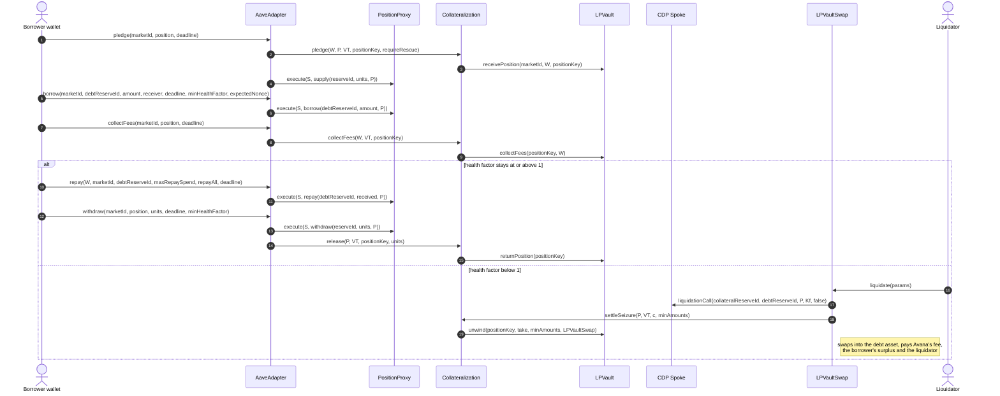

# 1.1 Protocol Overview

> **Status:** In review · **Owner:** Avana Labs · **Last reviewed:** 2026-11-10

Avana lets a liquidity provider borrow approved debt assets, GHO first, against a liquidity position in a listed AMM pool, on several chains, Hubs and AMM protocols. The sections below set out what Avana does, who takes part, how a loan moves through the contracts, where each contract lives, and what is in and out of scope at launch; the binding rules are the `REQ-ARCH-…` and `REQ-CHAIN-…` lines. Contract behaviour is in [2.x](../02-contracts/), flows in [3.x](../03-operations/), parameters in [1.5](05-parameters.md) (referred to by name, never by value), roles in [1.4](04-permissions-and-roles.md) and [2.15](../02-contracts/15-governance-and-timelock.md), and global invariants in [4.1](../04-security/01-global-invariants.md).

## What Avana does

Avana lets a liquidity provider borrow against an AMM liquidity position without taking the liquidity out of the pool. The position keeps earning trading fees; where the AMM protocol keeps fees apart from the position (Uniswap v3, Aerodrome Slipstream, Uniswap v4), the provider collects them at any time, and where it rolls fees into the position (Uniswap v2, Curve, Balancer), they stay in the position and return with it. GHO is the first debt asset; any other asset becomes borrowable once the Aave DAO approves its credit line, caps, price source and swap routes.

At launch Avana runs on Ethereum and Base. Each chain has an Avana Stable LP Hub and one CDP Spoke per AMM protocol listed there: "Uniswap v3 Stable" on Ethereum and "Aerodrome Slipstream Stable" on Base. The core contracts know nothing about any one AMM protocol: each AMM protocol has an **AMM integration**, the Avana code that takes custody of its positions, reads their token amounts at a given price, removes an exact number of units, collects separated fees and reports range and pool-share data ([2.2](../02-contracts/02-lp-vault.md)). Uniswap v3 and Aerodrome Slipstream are fully specified; Uniswap v2, Curve StableSwap-NG, Balancer weighted and stable pools and Uniswap v4 are supported by the core and are listed only after their readiness guards pass.

Aave V4 accepts collateral only as ERC-20 reserves, while an AMM position is an NFT or a pool share. Avana separates custody from collateral accounting. Each AMM protocol has one immutable **LPVault** per chain that holds its positions. The chain's one immutable, AMM-neutral **Collateralization** ledger records how many units each position backs and tells the **AaveAdapter** how many vault tokens that is. A transfer-restricted, collateral-only **vault token** per market stands for those units one for one; the Adapter mints it to the borrower's own **PositionProxy** for that CDP Spoke and market, which supplies it to the **CDP Spoke**. Every borrower action goes through the Adapter, which runs the **RiskModule**'s checks and has the proxy call the Spoke. The CDP Spoke is a standard, unmodified Aave V4 Spoke whose listing sets three required values on every Avana collateral reserve, which Avana's drift check enforces: `receiveSharesEnabled = false`, `liquidationFee = 0` and no reinvestment controller. Aave V4 then does what it already does: it values the collateral (through the market's **LPOracle**) and the debt (through Aave's fixed GHO price, or Avana's **DebtOracle** for any other debt asset), lends from the reserve's funding Hub, tracks the health factor and decides when and how much to liquidate. When Aave liquidates, Avana's **LPVaultSwap**, the only address the vault token lets receive seized collateral, takes the debt asset from its caller, repays, receives the seized vault tokens, has the Adapter burn them, has Collateralization remove exactly the matching units from the position, and swaps the returned tokens into the debt asset in the same transaction.

- `REQ-ARCH-001` — Avana MUST use Aave V4 contracts owned by the Aave DAO for collateral accounting, debt, interest, health factor and liquidation sizing: the unmodified Aave V4 Hub and, as CDP Spoke, the unmodified standard Aave V4 Spoke at the pinned release, with no liquidation-manager variant. The listing AIP of every Avana collateral reserve MUST set `receiveSharesEnabled = false`, `liquidationFee = 0` and no reinvestment controller, and Avana's drift check compares all three on every pledge, borrow and activation. Avana MUST NOT reimplement Aave liquidation sizing on-chain, because Aave already sizes the seizure inside `liquidationCall`; liquidation is exclusive to LPVaultSwap because the vault token's transfer rule lets seized collateral reach only LPVaultSwap, so any other caller's `liquidationCall` reverts on the token transfer. Keepers and the Lens preview liquidations from Aave's formulas at the pinned version and on-chain reads, and LPVaultSwap recomputes and enforces every check. The liquidation-manager Spoke is not used because the only one in Aave's code takes 4 arguments and allows 1 collateral reserve per Spoke, which cannot hold several markets. (Source: Q-002, Q-003, Q-060, Q-116, Q-119, Q-232, Q-281)
- `REQ-ARCH-002` — A pledged position MUST stay in its AMM pool, with its listed shape, for the life of the pledge. Avana MUST NOT compound, rebalance or otherwise change pledged liquidity, except to remove exactly the units matching vault tokens that are burned in the same call: units Aave seized in a liquidation, units the depositor removes with a partial removal, and units the borrower repays with through repay with collateral. Liquidity the depositor adds to a pledged position through the AMM protocol is credited only when it calls `recredit`, and only for AMM integrations that support adding to an existing position. (Source: Q-009, Q-011, Q-060, Q-254, Q-255)
- `REQ-ARCH-003` — Trading fees on a pledged position belong to the depositor of record. Where the AMM protocol keeps fees apart from the position, the depositor MAY collect them at any time by calling `AaveAdapter.collectFees(marketId, position, deadline)`, which has Collateralization, under the Adapter's Lock, call `collectFees` on that AMM protocol's LPVault, paying the depositor directly; it works in every application pause state and price state and regardless of health factor, because neither the Adapter's path nor Collateralization's reads a pause state, breaker or price, and liquidation MUST NOT take them. Where the AMM protocol rolls fees into the position, they stay in the position as part of each unit's value and return to the depositor with the position on withdrawal; a seizure takes units at their value including those fees, as the AMM integration page states. (Source: Q-009, Q-030, Q-051, Q-061, Q-122, Q-223, Q-227)

## Participants

| Participant | What they do | What they want | What they risk | On-chain authority ([1.4](04-permissions-and-roles.md)) |
|---|---|---|---|---|
| Borrower (liquidity provider) | Approves the AMM protocol's LPVault for a position and the AaveAdapter for exact debt-asset amounts; pledges positions of a listed market, borrows any approved debt reserve, repays, withdraws and closes through the Adapter; collects separated fees directly on the LPVault. The wallet that pledges is the depositor of record and the bound wallet of its PositionProxy for that CDP Spoke and market; it never calls the proxy itself. | Liquidity in GHO (or another approved asset) while keeping fee income and pool exposure. | Partial liquidation of one market's account when its health factor falls below 1 (the seized units are sold at Aave's liquidation bonus), including when a debt asset's price rises. A stale price for the market or a debt reserve blocks borrowing and withdraw-with-debt for that account only; its other markets are separate accounts. A lost wallet key means the position can never be withdrawn; the debt can still be repaid by any payer or cleared by liquidation. Aave-side halts or pauses can block repay and withdrawal. | No role; the Adapter resolves the proxy from `msg.sender`, the CDP Spoke and the market, and Collateralization and the LPVault check the depositor of record |
| Committed operators (keepers) | Commit to liquidate, on a chain, every account with health factor below 1 through `LPVaultSwap.liquidate`, whatever its size, liquidating whatever Aave allows per call; each sizes `debtToCover` up front for Aave V4's dust rule and funds it in the debt asset from its own inventory, directly or through its own operator helper. Each chain has its own committed-operator registry: at launch Avana's own keeper (`keeperFloor` = 1), with further operators and a standby keeper on separate infrastructure added through the timelock up to `MAX_KEEPERS` (32), each holding inventory on that chain in each of its debt assets. Registration gives no power any other caller lacks (`Q-404`). | The keeper reward `kr`: the oracle gain left after Avana's share, capped by the realized surplus. | Gas and swap costs; a recovery below the debt repaid; reverted settlements; liquidation gas, which Avana pays as its own keeper cost (`keeperReimbursementBudget`, `Q-381`). | Registration in the chain's LPVaultSwap committed-operator registry (added at the normal delay, removed at the short delay down to `keeperFloor`); it gates no call |
| Aave DAO | Owns every Avana Hub, the CDP and Lend Spokes and each Avana Umbrella (Coverage Spoke), Avana's protocol safety module named after Aave's Umbrella, whose design inspired it, and their configuration on each chain (collateral factors, caps, rates, flags, halts, the three required settings, which reserves are borrowable). Its treasury supplies each credit line. Its governance executor on each chain is the second proposer to that chain's AvanaTimelock, cancels any queued Avana operation, is the only party that can cancel an operation that grants or revokes roles or restores reviewed configuration, and undoes a guardian's standby switch at once. | Demand for GHO and the other debt assets and interest income within a bounded risk. | Bad debt beyond the funded First-Loss Reserve of each (Hub, debt asset) (who bears it is stated in the launch approval). | Aave governance executor of the chain: `PROPOSER_ROLE`, `CANCELLER_ROLE`, `DAO_CANCELLER_ROLE` on that chain's AvanaTimelock; the MarketRegistry's immutable `AAVE_GOVERNANCE_EXECUTOR`, the only caller of `cancelStandbySwitch`; Aave-side roles |
| Aave Protocol Guardian | Pauses (with a reason) or freezes one Hub or every Hub of a chain and lifts a pause or freeze; freezes an address; trips and resets circuit breakers; switches a token to its listed standby price route; cancels queued Avana operations other than role changes and restoring operations. On the Aave side it can freeze or pause a reserve. It cannot upgrade, change parameters or move funds. | Fast containment of incidents. | Not a capital provider. | `APPLICATION_PAUSE_GUARDIAN`, `APPLICATION_FREEZE_GUARDIAN` (MarketRegistry), `CANCELLER_ROLE` (AvanaTimelock), on each chain |
| Emergency Guardian (3-of-5 Safe per chain) | Avana's own fast-response key on each chain, with signers that do not overlap the governance multisig or the Aave Protocol Guardian. Pauses (with a reason) or freezes one Hub or every Hub of the chain, lifts a pause or freeze, freezes an address, trips and resets circuit breakers, switches a token to its listed standby price route, and cancels queued operations other than role changes and restoring operations. It has no upgrade or parameter power. | Fast containment of incidents. | Not a capital provider. | `APPLICATION_PAUSE_GUARDIAN`, `APPLICATION_FREEZE_GUARDIAN`, `CANCELLER_ROLE` |
| Governance multisig (4-of-7 Safe per chain) | Mixed signers (Avana Labs plus external), no overlap with either guardian. One of the two proposers to the chain's AvanaTimelock (the Aave governance executor is the other): schedules upgrades, the three deployment operations, parameter changes, keeper changes and role changes, each at its delay; cancels queued operations other than role changes and restoring operations. It has no instant power, and a Safe guard limits it to calls to the AvanaTimelock and itself. Avana Labs also funds each (Hub, debt asset) First-Loss Reserve and runs Avana's own keeper on each chain with a separate key. | Revenue from its share of liquidation surplus. | Its First-Loss Reserve capital; the gas of its own keepers' liquidations. | `PROPOSER_ROLE`, `CANCELLER_ROLE`, and `EXECUTOR_ROLE` for execution while public execution is off (AvanaTimelock of its chain) |
| AvanaTimelock (one per chain) | Executes every privileged change to Avana's contracts on its chain after its delay, within the grace window. It administers itself and holds the admin roles on every Avana contract with roles on its chain; no operation reaches another chain. | Not an actor with interests; a contract. | Not a capital provider. | Self-held `DEFAULT_ADMIN_ROLE`; `DEFAULT_ADMIN_ROLE` and `APPLICATION_ADMIN` on every upgradeable Avana contract of its chain; the `TIMELOCK` address of the immutable ones |
| Risk reviewer | The Aave V4 risk service providers. Assess each listing; set each market's `poolRiskFactor` within its bound, the per-market, per-token and per-depositor USD caps, `minPledgeUsd` and each debt reserve's caps in the listing payload; publish every risk-parameter change with its cap-sizing calculation, which the governance multisig proposes. | Calibrated, conservative markets. | None on-chain. | None |
| Anyone | May refresh oracle caches (`LPOracle.poke`, `DebtOracle.poke`) and breaker state (`RiskModule.pokeBreakers`), repay any account's debt on any debt reserve through `AaveAdapter.repay` with its own funds, liquidate an account below health factor 1 through `LPVaultSwap.liquidate` with either route mode, funding `debtToCover` in the debt asset from its own balance or through the public flash liquidation helper (no reimbursement, with an optional shortfall top-up in the debt asset from its own funds), clear a pending-settlement balance (`LPVaultSwap.settlePending`, which pays the caller nothing) and execute a ready timelock operation within its grace window. | Fresh prices; liveness; the liquidation payout left after Avana's share. | Its own funds, gas and conversion outcome, bounded by the caller's deadline, `debtToCover`, shortfall limit and minimum payout. | None (public execution of the AvanaTimelock) |

## How borrowing against an LP position works

The collateral path is **position → the AMM protocol's LPVault (custody) and Collateralization (record) → AaveAdapter mints vault tokens → PositionProxy for (CDP Spoke, market) → CDP Spoke → debt asset**:

The life of one position, from pledge to withdrawal or liquidation:

1. **Pledge.** The borrower approves the AMM protocol's LPVault for one position and calls `AaveAdapter.pledge`, naming the CDP Spoke, the market's vault token, the position's `positionKey` and a deadline. On the wallet's first pledge into that market on that Spoke the Adapter has the ProxyManager create the wallet's PositionProxy at its CREATE2 address predicted from `(wallet, spoke, marketId)` and registers it in the vault token. Collateralization has the LPVault named by the vault token check the position against the market (same pool, exact shape: for concentrated liquidity, `tickLower` and `tickUpper` equal the market's range exactly) and take custody of it from the wallet; it then reads the position's units, pokes the LPOracle and asks the RiskModule (`checkPledge`) for eligibility, the minimum pledge value, the circuit breakers and the USD cap charge, records the credited units (at most `MAX_RECORDS_PER_ACCOUNT_MARKET` open records per account and market) and books its counters, keyed by Hub. A rescue top-up (an indebted account below `rescueHealthFactor`, 1.10, adding at most what restores it) passes the pool-share cap, `Paused(General)`, a breaker and an address freeze, and its units are booked as rescue units that never support new debt. The Adapter mints exactly the credited units in vault-token base units to the proxy, has the proxy supply them to the CDP Spoke (which moves them into the Hub) and enable them as collateral, and checks that the market's backing gap (credited total plus pending-settlement balance minus supply) is unchanged. All of this is one transaction.
2. **Borrow.** The borrower calls `AaveAdapter.borrow`, naming the CDP Spoke, the market, the debt reserve, the amount, the receiver, a deadline, a minimum health factor and the proxy's expected borrow nonce. The Adapter checks the deadline, the pause state of the Spoke's home Hub and of the debt reserve's funding Hub, the debt reserve, the receiver and the nonce, then has the RiskModule poke the market's LPOracle and check the market's and every debt reserve's prices (fresh within each feed's heartbeat plus margin, and agreeing with an independent second source), Aave reserve flags, Hub share rate, configuration match and circuit breakers; a frozen caller or receiver is refused. Any amount above 0 may be borrowed; there is no minimum debt (`Q-381`). It has the proxy call `Spoke.borrow` as itself; the proxy forwards exactly the drawn amount to the named receiver, and the RiskModule checks the account's health factor, with rescue units valued at zero, against the larger of the caller's `minHealthFactor` and the market's `hardHealthFloor` (0, off, unless stress tests justify setting it), while Aave itself refuses any borrow below health factor 1.00. Avana sets no opening health floor of its own (`Q-398`): the Lens shows a recommended borrow at health factor 1.10 beside the protocol maximum at 1.00, so $100,000 of collateral at a 70% CF shows $63,636 recommended and $70,000 maximum.
3. **Collect fees.** Where the AMM protocol keeps fees apart, the depositor of record calls `collectFees` on the AaveAdapter; under the Adapter's Lock, Collateralization checks the record and has the AMM protocol's LPVault collect the position's fees and send them to the depositor. Units, vault tokens and debt are untouched, and no pause state, breaker or price is read.
4. **Repay.** The payer (the borrower or any other address) approves the Adapter for the debt asset and calls `AaveAdapter.repay`, naming the borrower, the Spoke, the market, the debt reserve, a maximum spend, whether to repay all and a deadline. The Adapter moves the amount to be repaid from the payer to the proxy (for repay-all, the whole maximum quoted to the deadline by the Lens), has the proxy call `Spoke.repay` and refunds anything unconsumed to the payer in the same call. Repay never reads the MarketRegistry, a pause state, a breaker, the address freeze or the RiskModule, and no Avana pause, freeze or price state blocks it. At zero debt, repay returns 0 and moves no tokens.
5. **Withdraw.** The borrower calls `AaveAdapter.withdraw` for one position. The proxy withdraws that record's vault tokens from the Spoke to itself. The Adapter decides debt-free from the Spoke alone (`getUserAccountData(proxy).borrowCount == 0`) and resolves the reserve from the vault token's immutables, so a debt-free withdrawal reads no MarketRegistry state; if any debt remains, the home Hub must not be Paused, the wallet must not be frozen, and the RiskModule's borrow-side checks, the breakers and the health-factor check with rescue units excluded apply. The Adapter burns the vault tokens from the proxy, Collateralization debits the record and the LPVault returns the whole position, with its uncollected fees, to the depositor of record. If the proxy's supplied vault tokens are below the record's credited units (a seizure that was never settled), Collateralization first treats the missing units as seized: it debits them from the records in list order from the head, moves the matching token amounts into the market's pending-settlement balance, and releases the rest. Any address later calls `LPVaultSwap.settlePending`, which has the Adapter burn the stranded vault tokens against that balance, swaps the released tokens into the debt asset of the market's debt reserve with oracle-derived per-leg minimums and adds it to the Coverage Spoke of that reserve's (funding Hub, debt asset). `AaveAdapter.repayAllAndWithdraw` repays every named debt reserve, requires all of the account's debt to be zero and then withdraws one position. `AaveAdapter.removeLiquidity` removes part of one position's credited units in the same way and pays the principal (n token amounts, each above its caller-set minimum) to the depositor of record while the position stays pledged; `recredit` credits units the depositor later added to a pledged position through the AMM protocol, with every top-up check.
6. **Liquidation.** When the account's health factor is below 1, any address that is not frozen can call `LPVaultSwap.liquidate`, the one liquidation entry point, with either route mode; the committed operators are bound to do so for every such account (`Q-404`). Each call names one account (one proxy, so one market) and one debt reserve and carries the caller's deadline, `debtToCover`, shortfall limit and minimum payout. The market and the repaid reserve need fresh, agreeing prices; another debt reserve of the account whose price is failing counts at its stress price in Aave's health factor, so a failing price can only make the account easier to liquidate, and nothing is repaid at that price. The caller funds the repayment in the debt asset itself: LPVaultSwap pulls `debtToCover` from the caller, measures what arrived as `Kf` and takes no flash loan. A caller that holds no debt asset uses the flash liquidation helper, a public, immutable periphery contract that flash-borrows it from the chain's Aave V3 Pool (`flashLoan`, never from a Hub recorded on the chain), calls `liquidate` and repays the loan from the payout. LPVaultSwap calls `Spoke.liquidationCall` with `receiveShares = false` and `Kf` as Aave's bound; the Spoke moves the seized vault tokens to LPVaultSwap, the only address their transfer rule accepts as a seizure recipient, and a liquidation that seizes nothing reverts. The Adapter burns the seized tokens from LPVaultSwap, Collateralization checks that the proxy's supplied shares and the token's supply each fell by exactly that amount, debits the proxy's records in list order from the head and has the LPVault remove exactly those units and send the n token amounts (principal, not separated fees) to LPVaultSwap. LPVaultSwap swaps each token into the debt asset on the market's swap routes with an oracle-derived minimum output on every leg, checks an oracle-based minimum recovery (the caller may top up a shortfall in the debt asset from its own funds; the caller sizes `debtToCover` up front for Aave V4's dust rule, and a recovery a few units below the debt repaid lowers only its own payout), then pays in the debt asset that was repaid: Avana's 20% share of the surplus, computed from the oracle value of the seizure and never above the surplus, any borrower surplus above the oracle value, and the rest to the caller, which includes the funding Aave did not pull, the recovered principal and the keeper reward. GHO is used only when the debt is GHO. The borrower keeps the rest of each position and all of its separated fees. There is no in-kind settlement (`Q-401`): if the swap routes cannot settle, the call reverts and the caller retries with a shortfall top-up or another route mode, or after a guardian switches routes. A payout that a token refuses (the borrower's surplus, Avana's fee, a route residue or a dust leg) is held in the PayoutEscrow, the payout escrow, for its recipient to claim; the caller's payout is paid directly to it or the call reverts. Liquidation runs in every application pause state, under every circuit breaker and for a frozen wallet's positions.
7. **Repay with collateral.** The borrower calls `AaveAdapter.repayWithCollateral`, naming one record, a number of units and one debt reserve. In one call LPVaultSwap flash-borrows the debt asset through the `IFlashSource` (its only use of a flash loan), the proxy repays the debt, the Adapter withdraws and burns the units, Collateralization debits the record and the LPVault sends those units' token amounts to LPVaultSwap, which swaps them into the debt asset with per-leg minimums, repays the flash loan and its premium and sends the rest to the wallet in the debt asset. No bonus or Avana fee applies, and if debt remains Aave's health factor must not fall. Paused and the address freeze refuse it; plain repay stays open.

- `REQ-ARCH-004` — The collateral path MUST be: the position is held by its AMM protocol's LPVault and its backing recorded by the chain's Collateralization; the AaveAdapter mints vault tokens for exactly its credited units to the depositor's PositionProxy for that CDP Spoke and market; the proxy supplies them to the market's CDP Spoke, which places them in the Spoke's home Hub; an approved debt asset is drawn from the debt reserve's funding Hub to the proxy and forwarded to the receiver the borrower named. No other path may create collateral or debt for an Avana account. (Source: Q-064, Q-223, Q-224, Q-233, Q-279, Q-280)
- `REQ-ARCH-005` — One vault-token base unit MUST represent one unit of credited liquidity of that market (the AMM integration defines the unit: liquidity for concentrated liquidity, a pool share for share-based pools), and vault tokens MUST exist only as the backing of credited Collateralization records or of the market's pending-settlement balance, so `totalSupply ≤ totalCredited + pendingUnits` after every pledge, withdrawal, partial removal, re-credit, repay with collateral and settlement, with each call leaving the gap `totalCredited + pendingUnits − totalSupply` unchanged and equality holding while every seized burn is settled in the same call. The one-sided form keeps a market working if a faulty settlement path ever burned units it did not settle: the liquidity behind such a burn stays in custody, so circulating vault tokens stay more than fully backed. The global form of this rule is in [4.1](../04-security/01-global-invariants.md). (Source: Q-066, Q-201, Q-224, Q-257)
- `REQ-ARCH-006` — Each borrower action, each repay and each liquidation, direct or through a flash liquidation helper, MUST be one atomic transaction. Pledge and borrow are separate calls; the only combined entry points are `AaveAdapter.repayAllAndWithdraw`, which repays the named debt reserves, requires every debt reserve of the account at zero and withdraws one position, and `AaveAdapter.repayWithCollateral`, which repays debt from one record's units through a flash-funded conversion and never lowers Aave's health factor while debt remains; there is no pledge-and-borrow entry point and no generic or delegatecall multicall, so every action is one all-or-nothing call whose effects can be checked on their own. (Source: Q-076, Q-212, Q-213, Q-223, Q-234, Q-255, Q-404)
- `REQ-ARCH-007` — Settlement MUST be partial seizure through the standard Aave V4 `liquidationCall` of the pinned release, called by LPVaultSwap with `receiveShares = false`, one collateral reserve against one debt reserve per call: Aave sizes the repayment and the seizure, Avana removes exactly the seized units, and the borrower keeps the rest of the position and its separated fees. There is no whole-position settlement route, and neither the AaveAdapter nor any PositionProxy carries liquidation or settlement authority; the Adapter only burns the seized units on LPVaultSwap's request. (Source: Q-060, Q-116, Q-224, Q-235, Q-281)

## Where liquidity comes from

Every borrowable asset comes from a capped **credit line** approved by the Aave DAO. Each chain has one supply-only **Lend Spoke**; its reserves point to (Hub, asset) pairs and can list any asset. The DAO treasury supplies a line's amount through it, its `addCap` on that (Hub, asset) equals the line, and the CDP Spokes' `drawCap`s on that (Hub, asset) sum to at most the line, so a credit line is a draw cap per (Hub, asset, Spoke). GHO is the first credit line and the first borrowable asset. Each CDP Spoke has a home Hub, and each debt reserve records its funding Hub and asset. A debt reserve funded by its Spoke's home Hub is the normal case. A **cross-Hub credit line**, where the funding Hub differs from the home Hub, is fully specified and off at launch: the funding Hub owns the cap, one register in the chain's MarketRegistry sums every line per (funding Hub, asset), a pause of the funding Hub stops the line, and the cap is at most that Hub's first-loss coverage of the asset ([2.1](../02-contracts/01-avana-hub-and-spokes.md)). Interest accrues to the lenders' positions. To recall a line the DAO sets the drawCaps to 0; the asset returns as debt is repaid and only unborrowed funds can be withdrawn. Growth of any line follows the funding proposal and Aave governance.

One buffer sits beside the lines. Each (Hub, debt asset) on each chain has its own **First-Loss Reserve**: Avana-funded supply of that asset in a DAO-controlled, supply-only **Coverage Spoke** (the Avana Umbrella of that (Hub, asset)) on that Hub, funded before any `drawCap` on that (Hub, asset) rises above 0. It covers recorded deficits in that asset from every CDP Spoke that draws it from that Hub, and receives what `LPVaultSwap.settlePending` recovers for markets whose debt reserve that (Hub, asset) funds. Its required balance follows `DEF-019`, `fundedBalance × 10⁴ ≥ coverageRatioBps × Σ drawCap`, with `coverageRatioBps` and the minimum funded balance set in the funding ARFC with the Aave service providers (20% is an illustrative guide, `Q-391`). There is no settlement budget (`Q-397`): Aave V4's dust rule can raise the repayment needed to finish a liquidation, so the caller sizes `debtToCover` and its funding for that amount up front, and any rounding gap at final settlement is paid by the caller through its shortfall top-up.

- `REQ-ARCH-008` — Each borrowable asset MUST come only from a credit line the Aave DAO approves: supply by the DAO treasury through the chain's Lend Spoke into the (Hub, asset) the debt reserve records as its funding Hub and asset. The Lend Spoke `addCap` on a (Hub, asset) equals its line, CDP Spoke `drawCap`s on that (Hub, asset) sum to at most the line, each debt reserve's `drawCap` is at most the flash liquidity of its asset in the chain's Aave V3 Pool (which the flash liquidation helper and `deleverage` borrow from) and the depth of its swap routes measured at listing, all of these are raised only by an Aave DAO proposal, and public lender deposits are not offered at launch. A debt reserve whose funding Hub is not its Spoke's home Hub is refused while `crossHubLinesEnabled` is false on that chain, which it is at launch. (Source: Q-006, Q-070, Q-095, Q-119, Q-143, Q-168, Q-233, Q-282, Q-283, Q-404)
- `REQ-ARCH-009` — No Avana contract or role MAY hold authority over any Hub `addCap` or `drawCap`, any interest rate, or any Lend Spoke position; these are Aave DAO decisions. With one CDP Spoke per (chain, AMM protocol) at launch, each Spoke's `drawCap` on a debt asset is that asset's whole line on the chain, and monitoring alerts when the debt drawn on a reserve, including accrued interest and premium, reaches 90% of its `drawCap`. (Source: Q-032, Q-095, Q-096, Q-119, Q-233)
- `REQ-ARCH-010` — A recorded Hub deficit from an approved Avana CDP Spoke MUST be covered only from the Coverage Spoke of the same asset on the Hub that funded that debt reserve, never with another asset's or another Hub's reserve, ; an in-transaction rounding gap in a liquidation's settlement is paid by the liquidation caller through its shortfall top-up, and the Coverage Spoke never funds the principal or a rounding gap of a liquidation. (Source: Q-101, Q-117, Q-142, Q-236, Q-284, Q-397)
- `REQ-ARCH-011` — Avana's only on-chain revenue MUST be `avanaFeeShareBps` of a routed liquidation's surplus, paid in the debt asset that was repaid, computed from the oracle value of the seized units net of the covered cost and capped at the realised surplus, so a caller's routing choices cannot lower it; there is no fee on borrow interest, and interest accrues to the lenders. Avana's other revenue is a fee its app charges outside the contracts, which no contract computes, holds or enforces. Value recovered from a pending-settlement balance is not revenue: it goes only to the Coverage Spoke of the market's debt reserve's (funding Hub, debt asset), the caller who triggers it receives nothing, and the conversion is held to an oracle-based floor, so nobody profits from an unsettled seizure. Repay with collateral pays no Avana fee. (Source: Q-095, Q-097, Q-099, Q-211, Q-231, Q-236, Q-255, Q-256, Q-284)

## Chains, Hubs and AMM protocols

Avana runs the same contracts on every chain it is deployed to, with one instance of each per-chain contract and every Hub-, Spoke- and market-specific setting held as data inside those instances. A chain can host any of the three Hub tiers (Stable LP, Correlated LP, Volatile LP). A **CDP Spoke** is one standard Aave V4 Spoke per (chain, Hub, AMM protocol, risk tier), for example "Uniswap v3 Stable" on Ethereum or "Aerodrome Slipstream Stable" on Base. It lists several **markets**; a market is one (chain, AMM protocol, pool, exact position shape), and for concentrated liquidity the shape is the exact `[tickLower, tickUpper]` range. Each market is one collateral reserve of its Spoke. Each wallet gets one PositionProxy per (CDP Spoke, market), so every market has its own Aave account and health factor and nothing is cross-collateralized: a wallet using two markets has two proxies. [1.2](02-contract-relationships.md) gives the full instance table and graph.

Worked example: on Ethereum the Stable LP Hub has the CDP Spoke "Uniswap v3 Stable" with two markets, USDC/USDT 0.01% with range `[−10, 10]` and GHO/USDC 0.05% with range `[−50, 50]`. Alice pledges one position in each. She gets two proxies, `P1 = predictProxy(alice, spoke, marketUsdcUsdt)` and `P2 = predictProxy(alice, spoke, marketGhoUsdc)`. She borrows 3,000 GHO on `P1` only. If the GHO/USDC feed goes stale, `P2` cannot borrow, while `P1` keeps borrowing and nothing on `P1` can be liquidated because of `P2`. On Base the same wallet using "Aerodrome Slipstream Stable" gets proxies from Base's own ProxyManager; no account, cap or governance action is shared between chains.

- `REQ-ARCH-205` — Every per-chain contract of [1.2](02-contract-relationships.md) `REQ-ARCH-206` MUST exist exactly once per chain and MUST key every cap, pause, breaker, route permission and emergency control by Hub, and by CDP Spoke and market where it applies; caps that bound a Hub as a whole (token, depositor and pool-share USD caps) live in the chain's one Collateralization ledger keyed by Hub, so adding a CDP Spoke or market never multiplies them. A per-Hub copy of a per-chain contract runs the same code under the same timelock and Guardian and so gives no smaller blast radius, while it multiplies deployments, upgrade calls and Lock members. Example: with `tokenUsdCap[Stable, USDC] = $5,000,000` and USDC/USDT and GHO/USDC markets on two CDP Spokes of the Stable LP Hub, a $3,000,000 pledge on one Spoke and a $2,500,000 pledge on the other book against the same counter, so the second is refused ($5,500,000 > $5,000,000) instead of each Spoke admitting up to $5,000,000. (Source: Q-279)
- `REQ-ARCH-207` — A CDP Spoke MUST be one standard Aave V4 Spoke per (chain, Hub, AMM protocol, risk tier) holding any number of markets, each one collateral reserve, and MUST have exactly one home Hub, recorded by `deployCdpSpoke`; a market belongs to exactly one CDP Spoke for life. Relisting the same pool and range on a successor Spoke (playbook P-19, `Q-355`) creates a new market with its own market ID, vault token and proxies, because market identity includes the Spoke (`Q-299`; the VaultTokenFactory keys tokens by (CDP Spoke, market key)); the old market winds down and closes on its own Spoke. One Spoke per market is not used, because it multiplies the Aave DAO's listing work by about 2.4 and splits each credit line into one cap per market, while the markets of one AMM protocol share code anyway. (Source: Q-280, Q-286)
- `REQ-ARCH-208` — Each wallet MUST have at most one PositionProxy per (CDP Spoke, market), created by CREATE2 with salt `keccak256(abi.encode(wallet, spoke, marketId))` on its first pledge into that market, so each market of a wallet is a separate Aave account with its own health factor, and a price failure, breaker or liquidation in one market never changes another market's account. Isolation covers pool-level failures (feeds, oracle state, breakers, pool depth, swap routes); a token price shared by two markets moves both by design, and the per-Hub token caps of `REQ-ARCH-205` bound that shared exposure. (Source: Q-280, Q-279)
- `REQ-ARCH-209` — Avana MUST add a CDP Spoke, a market or a debt reserve only through the chain's AvanaTimelock, by the three deployment operations of [2.15](../02-contracts/15-governance-and-timelock.md): `deployCdpSpoke` registers a standard Spoke and its AaveOracle, which the Aave DAO payload of the same listing creates, under a Hub with one AMM integration after checking the three required settings; `listCollateralMarket` deploys the market's VaultToken and LPOracle, records the exact range or shape, binds the integration's LPVault and wires the Spoke reserve; `enableDebtReserve` records the funding Hub and asset, checks the credit-line sums, the flash-liquidity and route-depth bounds, the Coverage Spoke's funding and the swap routes, and enables borrowing. Each runs at the normal delay and is followed by a short-delay activation that re-checks the live Aave configuration. (Source: Q-068, Q-119, Q-126, Q-286)
- `REQ-CHAIN-001` — Avana MUST launch on Ethereum and Base together, with an Avana Stable LP Hub on each, the CDP Spoke "Uniswap v3 Stable" on Ethereum and "Aerodrome Slipstream Stable" on Base. A further chain, Hub or AMM protocol is added only through that chain's AvanaTimelock and the Aave DAO's approval for that chain; no Avana operation, role or contract on one chain can change state on another. (Source: Q-279, Q-285)
- `REQ-CHAIN-002` — Each chain MUST have its own AvanaTimelock, 4-of-7 governance Safe, Emergency Guardian 3-of-5 Safe, committed-operator registry with its own `keeperFloor` (1, Avana's own keeper; new borrowing on the chain halts only when no active committed operator remains), `IFlashSource` implementation (for `deleverage`) and public flash liquidation helper, and its own values of the per-chain parameters of [1.5](05-parameters.md): block time, sequencer-uptime feed and grace period, feed heartbeats and the liquidation gas model (`SPEC-CHAIN-001`). Aave-side actions on a chain go through the Aave DAO's executor for that chain; on Base they arrive through the DAO's cross-chain delivery, whose latency the emergency playbooks of [3.6](../03-operations/06-emergency-operations.md) state. (Source: Q-285, Q-287, Q-289, Q-397, Q-400, Q-404)
- `REQ-CHAIN-003` — On a chain with a sequencer (Base), every LPOracle and DebtOracle MUST read the chain's sequencer-uptime feed (Base: `0xBCF85224fc0756B9Fa45aA7892530B47e10b6433`) and apply it as [2.10](../02-contracts/10-lp-oracle.md) `REQ-ORACLE-099` states. The sequencer status never changes a price state, the served price, the accepted price or any timer: price state stays a function of the feeds alone. While the sequencer is down (or its status is unknown), borrowing and withdraw-with-debt are refused; while it is down, liquidation is paused (reason `SEQUENCER_DOWN`). For `sequencer.gracePeriod` after it restarts, borrowing and withdraw-with-debt stay refused and liquidation is paused for every account at or above `graceHealthFactor` (reason `SEQUENCER_GRACE`), so only accounts below `graceHealthFactor` can be liquidated and borrowers get time to repay before liquidations run on prices that have just been restored. An unknown status refuses borrowing but does not pause liquidation, so a broken uptime feed never stops liquidation. Ethereum has no sequencer feed and the check is off. (Source: Q-287, Q-324)

## Supported assets and position types

| Dimension | At launch | Supported by the core, listed later through the three deployment operations |
|---|---|---|
| AMM protocols and position format | Uniswap v3 positions (ERC-721) from the canonical NonfungiblePositionManager on Ethereum; Aerodrome Slipstream positions (ERC-721, unstaked only) from one bound NonfungiblePositionManager and factory generation on Base. Each market fixes an exact `[tickLower, tickUpper]` range; a pledge needs an exact tick match | Uniswap v2, Curve StableSwap-NG, Balancer weighted and stable, Uniswap v4, each after its readiness guards ([2.2](../02-contracts/02-lp-vault.md)) |
| Pools | Stablecoin/stablecoin pools meeting the listing rule, including USDC/USDT and pools containing GHO | Correlated-asset and volatile pools on the Correlated LP and Volatile LP Hubs |
| Hubs and Spokes | Per chain: one Avana Stable LP Hub; one CDP Spoke per AMM protocol ("Uniswap v3 Stable" on Ethereum, "Aerodrome Slipstream Stable" on Base); one Lend Spoke; one Coverage Spoke per (Hub, debt asset) | Correlated LP and Volatile LP Hubs on any chain; further CDP Spokes per (Hub, AMM protocol, risk tier) |
| Borrowable assets | GHO first; any asset the Lend Spoke lists once its credit line, caps, price source and swap routes are approved through `enableDebtReserve` | Cross-Hub credit lines (designed, off at launch) |
| Chains | Ethereum and Base | Other networks, each through its own ARFC and deployment |
| Lending | Aave DAO credit lines through each chain's Lend Spoke; no public deposits | Public lending through the Lend Spoke |
| Liquidation | One entry point, `LPVaultSwap.liquidate`, open to any address that is not frozen with either route mode; committed operators bound to liquidate every account below health factor 1; funding by the caller in the debt asset, from its own balance or through the public flash liquidation helper; payout in the debt asset repaid | None planned |
| Pricing | LP collateral: fair composition at the oracle price vector, `value = Σ amountᵢ(oracle prices) × priceᵢ`; Chainlink primary, alternate and standby routes per token, each fresh within its own heartbeat plus a margin; an independent second source for borrow and withdraw; the pool TWAP as a consistency check sized to the chain's block time; the sequencer-uptime feed on Base. Debt: Aave's fixed $1 for GHO, a DebtOracle per other asset | An independent provider as a veto on cached prices |

- `REQ-ARCH-012` — Collateral MUST be positions of a listed market: positions minted by the position manager bound to that market's AMM integration, in the market's pool, with exactly the market's shape. The position manager and factory are constructor immutables of the AMM protocol's LPVault, and every other contract, including forks and other factory generations, is rejected, because custody logic is immutable. For concentrated liquidity the shape is checked by exact equality `tickLower == market.tickLower && tickUpper == market.tickUpper`, and the market's ticks are aligned to the pool's tick spacing with signed arithmetic at listing; a position with any other range is refused even if it overlaps, because a narrow range priced at the market's per-unit value is overvalued (a $10,000 position quoted at $9.79M, ×979). Example: a market listed at `[−10, 10]` with tick spacing 1 accepts a position at `[−10, 10]` and refuses one at `[−9, 10]` with `ShapeMismatch`. On Base, a Slipstream position staked in a gauge is refused. (Source: Q-001, Q-017, Q-032, Q-049, Q-054, Q-119, Q-279)
- `REQ-ARCH-013` — A pool MAY be listed only if its AMM protocol has a specified integration whose readiness guards pass for that pool, and each of its tokens has a Chainlink primary route whose every leg's heartbeat is recorded from that feed's own configuration, an alternate Chainlink route that shares no intermediate feed with the other token's alternate route, an independent second source (a TWAP of a deep pool or a second oracle network) for the borrow and withdraw agreement check, a standby route that passes the checks of the slot it can replace, an issuer probe, and a primary and a backup swap route into each debt asset of the Spoke that never trades through the market's own pool. On a chain with a sequencer, the chain's sequencer-uptime feed is required. A debt asset other than GHO MAY be listed only with its own DebtOracle (primary, alternate and standby routes under the same checks) as the reserve's Aave price source and a `drawCap` within the flash liquidity of its asset in the chain's `IFlashSource` and the depth of its swap routes. The risk reviewer publishes the numeric listing thresholds (pool age, TVL, depth, feed heartbeat and deviation, stress slippage at full one-sidedness for a bounded range) that the listing payload is checked against. (Source: Q-058, Q-119, Q-176, Q-182, Q-187, Q-233, Q-241, Q-248, Q-261, Q-273, Q-274, Q-282, Q-287)
- `REQ-ARCH-014` — Fee-on-transfer, rebasing, hook and false-returning tokens MUST NOT be listed as pool tokens or debt assets, and listing checks that USDT's fee rate is 0; USDC and USDT are accepted as named issuer-upgradeable exceptions with monitoring. A pool holding native ETH or a rate token is listed only through its AMM integration's native-ETH or rate hook, which keeps every Avana-side amount an ERC-20 amount. All accounting uses SafeERC20 and amounts actually received (balance deltas), pool tokens and debt assets are forwarded in the same call so none rest in Avana contracts, and there is no ERC-20 rescue function. A USDT fee switched on after listing leaves settlement and repay working at the amounts actually received. An issuer pause or fee switch trips the issuer security freeze for new activity, which only an authorized reset reopens; an issuer blocklist affecting an LPVault, LPVaultSwap, Collateralization, the AaveAdapter or a PositionProxy is an accepted external risk, contained by the token-issuer playbook: an Aave reserve freeze, the market's `Offboarding` status and a relisting. (Source: Q-052, Q-058, Q-061, Q-075, Q-119, Q-227, Q-233, Q-241, Q-243, Q-271)
- `REQ-ARCH-015` — Avana MUST run only on the chains, Hubs, CDP Spokes and AMM protocols added through the deployment operations of `REQ-ARCH-209`; at launch these are Ethereum and Base, an Avana Stable LP Hub on each, and the CDP Spokes "Uniswap v3 Stable" on Ethereum and "Aerodrome Slipstream Stable" on Base, each with GHO as its first debt reserve. A CDP Spoke's borrowable reserves are those its Aave configuration marks borrowable and `enableDebtReserve` has recorded, and the drift check requires the two sets to be equal. Per-market exposure is bounded by the collateral caps. Each market is listed on exactly one CDP Spoke, verified at listing and by the live-config check; moving a market to another Spoke is not supported and is done by offboarding it and listing a new market. Each wallet has one PositionProxy per (CDP Spoke, market), created on its first pledge there; it moves between markets by repay, withdraw and re-pledge. (Source: Q-003, Q-017, Q-032, Q-119, Q-233, Q-239, Q-279, Q-280, Q-281)
- `REQ-ARCH-016` — A market MUST be exactly one approved pool with one exact position shape, one vault token and one CDP Spoke reserve, keyed by `(chainId, spoke, reserveId)`; the MarketRegistry stores a one-to-one map market ↔ (pool, shape) ↔ vault token ↔ `(hub, assetId)` from day one. Each vault token is permanently bound to its pool, shape, AMM integration and that integration's LPVault, Hub, Spoke, market ID, LPOracle (the oracle's fixed proxy address), AaveAdapter, LPVaultSwap and Collateralization as immutables, and the immutable Collateralization reads the market's identity only from the token, never from the upgradeable MarketRegistry, so no upgrade can repoint existing backing; a later Hub gets new markets and users move by repay, withdraw and re-pledge. Each vault-token Hub asset has exactly one Spoke with non-zero caps, `vaultToken.spoke()`, checked at listing and by the drift check, because a second Spoke on the asset could draw vault tokens out of the Hub and leave proxy withdrawals and seizures unable to settle. (Source: Q-017, Q-032, Q-068, Q-076, Q-119, Q-224, Q-240, Q-281)
- `REQ-ARCH-017` — Liquidation MUST be possible only through LPVaultSwap's one entry point `liquidate`, open to any address that is not frozen with either route mode, directly or through a flash liquidation helper; the committed-operator registry gates no call, so liquidation continues whether or not a committed operator acts (`Q-404`). Exclusivity holds because the vault token's transfer rule accepts a seizure transfer only to LPVaultSwap and `receiveSharesEnabled` is false on every Avana collateral reserve: a direct `Spoke.liquidationCall` from any other address reverts when the Hub moves the seized vault tokens to it, and the receive-shares path that moves no token is closed by the Spoke configuration. No application pause state, circuit breaker or address freeze stops `liquidate` for any account; a frozen address cannot call it directly, and one that calls through the public helper reaches LPVaultSwap as the helper. Liquidation is gated by the price state of the market and the repaid debt reserve only, the other liquidation checks and Aave-side reserve pauses and halts. (Source: Q-053, Q-082, Q-116, Q-213, Q-227, Q-241, Q-242, Q-247, Q-281, Q-397, Q-401, Q-404)
- `REQ-ARCH-151` — Liquidation access, in summary: every liquidation of an Avana account enters through the chain's LPVaultSwap, because only it can receive seized vault tokens. There is one entry point, `liquidate`, with both route modes, for every address that is not frozen, the Aave DAO included, with no role; a caller without the debt asset goes through the public flash liquidation helper. Committed operators (onboarded under the keeper agreement, registered by an `APPLICATION_ADMIN` operation at the normal delay and removed by one at the short delay down to `keeperFloor`, each cancellable by the cancellers) commit to liquidate every account below health factor 1, whatever Aave allows per call; registration gates no call. The Aave DAO liquidates through `liquidate` like any caller, including with a committed operator it or a service provider it chooses runs. A change by the Aave DAO that would admit another liquidator (`receiveSharesEnabled` set true, a liquidation fee paid elsewhere, a reinvestment controller, a second Spoke on a vault-token asset) is drift: it trips the drift breaker, which stops new activity in the affected markets and never stops liquidation, and the playbook asks the DAO to revert it. [3.5](../03-operations/05-liquidation.md) `LIQ-064` to `LIQ-068` state the full model and an end-to-end example. (Source: Q-053, Q-213, Q-228, Q-281, Q-395, Q-397, Q-401, Q-404)
- `REQ-ARCH-018` — There MUST be no borrower allowlist and no minimum debt. Exposure is limited by caps; each pledge, new or top-up, must be worth at least the market's `minPledgeUsd` at the LPOracle's last accepted price (a rescue top-up needs only `min(minPledgeUsd, $10)`), and a borrow of any amount above 0 that passes the other checks is accepted. Liquidation never depends on a keeper making a profit: Avana's own keeper, a committed operator, liquidates every account below health factor 1 whatever its size and pays the gas as Avana's operating cost, `liquidate` stays open to every address that is not frozen, and the 16-record cap keeps one liquidation of the largest account within one transaction ([1.5](05-parameters.md) `SPEC-CHAIN-001`). Example: on Ethereum a borrower with $10,000 of collateral may borrow 50 GHO; if the account falls below health factor 1, Avana's keeper liquidates it at about `G(1) = 1,550,000` gas, paid by Avana. (Source: Q-078, Q-153, Q-230, Q-247, Q-252, Q-381, Q-404)
- `REQ-ARCH-019` — Each account MUST hold exactly one collateral market (its proxy's market) and at most `MAX_RECORDS_PER_ACCOUNT_MARKET` (16) open records in it; a pledge that would open a 17th record reverts `TooManyRecords`, rescue top-ups included, and the borrower adds value to an existing record through `recredit` instead. Debt reserves per account are bounded by the CDP Spoke's `spokeUserReservesLimit`, set by the Aave DAO. Collateralization keeps each account's records in a stored list ordered largest-first at insertion and debits it from the head, so a seizure touches only the records it debits. The cap keeps every whole-account seizure within one transaction: Aave's dust rule can force the last chunk of an account to be seized whole, and 16 records cost at most `1.31M + 16 × 0.24M = 5.15M` gas, under 31% of the 16.78M per-transaction cap, while 125 records of $8 would need about 31M. (Source: Q-193, Q-194, Q-234, Q-287)

## What Avana is not

- `REQ-ARCH-020` — Avana v1 MUST NOT include an Invest Spoke, Multiply or any leveraged-LP loop, public lender deposits, or a separate CreditLineController. (Source: Q-006, Q-031, Q-070)
- `REQ-ARCH-021` — Avana v1 MUST NOT include any function that moves an account to a new proxy or contract, off-chain signature or permit flows, or native ETH payouts; WETH, when approved, is an ERC-20 debt asset like any other, and a pool holding native ETH is handled by its integration's wrapping hook. A PositionProxy never changes code and is never replaced. Moving an account between wallets, markets, CDP Spokes, Hubs or chains is: offboard the market where needed, list a replacement, and users repay every debt reserve, withdraw (debt-free withdrawal works in every pause and price state) and re-pledge. Every debt asset is an ERC-20, so every payout is an ERC-20 transfer. Any later permit flow uses EIP-712 with `chainId` and `verifyingContract`, nonces and deadlines, and wraps third-party permits in try/catch. (Source: Q-029, Q-032, Q-052, Q-107, Q-119, Q-227, Q-233, Q-279)
- `REQ-ARCH-022` — Avana v1 MUST NOT convert liquidation proceeds through CoW Swap or any swap route that settles outside the liquidation transaction. (Source: Q-062)
- `REQ-ARCH-023` — Avana v1 MUST NOT include a daily borrow limit (the Adapter executes every borrow and could enforce one, but the Hub draw caps and the per-market, per-token and per-depositor caps already bound exposure), a force-close power, or any generic rescue or sweep function; the only recovery path is the timelock return of positions that never had a record. Offboarding is `setMarketOffboarding` at the short delay together with an Aave reserve freeze, and repay, withdrawal and liquidation stay open throughout. (Source: Q-052, Q-104, Q-124, Q-172, Q-220, Q-227, Q-228)
- `REQ-ARCH-024` — Avana MUST NOT own or configure any Aave V4 Hub or Spoke; it proposes their configuration to the Aave DAO and checks it on-chain, and it is not a lender. (Source: Q-002, Q-080, Q-092)
- `REQ-ARCH-025` — Avana's guarantees are its on-chain behaviour and the operating commitments stated in its requirements; launch schedules and bug-bounty terms are not protocol guarantees, and every new Avana contract and AMM integration is audited before deployment. (Source: Q-046, Q-115)

## Trust, pause and governance in brief

On each chain, Avana trusts the reviewed code of the AaveAdapter, and the timelock that upgrades it, with custody of every proxy position; PositionProxies carry no logic of their own. Everything else is bounded by the timelock delays, the cancellers, the Aave caps and the checks of the immutable contracts. A pause state with a reason per Hub, per-market and per-debt-reserve circuit breakers, and a per-chain address freeze contain incidents without ever trapping a borrower or stopping liquidation; monitoring and written playbooks tell the guardians when and how to use them.

- `REQ-ARCH-152` — Every borrower action MUST enter through the AaveAdapter. Every action that touches the account's Aave position MUST go wallet → AaveAdapter → the wallet's PositionProxy for that CDP Spoke and market → CDP Spoke; fee collection and zero-credit release go wallet → AaveAdapter → Collateralization → LPVault under the Adapter's Lock, touch no proxy and read no pause state, breaker or price. A PositionProxy MUST be a logic-free immutable account, bound at creation to its wallet, Spoke and market, with no implementation pointer and no upgrade, never replaced, that executes only calls from its chain's AaveAdapter (`OnlyAdapter()`), its bound wallet included; all logic lives in the Adapter, which upgrades through the timelock, so exits never depend on proxy code. The Adapter's code and the timelock that upgrades it are trusted for custody of proxy positions. Blast radius of a faulty or hostile AaveAdapter implementation: it can borrow every debt reserve against every proxy on its chain up to each `drawCap`, withdraw supplied vault tokens, mint vault tokens to any registered proxy (bounded by the Hub `addCap`), burn any holder's vault tokens (including a Hub's), register any address as a proxy, spend allowances granted to the Adapter and pledge any position whose owner approved an LPVault; it cannot send a position to anyone but its depositor of record, receive seized vault tokens in a liquidation, raise any Aave cap, spend a Coverage Spoke or act on another chain. It is bounded by the normal delay (5 days, never below 4), the cancellers and the Hub and Spoke caps, and because repay and debt-free withdrawal are never paused and read no MarketRegistry state, borrowers can leave inside the delay. (Source: Q-223, Q-224, Q-228, Q-260, Q-262, Q-279)
- `REQ-ARCH-153` — Each Hub on a chain MUST have its own application pause state, held by the chain's MarketRegistry: `None`, `Frozen` or `Paused`, and a pause carries a reason, `General` or `MintPathSuspect`. `pauseAll(reason)` and `freezeAll()` change every Hub of the chain in one guardian call, so an incident in shared code is contained at once, while a per-Hub pause keeps a local incident local. Frozen blocks new pledges by accounts with no debt and borrowing, and still allows top-ups of indebted accounts and withdraw-with-debt with every RiskModule check. `Paused(General)` blocks new pledges, non-rescue top-ups and re-credits, borrowing, withdraw-with-debt, partial removal with debt and repay with collateral, and admits rescue top-ups; `Paused(MintPathSuspect)` also refuses every top-up and re-credit, because each one mints vault tokens. A pledge reads its Spoke's home Hub; a borrow reads both its Spoke's home Hub and its debt reserve's funding Hub, so a funding Hub's pause stops every draw of its liquidity. Repay, fee collection, debt-free withdrawal and partial removal, zero-credit release, both liquidation entry points and pending settlement MUST stay open in every state and never read it. Freeze is set by `APPLICATION_FREEZE_GUARDIAN` or `APPLICATION_ADMIN`; pause (with its reason), unpause and unfreeze by `APPLICATION_PAUSE_GUARDIAN` or `APPLICATION_ADMIN`, so a key holding only the freeze role cannot undo a freeze. Per-market containment uses the circuit breakers, the Aave reserve freeze or pause and the MarketRegistry `Offboarding` status, and per-wallet containment the chain's address freeze. Liquidation stays open because stopping it would let unhealthy accounts lose value with nobody able to close them. (Source: Q-118, Q-227, Q-241, Q-242, Q-252, Q-283, Q-285)
- `REQ-ARCH-154` — Every privileged change to an Avana contract MUST execute through its chain's AvanaTimelock, which holds its own `DEFAULT_ADMIN_ROLE` with no bypass: that chain's 4-of-7 governance multisig and the Aave governance executor propose; an operation waits the normal delay (5 days, never less than `MIN_NORMAL_DELAY` of 4 days and never more than `MAX_DELAY`), or the short delay (12 hours) when every call in it is in the immutable `SHORT_ELIGIBLE` set of risk-reducing, new-activity-stopping or restore-reviewed-configuration calls; anyone executes it once ready and before its 14-day `GRACE_PERIOD` ends (public execution, on at launch; otherwise the holders of `EXECUTOR_ROLE`); the governance multisig, the Emergency Guardian, the Aave Protocol Guardian and the Aave governance executor cancel, and only the Aave governance executor cancels an operation that grants or revokes roles or whose every call restores reviewed configuration. No grant can give `DEFAULT_ADMIN_ROLE` or `APPLICATION_ADMIN` to any account but the timelock. The normal delay is enough for a borrower to leave before an upgrade lands: leaving takes one repay per debt reserve and one withdrawal per position, none of which a pause, breaker, freeze or gate can block, and the window `normalDelay ≥ r + blockTime × (k + 1)` of [2.15](../02-contracts/15-governance-and-timelock.md) `SPEC-GOV-015`, with the chain's own block time (12 s on Ethereum, 2 s on Base), gives the cancellers time to act. (Source: Q-228, Q-245, Q-259, Q-262, Q-263, Q-285)
- `REQ-ARCH-155` — On each chain the AaveAdapter, MarketRegistry, ParameterStore, RiskModule, each LPOracle, each DebtOracle and LPVaultSwap MUST be UUPS proxies whose upgrade requires `APPLICATION_ADMIN`, held only by that chain's AvanaTimelock and grantable to no other account; the ProxyManager, the vault tokens and VaultTokenFactory, every LPVault, Collateralization, Lock, PayoutEscrow (the payout escrow), every PositionProxy, every swap route version, each `IFlashSource` implementation, the flash liquidation helper and the AvanaTimelock MUST be immutable, and a privileged call on an immutable contract checks `msg.sender == TIMELOCK`. The `IFlashSource` implementation LPVaultSwap uses for `deleverage` is replaced by a normal-delay timelock operation. The Lens is a periphery contract outside the audited core: immutable, read-only, replaced by a new deployment, and called by no core contract. The flash liquidation helper is also periphery outside the audited core: public, immutable, with no owner, admin, setter or sweep; no core contract calls it, and LPVaultSwap treats it as an ordinary caller. Custody of positions and the rule that a position returns only to its depositor of record live in the immutable LPVaults and Collateralization, so no upgrade can change them. (Source: Q-226, Q-228, Q-240, Q-248, Q-259, Q-279, Q-288, Q-397, Q-401, Q-404)
- `REQ-ARCH-156` — An account MUST be one PositionProxy on one CDP Spoke for one market, holding that market's vault-token collateral reserve and any approved debt reserves under one Aave health factor. Borrowing and withdraw-with-debt check the market and every debt reserve of the account, and a stale or failing price for any of them blocks them. Liquidation needs fresh prices for the market and the repaid debt reserve; a failing debt reserve elsewhere in the account counts at its stress price and can only lower the health factor. A rise in a debt asset's price lowers the health factor and can make the account liquidatable with no collateral move; debt-free means `borrowCount == 0` on the Spoke, zero debt on every debt reserve of the account. Each wallet keeps one account per (CDP Spoke, market). (Source: Q-238, Q-247, Q-260, Q-280)
- `REQ-ARCH-157` — Every liquidation MUST be funded and settled in the debt asset of the repaid reserve: LPVaultSwap pulls `debtToCover` of that asset from its caller, measures the funding `Kf` it received and takes no flash loan; a caller without the debt asset borrows it through the flash liquidation helper, which checks the Aave V3 Pool's available liquidity and the premium against its caller's bound and `maxFlashFeeBps` before the loan and the Pool, initiator, asset, amount and single-use context in its callback, and never borrows from a Hub recorded on the chain. Every swap leg from an unwound token into the debt asset runs with an oracle-derived minimum output, the recovery floor and the surplus split run in the debt asset, any caller shortfall top-up counts in the recovery, and the payouts (Avana's share, any borrower surplus and the caller's payout `keeperOut`, which includes the funding Aave did not pull and the keeper reward) are paid in that debt asset; GHO is used only when the debt is GHO. A deficit left after liquidation is recorded per debt reserve in its own asset on its funding Hub. (Source: Q-233, Q-236, Q-250, Q-251, Q-256, Q-282, Q-404)

- `REQ-ARCH-181` — Avana MUST have automatic circuit breakers that stop new activity only: a market breaker on market m blocks new-account pledges, non-rescue top-ups and re-credits into m, and borrowing and withdraw-with-debt by every account of m; a debt breaker on (CDP Spoke, debt reserve r) blocks borrowing r and withdraw-with-debt by every account with debt in r. The on-chain breakers are: (1) **temporary gates**, which block while their condition holds and clear only after `gateRecoverySeconds` (30 minutes, a provisional launch setting) of healthy observations: oracle and stablecoin-band failure (`ORACLE`, the existing price-state, debt-price and `usdBandLow`–`usdBandHigh` checks; sequencer down or in grace), the concentration gate (`POOL_SHARE`: Avana's combined share of a pool across all borrowers and Spokes on the chain above `poolShareMaxBps`, 10%, which blocks new borrowing and pledges that increase pool exposure) and pool depth (`POOL_DEPTH`); (2) **security freezes**, latched until an authorized reset by a guardian or a timelock operation ([2.15](../02-contracts/15-governance-and-timelock.md)): an outstanding Hub deficit of a debt reserve above `breakerDeficitMax` (10,000 GHO for the GHO reserve of a CDP Spoke; a per-reserve materiality set at listing for other assets), which freezes new borrowing on that reserve, issuer action (`ISSUER`), configuration drift including the three required Spoke settings (`CONFIG_DRIFT`), and a guardian's manual trip (`MANUAL`). Anyone, and Avana's keeper every block, calls `RiskModule.pokeBreakers(marketId)` to record breach times and latch freezes; a live condition blocks even before anyone pokes. A price drop of 3% in 2 hours, seizures above 20% of a market in 1 hour, 3 swap-route failures in 1 hour, a Coverage Spoke below its minimum and every new deficit are monitoring alerts with no on-chain trip; a guardian freezes new borrowing with a manual trip only when the approved routes are confirmed unable to settle valid liquidations at the required size, because reverted calls cannot persist failure counts and an on-chain counter could be gamed. Triggers use values one actor cannot move in one transaction and never count withdrawals, so a borrower's own exit never trips one. Repay, debt-free withdrawal and partial removal, fee collection, zero-credit release, pending settlement, eligible liquidations, rescue top-ups and repay with collateral never read a breaker; a liquidation still needs a valid price, Aave eligibility and executable settlement, and an Aave reserve pause can independently block repay or liquidation. (Source: Q-241, Q-281, Q-287, Q-399)
- `REQ-ARCH-182` — Each chain's MarketRegistry MUST keep one set of frozen addresses, read for every Hub of the chain, so an address frozen once cannot keep acting through another Hub. A frozen wallet cannot open an account, make a non-rescue top-up or re-credit, borrow or receive a borrow, withdraw or remove liquidity with debt, repay with collateral, have a proxy created, call `liquidate` directly, or be registered as a committed operator; it keeps repay, debt-free withdrawal and partial removal, `repayAllAndWithdraw`, fee collection, zero-credit release, rescue top-ups, PayoutEscrow payout claims and pending settlement, and its positions are liquidated as any account's are. Contract-to-contract calls are never checked, and Avana's own contracts, every registered proxy, the Aave contracts Avana uses, the `IFlashSource` and every swap route cannot be frozen. The freeze binds `msg.sender` only: an address calling through the public flash liquidation helper reaches LPVaultSwap as the helper, so a freeze stops its direct calls but not its liquidations. The freeze is an incident tool that limits an address, not a person. (Source: Q-242, Q-285, Q-401, Q-404)
- `REQ-ARCH-183` — A rescue top-up (a pledge into an account with debt whose health factor is below `rescueHealthFactor`, 1.10, booked charge at most the restore amount) MUST pass the pool-share cap, the home Hub's Frozen state, `Paused(General)`, circuit breakers and the address freeze, and needs `min(minPledgeUsd, $10)`; every other pledge check applies, the record cap included, and `Paused(MintPathSuspect)` refuses it. Units admitted through an exemption or the slice are rescue units, valued at zero in the health check after borrowing, withdraw-with-debt and partial removal with debt, and counted in full by Aave's health factor and liquidation. Adding collateral is a borrower's cheapest way out of liquidation, so containment never refuses it, and because rescue units cannot support new debt it cannot grow exposure. (Source: Q-252, Q-253, Q-398)
- `REQ-ARCH-184` — A depositor MAY remove part of a pledged position's credited units (`AaveAdapter.removeLiquidity`) and MAY credit units it later added to a pledged position through the AMM protocol (`AaveAdapter.recredit`, only for integrations that support adding to an existing position). Partial removal burns exactly the units removed, pays only the principal, as n token amounts each at least the caller's minimum, to the depositor of record and leaves the position and its separated fees in custody; with debt it is a withdraw-with-debt and must leave a record worth at least `minPledgeUsd`  Re-credit books the new units as a top-up with every top-up check and rebases the record's charge so later exits release exactly what each unit carries. (Source: Q-254, Q-287)
- `REQ-ARCH-185` — A borrower MAY repay debt with units from one of its pledged positions (`AaveAdapter.repayWithCollateral`) in one call funded by a flash loan of the debt asset through the chain's `IFlashSource`: debt is repaid before collateral leaves, the swap legs run with oracle-derived minimums, the flash loan and its premium are repaid from the proceeds or the call reverts, the remainder goes to the wallet in the debt asset, and if debt remains Aave's health factor after the call is at least its value before and the caller's `minHealthFactor`. No bonus, Avana fee or keeper reimbursement applies. It requires liquidation-grade prices for the market and the debt reserve and is refused under Paused and for a frozen wallet. (Source: Q-255, Q-397)
- `REQ-ARCH-186` — Repay and withdrawal MUST read nothing from the MarketRegistry: the Adapter decides debt-free from `spoke.getUserAccountData(proxy).borrowCount == 0`, accepts any debt reserve the Spoke accepts for repay, and resolves a withdrawal's reserve from the vault token's immutables, its Hub and its Spoke, checking the token against the VaultTokenFactory. The MarketRegistry is trusted only to gate new activity, so a faulty registry can never block an exit or make an indebted account look debt-free. (Source: Q-260)
- `REQ-ARCH-187` — Avana MUST run monitoring on every chain with two alert levels (warn, page) per market and per (Hub, debt asset), each naming its responder and playbook, and MUST keep a step-by-step playbook in [3.6](../03-operations/06-emergency-operations.md) for every emergency type, each stating its detection, the breakers that trip by themselves, who acts immediately with which call on which chain, the ordered steps, what stays open and the recovery through that chain's timelock. Breakers stop new exposure by themselves, but only people can switch feeds, cover deficits, fund reserves, cancel operations or ask Aave to act, and each needs an alert early enough to act within the 48-hour window caps are sized for. (Source: Q-243, Q-244, Q-285)
- `REQ-ARCH-188` — Every listed token MUST record a standby price route approved at listing under the checks of the slot it can replace, which a guardian can switch to at once (`useStandbyRoute`), the Aave governance executor can undo at once, and only a normal-delay operation can change or switch back. Every non-GHO debt reserve MUST be priced through a DebtOracle with the collateral legs' model (primary and alternate routes with failover, agreement, Cached and Expired, standby), serving its last accepted price raised by `debtStressRiseBps` once Expired. A standby lets a guardian end a feed outage in minutes without choosing an unreviewed price, and the DebtOracle removes the single point that one stale debt feed was. (Source: Q-247, Q-248)

## Glossary

| Term | Meaning |
|---|---|
| AMM protocol | A DEX family whose positions Avana can accept: Uniswap v3, Aerodrome Slipstream, Uniswap v2, Curve, Balancer, Uniswap v4, Sushi. |
| AMM integration | Avana's code for one AMM protocol: its LPVault (custody, validation against the market, composition at an oracle price, unwind of exact units, fee collection, range and pool-share data) and its pricing library, identified by `integrationId`. |
| Market | One (chain, AMM protocol, pool, exact position shape) with its vault token and its collateral reserve on one CDP Spoke. For concentrated liquidity the shape is the exact `[tickLower, tickUpper]` range. |
| Swap route | A fixed path, recorded in the MarketRegistry with a primary and a backup per (market, token, debt asset), that LPVaultSwap uses to swap an unwound token into the debt asset during settlement. |
| `positionKey` | The `bytes32` identifier of a position within its AMM integration; with `integrationId` it names a position on a chain. |
| Avana Hub | A standard Aave V4 Hub owned by the Aave DAO holding vault tokens and debt-asset liquidity for Avana markets, in one of three tiers: Stable LP, Correlated LP, Volatile LP. At launch, the Avana Stable LP Hub on Ethereum and on Base. |
| Home Hub | The Hub a CDP Spoke's collateral reserves live on, recorded by `deployCdpSpoke`. |
| Funding Hub | The Hub a debt reserve draws from, recorded on the debt reserve by `enableDebtReserve`; it bears the reserve's deficits and its pause stops the reserve's borrows. |
| CDP Spoke (Borrow Spoke) | A standard Aave V4 Spoke per (chain, Hub, AMM protocol, risk tier) listing several markets and the approved debt reserves, with the three required settings on every collateral reserve. |
| Required Spoke settings | `receiveSharesEnabled = false`, `liquidationFee = 0` (a fee pays Hub shares with no token transfer, so no receiver is safe) and no reinvestment controller on every Avana collateral reserve, set by the listing AIP and enforced by the drift check. |
| Lend Spoke | The DAO-owned, supply-only Spoke on each chain through which credit lines are supplied to (Hub, asset) pairs, GHO first; it can list any asset. |
| Credit line | A draw cap per (Hub, asset, Spoke), summing to the Lend Spoke's `addCap` on that (Hub, asset). |
| Cross-Hub credit line | A debt reserve whose funding Hub is not its Spoke's home Hub; specified, off at launch. |
| Coverage Spoke (Avana Umbrella) | A DAO-controlled, supply-only Spoke holding Avana-funded supply of one asset on one Hub (that (Hub, asset)'s First-Loss Reserve); its shares are burned through `eliminateDeficit` to cover recorded deficits in that asset of CDP Spokes drawing it from that Hub. One per (Hub, debt asset) per chain. |
| Debt reserve | A borrowable reserve of a CDP Spoke, recorded in the MarketRegistry with its asset, decimals, funding Hub and Hub asset ID, price source (its DebtOracle for a non-GHO asset), Coverage Spoke and swap routes. |
| `IFlashSource` | The per-chain interface LPVaultSwap flash-borrows the debt asset through for `deleverage` (repay with collateral) only; implemented by the Aave V3 Pool `flashLoan` (single asset, mode 0), replaceable through the timelock. A liquidation takes no flash loan. |
| Flash liquidation helper | A public, immutable periphery contract per chain, outside the audited core, that flash-borrows the debt asset from the chain's Aave V3 Pool for a caller that holds none, calls `LPVaultSwap.liquidate`, repays the loan from the payout and pays the caller the rest, held to a net minimum payout and a bounded top-up. An operator variant binds its signer and pays only its funding Safe. |
| Deployment operations | `deployCdpSpoke`, `listCollateralMarket`, `enableDebtReserve`: the three timelock operations that add a Spoke, a market and a debt reserve. See `REQ-ARCH-209`. |
| Record (backing record) | Collateralization's entry for one pledged position: depositor, proxy, market, `positionKey`, credited units, status. At most 16 open per account and market. |
| Credited units | The units read from the AMM integration when the position was pledged, less units removed by liquidations and partial removals, plus units added by `recredit`. Vault tokens exist only against them. |
| Pending-settlement balance | The n token amounts Collateralization removed from an account's records for vault tokens that Aave seized but that never reached `settleSeizure`; it keeps those outstanding vault tokens backed until any address calls `LPVaultSwap.settlePending`, which has the Adapter burn them, swaps the released tokens into the debt asset of the market's debt reserve and adds it to that reserve's Coverage Spoke. |
| Depositor of record | The wallet that owned and pledged the position. It alone receives the position and its separated fees. It is also the PositionProxy's bound wallet. |
| Vault token | One immutable, owner-less, collateral-only ERC-20 per market whose only minter and burner is the AaveAdapter and whose transfers may reach only the Hub (supply), the Adapter (from the Hub) or LPVaultSwap (from the Spoke on a seizure), plus registered proxies on supply and withdrawal; one base unit = one credited unit. |
| AaveAdapter | The upgradeable, per-chain entry point of every borrower action, fee collection and zero-credit release included: it creates proxies, mints and burns vault tokens, runs the RiskModule's checks and has the proxy call the Spoke. |
| PositionProxy | One logic-free immutable account per (wallet, CDP Spoke, market), created by the ProxyManager at a CREATE2 address predicted from `(wallet, spoke, marketId)` and bound to them forever; it is the Aave account, calls the Spoke as itself and executes only calls from its chain's AaveAdapter. |
| ProxyManager | The per-chain contract that creates PositionProxies on the Adapter's request at their predicted addresses; it holds no proxy code that can change. |
| RiskModule | The upgradeable contract holding Avana's pledge and borrow-side checks (health factor with rescue units excluded against the caller's minimum and any per-market hard floor, price freshness and second-source agreement, sequencer state, Aave flags, drift, circuit breakers, rescue eligibility); it holds no tokens. |
| MarketRegistry | The upgradeable per-chain registry of Hubs, CDP Spokes and their integrations, markets and their status, debt reserves with their funding Hubs, the cross-Hub register, tokens, price routes and swap routes with their standby routes, the pause state and reason of each Hub, breach times and latched security freezes, and the address freeze set. |
| ParameterStore | The upgradeable per-chain store of every risk parameter with its bounds and its tighten and loosen setters. |
| Application pause state | `None`, `Frozen` or `Paused` with a pause reason (`General`, `MintPathSuspect`), held per Hub by the chain's MarketRegistry; see `REQ-ARCH-153`. |
| Circuit breaker | An automatic stop of new activity in one market or one debt reserve: a temporary gate that clears after `gateRecoverySeconds` of healthy observations, or a security freeze that only an authorized reset reopens; see `REQ-ARCH-181`. |
| Address freeze | A per-chain, per-wallet stop of new activity set by a guardian and lifted only by a normal-delay operation; see `REQ-ARCH-182`. |
| Rescue top-up / rescue units | A pledge into an indebted account below `rescueHealthFactor` (1.10), capped at its restore amount and admitted through containment; the units it adds never support new debt. See `REQ-ARCH-183`. |
| Partial removal / re-credit | Removing part of a pledged position's credited units to its depositor, and crediting units the depositor later added to it; see `REQ-ARCH-184`. |
| Repay with collateral | Repaying debt from one pledged position's units through a flash-funded conversion, with no bonus or fee; see `REQ-ARCH-185`. |
| DebtOracle | The upgradeable Aave price source of one non-GHO debt asset on one chain, with primary, alternate and standby routes, failover, agreement and Cached and Expired states. |
| Standby route | A price route approved at listing that a guardian can switch a token to at once; see `REQ-ARCH-188`. |
| Stress valuation | The conservative price Aave sees for a reserve whose own price is failing: an Expired market at 1 (10⁻⁸ USD per whole token), a disagreeing market at the lower route, Expired debt at its last price raised by `debtStressRiseBps`. Nothing is ever seized or repaid at it. |
| Shortfall top-up | Debt asset a liquidation caller adds from its own funds when conversion lands below the recovery floor, within its shortfall limit. |
| Offboarding | MarketRegistry market status that blocks pledges and borrowing against the market; repay, fees, withdrawal and liquidation continue. |
| New account / top-up | A pledge into a market where the proxy has no debt on any debt reserve opens a new account; a pledge to a proxy with debt is a top-up. |
| Price states | Live, Drifting (TWAP disagreement or primary-vs-alternate route disagreement; both block borrowing and withdraw-with-debt, and only route disagreement also pauses seizure in that market), Cached (both routes failed freshness, within `cachedWindow`), Expired (after `cachedWindow`). The state is a function of the feeds alone: the chain's sequencer status never changes it, and instead blocks borrowing and pauses liquidation (`REQ-CHAIN-003`). Precedence Expired > Cached > Drifting > Live. A USD-band breach (the LP's USD level outside `usdBandLow`–`usdBandHigh`) blocks borrowing and withdraw-with-debt only; pledges stay open and liquidation continues while both routes are fresh and agree. A disagreement that outlasts `disagreementPauseMax` is treated as Expired for liquidation. |
| Freshness | A feed is fresh while its age is at most its own heartbeat plus a margin; Chainlink stablecoin feeds have heartbeats of 82,800–86,400 s. Borrow and withdraw-with-debt also need an independent second source to agree within the deviation band. |
| Grace | Grace applies per account: for `graceDuration` after a price the account uses recovers from Expired, and for `sequencer.gracePeriod` after a sequencer restart, that account can be liquidated only below `graceHealthFactor`. |
| Recovery floor | The minimum amount of the debt asset a liquidation's unwind and swaps must return: the oracle value of the seized backing in the debt asset × (1 − effective slippage), minus one raw token unit per unwound leg (valued in the debt asset), minus the floor rounding allowance. A caller's shortfall top-up counts toward it; every swap leg also has its own oracle-derived minimum output. |
| SettlementBudget | Removed (`Q-397`): no Avana contract pays rounding gaps; the liquidation caller sizes `debtToCover` and its funding up front for Aave V4's dust rule and pays any rounding gap at final settlement through its shortfall top-up. |
| In-kind settlement | Removed (`Q-401`): every liquidation settles by swapping the unwound tokens into the debt asset in the same transaction; there is no path in which a keeper takes the unwound tokens. |
| Keeper / standby keeper | A committed operator: an address in a chain's LPVaultSwap keeper list, the registry of operators committed to liquidate every account below health factor 1; at least `keeperFloor` (1, Avana's own keeper) active and at most `MAX_KEEPERS` (32). The registry gates no call. A standby is a committed operator on independent infrastructure, added through the timelock, that acts when the primaries stall, by operating agreement, funded on each chain. |
| Permissionless liquidation | `LPVaultSwap.liquidate`, the one liquidation entry point, open to any address that is not frozen with either route mode and no reimbursement; no separate permissionless function exists (`Q-404`). |
| PayoutEscrow | Small immutable per-chain payout escrow: it holds a liquidation payout that a token refused to deliver (the borrower's surplus, Avana's fee, a route residue or a dust leg; never the caller's payout `keeperOut`) until its recipient claims it to an address of its choosing. |
| Lens | A read-only periphery contract per chain, outside the audited core, giving views and previews; no core contract calls it. |
| AvanaTimelock | The immutable, self-administered per-chain timelock through which every privileged Avana change on that chain executes; normal delay 5 days (never below `MIN_NORMAL_DELAY`, 4 days), short delay 12 hours for the immutable `SHORT_ELIGIBLE` set only, 14-day grace window, public execution, two proposers. |
| Delay classes | Short delay (tightening, new-activity stops and restore-reviewed-configuration calls in `SHORT_ELIGIBLE`), normal delay (everything else privileged, including upgrades, loosening within its step limits, the deployment operations, address unfreeze, switching back from a standby route, replacing the `deleverage` flash source and role changes; role changes and restoring operations cancellable only by the Aave governance executor), immediate (pause, freeze, unpause and unfreeze of one Hub or all, address freeze, breaker trip and reset and standby switch by a guardian, standby-switch undo by the Aave governance executor, cancel), Immutable, Aave governance. See [1.4](04-permissions-and-roles.md) and [1.5](05-parameters.md). |
| Incident window | The 48-hour longest liquidation stop that caps are sized for: an Aave-side reserve pause or Hub halt, which the listing AIP asks Aave to lift within it, or an LPOracle price-state pause, which a guardian's standby switch shortens. Avana's own pause states, circuit breakers and address freeze never stop liquidation. |
| Sequencer grace | On a chain with a sequencer, the `sequencer.gracePeriod` after a restart during which borrowing is refused and only accounts below `graceHealthFactor` can be liquidated; see `REQ-CHAIN-003`. |
| HF | Aave V4 health factor of one account (one proxy) on one Spoke, WAD. |
| CF | Aave V4 collateral factor of a reserve; for a vault-token reserve it is the lowest of its tokens' collateral factors multiplied by `poolRiskFactor`. |
| Deficit | Debt Aave records as unbacked, per debt reserve on its funding Hub, when a liquidated account has no collateral left; cleared only by `eliminateDeficit`. |
