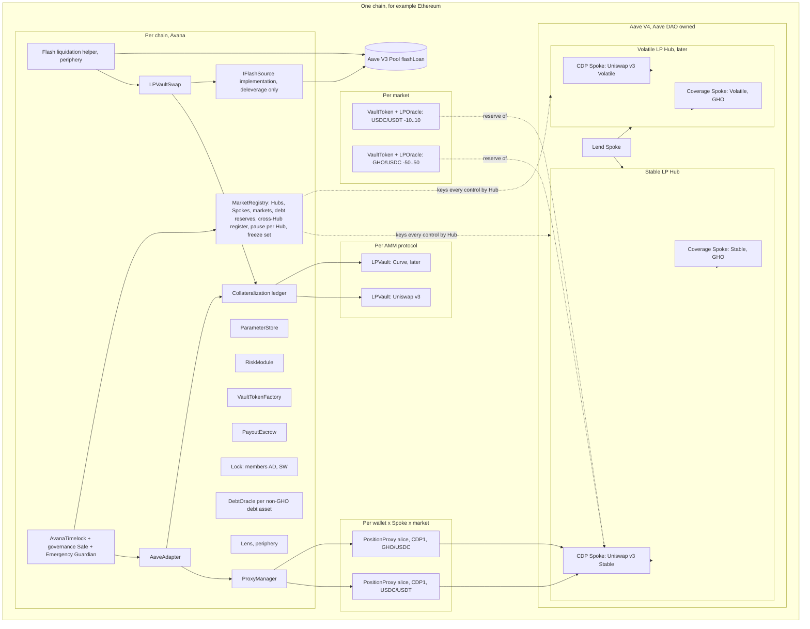
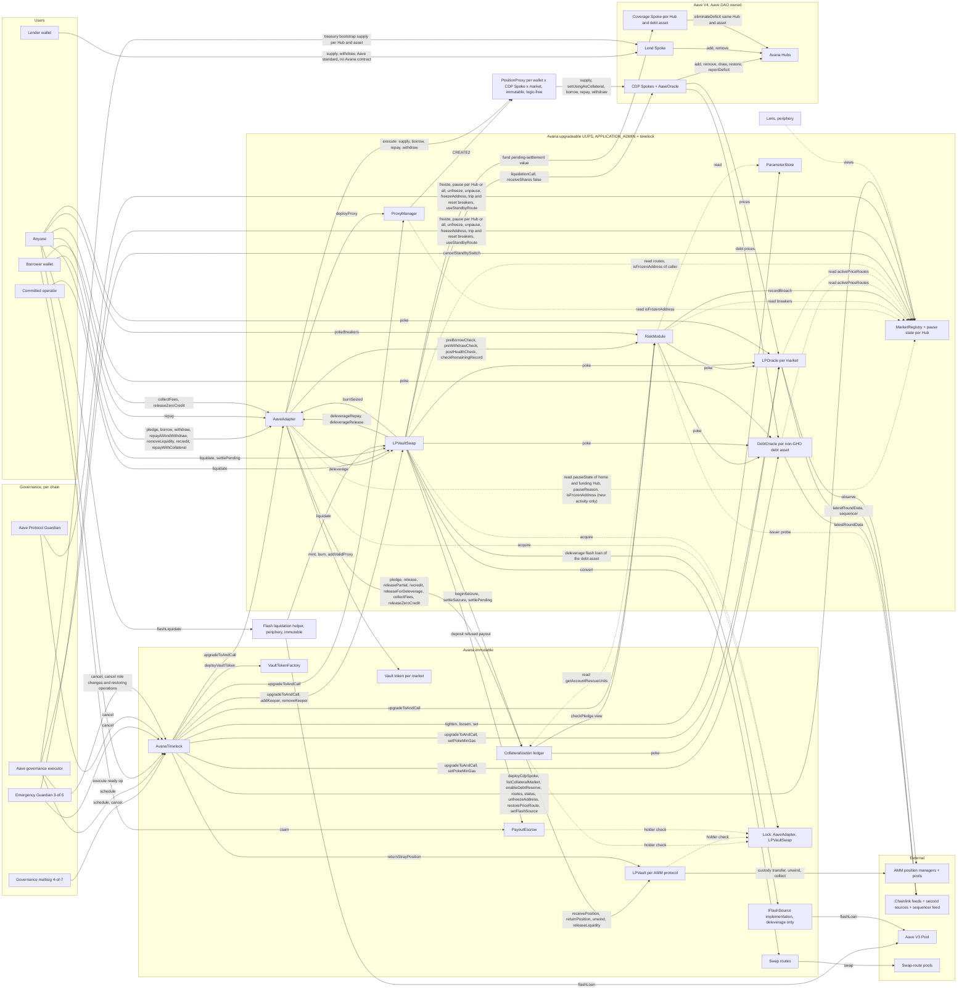

# 1.2 Contract Relationships

> **Status:** In review · **Owner:** Avana Labs · **Last reviewed:** 2026-11-12

Every contract in Avana, who owns and can change it, every call between contracts, and where assets and information sit at each stage. The contract pages ([2.1](../02-contracts/01-avana-hub-and-spokes.md)–[2.18](../02-contracts/18-payout-escrow.md)) give full function behaviour, storage, events and errors and are authoritative for each function's full argument list. Roles are those of the [2.15](../02-contracts/15-governance-and-timelock.md) role table, summarised in [1.4](04-permissions-and-roles.md). Global invariants are defined only in [4.1](../04-security/01-global-invariants.md).

A borrower's every action goes Wallet → AaveAdapter → PositionProxy → CDP Spoke. The AaveAdapter is the executing entry point: it creates the wallet's PositionProxy for a (CDP Spoke, market), mints and burns vault tokens, asks the RiskModule for every borrow-side check and drives the proxy, which executes only the Adapter's calls. Each AMM protocol's LPVault keeps custody of its positions; Collateralization keeps the backing records, counters and pending-settlement balance for every AMM protocol of the chain. Every privileged change goes through the chain's AvanaTimelock. New activity is gated by the pause state of the Hubs involved and its reason, the circuit breakers and the address freeze; exits and liquidation read none of them.

## Instance scope

Avana deploys the same contract set on every chain. A contract exists once per chain unless the table says otherwise, and Hubs, CDP Spokes and markets are data inside the per-chain contracts.

- `REQ-ARCH-206` — Avana's contracts MUST be instantiated exactly at the following scopes, and every cap, budget, pause, breaker, route permission and emergency control inside a per-chain contract MUST be keyed by Hub, and by CDP Spoke and market where it applies (Source: Q-279, Q-280, Q-288):

| Scope | Contracts | Why this scope |
|---|---|---|
| Per chain | ProxyManager, VaultTokenFactory, AvanaTimelock, AaveAdapter, LPVaultSwap, Collateralization (one AMM-neutral ledger), MarketRegistry, ParameterStore, RiskModule, PayoutEscrow (the payout escrow), Lock, each DebtOracle (one per non-GHO debt asset), the `IFlashSource` implementation (for `deleverage`), and two periphery contracts outside the audited core: the Lens and the public flash liquidation helper (operators may deploy their own instances of its operator variant) | One implementation under one timelock and one Guardian set per chain: per-Hub copies would run the same code under the same keys, so they would add deployments, upgrade calls and Lock members without a smaller blast radius |
| Per AMM protocol per chain | One immutable LPVault for custody (for example the Uniswap v3 LPVault on Ethereum and the Slipstream LPVault on Base) and one pricing library or LPOracle implementation | Custody logic and pricing math are what differ between AMM protocols; a new AMM protocol adds one vault and one implementation and touches no other contract |
| Per Hub per chain | Aave-owned: the Hub, its CDP Spokes (one per AMM protocol and risk tier), and one Avana Umbrella (Coverage Spoke) per debt asset, Avana's protocol safety module named after Aave's Umbrella, whose design inspired it. Avana-side: the Hub's pause state, caps and breakers as keyed data | Each Hub's suppliers carry only the losses of the debt reserves it funds |
| Per chain, Aave-owned | One Lend Spoke, listing any (Hub, asset) | Every lender, public and the DAO treasury alike, supplies each (Hub, asset) through it; credit lines are draw caps per (Hub, asset, Spoke) on that shared supply |
| Per market | One VaultToken and one LPOracle instance (the price source of the market's Aave reserve) | The vault token's immutables bind the market's identity so no upgrade can repoint backing |
| Per wallet × CDP Spoke × market | One PositionProxy, created by CREATE2 on first use | Each market is a separate Aave account with its own health factor, so nothing is cross-collateralized |

The Lock has exactly two members, the AaveAdapter and LPVaultSwap. Every LPVault and Collateralization entry point that moves value is reachable only through them, so adding a CDP Spoke, a market or an AMM protocol never needs a new Lock. Hub-wide caps (token, depositor, pool share) live in the one Collateralization ledger keyed by Hub, so adding Spokes never multiplies them.

Worked example, launch on Ethereum and Base, one AMM protocol each, two markets each: each chain has the 13 per-chain contracts (no DebtOracle while GHO, priced by Aave's fixed source, is the only debt asset), 1 LPVault, 1 Hub, 1 CDP Spoke, 1 Lend Spoke, 1 Coverage Spoke (GHO), 2 vault tokens and 2 LPOracle instances, so 2 × 13 = 26 per-chain deployments, 2 LPVaults and 4 market instances. A wallet using both Ethereum markets and one Base market has 3 PositionProxies. Adding Curve on Ethereum later adds 1 LPVault, 1 LPOracle implementation, 1 CDP Spoke ("Curve Stable") and one VaultToken and LPOracle instance per Curve market; no per-chain contract is redeployed and the Lock is unchanged.

Base has the same graph with its own instances: its own AvanaTimelock, Safes and Guardian set, a Slipstream LPVault, the CDP Spoke "Aerodrome Slipstream Stable" on its Stable LP Hub, and an `IFlashSource` implementation and a public flash liquidation helper over the Aave V3 Base Pool. No edge crosses between chains.

## Contract inventory

Delay classes are defined in [1.4](04-permissions-and-roles.md#delay-classes): normal delay = 5 days (`normalDelay()`, never below `MIN_NORMAL_DELAY` = 4 days and never above `MAX_DELAY` = 5 days), short delay = 12 hours (`SHORT_DELAY`, only for calls in the immutable `SHORT_ELIGIBLE` set), immediate = `pause(hub, reason)`, `freeze(hub)` (one call per Hub, batched to stop every Hub of the chain), guardian `unpause`/`unfreeze`, `freezeAddress`, breaker trips and resets, `useStandbyRoute`, `cancelStandbySwitch` and `cancel`. A ready timelock operation expires `GRACE_PERIOD` = 14 days after it becomes executable, and anyone may execute it before then. "U" is an upgradeable UUPS proxy (ERC-1967) whose `_authorizeUpgrade` requires `APPLICATION_ADMIN`, held only by the chain's timelock; "I" is immutable. Every row is one instance per chain unless its contract name gives another scope (`REQ-ARCH-206`).

| ID | Contract | Spec page | Role | Form | Owner / upgrade authority | Source |
|---|---|---|---|---|---|---|
| `REQ-ARCH-026` | Avana Hubs (Stable LP, Correlated LP, Volatile LP; per chain) | [2.1](../02-contracts/01-avana-hub-and-spokes.md) | Standard Aave V4 Hub: holds the vault tokens of its CDP Spokes' markets and every asset the Lend Spoke supplies to it (for example GHO, USDC, USDT), share and debt accounting per asset, caps, deficits per asset. At launch: the Avana Stable LP Hub on Ethereum and on Base. | Aave V4 release pinned at `a3ef63e`, unmodified; Avana pins every dependency by commit and checks its vendored interfaces against the deployed bytecode; the Hub implementation is checked off-chain because the Hub has no `extSload` | Aave DAO through Aave governance of that chain; Avana has no authority | (Source: Q-002, Q-032, Q-043, Q-119, Q-233, Q-279, Q-408) |
| `REQ-ARCH-027` | CDP Spokes (one per chain, Hub, AMM protocol and risk tier) and their AaveOracles | [2.1](../02-contracts/01-avana-hub-and-spokes.md) | Standard, unmodified Aave V4 Spoke with one home Hub: one non-borrowable vault-token reserve per Avana market, and the debt reserves `enableDebtReserve` recorded (the stable debt assets the Aave DAO approves, for example GHO, USDC, USDT); one health factor per account, and each account (proxy) holds one market. Its listing AIP sets the three required settings on every vault-token reserve (`receiveSharesEnabled = false`, `liquidationFee = 0`, no reinvestment controller), which the drift check enforces; `liquidationCall` is the standard one, and only LPVaultSwap can complete it because the vault token accepts seized collateral only to LPVaultSwap. AaveOracle prices each vault-token reserve from the market's LPOracle, GHO from Aave's fixed GHO price source and every other debt reserve from that asset's DebtOracle. Launch: "Uniswap v3 Stable" on Ethereum, "Aerodrome Slipstream Stable" on Base. | Canonical at `a3ef63e`; deployed by the Aave DAO payload of `deployCdpSpoke` behind a DAO-owned proxy; implementation checked on-chain through `extSload` | Aave DAO | (Source: Q-003, Q-100, Q-116, Q-238, Q-280, Q-281, Q-286, Q-408) |
| `REQ-ARCH-028` | Lend Spoke (one per chain) | [2.1](../02-contracts/01-avana-hub-and-spokes.md) | Supply-only Spoke through which any lender, public or the DAO treasury's bootstrap supply, supplies single assets into a (Hub, asset) pair and withdraws them; its reserves can list any asset the Aave DAO approves (for example GHO, USDC, USDT), and each (Hub, asset) `addCap` is the DAO-set supply cap. CDP Spoke `drawCap`s on that (Hub, asset) sum to at most `creditLine(hub, asset)`, a borrow-side cap separate from the supply cap; each debt reserve records its funding `(hub, hubAssetId)`. | Unmodified Aave V4 | Aave DAO; each Lend Spoke position belongs to the lender that supplied it | (Source: Q-070, Q-095, Q-143, Q-168, Q-233, Q-282, Q-407, Q-408) |
| `REQ-ARCH-029` | Coverage Spokes (First-Loss Reserve), one per (Hub, debt asset) per chain | [2.14](../02-contracts/14-first-loss-reserve.md) | Supply-only Spoke with zero draw capacity holding Avana-funded supply shares of one asset on one Hub (`ASSET()`, `HUB()`, `ASSET_ID()`); burns them through `Hub.eliminateDeficit` only for recorded deficits of that asset of CDP Spokes on a DAO-set allowlist, which lists every CDP Spoke drawing that (Hub, asset), never across assets or Hubs. Receives the value LPVaultSwap recovers in pending settlements of markets whose debt reserve that (Hub, asset) funds. | Aave V4 Spoke deployed with an immutable `RESERVE_WITHDRAWAL_DELAY` | Aave DAO controls each instance (`COVERAGE_ROLE`, `RESERVE_ADMIN_ROLE`); Avana Labs funds it before any `drawCap` on its (Hub, asset) is above 0, to at least `coverageRatioBps` of the summed `drawCap`s (`DEF-019`), both set in the funding ARFC with the Aave service providers | (Source: Q-101, Q-142, Q-211, Q-236, Q-284, Q-391, Q-402) |
| `REQ-ARCH-030` | Vault-token fee receiver | [2.1](../02-contracts/01-avana-hub-and-spokes.md) | Aave treasury Spoke registered on each vault-token asset with `addCap = 0` and `drawCap = 0`; the asset has `liquidityFee = 0` and a valid interest-rate strategy, so the fee receiver never holds vault tokens. Each vault-token asset has exactly one Spoke with non-zero caps (its CDP Spoke, `vaultToken.spoke()`) plus the fee receiver, all with `drawCap = 0`, checked at listing and by the drift check. | Unmodified Aave V4 | Aave DAO | (Source: Q-119, Q-281) |
| `REQ-ARCH-031` | LPVault (one per AMM protocol per chain; custody) | [2.2](../02-contracts/02-lp-vault.md) | The AMM integration's custody contract: custody of every pledged position of its AMM protocol on the chain and the `depositorOf` map keyed by `positionKey`; validation of a position against a market (pool and exact shape); composition (token amounts per unit at a given oracle price vector); unwind of exactly `x` units returning n token amounts with per-token minimums; fee collection where the AMM protocol separates fees (`collectFees`, for the depositor); range status and pool share; return of positions that never had a record. Every value-moving entry point is reachable only from Collateralization, itself reachable only through the AaveAdapter or LPVaultSwap. Never holds a vault token or a pool token between calls: removed principal is sent straight to LPVaultSwap (seizure), the depositor (partial removal) or Collateralization (reconciliation into the pending-settlement balance). Launch: a Uniswap v3 LPVault on Ethereum and a Slipstream LPVault on Base. | **I** | None. `returnStray` callable only by the immutable `TIMELOCK` address (normal delay) | (Source: Q-049, Q-104, Q-126, Q-201, Q-224, Q-226, Q-240, Q-279) |
| `REQ-ARCH-032` | Vault token (one per market) | [2.4](../02-contracts/04-vault-tokens.md) | Collateral-only ERC-20. Only the AaveAdapter mints (`mint(to, amount)` to a registered proxy of the market, on pledge and re-credit), burns (`burn(from, amount)` from a registered proxy on withdrawal, partial removal and `deleverageRelease`, or from LPVaultSwap in `burnSeized`; no allowance) and registers proxies (`addValidProxy(proxy)`, append-only, `ProxyAdded`). Every balance change is on one of five paths and every other transfer reverts, zero-amount transfers included: mint to a registered proxy; supply from a registered proxy to the home Hub (the CDP Spoke as spender, allowance set and reset to 0 by the Adapter through `proxy.execute`); withdrawal from the home Hub to a registered proxy (`Spoke.withdraw` called by the proxy sends to its caller); seizure from the home Hub to LPVaultSwap; burn. There is no Hub-to-Adapter transfer. Because the Hub sends seized units to the caller of `liquidationCall`, any liquidator other than LPVaultSwap reverts on the token transfer. Exposes `pool()`, `positionShape()`, `integrationId()`, `lpVault()`, `hub()`, `spoke()`, `marketId()`, `lpOracle()`, `adapter()`, `lpVaultSwap()`, `collateralization()` as immutables. | **I**, no owner, setter, pause or upgrade | None | (Source: Q-066, Q-068, Q-120, Q-126, Q-224, Q-226, Q-281) |
| `REQ-ARCH-033` | VaultTokenFactory and market registry of pools (one per chain) | [2.4](../02-contracts/04-vault-tokens.md) | Deploys each vault token with CREATE3 salted by (CDP Spoke, market key) through `deployVaultToken(def)`, binding pool, shape, integration and its LPVault, Hub, Spoke, market ID, LPOracle, Adapter, LPVaultSwap, Collateralization and decimals, and emits `VaultTokenDeployed`; the registry `tokenOf(spoke, marketKey)` maps each (CDP Spoke, market key) to one token, where the market key names the AMM protocol, the pool and the exact range or shape; it is written once and rejects a second, so a market can never have two collateral tokens. Because the slot is write-once, deployment runs in the same timelock batch as the market's `listCollateralMarket`, which requires the token's `marketId()` and `lpOracle()` to match. | **I** | `deployVaultToken` callable only by the immutable `TIMELOCK` address (normal delay, `listCollateralMarket` batch) | (Source: Q-068, Q-119, Q-120, Q-126, Q-228, Q-286) |
| `REQ-ARCH-034` | PositionProxy (one per wallet, CDP Spoke and market) | [2.5](../02-contracts/05-position-proxy-and-proxy-manager.md) | The borrower's Aave account for one market on one CDP Spoke: supplied vault-token shares of that market and debt in every debt reserve it borrowed, under one Aave health factor. A logic-free immutable account: its one state-changing function `execute(target, data)` accepts only the chain's AaveAdapter (`OnlyAdapter()`), including for its bound wallet. The Adapter, through `execute` and balance reads, supplies, enables and asserts collateral, measures every asset delta, pays borrowed assets to the receiver, refunds unconsumed repay funds to the payer and disables the reserve when its shares reach 0 with all debt zero; the proxy holds no logic of its own. | **I**, created by CREATE2; no implementation pointer, no upgrade, never replaced | None; bound wallet, Spoke and market fixed at creation | (Source: Q-064, Q-123, Q-223, Q-279, Q-280) |
| `REQ-ARCH-035` | ProxyManager (one per chain) | [2.5](../02-contracts/05-position-proxy-and-proxy-manager.md) | `deployProxy(wallet, spoke, marketId)`, callable only by the chain's AaveAdapter, deploys a PositionProxy with CREATE2 salt `keccak256(abi.encode(wallet, spoke, marketId))` bound to those three values; `predictProxy(wallet, spoke, marketId)` is exact before deployment. It holds no implementation pointer that proxies follow, so no call can change any proxy's code. With one Adapter per chain, no other contract can claim a proxy address first. | **I**: a CREATE2 deployer with no upgrade proxy, owner, role, pause or setter ([2.5](../02-contracts/05-position-proxy-and-proxy-manager.md) `REQ-PROXY-050`, `REQ-PROXY-101`) | None; its Adapter, registry and creation-code hash are fixed for life, so every predicted proxy address stays valid | (Source: Q-123, Q-226, Q-228, Q-279) |
| `REQ-ARCH-036` | AaveAdapter (one per chain) | [2.6](../02-contracts/06-aave-adapter.md) | The executing entry point for every borrower action on the chain: `pledge`, `borrow`, `repay` (any payer), `withdraw`, `repayAllAndWithdraw`, `removeLiquidity`, `recredit`, `repayWithCollateral` (with `deleverageRepay` and `deleverageRelease` for LPVaultSwap inside its deleverage session); resolves `proxyOf(wallet, marketId)`, deploys proxies through the ProxyManager, registers them on each vault token, mints exactly the units Collateralization credits and burns on withdrawal; `burnSeized` for LPVaultSwap; holds the call bounds (deadline, `borrowNonce` per proxy, `minHealthFactor`, receiver rule) and reads the pause state of the home Hub (and the funding Hub on a borrow), its reason and the address freeze for new activity only; decides debt-free from the Spoke's `borrowCount` and reads no MarketRegistry state on repay or withdrawal; calls the RiskModule for every borrow-side check and reverts with its errors; requires `vaultToken.totalSupply() ≤ totalCredited + pending.units` with the gap unchanged after every pledge, withdrawal, partial removal, re-credit and repay with collateral (on the seizure and pending paths Collateralization's supply-drop and one-sided supply checks keep it). Holds no setter; trusted, with its timelock, for custody of proxy positions. Hub and Spoke scope are data, so one Adapter serves every Hub of the chain. | **U** | `APPLICATION_ADMIN` (timelock), normal delay; cancellable by every canceller | (Source: Q-075, Q-106, Q-223, Q-224, Q-226, Q-227, Q-229, Q-242, Q-252, Q-254, Q-255, Q-257, Q-260, Q-279) |
| `REQ-ARCH-037` | RiskModule | [2.7](../02-contracts/07-risk-module.md) | Every check, no stored value: `checkPledge` for Collateralization (eligibility, price state for new account vs top-up, `Offboarding`, Aave reserve flags, drift and Hub shares == assets for new accounts, `minPledgeUsd`, caps and the top-up slice, pool share, the market's circuit breakers, rescue eligibility, Hub `addCap`, reserve limit; returns `PledgeCharge{usdCharge, sliceUsd, rescue, rescueUnits}`); `preBorrowCheck`, `preWithdrawCheck` (including the market and debt breakers) and `postHealthCheck` (rescue units valued at zero) for the Adapter over every collateral and debt reserve of the account; `checkRemainingRecord` for a partial removal with debt; breaker status views and the permissionless `pokeBreakers(marketId)`, which records breach times and latches security freezes in the MarketRegistry; `rescueHealthFactor = 1.10e18` for rescue eligibility, with no opening health floor (`Q-398`); `checkAaveConfig`, `isHubSharesEqualAssets`, previews. Reads values from the ParameterStore and MarketRegistry and probes token issuers with a gas-limited static call. | **U** | `APPLICATION_ADMIN` (timelock), normal delay | (Source: Q-054, Q-055, Q-158, Q-175, Q-229, Q-230, Q-240, Q-241, Q-252, Q-253, Q-254, Q-270, Q-398, Q-399) |
| `REQ-ARCH-038` | MarketRegistry (one per chain) | [2.8](../02-contracts/08-market-registry.md) | Hubs, CDP Spokes with their home Hub, AMM integration and risk tier, markets and their status (`Registered`, `Active`, `Offboarding`) with pool and exact shape, debt reserves per Spoke (`DebtReserveDef`: asset, decimals, funding `(hub, hubAssetId)`, price source, Coverage Spoke), the cross-Hub register per (funding Hub, asset) summing every drawing Spoke's `drawCap` and `crossHubLinesEnabled`, listed tokens and their primary, alternate and standby price routes with leg heartbeats, second sources and issuer probes, swap routes per `(marketId, token, debtAsset, kind)`, the `PauseState` (None, Frozen, Paused) and `PauseReason` of each Hub, temporary-gate breach times and latched security freezes per market and debt reserve (written only by the RiskModule's `recordBreach` and the breaker roles), and the chain's frozen-address set; `marketOfVaultToken`, `activePriceRoutes`, `activeMarketCount` and the other lookups are views. Runs the three deployment operations. Holds no token and moves none. | **U** | `APPLICATION_ADMIN` (timelock): `deployCdpSpoke`, `listCollateralMarket`, `enableDebtReserve`, routes, `restorePriceRoute`, `unfreezeAddress`, breaker resets and cross-Hub settings at the normal delay; the three activations, `cancelRegistration`, `setMarketOffboarding`, `disableRoute`, `restoreRoute`, `freeze`, `pause`, `freezeAddress`, `tripMarketBreaker`, `tripDebtBreaker` and `useStandbyRoute` at the short delay. Immediate: `APPLICATION_FREEZE_GUARDIAN` (`freeze(hub)`, `freezeAll`, `freezeAddress`, breaker trips), `APPLICATION_PAUSE_GUARDIAN` (`pause(hub, reason)`, `pauseAll`, `unpause`, `unfreeze`, breaker resets, `useStandbyRoute`), the Aave governance executor through the immutable `AAVE_GOVERNANCE_EXECUTOR` (`cancelStandbySwitch`) | (Source: Q-114, Q-151, Q-227, Q-228, Q-240, Q-241, Q-242, Q-248, Q-252, Q-262, Q-282, Q-283, Q-285, Q-286, Q-399, Q-401) |
| `REQ-ARCH-039` | LPOracle (one instance per market; one implementation per AMM protocol) | [2.10](../02-contracts/10-lp-oracle.md) | Vault-token price for Aave (8 decimals, never reverts, never 0) by fair composition, `value = Σ amountᵢ(oracle price vector) × priceᵢ` per unit, with the oracle ratio clamped to the market's range, amounts floored and reduced by one raw unit, and uncollected fees excluded; price state and freshness (each feed's own heartbeat plus margin, the second source, and on Base the sequencer feed), `poke()` cache, first-disagreement time, per-account grace, the hourly `priceCheckpoint` for the price-drop monitoring alert and `lastAcceptedPrice` for Avana's own valuations; serves the stress price (1 when Expired, the lower route during a disagreement); the TWAP is a consistency check sized to the chain's block time. Reads feed definitions, active routes and tolerances from the ParameterStore and MarketRegistry. | **U** | `APPLICATION_ADMIN` (timelock): upgrade and `setPokeMinGas`, normal delay | (Source: Q-049, Q-091, Q-128, Q-154, Q-199, Q-226, Q-241, Q-247, Q-248, Q-279, Q-287) |
| `REQ-ARCH-040` | LPVaultSwap (one per chain) | [2.11](../02-contracts/11-lpvaultswap.md) | Liquidation: one entry point, `liquidate`, open to any address that is not frozen with either route mode (`Q-404`); the caller sizes `debtToCover` up front for Aave V4's dust rule and bears any recovery below the debt repaid in its own payout; funding in the debt asset pulled from the caller and measured by balance delta (`Kf`), with no flash loan inside the call (a caller without the debt asset uses the flash liquidation helper, a periphery contract that LPVaultSwap treats as an ordinary caller); `liquidationCall` with `receiveShares = false` and `Kf` as Aave's bound; `AaveAdapter.burnSeized`; hand-off to Collateralization; swaps of the n unwound tokens into the debt asset with an oracle-derived minimum on every leg, recovery floor with the caller's shortfall top-up, caller deadline and minimum payout, waterfall in the debt asset (internal library SettlementMath); delivery of Avana's fee and the borrower surplus to their recipients, or to the PayoutEscrow when the token refuses the transfer, and of `keeperOut` directly to `msg.sender` (a failed transfer reverts the call); `settlePending` (anyone), which forwards what it recovers to the Coverage Spoke of the market's debt reserve; `deleverage` for the Adapter's repay with collateral, its only flash loan, through the `IFlashSource` the MarketRegistry records (liquidity and premium checked before the loan; Pool, initiator and active deleverage context in the callback; never from a lender that is any Hub registered on the chain, `Q-386`); holds the chain's committed-operator registry (at least `keeperFloor` = 1 active, at most `MAX_KEEPERS` = 32), which gates no call, and counts active (unfrozen) committed operators. Never reads a pause state or any breaker; checks the address freeze only for its own callers. | **U** at a fixed address (immutable in every vault token of the chain) | `APPLICATION_ADMIN` (timelock): upgrade and `addKeeper` at the normal delay, `removeKeeper` at the short delay | (Source: Q-068, Q-201, Q-211, Q-213, Q-214, Q-216, Q-226, Q-235, Q-241, Q-242, Q-250, Q-251, Q-255, Q-279, Q-284, Q-289, Q-397, Q-400, Q-401, Q-404) |
| `REQ-ARCH-041` | Swap route contracts | [2.12](../02-contracts/12-settlement-routes.md) | One immutable contract per route version: swaps one token into one debt asset on a fixed path (a fixed pool of a fixed AMM protocol, or a fixed multi-hop path) and returns the debt asset to LPVaultSwap. Each market has a primary and a backup swap route per (token, debt asset); each route exposes its path type as `routeType()` and never trades through the market's own pool. | **I** per version | Route records in the MarketRegistry keyed `(marketId, token, debtAsset, kind)`, `kind` 0 primary, 1 backup: `setRoute` at the normal delay (a new route version is new code); `disableRoute` and `restoreRoute` of a previously approved route at the short delay | (Source: Q-062, Q-084, Q-119, Q-151, Q-187, Q-228, Q-235) |
| `REQ-ARCH-042` | SettlementBudget (removed) | [2.13](../02-contracts/13-settlement-budget.md) | Not deployed: no Avana contract pays rounding gaps. Aave V4's dust rule can raise the repayment needed to finish a liquidation, so the caller sizes `debtToCover` for that amount up front, a recovery a few units below the debt repaid lowers only the caller's own payout, and a recovery below the floor is closed by the caller's shortfall top-up. | Not applicable | None | (Source: Q-397, Q-404) |
| `REQ-ARCH-043` | AvanaTimelock (one per chain) | [2.15](../02-contracts/15-governance-and-timelock.md) | TimelockController extension that executes every privileged Avana change on its chain: holds its own `DEFAULT_ADMIN_ROLE` with no other admin; `getMinDelay()` returns `SHORT_DELAY` (12 h) and `updateDelay` reverts; `normalDelay()` (5 d at launch, bounds `[MIN_NORMAL_DELAY, MAX_DELAY]` = 4 to 5 d) changed only by a self-call; `schedule`/`scheduleBatch` require `delay ≥ requiredDelay(targets, payloads)`; the short-delay list can only enable pairs in the immutable `SHORT_ELIGIBLE` set; operations expire `GRACE_PERIOD` (14 d) after they become ready; public execution flag (launch `true`); a role-change operation and an operation whose every call is in the immutable DAO-only cancel set are cancellable only by `DAO_CANCELLER_ROLE`; a grant of its own `DEFAULT_ADMIN_ROLE` to any account but itself reverts. Holds `DEFAULT_ADMIN_ROLE` and `APPLICATION_ADMIN` on every upgradeable Avana contract of its chain, which no grant can give to another account, and is the `TIMELOCK` immutable of the immutable ones. It cannot call another chain. | **I** | Itself (self-calls at the normal delay); proposers that chain's 4-of-7 governance multisig and the Aave governance executor; executor anyone while public execution is on, otherwise `EXECUTOR_ROLE` | (Source: Q-043, Q-119, Q-226, Q-228, Q-245, Q-259, Q-262, Q-263, Q-285) |
| `REQ-ARCH-044` | Lock (one per chain) | [2.16](../02-contracts/16-lock.md) | Protocol-wide reentrancy lock with exactly two members, the AaveAdapter and LPVaultSwap; every LPVault and Collateralization entry point that moves value is reachable only through them and checks that one of them holds the Lock, so a new LPVault, CDP Spoke or market never needs a Lock redeploy. | **I** | None | (Source: Q-148, Q-224, Q-279) |
| `REQ-ARCH-045` | Lens (one per chain; periphery, outside the audited core) | [2.17](../02-contracts/17-lens.md) | Read-only views keyed by `(wallet, spoke, marketId)`: `predictProxy`, accounts with every debt reserve, backing checks (with `≥`), price states and debt-price freshness, the pause state and reason of each Hub, breaker status, frozen addresses, cap headroom including `minPledgeUsd`, tail coverage per (Hub, debt asset), `previewLiquidation`, which returns ready-to-send `LiquidationParams`, and the previews `previewBorrowMax`, `quoteRepayAll`, `previewRecredit` and `previewRepayWithCollateral`, each built so the transaction made from it succeeds at its deadline. It reads everything at one block and cannot revert in Expired because the feeds never revert. No core contract calls it and nothing it returns authorizes an action. | **I**; a new Lens is a new deployment | None | (Source: Q-056, Q-066, Q-119, Q-194, Q-226, Q-232, Q-249, Q-268, Q-288) |
| `REQ-ARCH-142` | Pause state of each Hub (`PauseState`, stored in the chain's MarketRegistry) | [2.8](../02-contracts/08-market-registry.md) | One state per Hub: None, Frozen or Paused, with a `PauseReason` (`General`, `MintPathSuspect`) while Paused; `pauseAll(reason)` and `freezeAll()` set every Hub of the chain in one call. Frozen blocks new pledges by accounts with no debt and borrowing; `Paused(General)` blocks new pledges, non-rescue top-ups and re-credits, borrowing, withdraw-with-debt and repay with collateral; `Paused(MintPathSuspect)` also blocks rescue top-ups and re-credits. A pledge reads its Spoke's home Hub; a borrow reads the home Hub and the debt reserve's funding Hub. Liquidation (`liquidate`, the one entry point, `Q-404`), pending settlement, repay, fee collection, debt-free withdrawal and partial removal and zero-credit release are open in every state and never read it. Only the AaveAdapter gates on it; the Lens and the RiskModule's `getAccountGateStatus` view report it. Per-market containment is the circuit breakers, the Aave reserve freeze or pause and the `Offboarding` market status. | Storage of the MarketRegistry (**U**) | `freeze(hub)`, `freezeAll()` (None → Frozen): `APPLICATION_FREEZE_GUARDIAN` or `APPLICATION_ADMIN` (short delay for `freeze`, normal for `freezeAll`); `pause(hub, reason)`, `pauseAll(reason)` (None or Frozen → Paused, or a change of reason while Paused): `APPLICATION_PAUSE_GUARDIAN` or `APPLICATION_ADMIN` (short delay for `pause`, normal for `pauseAll`); `unfreeze(hub)` (Frozen → None) and `unpause(hub)` (Paused → None): `APPLICATION_PAUSE_GUARDIAN` or `APPLICATION_ADMIN` only; unfreezing while Paused reverts | (Source: Q-118, Q-202, Q-227, Q-228, Q-252, Q-262, Q-283, Q-285) |
| `REQ-ARCH-146` | PayoutEscrow (one per chain; the payout escrow) | [2.18](../02-contracts/18-payout-escrow.md) | Holds a liquidation payout that a token refused (the borrower's surplus, Avana's fee, a route residue or a dust leg; never the caller's payout `keeperOut`, which is paid directly or reverts the call), credited per token and recipient; the credited recipient claims it in full to an address of its choosing. This is its only job; there is no in-kind settlement. Accepts deposits only from LPVaultSwap while it holds the Lock. | **I** | None: no owner, no role, no setter, no sweep | (Source: Q-214, Q-049, Q-401, Q-404) |
| `REQ-ARCH-170` | ParameterStore (one per chain) | [2.9](../02-contracts/09-parameter-store.md) | Every risk parameter with its bounds and its tighten and loosen setters, keyed by Hub, Spoke, market, debt reserve or feed as the parameter needs: the optional per-market `hardHealthFloor` (0, off, by default), market, token and depositor USD caps (per Hub), top-up slice, pool share, `minPledgeUsd` per market, stress floor, slippage allowance per market, `debtStressRiseBps` per debt reserve, breaker thresholds (`poolShareMaxBps`, `breakerDeficitMax`, `gateRecoverySeconds`), `maxShortfallBps`, oracle tolerances, windows, feed definitions with each feed's heartbeat, the sequencer feed and grace period, swap-route depth thresholds, `avanaFeeShareBps`, `feeRecipient`, `maxFlashFeeBps`; it records `lastLoosenedAt` per parameter key. Holds no token and makes only view calls. | **U** | `APPLICATION_ADMIN` (timelock): every `tighten*` setter at the short delay (reverts `NotStricter` and outside liveness bounds); every loosening (within its step limit and at most once per `normalDelay` per key), structural and fee setter at the normal delay | (Source: Q-114, Q-139, Q-196, Q-228, Q-230, Q-231, Q-240, Q-241, Q-246, Q-248, Q-251, Q-261, Q-283, Q-287, Q-398, Q-399, Q-401) |
| `REQ-ARCH-171` | Collateralization (one per chain; AMM-neutral ledger) | [2.3](../02-contracts/03-collateralization.md) | Backing records keyed by `(integrationId, positionKey)` with n-token pending amounts, the per account-market largest-first seizure lists (at most `MAX_RECORDS_PER_ACCOUNT_MARKET` open records each), per-market and per-account credited totals, exposure counters keyed by Hub (token, depositor and pool-share USD caps) and the booking of the RiskModule's pledge charge, the pending-settlement balance, seizure snapshots; `pledge` and `release` for the Adapter, `beginSeizure`, `settleSeizure` and `settlePending` for LPVaultSwap, `releaseZeroCredit` for the depositor; reconciliation of unsettled seizures on exit (`Q-201`); the independent seizure check (proxy share drop == token supply drop == debited units). Reads each market's pool, shape, LPVault, Hub, Spoke, market ID and LPOracle from the vault token's immutables, and calls each market's LPVault for custody and unwinds. Holds no position and no vault token; its only assets are the token amounts of the pending-settlement balance, paid out only by `settlePending`. | **I** | None | (Source: Q-069, Q-158, Q-160, Q-165, Q-201, Q-224, Q-226, Q-240, Q-279, Q-287) |
| `REQ-ARCH-172` | Debt buy routes (retired) | [2.12](../02-contracts/12-settlement-routes.md) | No buy route exists: the caller funds the liquidation in the debt asset itself, so no leg buys a debt asset with GHO, and each market's swap routes go directly from each unwound token into the debt asset (`REQ-ARCH-041`). | None | None | (Source: Q-235, Q-282) |
| `REQ-ARCH-189` | DebtOracle (one per non-GHO debt asset per chain) | [2.10](../02-contracts/10-lp-oracle.md) | The Aave price source of one non-GHO debt asset on every CDP Spoke of its chain that lends it (8 decimals, never reverts, at least 1): primary and alternate routes with failover, agreement check, each feed fresh within its own heartbeat plus margin, Cached and Expired states, the sequencer feed on a chain with one, `poke()`, the standby route of the MarketRegistry, and `lastAcceptedPrice`; serves its last accepted price raised by `debtStressRiseBps` once Expired and the higher route during a disagreement; no stable ceiling. | **U** | `APPLICATION_ADMIN` (timelock): upgrade and `setPokeMinGas`, normal delay | (Source: Q-247, Q-248, Q-287) |
| `REQ-ARCH-210` | `IFlashSource` implementation (one per chain) | [2.11](../02-contracts/11-lpvaultswap.md) | The flash-loan source of LPVaultSwap's `deleverage` (repay with collateral), its only flash loan: flash-borrows one debt asset through the chain's Aave V3 Pool `flashLoan` (single asset, interest-rate mode 0), after checking the asset's available liquidity and that the Pool's premium is at most `maxFlashFeeBps`; in the callback it requires the Pool as caller, itself as initiator and an active deleverage context. A liquidation never calls it; a liquidation caller that needs a loan uses the flash liquidation helper, which borrows from the same Pool directly. Aave V4 has no flash loan, so the V3 Pool is used on every chain. Its `LENDER()` reports the pool or Hub that holds the liquidity it lends (for a flash Spoke on an Aave V4 Hub, that Hub), and the source is refused, at `setFlashSource` and at every `deleverage`, when that lender is any Hub registered on the chain (`Q-386`). When the source cannot lend, the borrower repays from its own funds. | **I**; replaced by recording a new implementation on the MarketRegistry (`setFlashSource`), which LPVaultSwap reads on every `deleverage` | `APPLICATION_ADMIN` (timelock): `MarketRegistry.setFlashSource` at the normal delay; the Aave DAO grants `FLASH_BORROWER` on the Pool | (Source: Q-063, Q-135, Q-279, Q-282, Q-404) |

- `REQ-ARCH-046` — Collateralization MUST be the only writer of backing records, per-market and per-account totals, exposure counters and the pending-settlement balance, and it reads credited units only through the market's LPVault; there is one Collateralization per chain for every AMM protocol, no separate credit-line controller contract, and any calculator outside Collateralization is a stateless view in the Lens or the RiskModule. (Source: Q-069, Q-070, Q-119, Q-240, Q-279)
- `REQ-ARCH-047` — Avana's custody trust MUST be the following: the reviewed AaveAdapter implementation of each chain, behind that chain's 5-day timelock, is trusted for custody of proxy positions (it mints, burns, registers proxies, and supplies, borrows, repays and withdraws for every proxy), and the ProxyManager only for creating proxies at their predicted addresses; PositionProxies carry no logic and are trusted for nothing; the immutable contracts (every LPVault, Collateralization, vault tokens, VaultTokenFactory, Lock, swap-route contracts, `IFlashSource` implementations, PayoutEscrow, AvanaTimelock) trust every other upgradeable contract (RiskModule, MarketRegistry, ParameterStore, LPOracle, DebtOracle, LPVaultSwap) only for yes-or-no checks, prices and values within bounds. Custody survives any upgrade: an LPVault returns a position only to its depositor of record. Collateralization independently checks every seizure (share drop == supply drop == debit) and every pending settlement (`totalSupply + units ≤ totalCredited + pending.units`), and never verifies a withdrawal burn by itself, because the release path relies on the reviewed Adapter. (Source: Q-092, Q-120, Q-214, Q-223, Q-224, Q-226, Q-257, Q-279)
- `REQ-ARCH-048` — Collateralization MUST read the Spoke, the Hub, the pool, the shape, the LPVault, the market ID and the market's LPOracle only from the vault token's immutables, never from upgradeable configuration; an LPVault holds no market binding of its own and acts only on Collateralization's instructions, validating each position against the market the vault token names. A PositionProxy's wallet, CDP Spoke and market are fixed at creation; reserve IDs, assets and the debt-reserve set come from the MarketRegistry through the Adapter, and the drift check requires the Spoke's borrowable reserves to equal the recorded set. A later CDP Spoke or market needs no new proxy code: the wallet gets a separate proxy for it at `predictProxy(wallet, spoke, marketId)`. (Source: Q-126, Q-239, Q-279, Q-280)
- `REQ-ARCH-049` — Canonical external addresses (each AMM protocol's position manager and factory, GHO, the Aave V3 Pool behind the `IFlashSource`, the sequencer-uptime feed, each Hub) MUST be constructor immutables: of the implementation in an upgradeable contract, changed only by an upgrade at the normal delay, and fixed for life in an immutable contract; per-market feeds and swap routes live in the MarketRegistry and ParameterStore. The pool is derived from the AMM protocol's own factory from the position's data (for Uniswap v3 `getPool(token0, token1, fee)`, for Slipstream `getPool(token0, token1, tickSpacing)` on the bound factory generation), never taken from a caller; before any pledge, seizure or reconciliation call the LPVault checks the AMM protocol's reentrancy lock (for Uniswap v3 and Slipstream `slot0.unlocked`) and reverts `PoolLocked` while it is held; fee collection relies on the pool's own lock. (Source: Q-056, Q-085, Q-119, Q-128, Q-144, Q-228, Q-279)
- `REQ-ARCH-050` — Every upgradeable Avana contract (AaveAdapter, RiskModule, MarketRegistry, ParameterStore, LPOracle, DebtOracle, LPVaultSwap) MUST be a UUPS proxy (ERC-1967) whose `_authorizeUpgrade` requires `APPLICATION_ADMIN`, held only by its chain's AvanaTimelock and exercised at the normal delay; its `_grantRole` reverts `AdminRoleOnlyTimelock(role, account)` for `DEFAULT_ADMIN_ROLE` or `APPLICATION_ADMIN` to any account but the timelock, so a role grant can never create an admin that upgrades without a delay; there is no `Ownable` owner and no other upgrade path. A move to a new timelock is an upgrade of each contract to an implementation that names it. PositionProxies and the ProxyManager are not upgradeable in any way: no upgrade proxy, no implementation pointer, no initializer callable after creation. Implementations use ERC-7201 namespaced storage and `_disableInitializers()` in the constructor, reinitializers use `reinitializer(n)` and run in the same `upgradeToAndCall`, CI diffs the storage layout against the last deployed implementation, and an upgrade names an already deployed, source-verified implementation whose bytecode hash reviewers check and whose payload they simulate on a fork of that chain during the delay. (Source: Q-043, Q-119, Q-226, Q-228, Q-248, Q-259, Q-266, Q-279)
- `REQ-ARCH-051` — Contracts MUST measure amounts received or spent within a call (before/after deltas), never absolute balances; approvals are for the exact amount and reset to 0; no Avana contract holds Avana-originated balances or non-zero allowances between transactions, except Collateralization's pending-settlement token amounts, LPVaultSwap's unsettled seized vault tokens and the PayoutEscrow's credited payouts, and stray dust is ignored. A borrowed debt asset moves Hub → proxy → the signed receiver; repay funds move payer → proxy → Hub. (Source: Q-064, Q-075, Q-119, Q-124, Q-201, Q-214, Q-224, Q-397, Q-401)
- `REQ-ARCH-052` — Every outer Avana entry point that changes state MUST acquire the Lock, and only the AaveAdapter and LPVaultSwap are Lock members; inner calls MUST be accepted only from their named caller and only while a member holds the Lock: Collateralization `pledge`, `release`, `releasePartial`, `recredit` and `releaseForDeleverage` from the Adapter; `beginSeizure`, `settleSeizure` and `settlePending` from LPVaultSwap; each LPVault's `receivePosition`, `returnPosition`, `unwind` and `releaseLiquidity` from Collateralization while a member holds the Lock; `AaveAdapter.burnSeized`, `deleverageRepay` and `deleverageRelease`, swap-route `convert`, the `IFlashSource` loan call and `PayoutEscrow.deposit` from LPVaultSwap; `LPVaultSwap.deleverage` from the Adapter. `LPVault.collectFees` takes the Lock through the Adapter's fee entry or checks that no member holds it, and moves no credited value. `ProxyManager.deployProxy` and every PositionProxy function accept only the Adapter (`OnlyAdapter()`) and check no Lock themselves, because the Adapter calls them only inside its own Lock-holding entry points. Every contract follows checks-effects-interactions, and a position release uses a transfer with no receiver hook only after the record, burn and backing updates are complete. (Source: Q-119, Q-148, Q-223, Q-224, Q-254, Q-255, Q-279)
- `REQ-ARCH-053` — Avana contracts MUST be written in Solidity 0.8.28 for EVM `cancun` on every chain, matching Aave V4; transient storage is used only for the Lock and the flash-loan and seizure context and is cleared before the call returns; AMM math comes from maintained 0.8 ports of each AMM protocol's libraries; contract sizes are measured in CI from the first build; upgradeable contracts use no externally linked libraries; every dependency is pinned by commit with Aave V4 at `a3ef63e` and interfaces vendored from it. (Source: Q-043, Q-119)
- `REQ-ARCH-147` — Every Avana contract MUST skip, not attempt, a token `transfer` or `transferFrom` whose computed amount is zero, and an AMM fee or principal collection whose every cap is zero. This covers liquidation payouts, swap-route inputs and residues, refunds, escrow deposits and claims, pending-settlement payouts, repay refunds and First-Loss Reserve funding; checks that reject a zero user input (`ZeroAmount`, `InvalidAmount`) are unchanged. Why: some ERC-20 tokens revert on a zero-amount transfer and position managers such as the Uniswap v3 NFPM revert a `collect` with every cap zero, so attempting either on a computed zero would make a liquidation, settlement or exit revert for no economic reason. Example: a seizure debit of 1 unit whose unwind returns 0 of every token skips the collection; a liquidation whose recovery is at most the oracle value leaves the borrower's payout 0, so no transfer and no escrow deposit is attempted. (Source: Q-217, Q-124)
- `REQ-ARCH-178` — The blast radius of each trusted upgradeable contract MUST be exactly the following, on its own chain only, and every control that bounds it MUST stay in place:
  - AaveAdapter implementation faulty or hostile: borrow every debt reserve against every proxy up to each `drawCap`; withdraw supplied vault tokens; mint vault tokens to any registered proxy (bounded by the Hub `addCap`); burn any holder's vault tokens (including a Hub's); register any address as a proxy; spend allowances granted to the Adapter; pledge any position whose owner approved an LPVault. It cannot send a position to anyone but its depositor of record, receive seized vault tokens, raise any Aave cap, or spend a Coverage Spoke. The ProxyManager is immutable: it creates proxies only at their predicted addresses for the chain's one Adapter and cannot change an existing proxy. Bound: the timelock's normal delay (never below 4 days), cancellers, Hub/Spoke caps; exits (repay, debt-free withdraw) are never paused and read no MarketRegistry state, so borrowers can leave inside the delay.
  - RiskModule faulty: can approve a borrow below 1.10/1.05 (bounded by Aave HF ≥ 1 and drawCaps) or block borrowing and pledges; cannot touch exits.
  - LPVaultSwap faulty: can seize only accounts Aave deems liquidatable, through Aave sizing; Collateralization's share-drop and supply-drop checks stop it releasing units it did not burn; it holds no budget it could draw; reconcile-on-exit (`Q-201`) handles seizures it never settles. A liquidation-blocking bug is fixed by a normal-delay upgrade, during which caps bound the loss.
  - MarketRegistry/ParameterStore faulty: can misprice gates within bounds, list bad swap routes, pause, trip breakers, freeze addresses; cannot move funds, block an exit (exits read no registry state) or shield an account from liquidation.
  - LPOracle or DebtOracle faulty: can misprice one market or one debt asset for Aave's health factor and sizing, bounded by the drift check, monitoring and the normal delay of its upgrade.
  (Source: Q-201, Q-223, Q-224, Q-226, Q-228, Q-247, Q-248, Q-260, Q-279)
- `REQ-ARCH-180` — An account MUST be one PositionProxy per (wallet, CDP Spoke, market), holding that market's vault-token collateral reserve and the approved debt reserves on that Spoke under one Aave health factor; the borrow-side gates (borrow, withdraw-with-debt) cover the market and every debt reserve of the account, so a stale price of any of them blocks borrowing and withdraw-with-debt for that account only; liquidation needs fresh prices for the market and the repaid debt reserve, while a failing debt reserve elsewhere in the account counts at its stress valuation in Aave's health factor; and a rise in a debt asset's price can make the account liquidatable. Closing an account requires every debt reserve at zero. At launch each chain's Avana Stable LP Hub has one CDP Spoke, the Lend Spoke and one Coverage Spoke (Avana Umbrella) per debt asset; its debt reserves are the stable debt assets the Aave DAO approves (for example GHO, USDC, USDT), and each becomes a live debt reserve only once `enableDebtReserve` has recorded its funding Hub, caps, price source (Aave's fixed source for GHO, a DebtOracle otherwise), Coverage Spoke and swap routes. (Source: Q-233, Q-238, Q-247, Q-248, Q-280, Q-282, Q-408)

### External contracts

Assumptions and failure behaviour for each are in [4.3](../04-security/03-external-dependencies.md) and [1.3](03-trust-boundaries.md).

| Contract | Used by | For |
|---|---|---|
| Each AMM protocol's position manager and factory (Uniswap v3 canonical NonfungiblePositionManager and UniswapV3Factory on Ethereum; one bound Aerodrome Slipstream NonfungiblePositionManager and PoolFactory generation on Base) | That AMM protocol's LPVault; Collateralization through it | Position data, custody transfers, unwind of exact units, fee collection, pool derivation |
| Listed pools | LPVault (reentrancy-lock check, range status, pool share), LPOracle (TWAP consistency check), RiskModule (pool-share denominator) | `slot0` lock flag (v3, Slipstream), `observe` for the TWAP and the pool-share denominator |
| Chainlink aggregators (primary, alternate and standby route per pool token and per non-GHO debt asset) and each token's independent second source | LPOracle; DebtOracle; RiskModule and LPVaultSwap (freshness through the oracles) | Pool-token and debt-asset USD prices; agreement check for borrow and withdraw |
| Chainlink L2 sequencer-uptime feed (Base `0xBCF85224fc0756B9Fa45aA7892530B47e10b6433`) | LPOracle, DebtOracle | Sequencer down (borrowing refused, liquidation paused; price state unchanged) and restart grace |
| Token issuer controls (`paused()`, USDT `basisPointsRate()`) | RiskModule (issuer probe, static call limited to `ISSUER_PROBE_GAS`) | Issuer-action circuit breaker |
| GHO token | Proxies, AaveAdapter, LPVaultSwap, PayoutEscrow (refused payouts), swap routes, Spokes | A stable debt asset when the Aave DAO approves it, priced at Aave's fixed $1; payout asset only when the debt is GHO |
| Other approved debt assets (USDC, USDT, WETH as ERC-20) | Proxies, AaveAdapter, LPVaultSwap, swap routes, Spokes | Debt reserves listed through `enableDebtReserve` |
| Aave V3 Pool of the chain (Ethereum Core; Base `0xA238Dd80C259a72e81d7e4664a9801593F98d1c5`) | `IFlashSource` implementation (for `deleverage`); flash liquidation helper | `flashLoan` of the debt asset (single asset, mode 0); `FLASH_BORROWER` fee waiver for the flash source and the public helper granted by the Aave DAO |
| Fixed pools of the swap routes (Uniswap, Curve or other AMM pools other than the market's own) | Swap-route contracts | Swapping unwound tokens into the debt asset |
| OpenZeppelin TimelockController, AccessControl, UUPSUpgradeable, Create2 | AvanaTimelock, upgradeable Avana contracts; `Create2` in the ProxyManager | Governance, roles, proxy deployment |
| Aave DAO HubConfigurator, SpokeConfigurator and governance executor of each chain | Aave DAO, Aave Protocol Guardian | Hub and Spoke configuration, the three required settings, `freezeReserve` and `pauseReserve` (CDP Spoke reserves), `freezeReserve` (Lend Spoke reserves), halts |

## Diagram

Calls and reads on one chain. Every chain has the same graph with its own instances.

## Contract call map

One row per caller → callee edge. "msg.sender at callee" is the address the callee sees. Every row is a requirement: the callee MUST accept the call only from the caller shown (or, for a public function, from anyone, with the checks of its contract page), and the tokens MUST move only as shown. Flows are specified step by step in [3.x](../03-operations/). "Debt asset" is the underlying of the debt reserve named in the call (GHO for the GHO reserve).

### Pledge ([3.1](../03-operations/01-deposit.md))

| ID | Caller → Callee.function | msg.sender at callee | Tokens moved | Notes | Source |
|---|---|---|---|---|---|
| `REQ-ARCH-054` | Wallet → the AMM protocol's position manager: per-position approval of that protocol's LPVault (for Uniswap v3 and Slipstream `approve(LPVault, tokenId)`) | Wallet | None | Per-position approval to the custody contract that pulls the position; app-built calldata never uses `setApprovalForAll`, and v1 accepts no permit signature, so no off-chain signature can move a position. | (Source: Q-073, Q-119, Q-123) |
| `REQ-ARCH-055` | Wallet → AaveAdapter.`pledge(marketId, position, deadline)` | Wallet | None | Outer entry point; acquires the Lock; `block.timestamp ≤ deadline` else `DeadlineExpired`; reads `MarketRegistry.pauseState(hub)`, `pauseReason(hub)` of the Spoke's home Hub and `isFrozenAddress(wallet)`: `Paused(MintPathSuspect)` reverts `ApplicationPaused`; `Paused(General)` or a frozen wallet sets `requireRescue`, so only a rescue top-up passes; the Spoke must be registered by `deployCdpSpoke` and active (`UnknownSpoke`) and the market active with `vaultToken.spoke() == spoke` (`UnknownMarket`). Under Frozen it reverts `ApplicationFrozen` when the account has no debt on any debt reserve, so top-ups of indebted accounts pass. | (Source: Q-123, Q-148, Q-164, Q-223, Q-227, Q-242, Q-252, Q-285) |
| `REQ-ARCH-060` | AaveAdapter → ProxyManager.`deployProxy(wallet, spoke, marketId)` | AaveAdapter | None | Only on the wallet's first pledge into that market on that Spoke (`proxyOf(wallet, marketId) == 0`). The ProxyManager deploys the logic-free PositionProxy with CREATE2 salt `keccak256(abi.encode(wallet, spoke, marketId))`, binding the three values in its creation code, so the address equals `predictProxy(wallet, spoke, marketId)`, and emits `ProxyDeployed`; the Adapter stores `proxyOf`, `walletOf`, `spokeOf`, `marketOf` and emits `UserProxyCreated`. Only the chain's one Adapter can call it, so no other contract can claim a proxy address first. | (Source: Q-123, Q-279, Q-280) |
| `REQ-ARCH-173` | AaveAdapter → VaultToken.`isValidProxy(proxy)` (view), then VaultToken.`addValidProxy(proxy)` when not yet valid | AaveAdapter | None | On the proxy's first pledge; append-only, emits `ProxyAdded`. The Adapter registers only the address the ProxyManager deployed for `(wallet, spoke, vaultToken.marketId())` with `vaultToken.spoke() == spoke`. | (Source: Q-224, Q-280) |
| `REQ-ARCH-056` | AaveAdapter → Collateralization.`pledge(wallet, proxy, vaultToken, positionKey, requireRescue)`; Collateralization → the vault token's LPVault: validation of the position against the market | AaveAdapter; Collateralization | None | Lock held by the Adapter. Collateralization requires a vault token bound to it, the Adapter and LPVaultSwap (`InvalidVaultToken`) and `vaultToken.isValidProxy(proxy)` (`UnknownProxy`); the LPVault named by `vaultToken.lpVault()` derives the pool from its AMM protocol's factory and the position's data and requires it to equal the vault token's pool (`PoolMismatch`) and the position's shape to equal the market's exactly (for concentrated liquidity `tickLower == market.tickLower && tickUpper == market.tickUpper`, `ShapeMismatch`); reverts while the pool's reentrancy lock is held (`PoolLocked`), if the position already has a record (`AlreadyPledged`) and if the account-market already has `MAX_RECORDS_PER_ACCOUNT_MARKET` open records (`TooManyRecords`). | (Source: Q-017, Q-067, Q-075, Q-119, Q-144, Q-240, Q-287) |
| `REQ-ARCH-057` | Collateralization → LPVault.`receivePosition(marketId, wallet, positionKey)`; LPVault → the AMM protocol's position manager: owner check and custody transfer | Collateralization; LPVault | Position wallet → LPVault | After the checks of `REQ-ARCH-056` and before the LPOracle poke and `checkPledge` of `REQ-ARCH-058`, which use the units `L` read after custody. The LPVault requires the wallet to own the position (`NotTokenOwner`), refuses a Slipstream position staked in a gauge, records `depositorOf[positionKey] = wallet` and emits `PositionReceived`; Collateralization then reads `L` from the LPVault and requires `0 < L ≤ MAX_CREDITED_UNITS` (`ZeroLiquidity`, `LiquidityAboveBound`); once `checkPledge` passes, Collateralization writes the record into the account-market's largest-first order at the pledger's gas cost, books the counters keyed by Hub, emits `CollateralPledged` and returns `(recordId, credited = L)`. | (Source: Q-123, Q-144, Q-194, Q-240, Q-279) |
| `REQ-ARCH-058` | Collateralization → VaultToken.`marketId()`, `lpOracle()` (views); Collateralization → LPOracle.`poke()` of that feed; Collateralization → RiskModule.`checkPledge(wallet, proxy, marketId, positionKey, units, counters, requireRescue)` (view) | Collateralization | None | The market ID and the feed come from the vault token's immutables, never from upgradeable configuration. `counters` are Collateralization's current exposure counters of the market's Hub, passed as arguments because its views revert while the Lock is held. The RiskModule checks the market is Active and not `Offboarding`, the price state (new account Live; top-up Live or Drifting; a USD-band breach does not block a pledge), the Aave vault-token reserve not paused or frozen and Hub and Spoke active, `pledgeUsd = mulDiv(L, price8, 10^d, Floor) ≥ minPledgeUsd[m]` at the booking price `min(fresh, accepted)` (`BelowMinPledge`), caps per Hub and the top-up slice, the pool-share cap, the market's circuit breakers, the Hub `addCap` and the per-account reserve limit; a pledge that needs an exemption (rescue requested, pool share exceeded, breaker tripped or below `minPledgeUsd`) must be a rescue top-up (`NotRescueTopUp`) of at least `min(minPledgeUsd, $10)`. It prices the charge from the LPOracle and returns `PledgeCharge{usdCharge, sliceUsd, rescue, rescueUnits}`, which Collateralization books (slice first, rescue units on the record) before any mint. | (Source: Q-054, Q-126, Q-132, Q-157, Q-158, Q-164, Q-174, Q-175, Q-195, Q-229, Q-230, Q-241, Q-247, Q-252, Q-253, Q-279) |
| `REQ-ARCH-059` | RiskModule (inside `checkPledge`) → Spoke.`getReserveConfig`, Hub asset and Spoke views, AaveOracle source views | RiskModule | None | New-account pledges only: Aave configuration drift over the market, the Spoke's borrowable reserves and price sources, and the three required settings (`receiveSharesEnabled == false`, `liquidationFee == 0` or paid to `feeRecipient`, no reinvestment controller) and a single Spoke with non-zero caps on the vault-token asset (`ConfigDrift`), Hub shares == assets (`HubSharesNotEqualAssets`) and no approved debt reserve paused (`DebtReservePaused`); top-ups of indebted accounts are spared so a drift never stops a borrower adding collateral. | (Source: Q-080, Q-103, Q-144, Q-172, Q-181, Q-229, Q-281) |
| `REQ-ARCH-061` | AaveAdapter → VaultToken.`mint(proxy, credited)` | AaveAdapter | Vault tokens minted to the proxy | Exactly the `credited` Collateralization returned, in the same call. | (Source: Q-066, Q-094, Q-123, Q-224) |
| `REQ-ARCH-062` | AaveAdapter → PositionProxy.`execute(vaultToken, approve(spoke, credited))`, then `execute(spoke, supply(reserveId, credited, proxy))` and `execute(spoke, setUsingAsCollateral(reserveId, true, proxy))` | AaveAdapter | None (see next rows) | `OnlyAdapter()`; the Adapter resets the allowance to 0 and checks the proxy's balance delta (`BalanceDeltaMismatch`) and that collateral is enabled (`CollateralNotEnabled`). | (Source: Q-123, Q-223) |
| `REQ-ARCH-063` | PositionProxy → VaultToken.`approve(Spoke, credited)` | PositionProxy | None | Exact amount; fully consumed by the supply and reset to 0. | (Source: Q-123, Q-124) |
| `REQ-ARCH-064` | PositionProxy → Spoke.`supply(reserveId, credited, proxy)` | PositionProxy | None (see next row) | The proxy is its own position owner. | (Source: Q-064, Q-123) |
| `REQ-ARCH-065` | Spoke → VaultToken.`transferFrom(proxy, Hub, credited)`; Spoke → Hub.`add(vaultAssetId, credited)` | Spoke | Vault tokens proxy → Hub | The token checks only the recipient (the Hub is allowed); no Avana contract transfers vault tokens to the Hub except through a Spoke supply, so fork tests assert after every flow that the Hub's vault-token balance equals its recorded liquidity. | (Source: Q-119, Q-120, Q-224) |
| `REQ-ARCH-066` | PositionProxy → Spoke.`setUsingAsCollateral(reserveId, true, proxy)` when not yet enabled; Spoke.`getUserReserveStatus` (view) | PositionProxy | None | Supply, then enable if not enabled, then assert enabled (`CollateralNotEnabled`); the proxy's vault-token balance returns to 0 (`BalanceDeltaMismatch`); emits `CollateralSupplied`. Mint, supply and enable run in one all-or-nothing call. | (Source: Q-076, Q-119, Q-123, Q-225) |
| `REQ-ARCH-174` | AaveAdapter → PositionProxy.`suppliedShares(reserveId)`, VaultToken.`totalSupply()`, Collateralization.`getTotalCredited(vaultToken)` and `getPending(vaultToken)` (views) | AaveAdapter | None | After every pledge, withdrawal, partial removal, re-credit and repay with collateral: the proxy's supplied shares rose by `credited` on a pledge (`SupplyIncomplete`), and `vaultToken.totalSupply() ≤ totalCredited + pending.units` with `totalCredited + pending.units − totalSupply`, read after the call into Collateralization, equal to its value before the call's first mint or burn (`BackingMismatch`); on the seizure path Collateralization's supply-drop check and on the pending path its one-sided check `totalSupply + x ≤ totalCredited + pending.units` keep the gap. Emits `CollateralAdded` after a pledge; releases the Lock last. | (Source: Q-224, Q-240, Q-257) |
| `REQ-ARCH-190` | Wallet → AaveAdapter.`recredit(marketId, position, topUp, deadline)`; AaveAdapter → Collateralization.`recredit(wallet, proxy, vaultToken, positionKey, topUp, requireRescue)`; Collateralization → LPVault units view, LPOracle.`poke()`, RiskModule.`checkPledge(…, added, counters, requireRescue)`; AaveAdapter → VaultToken.`mint(proxy, added)`, then the supply calls of `REQ-ARCH-062` through PositionProxy.`execute` | Wallet; AaveAdapter; Collateralization | Vault tokens minted to the proxy and supplied to the Hub | Only the depositor of record, after reconciliation, and only for integrations that support adding to an existing position; `added = units − credited` (`NothingToRecredit` if 0); the pause and freeze rules of `pledge` apply; the record's charge basis is rebased so later exits release exactly what each unit carries; backing gap unchanged. | (Source: Q-252, Q-254) |
| `REQ-ARCH-191` | ProxyManager → MarketRegistry.`isFrozenAddress(wallet)` inside `deployProxy` | ProxyManager | None | A frozen wallet gets no proxy (`AddressIsFrozen`); the ProxyManager holds a `MARKET_REGISTRY` immutable. | (Source: Q-242) |

### Borrow ([3.2](../03-operations/02-borrow.md))

| ID | Caller → Callee.function | msg.sender at callee | Tokens moved | Notes | Source |
|---|---|---|---|---|---|
| `REQ-ARCH-067` | Wallet → AaveAdapter.`borrow(marketId, debtReserveId, amount, receiver, deadline, minHealthFactor, expectedNonce)` | Wallet | None | Outer entry point under the Lock; deadline; `amount > 0`; the pause state of the Spoke's home Hub and of the debt reserve's funding Hub: Frozen → `ApplicationFrozen`, Paused → `ApplicationPaused`; the wallet's proxy for the Spoke and market must exist (`NoProxy`); `MarketRegistry.isApprovedDebtReserve(spoke, debtReserveId)` (`UnknownDebtReserve`); receiver rule (`InvalidReceiver`); `borrowNonce[proxy] == expectedNonce` (`BadNonce`), then the nonce increments before any Spoke call; any amount above 0, with no minimum debt (`Q-381`). | (Source: Q-075, Q-093, Q-106, Q-223, Q-227, Q-229, Q-283, Q-285, Q-287) |
| `REQ-ARCH-068` | AaveAdapter → RiskModule.`preBorrowCheck(proxy, spoke, debtReserveId)`; RiskModule → the market's LPOracle `poke()`, then `latestRoundData()` and `getPriceState()`; AaveOracle source and feed views of every debt reserve of the account and of `debtReserveId` | AaveAdapter; RiskModule | None | The poke records a first disagreement before the state is read. The market's price Live with every input feed within its own `borrowPriceMaxAge` (that feed's heartbeat plus margin) and agreeing with the token's independent second source within the deviation band (`PriceNotLive`, `PriceTooOld`, `SecondSourceDisagrees`); on a chain with a sequencer, the sequencer up and out of its grace period (`SequencerDown`); every debt reserve's price source equal to the recorded one (`UnexpectedDebtPriceSource`) and, unless fixed, its DebtOracle Live within `borrowPriceMaxAge` (`DebtPriceTooOld`). | (Source: Q-128, Q-182, Q-199, Q-229, Q-238, Q-248, Q-274, Q-287) |
| `REQ-ARCH-069` | RiskModule (inside `preBorrowCheck`) → Spoke.`getReserveConfig` of the market's and every debt reserve of the account; Hub views; MarketRegistry and ParameterStore views | RiskModule | None | A failed check reverts with the RiskModule's own error. The collateral reserve not frozen (`ReserveFrozen`) or paused (`AaveReservePaused`) on Aave; the market not `Offboarding` (`MarketOffboarding`); Hub shares == assets; no liquidation halt (no usable swap route, or no active committed operator left on the chain, `keeperFloor` being 1, `LiquidationHalted`); every debt reserve approved and not paused (`DebtReservePaused`); no configuration drift (`ConfigDrift`, including the three required settings, a collateral factor above the expected one, a bonus bound or a changed target health factor); no market breaker on the market (`BreakerTripped`) and no debt breaker on `debtReserveId` (`DebtBreakerTripped`). | (Source: Q-081, Q-093, Q-103, Q-195, Q-203, Q-227, Q-229, Q-241, Q-270, Q-281, Q-289, Q-399, Q-400) |
| `REQ-ARCH-192` | RiskModule (inside `checkPledge`, `preBorrowCheck`, `preWithdrawCheck`, and in the permissionless `pokeBreakers(marketId)`) → MarketRegistry.`marketBreaker(marketId)`, `debtBreaker(spoke, r)`, `lastBreachAt(key)`; a static call to each pool token's and debt asset's issuer probe limited to `ISSUER_PROBE_GAS`; Hub deficit views; ParameterStore `poolShareMaxBps`, `breakerDeficitMax`, `gateRecoverySeconds`; `pokeBreakers` → MarketRegistry.`recordBreach(key, reasons)` | RiskModule | None | Temporary gates (`ORACLE`, `POOL_SHARE`, `POOL_DEPTH`) block while their condition holds and until `gateRecoverySeconds` (1,800 s, a provisional launch setting) after the last recorded breach; security freezes (`DEFICIT` above `breakerDeficitMax`, `ISSUER`, `CONFIG_DRIFT`, `MANUAL`) block while the condition holds and, once latched, until an authorized reset; a reverting probe counts as tripped. Price drop, seizures, route failures and Coverage Spoke balance are monitoring alerts, not reads here. Repay, debt-free withdrawal and partial removal, fee collection, zero-credit release, pending settlement, liquidation, rescue top-ups and repay with collateral never reach these reads. | (Source: Q-241, Q-399) |
| `REQ-ARCH-193` | AaveAdapter → MarketRegistry.`isFrozenAddress(wallet)` and `isFrozenAddress(receiver)` inside `borrow`; Collateralization.`getAccountRescueUnits(proxy, vaultToken)` read by the RiskModule in `postHealthCheck` | AaveAdapter; RiskModule | None | A frozen caller or receiver reverts `AddressIsFrozen`. `postHealthCheck` subtracts the rescue units' value (rounded up) from Aave's health factor and requires `max(hardHealthFloor[m], minHealthFactor)` of the result (`hardHealthFloor` 0, off, by default). | (Source: Q-242, Q-253, Q-398) |
| `REQ-ARCH-070` | AaveAdapter → PositionProxy.`borrow(debtReserveId, amount, receiver)`; PositionProxy → Spoke.`borrow(debtReserveId, amount, proxy)` | AaveAdapter; PositionProxy | None (see next row) | `onBehalfOf` is the proxy itself. Aave enforces HF ≥ 1, the `drawCap` and the reserve's active, not-frozen, not-paused and borrowable flags. | (Source: Q-064, Q-093, Q-223, Q-281) |
| `REQ-ARCH-071` | Spoke → Hub.`draw(hubAssetId, amount, proxy)` on the debt reserve's funding `(hub, hubAssetId)` | Spoke | Debt asset Hub → proxy | The funding Hub enforces the CDP Spoke's `drawCap` for that asset, part of the (Hub, asset) credit line, and its idle liquidity, which is what lenders supplied through the Lend Spoke and borrowers have not drawn (`InsufficientLiquidity`). | (Source: Q-064, Q-233, Q-282) |
| `REQ-ARCH-073` | PositionProxy → debt asset.`transfer(receiver, drawn)` | PositionProxy | Debt asset proxy → receiver | Exactly the drawn amount by delta. The receiver rule is the Adapter's ([2.6](../02-contracts/06-aave-adapter.md) `REQ-PROXY-017`): not 0 and not any Avana contract or Aave contract of the chain, read from the chain's directory in the MarketRegistry: a registered proxy, the Adapter, Collateralization, any LPVault, LPVaultSwap, the PayoutEscrow, the `IFlashSource` implementation, every Avana Hub and CDP Spoke, the Lend Spoke, every Coverage Spoke, any Spoke listed on the borrowed reserve's Hub asset, any vault token, the timelock, the MarketRegistry, the ParameterStore, the RiskModule or the ProxyManager. | (Source: Q-064, Q-075, Q-105, Q-124, Q-229, Q-279) |
| `REQ-ARCH-072` | AaveAdapter → RiskModule.`postHealthCheck(proxy, spoke, minHealthFactor)`; RiskModule → Spoke.`getUserAccountData(proxy)` (view) | AaveAdapter; RiskModule | None | `HF ≥ max(hardHealthFloor[m], minHealthFactor)` else `HealthFactorTooLow`, with rescue units valued at zero; `hardHealthFloor` is 0 (off) at launch, so the borrower's own `minHealthFactor` and Aave's HF 1.00 bound the borrow, and the Lens recommends HF 1.10 (example: $100,000 of collateral at a 70% CF, $63,636 recommended, $70,000 maximum); then the Adapter emits `Borrowed(wallet, spoke, debtReserveId, receiver, drawn, nonce, HF)`. | (Source: Q-018, Q-126, Q-161, Q-229, Q-398) |

### Repay ([3.3](../03-operations/03-repay.md))

| ID | Caller → Callee.function | msg.sender at callee | Tokens moved | Notes | Source |
|---|---|---|---|---|---|
| `REQ-ARCH-074` | Payer → debt asset.`approve(AaveAdapter, x)`; Payer → AaveAdapter.`repay(borrower, marketId, debtReserveId, maxRepaySpend, repayAll, deadline)` | Payer (any address, including the borrower) | None | Outer entry point under the Lock; deadline; the borrower's proxy must exist and the reserve be approved; never reads the MarketRegistry, the pause state, a breaker or the address freeze and never calls the RiskModule; it accepts any debt reserve the Spoke accepts. A repay by another payer that lands first only lowers what a later repay pulls. At zero debt, partial repay and repay-all both return 0 with no token movement and no event. | (Source: Q-122, Q-153, Q-180, Q-209, Q-212, Q-223, Q-227, Q-260) |
| `REQ-ARCH-075` | AaveAdapter → PositionProxy.`totalDebt(debtReserveId)`; PositionProxy → Spoke.`getUserTotalDebt(debtReserveId, proxy)` (views) | AaveAdapter; PositionProxy | None | Live debt including interest and premium. Repay-all: reverts `RepayExceedsMax` before any pull if `debt > maxRepaySpend`, else `x = maxRepaySpend` (the Lens `quoteRepayAll` for the deadline), with the unused part refunded in the same call. Partial: `ZeroAmount` if `maxRepaySpend == 0`, else `x = min(maxRepaySpend, debt)`. | (Source: Q-180, Q-234, Q-269) |
| `REQ-ARCH-076` | AaveAdapter → debt asset.`transferFrom(payer, proxy, x)`; PositionProxy → debt asset.`transfer(payer, x − spent)` when non-zero | AaveAdapter; PositionProxy | Debt asset payer → proxy; any unconsumed amount proxy → payer | A partial repay pulls `min(maxRepaySpend, debt)`; `repayAll` pulls `maxRepaySpend` and refunds `maxRepaySpend − spent` in the same call, so the payer's allowance ends at zero. The proxy repays the amount it actually received (balance delta). The payer is `msg.sender` of `repay` (the wallet in `repayAllAndWithdraw`). | (Source: Q-124, Q-144, Q-180, Q-212, Q-217, Q-223, Q-269, Q-271) |
| `REQ-ARCH-077` | AaveAdapter → PositionProxy.`execute(debtAsset, approve(spoke, x))`, then `execute(spoke, repay(debtReserveId, x, proxy))`; PositionProxy → Spoke.`repay(debtReserveId, x, proxy)` | AaveAdapter; PositionProxy | None (see next row) | Aave V4 `Spoke.repay` accepts only the account itself or its approved position manager, and proxies approve none, so every repay, by any payer, runs through the Adapter and the proxy's `execute`; exact approval, reset to 0 after the call; `repayAll` requires the reserve's debt at 0 afterwards (`DebtRemaining`); the Adapter emits `Repaid(payer, borrower, spoke, debtReserveId, spent, debtAfter, repayAll)`. | (Source: Q-124, Q-180, Q-223) |
| `REQ-ARCH-078` | Spoke → debt asset.`transferFrom(proxy, Hub, restored)`; Spoke → Hub.`restore(hubAssetId, drawn, premiumDelta)` | Spoke | Debt asset proxy → Hub | Aave splits the payment between drawn debt and premium. An Aave reserve pause or Hub halt still blocks repay on the Aave side. | (Source: Q-064, Q-202) |
| `REQ-ARCH-195` | Wallet → AaveAdapter.`repayWithCollateral(RepayWithCollateralParams)`; AaveAdapter → LPVaultSwap.`deleverage(DeleverageRequest)`; LPVaultSwap → `IFlashSource` flash loan of the debt asset (the only LPVaultSwap path that takes one), AaveAdapter.`deleverageRepay(proxy, debtReserveId, amount)` → PositionProxy.`execute(spoke, repay(…))`; LPVaultSwap → AaveAdapter.`deleverageRelease(proxy, position, units, minAmounts)` → PositionProxy.`execute(spoke, withdraw(…))`, VaultToken.`burn(proxy, units)`, Collateralization.`releaseForDeleverage(proxy, vaultToken, positionKey, units)` → LPVault.`unwind(positionKey, units, minAmounts, LPVaultSwap)` (and `returnPosition` when the record closes); LPVaultSwap → swap route `convert(amountIn, minOut)` per token, flash repayment, debt asset `transfer(wallet, out)` | Wallet; AaveAdapter; LPVaultSwap | Debt asset flash-borrowed → proxy → Hub; principal LPVault → LPVaultSwap → swap routes → debt asset; flash principal and premium → Aave V3 Pool; remainder → wallet | Debt is repaid before collateral leaves; the market and debt reserve need liquidation-grade prices and Hub shares == assets; refused under `Paused(MintPathSuspect)` and while the chain's sequencer is down, allowed under `Paused(General)` because it only lowers debt and never lowers the health factor (`NotDeleveraging(hfBefore, hfAfter)`), and reads no breaker or address freeze; no bonus, Avana fee, budget draw or keeper reimbursement; the call reverts unless proceeds cover the flash loan and premium and, while debt remains, Aave's health factor after is at least `max(before, minHealthFactor)`; `deleverageRepay` and `deleverageRelease` accept only LPVaultSwap while the Adapter holds the Lock and its deleverage session is open. | (Source: Q-250, Q-255) |

### Withdraw and release ([3.4](../03-operations/04-withdraw.md))

| ID | Caller → Callee.function | msg.sender at callee | Tokens moved | Notes | Source |
|---|---|---|---|---|---|
| `REQ-ARCH-079` | Wallet → AaveAdapter.`withdraw(marketId, position, units, deadline, minHealthFactor)` | Wallet | None | Outer entry point under the Lock; deadline; the wallet's proxy for the Spoke and market must exist; `units` equals the record's credited units after reconciliation; one position per call. | (Source: Q-067, Q-075, Q-223, Q-224) |
| `REQ-ARCH-080` | AaveAdapter → Spoke.`getUserAccountData(proxy)`, Hub.`getAssetId(vaultToken)`, Spoke.`getReserveId(hub, assetId)` and VaultTokenFactory pool map (views) | AaveAdapter | None | Debt-free is decided by `spoke.getUserAccountData(proxy).borrowCount == 0`, read from the Spoke alone; the collateral reserve comes from the vault token's immutables (`vaultToken.hub().getAssetId(vaultToken)`, `spoke.getReserveId(hub, assetId)`) and the token is checked against the VaultTokenFactory. A debt-free withdrawal reads no MarketRegistry state: no pause, breaker or freeze read, no RiskModule call, no Hub shares == assets check. | (Source: Q-122, Q-128, Q-227, Q-234, Q-260) |
| `REQ-ARCH-081` | AaveAdapter → `MarketRegistry.pauseState(hub)` of the home Hub, `isFrozenAddress(wallet)` and RiskModule.`preWithdrawCheck(proxy, spoke, reserveId)`, only if debt remains | AaveAdapter | None | Paused → `ApplicationPaused` (Frozen allows it); a frozen wallet → `AddressIsFrozen`; the market breaker of every collateral market and the debt breaker of every debt reserve of the account apply. The same gates as borrow over every collateral and debt reserve of the account except `ReserveFrozen` and `MarketOffboarding` (liquidation continues for a frozen or offboarding market), so a withdrawal with debt is blocked whenever liquidation of the account is halted (Cached, Expired, persistent disagreement, a stale debt feed, Hub shares ≠ assets, no usable settlement path), on a USD-band breach and with `AaveReservePaused` / `DebtReservePaused`, because an exit with debt must never outrun a liquidation that cannot run. | (Source: Q-081, Q-122, Q-128, Q-189, Q-195, Q-227, Q-229, Q-241, Q-242) |
| `REQ-ARCH-082` | AaveAdapter → PositionProxy.`execute(spoke, withdraw(reserveId, units, proxy))`; PositionProxy → Spoke.`withdraw(reserveId, units, proxy)` | AaveAdapter; PositionProxy | Vault tokens Hub → proxy (`hub.remove(…, msg.sender)` with the proxy as caller) | `onBehalfOf` is the proxy itself; the Adapter checks that the proxy's vault-token delta equals `units` (`UnitsMismatch`) and emits `CollateralDisabled(proxy, reserveId)` when it disables the reserve. | (Source: Q-093, Q-223, Q-224) |
| `REQ-ARCH-083` | Spoke → Hub.`remove(vaultAssetId, units, proxy)`; Hub → VaultToken.`transfer(proxy, units)` | Spoke; Hub | Vault tokens Hub → proxy | With Hub shares == assets the proxy receives exactly `units`; a registered proxy is an allowed recipient. | (Source: Q-103, Q-120, Q-224) |
| `REQ-ARCH-084` | PositionProxy → Spoke.`setUsingAsCollateral(reserveId, false, proxy)` | PositionProxy | None | Only when the proxy's supplied shares in that reserve reach 0 and every debt reserve is at 0, so collateral stays enabled while it is backed and a re-pledge does a fresh enable. | (Source: Q-119, Q-225) |
| `REQ-ARCH-085` | AaveAdapter → RiskModule.`postHealthCheck(proxy, spoke, minHealthFactor)`, only if debt remains | AaveAdapter | None | `HF ≥ max(hardHealthFloor[m], minHealthFactor)` (`hardHealthFloor` 0, off, by default). | (Source: Q-018, Q-161, Q-229, Q-398) |
| `REQ-ARCH-086` | AaveAdapter → VaultToken.`burn(proxy, units)` | AaveAdapter | Vault tokens burned from the proxy | No allowance; the proxy's balance returns to 0 in the same call. | (Source: Q-120, Q-224) |
| `REQ-ARCH-087` | AaveAdapter → Collateralization.`release(proxy, vaultToken, positionKey, units)` | AaveAdapter | None (see next row) | Lock held by the Adapter. Collateralization first reconciles any unsettled seizure of this proxy (`REQ-ARCH-143`), requires `units` equal to the record's credited units after reconciliation (`UnitsMismatch`) and that the record belongs to the proxy (`NotRecordProxy`), then debits the record and decrements the counters with saturating math; no RiskModule call. | (Source: Q-120, Q-158, Q-165, Q-174, Q-201, Q-224) |
| `REQ-ARCH-088` | Collateralization → LPVault.`returnPosition(positionKey)`; LPVault → the position manager: custody transfer to the depositor | Collateralization; LPVault | Position LPVault → depositor of record | Whole position with uncollected fees; no receiver callback; emits `CollateralReleased` and `PositionReturned`; the Adapter then runs the backing check of `REQ-ARCH-174` and emits `CollateralWithdrawn`. | (Source: Q-067, Q-105, Q-144, Q-224) |
| `REQ-ARCH-089` | Wallet → AaveAdapter.`repayAllAndWithdraw(marketId, position, units, debtReserveIds[], maxRepaySpends[], deadline)` | Wallet | As the repay rows for each listed reserve with payer = wallet and `repayAll = true`, then the debt-free withdrawal rows | Lengths must match (`LengthMismatch`); every debt reserve of the proxy must be at 0 afterwards (`DebtRemaining`); never reads a pause state or calls the RiskModule, so a borrower can always close out (zero debt passes in every price state); remaining positions leave by debt-free `withdraw`. | (Source: Q-029, Q-119, Q-122, Q-180, Q-223, Q-234) |
| `REQ-ARCH-090` | Depositor → AaveAdapter.`releaseZeroCredit(marketId, position, deadline)` → Collateralization.`releaseZeroCredit(depositor, vaultToken, positionKey)` → LPVault.`returnPosition(positionKey)` | Depositor; AaveAdapter; Collateralization; LPVault | Position LPVault → depositor | Record at 0 credited units after a full seizure; the Adapter holds the Lock and passes `msg.sender` as the depositor; no Spoke or debt call and no pause read. | (Source: Q-134, Q-227) |
| `REQ-ARCH-194` | Wallet → AaveAdapter.`removeLiquidity(marketId, position, units, minAmounts[], deadline, minHealthFactor)`; AaveAdapter → PositionProxy.`execute(spoke, withdraw(reserveId, units, proxy))`; AaveAdapter → VaultToken.`burn(proxy, units)`; AaveAdapter → Collateralization.`releasePartial(proxy, vaultToken, positionKey, units, minAmounts[])`; Collateralization → LPVault.`releaseToDepositor(positionKey, units, minAmounts[])` | Wallet; AaveAdapter; Collateralization; LPVault | Vault tokens Hub → proxy, burned; principal (n token amounts) pool → depositor of record | `0 < units < credited` after reconciliation (`PartialRemovalTooLarge`); each returned amount at least its `minAmounts[i]`; the position stays in custody with its fees. Debt-free (Spoke `borrowCount == 0`): no pause, breaker, freeze or price read. With debt: Paused and a frozen wallet refuse it, `preWithdrawCheck` and `postHealthCheck` (rescue-excluded) apply, and the remaining record must be worth at least `minPledgeUsd` (`RecordBelowMinPledge`). Backing gap unchanged. | (Source: Q-254, Q-260) |

### Fee collection ([3.7](../03-operations/07-collect-fees.md))

| ID | Caller → Callee.function | msg.sender at callee | Tokens moved | Notes | Source |
|---|---|---|---|---|---|
| `REQ-ARCH-091` | Depositor → AaveAdapter.`collectFees(marketId, position, deadline)`; AaveAdapter → Collateralization.`collectFees(depositor, vaultToken, positionKey)`; Collateralization → LPVault.`collectFees(positionKey, depositor)` | Depositor; AaveAdapter; Collateralization | Fees pool → depositor of record | Only where the AMM protocol keeps fees apart from the position (the LPVault reverts `FeesRolledIn` otherwise); the Adapter's outer entry point acquires the Lock, and Collateralization and the LPVault are reached only through it; `depositorOf[positionKey]` only (`NotDepositor`), including at 0 credited units; reads no pause state, breaker, freeze, price, RiskModule, ParameterStore or Aave state; open in every pause state. Avana charges no fee on LP fees or on borrow interest. | (Source: Q-011, Q-030, Q-122, Q-134, Q-148, Q-231) |
| `REQ-ARCH-092` | LPVault → the position manager: fee collection to the depositor (for Uniswap v3 and Slipstream `collect(tokenId, depositor, type(uint128).max, type(uint128).max)`) | LPVault | Fees pool → depositor | No unit removal; no mint or burn. | (Source: Q-011, Q-030) |

### Pricing

| ID | Caller → Callee.function | msg.sender at callee | Tokens moved | Notes | Source |
|---|---|---|---|---|---|
| `REQ-ARCH-093` | Anyone, the RiskModule, Collateralization or LPVaultSwap → LPOracle.`poke()`; LPOracle → Chainlink `latestRoundData()`, the second source, the sequencer feed (where present), pool `observe()` | Caller; LPOracle | None | Permissionless; requires `pokeMinGas`; stores each feed's answer, `updatedAt` and round ID only for validated, newer observations, the first time a primary-vs-alternate disagreement is observed, and the grace evidence. The RiskModule pokes before borrow-side checks, Collateralization before `checkPledge`, LPVaultSwap before its entry checks, and keepers every heartbeat. | (Source: Q-056, Q-119, Q-154, Q-199, Q-229, Q-287) |
| `REQ-ARCH-094` | Spoke → AaveOracle.`getReservePrice(reserveId)`; AaveOracle → LPOracle.`latestAnswer()` (vault-token reserves), the fixed GHO price source (GHO), or the asset's DebtOracle.`latestAnswer()` (other debt reserves) | Spoke; AaveOracle | None | The LPOracle and DebtOracle never revert and never return 0; the debt-reserve source is the one the MarketRegistry records, checked by the drift check. A failing price is served conservatively: an Expired market at 1, a disagreeing market at the lower route, an Expired debt asset at its last accepted price raised by `debtStressRiseBps`, a disagreeing debt asset at the higher route; Avana never seizes or repays at these prices. | (Source: Q-100, Q-128, Q-238, Q-247, Q-248) |
| `REQ-ARCH-196` | Anyone, the RiskModule or LPVaultSwap → DebtOracle.`poke()`; LPOracle and DebtOracle → MarketRegistry.`activePriceRoutes(token)`, then Chainlink `latestRoundData()` of each active leg | Caller; oracle | None | The same pipeline as the LPOracle legs: freshness, failover to the alternate, agreement, Cached and Expired, latch. After a guardian's standby switch the oracles read the standby in the replaced slot; a switch resets `disagreeSince`, runs a fresh evaluation and never forces Live. | (Source: Q-248, Q-272, Q-274) |

### Liquidation ([3.5](../03-operations/05-liquidation.md))

| ID | Caller → Callee.function | msg.sender at callee | Tokens moved | Notes | Source |
|---|---|---|---|---|---|
| `REQ-ARCH-095` | Any address (a committed operator, any other caller or a flash liquidation helper) → LPVaultSwap.`liquidate(LiquidationParams{proxy, marketId, debtReserveId, debtToCover, routeMode, minAmounts, deadline, minPayout, maxShortfall})` | Caller | None | The one liquidation entry point, an outer entry point under the Lock; reverts `DeadlineExpired` first if `block.timestamp > deadline`; the caller not frozen (`AddressIsFrozen`), with no committed-operator or role check (`Q-404`); never reads a pause state or any breaker, and the borrower's own freeze never matters; the market is the proxy's own; `routeMode` is `PrimaryThenBackup` or `BackupOnly` for every caller; amounts are in the debt asset of `debtReserveId`; reverts `PayoutTooLow` if `keeperOut` is below `minPayout`; `debtToCover` is sized up front for Aave V4's dust rule. One account and one debt reserve per call, no flash loan inside the call; callers batch with separate calls. LPVaultSwap pulls `debtToCover` from `msg.sender` and measures the funding `Kf`; `maxShortfall` is the most caller funds the call may pull, beyond `Kf`, to close a gap below the recovery floor ([2.11](../02-contracts/11-lpvaultswap.md)). | (Source: Q-053, Q-119, Q-148, Q-216, Q-227, Q-235, Q-242, Q-251, Q-395, Q-401, Q-404) |
| `REQ-ARCH-148` | Any address → flash liquidation helper.`flashLiquidate(FlashLiquidationRequest{params, flashAmount, maxPremium, maxTopUp, minPayout})`; helper → Aave V3 Pool.`flashLoan(helper, [debtAsset], [F], [0], helper, params, 0)`; Pool → helper.`executeOperation` → LPVaultSwap.`liquidate(params)` | Any address; helper; Aave V3 Pool | Debt asset Pool → helper → LPVaultSwap; `keeperOut` LPVaultSwap → helper; `F + premium` helper → Pool; net payout helper → its caller (the funding Safe for the operator variant) | No separate permissionless entry point exists (`Q-404`): a caller without the debt asset reaches `liquidate` through the helper, which LPVaultSwap treats as an ordinary caller, so every check of `REQ-ARCH-095` applies to the helper as caller. The helper reverts before LPVaultSwap is called if the Pool is a Hub recorded on the chain or its idle liquidity is short; its callback requires the Pool, itself as initiator, the bound asset, amount, premium bound and a single-use context; it repays `F + premium` from `keeperOut` plus a top-up of at most `maxTopUp` from its caller, and pays the net payout only after `flashLoan` returns, reverting below `minPayout`. The operator variant also accepts `F = 0` (2.11 `REQ-HELPER-011`): it then calls `LPVaultSwap.liquidate` directly, with no lender call, and its funding Safe funds the whole repayment. | (Source: Q-213, Q-216, Q-227, Q-235, Q-242, Q-251, Q-397, Q-404) |
| `REQ-ARCH-096` | LPVaultSwap → VaultToken.`isValidProxy(proxy)`; MarketRegistry `isApprovedDebtReserve(spoke, debtReserveId)` and swap-route views; ParameterStore views; LPOracle `poke()` and `getPriceState()` of the proxy's market; DebtOracle `poke()` and state of the repaid debt reserve; Spoke.`getUserAccountData(proxy)`, Spoke.`getLiquidationBonus(…)`; Hub share views | LPVaultSwap | None | `UnknownProxy`, `UnknownDebtReserve`; the market not Cached or Expired and in no disagreement pause (a disagreement older than `disagreementPauseMax` counts as Expired), each of its inputs within `liquidationPriceMaxAge` and, while it is served by its alternate, every alternate leg within its `borrowPriceMaxAge` (`StalePrice`); on a chain with a sequencer, the sequencer up (`SequencerDown`) and, in its grace period, HF below `graceHealthFactor`; the repaid debt reserve GHO or Live within `liquidationPriceMaxAge` (`DebtPriceStale`); the account's other debt reserves are not gated; per-account grace bound, HF < 1, Hub shares == assets, effective slippage from Aave's live bonus. | (Source: Q-128, Q-154, Q-159, Q-162, Q-189, Q-208, Q-235, Q-238, Q-247, Q-274, Q-287) |
| `REQ-ARCH-097` | LPVaultSwap → debt asset.`transferFrom(msg.sender, LPVaultSwap, debtToCover)` | LPVaultSwap | Debt asset caller → LPVaultSwap | Before any other transfer; the funding `Kf` is measured by balance delta and must satisfy `0 < Kf ≤ debtToCover` (`FundingMismatch`); callers fund in the debt asset of the repaid reserve; the funding Aave does not pull, `Kf − D`, returns to the caller inside `keeperOut` in the same call. | (Source: Q-063, Q-119, Q-213, Q-217, Q-235, Q-404) |
| `REQ-ARCH-098` | LPVaultSwap (inside `deleverage` only) → `IFlashSource` → Aave V3 Pool.`flashLoan(source, [debtAsset], [F], [0], …)` | LPVaultSwap; `IFlashSource` | Debt asset Pool → source → LPVaultSwap | Before the loan: `F` ≤ the asset's available liquidity in the Pool (`FlashLiquidityShort`; the borrower then repays from its own funds) and the Pool's premium ≤ `maxFlashFeeBps` (`FlashFeeTooHigh`); the source's lender is never a Hub recorded on the chain. `liquidate` makes no such call. | (Source: Q-063, Q-135, Q-279, Q-282, Q-404) |
| `REQ-ARCH-099` | Aave V3 Pool → `IFlashSource`.`executeOperation(assets, amounts, premiums, initiator, params)` → LPVaultSwap callback | Aave V3 Pool; `IFlashSource` | None | Reverts unless `msg.sender` is the chain's Aave V3 Pool, `initiator` is the flash-source contract acting for LPVaultSwap, and LPVaultSwap has an active deleverage context in transient storage, with the AaveAdapter holding the Lock; inside `liquidate` the callback reverts. | (Source: Q-045, Q-279, Q-404) |
| `REQ-ARCH-175` | Retired: no debt buy leg | None | None | The caller funds the debt asset itself, so no call buys a debt asset with GHO; `debtToCover` is repaid from the caller's funding in that asset. | (Source: Q-235, Q-282, Q-404) |
| `REQ-ARCH-100` | LPVaultSwap → Collateralization.`beginSeizure(proxy, vaultToken)` | LPVaultSwap | None | Collateralization snapshots the proxy's supplied shares and the token's `totalSupply` in transient storage under the Lock and requires Hub shares == assets (`SharesNotEqualAssets`), no active snapshot (`SeizureActive`) and a registered proxy (`UnknownProxy`). | (Source: Q-160, Q-165, Q-189, Q-224) |
| `REQ-ARCH-101` | LPVaultSwap → debt asset.`approve(Spoke, Kf)`; LPVaultSwap → Spoke.`liquidationCall(collReserveId, debtReserveId, proxy, Kf, false)` | LPVaultSwap | None (see next row) | The standard Aave V4 `liquidationCall`, with the measured funding `Kf` as Aave's bound; `receiveShares` is always false and `receiveSharesEnabled` is false on every Avana collateral reserve; LPVaultSwap is the only address the vault token accepts as the seized-collateral recipient, so the call succeeds only from it; exact approval per transaction, reset to 0 before returning. | (Source: Q-116, Q-119, Q-281) |
| `REQ-ARCH-102` | Spoke → debt asset.`transferFrom(LPVaultSwap, Hub, repaid)`; Hub.`restore`; Hub.`remove(vaultAssetId, seized, LPVaultSwap)` → VaultToken.`transfer(LPVaultSwap, seized)`; Hub.`reportDeficit` for every debt reserve when the account has no collateral left | Spoke; Hub | Debt asset LPVaultSwap → funding Hub; vault tokens home Hub → LPVaultSwap | Aave sizes `repaid` and `seized` (target HF, dynamic bonus, dust rule) for one collateral and one debt reserve per call; LPVaultSwap is the allowed seizure recipient; the liquidation fee is 0 or paid to `feeRecipient`, so no fee shares reach another address. A deficit is reported in each debt reserve's own asset on the Hub that funded it. | (Source: Q-060, Q-070, Q-116, Q-224, Q-236, Q-281) |
| `REQ-ARCH-176` | Retired: no sell-back leg | None | None | With no buy leg there is no leftover purchased debt asset to sell back; the caller funding not consumed by `liquidationCall`, `Kf − D`, returns to the caller inside `keeperOut` in that asset. | (Source: Q-235, Q-282, Q-404) |
| `REQ-ARCH-103` | LPVaultSwap (balance delta of the vault token) | LPVaultSwap | None | `seized` is all vault tokens received in this call, measured by delta; LPVaultSwap reverts `NothingSeized` if `seized == 0`, so an empty liquidation cannot run the settlement path or pay a reward. | (Source: Q-165) |
| `REQ-ARCH-106` | LPVaultSwap → AaveAdapter.`burnSeized(marketId, vaultToken, seized)`; AaveAdapter → VaultToken.`burn(LPVaultSwap, seized)` | LPVaultSwap; AaveAdapter | Vault tokens burned from LPVaultSwap | Only LPVaultSwap, holding the Lock, may call `burnSeized`; the Adapter is the token's only burner; emits `SeizedUnitsBurned`. Called between `beginSeizure` and `settleSeizure`, and before `settlePending`. | (Source: Q-165, Q-224) |
| `REQ-ARCH-104` | LPVaultSwap → Collateralization.`settleSeizure(proxy, vaultToken, seized)` | LPVaultSwap | None (see next rows) | Before debiting the current seizure, Collateralization reconciles any earlier unsettled seizure of this proxy-market into the pending-settlement balance (`REQ-ARCH-143`); that balance is never paid out inside `liquidate`, so the recovery of this call measures only the units it seized. | (Source: Q-160, Q-165, Q-201) |
| `REQ-ARCH-105` | Collateralization → Spoke.`getUserSuppliedShares(collReserveId, proxy)`; VaultToken.`totalSupply()`; Hub share views | Collateralization | None | An active snapshot for this proxy and vault token (`SeizureMismatch`); proxy share drop == `seized` (`DebitMismatch`) == token supply drop since `beginSeizure` (`SupplyDropMismatch`), with Hub shares == assets checked at `beginSeizure`; otherwise revert. | (Source: Q-160, Q-189, Q-224) |
| `REQ-ARCH-107` | Collateralization → LPVault.`unwind(positionKey, debit, minAmounts, LPVaultSwap)` for each debited record, walking the account-market's seizure list in its stored order from the head (largest-first at insertion, ties by lowest record ID; a partial change does not reorder) and stopping once `seized` is covered | Collateralization; LPVault | Principal of the debited units → LPVaultSwap (n token amounts) | Zero per-token minimums on the unwind itself (the swap legs carry the oracle minimums); only the records debited are touched and at most one is partially debited; at most `MAX_RECORDS_PER_ACCOUNT_MARKET` records exist, so a whole-account seizure stays within one transaction; counters decremented in Collateralization storage. | (Source: Q-131, Q-158, Q-170, Q-174, Q-194, Q-240, Q-287) |
| `REQ-ARCH-108` | LPVault → the position manager: removal of exactly `debit` units and collection of their principal to LPVaultSwap (for Uniswap v3 and Slipstream `decreaseLiquidity` then `collect(tokenId, LPVaultSwap, principal0, principal1)`) | LPVault | Token amounts pool → LPVaultSwap | Capped at the principal the removal returned; separated fees stay with the position. | (Source: Q-061) |
| `REQ-ARCH-109` | LPVaultSwap → token.`approve(route, amountIn)`; LPVaultSwap → swap route `convert(amountIn, minOut)` for each unwound token that is not the debt asset | LPVaultSwap | Token LPVaultSwap → route (pulled by the route); debt asset route → LPVaultSwap | Route chosen by the route mode among the market's swap routes for (token, debt asset) that the MarketRegistry reports usable; no route for a token that is the debt asset; approval reset to 0; each leg runs with the oracle-derived `minOut` of `SPEC-LIQ-018` (`MinOutNotMet`); the caller may cover a gap below the floor from its own debt asset within its shortfall limit, and `R + shortfall ≥ minRecovery` (`RecoveryBelowFloor`). No swap route trades through the market's own pool. | (Source: Q-062, Q-084, Q-151, Q-227, Q-250, Q-251, Q-273) |
| `REQ-ARCH-110` | Swap route → its fixed pool or path | Route | Token → debt asset; debt asset → LPVaultSwap | Any AMM swap callback checks that the caller is the pool fixed in the route (factory-derived where the AMM protocol has a factory), else reverts; a route never uses the pool being unwound. | (Source: Q-045, Q-062, Q-085, Q-119, Q-144) |
| `REQ-ARCH-111` | None (the SettlementBudget draw is removed) | LPVaultSwap | None | No Avana contract pays a gap. The settlement gap `g = max(0, D + A + B − Kf − R)`, in the debt asset, never exceeds the floor gap because `Kf ≥ D`, so `shortfall = max(0, minRec − R)` closes it and `InsufficientProceeds` is defensive; a recovery between `minRec` and `D` lowers only `keeperOut`; the caller sizes `debtToCover` up front for Aave V4's dust rule. | (Source: Q-251, Q-397, Q-404) |
| `REQ-ARCH-112` | LPVaultSwap → debt asset.`transfer(feeRecipient, A)`; LPVaultSwap → debt asset.`safeTransfer(msg.sender, keeperOut)` | LPVaultSwap | Debt asset → `feeRecipient`; debt asset → the caller | Oracle gain `G = max(0, V − D)`, realized surplus `S = max(0, R_f − D)` with `R_f = max(R, minRec)`; Avana fee `A = min(⌊G × avanaFeeShareBps / 10⁴⌋, S)` (2,000 bps at launch), from the oracle value `V` of the seized units in the debt asset and never above the realized surplus (`SPEC-LIQ-009`); keeper reward `kr = min(S, G) − A`, borrower surplus `B = S − A − kr`, `keeperOut = Kf + R' − D − A − B ≥ 0`; no other Avana fee exists. Every amount is in the debt asset that was repaid; GHO only when the debt is GHO. `keeperOut` goes to `msg.sender` of `liquidate` by a plain transfer, and a failure reverts the call; calldata carries no recipient; zero amounts are skipped. Example: `D = Kf = 1,950`, `V = 2,047.5`, `R = 2,040.3` USDC give `G = 97.5`, `S = 90.3`, `A = 19.5`, `kr = 70.8`, `B = 0`, `keeperOut = 2,020.8` USDC. | (Source: Q-097, Q-119, Q-190, Q-196, Q-213, Q-217, Q-231, Q-256, Q-404) |
| `REQ-ARCH-113` | Inside `deleverage`: LPVaultSwap → debt asset.`transfer(flash source, need)` until the source holds `amount + premium`; flash source → debt asset.`forceApprove(Aave V3 Pool, amount + premium)`; Pool pulls `amount + premium` when `executeOperation` returns. In a helper-funded liquidation the helper approves and repays the Pool the same way from `keeperOut` and its bounded top-up | LPVaultSwap; flash source or helper; Aave V3 Pool | Debt asset → Pool | After the callback returns; the call reverts if the proceeds (for `deleverage`) or the payout plus the bounded top-up (for the helper) do not cover principal and premium. `liquidate` repays no flash loan. | (Source: Q-063, Q-279, Q-404) |
| `REQ-ARCH-114` | LPVaultSwap → token.`transfer` of each escrowable payout (Avana's fee to `feeRecipient`, the borrower's surplus to the proxy's wallet, `AaveAdapter.walletOf(proxy)`, each route residue and dust leg to the caller), each a low-level call limited to `PAYOUT_TRANSFER_GAS` | LPVaultSwap | Payout token LPVaultSwap → recipient, or to the PayoutEscrow when that transfer fails | An escrowable payout transfer that reverts, returns `false` or exhausts its gas does not revert the liquidation and goes to the PayoutEscrow credited to its recipient; zero amounts are skipped. `keeperOut` is not escrowable: it is transferred to `msg.sender` directly and a failure reverts the call. There is no in-kind settlement: only a residue or dust leg is paid in a pool token. | (Source: Q-214, Q-217, Q-401, Q-404) |
| `REQ-ARCH-149` | LPVaultSwap → token.`approve(PayoutEscrow, amount)`; LPVaultSwap → PayoutEscrow.`deposit(token, recipient, amount)`; PayoutEscrow → token.`transferFrom(LPVaultSwap, PayoutEscrow, amount)` | LPVaultSwap; PayoutEscrow | Payout token (the debt asset repaid) LPVaultSwap → PayoutEscrow | Only after an escrowable payout transfer to its recipient failed (never for `keeperOut`); inner call accepted only from LPVaultSwap while it holds the Lock; exact approval reset to 0; the escrow credits `claimable[token][recipient]`. A revert here reverts the liquidation. | (Source: Q-214, Q-148, Q-401) |
| `REQ-ARCH-150` | Credited recipient → PayoutEscrow.`claim(token, to)`; PayoutEscrow → token.`transfer(to, amount)` | Credited recipient; PayoutEscrow | Payout token PayoutEscrow → `to` | The credited recipient only (`msg.sender`), the whole credit, to any recipient other than `address(0)` and the escrow; refused while the Lock is held; no Avana pause state can block it. | (Source: Q-214, Q-227) |
| `REQ-ARCH-144` | Anyone → LPVaultSwap.`settlePending(marketId)`; LPVaultSwap → Collateralization.`getPending(vaultToken)` (view, read before the Lock is acquired); LPVaultSwap → LPOracle.`poke()` and price views; LPVaultSwap → AaveAdapter.`burnSeized(marketId, vaultToken, x)`; LPVaultSwap → Collateralization.`settlePending(vaultToken, x)` → Collateralization transfers the matching pending token amounts it holds; LPVaultSwap → swap routes into the debt asset of the market's debt reserve; LPVaultSwap → debt asset.`approve(coverageSpoke, R)`, Coverage Spoke.`fund(R)` | Caller; LPVaultSwap | Vault tokens burned from LPVaultSwap; pending token amounts Collateralization → LPVaultSwap → swap routes; debt asset → the Coverage Spoke recorded in the debt reserve's `DebtReserveDef`; route residue → `feeRecipient` | A separate call, never part of a liquidation, open to anyone and in every pause state. LPVaultSwap reads the pending units before taking the Lock, because Collateralization views revert while it is held, and takes `x = min(held, pending.units)` (`NothingPending`). Under the Lock it pokes the market's feed and requires the liquidation price gate; the Adapter burns `x`; Collateralization requires `totalSupply + x ≤ totalCredited + pending.units` before debiting and releases the pending token amounts attributed to `x` (`PendingSettled`); LPVaultSwap swaps them into the debt asset on the market's usable swap routes with per-leg minimums at `s = min(slippageAllowanceBps, 30)`. `R` must reach the oracle-based floor `minPending` ([2.11](../02-contracts/11-lpvaultswap.md) `SPEC-LIQ-014`) and goes whole to the Coverage Spoke of the debt reserve's (funding Hub, debt asset), so the recovered value lands in the First-Loss Reserve that absorbs that incident's losses. No caller reward, Avana fee or budget draw is paid; LPVaultSwap emits `PendingSettlementForwarded`. | (Source: Q-124, Q-148, Q-201, Q-211, Q-224, Q-227, Q-236, Q-250, Q-257, Q-284) |
| `REQ-ARCH-197` | None (LPVaultSwap records no liquidation outcome on-chain) | LPVaultSwap | None | Seizure volume and swap-route failures are read by monitoring from `LiquidationSettled` events and reverted keeper calls and raise alerts only (seizures above 20% of a market in 1 hour; 3 route failures in 1 hour); there is no on-chain counter, because reverted calls cannot persist counts and a counter could be gamed. A guardian trips `MANUAL` when the approved routes are confirmed unable to settle valid liquidations at the required size. | (Source: Q-241, Q-399) |
| `REQ-ARCH-198` | None (shortfall reports and automatic in-kind are removed) | Caller | None | A caller whose liquidation cannot recover the floor tops up the shortfall from its own funds or retries after a guardian route action; monitoring alerts on committed operators' reverted calls and simulations. | (Source: Q-251, Q-401) |
| `REQ-ARCH-199` | LPVaultSwap → debt asset.`transferFrom(caller, LPVaultSwap, shortfall)` after the swaps | LPVaultSwap | Debt asset caller → LPVaultSwap | `shortfall = max(0, minRecovery − R) ≤ maxShortfall`; per-leg slippage rises by at most `min(maxShortfallBps, ⌊maxShortfall × 10⁴ / V⌋)`; the waterfall and Avana's fee use `R + shortfall`, and the top-up also pays any rounding gap at final settlement, since no Avana contract pays one. | (Source: Q-251, Q-397) |

### Funding, coverage and Aave configuration ([3.8](../03-operations/08-market-lifecycle.md), [3.9](../03-operations/09-deficit-coverage.md))

| ID | Caller → Callee.function | msg.sender at callee | Tokens moved | Notes | Source |
|---|---|---|---|---|---|
| `REQ-ARCH-115` | Lender wallet (any address; the DAO treasury for the bootstrap supply) → Lend Spoke.`supply(reserveId, amount, lender)` for each listed (Hub, asset); Lend Spoke → asset.`transferFrom(lender, Hub)`, Hub.`add` | Lender; Lend Spoke | Asset lender → Hub | Aave's standard supply, with no Avana contract in the path; the app's Lend page builds it against the manifest's Lend Spoke. Bounded by the Lend Spoke `addCap`, the DAO-set supply cap. Refused while the Aave Protocol Guardian has frozen that Lend Spoke reserve (P-18). Lend assets are those the Aave DAO approves (DAO bootstrap example: $1M GHO and $1M USDT at launch). | (Source: Q-168, Q-233, Q-282, Q-407, Q-408) |
| `REQ-ARCH-116` | Lender wallet → Lend Spoke.`withdraw(reserveId, amount, lender)`; Lend Spoke → Hub.`remove(…, lender)` | Lender; Lend Spoke | Asset Hub → lender | Aave's standard withdrawal, with no Avana contract in the path. Only idle liquidity: above it the Hub reverts `InsufficientLiquidity` until borrowers repay or are liquidated; every lender, the DAO included, competes for the same idle liquidity. A recall sets the drawCaps on that (Hub, asset) to 0 first. | (Source: Q-095, Q-233, Q-407) |
| `REQ-ARCH-117` | Avana Labs or LPVaultSwap → Coverage Spoke(Hub, asset).`fund(amount)`; Coverage Spoke → Hub.`add(assetId, amount)` | Avana Labs or LPVaultSwap; Coverage Spoke | Asset funder → Hub | Shares belong to the DAO-controlled Coverage Spoke position and give the funder no claim. Avana Labs funds each instance to its minimum before any `drawCap` on its (Hub, asset) is above 0 and tops it up; LPVaultSwap funds an instance only with the value recovered in `settlePending` for a market whose debt reserve that (Hub, asset) funds (`REQ-ARCH-144`). | (Source: Q-101, Q-142, Q-211, Q-236, Q-284) |
| `REQ-ARCH-118` | `COVERAGE_ROLE` holder → Coverage Spoke(Hub, asset).`coverDeficit(cdpSpoke, maxAmount)`; Coverage Spoke → Hub.`eliminateDeficit(assetId, amount, cdpSpoke)` | Coverage role holder; Coverage Spoke | Coverage Spoke added shares burned | Only for CDP Spokes on the instance's allowlist, which lists every CDP Spoke drawing that (Hub, asset), whatever its home Hub (`SpokeNotAllowlisted`), and only for a deficit in the instance's own asset on its own Hub, never across assets or Hubs; covers `min(maxAmount, ⌈deficitRay / RAY⌉, funded balance)` and never reverts on a short balance; below its minimum it emits `ReserveBelowMinimum`. A Hub halt of the CDP Spoke does not stop coverage: `eliminateDeficit` checks only that the Spoke is active. | (Source: Q-101, Q-142, Q-190, Q-236, Q-284, Q-290) |
| `REQ-ARCH-119` | Aave DAO → HubConfigurator (`updateSpokeAddCap`, `updateSpokeDrawCap`, `haltSpoke`, `updateSpokeHalted`, `updateReinvestmentController`) and SpokeConfigurator (`addReserve`, collateral factor, flags, `receiveSharesEnabled`, liquidation config and fee, `updateCollateralRisk`, `updateReservePriceSource`); deployment of each CDP Spoke and its AaveOracle in the payload of `deployCdpSpoke` | Aave DAO executor of the chain | None | Avana has no authority here. Avana-authored payloads change vault reserves only through single-field SpokeConfigurator helpers, and a post-execution fork check asserts the reserve flags and the three required settings. The MarketRegistry's debt-reserve set must equal the Spoke's borrowable reserves (`ConfigDrift` with `DebtReserveSet`). | (Source: Q-002, Q-110, Q-119, Q-143, Q-281, Q-286) |
| `REQ-ARCH-120` | Aave Protocol Guardian → SpokeConfigurator.`freezeReserve` / `pauseReserve` on CDP Spoke reserves and `freezeReserve` on Lend Spoke reserves; Aave DAO → `haltSpoke` | Aave Protocol Guardian; Aave DAO executor | None | One-way: the DAO grants the Guardian only these selectors (on a Lend Spoke reserve the freeze alone, which stops new supply and never stops a withdrawal), never `updateFrozen`, `updatePaused` or the domain-admin role, so unfreeze and unpause stay with the DAO. An Aave-side pause or halt is a separate source from Avana's pause states and has no Avana expiry. A Hub halt of a Spoke on an asset stops `add`, `remove`, `draw`, `restore` and share transfers, so supply, withdraw, borrow, repay and liquidation of that Spoke on that asset; deficit reporting and elimination, premium refresh and fee-share payment continue. The deployment AIP asks the DAO to pause or halt Avana reserves only for exploits and to lift it within the 48-hour incident window that caps are sized for. | (Source: Q-119, Q-192, Q-202, Q-227, Q-290, Q-408) |
| `REQ-ARCH-121` | DAO position-updater payload → Spoke.`updateUserRiskPremium(proxy)` for every proxy listed from Ponder | Aave DAO executor | None | No Avana contract, multisig or keeper holds `SPOKE_USER_POSITION_UPDATER_ROLE`; it stays with the DAO and is listed as a centralization point. | (Source: Q-119, Q-145) |
| `REQ-ARCH-122` | Aave DAO → the chain's Aave V3 ACLManager.`addFlashBorrower(flash source)` and `addFlashBorrower(public flash liquidation helper)` | Aave DAO executor | None | Part of each chain's deployment payload; until granted, the flash source and the helper revert if the premium exceeds `maxFlashFeeBps`; borrowers then repay from their own funds and liquidation callers fund the debt asset themselves. | (Source: Q-045, Q-063, Q-119, Q-135, Q-279, Q-404) |

### Avana governance, emergency and maintenance ([2.15](../02-contracts/15-governance-and-timelock.md), [3.6](../03-operations/06-emergency-operations.md))

| ID | Caller → Callee.function | msg.sender at callee | Tokens moved | Notes | Source |
|---|---|---|---|---|---|
| `REQ-ARCH-123` | Governance multisig or Aave governance executor (`PROPOSER_ROLE`) → AvanaTimelock.`schedule` / `scheduleBatch(targets, values, payloads, predecessor, salt, delay)`; anyone → AvanaTimelock.`execute` / `executeBatch` once ready; AvanaTimelock → each target function | Governance multisig or Aave governance executor; executor; AvanaTimelock | None | `delay ≥ requiredDelay(targets, payloads)`: `SHORT_DELAY` (12 h) only when every call is on the short-delay list, a subset of the immutable `SHORT_ELIGIBLE`, else `normalDelay()` (5 d, at least `MIN_NORMAL_DELAY`) (`DelayBelowRequired`). The live-configuration check requires at least two proposers. Execution is public while `publicExecution()` is true (launch setting), otherwise limited to `EXECUTOR_ROLE`, and reverts `OperationExpired` after `readyAt + GRACE_PERIOD` (14 d). The target sees `msg.sender` = timelock, which holds `APPLICATION_ADMIN` and `DEFAULT_ADMIN_ROLE` on every upgradeable Avana contract and is the `TIMELOCK` immutable of the immutable ones. | (Source: Q-119, Q-228, Q-245, Q-262) |
| `REQ-ARCH-124` | `CANCELLER_ROLE` holder → AvanaTimelock.`cancel(id)` | Governance multisig, Emergency Guardian (3-of-5), Aave Protocol Guardian or Aave governance executor | None | Immediate; any pending operation that is not a role-change operation or a restoring operation. | (Source: Q-228, Q-263) |
| `REQ-ARCH-125` | `DAO_CANCELLER_ROLE` holder → AvanaTimelock.`cancel(id)` of a role-change or restoring operation | Aave governance executor | None | An operation whose every call is `grantRole`, `revokeRole` or `renounceRole` on an Avana contract or the timelock is cancellable only by `DAO_CANCELLER_ROLE` (`RoleChangeCancelRestricted` otherwise), so no guardian can block its own removal or a replacement's appointment; an operation whose every call is in the DAO-only cancel set (`restoreRoute`, `useStandbyRoute`, `addKeeper`, `unfreezeAddress`) likewise (`RestoringCancelRestricted`), so no canceller can hold liquidation or an address stopped by cancelling every repair. | (Source: Q-136, Q-228, Q-263, Q-401) |
| `REQ-ARCH-126` | AvanaTimelock → ParameterStore `tighten*` setters, MarketRegistry `disableRoute` | AvanaTimelock | None | Short delay (12 h). The short-delay list is a subset of the immutable `SHORT_ELIGIBLE` set: every ParameterStore `tighten*` setter (including the breaker thresholds, `tightenMaxShortfallBps`, `tightenDebtStressRiseBps`, `tightenFloorRoundingAllowance`, `tightenMaxFlashFeeBps`), MarketRegistry `disableRoute`, `restoreRoute` (a previously approved route only), `setMarketOffboarding`, `activateMarket`, `cancelRegistration`, `freeze`, `pause`, `freezeAddress`, `tripMarketBreaker`, `tripDebtBreaker`, `useStandbyRoute`, and LPVaultSwap `removeKeeper` (down to `keeperFloor`); every other privileged call takes the normal delay, and `setShortDelaySelector` reverts `InvalidShortDelaySelector` when enabling a pair outside `SHORT_ELIGIBLE`. Each two-direction parameter has separate tighten and loosen selectors, and a tighten selector reverts `NotStricter` unless the new value is strictly safer and `LivenessBound` outside the liveness bounds; loosening is always at the normal delay, within its step limit and at most once per `normalDelay` per key. No parameter changes without a delay. | (Source: Q-114, Q-139, Q-228, Q-246, Q-262, Q-287, Q-397, Q-401) |
| `REQ-ARCH-127` | Emergency Guardian or Aave Protocol Guardian → MarketRegistry.`freeze(hub)` / `freezeAll()` (`APPLICATION_FREEZE_GUARDIAN`) or `pause(hub, reason)` / `pauseAll(reason)` (`APPLICATION_PAUSE_GUARDIAN`) | Guardian directly | None | Immediate, outside the timelock; `freeze` None → Frozen, `pause(reason)` None or Frozen → Paused(reason), or Paused(r) → Paused(r′ ≠ r), for one Hub or every Hub of the chain; emits `PauseStateChanged(hub, …)` and `PauseReasonChanged(hub, …)`. Neither state stops liquidation, pending settlement, repay, fee collection, debt-free withdrawal and partial removal or zero-credit release. `APPLICATION_ADMIN` may also call them through a timelock operation at the short delay, so the governance Safe can stop new activity when both guardians are unavailable. | (Source: Q-227, Q-228, Q-252, Q-262, Q-285) |
| `REQ-ARCH-128` | Emergency Guardian or Aave Protocol Guardian (`APPLICATION_PAUSE_GUARDIAN`) → MarketRegistry.`unfreeze(hub)` / `unpause(hub)` | Guardian directly | None | Immediate; Frozen → None and Paused → None (clearing the reason) for that Hub; `unfreeze` while Paused reverts `CannotUnfreezeWhilePaused`; a holder of only `APPLICATION_FREEZE_GUARDIAN` cannot unfreeze, so a key used for fast containment cannot undo it. | (Source: Q-227, Q-228, Q-285) |
| `REQ-ARCH-129` | AvanaTimelock → LPVaultSwap.`addKeeper(keeper)` (normal delay, DAO-only cancel) or `removeKeeper(keeper)` (short delay) | AvanaTimelock | None | The committed-operator registry, `keeperFloor` (1, Avana's own keeper) and `MAX_KEEPERS` (32) are per chain; the registry gates no call; removal cannot take the chain's active (registered, unfrozen) committed operators below the floor; a frozen address cannot be added; Avana's keeper is funded on the chain in each of its debt assets before any market there is activated, and more committed operators can be added later at the normal delay. New borrowing on the chain halts only when no active committed operator remains. | (Source: Q-139, Q-155, Q-228, Q-242, Q-263, Q-289, Q-400, Q-404) |
| `REQ-ARCH-130` | AvanaTimelock → LPVault.`returnStray(positionKey, recipient)` | AvanaTimelock; LPVault | Position LPVault → address proven off-chain | `msg.sender == TIMELOCK` (immutable); one operation at the normal delay with no in-contract timer, cancellable by every canceller; only positions that never had a record. | (Source: Q-104, Q-134, Q-228) |
| `REQ-ARCH-131` | None (the SettlementBudget and its withdrawal and cap calls are removed) | Not applicable | None | No Avana contract holds a settlement budget, so no timelock call funds, caps or withdraws one. | (Source: Q-397) |
| `REQ-ARCH-132` | Anyone → RiskModule.`pokeBreakers(marketId)`; RiskModule → MarketRegistry.`recordBreach(key, reasons)` | Anyone; RiskModule | None | Records the time of each temporary-gate breach and latches each security freeze of the market and of every debt reserve of its Spoke; moves no token; Avana's keeper calls it every block beside `pokeConfig`. `recordBreach` accepts only the RiskModule. | (Source: Q-399) |
| `REQ-ARCH-133` | AvanaTimelock (normal delay) → the three deployment operations: `approveSpokeCodeHash(h)` when the implementation's hash is new, then `deployCdpSpoke(SpokeDef{hub, integrationId, riskTier, implementation, aaveOracle})`; `listCollateralMarket(def)` with VaultTokenFactory.`deployVaultToken(integrationId, pool, poolId, shape, hub, spoke, marketId, lpOracle, decimals, name, symbol)`, the LPOracle instance's deployment and `initialize`, `listToken`, `setRoute` per (token, debt asset, kind), ParameterStore.`setInitialMarketParams` (including `minPledgeUsd`), `setInitialMarketCaps`, `setInitialTokenCap`, `setFeed` for new feeds, and swap-route depth thresholds; `enableDebtReserve(spoke, def)` with the DebtOracle for a non-GHO asset, `debtStressRiseBps` and `breakerDeficitMax`; then AvanaTimelock (short delay) → `activateMarket` (a CDP Spoke and a debt reserve take effect when `deployCdpSpoke` and `enableDebtReserve` execute) | AvanaTimelock | None | Order: the Aave DAO payload of the same listing deploys the standard Spoke and its AaveOracle, adds the vault-token reserve (non-borrowable, `receiveSharesEnabled = false`, `liquidationFee = 0`, no reinvestment controller), the Hub asset with one Spoke and the caps; the Avana batch runs at 5 days (the public review), executable by anyone before its 14-day grace ends; the governance multisig then schedules each activation at 12 hours, which reverts `ActivationCheckFailed` unless the on-chain match check passes (vault token and its immutable `marketId()`, `lpOracle()`, `lpVault()` and shape, factory-derived pool, Spoke reserve and underlying, Hub asset with a single Spoke, feed decimals and description, swap routes, CF > 0, reserve flags and the three required settings, price sources, debt-reserve set, drift reasons) and `LivenessBound` unless the liquidation liveness inequality holds for every market on the Spoke. `enableDebtReserve` reverts `CreditLineExceeded`, `CoverageBelowRatio`, `InvalidDebtReserve("flash")`, `CoverageSpokeMismatch`, `CoverageNotFunded`, `CrossHubLinesDisabled`, `CrossHubLineClosed` or `FundingHubConsentMissing` when its checks fail. `listToken` records each token's primary, alternate and standby routes, each leg's own heartbeat, the second source and the issuer probe. Offboarding is `setMarketOffboarding` at the short delay plus an Aave reserve freeze. | (Source: Q-043, Q-068, Q-114, Q-119, Q-126, Q-128, Q-228, Q-230, Q-233, Q-248, Q-261, Q-265, Q-270, Q-274, Q-286, Q-397, Q-401) |
| `REQ-ARCH-134` | AvanaTimelock → `upgradeToAndCall(implementation, data)` on the AaveAdapter, RiskModule, MarketRegistry, ParameterStore, LPOracle, DebtOracle and LPVaultSwap proxies of its chain | AvanaTimelock | None | `_authorizeUpgrade` requires `APPLICATION_ADMIN`; normal delay (5 d, never below 4 d), cancellable by every canceller. Because repay and debt-free withdrawal never read the MarketRegistry, a pause state or any gate, a borrower can repay and withdraw every position inside the delay. | (Source: Q-049, Q-226, Q-228, Q-248, Q-260, Q-262) |
| `REQ-ARCH-177` | Retired: no proxy implementation switch | None | None | PositionProxies are logic-free immutable accounts with no implementation pointer, so no operation changes any proxy's code; a fix to account logic is an AaveAdapter upgrade (`REQ-ARCH-134`), which every proxy follows because every proxy executes only the Adapter's calls. | (Source: Q-279) |
| `REQ-ARCH-179` | AvanaTimelock → itself: `setNormalDelay(newDelay)`, `togglePublicExecution(enabled)`, `setShortDelaySelector(target, selector, enabled)`, `grantRole` / `revokeRole` | AvanaTimelock | None | Self-calls only, each at the normal delay; `setNormalDelay` keeps `[MIN_NORMAL_DELAY, MAX_DELAY]` = [345,600 s, 432,000 s] (`DelayOutOfBounds`), so the normal delay never falls below 4 days or exceeds 5; `setShortDelaySelector` enables only pairs of the immutable `SHORT_ELIGIBLE` (`InvalidShortDelaySelector`); a grant of the timelock's `DEFAULT_ADMIN_ROLE` to any account but itself reverts `AdminRoleOnlyTimelock`; `updateDelay` reverts `UpdateDelayDisabled`. The timelock has no admin other than itself, so nobody can shorten a delay or grant a role without waiting the same delay in public. | (Source: Q-228, Q-259, Q-262) |
| `REQ-ARCH-135` | Avana outer entry points → Lock.`acquire()` / `release()`; inner Avana calls → Lock holder check | Avana contract | None | Members: the AaveAdapter and LPVaultSwap only. Inner entries accept only their named caller while a member holds the Lock, per `REQ-ARCH-052`. | (Source: Q-148, Q-201, Q-214, Q-224, Q-279) |
| `REQ-ARCH-145` | AvanaTimelock (`APPLICATION_ADMIN`, normal delay) → MarketRegistry.`unfreeze()` / `unpause()` | AvanaTimelock | None | The governance path for lifting a pause or freeze, beside the pause guardian's immediate call; cancellable by every canceller. A guardian cannot keep the application paused against governance: the Aave governance executor can remove it through a role-change operation that only `DAO_CANCELLER_ROLE` can cancel. | (Source: Q-227, Q-228) |
| `REQ-ARCH-200` | Emergency Guardian or Aave Protocol Guardian (`APPLICATION_FREEZE_GUARDIAN`) → MarketRegistry.`freezeAddress(account)`; AvanaTimelock (`APPLICATION_ADMIN`) → `freezeAddress` (short delay) or `unfreezeAddress(account)` (normal delay, DAO-only cancel) | Guardian directly; AvanaTimelock | None | The freeze set is per chain and read for every Hub of it. At most `MAX_ADDRESS_FREEZES_PER_DAY` (20) freezes per caller in the 24 one-hour buckets ending with the current one (`FreezeLimitReached`); the protected set reverts `ProtectedAddress` (the AvanaTimelock, the Aave governance executor, every Avana contract and vault token, every LPOracle and DebtOracle, every Hub, every CDP, Lend and Coverage Spoke, GHO, the `IFlashSource` and the Aave V3 Pool, every swap route, every registered proxy); freezing a committed operator is never blocked, so a compromised operator's direct calls can always be stopped (a frozen address still reaches `liquidate` through the public flash liquidation helper, which LPVaultSwap sees as the caller), and if it leaves no active committed operator new borrowing on the chain halts (`LiquidationHalted`) until one is added or unfrozen. | (Source: Q-242, Q-285, Q-400, Q-404) |
| `REQ-ARCH-201` | Emergency Guardian or Aave Protocol Guardian → MarketRegistry.`tripMarketBreaker(marketId)`, `tripDebtBreaker(spoke, r)` (`APPLICATION_FREEZE_GUARDIAN`), `resetMarketBreaker`, `resetDebtBreaker` (`APPLICATION_PAUSE_GUARDIAN`); AvanaTimelock (`APPLICATION_ADMIN`) → trips (short delay) and resets (normal delay) | Guardian directly; AvanaTimelock | None | A manual trip latches `MANUAL` until reset; `DEFICIT`, `ISSUER` and `CONFIG_DRIFT`, once latched by `pokeBreakers`, also stay until reset, and a reset reverts while the condition still holds; nothing expires by time; a reset with nothing latched reverts `NothingToReset`. Temporary gates need no reset: they clear `gateRecoverySeconds` after their last breach. | (Source: Q-241, Q-399) |
| `REQ-ARCH-202` | Emergency Guardian or Aave Protocol Guardian (`APPLICATION_PAUSE_GUARDIAN`) → MarketRegistry.`useStandbyRoute(token, slot)`; Aave governance executor (`msg.sender == AAVE_GOVERNANCE_EXECUTOR`, an immutable of the MarketRegistry) → `cancelStandbySwitch(token)`; AvanaTimelock (`APPLICATION_ADMIN`) → `useStandbyRoute` (short delay, DAO-only cancel), `restorePriceRoute(token)` (normal delay) | Guardian, executor or AvanaTimelock | None | Replaces the token's primary or alternate route with the standby recorded at listing; never forces Live. | (Source: Q-248) |
| `REQ-ARCH-203` | None (`setInKindAutoTrigger` is removed with in-kind settlement) | Not applicable | None | No market has an in-kind trigger; a failed swap route is handled by the caller's shortfall top-up, the backup route and a guardian route action. | (Source: Q-251, Q-263, Q-401) |
| `REQ-ARCH-204` | Monitoring service → Lens and contract views (`getBreakerStatus`, `getDebtBreakerStatus`, `isFrozenAddress`, `getTailCoverage`, price states, budget and reserve balances) and events | Off-chain reader | None | Read-only and outside every on-chain decision; each alert names its responder and its [3.6](../03-operations/06-emergency-operations.md) playbook. | (Source: Q-243, Q-244) |

## Asset flow

Where each asset physically sits at every stage of a position's life. "At rest" means between transactions. "Debt asset" is the underlying of the debt reserve involved (GHO for the GHO reserve). "Tokens" are the n tokens of the market's pool.

| Stage | Position | Vault tokens | Debt asset | Pool tokens |
|---|---|---|---|---|
| Before pledge | Wallet | None exist for this position | Wallet | In the pool, owed to the position |
| After pledge | The AMM protocol's LPVault (record in Collateralization, credited `L`) | Minted to the proxy, supplied to the home Hub within the call; at rest `L` units in the Hub, credited to the proxy's Spoke supply | Unchanged | Liquidity stays in the pool and keeps earning fees |
| After borrow | LPVault | Hub | Funding Hub → proxy → receiver within the call; at rest with the receiver; the funding Hub records the proxy's debt in that reserve | In the pool |
| After fee collection | LPVault | Hub | Unchanged | Separated fees pool → depositor of record; principal stays in the pool |
| After repay | LPVault | Hub | Payer (the wallet or any other address) → proxy → funding Hub within the call; at rest in the Hub | In the pool |
| Withdrawal (within the call) | LPVault until the last step | Hub → proxy, then burned by the Adapter | Unchanged | In the pool |
| After withdrawal | Depositor of record, with all liquidity and uncollected fees | None for this position | Unchanged | Owed to the position, now held by the depositor |
| Partial removal (within the call) | LPVault throughout | `units` Hub → proxy, then burned by the Adapter | Unchanged | Principal for `units` (n token amounts) pool → depositor of record; the rest stays in the pool with the position's fees |
| Re-credit (within the call) | LPVault throughout | `added` minted to the proxy and supplied to the Hub | Unchanged | Unchanged; the liquidity the depositor added becomes credited |
| Repay with collateral (within the call) | LPVault; returned to the depositor if every credited unit is used | `units` Hub → proxy, then burned | Flash-borrowed from the Aave V3 Pool through the `IFlashSource` → proxy → funding Hub; principal and premium → Pool; remainder → wallet | Principal for `units` pool → LPVaultSwap → swap routes → debt asset |
| Liquidation (within the call) | LPVault | Home Hub → LPVaultSwap, then burned by the Adapter | Caller-funded debt asset (from its balance, or flash-borrowed by a helper before the call) → LPVaultSwap → funding Hub; recovered debt asset from the swap routes; Avana share → `feeRecipient`; borrower surplus → wallet; `keeperOut` → the caller (a helper repays its loan and premium to the Aave V3 Pool from it); no budget draw | Seized principal pool → LPVaultSwap → swap routes; separated fees stay owed to the position |
| After partial liquidation | LPVault, record credited `L − debit` | `L − debit` in the Hub | Debt in that reserve reduced; any deficit recorded on the funding Hub in that reserve's asset | Remaining liquidity in the pool |
| After full seizure | LPVault, record open at 0 credited units | None for this position | Any remaining debt recorded as a deficit per debt reserve on its funding Hub, in its own asset | Only separated fees and any donated liquidity remain with the position; the depositor can collect them and release it |
| Seizure never settled (LPVaultSwap faulty or hostile) | LPVault | Seized units held outside the Hub (by LPVaultSwap) | Debt reduced by Aave | Still in the pool, credited to the records |
| After reconcile on the next withdrawal or settlement | Released position to the depositor; debited records stay with the LPVault | Seized units still outstanding, backed by the pending-settlement balance | Unchanged | Token amounts for the missing units removed into the pending-settlement balance (recorded and held by Collateralization); the rest released |
| After `settlePending` | Unchanged | Pending units burned from LPVaultSwap by the Adapter | Recovered debt asset → the Coverage Spoke of the debt reserve's (funding Hub, asset) as First-Loss Reserve shares within the call | Pending tokens Collateralization → LPVaultSwap → swap routes within the call |
| Refused payout (within a liquidation) | LPVault | As in a routed liquidation | An escrowable payout (Avana fee or borrower surplus in the debt asset, a residue or dust leg in its token) whose transfer fails → PayoutEscrow; a failed `keeperOut` transfer reverts the liquidation | As in a routed liquidation |
| After an escrowed payout | Unchanged | Unchanged | Payout held by the PayoutEscrow, credited to its recipient, until the recipient claims it to an address it names | Unchanged |
| Deficit coverage | Not involved | Not involved | The Coverage Spoke shares of the deficit's (Hub, asset) burned against it on that Hub | Not involved |
| Lending | Not involved | Not involved | Lender wallet (public or the DAO treasury) → (Hub, asset) through the chain's Lend Spoke; back to the lender out of idle liquidity, which refills as debt is repaid | Not involved |

- `REQ-ARCH-136` — Between transactions, a pledged position MUST be held only by its AMM protocol's LPVault, and a position that is not pledged only by a wallet; no other Avana contract, keeper or swap route ever holds a position. (Source: Q-067, Q-104, Q-105, Q-224)
- `REQ-ARCH-137` — Between transactions, vault tokens MUST rest only in their market's home Hub; the AaveAdapter and every proxy hold them only inside a call, and the LPVaults and Collateralization never, which fork tests assert after every flow. The one exception is a seizure that never reached `settleSeizure`: those units are held by LPVaultSwap until `settlePending` has the Adapter burn them, and the pending-settlement balance backs them meanwhile. (Source: Q-119, Q-120, Q-124, Q-201, Q-224)
- `REQ-ARCH-138` — Between transactions, no Avana contract other than the PayoutEscrow, for credited payouts a token refused, MAY hold an Avana-originated debt asset, and no Avana contract other than Collateralization, for the pending-settlement balance, MAY hold Avana-originated pool tokens; pool tokens and debt assets received during settlement are forwarded in the same call, and there is no ERC-20 rescue function. (Source: Q-061, Q-097, Q-119, Q-124, Q-201, Q-214, Q-235, Q-397, Q-401)
- `REQ-ARCH-139` — A borrowed debt asset MUST go funding Hub → proxy → the signed receiver; withdrawn positions and collected fees MUST go only to the depositor of record; liquidation payouts MUST go only to `feeRecipient`, the caller (`msg.sender` of `liquidate`) and the proxy's wallet for the borrower's surplus, or, when an escrowable payout transfer fails, the PayoutEscrow credited to that recipient, all in the debt asset repaid except residues and dust legs; `keeperOut` goes only to the caller and is never escrowed; an escrowed payout MUST leave the escrow only to the address its credited recipient names; a repay refund MUST go only to the payer; principal from a partial removal MUST go only to the depositor of record; the debt asset left after a repay with collateral MUST go only to the record's wallet; value recovered in `settlePending` MUST go only to the Coverage Spoke of the market's debt reserve's (funding Hub, asset), and only unconverted swap-route residue from `settlePending` goes to `feeRecipient`. (Source: Q-064, Q-097, Q-105, Q-133, Q-211, Q-212, Q-213, Q-214, Q-223, Q-254, Q-255, Q-284, Q-401, Q-404)
- `REQ-ARCH-143` — If a proxy's supplied vault tokens (plus the units being released, on `release`) are below its credited units, Collateralization MUST, inside `release`, `releaseZeroCredit` or `settleSeizure` and before its own debit, treat the missing units as seized: debit them from the proxy's records in list order from the head, have the LPVault unwind the matching units and send their token amounts to Collateralization, into the market's pending-settlement balance, so the outstanding vault tokens stay backed, emit `SeizureReconciled`, and release the rest. A faulty LPVaultSwap that seizes and never settles therefore cannot strand the borrower's remaining positions. (Source: Q-194, Q-201, Q-240)

## Information flow

| Information | Source of truth | Read by | How it moves | Trust note |
|---|---|---|---|---|
| Pool-token USD prices | Chainlink primary, alternate and active standby routes per token; the token's independent second source; the chain's sequencer-uptime feed | LPOracle | `latestRoundData` in `latestAnswer`, `getPriceState` and `poke` | Freshness (each feed's own heartbeat plus margin), bounds, agreement and second-source agreement checked per leg ([1.3](03-trust-boundaries.md)) |
| Debt-asset USD prices | Aave fixed GHO source; the DebtOracle of each other debt asset (primary, alternate and standby Chainlink routes), through AaveOracle | Spoke (health, sizing), RiskModule (borrow freshness), LPVaultSwap (recovery floor, liquidation freshness), Lens | Views | Source recorded per debt reserve in the MarketRegistry; drift check compares it; stale debt is served at its stress price |
| Pool TWAP and pool-share denominator | Market pool `observe()` through the AMM integration | LPOracle (Drifting consistency check, buffer sized to the chain's block time), RiskModule (pool-share cap) | View calls | Consistency check only; never in the value |
| Vault-token price | LPOracle per market | AaveOracle → Spoke (health, seizure sizing) through `latestAnswer()`; LPVaultSwap (recovery floor) through `getTokenPrices()`; RiskModule (USD charge, `minPledgeUsd`, caps at `min(fresh, accepted)`; post-action health check at `min(served, accepted)`) through `getPriceState()`, `latestAnswer()` and `lastAcceptedPrice()` | `latestAnswer()`, `getPriceState()`, `lastAcceptedPrice()` | `latestAnswer()` is the fresh price while Live or Drifting, the lower route (at most the fresh price) during a disagreement, the accepted price while Cached and 1 once Expired; `lastAcceptedPrice()` is always the last accepted positive price and bounds borrowing only |
| Price state and source timestamps | LPOracle | RiskModule, Collateralization, LPVaultSwap, Lens | `getPriceState()`, `latestRoundData()` | Computed per read; only the poke cache, first-disagreement time and grace evidence are stored |
| Position units, shape and fees | The AMM protocol's position manager or pool | The LPVault of that AMM protocol; Collateralization through it | AMM integration views | Pool derived from the AMM protocol's bound factory; shape matched exactly to the market |
| Credited backing, records, exposure counters, pending-settlement balance | Collateralization | RiskModule (counters passed as `checkPledge` arguments), AaveAdapter (backing check), Lens, LPVaultSwap (`getPending` before the Lock, then `settleSeizure` and `settlePending`) | Views and call arguments | Written only by Collateralization |
| Position custody (`depositorOf`) | Each LPVault | Collateralization, Lens | Views | Written only by the LPVault; a position returns only to its depositor |
| Proxy binding (`proxyOf`, `walletOf`, `spokeOf`, `marketOf`) and per-proxy `borrowNonce` | AaveAdapter | Lens, keepers, Ponder (`UserProxyCreated`, `ProxyDeployed`) | Views and events | Proxy address = `ProxyManager.predictProxy(wallet, spoke, marketId)` |
| Proxy registry (`isValidProxy`) | Each vault token | Vault token (recipient check), LPVaultSwap (`UnknownProxy`), AaveAdapter | Views and `ProxyAdded` events | Written only by the AaveAdapter, append-only |
| PositionProxy code | Fixed at creation | Not applicable | Not applicable | Logic-free and immutable; account logic lives in the AaveAdapter |
| Supplied shares, debt per reserve, health factor, bonus, reserve frozen and paused flags | CDP Spoke and Hubs | PositionProxy, AaveAdapter, RiskModule, LPVaultSwap, Collateralization (share drop, reconcile), Lens, keepers | Views at the current block | Aave is authoritative; Avana never recomputes liquidation sizing |
| Aave configuration (flags, caps, CF, price sources, the three required settings, borrowable reserves, Spokes per vault-token asset) | Aave DAO-owned Hubs and Spokes | RiskModule drift check, MarketRegistry activation check, monitoring | Views on every new-account pledge, every borrow and at activation | Drift blocks new risk only |
| Market identity of a vault token (pool, shape, integration and LPVault, Hub, Spoke, market ID, LPOracle) | Vault-token immutables | Collateralization, LPVaults, AaveAdapter, Lens | Views | Fixed at deployment; never read from upgradeable configuration by immutable contracts |
| Hubs, CDP Spokes, markets and status, debt reserves with funding Hubs, the cross-Hub register, tokens, price and swap routes | MarketRegistry | AaveAdapter, RiskModule, LPOracle, LPVaultSwap, Lens | Views | Changed only through the timelock at the delay of [2.15](../02-contracts/15-governance-and-timelock.md) |
| Pause state and reason of each Hub | MarketRegistry `pauseState(hub)`, `pauseReason(hub)` | AaveAdapter (pledge, re-credit, borrow, withdraw-with-debt, partial removal with debt, repay with collateral), Lens and RiskModule `getAccountGateStatus` (report only) | View | Changed immediately by the guardians or through the timelock; liquidation and exits never read it |
| Circuit breakers and their conditions | MarketRegistry (temporary-gate `lastBreachAt` and latched security-freeze reasons); live state for conditions | RiskModule (`checkPledge`, `preBorrowCheck`, `preWithdrawCheck`), Lens, monitoring | Views | Written only by the RiskModule's `recordBreach` (from `pokeBreakers`) and the breaker roles; exits, liquidation and rescue never read them |
| Frozen addresses | MarketRegistry `isFrozenAddress` | AaveAdapter, ProxyManager, LPVaultSwap (callers only), Lens | View | Set immediately by a guardian, lifted only by a normal-delay operation |
| Risk parameters, caps per Hub, `minPledgeUsd`, stress floor, fee share and recipient | ParameterStore | RiskModule, LPOracle, LPVaultSwap, Lens | Views | Tighten at the short delay, loosen and structural at the normal delay |
| Committed-operator registry (keeper list) and active count (per chain) | LPVaultSwap | RiskModule (new borrowing halts at 0 unfrozen committed operators), Lens, monitoring; no liquidation check reads it | Storage and views | Floor-bounded; added at the normal delay, removed at the short delay |
| Swap-route failures and seizure volume | Off-chain monitoring, from events and reverted keeper calls | Guardians (route freeze by a manual trip) | Alerts | No on-chain counter (`Q-399`) |
| Queued governance operations | AvanaTimelock of each chain | Monitoring, cancellers, anyone executing | `CallScheduled`, `CallExecuted`, `Cancelled` events and `getTimestamp` | Public before execution for the full delay |
| Events | Every Avana contract | Ponder (chain index), keepers, monitoring | Logs keyed `chainId+Spoke+proxy`, `chainId+integrationId+positionKey`, `chainId+Collateralization+recordId`, `txHash+logIndex` | Indexed data is historical; RPC is authoritative |
| App state and intents | Convex (intent ID and status, preferences, daily history) | Web app | API | Never supplies a transaction target or calldata |
| Transaction calldata | The user's browser through `packages/protocol` and the bundled verified manifest | Wallet | Wallet signing prompt shows receiver and amount | Built client-side only |

- `REQ-ARCH-140` — Safety decisions on-chain MUST use only on-chain data read in the same transaction (Spoke and Hub state, LPOracle, DebtOracle, AaveOracle sources, the AMM protocols' position managers and pools, MarketRegistry, ParameterStore, RiskModule, Collateralization, LPVaults, issuer probes, the sequencer feed); no on-chain check MAY depend on Ponder, Convex, a keeper's preview, the Lens or any other off-chain input except the bounded arguments a caller passes. Caller inputs are bounds (`debtToCover` is a maximum Aave caps, the spend limit a maximum spend of the debt asset), never exact-match values, and settlement uses balance deltas, never the off-chain or Lens preview, which replicates the pinned `LiquidationLogic` and is differentially fuzzed against fork execution. (Source: Q-073, Q-119, Q-128, Q-232, Q-235)
- `REQ-ARCH-141` — Every Avana contract MUST emit its own events for each action, covering at least `ProxyDeployed`, `UserProxyCreated`, `ProxyAdded`, `CollateralPledged`, `PositionReceived`, `CollateralSupplied`, `CollateralAdded`, vault-token mint and burn `Transfer`, `Borrowed` (with the receiver and debt reserve), `Repaid` (with payer, borrower and debt reserve), `FeesCollected`, `CollateralReleased`, `PositionReturned`, `CollateralWithdrawn`, `SeizedUnitsBurned`, `SeizureSettled`, `SeizureReconciled`, `PendingSettled`, `PendingSettlementForwarded`, `LiquidationSettled` (with the permissionless flag and escrowed amounts), `RemainderEscrowed` and `RemainderClaimed` (refused payouts), `PriceStateChanged` (emitted by `poke` so price states can be indexed), `DebtPriceStateChanged`, `PauseStateChanged` and `PauseReasonChanged` (per Hub), `BreakerLatched`, `BreakerReset`, `GateBreached`, `AddressFrozen`, `AddressUnfrozen`, `StandbyRouteActivated`, `StandbySwitchCancelled`, `PriceRouteRestored`, `CollateralReduced`, `CollateralRecredited`, `RepaidWithCollateral`, `Deleveraged`, `FlashSourceSet`, the timelock's scheduling, execution, cancellation and delay events, and every configuration and role change. (Source: Q-056, Q-076, Q-119, Q-201, Q-211, Q-212, Q-213, Q-214, Q-224, Q-225, Q-227, Q-228, Q-235, Q-241, Q-242, Q-248, Q-251, Q-252, Q-254, Q-255, Q-399, Q-401)
