# 2.7 Risk Module

> **Status:** In review · **Owner:** Avana Labs · **Last reviewed:** 2026-11-10
>
> **Requirement prefixes:** `REQ-RISK-NNN`, `REQ-ADAPTER-NNN` (borrow-side checks) · **Math prefixes:** `SPEC-CAP-NNN`, `SPEC-CF-NNN`

## Purpose

The RiskModule holds every Avana risk check and no funds. One RiskModule serves every Hub, CDP Spoke and market on its chain; every cap, breaker and gate it applies is keyed by the market's Hub, Spoke and market (`Q-308`, `Q-310`). It answers two kinds of question:

- **Pledge.** Collateralization asks it, inside each pledge and re-credit, whether liquidity may be pledged into a market for an account, whether it must and may enter as a rescue top-up, and how much USD exposure it books against the caps (`checkPledge`).
- **Borrow side.** The AaveAdapter asks it before and after every borrow, every withdraw-with-debt and every partial removal with debt whether the account may take on more risk (`preBorrowCheck`, `preWithdrawCheck`, `postHealthCheck`, `checkRemainingRecord`). These checks moved here from the Adapter so that every risk rule sits in one contract and the Adapter stays the small piece that moves funds (`Q-229`, `Q-240`).

It is responsible for: pledge eligibility (active market, a position the market's pinned AMM integration validated against the market's exact shape, credited units above 0, price state, `minPledgeUsd`, Aave pre-checks, drift, Hub shares == assets and the sequencer gate for new accounts); the rescue top-up rule and the rescue units it admits ([REQ-RISK-066](#rescue-top-ups-and-rescue-units)); the cap charge and cap tests ([SPEC-CAP](#cap-math)), reading the cap values from the ParameterStore; the circuit breakers of new activity ([SPEC-BRK](#circuit-breaker-math)); the borrow-side gates over the account's one collateral market and every debt reserve of the account (price states and ages, Aave pauses and freezes, offboarding, drift, Hub shares == assets, liquidation halt, breakers, the sequencer gate, the cross-Hub credit-line sum); the account debt value ([SPEC-CAP-009](#cap-math)); the post-action health check on the health factor with rescue units excluded (at least 1.00, the caller's `minHealthFactor` and the market's optional `hardHealthFloor`, off by default; Avana sets no opening floor, `Q-398`); the remaining-record minimum of a partial removal; the Aave configuration drift check used by pledges, borrows and market activation; and the collateral-factor formulas ([SPEC-CF](#collateral-factor-math)).

It is **not** responsible for:

- the cap and parameter values and their setters (ParameterStore, [2.9](09-parameter-store.md), `REQ-RISK-041` to `REQ-RISK-045`) or the market, Spoke and debt-reserve records, the pause state and its reason, the address freeze and the latched breaker state (MarketRegistry, [2.8](08-market-registry.md)); the RiskModule only reads them, and reads neither the pause state nor the freeze in any check;
- the exposure counters: Collateralization ([2.3](03-collateralization.md)) keeps them, passes their current values to `checkPledge` and books the returned charge;
- the call bounds and the application pause state of borrower actions (AaveAdapter, [2.6](06-aave-adapter.md));
- custody, minting, backing records, fee collection or LP release;
- liquidation gates (LPVaultSwap, [2.11](11-lpvaultswap.md)); the worst-state rule here does not apply to liquidation;
- setting the collateral factor on the CDP Spoke or the Hub caps (Aave DAO);
- an allowlist or a cap on markets per wallet (none exist; each market is a separate account with its own proxy, `Q-307`).

Global invariants it must preserve are defined in [4.1 Global Invariants](../04-security/01-global-invariants.md); in words: a pledge within its Avana budget always fits under the Hub `addCap`, every account-level gate covers the account's collateral reserve and every debt reserve of the account, exits, liquidation and rescue top-ups never meet a breaker, rescue units never support new debt, and the RiskModule never overstates collateral value.

## Inputs

| Input | From | Used for |
|---|---|---|
| `depositor`, `proxy`, `marketId`, `integrationId`, `positionKey`, `units`, `counters`, `requireRescue` | Collateralization in `pledge` and `recredit`, after custody (any caller for previews) | The units to check (the position's credited units for a pledge, the added units for a re-credit); `proxy` is the Adapter-resolved proxy of `depositor` for the market; `counters` are Collateralization's current exposure counters for this market, the market's Hub, each of its `n` pool tokens on that Hub and the depositor on that Hub; `requireRescue` is set by the Adapter under `Paused(General)` or for a frozen depositor |
| `proxy`, `marketId`, `debtReserveId`, `minHealthFactor`; `remainingUnits` | AaveAdapter in `borrow`, `withdraw`, `removeLiquidity` | The account (one proxy per wallet and market) and the action to gate; the record left by a partial removal |
| `validatePosition(marketId, positionKey)` and `positionOwner` in `previewPledge` only; risk metadata `riskStatus(marketId)` (range status, time-weighted depth units, pool share) | The market's pinned AMM integration (its LPVault, [2.2](02-lp-vault.md)) | Shape match and units shown before custody; pool-share denominator and breaker inputs |
| Price state, source timestamps, served price, last accepted price and the hourly checkpoint (`poke`, `getPriceState`, `latestAnswer`, `lastAcceptedPrice`, `priceCheckpoint`) | Each market's LPOracle ([2.10](10-lp-oracle.md)) | State gates, per-feed ages, USD value at pledge, price-drop breaker |
| Debt-asset price sources (`getReserveSource`); each debt reserve's DebtOracle where its source is one (`poke`, `getPriceState`, `borrowPriceMaxAge`) | The Spoke's AaveOracle; the DebtOracles ([2.10](10-lp-oracle.md)) | Debt price source, state and age |
| Sequencer gate state (`Up`, `Down`, `Grace`) | The chain's sequencer-uptime feed through the ParameterStore's `sequencer()` config ([2.9](09-parameter-store.md)) | New-account pledges, borrows and withdraw-with-debt on an L2 |
| Market, Spoke (home Hub, integration), debt-reserve (funding Hub) and swap-route records; the credit-line registry; breach times and latched freezes (`marketBreaker`, `debtBreaker`, `spokeSettingsDrift`); `pauseState(hub)` for the status view only | MarketRegistry ([2.8](08-market-registry.md)) | Market lookup, debt-reserve set, swap-route availability, cross-Hub line sums, latched breakers |
| Caps (`marketUsdCap`, `topUpSliceUsd` per market; `tokenUsdCap(hub, token)`, `depositorUsdCap(hub)`; `poolShareMaxBpsOf(poolKey)` per pool), `minPledgeUsd`, `stressFloorUsd`, token CFs, `poolRiskFactor`, `twapWindow`, `hardHealthFloor` per market, `borrowPriceMaxAge(feed)`, `breakerDeficitMax(hub, asset)`, `gateRecoverySeconds`, `aaveTargetHealthFactor`, `minLiquidationBonus` | ParameterStore ([2.9](09-parameter-store.md)) | Formulas, gate values, breaker thresholds and drift references |
| Account and reserve data | CDP Spoke | Scope, top-up class, slice rule, flags, health factor |
| `getSpokeConfig`, `getAddedAssets`, `getAddedShares`, `getAssetConfig`, `getSpokeCount`, `getSpokeAddress`, `getAssetDrawnShares` | The market's home Hub (from the MarketRegistry Spoke record) and each debt reserve's funding Hub | `addCap`, drift, Hub shares == assets |
| `activeKeeperCount()` (registered committed operators of the chain not frozen, at most `MAX_KEEPERS = 32`) | LPVaultSwap ([2.11](11-lpvaultswap.md)) | Liquidation-halt test |
| `getAccountRescueUnits(proxy, vaultToken)`; `poolUnits(poolKey)` in the borrow-side breaker evaluation and `pokeBreakers`; `getCounters(vaultToken, depositor)` and `getOpenRecordCount(proxy, vaultToken)` in `previewPledge` | Collateralization ([2.3](03-collateralization.md)); `getAccountRescueUnits` and `poolUnits` are readable while the Lock is free or held by the AaveAdapter (`REQ-COLL-018`), so the health check and the borrow-side market breaker can read them inside the Adapter's calls | Rescue units excluded from the health floor; the pool-share condition of `POOL_SHARE`; the preview's counters |
| `paused()`, `basisPointsRate()` or both per the probe recorded at listing | Each pool token and debt asset | Issuer breaker |
| `getSpokeDeficitRay(hubAssetId, spoke)` | Each debt reserve's funding Hub | Deficit freeze (`DEFICIT`) |
| Vault-token `totalSupply()`, `decimals()` | The market's vault token | Pool-share test, units |

## Outputs

- `checkPledge` returns a `PledgeCharge` (`usdCharge`, `sliceUsd`, `rescue`, `rescueUnits`) or reverts with an Avana custom error; Collateralization books the charge and the rescue units in the same transaction.
- `preBorrowCheck` and `preWithdrawCheck` return nothing on approval and revert with the first failing gate's error; each pokes the account's LPOracle and DebtOracles, which writes only LPOracle state.
- `postHealthCheck` returns the rescue-excluded health factor on approval and reverts `HealthFactorTooLow` otherwise; `checkRemainingRecord` returns nothing or reverts `RecordBelowMinPledge`.
- `previewPledge`, `getAccountGateStatus`, `getBreakerStatus` and `getDebtBreakerStatus` return the same outcomes as structs or reason bitmaps, without reverting, for the app, the Lens and keepers.
- No token, NFT or debt asset ever moves through the RiskModule. Its own events are `ConfigDriftDetected` (`pokeConfig`) and `BreakersPoked` (`pokeBreakers`), beside its proxy's ERC-1967, initializer and role events.

## Storage

The RiskModule has no mutable state of its own: its only storage is the OpenZeppelin `AccessControl` roles (`DEFAULT_ADMIN_ROLE`, `APPLICATION_ADMIN`, both held by the timelock) and the initializer flag, each in OpenZeppelin's ERC-7201 namespace; it declares no Avana namespace. The check bodies run in five immutable, stateless logic contracts (drift, breakers, pledge, borrow side, account status) that the implementation calls with plain calls; their addresses are implementation immutables whose `logicConfig()` the constructor checks (`InvalidLogic`), so a new logic contract is part of a new implementation and waits the normal delay. A logic contract writes nothing and its only state-changing calls are LPOracle and DebtOracle `poke()`; only the RiskModule proxy calls `MarketRegistry.recordBreach`.

| Variable | Type | Description | Written by |
|---|---|---|---|
| `MARKET_REGISTRY`, `PARAMETER_STORE`, `COLLATERALIZATION`, `ADAPTER`, `LP_VAULT_SWAP`, `TIMELOCK` | `address` (implementation immutables) | Fixed per-chain dependencies; change only with an upgrade. There is no Hub, AMM-protocol, position-manager, factory or debt-asset immutable: each market's Hub, Spoke, integration and tokens come from the MarketRegistry record, so a new Hub, Spoke, market or AMM integration needs no RiskModule change (`Q-313`) | Implementation constructor |
| `rescueHealthFactor` | `uint256` constant | 1.10e18 (WAD): the rescue top-up target. An indebted account below it may use a rescue top-up, and the top-up slice restores it to this level. It equals the Lens recommended level `RECOMMENDED_HEALTH_FACTOR` ([2.17](17-lens.md)) and replaces `minOpeningHealthFactor` in that role; it is never a borrow limit. `PROXY_HEALTH_FACTOR_FLOOR` and `minOpeningHealthFactor` are removed (`Q-398`) | Implementation code; changes only with a RiskModule upgrade at the normal delay |
| `RESCUE_MIN_PLEDGE_USD` | `uint256` constant | `10e8` ($10.00, 8-decimal USD): the most a rescue top-up's minimum value can be | Implementation code; changes only with an upgrade |
| `ISSUER_PROBE_GAS` | `uint256` constant | 30,000: gas given to each issuer probe staticcall | Implementation code; changes only with an upgrade |

Types used in the interface:

- `PledgeCounters{address hub; uint128 regularUsed; uint128 sliceUsed; uint256 depositorUsed; uint256 accountRecords; uint256[] tokenUsed}` — Collateralization's current counters, 8-decimal USD: the market's `Regular` and `Slice` parts (there is no idle part, `Q-396`), the depositor's counter on the market's Hub, the account's open records in the market before this pledge (Collateralization refuses a 17th with `TooManyRecords`; `checkPledge` does not test the count, because a re-credit passes a count that includes its own record, and `previewPledge` reports `TooManyRecords` for a new record) and one token counter per pool token on that Hub, in pool token order (`tokenUsed.length == n`).
- `PledgeCharge{uint256 usdCharge; uint256 sliceUsd; bool rescue; uint128 rescueUnits}` — the charge to book and its slice part (8-decimal USD), whether the pledge entered as a rescue top-up, and the units Collateralization books as the record's rescue units.
- `PledgePreview` — eligibility, first failing reason (including `BelowMinPledge.selector`), account class, charge and remaining room of every cap (`uint256[] tokenRoomUsd` per pool token).
- `AccountGateStatus`, `MarketGateStatus`, `DriftReason` — the non-reverting borrow-side status (`REQ-ADAPTER-038`), including breaker reasons and the rescue-excluded health factor.
- Breaker reasons are the `uint32` bitmap of `BreakerReasons` ([2.8](08-market-registry.md)). Temporary gates, which reopen after `gateRecoverySeconds` of healthy observations: `ORACLE`, `POOL_SHARE`, `POOL_DEPTH`. Security freezes, latched in the MarketRegistry and reopened only by an authorized reset: `ISSUER`, `CONFIG_DRIFT`, `DEFICIT`, `MANUAL`. The bits `PRICE_DROP`, `SEIZURE_SURGE`, `ROUTE_FAILURES`, `COVERAGE` and `BUDGET` are retired and never set: those signals are monitoring alerts, and the SettlementBudget is removed (`Q-397`, `Q-399`).

## Functions

| Function | Description | Caller (role / contract) | Requirements |
|---|---|---|---|
| `initialize(address timelock)` | Grants `DEFAULT_ADMIN_ROLE` and `APPLICATION_ADMIN` to the timelock | Deployment, once | `REQ-RISK-002` |
| `checkPledge(address depositor, address proxy, uint256 marketId, uint32 integrationId, bytes32 positionKey, uint128 units, PledgeCounters calldata counters, bool requireRescue)` `view` returns `PledgeCharge` | Full pledge eligibility, rescue rule, minimum, breaker, charge and cap check | Collateralization inside `pledge` and `recredit`, after custody and after poking the market's LPOracle (callable by anyone) | `REQ-RISK-009`…`REQ-RISK-031`, `REQ-RISK-057`, `REQ-RISK-058`, `REQ-RISK-065`, `REQ-RISK-066`, `REQ-RISK-067` |
| `preBorrowCheck(address proxy, uint256 debtReserveId, uint256 amount)` | Pokes the account's market and debt oracles and runs every borrow gate, including the cross-Hub line sum | AaveAdapter before the proxy's borrow (callable by anyone) | `REQ-ADAPTER-009`…`REQ-ADAPTER-024`, `REQ-ADAPTER-061`, `REQ-RISK-056`, `REQ-RISK-061`, `REQ-RISK-062`, `REQ-RISK-065`, `REQ-RISK-069`, `REQ-RISK-071`, `REQ-RISK-077`, `REQ-RISK-080`, `REQ-RISK-081`, `REQ-RISK-082` |
| `preWithdrawCheck(address proxy)` | Pokes and runs the withdraw-with-debt gates | AaveAdapter before the proxy's withdrawal when debt remains (callable by anyone) | `REQ-ADAPTER-025`, `REQ-RISK-056`, `REQ-RISK-065`, `REQ-RISK-069`, `REQ-RISK-081` |
| `postHealthCheck(address proxy, uint256 minHealthFactor)` `view` returns `uint256` | `hfEx ≥ max(1.00e18, hardHealthFloor(m), minHealthFactor)`, with rescue units valued at zero | AaveAdapter after the proxy's Spoke call | `REQ-ADAPTER-026`, `REQ-ADAPTER-027`, `REQ-RISK-059`, `REQ-RISK-068`, `SPEC-CF-005` |
| `checkRemainingRecord(uint256 marketId, uint128 remainingUnits)` `view` | The record left by a partial removal with debt is worth at least `minPledgeUsd` | AaveAdapter in `removeLiquidity` with debt | `REQ-RISK-070` |
| `getBreakerStatus(uint256 marketId)`, `getDebtBreakerStatus(address spoke, uint256 debtReserveId)` `view` returns `(uint32 reasons, uint64 reopensAt)` | Live condition bits, temporary bits still in recovery and latched bits, including `CONFIG_DRIFT` of the market's Spoke; `reopensAt` is when the last temporary gate reopens (0 when none) | App, Lens, keepers, monitoring | `REQ-RISK-065`, `REQ-RISK-078`, `SPEC-BRK-007` |
| `pokeConfig(address spoke)` | Runs `checkAaveConfig` over the Spoke's markets and emits `ConfigDriftDetected(spoke, reasons)` on a failure | Anyone; Avana's keeper simulates it every block and sends it only when it finds a drift | `REQ-RISK-090` |
| `pokeBreakers(uint256 marketId)` | Evaluates the market's breaker conditions and the debt conditions of every enabled debt reserve of its Spoke; records breach times of temporary gates and latches security freezes in the MarketRegistry | Anyone; Avana's keeper simulates it every block and sends it only when a reason holds, so the call records a breach or a latch | `REQ-RISK-091`, `SPEC-BRK-007`, `SPEC-BRK-008` |
| `checkAaveConfig(address spoke, uint256[] marketIds)` `view` | Spoke-wide and per-market drift checks, including the three standard-Spoke settings | RiskModule itself, MarketRegistry `deployCdpSpoke`, `listCollateralMarket` and activation, Lens, anyone | `REQ-ADAPTER-028`…`REQ-ADAPTER-036`, `REQ-ADAPTER-063`, `REQ-ADAPTER-064`, `REQ-RISK-063`, `REQ-RISK-078` |
| `isHubSharesEqualAssets(uint256 marketId)` `view` | `getAddedAssets == getAddedShares` for the market's vault-token asset | RiskModule, MarketRegistry activation, Lens, anyone | `REQ-ADAPTER-037` |
| `previewPledge(address depositor, uint256 marketId, bytes32 positionKey)` `view` | Same checks as `checkPledge`, never reverts | App, Lens | `REQ-RISK-031` |
| `getAccountGateStatus(address proxy)` `view` | Every borrow-side gate outcome, never reverts | App, Lens, keepers | `REQ-ADAPTER-038` |
| `expectedCollateralFactorBps(uint256 marketId)` `view` | `SPEC-CF-001` value | MarketRegistry activation, Lens, anyone | `SPEC-CF-001` |
| `usdToRestore(address proxy)` `view` | `SPEC-CAP-003` value | Lens, app, `checkPledge` | `SPEC-CAP-003` |
| `debtValueUsd(address proxy)` `view` | `SPEC-CAP-009` debt value of an account | Lens, app, monitoring | `REQ-RISK-080`, `SPEC-CAP-009` |
| `rescueHealthFactor()`, `RESCUE_MIN_PLEDGE_USD()`, `MARKET_REGISTRY()`, `PARAMETER_STORE()`, `COLLATERALIZATION()`, `ADAPTER()`, `LP_VAULT_SWAP()`, `TIMELOCK()` | Views | Anyone | `REQ-RISK-059`, `REQ-RISK-067` |
| `upgradeToAndCall(address newImplementation, bytes data)` (UUPS) | Replaces the implementation | `APPLICATION_ADMIN` (timelock, normal delay) | `REQ-RISK-002` |

## Permissions

Roles, holders and delays are defined in [2.15](15-governance-and-timelock.md); delay classes in [1.5 Parameters](../01-architecture/05-parameters.md).

- Every check and view is public; the checks have effect because Collateralization and the AaveAdapter act on them. `preBorrowCheck` and `preWithdrawCheck` change no RiskModule state; the pokes they make write only LPOracle state, so any caller may run them.
- The RiskModule has no setter, no pause and no guardian function. Every value it uses is set in the ParameterStore or the MarketRegistry by timelock operations (tighten at the short delay, loosen and structural changes at the normal delay).
- Upgrades: `upgradeToAndCall` by `APPLICATION_ADMIN` (timelock, normal delay, 5 days), cancellable by every `CANCELLER_ROLE` holder. A change of `rescueHealthFactor`, `RESCUE_MIN_PLEDGE_USD` or `ISSUER_PROBE_GAS` is a RiskModule upgrade. `DEFAULT_ADMIN_ROLE` and `APPLICATION_ADMIN` can be granted only to the timelock (`REQ-RISK-072`).

## Dependencies

| Dependency | Type (internal / external) | Calls made | Why |
|---|---|---|---|
| Collateralization ([2.3](03-collateralization.md)) | Internal (caller) | `getCounters` and `getOpenRecordCount` in `previewPledge` only; `getAccountRescueUnits(proxy, vaultToken)` in `postHealthCheck`; `poolUnits(poolKey)` when the market breaker is evaluated outside a pledge; `checkPledge` makes no Collateralization call | Counters arrive as arguments |
| AaveAdapter ([2.6](06-aave-adapter.md)) | Internal (caller) | `proxyOf(wallet, marketId)`, `predictProxy(wallet, marketId)` in `previewPledge` only | Account identity before the first pledge |
| MarketRegistry ([2.8](08-market-registry.md)) | Internal | `getSpoke` (home Hub, integration, AaveOracle, approved implementation), `getMarket`, `marketOfReserve`, `getDebtReserve` (funding Hub), `getDebtReserveIds`, `isApprovedDebtReserve`, `creditLine`, `crossHubLinesEnabled`, `getRoute`, `getToken`, `pauseState(hub)` (status view only), `marketBreaker`, `debtBreaker`, `spokeSettingsDrift`, `recordBreach` (RiskModule only) | Records, routes, credit lines, breach times and latched freezes, status |
| ParameterStore ([2.9](09-parameter-store.md)) | Internal | Cap views keyed by market and Hub, `minPledgeUsd`, `sequencer`, `stressFloorUsd`, `tokenCollateralFactorBps`, `getMarketParams` (`poolRiskFactor`, `twapWindow`), `hardHealthFloor`, `borrowPriceMaxAge`, `breakerDeficitMax`, `gateRecoverySeconds`, `aaveTargetHealthFactor`, `minLiquidationBonus` | Values |
| LPOracle ([2.10](10-lp-oracle.md)) | Internal | `poke()` (pre-checks), `getPriceState()`, `latestAnswer()`, `lastAcceptedPrice()`, `priceCheckpoint()` | Price states, ages, value, price-drop breaker |
| LPVaultSwap ([2.11](11-lpvaultswap.md)) | Internal | `activeKeeperCount()` (iterates at most 32 operators) | Liquidation-halt test |
| AMM integration of each market (its LPVault, [2.2](02-lp-vault.md)) | Internal | `validatePosition`, `positionOwner` (preview only), `riskStatus` (views) | Shape match, units, pool depth and share |
| Funding Hubs ([2.1](01-avana-hub-and-spokes.md)) | External | `getSpokeDeficitRay` (view) | Deficit freeze; an Avana Umbrella (Coverage Spoke), Avana's protocol safety module for each (Hub, debt asset) (`Q-402`), below its minimum is a monitoring alert, not a breaker (`Q-399`) |
| Pool tokens and debt assets | External | `paused()`, `basisPointsRate()` or both by `staticcall`, each read with `ISSUER_PROBE_GAS` | Issuer breaker |
| CDP Spoke (standard, unmodified Aave V4 Spoke) | External | `getUserTotalDebt`, `getUserAccountData`, `getUserReserveStatus`, `getUserSuppliedShares`, `getUserPosition`, `getReserve`, `getReserveConfig`, `getDynamicReserveConfig`, `getLiquidationConfig`, `getReserveCount`, `MAX_USER_RESERVES_LIMIT`, `ORACLE`, `extSload` | Account, reserves, drift |
| AaveOracle; DebtOracle of each debt reserve priced by one ([2.10](10-lp-oracle.md)) | External; internal | `getReserveSource`; `poke()` (pre-checks), `getPriceState()`, `borrowPriceMaxAge()` | Debt price source, state and age |
| The market's home Hub and each debt reserve's funding Hub | External | Asset and Spoke views | `addCap`, drift, shares == assets |

## Events

The RiskModule emits `ConfigDriftDetected(spoke, reason)` from `pokeConfig` and `BreakersPoked(marketId, reasons)` from `pokeBreakers`, and otherwise only `Upgraded` (ERC-1967), `Initialized`, `RoleGranted` and `RoleRevoked` (OpenZeppelin). Cap and parameter events are emitted by the ParameterStore; `CollateralPledged` and counter changes by Collateralization; LPOracle state events by the poked LPOracles.

## Restrictions

### Form

- `REQ-RISK-001` — The RiskModule MUST sit behind one fixed UUPS proxy address referenced by Collateralization (immutable), the AaveAdapter, LPVaultSwap, the MarketRegistry and the Lens. The `checkPledge` interface that immutable Collateralization calls (selector, the seven arguments including `liquidity`, the `PledgeCounters` layout and `requireRescue`, the `PledgeCharge` layout with `rescue` and `rescueUnits`, "return = yes, revert = no") MUST stay unchanged across upgrades, because Collateralization can never be redeployed for existing records. (Source: Q-224, Q-226, Q-229, Q-252, Q-253)
- `REQ-RISK-002` — The RiskModule MUST be a UUPS proxy whose `_authorizeUpgrade` requires `APPLICATION_ADMIN`, held only by the timelock; `initialize(timelock)` grants `DEFAULT_ADMIN_ROLE` and `APPLICATION_ADMIN` to the timelock once. Upgrades run at the normal delay (5 days), cancellable by every canceller, to an implementation already deployed and source-verified. The implementation uses ERC-7201 namespaced storage diffed in CI, calls `_disableInitializers()`, runs any `reinitializer(n)` atomically and links no external library. Its `_grantRole` follows `REQ-RISK-072`. (Source: Q-119, Q-226, Q-228)
- `REQ-RISK-003` — The RiskModule MUST NOT hold or approve any token or NFT, MUST NOT call any state-changing Aave, AMM-protocol or Avana function other than LPOracle and DebtOracle `poke()` and, from `pokeBreakers` and `pokeConfig` only, `MarketRegistry.recordBreach`, and MUST NOT have a rescue or sweep function. (Source: Q-104, Q-124, Q-223, Q-229)
- `REQ-RISK-004` — The RiskModule MUST NOT store or write exposure counters; Collateralization keeps and updates them with saturating math and passes their current values to `checkPledge` as `PledgeCounters`. (Source: Q-158, Q-209, Q-224)
- `REQ-RISK-005` — No exit path (repay, debt-free withdrawal and removal, `repayAllAndWithdraw`, zero-credit release, fee collection, pending settlement, repay with collateral) and no liquidation path MAY call the RiskModule; a reverting or hostile RiskModule can block only new pledges, re-credits, borrows, withdraw-with-debt and removal with debt. Rescue top-ups call `checkPledge`, so a broken RiskModule also stops them; that is the one protective path it reaches. (Source: Q-158, Q-223, Q-229, Q-254, Q-255)
- `REQ-RISK-006` — `checkPledge` MUST be `view`, safe under `STATICCALL`, and MUST make no call to Collateralization or the LPVault. Inside `pledge`, Collateralization takes custody through the LPVault, reads `L`, calls `poke()` on the market's LPOracle, then calls `checkPledge` with its current counters, and books the returned charge in the same transaction; any revert undoes custody. (Source: Q-148, Q-199, Q-224)
- `REQ-RISK-007` — A faulty or hostile RiskModule implementation MUST NOT be able to mint, credit backing, move an NFT or move any debt asset. The most it can do is approve a pledge Avana's caps or states would refuse (bounded by the Hub `addCap` and Aave's own checks), approve a borrow or withdraw-with-debt below the caller's `minHealthFactor` or a set `hardHealthFloor` (bounded by Aave's health factor ≥ 1 and the `drawCap`s), approve a top-up as rescue outside the rescue rule, undercount rescue units in the health check, or refuse every pledge, borrow and withdraw-with-debt; it cannot touch repay, debt-free withdrawal or liquidation. Checked by: QNT-13, QNT-19. (Source: Q-223, Q-229, Q-398)
- `REQ-RISK-008` — Avana sets no allowlist and no cap on markets per wallet. Its per-account limits are: one collateral market per account, since each (wallet, market) has its own proxy ([2.5](05-position-proxy-and-proxy-manager.md) `REQ-PROXY-100`); at most `MAX_RECORDS_PER_ACCOUNT_MARKET = 16` open records per account (Collateralization, `TooManyRecords`), which keeps every account liquidatable in one transaction (about 1.31M + 16 × 0.24M = 5.15M gas, under 31 % of the 16.78M per-transaction gas cap); `minPledgeUsd` per pledge (`REQ-RISK-057`); there is no minimum debt (`REQ-RISK-077`). `checkPledge` MUST NOT add any other. (Source: Q-169, Q-193, Q-230, Q-307, Q-381)

### Pledge eligibility

`checkPledge` runs the checks below and reverts on the first failure. A **top-up** is a pledge for an account whose debt on the market's CDP Spoke is above 0 on any debt reserve (`getUserAccountData(proxy).borrowCount > 0`); every other pledge, including one from a wallet whose proxy was deployed in the same call, is a **new-account pledge**. A re-credit is a pledge of the added liquidity into the same record and is classified the same way. A **rescue top-up** is a top-up that meets `REQ-RISK-066`. The application pause state and the address freeze are applied by the Adapter before custody (`Frozen` refuses new-account pledges, `Paused(MintPathSuspect)` refuses every pledge, `Paused(General)` and a frozen depositor set `requireRescue`, [2.6](06-aave-adapter.md) `REQ-ADAPTER-083`); `liquidity` is the units being credited, `L` below.

- `REQ-RISK-009` — The market MUST have status `Active` in the MarketRegistry; otherwise `MarketNotActive(marketId)`, or `MarketOffboarding(marketId)` for an `Offboarding` market. Markets are created `Registered` and activation reverts unless the Spoke reserve exists with the expected underlying, a positive CF, the required flags and the market's price source, so a registered market never takes collateral. (Source: Q-068, Q-114, Q-119, Q-227)
- `REQ-RISK-010` — The position MUST be the one the market's pinned AMM integration took into custody and validated: Collateralization calls `integration.receivePosition` and `validatePosition(marketId, positionKey)` before `checkPledge`, and the integration refuses a position from any other position manager, factory, pool or shape ([2.2](02-lp-vault.md), [2.8](08-market-registry.md) `REQ-CONFIG-075`). `checkPledge` runs after custody and MUST NOT check ownership: the integration has already moved the position from `depositor`, so a second ownership check here could only disagree with the authoritative one. `previewPledge`, which runs before custody, reads the integration's `positionOwner(positionKey)` and reports `NotPositionOwner` without reverting when it differs from `depositor`. (Source: Q-054, Q-067, Q-119, Q-224, Q-313)
- `REQ-RISK-011` — The pool MUST be the market's recorded pool (address or identifier, per the integration's pool keying); the integration derives the position's pool on-chain from its own factory or pool manager and reverts `PoolMismatch` when it differs; a caller-supplied pool is never used. `checkPledge` reads the pool only from the MarketRegistry market record. (Source: Q-017, Q-054, Q-075, Q-119, Q-313)
- `REQ-RISK-012` — The position MUST match the market's exact shape: for concentrated liquidity, `tickLower` and `tickUpper` equal the market's range exactly (signed `int24` comparison); for a full-pool AMM protocol, the position is a balance of the pool's LP token. A position of another range is refused with `ShapeMismatch`, whatever its value: a narrow range priced at the market's per-unit value is overvalued by orders of magnitude (a $10,000 position priced at $9.79M, AMMN-RT-01). The integration enforces it in `validatePosition`; `checkPledge` relies on that and `previewPledge` reports it. Checked by: TEST-011, TEST-116. (Source: Q-017, Q-119, Q-313)
- `REQ-RISK-013` — The units to credit MUST be greater than 0 (error `ZeroLiquidity`); the pledge's value must also reach `minPledgeUsd` (`REQ-RISK-057`). Units are the market's vault-token units as the integration defines them ([2.4](04-vault-tokens.md)). (Source: Q-169, Q-230)
- `REQ-RISK-014` — An `Offboarding` market MUST take no pledge, new account or top-up (error `MarketOffboarding(marketId)`, `REQ-RISK-009`). There is no Avana market freeze: per-market containment is an Aave freeze or pause of the market's vault-token reserve, which `REQ-RISK-020` refuses, and the `Offboarding` status. (Source: Q-118, Q-227)
- `REQ-RISK-015` — No pool-broken restriction exists. A broken pool is contained by an Aave freeze of the market's vault-token reserve (pledges refused by `REQ-RISK-020`, borrows by `REQ-PROXY-079` of [2.6](06-aave-adapter.md)), by the `POOL_DEPTH` breaker (`Q-350`) and, when needed, the Hub's `Frozen` state; liquidation continues through the backup swap route or in kind. (Source: Q-227)
- `REQ-RISK-016` — `checkPledge` MUST NOT read the application pause state, its reason or the address freeze: the Adapter applies them before custody and passes their effect as `requireRescue`. Top-ups of indebted accounts pass `Frozen`, because adding collateral to an indebted account only lowers its risk. The pause state is per Hub ([2.8](08-market-registry.md)); the Adapter reads the market's home Hub's state. (Source: Q-227, Q-242, Q-252, Q-308)
- `REQ-RISK-017` — Price state of the pledged market only (the worst-state rule does not apply to pledges): a new-account pledge MUST see Live, or Drifting whose only reason is a breach of the `usdBandLow`–`usdBandHigh` band; a top-up MUST see Live or Drifting for any reason; Cached and Expired MUST revert with `PriceNotAccepted(state)` for both. (Source: Q-054, Q-121, Q-132, Q-195)
- `REQ-RISK-018` — For a new-account pledge, `checkAaveConfig(spoke, [marketId])` MUST pass, including the risk-configuration reasons of `REQ-RISK-069`, and `isHubSharesEqualAssets(marketId)` MUST be true (`HubSharesNotEqualAssets(marketId)`, the same error the borrow-side checks use); top-ups MUST NOT run either check, so an indebted account can still add collateral while the Aave configuration drifts or Hub shares stop equalling assets. (Source: Q-080, Q-103, Q-144, Q-270)
- `REQ-RISK-019` — For a new-account pledge, no enabled debt reserve of the Spoke may be paused on Aave (`getReserveConfig(r).paused == false` for every `r` in `getDebtReserveIds(spoke)`); error `DebtReservePaused(r)`. An account that cannot borrow or be repaid in some asset should not open; a top-up skips the check because it only lowers risk. (Source: Q-118, Q-233)
- `REQ-RISK-020` — Aave pre-checks for every pledge, so failures surface as Avana errors instead of Aave errors from inside `Spoke.supply` (which still runs its own checks): `getReserveConfig(reserveId)` not paused and not frozen; with `hub` the market's home Hub, `hub.getSpokeConfig(hubAssetId, spoke)` active and not halted; `hub.getAddedAssets(hubAssetId) + L ≤ addCap × 10^d` unless `addCap == hub.MAX_ALLOWED_SPOKE_CAP()`; and, if the reserve is not yet enabled as collateral for `proxy`, the number of reserves `proxy` uses as collateral MUST be below `Spoke.MAX_USER_RESERVES_LIMIT()` unless that limit is the Spoke's unlimited value `type(uint16).max` (the count Aave's `setUsingAsCollateral` tests). These availability checks of the vault-token reserve and the Hub run before the new-account checks of `REQ-RISK-018` and `REQ-RISK-019`, so a paused or frozen reserve reports `AaveReserveUnavailable` for every account class. A frozen debt reserve alone does not block a pledge. Errors `AaveReserveUnavailable`, `HubSpokeUnavailable`, `HubAddCapReached`, `UserReservesLimit`. (Source: Q-076, Q-119, Q-175, Q-193, Q-234)
- `REQ-RISK-021` — The pledge's USD value MUST be booked with [SPEC-CAP-001](#cap-math) and tested with [SPEC-CAP-002](#cap-math): the caps are hard reverts at pledge in USD per market (`Regular`, `Slice`), per (Hub, pool token) for each of the market's `n` tokens, per (Hub, depositor), and on Avana's share of the pool; any failure reverts with `CapExceeded(capKind)`. Token and depositor caps are keyed by the market's Hub and kept in the one ledger of the chain, so a token used by markets on several CDP Spokes of the same Hub has one counter and adding Spokes never multiplies the cap (AMMN-RT-05, `Q-310`). The Spoke `drawCap` of each debt reserve bounds the debt in that asset. (Source: Q-055, Q-119, Q-150, Q-175, Q-209, Q-310)
- `REQ-RISK-022` — A pledge MAY use the market's top-up slice only if it is a top-up, the account's health factor before the pledge is below `rescueHealthFactor` (1.10), and the slice used is at most [SPEC-CAP-003](#cap-math)'s restore amount; otherwise the slice part MUST be 0 and the pledge MUST fit the regular budget. Error `SliceNotAvailable`. Checked by: HYP-55. (Source: Q-150, Q-157, Q-175, Q-234, Q-398)
- `REQ-RISK-023` — Avana's share of the pool MUST satisfy [SPEC-CAP-005](#cap-math) for every pledge except a rescue top-up (`REQ-RISK-066`), which is exempt. The numerator is Avana's credited units in every market (every range) of the pool on the chain plus the pledge (`counters.poolUnits + L`, `Q-383`), and the denominator is the integration's time-weighted depth of the pool (`riskStatus(marketId).depthUnits`: for concentrated liquidity the pool's harmonic-mean in-range liquidity over `twapWindow`; for a full-pool AMM protocol the LP-token supply excluding pending fee liquidity, read under the pool's reentrancy-lock check), never a balance read in the same transaction alone, so liquidity added and removed around a pledge cannot bypass the cap. An unavailable depth (`depthAvailable == false`) reverts with `PoolShareUnavailable`. Error `PoolShareExceeded`; a pledge that exceeds the cap but meets the rescue rule passes as a rescue top-up, and one that does not reverts as `REQ-RISK-066` orders: `NotRescueTopUp` when `requireRescue` is set or the value is also below `minPledgeUsd`, and `PoolShareUnavailable` or `PoolShareExceeded` otherwise. A `poolShareMaxBpsOf(poolKey)` of 10,000 bps is no limit: the test is skipped and the depth is not read. (Source: Q-054, Q-119, Q-252)
- `REQ-RISK-024` — Exposure caps MUST be checked on pledge against post-pledge totals only (there is no idle part to move back at a borrow, `Q-396`); lowering a cap MUST NOT affect existing records, withdrawals or liquidations. There is no per-market debt cap: the collateral cap times the collateral factor bounds the debt each market can back, and each debt reserve's `drawCap` bounds the total in its asset. (Source: Q-055, Q-119, Q-233, Q-354, Q-396)
- `REQ-RISK-025` — `checkPledge` MUST return `PledgeCharge{usdCharge, sliceUsd, rescue, rescueUnits}` with `usdCharge` from SPEC-CAP-001, `sliceUsd ≤ usdCharge` from SPEC-CAP-002, and `rescue` and `rescueUnits ≤ L` from `REQ-RISK-066`; Collateralization stores `usdCharge` and `L` as the record's original charge and original units, adds `usdCharge − sliceUsd` to the market's `Regular` part and `sliceUsd` to its `Slice` part, adds the full `usdCharge` to each of the `n` token counters of the market's Hub and to the depositor counter of that Hub, in the same transaction as custody, and adds `rescueUnits` to the record's rescue units ([2.3](03-collateralization.md) `SPEC-BACK-014`). (Source: Q-158, Q-174, Q-175, Q-209, Q-253, Q-310)
- `REQ-RISK-026` — The price used for booking, for the minimum and for the booking basis of the restore amount MUST be the LPOracle's last accepted price `lastAcceptedPrice().price8`, read in the same call (the unhaircut value of one whole vault token, 8 decimals); the restore amount divides by the served `latestAnswer()` read in the same call, the price at which Aave values the added collateral (`SPEC-CAP-003`). Pledges run only while the market is Live or Drifting. The accepted and served prices are equal only while the market is Live; while Drifting the served price is `min(fresh, accepted)` (`SPEC-ORC-017`) and can be lower, for example the lower route's price during a route disagreement, and the accepted price is not updated (`REQ-ORACLE-029`). The RiskModule MUST NOT apply any haircut; the risk adjustment sits only in the Spoke collateral factor. The health floor of `SPEC-CF-005` values rescue units at the served price, as Aave does. (Source: Q-020, Q-028, Q-055, Q-209, Q-230, Q-247)
- `REQ-RISK-027` — Collateralization's and the integration's own custody checks (pinned integration, caller owns the position, pool match, exact shape, `0 < L ≤ MAX_CREDITED_UNITS`, at most 16 open records per account) are authoritative ([2.3](03-collateralization.md)) and MUST NOT rely on the RiskModule; `previewPledge` repeats the shape, pool, units and ownership checks so the app gets a reason before the user signs. The RiskModule is authoritative for eligibility that depends on policy: price state, minimum, caps, sequencer gate and Aave pre-checks. (Source: Q-132, Q-223, Q-224, Q-313)
- `REQ-RISK-028` — `checkPledge` MUST read the account's debt and health factor from the CDP Spoke at the current block and MUST NOT accept them as arguments. (Source: Q-075, Q-128)
- `REQ-RISK-029` — The market's CDP Spoke, home Hub, integration, `reserveId`, `hubAssetId`, pool, pool tokens and vault token MUST come from the MarketRegistry's immutable market fields; `checkPledge` MUST NOT take any of them as arguments. (Source: Q-075, Q-076, Q-119)
- `REQ-RISK-030` — Errors from Aave V4, an AMM protocol or Chainlink that are not caught MUST pass through unchanged; Avana custom errors exist only for the RiskModule's own gates, and `packages/protocol` ships the upstream error ABIs. (Source: Q-119)
- `REQ-RISK-031` — `previewPledge(depositor, marketId, positionKey)` MUST run the same code paths as `checkPledge`, with the proxy `ADAPTER.proxyOf(depositor, marketId)` when that stored address is non-zero and `ADAPTER.predictProxy(depositor, marketId)` otherwise (an empty account before the first pledge to that market), the counters from `COLLATERALIZATION.getCounters(vaultToken, depositor)` with the record count from `COLLATERALIZATION.getOpenRecordCount(proxy, vaultToken)` (`TooManyRecords` at 16), the units and shape check from the integration's `validatePosition` and the owner from its `positionOwner`, and return, without reverting, eligibility, the first failing reason (including `BelowMinPledge.selector` and `ShapeMismatch.selector`), the account class, the booked charge, the slice used and the remaining room of every cap. (Source: Q-037, Q-054, Q-073, Q-230, Q-268, Q-307)
- `REQ-RISK-057` — Minimum pledge value: for every pledge, new account and top-up alike, `pledgeUsd = mulDiv(L, price8, 10^d, Floor)` (SPEC-CAP-001) MUST be at least `PARAMETER_STORE.minPledgeUsd(marketId)`, or for a rescue top-up at least `min(minPledgeUsd(marketId), RESCUE_MIN_PLEDGE_USD)` (`REQ-RISK-067`); otherwise `BelowMinPledge(pledgeUsd, required)`, with `required` the minimum that applies (`minPledgeUsd(marketId)`, or the rescue minimum for a rescue top-up). A pledge below the rescue minimum reverts `BelowMinPledge(pledgeUsd, min(minPledgeUsd, RESCUE_MIN_PLEDGE_USD))` whatever its other exemption reasons; one at or above it but below `minPledgeUsd` that is not admitted as a rescue top-up reverts `BelowMinPledge(pledgeUsd, minPledgeUsd)` when the value is its only exemption reason and `NotRescueTopUp` otherwise (`REQ-RISK-066`). Example: with `minPledgeUsd = $50` and the rescue minimum $10, a new account's $12 pledge into a market whose pool-share cap is exceeded reverts `NotRescueTopUp`, the same $12 pledge into a market within every cap reverts `BelowMinPledge(1,200,000,000, 5,000,000,000)`, and a $9 pledge reverts `BelowMinPledge(900,000,000, 1,000,000,000)` in both markets. It uses the served price, not the stress floor, because it measures what the NFT is worth now. Exits never read it. Launch value $10 (`10e8`) per market, bounds `[0, 100_000e8]`; raising it is a short-delay change, lowering it a normal-delay change ([2.9](09-parameter-store.md)). Why: every record costs liquidation gas when it is seized, so a floor on each pledge stops an account being built from dust positions that cost more to seize than they are worth. (Source: Q-230, Q-252, Q-277, Q-381)
- `REQ-RISK-058` — `checkPledge` MUST be callable for its effect only from Collateralization's `pledge`: Collateralization passes the depositor the Adapter named (`msg.sender` of `Adapter.pledge`) and the proxy the Adapter resolved, which is deployed by the time of the check. The RiskModule takes both as given; it does not resolve or verify the proxy itself, because only the reviewed Adapter can reach `Collateralization.pledge`. (Source: Q-223, Q-224)

### Rescue top-ups and rescue units

- `REQ-RISK-066` — **Rescue top-up.** `checkPledge` MUST compute `eligible = borrowCount > 0 ∧ hf < rescueHealthFactor` (1.10e18) (both from `getUserAccountData(proxy)` before the pledge) and `needsExemption = requireRescue ∨ poolShareExceeded ∨ marketBreakerTripped ∨ pledgeUsd < minPledgeUsd[m]`, where `poolShareExceeded` is `SPEC-CAP-005` failing or the concentration gate `POOL_SHARE` tripped and `marketBreakerTripped` is any market breaker reason of `m` other than `ORACLE`, live, recovering or latched (`REQ-RISK-065`), and for a top-up other than `CONFIG_DRIFT`, which never stops a top-up (`REQ-RISK-078`). If `needsExemption`, it MUST, in this order: revert `BelowMinPledge(pledgeUsd, min(minPledgeUsd[m], RESCUE_MIN_PLEDGE_USD))` if `pledgeUsd` is below that rescue minimum; then, unless `eligible ∧ usdCharge ≤ restoreBooked` (`SPEC-CAP-003`), revert `BelowMinPledge(pledgeUsd, minPledgeUsd[m])` when `pledgeUsd < minPledgeUsd[m]` is the only exemption reason, `NotRescueTopUp(hf, usdCharge, restoreBooked)` when `requireRescue` is set or the minimum is one of several reasons, and otherwise the first failing gate's own error: `PoolShareUnavailable`, `PoolShareExceeded`, then `BreakerTripped(m, reasons)` (`REQ-RISK-023`, `REQ-RISK-073`); it then returns `rescue = true` and `rescueUnits = L`. Otherwise `rescue = false` and `rescueUnits = sliceUsd > 0 ? ⌈L × sliceUsd / usdCharge⌉ : 0` (the slice part, [2.3](03-collateralization.md) `SPEC-BACK-014`). A rescue top-up is exempt only from the pool-share cap, the market breakers, `minPledgeUsd` above $10 and, through the Adapter, Frozen, `Paused(General)` and the address freeze; every other check applies: exact shape, price state Live or Drifting, market not `Offboarding`, the cap test of `SPEC-CAP-002` (regular room, then the slice), the Hub's token and depositor caps on the regular part, the Hub `addCap` and the per-account reserve limit. Why: adding collateral is the cheapest way out of liquidation and incidents are when borrowers need it; capping it at the restore amount and excluding it from new borrowing (`REQ-RISK-068`) means it cannot grow exposure. Example: under `Paused(General)`, an account with `hf = 1.02`, $10,000 of debt and a market at `CF = 3,000` has `restoreBooked = $2,666.67`; a top-up charged $2,000 passes as rescue with all its units booked as rescue units, one charged $3,000 reverts `NotRescueTopUp(1.02e18, 300,000,000,000, 266,666,666,667)`, and a new account's $1,000 pledge reverts `NotRescueTopUp(type(uint256).max, 100,000,000,000, 0)`. Checked by: TEST-235. (Source: Q-157, Q-241, Q-242, Q-252, Q-253, Q-398, Q-399)
- `REQ-RISK-067` — A rescue top-up's value at the accepted price MUST reach `min(minPledgeUsd[m], RESCUE_MIN_PLEDGE_USD)`, with `RESCUE_MIN_PLEDGE_USD = 10e8` ($10.00) a RiskModule constant; every other pledge must reach `minPledgeUsd[m]`. Why: a rescue is valuable at any size above dust, and a `minPledgeUsd` raised above $10 for a market must not stop a borrower from saving a position; $10 is above the gas to seize one record on Base, and a rescue only adds collateral to an indebted account. Example: a market with `minPledgeUsd = $50` admits a $12 rescue top-up and refuses a $12 ordinary top-up (`BelowMinPledge(1,200,000,000, 5,000,000,000)`). Checked by: TEST-235. (Source: Q-252, Q-277)
- `REQ-RISK-068` — **Rescue units never support new debt.** `postHealthCheck` MUST read the account's rescue units `COLLATERALIZATION.getAccountRescueUnits(proxy)` (one market per account), compute `hfEx` by `SPEC-CF-005` and require `hfEx ≥ max(1.00e18, hardHealthFloor(m), minHealthFactor)`, reverting `HealthFactorTooLow(hfEx, required)`; it returns `hfEx`. It runs after every borrow, and after Collateralization's debit in every withdraw-with-debt and partial removal with debt, so a withdrawn record's rescue units, which leave with it, are not subtracted again. Aave's health factor, liquidation and seizure order count rescue units in full. Why: the slice and the rescue exemptions exist to keep indebted accounts out of liquidation; if the collateral they admit could back new debt, a borrower could top up from the slice on every dip and borrow back to 1.10, turning the rescue budget into growth past the caps. Checked by: TEST-236, PROP-067. (Source: Q-229, Q-253)
- `REQ-RISK-070` — `checkRemainingRecord(marketId, remainingUnits)` MUST revert with `RecordBelowMinPledge(remainingUsd, minPledgeUsd)` unless `remainingUsd = mulDiv(remainingUnits, price8, 10^d, Floor) ≥ minPledgeUsd[m]`, with `price8` the LPOracle's `lastAcceptedPrice()`; the Adapter calls it after a partial removal while the account has debt. Why: a record costs liquidation gas whatever its size, so a removal must not leave an indebted account with a record worth less than a pledge may be. Example (`d = 6`, `price8 = 199,990,000`, `minPledgeUsd = $10`): `remainingUnits = 4,000,000` gives `799,960,000` and reverts `RecordBelowMinPledge(799,960,000, 1,000,000,000)`; `5,001,000` gives `1,000,149,990` and passes. Checked by: TEST-237. (Source: Q-230, Q-254)

### Market status and containment

- `REQ-RISK-032` — There is no Avana market freeze and the RiskModule has no `freezeMarket`. Stopping new risk in one market uses an Aave freeze of its vault-token reserve (pledges refused here; borrows refused with `ReserveFrozen`) and, for a planned exit, the MarketRegistry status `Offboarding`. Withdraw-with-debt, liquidation, repay, fee collection and debt-free withdrawal continue in both. (Source: Q-118, Q-203, Q-227)
- `REQ-RISK-033` — The RiskModule MUST NOT set or clear any market status; `setMarketOffboarding` is a MarketRegistry function at the short delay ([2.8](08-market-registry.md)). (Source: Q-227, Q-228)
- `REQ-RISK-034` — `Offboarding` MUST block pledges into the market and borrowing against the market's accounts, and MUST NOT block repay, withdrawals (with or without debt) or liquidation. A market is never offboarded by setting its collateral factor to 0 while debt exists. Wind-down ends (`Q-355`): after the notice period the Aave DAO lowers the market's liquidation threshold once, to the target the MarketRegistry published at offboarding ([2.8](08-market-registry.md) `REQ-CONFIG-080`) and remaining indebted accounts become liquidatable through the normal flow; once the market's total debt is 0, `closeMarket` releases its feed, swap routes, keeper duty and budget window, and debt-free positions stay withdrawable forever because a debt-free withdrawal reads no price. During the ramp the drift check accepts the ramp's factor, never a factor above `expectedCollateralFactorBps`. (Source: Q-119, Q-227, Q-228, Q-355)
- `REQ-RISK-035` — The pool-broken restriction, the Guardian market freeze, the per-function pauses and the incident clock no longer exist; the RiskModule MUST read none of them. (Source: Q-227)
- `REQ-RISK-036` — No RiskModule check MAY depend on an incident deadline or an expiry: the pause state has no on-chain expiry, and caps are sized for a 48-hour incident window (`SPEC-CAP-007`). (Source: Q-192, Q-227)
- `REQ-RISK-037` — Leaving `Frozen` or `Paused` is `unfreeze()` or `unpause()` by `APPLICATION_PAUSE_GUARDIAN` or `APPLICATION_ADMIN` on the MarketRegistry; the RiskModule takes no part. (Source: Q-227, Q-228)
- `REQ-RISK-038` — Pledge, borrow and withdraw-with-debt are stopped for a Hub only through that Hub's pause state, which the Adapter reads ([2.8](08-market-registry.md) `pauseState(hub)`); repay, fee collection and debt-free withdrawal cannot be paused. (Source: Q-227)
- `REQ-RISK-039` — The RiskModule MUST have no pause, unpause, freeze or restriction function of any kind. (Source: Q-227)
- `REQ-RISK-040` — No RiskModule check and no state the RiskModule reads MAY block repay, fee collection, debt-free withdrawal, zero-credit release or a liquidation debit. (Source: Q-051, Q-223, Q-227)
- `REQ-RISK-054` — The RiskModule MUST have no privileged function other than its upgrade, so no key can change a gate without a timelock operation; there is no quarantine and no zero-delay power. (Source: Q-227, Q-228)
- `REQ-RISK-055` — The RiskModule MUST read the MarketRegistry and ParameterStore only through their views and MUST keep no copy of any value they hold. (Source: Q-229, Q-240)
- `REQ-RISK-046` — Cap and reserve values are Aave DAO and service-provider decisions; they MUST be sized off-chain with [SPEC-CAP-007](#cap-math), both terms, before each listing or loosening, with the tail coverage of [SPEC-CAP-008](#cap-math) published, and the sizing MUST be part of the proposal. Before each chain's launch the caps are stress-tested against a stablecoin depeg, a correlated crash and a rise of each debt asset's price, including the Aave V3 Pool's flash liquidity of each debt asset on that chain (which the flash liquidation helper borrows), the committed operators' debt-asset inventory and the swap-route depth of each pool token into each debt asset at a fully one-sided unwind, and the resulting liquidation throughput limits are published per chain. (Source: Q-079, Q-084, Q-186, Q-192, Q-197, Q-234, Q-249, Q-404)
- `REQ-RISK-065` — **Circuit breakers.** The RiskModule MUST evaluate breakers only in `checkPledge` (non-rescue), `preBorrowCheck`, `preWithdrawCheck` and `pokeBreakers`, and nothing else in Avana evaluates them. There are two kinds (`Q-399`). **Temporary gates** block while their condition holds and reopen only after `gateRecoverySeconds` (1,800 s, a provisional launch setting) of healthy observations (`SPEC-BRK-007`): `ORACLE` (a collateral market not Live, a stablecoin-band breach, a debt price stale, off source or disagreeing; raised by the existing price gates with their own errors and reported in the views, with recovery from Expired also running the LPOracle's `graceDuration`), `POOL_SHARE` (the concentration gate, `SPEC-BRK-002`) and `POOL_DEPTH` (the integration's time-weighted depth over `twapWindow` unavailable or 0; the ParameterStore records no other depth minimum, `Q-350`). **Security freezes** block while their condition holds and, once latched in the MarketRegistry (`SPEC-BRK-008`), stay closed until an authorized reset: `resetMarketBreaker` or `resetDebtBreaker` by `APPLICATION_PAUSE_GUARDIAN` (immediate) or `APPLICATION_ADMIN` (normal delay), per [2.15](15-governance-and-timelock.md). They are `ISSUER` (`SPEC-BRK-003`), `CONFIG_DRIFT` of the market's Spoke (`REQ-RISK-078`), `DEFICIT` (`SPEC-BRK-004`) and `MANUAL` (`tripMarketBreaker` or `tripDebtBreaker` by a guardian or the timelock, including the route freeze: a guardian freezes new borrowing only when the approved swap routes are confirmed unable to settle valid liquidations at the required size). A **market breaker** of market `m` is tripped when any market reason of `m` is live, recovering or latched; a **debt breaker** of `(spoke, r)` is tripped when `DEFICIT` or `ISSUER` of its asset is live or latched, or its manual latch is set. `checkPledge` applies the market breaker of the pledged market to every pledge, each of which adds pool exposure, and admits a tripped market only as a rescue top-up (`REQ-RISK-066`); `preBorrowCheck(P, m, r)` applies the market breaker of `P`'s market `m` and the debt breaker of `r`; `preWithdrawCheck(P, m)` applies the market breaker of `m` and the debt breaker of every debt reserve `P` holds. A tripped breaker reverts with `BreakerTripped(marketId, reasons)` or `DebtBreakerTripped(spoke, debtReserveId, reasons)`, `reasons` being the bitmap of every tripped reason. `getBreakerStatus(m)` and `getDebtBreakerStatus(spoke, r)` return the live, recovering and latched bits and `reopensAt`, never reverting. A price drop of 3 % in 2 hours, seizures above 20 % of a market in 1 hour, 3 swap-route failures in 1 hour, a Coverage Spoke below its minimum and every new deficit are monitoring alerts with no on-chain trip (`SPEC-BRK-001`, `SPEC-BRK-004`). Breakers are never read by repay, debt-free withdrawal or removal, `repayAllAndWithdraw`, fee collection, zero-credit release, pending settlement, liquidation or repay with collateral, and never block a rescue top-up, for which a tripped market breaker only makes the rescue rule apply. Liquidation still needs a valid price, Aave eligibility and executable settlement, and an Aave reserve pause can block repay or liquidation independently of Avana. Why: conditions one actor cannot move in one transaction stop new exposure automatically; a temporary breach must stay healthy for 30 minutes before new exposure resumes, so a gate cannot reopen and close again on a value at its edge; a realized loss or a security event needs an authorized person to decide when borrowing reopens. No breaker counts liquidation outcomes on-chain: a reverted call cannot persist a count, and an actor could feed a counter cheaply to freeze a market. Checked by: TEST-228, PROP-066. (Source: Q-241, Q-252, Q-399)
- `REQ-RISK-071` — The zero-operator halt of `REQ-ADAPTER-010` MUST count `LP_VAULT_SWAP.activeKeeperCount()`, the registered committed operators of the chain that are not frozen (one registry per chain covering every Hub, [2.11](11-lpvaultswap.md) `REQ-SWAP-107`). The registry gates no liquidation: `liquidate` is open to every address that is not frozen, and a frozen operator can still liquidate through the public flash liquidation helper; the count measures how many parties remain committed to liquidate every account below HF 1, including accounts whose bonus does not cover the gas, so a registered but frozen set stops new risk as an empty one does (`Q-404`). LPVaultSwap computes the count by reading the MarketRegistry's address freeze for each registered operator and refuses `addKeeper` beyond `MAX_KEEPERS = 32` per chain, so the read has a fixed gas bound whatever the registry (AMMN-GAS-12, `Q-316`). With `keeperFloor = 1` (Avana's own keeper) a removal below one active committed operator reverts, while a guardian's address freeze of an operator is never blocked; borrowing halts only when the count reaches 0, and more operators can be registered at the normal delay (`Q-400`). Example: Ethereum has Avana's keeper and one other committed operator; freezing the other leaves a count of 1 and borrowing continues; freezing Avana's keeper as well gives 0 and every `preBorrowCheck` on every Hub of Ethereum reverts `LiquidationHalted(m)`, while `liquidate` keeps settling for every caller. Checked by: TEST-229. (Source: Q-241, Q-242, Q-316, Q-400, Q-404)
- `REQ-RISK-077` — **No minimum debt.** `preBorrowCheck(proxy, r, amount)` MUST NOT read or enforce a minimum debt: a borrow of any `amount > 0` that passes every other gate is accepted, however small the account's debt after it, and no exit reads one. There is no minimum-debt parameter, error or setter (`Q-381`). Why: Avana's committed operators, Avana's own keeper at launch, liquidate every account below health factor 1 whatever its size and pay the gas as an operating cost, and `liquidate` stays open to every address, so liquidation never depends on a keeper making a profit. A debt floor would not remove small debts, which partial repays, partial liquidations and price moves create anyway, and the gas limit that could make an account unliquidatable is bounded by the 16-record cap ([1.5](../01-architecture/05-parameters.md) `SPEC-CHAIN-001`). Example: on Ethereum an account with $10,000 of collateral borrows 50 USDC; every gate passes and the borrow succeeds; if the account later falls below health factor 1, Avana's keeper liquidates it at about 1,550,000 gas paid by Avana. Checked by: TEST-278. (Source: Q-311, Q-381, Q-404)
- `REQ-RISK-078` — **Standard-Spoke settings breaker.** The RiskModule MUST evaluate the security freeze `CONFIG_DRIFT` of a CDP Spoke (live while the check fails, latched by `pokeConfig` and `pokeBreakers`, reopened only by an authorized reset, `SPEC-BRK-008`, `Q-399`) whenever `checkAaveConfig` over the Spoke and its Active and Offboarding markets reports any drift reason, among them the settings that Avana's liquidation exclusivity rests on: `receiveSharesEnabled == false` on every Avana collateral reserve (`REQ-ADAPTER-029`), `liquidationFee == 0` on every key (`REQ-ADAPTER-030`), no reinvestment controller on the vault-token asset (`REQ-ADAPTER-033`), the reserve not borrowable, no second Spoke on the vault-token asset (`REQ-ADAPTER-031`), the approved Spoke implementation (`REQ-ADAPTER-063`) and oracle (`REQ-ADAPTER-064`). `CONFIG_DRIFT` stops new-account pledges, re-credits of debt-free accounts, borrows, withdraw-with-debt and removal with debt for every market of the Spoke, and never stops liquidation, repay, top-ups, debt-free exits or fee collection. The same check runs in `deployCdpSpoke` and `listCollateralMarket`, so a Spoke or market whose settings differ is never listed ([2.8](08-market-registry.md) `REQ-CONFIG-076`). Why: on a standard Aave V4 Spoke these settings are Aave DAO configuration, not code, so the check is the main control rather than a duplicate of code; a breaker scoped to the Spoke stops new debt from the first Avana call after a change while every account stays liquidatable (AMMN-RT-03, AMMN-SM-04, AMMN-INT-07). Exposure window: Avana's exposure to a changed setting lasts from the Aave change until the drift check trips `CONFIG_DRIFT`; the check runs on every Avana entry point that opens new risk and on the per-block keeper poke `pokeConfig` (`REQ-RISK-090`), so the window is at most the block of the change and the next block. Seizures outside LPVaultSwap while the setting stays changed (a third party's `liquidationCall(…, receiveShares = true)` and a borrow against the received shares) are not Avana calls and no Avana check can stop them: they are an accepted residual risk, bounded by the Spoke's draw caps, that ends when Aave reverts the setting (`Q-382`). Example: an Aave payload sets `receiveSharesEnabled = true` on market A's reserve of the Uniswap v3 Stable Spoke; the next `preBorrowCheck` on any of that Spoke's markets reverts `BreakerTripped(m, CONFIG_DRIFT)`, while `liquidate` through LPVaultSwap and every repay continue. Checked by: TEST-268. (Source: Q-309, Q-352)
- `REQ-RISK-079` — **Caps keyed by Hub and by pool token.** Every token cap and depositor cap MUST be read per Hub (`tokenUsdCap(hub, token)`, `depositorUsdCap(hub)`) for the market's home Hub, every market cap per market (`marketUsdCap`, `topUpSliceUsd`), and the pool-share cap per pool (`poolShareMaxBpsOf(poolKey)` of the market's pool against `poolUnits` of that pool, `SPEC-CAP-005`, `Q-383`); Collateralization, the one ledger of the chain, holds one counter per (Hub, token) and per (Hub, depositor), passed in `PledgeCounters`. The token test runs for each of the market's `n` pool tokens (`2 ≤ n ≤ MAX_POOL_TOKENS = 8`). Why: with several CDP Spokes per Hub, per-Spoke counters would let the same token and the same depositor reach the cap once per Spoke (AMMN-RT-05); keying by Hub keeps one limit per Hub however many Spokes and markets it lists. Example: `tokenUsdCap(Stable, USDT) = $10,000,000`; USDC/USDT on the Uniswap v3 Stable Spoke holds $6,000,000 and USDT/DAI on a Curve Stable Spoke of the same Hub $3,500,000; a $600,000 pledge into either market reverts `CapExceeded(TOKEN)`, while the same pledge into a USDT market of the Correlated LP Hub is tested against that Hub's counter. Checked by: TEST-272. (Source: Q-310)
- `REQ-RISK-080` — **No idle part; cap squatting is an accepted risk.** A market's USD budget MUST have two parts in Collateralization: `Regular` (bounded by `marketUsdCap`) and `Slice` (bounded by `topUpSliceUsd`). A pledge is booked to `Regular` (or `Slice`, `SPEC-CAP-002`) and stays there until a withdrawal, removal, seizure or reconciliation releases it; there is no `Idle` part, no `idleUsdCap`, no `idleBookingSeconds`, no `IDLE_UTILIZATION_BPS` and no `releaseIdle` (`Q-396`). Token and depositor caps count both parts; the pool-share cap counts all credited units. Why: a debt-free LP or a set of sybil wallets can fill `marketUsdCap` and keep earning fees while borrowers wait (AMMN-FLOW-16). Moving dormant charges to a separate budget needed a third cap, a utilisation test and permissionless moves a borrower could time around, for a harm that creates no unbacked debt and blocks no exit; Avana accepts it, bounds it with `marketUsdCap`, `depositorUsdCap` and the pool-share cap set at listing, and monitoring alerts when accounts with no debt hold a large share of a market's budget so the risk team can raise the cap. Example: `marketUsdCap = $1,000,000`; a whale books $900,000 and never borrows; a new borrower's $500,000 pledge reverts `CapExceeded(MARKET)` while one of $100,000 passes; the cap can be raised to $1,500,000 at the normal delay (`LOOSEN_CAP_STEP_BPS`), after which the $500,000 pledge passes. Checked by: TEST-272. (Source: Q-310, Q-354, Q-384, Q-396)
- `REQ-RISK-090` — **Per-block drift poke.** `pokeConfig(spoke)` MUST be callable by anyone, MUST run `checkAaveConfig(spoke, marketIds)` over every market of the Spoke and, when it fails, MUST emit `ConfigDriftDetected(spoke, reasons)`; it changes no other state, because `CONFIG_DRIFT` is a condition breaker that every gated call evaluates itself. Avana's keeper calls it every block on each CDP Spoke. Why: without a user call, a setting change would go unseen until the next Avana entry point; the poke bounds detection to one block and starts the 3.6 playbook, in which Avana asks the Aave Protocol Guardian to freeze the reserve and set the Spoke's `drawCap`s to 0 (`Q-382`). Example: an Aave payload executes in block `b` and sets `receiveSharesEnabled = true` on market A's reserve; the keeper's `pokeConfig` in block `b + 1` emits `ConfigDriftDetected(S, RECEIVE_SHARES)`, and any borrow on the Spoke from block `b + 1` reverts `BreakerTripped(m, CONFIG_DRIFT)`. Checked by: TEST-268. `pokeConfig` also latches `CONFIG_DRIFT` through `MarketRegistry.recordBreach`, so the Spoke stays closed to new borrowing after the setting is restored until an authorized reset (`SPEC-BRK-008`, `Q-399`). (Source: Q-382, Q-399)
- `REQ-RISK-091` — **Breaker poke.** `pokeBreakers(marketId)` MUST be callable by anyone and MUST evaluate, from live state, the market's reasons `ORACLE`, `POOL_SHARE`, `POOL_DEPTH`, `ISSUER` and `CONFIG_DRIFT` and, for every enabled debt reserve `r` of the market's Spoke, `DEFICIT` and `ISSUER` of `r`; it MUST then call `MARKET_REGISTRY.recordBreach(key, reasons)` once per key with any reason holding, which sets `lastBreachAt(key) = block.timestamp` when a temporary reason holds (`SPEC-BRK-007`) and ORs the security reasons into the key's latch (`SPEC-BRK-008`), and emit `BreakersPoked(marketId, reasons)`. It MUST NOT clear a latch or shorten a recovery, MUST NOT revert because a condition holds, and reads the same values the gated calls read, so a poke cannot record a breach the gates would not see. Gas is bounded by the market's token count (at most 8 issuer probes, each with `ISSUER_PROBE_GAS`) and the Spoke's debt-reserve count. `recordBreach` MUST revert `NotRiskModule` for any other caller. Avana's keeper calls it every block for every active market, beside `pokeConfig`; a condition that holds blocks the gated calls whether or not anyone has poked. Why: a borrow that a breaker refuses reverts, so it cannot write the breach time or the latch; a separate permissionless poke records them, and making it permissionless means a missing keeper only shortens the record, never opens a gate while a condition holds. Example: market A's pool, listed with an illustrative per-pool cap of 10 %, reaches a 10.5 % share at block `b`; borrows revert `BreakerTripped(A, POOL_SHARE)` from block `b`, the keeper's poke in `b` records `lastBreachAt(A)`, and after the share falls back below 10 % borrows revert `BreakerTripped(A, ORACLE | POOL_SHARE | POOL_DEPTH)` until 1,800 s after the last poke that saw it above (`SPEC-BRK-007`). Checked by: TEST-228. (Source: Q-399)
- `REQ-RISK-081` — **Sequencer gate.** On a chain whose ParameterStore records a sequencer-uptime feed (Base: `0xBCF85224fc0756B9Fa45aA7892530B47e10b6433`), `checkPledge` for a new account, `preBorrowCheck` and `preWithdrawCheck` MUST read the gate first and revert with `SequencerDown()` while the feed reports down (answer 1, or a reverting or malformed read; an answer that is not exactly 160 bytes counts as down, and the read copies at most 161 bytes, so an oversized answer costs it no more than a 161-byte one) and with `SequencerGrace(graceEndsAt)` until `startedAt + gracePeriod` after the latest restart (launch 3,600 s). Top-ups, repay, debt-free exits and fee collection never read it; liquidation applies its own grace rule ([2.11](11-lpvaultswap.md)). On Ethereum the feed is `address(0)` and the gate is always `Up`. Why: during an outage borrowers cannot act while prices move, and transactions forced in from L1 act on stale prices; new risk waits until every borrower has had the grace period to react (AMMN-FLOW-03). Example: the Base sequencer restarts at `t = 1,000,000`; a borrow at `t = 1,002,000` reverts `SequencerGrace(1,003,600)`, and one at `t = 1,003,601` proceeds to the other gates. Checked by: TEST-275. (Source: Q-357)
- `REQ-RISK-082` — **Cross-Hub credit lines.** For a debt reserve whose funding Hub differs from the Spoke's home Hub, `preBorrowCheck` MUST revert with `CrossHubLinesDisabled()` unless `MarketRegistry.crossHubLinesEnabled()` (false at launch) and with `CreditLineExceeded(fundingHub, asset, sum, line)` (both the MarketRegistry's errors) unless the registry's sum of `drawCap`s of every Spoke drawing `(fundingHub, asset)` is at most the line the funding Hub recorded (`SPEC-CAP-010`), and then with `CoverageBelowRatio(fundingHub, asset, required, funded)` (the MarketRegistry's error) when `MarketRegistry.creditLineCoverage(fundingHub, asset)` reports `required > funded`: `required = ⌈line × 10^dec × coverageRatioBps / 10^4⌉` base units, `funded` the Coverage Spoke's balance ([2.8](08-market-registry.md) `REQ-CONFIG-081`). The three are checked in that order, so a borrow that fails several reports the switch first, then the sum, then the coverage. A revert of the coverage read propagates. Why: a line is set by the funding Hub's governance and backed by that Hub's first-loss coverage; nothing on-chain summed per-Spoke caps across Hubs, so a cap set to 0 by the funding Hub could stay open through another Hub's Spoke (AMMN-FLOW-06, AMMN-SM-01). `syncDrawCap` records every cap whatever the coverage, so that a raise is never hidden, and coverage can fall after a line is recorded; the borrow gate is where an uncovered line stops new cross-Hub debt. Example: a 1,000,000 DAI line at 2,000 bps needs `⌈10^6 × 10^18 × 2,000 / 10^4⌉ = 2×10^23` base units; with exactly `2×10^23` funded a DAI borrow passes, with `2×10^23 − 1` it reverts `CoverageBelowRatio(hub2, DAI, 2×10^23, 2×10^23 − 1)`. Same-Hub reserves skip the sum and the coverage, because Aave's `drawCap`s on that Hub bound them directly. `preWithdrawCheck` and `getAccountGateStatus` read neither. The funding Hub's pause state is applied by the Adapter before `preBorrowCheck` (`FundingHubPaused`, [2.15](15-governance-and-timelock.md) `REQ-ACCESS-082`), because no RiskModule check reads a pause state (`REQ-ADAPTER-018`). Checked by: TEST-273. (Source: Q-312)

### Borrow-side checks

`preBorrowCheck(proxy, debtReserveId, amount)` and `preWithdrawCheck(proxy)` run their checks in this order and revert on the first failure: (0) the chain's sequencer gate (`REQ-RISK-081`); (1) the market's Spoke is approved (`REQ-ADAPTER-011`); (2) the account's market is on that Spoke and `Active` or `Offboarding` (`UnknownCollateral(reserveId)` otherwise); (3) the scope is read from the Spoke reserve by reserve (`REQ-ADAPTER-012`), each collateral-enabled reserve required to be the account's market reserve (`REQ-ADAPTER-013`), and then every debt reserve of the scope is approved and matches its recorded definition (`REQ-ADAPTER-014`, `REQ-ADAPTER-022`); (4) the market's LPOracle and the DebtOracle of every debt reserve in the debt scope priced by one are poked (`REQ-RISK-056`); (5) collateral price states and input ages (`REQ-ADAPTER-015`, `REQ-ADAPTER-016`); (6) debt-reserve pauses, price sources and ages (`REQ-RISK-061`); (7) Aave pauses of collateral reserves (`REQ-ADAPTER-061`); (8) `preBorrowCheck` only: `Offboarding` and Aave-frozen collateral reserves (`REQ-ADAPTER-019`); (9) Aave configuration drift (`REQ-ADAPTER-020`); (10) Hub shares == assets (`REQ-ADAPTER-021`); (11) liquidation halts of collateral markets and debt reserves (`REQ-ADAPTER-010`, `REQ-RISK-062`); (12) circuit breakers (`REQ-RISK-065`); (13) `preBorrowCheck` only: the credit-line switch, sum and coverage of a cross-Hub reserve (`REQ-RISK-082`). Mapping before the poke means only registered LPOracles are ever poked. The account's **collateral scope** is its market's reserve; any other reserve `getUserReserveStatus(·, proxy)` reports as collateral-enabled is drift. Its **debt scope** is every reserve it reports as borrowed, plus `debtReserveId` for a borrow.

```mermaid
flowchart TD
  IN["preBorrowCheck(proxy, debtReserveId, amount)<br/>preWithdrawCheck(proxy)"]
  C0["(0) Sequencer gate Up<br/>SequencerDown, SequencerGrace"]
  C1["(1) Spoke approved<br/>UnknownSpoke"]
  C2["(2-3) Scope read from the Spoke, the only collateral is the market's reserve,<br/>every debt reserve approved and matching its definition<br/>UnknownCollateral, ConfigDrift"]
  C4["(4) LPOracle.poke(), then DebtOracle.poke() per non-fixed debt reserve"]
  C5["(5) Market Live, feed ages, second sources, borrowAllowed<br/>PriceNotLive, PriceTooOld, SecondSourceDisagrees"]
  C6["(6) Debt reserves unpaused, on their recorded source, Live and fresh<br/>DebtReservePaused, UnexpectedDebtPriceSource, DebtPriceTooOld"]
  C7["(7) Collateral reserve not paused on Aave<br/>AaveReservePaused"]
  B8{"Borrow?"}
  C8["(8) Market not Offboarding, reserve not frozen on Aave<br/>MarketOffboarding, ReserveFrozen"]
  C9["(9) No Aave configuration drift<br/>ConfigDrift"]
  C10["(10) Hub shares equal assets<br/>HubSharesNotEqualAssets"]
  C11["(11) An active committed operator, a usable swap route per pool token<br/>LiquidationHalted, DebtLiquidationHalted"]
  C12["(12) Market breaker, debt breaker of the borrowed reserve<br/>or of every owed reserve on withdraw<br/>BreakerTripped, DebtBreakerTripped"]
  B13{"Borrow?"}
  C13["(13) Cross-Hub reserve only: lines enabled, line sum, coverage<br/>CrossHubLinesDisabled, CreditLineExceeded, CoverageBelowRatio"]
  OK["Pass. After the Spoke call: postHealthCheck(proxy, minHealthFactor)<br/>HealthFactorTooLow"]
  IN --> C0 --> C1 --> C2 --> C4 --> C5 --> C6 --> C7 --> B8
  B8 -- yes --> C8 --> C9
  B8 -- "no, withdraw" --> C9
  C9 --> C10 --> C11 --> C12 --> B13
  B13 -- yes --> C13 --> OK
  B13 -- "no, withdraw" --> OK
```

- `REQ-RISK-056` — Both pre-checks MUST call `poke()` on the LPOracle of every market in the collateral scope (the market's `lpOracle`, which the drift check holds equal to `IAaveOracle(spoke.ORACLE()).getReserveSource(reserveId)`), in reserve order, and then on the DebtOracle of every reserve in the debt scope whose recorded `priceSource` is a DebtOracle ( [2.10](10-lp-oracle.md) `REQ-ORACLE-096`), before reading any price state, ignoring the return value; a revert of `poke()` (including `InsufficientGas`) MUST propagate, so the action fails closed and the borrower retries with more gas. The pre-checks are not `view` for this reason only: the poke stores the first observation of a primary-versus-alternate disagreement or a failure, which starts the disagreement and Cached windows on time ([2.10](10-lp-oracle.md)). Each oracle's `poke()` takes no lock and makes only static calls, so it cannot re-enter the Adapter's call. (Source: Q-199, Q-209, Q-229, Q-248)
- `REQ-ADAPTER-009` — The pre-checks and `postHealthCheck` MUST be called only for borrow, withdraw-with-debt and partial removal with debt; repay, fee collection, debt-free withdrawal and removal, `repayAllAndWithdraw`, zero-credit release, repay with collateral and liquidation MUST NOT depend on any of them, so a RiskModule that reverts on every call cannot block them. (Source: Q-051, Q-134, Q-223, Q-229, Q-254, Q-255)
- `REQ-ADAPTER-010` — Both pre-checks MUST revert with `LiquidationHalted(marketId)` while `LPVaultSwap.activeKeeperCount() == 0` on the chain (`REQ-RISK-071`): `liquidate` stays open to every address, but no party is then committed to clear small or unprofitable accounts, so new risk waits for a committed operator; with `keeperFloor = 1` this is the only operator condition that halts borrowing (`Q-400`, `Q-404`). They MUST revert with `DebtLiquidationHalted(r)` when some pool token of the market other than a debt asset of the account has neither a usable primary swap route (`kind = 0`) nor a usable backup swap route (`kind = 1`) into the asset of a debt reserve `r` in scope, read from `MarketRegistry.getRoute(marketId, token, asset, kind)` (`REQ-RISK-062`); there is no in-kind settlement to fall back on (`Q-401`). The pause state never halts liquidation (`Q-227` as amended); a route usable on record but failing at run time does not count, because LPVaultSwap falls back to the other route in the same call. Hub shares ≠ assets, a paused Aave collateral or debt reserve and a non-Live price also stop liquidation and are refused with their own errors. While liquidation cannot run, debt cannot be closed out on a falling price, so the account must not take on new debt or reduce its collateral. (Source: Q-213, Q-227, Q-229, Q-242, Q-400, Q-401, Q-404)
- `REQ-RISK-062` — Both pre-checks MUST revert with `DebtLiquidationHalted(r)` for the first reserve `r` in the debt scope into whose asset some pool token of the market has no usable primary or backup swap route (`REQ-ADAPTER-010`), and MUST NOT read the chain's `IFlashSource` or the Aave V3 Pool's flash liquidity. Replaces the flash-liquidity halt: LPVaultSwap takes no flash loan in a liquidation, the caller funds the repayment in the debt asset from its own balance or through the flash liquidation helper, and each committed operator holds debt-asset inventory of at least the largest single `debtToCover` the chain's caps allow ([2.11](11-lpvaultswap.md) `REQ-SWAP-012`, `REQ-SWAP-014`, `Q-404`), so a short or paused Pool does not leave the debt without a funded liquidator. The Pool's idle liquidity bounds each debt reserve's `drawCap` at listing and is a monitoring alert ([2.11](11-lpvaultswap.md) `REQ-FLASH-008`); the core flash source serves only `deleverage`, which fails closed on its own when the source is short. Example: the Base V3 Pool pauses its GHO reserve; `maxFlashLoan(GHO)` returns 0, GHO borrows on Base continue, and Avana's keeper liquidates a GHO-debt account from its own GHO; a market whose USDT has no usable route into GHO refuses new GHO borrows with `DebtLiquidationHalted(r_GHO)`. (Source: Q-229, Q-235, Q-336, Q-401, Q-404)
- `REQ-ADAPTER-011` — Both pre-checks MUST revert with `UnknownSpoke(spoke)` unless `MarketRegistry.getSpoke(spoke).approved` for the market's CDP Spoke. Each market is listed on exactly one CDP Spoke, under one Hub; moving it means offboarding it and listing it again. (Source: Q-003, Q-017, Q-119, Q-312)
- `REQ-ADAPTER-012` — The scope MUST be computed from the Spoke, not from the caller: for every `reserveId` in `[0, spoke.getReserveCount())`, `getUserReserveStatus(reserveId, proxy)` gives collateral-enabled and borrowed. The account's only collateral reserve is its market's; every debt reserve of the account is checked, because Aave's health factor is account-wide and a borrow of any asset is backed by the market's collateral. (Source: Q-081, Q-121, Q-128, Q-234, Q-307)
- `REQ-ADAPTER-013` — Every reserve in the collateral scope MUST be the account's market's reserve, mapped through `MarketRegistry.marketOfReserve(spoke, reserveId) == marketId`, with status `Active` or `Offboarding`; otherwise `UnknownCollateral(reserveId)`. (Source: Q-068, Q-081, Q-119, Q-227, Q-307)
- `REQ-ADAPTER-014` — Every reserve in the debt scope MUST be in the MarketRegistry's enabled debt-reserve set for the Spoke; otherwise `ConfigDrift(0, BorrowedUnapprovedReserve)`. On a standard Spoke the Aave DAO could make another reserve borrowable; a hit means the Spoke lent a reserve Avana has not enabled. (Source: Q-233, Q-237, Q-309)
- `REQ-ADAPTER-015` — For the account's market the LPOracle price state MUST be Live; Drifting (for any reason, including a USD-band breach, a route disagreement and a disagreement that persisted past `disagreementPauseMax`), Cached and Expired MUST each revert with `PriceNotLive(marketId, state)`. A non-Live market blocks the action for the account. A USD-band breach blocks only borrow and withdraw-with-debt: liquidation continues while both Chainlink routes are fresh and agree, and pledges stay open. **Second-source confirmation.** The second source never changes the price state, the served price or a timer ([2.10](10-lp-oracle.md) `REQ-ORACLE-100`); it is a separate permission for new debt that the RiskModule enforces itself in both pre-checks, whatever the oracle's own `borrowAllowed` reports: token by token in pool order, after that token's input ages (`REQ-ADAPTER-016`), a token whose second source is unconfirmed (token reason bit 4 disagrees or bit 5 unavailable, an out-of-range configuration word included) reverts `SecondSourceDisagrees(token)`; then the market's bit 16 (some token unconfirmed, evaluated while Live or Drifting) reverts `SecondSourceDisagrees(address(0))`, a fail-closed check that a correct LPOracle never reaches alone, since it sets the bit only with a token bit; then the oracle's `borrowAllowed = false` (Live, sequencer ready, every token confirmed, served age within `borrowPriceMaxAge` and token decimals verified within their maximum age) reverts `PriceNotLive(marketId, state)`. Both pre-checks read this after their own `poke()`. Only `preBorrowCheck` and `preWithdrawCheck` read it, so pledges, `postHealthCheck`, `checkRemainingRecord`, repay and liquidation never stop on it alone, and `getAccountGateStatus` reports both actions refused. Example: USDT's second source returns an out-of-range word; the market stays Live at $2.00, a borrow and a withdraw-with-debt revert `SecondSourceDisagrees(USDT)`, a repay and a liquidation proceed. Checked by: TEST-276. (Source: Q-029, Q-056, Q-081, Q-118, Q-128, Q-195, Q-208)
- `REQ-ADAPTER-016` — For the account's market and every Chainlink input of its served price, `t_i ≤ block.timestamp` and `block.timestamp − t_i ≤ borrowPriceMaxAge(f_i)` MUST hold, with `t_i` the original source timestamp and `borrowPriceMaxAge(f) = heartbeat(f) + heartbeatMargin(f)` from the feed's own published heartbeat ([2.9](09-parameter-store.md) `REQ-CONFIG-023`); otherwise `PriceTooOld(feed, age)` (`SPEC-PROXY-002` of [2.6](06-aave-adapter.md)). A Chainlink stablecoin feed with an 86,400 s heartbeat and a 600 s margin is fresh for 87,000 s; a fixed 3,600 s bound would stop borrowing most of the day (AMMN-INT-01). (Source: Q-056, Q-182, Q-317)
- `REQ-RISK-061` — For every reserve `r` in the debt scope: `spoke.getReserveConfig(r).paused` MUST be false (`DebtReservePaused(r)`); `IAaveOracle(spoke.ORACLE()).getReserveSource(r)` MUST equal `MarketRegistry.getDebtReserve(spoke, r).priceSource` (`UnexpectedDebtPriceSource(r, source)`); and, unless the recorded source is a fixed-price source (GHO on a Hub that prices it at $1.00, no age), the source is the asset's DebtOracle and, after its poke (`REQ-RISK-056`), its `getPriceState()` MUST report state Live with `servedUpdatedAt ≤ block.timestamp` and `age = block.timestamp − servedUpdatedAt ≤ source.borrowPriceMaxAge()` (`DebtPriceTooOld(r, source, age)` otherwise; a Drifting, Cached or Expired DebtOracle fails this test whatever its age). A paused debt reserve cannot be repaid by a liquidation, and a debt price that is stale, disagreeing or served at its stress value misstates the health factor, so any of them blocks the whole account (`Q-234`, `Q-238`); borrowing stays account-wide even though liquidation is gated only by the repaid reserve (`Q-247`). (Source: Q-118, Q-229, Q-234, Q-238, Q-247, Q-248)
- `REQ-ADAPTER-017` — No pool-broken check exists (`REQ-RISK-015`); a broken pool reaches the pre-checks only through the Aave reserve flags and the price state. (Source: Q-227)
- `REQ-ADAPTER-061` — Both pre-checks MUST revert with `AaveReservePaused(reserveId)` if `spoke.getReserveConfig(reserveId).paused` is true for any reserve in the collateral scope. A paused collateral reserve cannot be seized, so liquidation of the account is halted; Aave's own `borrow` does not check the pause of collateral reserves, so without this check an account could borrow against collateral that cannot be liquidated. An Aave pause has no Avana expiry; the listing AIP asks the DAO to pause Avana reserves only for exploits and to unpause within the 48-hour incident window. (Source: Q-118, Q-192, Q-202, Q-209)
- `REQ-ADAPTER-018` — The RiskModule MUST NOT read the application pause state in the pre-checks: the Adapter applies it to the call immediately before `preBorrowCheck` (`Frozen` and `Paused` refuse a borrow) and before `preWithdrawCheck` (`Paused` refuses withdraw-with-debt), with its own errors, which is how the pause-state item of `Q-229`'s pre-check list is met. (Source: Q-227, Q-229)
- `REQ-ADAPTER-019` — `preBorrowCheck` MUST revert with `MarketOffboarding(marketId)` if the account's market has status `Offboarding`, and with `ReserveFrozen(reserveId)` if its reserve, with supplied shares, is frozen on Aave (`getReserveConfig(reserveId).frozen`). Either state blocks borrowing against the account; repay, withdrawal and liquidation stay open. (Source: Q-118, Q-203, Q-227)
- `REQ-ADAPTER-020` — Both pre-checks MUST run `checkAaveConfig(spoke, [marketId])` for the account's market, and read the Spoke's `CONFIG_DRIFT` breaker (`REQ-RISK-078`), including the risk-configuration reasons of `REQ-RISK-069` on the reserve's latest key and the account's own key, and revert with its error on any failure. (Source: Q-080, Q-172, Q-178, Q-181, Q-229, Q-270)
- `REQ-ADAPTER-021` — Both pre-checks MUST revert with `HubSharesNotEqualAssets(marketId)` if `isHubSharesEqualAssets(marketId)` is false for the account's market. Liquidation requires shares == assets, so shares ≠ assets halts liquidation and stops new risk; an alarm is raised. (Source: Q-103, Q-189)
- `REQ-ADAPTER-022` — For every reserve in the debt scope, `spoke.getReserve(r)` MUST match the MarketRegistry's `DebtReserveDef` (`underlying == asset`, `hub == fundingHub`, `assetId == hubAssetId`, `decimals`); otherwise `ConfigDrift(0, DebtReserveMismatch)`. These are cheap views that confirm each debt reserve is the asset and the funding Hub Avana enabled, on every call. (Source: Q-075, Q-119, Q-233, Q-312)
- `REQ-ADAPTER-023` — `preBorrowCheck` MUST NOT check the `drawCap`, a debt reserve's freeze or a daily limit; Aave enforces the `drawCap` and the freeze inside `Spoke.borrow`. The `drawCap` is a gate on new draws, not a state bound: a cap cut or accrued interest can leave a Spoke's drawn amount above its cap, and then only repayment, liquidation and coverage lower it (AMMN-SM-02, `Q-314`). For a debt reserve whose funding Hub differs from the Spoke's home Hub, the credit-line sum of `REQ-RISK-082` applies. There is no daily borrow limit: the `drawCap`s and the per-market, per-token and per-depositor caps bound exposure. (Source: Q-118, Q-172, Q-197, Q-220, Q-223, Q-314)
- `REQ-ADAPTER-024` — `preBorrowCheck` MUST pass for an account on an approved Spoke, with the sequencer `Up`, whose market is Active, Live, within its feed ages, not frozen or paused on Aave and with Hub shares == assets, whose every debt reserve (including the one borrowed) is enabled, unpaused, on its recorded price source and fresh, with no drift, no liquidation halt, no tripped breaker, and, for a cross-Hub reserve, the credit-line sum within its caps; it has no other borrow veto. (Source: Q-118, Q-223, Q-229, Q-241)
- `REQ-ADAPTER-025` — `preWithdrawCheck` MUST run the checks of `preBorrowCheck` except `REQ-ADAPTER-019` (Offboarding and the Aave frozen-reserve refusal), because liquidation continues for a frozen or offboarding market and the emergency matrix leaves withdraw-with-debt open there. Together with the common gates it refuses withdraw-with-debt whenever liquidation is halted, since collateral that leaves an indebted account can no longer be seized. (Source: Q-118, Q-189, Q-203, Q-229)
- `REQ-ADAPTER-026` — `postHealthCheck(proxy, minHealthFactor)` MUST read `spoke.getUserAccountData(proxy)` on the market's Spoke (WAD health factor and `totalDebtValueRay`) in the same transaction, after the Spoke call, compute the rescue-excluded `hfEx` (`SPEC-CF-005`, `REQ-RISK-068`), and MUST revert with `HealthFactorTooLow(hfEx, required)` unless `hfEx ≥ required = max(1e18, PARAMETER_STORE.hardHealthFloor(marketId), minHealthFactor)` (inclusive; `hardHealthFloor` is 0 unless set, `Q-398`); it returns `hfEx`. The comparison is on Aave's floored WAD value less a rounded-up exclusion, which never passes a threshold the exact ratio fails (`SPEC-PROXY-001`, `SPEC-CF-003`). Checked by: MATH-AR-03, MATH-AR-06, HYP-13, HYP-20, TEST-236, PROP-067. (Source: Q-018, Q-161, Q-229, Q-253)
- `REQ-ADAPTER-027` — The health check MUST apply to every borrow, including when the account's health factor was already below `rescueHealthFactor` before the call, to every withdraw-with-debt and to every partial removal with debt; it MUST NOT apply to repay, fee collection, debt-free withdrawal or liquidation. (Source: Q-018, Q-119, Q-161, Q-254, Q-398)
- `REQ-RISK-059` — **No Avana opening floor.** The RiskModule MUST NOT enforce a constant health floor or a minimum opening health factor: `PROXY_HEALTH_FACTOR_FLOOR` and `minOpeningHealthFactor` are removed (`Q-398`). `postHealthCheck` requires the rescue-excluded health factor to be at least `max(1.00e18, hardHealthFloor(m), minHealthFactor)`, where `hardHealthFloor(m)` is an optional per-market ParameterStore value, 0 (off) by default and at launch, set only if stress tests justify it (bounds 1.00e18–1.25e18 when set). The Lens previews a recommended borrow at health factor 1.10 next to the protocol maximum at Aave's 1.00. Why: Aave's liquidation already protects lenders at 1.00, and an on-chain floor above it only moves the point where borrowers stop; the headroom choice belongs to the borrower, who sees the recommendation, while a market whose stress tests show liquidation cannot keep up can still get a hard floor. Example: $100,000 of collateral at a 70 % collateral factor gives a recommended borrow of `⌊70,000 / 1.10⌋ = $63,636` and a maximum of $70,000; with `hardHealthFloor = 1.05e18` set on a market, the maximum becomes `⌊70,000 / 1.05⌋ = $66,666`. `graceHealthFactor` (0.95) is unrelated and stays. Checked by: MATH-AR-03, TEST-235. (Source: Q-196, Q-229, Q-398)
- `REQ-RISK-060` — `getAccountGateStatus(proxy)` MUST NOT poke: it evaluates the same checks on the stored LPOracle state, so a value read between pokes can differ from what the next borrow sees; the app and keepers simulate the borrow call to see the exact outcome. (Source: Q-037, Q-209, Q-229)

### Aave configuration drift check

`checkAaveConfig(spoke, marketIds)` runs the Spoke-wide checks once and the per-market checks for each listed market. CDP Spokes are standard, unmodified Aave V4 Spokes whose configuration the Aave DAO holds, so the drift check is the main control over the settings Avana's exclusivity depends on (`Q-309`, `Q-352`). Each failure reverts with `ConfigDrift(marketId, reason)` (`marketId = 0` for Spoke-wide reasons). The same list is the check of `deployCdpSpoke`, `listCollateralMarket` and activation in [2.8](08-market-registry.md) (`REQ-CONFIG-043`) and the Lens. Both `checkAaveConfig` and `isHubSharesEqualAssets` are `view`, take the market's `reserveId` and `hubAssetId` from the MarketRegistry market record and do not require the market to be `Active`: `MarketRegistry.activateMarket` records both IDs, then calls `RISK_MODULE.checkAaveConfig(spoke, [marketId])` and requires `RISK_MODULE.isHubSharesEqualAssets(marketId)` while the market is still `Registered`, and a failure of either leaves the market `Registered`; the deployment manifest check asserts every value and is rerun on a schedule and on every governance event.

- `REQ-ADAPTER-028` — Reserve identity: for each market, `getReserve(reserveId)` MUST return `underlying == vaultToken`, `hub == homeHub(spoke)`, `assetId == hubAssetId` and `decimals == vault-token decimals` as recorded in the MarketRegistry. Reason `ReserveIdentity`. (Source: Q-032, Q-066, Q-068, Q-075, Q-119, Q-312)
- `REQ-ADAPTER-029` — Reserve flags: for each market, `getReserveConfig(reserveId)` MUST return `receiveSharesEnabled == false` and `borrowable == false`. On a standard Spoke these are configuration values, not code: with receive-shares liquidation on, a liquidator takes Spoke supply shares of the vault-token reserve with no token transfer, so the vault token's transfer rule never runs, Avana's ledger is never debited and the shares can never be settled (AMMN-RT-03, AMMN-SM-04, AMMN-INT-07); with the reserve borrowable, vault tokens could leave the Hub as debt. Reasons `ReceiveSharesOn`, `Borrowable`. (Source: Q-043, Q-064, Q-068, Q-080, Q-237, Q-309)
- `REQ-ADAPTER-030` — Liquidation fee: for each market, `getDynamicReserveConfig(reserveId, key).liquidationFee` MUST be 0 for the reserve's latest key and, inside `preBorrowCheck` and `preWithdrawCheck`, also for the account's own key (`getUserPosition(reserveId, proxy).dynamicConfigKey`). A non-zero fee moves vault-token shares to the Hub's fee receiver with no token transfer; Collateralization debits them into the pending balance at the liquidation that moves them ([2.3](03-collateralization.md) `REQ-VAULT-176`), so liquidation continues, while new borrowing and withdrawal with debt stop on this check. Reason `LiquidationFeeNonZero`. (Source: Q-068, Q-080, Q-190, Q-309)
- `REQ-ADAPTER-031` — Single Spoke on the vault-token asset: for each market, `homeHub.getSpokeCount(hubAssetId)` MUST be 2 and the two Spokes MUST be exactly the market's CDP Spoke and `getAssetConfig(hubAssetId).feeReceiver`. A second Spoke on the vault-token asset could take supply or liquidation of the token outside Avana's accounts (AMMN-RT-12). Reason `ExtraSpoke`. (Source: Q-119, Q-172, Q-309)
- `REQ-ADAPTER-032` — No draw on the vault-token asset: every Spoke's `drawCap` on it MUST be 0, `homeHub.getAssetDrawnShares(hubAssetId)` MUST be 0, and the fee receiver's `addCap` MUST be 0. Reasons `DrawCapNonZero`, `DrawnSharesNonZero`, `FeeReceiverAddCap`. (Source: Q-119, Q-172, Q-181)
- `REQ-ADAPTER-033` — No reinvestment controller: `getAssetConfig(assetId).reinvestmentController` MUST be `address(0)` for each market's vault-token asset on its home Hub and for each enabled debt reserve's asset on its funding Hub. A reinvestment controller can move a Hub asset's idle balance out of the Hub, which for a vault token would move units outside every record. Reason `ReinvestmentController`. (Source: Q-068, Q-119, Q-172)
- `REQ-ADAPTER-034` — Expected price sources: `IAaveOracle(spoke.ORACLE()).getReserveSource(reserveId)` MUST equal the market's LPOracle for each market (reason `PriceSource`), and MUST equal the recorded `priceSource` for each enabled debt reserve of the Spoke (reason `DebtPriceSource`): the fixed-price source where the funding Hub prices the asset at a fixed value (GHO), the asset's DebtOracle for every other asset. (Source: Q-043, Q-068, Q-100, Q-172, Q-238, Q-248)
- `REQ-ADAPTER-035` — Risk premium threshold ordering: for each enabled debt reserve with Hub asset `a` on Hub `h`, with `T = h.getSpokeConfig(a, spoke).riskPremiumThreshold` and `MAX = h.MAX_RISK_PREMIUM_THRESHOLD()`, if `T ≠ MAX` then for every active Avana market on the Spoke `getReserve(reserveId).collateralRisk + 1 ≤ T` MUST hold (bps, integer). Reason `CollateralRiskAboveThreshold`. Checked by: MATH-AR-21, MATH-AR-23, MATH-AR-25, SYM-52, SYM-54. (Source: Q-141, Q-178, Q-233)
- `REQ-ADAPTER-036` — Liquidation exclusivity on a standard Spoke comes from the vault token's transfer rule (only proxy → Hub supply, Hub → proxy withdrawal, after which the Adapter burns from the proxy, and Hub → LPVaultSwap seizure; [2.4](04-vault-tokens.md) `REQ-VTOKEN-006`): any other liquidator's `liquidationCall` reverts on the seizure transfer, and a registered proxy never calls `liquidationCall`, because the Adapter's call builder has no such selector ([2.5](05-position-proxy-and-proxy-manager.md) `REQ-PROXY-008`), provided `REQ-ADAPTER-029`, `REQ-ADAPTER-030` and `REQ-ADAPTER-033` hold. The drift check MUST block only new risk (Spoke deployment, market listing and activation, new-account pledges, borrows and withdraw-with-debt) and MUST NOT be called by repay, fee collection, debt-free withdrawal, top-ups of indebted accounts or liquidation, so a drifted Spoke never stops a liquidation. Residual risk: an Aave configuration change and an attack in the same block cannot be stopped by a check that runs on Avana calls; it is bounded by the Aave DAO's own governance delay on Spoke configuration, the listing AIP's commitment to the three settings, and the `CONFIG_DRIFT` breaker, which stops new debt from the first block after the change (`REQ-RISK-078`). (Source: Q-080, Q-116, Q-144, Q-172, Q-229, Q-309)
- `REQ-ADAPTER-063` — Spoke implementation (Spoke-wide), checked first: `MarketRegistry.spokeImplementationStatus(spoke)` MUST report `current = true`, which holds only when the Spoke is approved, the proxy's ERC-1967 implementation slot (`0x360894a13ba1a3210667c828492db98dca3e2076cc3735a920a3ca505d382bbc`, read through the Spoke's `extSload`, which runs in the proxy's storage) holds `MarketRegistry.getSpoke(spoke).implementation`, and that implementation's code hash equals the hash `deployCdpSpoke` recorded ([2.8](08-market-registry.md) `REQ-CONFIG-074`). The check binds the code actually behind the Spoke proxy, not the proxy's own code, which an upgrade leaves unchanged. A DAO upgrade to any other implementation (a fresh deployment of the same code included, since its immutables give it another hash), a slot the Spoke cannot serve and a Spoke Avana never recorded are each drift, reported without reverting, until `deployCdpSpoke` re-approves the Spoke. Reason `SpokeImplementation`, `marketId = 0`. Every implementation change needs revalidation before that re-approval: the listing package checks the new implementation's position-manager routes (`REQ-RISK-088`) and every setting this page reads. Example: the approved implementation is `0x4c2e…a913`; after a DAO upgrade the slot holds `0x7a21…04de`, so `preBorrowCheck` reverts with `ConfigDrift(0, SpokeImplementation)` while repay and liquidation continue. Checked by: TEST-182, PROP-078. (Source: Q-080, Q-222)
- `REQ-ADAPTER-064` — Spoke oracle (Spoke-wide): `spoke.ORACLE()` MUST equal `MarketRegistry.getSpoke(spoke).aaveOracle`, the AaveOracle `deployCdpSpoke` created for the Spoke, so every reserve source the drift check reads comes from the oracle Avana recorded. Reason `PriceSource` with `marketId = 0` (every reserve source is read through this oracle). Example: the recorded oracle is `0x91b0…2c7e`; a Spoke whose `ORACLE()` returns another address fails with `ConfigDrift(0, PriceSource)` while repay and liquidation continue. (Source: Q-080, Q-312)
- `REQ-RISK-063` — Debt-reserve set (Spoke-wide): for every `reserveId` in `[0, spoke.getReserveCount())`, `getReserveConfig(reserveId).borrowable` MUST be true exactly for the reserves in `MarketRegistry.getDebtReserveIds(spoke)`; otherwise `ConfigDrift(0, DebtReserveSet)`. Example: the registry enables reserves 0 (GHO) and 3 (USDC); if reserve 5 (WETH) is made borrowable by an Aave payload before Avana's `enableDebtReserve` runs, new risk stops on that Spoke until the sets agree. (Source: Q-237, Q-309)
- `REQ-RISK-069` — Risk configuration (per market): `checkAaveConfig` MUST revert with `ConfigDrift(marketId, CollateralFactorAboveExpected)` if the reserve's latest dynamic key (and, inside the pre-checks, the account's own key) has `collateralFactor > expectedCollateralFactorBps(m)` (`SPEC-CF-001`); with `ConfigDrift(marketId, BonusBoundViolated)` if `⌈maxLiquidationBonus × collateralFactor / 10^4⌉ ≥ 10^4` for that key (`SPEC-CF-002`) or the Spoke's minimum bonus above par `⌊(maxLiquidationBonus − 10^4) × liquidationBonusFactor / 10^4⌋` (bps) is below `PARAMETER_STORE.minLiquidationBonus(spoke)`, which the ParameterStore stores as the bonus above par within `[200, 10,000)` (a `maxLiquidationBonus` below `10^4` violates); and with `ConfigDrift(0, LiquidationConfigChanged)` if `spoke.getLiquidationConfig().targetHealthFactor ≠ PARAMETER_STORE.aaveTargetHealthFactor(spoke)` once the ParameterStore holds that expectation (it accepts one only above `1e18` and only for a recorded Spoke, so the value is 0 only while `deployCdpSpoke` runs; activation requires the two equal). These reasons stop new-account pledges, borrows, withdraw-with-debt, removal with debt and market activation, never top-ups, exits or liquidation. Why: Avana's caps, listing margin and the liquidation slippage bound all assume a collateral factor and a bonus curve; an Aave payload that raised the factor or cut the bonus after activation would otherwise let Avana open loans with a smaller margin than every sizing rule assumed. Example: expected `CF_LP = 3,000`; an Aave payload sets the latest key's factor to 3,300, so `preBorrowCheck` reverts `ConfigDrift(m, CollateralFactorAboveExpected)` while liquidation continues; with `maxLiquidationBonus = 10,500`, `liquidationBonusFactor = 1,000` gives a minimum bonus above par of 50 bps `< minLiquidationBonus = 200` and reverts `BonusBoundViolated`; a target health factor moved from 1.10e18 to 1.05e18 reverts `LiquidationConfigChanged`. Checked by: TEST-249. (Source: Q-181, Q-270)
- `REQ-ADAPTER-037` — `isHubSharesEqualAssets(marketId)` MUST return `homeHub.getAddedAssets(hubAssetId) == homeHub.getAddedShares(hubAssetId)` for the market's vault-token asset, exactly, with no tolerance. Checked by: MATH-AR-26, MATH-AR-27, MATH-ST-41. (Source: Q-068, Q-103, Q-189)
- `REQ-RISK-088` — **Halted Spoke, position managers and oracle switch.** `checkAaveConfig` MUST also report drift, latching the Spoke's `CONFIG_DRIFT` breaker, when: the market's home Hub reports the CDP Spoke inactive or halted on the market's vault-token asset, or the market's vault-token reserve is paused (reason `SpokeHalted`; a paused debt reserve is refused by its own gates, `REQ-RISK-019` and `REQ-RISK-061`); or the Spoke's AaveOracle source of a collateral reserve differs from the market's LPOracle, or of a debt reserve from its recorded DebtOracle (`PriceSource`, `DebtPriceSource`). The reasons `ReceiveSharesOn`, `LiquidationFeeNonZero`, `ReinvestmentController` and `ExtraSpoke` (the vault-token asset listed on a second Spoke) carry the three standard-Spoke settings of `REQ-ADAPTER-029`…`REQ-ADAPTER-031`. Every such drift stops new activity (new-account pledges, borrows, withdraw-with-debt) and never liquidation: LPVaultSwap gates seizure on the market's own LPOracle state and bounds the seized units by its valuation ([2.10](10-lp-oracle.md) `REQ-ORACLE-101`). Why: each of these is an Aave-side setting Avana cannot change; refusing new risk until governance restores it keeps the account isolation and liquidation exclusivity Avana's math assumes, while leaving every exit and liquidation open (AMMN-RT-03, AMMN-SM-04, AMMN-FLOW-12, AMMN-FLOW-20). **Position managers.** No Avana account has an approved Aave position manager, and Avana shows it by construction rather than by a runtime read: the Spoke keeps approvals in a mapping no view enumerates, so no drift view computes the reserved reason `PositionManagerApproved`. The pinned Spoke has four routes to `approval[proxy]`: `setUserPositionManager` and `multicall` set it only for `msg.sender` (`multicall` delegatecalls the Spoke, keeping the caller), so only a call made by the proxy itself reaches it; `setUserPositionManagersWithSig` needs a signature that `SignatureChecker` validates for `onBehalfOf = proxy`, which for a deployed proxy is an ERC-1271 call the proxy cannot answer (no `isValidSignature`, no fallback) and before deployment an ECDSA signature by the key of the proxy's CREATE2 address, which no party holds (finding one is a 160-bit address collision, about 2^80 hash evaluations when the attacker also chooses the wallet); `renouncePositionManagerRole` only clears; the Aave DAO's `updatePositionManager` activates a manager for every user but approves it for none. The proxy makes calls only for the AaveAdapter, and `execute` forwards the Adapter's calldata to any code target other than the proxy, the Adapter and the ProxyManager, so the last condition is the Adapter's fixed selector set ([2.5](05-position-proxy-and-proxy-manager.md) `REQ-PROXY-008`), which excludes every approval selector and `multicall`. The reason `PositionManagerApproved` stays in `DriftReason` until the AaveAdapter's tests and formal rule show that an unapproved manager stays unapproved across every Avana action; then it is removed. The routes are revalidated on any Spoke implementation change (`REQ-ADAPTER-063`) and on any AaveAdapter or ProxyManager implementation change. Checked by: TEST-172, TEST-182. (Source: Q-351, Q-352, Q-327)
- `REQ-RISK-089` — **Gas floor before a gas-limited probe.** Before each issuer-probe `staticcall` with `ISSUER_PROBE_GAS`, the RiskModule MUST require `gasleft() ≥ ⌈64 × ISSUER_PROBE_GAS / 63⌉ + POST_CALL_GAS` and otherwise revert `InsufficientGas(gasLeft, required)`, with `POST_CALL_GAS = 5,000` the gas the caller needs after the probe returns ([2.10](10-lp-oracle.md) `SPEC-ORC-023`, `REQ-ORACLE-102`). Units: gas. Rounding: up. Why: under EIP-150 a call receives at most 63/64 of the gas left, so a caller that starts the probe with too little gas makes the probe fail for lack of gas, which the breaker would read as an issuer pause; the floor makes that outcome a revert of the whole call instead of a false breaker trip (AMMN-GAS-04). Example: `ISSUER_PROBE_GAS = 30,000` needs `⌈1,920,000 / 63⌉ + 5,000 = 30,477 + 5,000 = 35,477` gas left before the probe; with 35,476 the check reverts `InsufficientGas(35,476, 35,477)` and no breaker reason is set. The floor also applies inside `pokeBreakers`, so a poke with too little gas reverts instead of latching a false `ISSUER` freeze; LPVaultSwap records no liquidation outcomes, so `BREAKER_RECORD_GAS` is retired (`Q-399`). Checked by: MATH-UO-57. (Source: Q-328, Q-399)
- `REQ-ADAPTER-038` — `getAccountGateStatus(proxy)` MUST evaluate the borrow-side checks with the same code paths as the pre-checks, without poking, without writing state and without reverting, and return (`AccountGateStatus`): whether the account's Spoke is approved (`spokeApproved`); for the account's market the market ID, reserve ID, price state, oldest feed age, the feed-too-old flag, `offboarding`, the Aave paused and frozen flags, Hub shares == assets, `noSettlementPath`, `liquidationHalted`, its breaker reasons and the time its latched breaker reopens (`MarketGateStatus`); the first unknown collateral reserve; the first unapproved, paused and stale debt reserve the account holds and the first held debt reserve with no usable swap route from a pool token (`REQ-RISK-062`); the first drift market and reason; whether no active (registered and unfrozen) committed operator exists on the chain (`noApprovedKeeper`); the pause state of the market's Hub and its reason; the current health factor, the rescue-excluded health factor and `hardHealthFloor(m)` (the required level is `max(1.00, hardHealthFloor(m))`); the first held debt reserve with a tripped debt breaker and its reasons; `borrowAllowed`, `withdrawWithDebtAllowed` and `statusUnavailable`. A reserve field with no matching reserve holds `NO_RESERVE = type(uint256).max`, because reserve 0 is a valid identifier (GHO on the launch Spoke). The status reads the stored LPOracle state without poking (`REQ-RISK-060`): after more than two hours without a poke the LPOracle's token-decimals verification is older than its maximum age, so its `borrowAllowed` is false, the status reports `borrowAllowed = false` and `withdrawWithDebtAllowed = false` and the market's breaker reasons show `ORACLE` (a market whose LPOracle `borrowAllowed` is false is an `ORACLE` condition, `REQ-RISK-065`), while an actual borrow, which pokes first, passes once that poke verifies the decimals; a `pokeBreakers` that ran in that window has recorded the `ORACLE` breach, and the market then reopens only after `gateRecoverySeconds` of healthy observations. The sequencer state, the debt value (`debtValueUsd`) and a cross-Hub line's room and coverage (`MarketRegistry.creditLine`, `creditLineCoverage`) are read from their own views.

  `borrowAllowed` is `true` exactly when every step of `preBorrowCheck` that does not depend on the reserve borrowed passes now; `withdrawWithDebtAllowed` is `true` exactly when `preWithdrawCheck` passes now. `borrowAllowed` ignores every debt breaker, the cross-Hub switch, sum and coverage (`REQ-RISK-082`) and the definition, pause and price of a reserve the account does not hold yet: `preBorrowCheck` reads those for the reserve borrowed only (`REQ-RISK-065`), and the status does not know which reserve will be borrowed. They are enforced where they apply: `preBorrowCheck` reverts `DebtBreakerTripped(spoke, r, reasons)` for the borrowed reserve `r` and `preWithdrawCheck` for every held reserve, so `withdrawWithDebtAllowed` includes the held reserves' debt breakers. The app reads a held reserve's breaker from `breakerDebtReserveId` and `debtBreakerReasons`, and any reserve's from `getDebtBreakerStatus(spoke, r)`, before offering a borrow of it. Example: an account owes GHO and USDC and the USDC debt breaker is tripped; the status reports `breakerDebtReserveId = USDC`, `borrowAllowed = true` and `withdrawWithDebtAllowed = false`; `preBorrowCheck(P, USDC, x)` reverts `DebtBreakerTripped(spoke, USDC, MANUAL)` and `preBorrowCheck(P, GHO, x)` passes.

  The status body reads no pause state, no pause reason and no address freeze; a separate call reads the pause state and reason of the market's Hub and the RiskModule copies them into `pauseState` and `pauseReason` only, so no other field, `borrowAllowed` and `withdrawWithDebtAllowed` included, depends on the pause. The Adapter applies the pause before calling the pre-checks (`REQ-ADAPTER-018`), so the app combines the two: a borrow is offered only when `borrowAllowed` and `pauseState = None`, a withdraw-with-debt only when `withdrawWithDebtAllowed` and `pauseState ≠ Paused`, each also subject to the Adapter's other gates (the funding Hub's pause of a cross-Hub reserve, the address freeze).

  **Fallback.** When either call reverts (an address that is not a proxy, a market record or Aave, oracle, breaker or registry read that reverts), the status is the unavailable status: `statusUnavailable = true`; every reserve field (`unknownCollateralReserveId`, `unapprovedDebtReserveId`, `pausedDebtReserveId`, `staleDebtReserveId`, `haltedDebtReserveId`, `breakerDebtReserveId`) is `NO_RESERVE`; `borrowAllowed = false` and `withdrawWithDebtAllowed = false`; `spokeApproved = false`, `noApprovedKeeper = false`, `markets` is empty, `driftMarketId = 0`, `driftReason = None`, `pauseState = None`, `pauseReason = None`, `debtBreakerReasons = 0`, and the health factors and `hardHealthFloor` are 0. The app then shows "Risk status unavailable. Refresh and try again." and reads no other field. Checked by: TEST-028, TEST-228, PROP-066. (Source: Q-037, Q-073, Q-119, Q-227, Q-234, Q-241, Q-252, Q-253, Q-404)
- `REQ-ADAPTER-039` — Custom errors MUST be defined only for Avana gates; errors from Aave V4, AMM-protocol or Chainlink reads that are not caught MUST pass through unchanged. Reads of the LPOracle never revert by design ([2.10](10-lp-oracle.md)). (Source: Q-119, Q-128)

## Cap math

Units: every USD amount is an integer with 8 decimals (1e8 = $1). `L`, `u` are vault-token base units (one unit per credited unit of the market's position as its AMM integration defines it; for Uniswap v3 and Slipstream, one unit of `liquidity` of the exact range, `Q-066`). `n` is the market's number of pool tokens. `d` is the market's vault-token decimals. `price8` is the LPOracle served price of one whole vault token. `Math.mulDiv` is OpenZeppelin's 512-bit `mulDiv` with the stated rounding. Cap values are read from the ParameterStore. The examples use a USDC/USDT market on the Stable LP Hub of Ethereum (`d = 6`, one whole vault token ≈ $2, `n = 2`), `stressFloorUsd = 1.00` (`10^8`), `marketUsdCap = $1,000,000`, `topUpSliceUsd = $100,000`, `minPledgeUsd = $10` and `rescueHealthFactor = 1.10`.

- `SPEC-CAP-001` — **Stress-floor booking and minimum pledge value.** Booking: `usdCharge = mulDiv(L, max(price8, stressFloorUsd[m]), 10^d, Ceil)`. Minimum: `pledgeUsd = mulDiv(L, price8, 10^d, Floor)`, required `pledgeUsd ≥ minPledgeUsd[m]`. Units: 8-decimal USD. Rounding: the charge rounds up, so it is never below the value at the booking price and is ≥ 1 for any `L > 0` (`MATH-UO-27`); the minimum test rounds the value down, so a pledge passes only if its exact value reaches the minimum. Why: the Hub `addCap` is counted in whole vault tokens while Avana's caps are counted in USD; booking every pledge at a price of at least the stress floor bounds the number of units a USD budget can admit (SPEC-CAP-006), so a pledge made while the price is depressed cannot push credited units past `addCap`. The minimum uses the served price with no floor, because it asks what the position is worth now, and a pledge worth less than the gas to liquidate it should not open. Health still uses `price8`. Example: `L = 50,000,000,000` (50,000 whole tokens), `price8 = 199,990,000`: `usdCharge = ⌈5×10^10 × 199,990,000 / 10^6⌉ = 9,999,500,000,000` ($99,995.00) and `pledgeUsd = 9,999,500,000,000`. At a depressed `price8 = 80,000,000` the floor applies to the charge: `⌈5×10^10 × 10^8 / 10^6⌉ = 5,000,000,000,000` ($50,000.00). For `L = 5,000,000` at `price8 = 199,990,000`: `pledgeUsd = ⌊5×10^6 × 199,990,000 / 10^6⌋ = 999,950,000` ($9.9995) `< 1,000,000,000`, so the pledge reverts `BelowMinPledge(999,950,000, 1,000,000,000)`; `L = 5,001,000` gives `1,000,149,990` and passes. Overflow: `L < 2^120`, `price8 < 2^64` under listing bounds, so both products are `< 2^184` and `mulDiv` cannot overflow. Checked by: MATH-UO-27, MATH-UO-28, MATH-UO-29, HYP-44. (Source: Q-055, Q-174, Q-175, Q-230)
- `SPEC-CAP-002` — **Cap tests and counter booking.** From `counters`: `R = regularUsed`, `S = sliceUsed`, `P = depositorUsed` (the depositor on the market's Hub), `T_i = tokenUsed[i]` (pool token `i` on that Hub, `i = 0 … n − 1`); `K = marketUsdCap[m]`, `Z = topUpSliceUsd[m]`, `c = usdCharge`. Regular room `room = K > R ? K − R : 0`. A new-account pledge, or a top-up not eligible under SPEC-CAP-003, requires `c ≤ room` and has `sliceUsd = 0`. An eligible top-up has `sliceUsd = c > room ? c − room : 0` and requires `S + sliceUsd ≤ Z`. Then, for every `i`, `T_i + (c − sliceUsd) ≤ tokenUsdCap(hub, token_i)`, and `P + (c − sliceUsd) ≤ depositorUsdCap(hub)`. Collateralization adds `c − sliceUsd` to `R`, `sliceUsd` to `S`, and the full `c` to every `T_i` and to `P`. Units: 8-decimal USD. Rounding: none. Why: the regular budget admits new exposure, and the slice is reserved on-chain for rescue top-ups, so a full market cannot stop an indebted borrower from adding collateral; each token counter carries the full LP value because an LP position can lose almost all its value when any one of its tokens collapses (a concentrated range below its lower tick holds only the falling token; a constant-product position is worth `2·√(p0·p1)` per unit). The slice part is exempt from the token and depositor tests, so those counters exceed their caps by at most the sum of the markets' slice use. Example: `R = $990,000`, `S = 0`, an eligible top-up of `c = $20,000`: `room = $10,000`, `sliceUsd = $10,000`, `S + sliceUsd = $10,000 ≤ $100,000`; the token and depositor tests use `$10,000`; Collateralization books `R = $1,000,000`, `S = $10,000` and adds `$20,000` to `T_USDC`, `T_USDT` and `P`. The same `c` as a new-account pledge reverts `CapExceeded(MARKET)` because `c > room`. In a three-token Curve market the same pledge adds `$20,000` to three token counters. Overflow: counters ≤ `2^192` by the cap bounds; `n ≤ 8` bounds the loop. Checked by: HYP-10, HYP-55, MATH-UO-29, TEST-272. (Source: Q-055, Q-119, Q-150, Q-157, Q-175, Q-209, Q-310)
- `SPEC-CAP-003` — **Top-up slice eligibility and restore amount.** Eligible iff the account has debt on any debt reserve (`getUserAccountData(proxy).borrowCount > 0`) and `hf < h_o`, where `hf = getUserAccountData(proxy).healthFactor` (WAD, before the pledge) and `h_o = rescueHealthFactor` (1.10e18, a RiskModule constant). `h_o` is the rescue top-up target: the Lens recommended level `RECOMMENDED_HEALTH_FACTOR`, which replaces `minOpeningHealthFactor` here; there is no opening floor (`Q-398`). With `D = totalDebtValueRay` (Aave Value × RAY over every debt reserve, Value = USD × 1e26) and `CF_m` = `getDynamicReserveConfig(reserveId, getReserve(reserveId).dynamicConfigKey).collateralFactor` (bps): `x = mulDiv(h_o − hf, D, WAD × RAY, Ceil)` (Aave Value of CF-weighted collateral missing); `usdToRestore = mulDiv(x, 10^4, CF_m × 10^18, Ceil)` (8-decimal USD at the oracle price); restore amount on the booking basis `restoreBooked = mulDiv(usdToRestore, max(price8, stressFloorUsd[m]), served8, Ceil)`, with `price8 = lastAcceptedPrice().price8` and `served8 = LPOracle.latestAnswer()` read in the same call (both 8-decimal USD per whole vault token): the collateral that restores `h_o` at the price Aave values it at, booked at the accepted price. Requires `sliceUsd ≤ restoreBooked`. Rounding: all up, so the bound exceeds the exact value by less than `max(price8, stressFloorUsd[m]) / served8 + 2` units of 1e-8 USD (less than 3 while `served8 = price8 ≥ stressFloorUsd[m]`). Why: the slice exists to bring a weak account back to health factor 1.10, not to grow positions, so it is capped at exactly the collateral that restores `h_o`; the debt value covers every debt reserve because the health factor does. Aave values the added collateral at the served price, so the divisor is `served8`: while Drifting the served price can be below the accepted one (`SPEC-ORC-017`), and dividing by the accepted price would admit only `served8 / price8` of the collateral that restores `h_o`. `CF_m = 0` gives no slice. Example: GHO debt 7,000.30 and USDC debt 3,000 USDC at $0.9999 (2,999.70), total $10,000.00 (`D = 10^57`), `hf = 1.02`, `h_o = 1.10`, `CF_m = 3,000`: `x = 8×10^28` ($800 of CF-weighted value), `usdToRestore = ⌈8×10^32 / 3×10^21⌉ = 266,666,666,667` ($2,666.67); at `price8 = served8 = 199,990,000` (Live) `restoreBooked` is the same; at `price8 = served8 = 80,000,000` `restoreBooked = 333,333,333,334` ($3,333.33), because each unit is booked at the $1.00 floor; while Drifting with `price8 = 198,950,000` and `served8 = 154,800,000`, `restoreBooked = ⌈266,666,666,667 × 198,950,000 / 154,800,000⌉ = 342,721,791,560` ($3,427.22), so a top-up worth $2,666.67 at the served price (about 1,722.65 whole vault tokens) is charged at most `restoreBooked` at the accepted price and is admitted in full, where dividing by the accepted price would have admitted only `154,800,000 / 198,950,000 = 77.8%` of it. Overflow: `h_o − hf < 2^61`, `D < 2^190`, handled by `mulDiv`. Checked by: HYP-55, MATH-AR-47. (Source: Q-157, Q-175, Q-234, Q-398)
- `SPEC-CAP-004` — **Exit release** (implemented by Collateralization, [2.3](03-collateralization.md)). For a record with original units `U0` and original charge `C0`, let `u_b` be its credited units before an exit and `u_a = u_b − x`, where `x` is the units removed. `charge(u) = mulDiv(C0, u, U0, Ceil)`; `release = charge(u_b) − charge(u_a)`. Units: 8-decimal USD. Rounding: up on the remaining charge, so the release never exceeds what the exited units carried. `charge(U0) = C0` and `charge(0) = 0`, so the last exit clears exactly what remains, however exits are split. Collateralization subtracts `release` from the market counters slice first (`fromSlice = min(release, S)`, `S −= fromSlice`, `R −= release − fromSlice`) and from both token counters and the depositor counter, all saturating at 0, in the same transaction as the exit; saturation firing indicates a bug and is alarmed. Why slice first: the slice is the scarce rescue budget, so exits refill it before the regular budget. Example: `U0 = 5×10^10`, `C0 = 9,999,500,000,000`; an exit of `x = 10^10` leaves `charge(4×10^10) = 7,999,600,000,000`, so `release = 1,999,900,000,000` ($19,999); with `S = $5,000` Collateralization sets `S = 0` and lowers `R` by $14,999. Overflow: `C0 < 2^184`, `U0 < 2^120`, handled by `mulDiv`. Checked by: MATH-UO-25, MATH-UO-26, MATH-UO-29, HYP-10, HYP-48. (Source: Q-157, Q-158, Q-174, Q-224)
- `SPEC-CAP-005` — **Pool-share cap, per pool.** `depth` = `riskStatus(marketId).depthUnits` from the market's AMM integration, in liquidity units of the pool: for concentrated liquidity the pool's harmonic-mean in-range (active) liquidity over `twapWindow[m]` (Uniswap v3-periphery `OracleLibrary.consult`, floor), which is the same for every range of the pool; for a full-pool AMM protocol the pool's LP-token supply including pending protocol-fee liquidity, read after the integration's reentrancy-lock check. `U = counters.poolUnits` is Avana's credited units in every market of the pool on the chain, over every Hub, Spoke, integration and range ([2.3](03-collateralization.md) `REQ-COLL-026`). Requires `(U + L) × 10^4 ≤ poolShareMaxBpsOf(poolKey) × depth`, where `poolShareMaxBpsOf(poolKey)` is the pool's override when a risk provider set one (`tightenPoolShareMaxBpsOf`, never above the default) and otherwise the chain default `poolShareMaxBps()` ([2.9](09-parameter-store.md) `REQ-RISK-042`), 10,000 bps (no limit) by default, so the test binds only on a pool whose listing sets a per-pool cap (`Q-403`), for every pledge except a rescue top-up (`REQ-RISK-066`), which is exempt; a rescue top-up is capped by its restore amount instead. Units: liquidity units on both sides; for concentrated liquidity one vault-token unit of any range is one unit of liquidity `L`, so the units of different ranges add. Rounding: the floored denominator only makes the test stricter. Why: a risk provider can cap Avana's share of a pool whose listing calls for it. The cap is off by default (`Q-403`): removing liquidity has no price impact, and liquidation proceeds can be sold through any approved swap route (other pools, DEXs and aggregators), so liquidation safety comes from the route-depth checks and the draw caps, not from Avana's share of the pool; concentration risk is covered by token caps, market caps and listing review, and Avana's combined share of a pool above 25 % raises a monitoring alert. Where a cap is set, a per-market test would let k ranges of one pool hold k × `poolShareMaxBpsOf(poolKey)` of it (AMMN-RT-05), so the sum runs over every range; out-of-range markets count too, which only makes the test stricter. A time-weighted denominator cannot be inflated by liquidity added in the same transaction. Example: `poolShareMaxBpsOf(poolKey) = 1,000` (illustrative per-pool cap, set at listing), `depth = 2×10^13`; market A on `[−50, 50]` holds `1.0×10^12` units and market B on `[−10, 10]` of the same pool `0.5×10^12`, so `U = 1.5×10^12`: a pledge of `L = 4×10^11` into either market gives `1.9×10^16 ≤ 2×10^16` and passes; `L = 6×10^11` gives `2.1×10^16` and reverts `PoolShareExceeded`, although market A's units alone (`1.6×10^16`) would have passed. Overflow: left side `< 2^134`, right side `< 2^142`. Checked by: HYP-10; TEST-034 checks the denominator on a fork. (Source: Q-054, Q-119, Q-252, Q-383, Q-403)
- `SPEC-CAP-006` — **Hub `addCap` sizing.** For each market `m`, `addCap(m) = homeHub.getSpokeConfig(hubAssetId, spoke).addCap` (whole vault tokens) MUST satisfy `addCap(m) ≥ ceilDiv(max(marketUsdCap[m], regularUsed) + max(topUpSliceUsd[m], sliceUsed), stressFloorUsd[m])`, or equal `MAX_ALLOWED_SPOKE_CAP`, with `regularUsed` and `sliceUsed` the market's `PledgeCounters` (8-decimal USD); at listing they are 0 and the bound is `ceilDiv(marketUsdCap[m] + topUpSliceUsd[m], stressFloorUsd[m])`. Units: whole vault tokens; caps and floor in 8-decimal USD. Rounding: up to whole tokens. Why: every live record's remaining charge is at least `u × stressFloorUsd / 10^d` and `R + S ≤ max(K, R) + max(Z, S)` at every point, so the market's credited units stay within `addCap × 10^d`: a pledge within its Avana budget always fits under Aave's `addCap`. A tightening of `marketUsdCap` or `topUpSliceUsd` leaves existing records untouched (`REQ-RISK-042`), so the counters can stay above the new caps (`R > K`); sizing on the new caps alone would then let a rescue top-up that Avana admits revert at the Hub. Example: `marketUsdCap = $1,000,000`, `topUpSliceUsd = $100,000`, `stressFloorUsd = $1.00`: `addCap ≥ ⌈1.1×10^14 / 10^8⌉ = 1,100,000` whole vault tokens. If `marketUsdCap` is later lowered to $500,000 while `R = $900,000` is booked at the $1.00 floor, the bound becomes `⌈(900,000 + 100,000) / 1.00⌉ = 1,000,000`: an `addCap` of 600,000 (sized on the new caps) would reject a $10,000 rescue top-up that Avana admits, which needs 910,000 tokens of Hub room. Enforced by MarketRegistry activation and the ParameterStore loosen setters. Checked by: MATH-UO-28, MATH-UO-03, MATH-AR-50. (Source: Q-054, Q-066, Q-150, Q-175)
- `SPEC-CAP-007` — **Cap sizing rule** (guidance for the Aave DAO and its risk service providers, who own every cap and reserve value; Avana enforces none of it on-chain, and the Lens and monitoring report how far the live configuration is from it, `SPEC-CAP-008`). Two terms bind, and the configuration meets both. **(i) Incident term.** Per market `m` and debt asset `a`, debt cap `debtCap_{m,a} = min(allocation_{m,a}, unwindCapacity_{m,a}, reserveCoverage_{m,a})`: the asset's credit line allocated to the market, what LPVaultSwap can unwind and settle under stress (the Aave V3 Pool flash liquidity of the asset that the flash liquidation helper borrows, or the committed operators' inventory of it, and the swap-route depth of every pool token into the asset at a fully one-sided unwind), and what the asset's funded Coverage Spoke covers. Loss factor `λ_{m,a} = max(0, (1 + g)(1 + δ_a) − h0 × (1 − dLP_m) / (CF_m × LB_m))`, with `g` the interest growth over the 48-hour incident window, `δ_a` the asset's worst historic price rise against USD over that window plus margin (`δ_GHO = 0`, fixed price), `h0 = pauseLossStartHealthFactor` (0.95, the health factor at which keeper lag is assumed to start), `dLP_m` the pool's worst historic LP value drop over the window plus margin, `CF_m` the market CF and `LB_m` its maximum liquidation bonus; dividing the collateral by `LB_m` already counts the bonus a liquidation pays out of collateral that would otherwise cover the debt, so bonus paid on an insolvent account is inside `λ`. Requirement per asset: summed over every market exposed to a token shock (each account once), `Σ_m debtCap_{m,a} × λ_{m,a} ≤ firstLossReserveMinimum[a]`; each market's collateral budget satisfies `(marketUsdCap + topUpSliceUsd) × CF_m ≤ Σ_a debtCap_{m,a}` (the debt the budget can carry at Aave's health factor 1.00, since Avana sets no opening floor, `Q-398`). **(ii) Tail term.** For every non-GHO pool token `t` and every debt asset `a`: `min((tokenUsdCap[t] + Σ_{m∋t} topUpSliceUsd[m]) × CF_t, Σ_spoke drawCap_a) ≤ firstLossReserveMinimum[a]`, with `CF_t` the largest collateral factor of a market holding `t`: if `t` goes to zero, every position in every market holding it loses close to all its value within hours, and the debt those positions can carry before liquidation is at most their booked value times `CF_t` (health factor 1), or the asset's total draw caps. Debt reaches booked value × `CF_t` while the account is still not liquidatable, through borrowing to the protocol maximum, interest accrued since, or LP value above the booked value. Units: USD for caps and reserves; the rest as ratios. Rounding: conservative (round `λ` and the tail up, caps down). **Why:** liquidation stops while an Aave reserve is paused or the seized market's price state halts it; an account at `h0` whose LP falls by `dLP_m` and whose debt grows by `g` and rises in price by `δ_a` before liquidation resumes loses `λ_{m,a}` of its debt, and each asset's Coverage Spoke must cover that loss in that asset. The incident term alone allowed any debt cap for stable pools: at `CF = 0.312`, `LB = 1.05`, `h0 = 0.95` and `g = 0.00055` it gives `λ = 0` for every LP drop up to `1 − 1.00055 × 0.312 × 1.05 / 0.95 = 65.5%`, far above a stable pool's worst historic two-day drop, and says nothing about one stablecoin defaulting; the tail term covers one token failing outright. Avana's own pause state never stops liquidation. **Example:** (i) `g = 0.001`, `h0 = 0.95`, `dLP = 0.70`, `CF = 0.30`, `LB = 1.05`: `h0(1 − dLP)/(CF × LB) = 0.904762`; for GHO `λ = 1.001 − 0.904762 = 0.096238`, and a single exposed market with `debtCap = $600,000` needs $57,743 ≤ $400,000 (an illustrative reserve minimum; the funding ARFC sets the real one, `Q-391`); for USDC with `δ = 0.05` (its launch `debtStressRiseBps` of 500), `λ = 1.001 × 1.05 − 0.904762 = 0.146288`, so a $300,000 USDC cap needs $43,887 of USDC coverage (rounded up); the collateral budget `$1,100,000 × 0.30 = $330,000 ≤ $900,000`. (ii) At `CF_t = 0.312`, an illustrative 400,000 GHO reserve covers `400,000 / 0.312 = $1,282,051` of token cap plus slices (rounded down): a token in markets with $50,000 of slices can have `tokenUsdCap` up to $1,232,051. Checked by: MATH-AR-29, MATH-AR-30, MATH-AR-31, MATH-AR-43, MATH-AR-44, SIM-02B, SIM-08A, TEST-225. (Source: Q-079, Q-084, Q-186, Q-192, Q-197, Q-234, Q-236, Q-249, Q-404)
- `SPEC-CAP-008` — **Tail coverage ratio** (reported by the Lens, `getTailCoverage(asset)`, and by monitoring; not enforced). For debt asset `a`: `tail_{t,a} = min(⌈(tokenUsdCap[t] + Σ_{m∋t} topUpSliceUsd[m]) × CF_t / 10^4⌉, drawCapUsd_a)` for each pool token `t` other than `a`, with `CF_t` in bps, caps in 8-decimal USD and `drawCapUsd_a` the sum of the asset's `drawCap`s at its Aave price; `fundedUsd_a` = the Coverage Spoke's `fundedBalance()` at the asset's Aave price; `tailCoverageBps_a = ⌊fundedUsd_a × 10^4 / max_t tail_{t,a}⌋`, and `type(uint256).max` when every tail is 0. Units: 8-decimal USD; the ratio in bps. Rounding: the tail rounds up and the ratio down, so the ratio never overstates coverage. Overflow: values below `2^128`; `mulDiv` for the products. When any `drawCap` is Aave's `MAX_ALLOWED_SPOKE_CAP`, `drawCapUsd = type(uint256).max` and the sum is not computed. **Why:** the tail term of `SPEC-CAP-007` is guidance the DAO applies when it sets caps; a ratio below 10,000 bps shows at once that the configuration has moved past it, so the DAO and the service providers can raise the reserve or lower the caps. **Example:** a token with `tokenUsdCap = $1,600,000` and $200,000 of slices at `CF_t = 3,120`: `tail = ⌈1,800,000 × 0.312⌉ = $561,600` (`56,160,000,000,000` in 8 decimals, below a $2,000,000 draw-cap total); with 400,000 GHO funded, `tailCoverageBps = ⌊4 × 10^13 × 10^4 / 56,160,000,000,000⌋ = 7,122`, so the reserve covers 71.22% of that token's tail. Checked by: MATH-AR-52, TEST-247. (Source: Q-244, Q-249)
- `SPEC-CAP-009` — **Account debt value.** From `a = spoke.getUserAccountData(proxy)`: debt value `debtUsd = ⌊a.totalDebtValueRay / 10^45⌋` (8-decimal USD; `totalDebtValueRay` is Aave Value × RAY with Value = USD × 10^26, so dividing by `10^18 × 10^27` gives 8 decimals), served by `debtValueUsd(proxy)` for the Lens, the app and monitoring. Units: 8-decimal USD. Rounding: down. The idle-utilisation test that used this value is removed with the idle part (`Q-396`). Why: one debt figure in USD across every debt reserve lets monitoring find accounts with no debt that hold a large share of a market's budget; there is no minimum debt to compare it with (`REQ-RISK-077`). Example: a $28,080 debt is Value `2.808×10^30`, so `totalDebtValueRay = 2.808×10^57` and `debtUsd = ⌊2.808×10^57 / 10^45⌋ = 2,808,000,000,000`; a $50 debt (`5×10^54`) gives `5,000,000,000`. Overflow: `totalDebtValueRay < 2^190`. Checked by: TEST-272. (Source: Q-381, Q-384, Q-396)
- `SPEC-CAP-010` — **Cross-Hub credit-line sum.** For a funding Hub `h` and asset `a`: `sum(h, a) = Σ_{s ∈ drawers(h, a)} drawCap(h, a, s)`, over every CDP Spoke `s` on any Hub whose enabled debt reserve draws `(h, a)`, each `drawCap` in whole tokens as Aave stores it (`MAX_ALLOWED_SPOKE_CAP` counts as unbounded and fails the test). Pass ⇔ `sum(h, a) ≤ line(h, a)`, where `line(h, a)` is the credit line `h`'s governance recorded, itself bounded by the first-loss coverage of `(h, a)`: `line(h, a) × 10^{dec_a} × coverageRatioBps ≤ fundedBalance(h, a) × 10^4`, with `fundedBalance` in base units of `a` held by the Coverage Spoke of `(h, a)` and `coverageRatioBps` from the ParameterStore (launch 2,000). Units: whole tokens of `a` for caps and lines; base units for the funded balance. Rounding: none. Why: each `drawCap` is set by a separate payload; only the sum bounds what the funding Hub's suppliers can lose, so the funding Hub owns the line and one registry sums it (AMMN-FLOW-06, AMMN-SM-01); the two inequalities together give `sum × 10^{dec_a} × coverageRatioBps ≤ fundedBalance × 10^4`, and the bound stays true after any raise that passes the sum test (MATH-CAP-10). Example: GHO line of the Ethereum Stable LP Hub `line = 20,000,000`, which at 2,000 bps needs at least 4,000,000 GHO funded; same-Hub Spokes draw 12,000,000 and a cross-Hub line from the Correlated LP Hub's Spoke asks for 9,000,000: `21,000,000 > 20,000,000`, so `enableDebtReserve` reverts (the largest cross-Hub `drawCap` that fits is 8,000,000) and, if a cap raise elsewhere pushes the sum over, every cross-Hub borrow reverts `CreditLineExceeded`. Checked by: MATH-CAP-10, TEST-273. (Source: Q-312, Q-353)

## Collateral factor math

- `SPEC-CF-001` — **LP collateral factor and borrowing capacity.** `CF_LP = floor(min_i CF_i × poolRiskFactor / 10^4)` (bps) over the market's `n` pool tokens, where `CF_i` are the per-token collateral factors in the ParameterStore (`tokenCollateralFactorBps(token)`): the token's Aave V4 Core Hub collateral factor where one exists, and otherwise the explicit value set at listing (GHO, tokenized stocks and tokens with no Core Hub listing). `V_m = suppliedAssets × price8 × 10^(18 − d)` is the account's collateral value in market `m` in Aave Value (1e26 = $1, exact). Capacity `B = V_m × CF_m / 10^4` of the account's one market is the total debt value, summed over every debt reserve at its Aave price (`SPEC-PROXY-006` of [2.6](06-aave-adapter.md)), at which Aave's health factor reaches 1. Rounding: `CF_LP` rounds down, never above the formula and at most 1 bps below it. Why: an LP position is worth only what its weakest token supports, and the pool risk factor discounts LP-specific risks (range exit, pool-specific failure); capacity is spent by debt in any enabled asset of the account, and each market has its own account, so one market's capacity never backs another's debt. `expectedCollateralFactorBps(m)` returns `CF_LP`; the collateral factor the Aave DAO sets on every dynamic key of the reserve MUST be > 0 and ≤ `CF_LP`, and a key above it is drift (`CollateralFactorAboveExpected`, `REQ-RISK-069`). Example: `CF_USDC = 7,800`, `CF_USDT = 7,500`, `poolRiskFactor = 4,000`: `CF_LP = ⌊7,500 × 4,000 / 10^4⌋ = 3,000`; a wallet with $50,000 in market A at `CF = 3,120` and $30,000 in market B at `CF = 3,000` has two accounts with `B_A = $15,600` and `B_B = $9,000`; 8,000 GHO on A and 8,999.10 USDC at $0.9999 on B would exhaust each. Overflow: `min_i CF_i × poolRiskFactor ≤ 10^8`. Checked by: SYM-01, SYM-02, SYM-03, SYM-07, MATH-AR-01, MATH-AR-04. (Source: Q-020, Q-028, Q-072, Q-119, Q-186, Q-188, Q-234, Q-270)
- `SPEC-CF-002` — **Bonus bound at listing.** With `maxLB` the reserve's `maxLiquidationBonus` (bps, 100_00 = no bonus), `ceil(maxLB × CF_LP / 10^4) < 10^4`, equivalently `maxLB × CF_LP ≤ 99,990,000`. Units: bps. Rounding: up, as Aave's `percentMulUp`. Why: an account at health factor ≥ 1 then holds collateral ≥ debt × `maxLB`, so a full seizure covers the debt when the account first becomes liquidatable. A pre-proposal fork check asserts the bound, and the drift check enforces it on every live key (`BonusBoundViolated`, `REQ-RISK-069`). Example: `maxLB = 10,500`, `CF_LP = 3,000`: `⌈10,500 × 3,000 / 10^4⌉ = 3,150 < 10,000`. Checked by: MATH-AR-02, SYM-06a, SYM-06b. (Source: Q-060, Q-119, Q-227, Q-270)
- `SPEC-CF-003` — **Opening debt bound.** After a borrow or withdraw-with-debt, with the reviewed RiskModule, the account's total debt value over every debt reserve satisfies `Σ_r DV_r ≤ B_ex / max(1.00, hardHealthFloor(m), minHealthFactor)`, with `B_ex` the CF-weighted collateral without rescue units; with a faulty RiskModule only Aave's own check holds, `Σ_r DV_r ≤ B`. Units: Aave Value (USD). Rounding: the on-chain test is Aave's floored WAD health factor read after the Spoke call, `hf ≥ threshold` (inclusive); flooring never lets an account pass a threshold its exact ratio fails, and a borrow of `a` records debt ≥ `a`. Why: Avana sets no opening floor above Aave's 1.00 (`Q-398`); the borrower picks the headroom through `minHealthFactor`, guided by the Lens recommendation at 1.10, and a market with a set `hardHealthFloor` keeps that room; rescue units never count. Example: `B = $24,600` with no rescue units: the protocol maximum is $24,600 of total debt value; a caller passing `minHealthFactor = 1.10e18` (the recommendation) is held to $22,363.63, so with 8,000 GHO outstanding at most 14,365.07 USDC at $0.9999. Checked by: SYM-05, MATH-AR-03, MATH-AR-06, MATH-AR-07, MATH-AR-08. (Source: Q-018, Q-161, Q-229, Q-234, Q-398)
- `SPEC-CF-004` — **Listing margin.** For every price route `r` (primary, alternate and standby, since a guardian can put the standby in place of either at once) of either pool token, `10^4 − CF_LP > dev(r) + drift(r)`, where `dev(r)` is the sum of `feedDeviationThresholdBps` and `drift(r)` the sum of `heartbeatDriftBps` over the feeds composing `r`. Units: bps. Rounding: none. Why: a feed can be off by up to its deviation threshold plus the drift within one heartbeat before it updates; that error must stay inside the collateral buffer `1 − CF`. The check runs in the MarketRegistry at registration and activation, and in the ParameterStore with `CF_LP = ⌊min_i CF_i × poolRiskFactor / 10⁴⌋` and every token's collateral factor set: in `setInitialMarketParams` ([2.9](09-parameter-store.md) `REQ-PSTORE-004`), in `setPoolRiskFactor` and `setTokenCollateralFactorBps` when they raise a factor, and in `setFeed` when a feed's deviation plus drift rises, for every Registered, Active or Offboarding market that holds the token or uses the feed, each reverting `OutOfBounds` when the margin fails (a lower factor or a smaller feed error only widens the margin). Example: `CF_LP = 3,000`; USDC primary (deviation 25, drift 25) gives 50; the alternate USDC/ETH × ETH/USD (deviations 100 + 50, drifts 100 + 100) gives 350; `7,000 > 350` holds for both, and the standby route is checked the same way. Checked by: TEST-139. (Source: Q-113, Q-248)
- `SPEC-CF-005` — **Health factor with rescue units excluded.** With `(hf, totalDebtValueRay) = spoke.getUserAccountData(proxy)` read after the Spoke call (and, in a withdrawal or removal, after Collateralization's debit, so `u_m` already excludes the rescue units of the units leaving), `u_m = COLLATERALIZATION.getAccountRescueUnits(proxy)` for the account's market `m`, `p_m` the market's served price (8 decimals, the price Aave uses), `CF_m` the account's dynamic-key collateral factor (bps) and `d_m` the vault-token decimals: `E = mulDiv(u_m × p_m, CF_m × 10^18, 10^{d_m} × 10^4, Ceil)` in Aave Value (USD × 10^26), and `hfEx = hf − mulDiv(E, WAD × RAY, totalDebtValueRay, Ceil)`, saturating at 0; `hfEx = hf` when `E = 0`. Pass ⇔ `hfEx ≥ max(1.00e18, hardHealthFloor(m), minHealthFactor)`. Units: WAD. Rounding: `E` and the subtracted term round up, so `hfEx` never exceeds the exact health factor without the rescue units. Overflow: `u_m × p_m < 2^184`; `mulDiv` keeps 512-bit intermediates. **Why:** the slice and the rescue exemptions admit collateral to keep indebted accounts out of liquidation; valuing it at zero for new debt, and only for new debt, keeps it fully protective in liquidation while denying it as borrowing power. **Example:** `hf = 1.2000`, debt $10,000 (`totalDebtValueRay = 10^57`), rescue units `5×10^8` of a `d = 6` market at `p = 200,000,000` ($1,000) and `CF = 3,120`: `E = 3.12×10^28` ($312), the subtraction is `0.0312e18`, so `hfEx = 1.1688e18`. The account's CF-weighted collateral is $12,000; borrowing back to Aave `hf = 1.10` (debt $10,909.09) gives `hfEx = 11,688 / 10,909.09 = 1.0714` and reverts; the largest borrow leaves debt `11,688 / 1.10 = $10,625.45`, Aave `hf = 1.1294`. Checked by: TEST-236, PROP-067. (Source: Q-229, Q-253)

## Circuit breaker math

Thresholds come from the ParameterStore: `poolShareMaxBpsOf(poolKey)` (chain default 10,000, off; a per-pool cap only where its listing sets one, `Q-403`; the concentration gate), `breakerDeficitMax` (10,000 GHO for the GHO reserve of each CDP Spoke; a per-reserve materiality set at listing for other assets) and `gateRecoverySeconds` (1,800 s, a provisional launch setting), each a proposed default whose final value is set in the listing ARFC (`Q-394`). Breach times of temporary gates and latched security freezes are stored in the MarketRegistry ([2.8](08-market-registry.md)); a live condition blocks whether or not it has been recorded. The price-drop, seizure and route-failure thresholds are monitoring alert parameters, not on-chain trips (`Q-399`).

- `SPEC-BRK-001` — **Price drop (monitoring alert, no on-chain trip).** With `(cp, at) = O_m.priceCheckpoint()` (the accepted price the LPOracle stored at its last hourly checkpoint) and `price8 = O_m.lastAcceptedPrice().price8`, monitoring alerts ⇔ `block.timestamp − at ≤ 7,200 ∧ price8 × 10^4 < cp × (10^4 − 300)`: a drop of more than 3 % within 2 hours. The RiskModule evaluates no price-drop breaker and `PRICE_DROP` is never set (`Q-399`). Units: 8-decimal USD, bps, seconds. Rounding: none; the strict comparison alerts only past the threshold. **Why:** a price that is invalid, stale, disagreeing or outside the stablecoin band already closes new borrowing through `ORACLE`; an automatic trip on a 3 % move would also freeze borrowing on ordinary moves of a valid price, so a fast fall goes to people, who can trip `MANUAL` if they judge it necessary. **Example:** `cp = 200,000,000` ($2.0000) stored 40 minutes ago: `price8 = 193,990,000` gives `1.9399×10^12 < 1.94×10^12` and an alert, while borrowing stays open as long as the market is Live and inside its band; `194,000,000` gives equality and no alert. Checked by: TEST-228. (Source: Q-241, Q-399)
- `SPEC-BRK-002` — **Concentration gate (market).** With `q_i` the uncapped quotes of the market's `n` tokens from its LPOracle (`getPriceState()`, the quotes `SPEC-ORC-011` reads for `usdBandLow`, 8 decimals) in the same call: tripped ⇔ `Π_i q_i ≤ 10^{8n} ∧ U × 10^4 > poolShareMaxBpsOf(poolKey) × depth`, with `U` Avana's credited units in every market of the pool on the chain, across every borrower, Hub and Spoke (the `poolUnits` of `SPEC-CAP-005`), and `depth` the integration depth of `SPEC-CAP-005`; a depth that is unavailable counts as a share above the threshold, and a token with no quote (the market Cached or Expired) counts as `Π_i q_i ≤ 10^{8n}`. Units: vault-token units; `8n`-decimal USD^n for the product (for `n = 2`, the 16-decimal `q0 × q1 ≤ 10^16`). Rounding: the floored `depth` only trips earlier; the product is exact. Overflow: below `2^142` for the share; the product is at most `10^{12n} ≤ 10^96 < 2^320`, computed in `mulDiv` steps that stop once it exceeds `10^{8n}`. **Why:** on a pool whose listing sets a per-pool cap (the default 10,000 bps sets none, `Q-403`), pledges keep Avana under it; when outside liquidity leaves, Avana's share rises without any pledge, and a large share makes the unwind of seized collateral move the pool price. The gate uses the same threshold as the pledge cap (the former `breakerPoolShareBps` is merged into `poolShareMaxBps`, `Q-399`) and blocks new borrowing and every pledge that would add pool exposure until the share is back under the cap and has stayed there for `gateRecoverySeconds` (`SPEC-BRK-007`). The share counts only while the LP's uncapped USD level is at or below its peg level, `Π_i q_i ≤ 10^{8n}`: when a token trades at a premium, the other LPs' ranges concentrated near peg fall out of range and Avana's share rises with no added risk, because the collateral is valued at the $1 stable ceiling (`SPEC-ORC-004`), so the premium cannot inflate it, and seized collateral is sold on routes other than the market's own pool (`Q-273`); a depeg or a drain, the cases the breaker exists for, keeps the product at or below `10^{8n}`. The time-weighted denominator cannot be moved within one transaction, and withdrawals never count, so a debt-free exit can never trip it. **Example:** `depth = 2×10^13`, `poolShareMaxBpsOf(poolKey) = 1,000` (illustrative per-pool cap), USDT at `q0 = 97,000,000` and USDC at `q1 = 100,000,000` (`q0 × q1 = 9.7×10^15 ≤ 10^16`): `U = 2.1×10^12` gives `2.1×10^16 > 2×10^16`, tripped; `U = 2×10^12` gives equality, not tripped. A GHO/USDC market with GHO at `q0 = 104,600,000` and USDC at `q1 = 100,000,000` has `q0 × q1 = 1.046×10^16 > 10^16`, so a share of 41.4% (supply `2.12×10^12` against `depth = 5.12×10^12`, `2.12×10^16 > 1.024×10^16`) does not trip it, and borrowing against GHO/USDC stays open. Checked by: TEST-228. (Source: Q-241, Q-273, Q-275, Q-399, Q-403)
- `SPEC-BRK-003` — **Issuer action (market tokens and debt assets).** For each token whose listing records a probe ([2.8](08-market-registry.md) `TokenDef.issuerProbe`): a `staticcall` with `ISSUER_PROBE_GAS = 30,000` gas to `paused()` for `PausedFlag`, tripped if it returns true, or to `basisPointsRate()` for `UsdtFeeRate`, tripped if it returns a value above 0; `UsdtFeeRateAndPaused` makes both reads, each a `staticcall` with its own `ISSUER_PROBE_GAS` behind the gas floor of `REQ-RISK-089`, and trips when either read trips; a revert, an out-of-gas or return data that is not exactly 32 bytes counts as tripped, a longer answer included whatever its first word; the RiskModule copies at most 32 bytes of any answer, so an oversized answer costs the read no more than a one-word one; `None` never trips. Units: none. **Why:** an issuer that pauses transfers or switches on a transfer fee changes how settlement of that token behaves; new exposure to it stops at once. The breaker never stops repay or liquidation; for a pool token they continue at the amounts that actually move (`Q-271`), and for a debt asset with a fee Aave V4 itself refuses every repayment until the fee returns to 0 ([2.11](11-lpvaultswap.md) `REQ-SWAP-123`). A probe that cannot be read fails closed for new activity only. **Example:** USDT's `basisPointsRate()` returns 0 at listing (clear); after Tether sets 10, every borrow against a USDT market and every borrow of USDT reverts `BreakerTripped(m, ISSUER)` or `DebtBreakerTripped(S, r_USDT, ISSUER)`. USDT on Ethereum is listed with `UsdtFeeRateAndPaused`, so a Tether pause trips it as a `PausedFlag` token would. A non-zero transfer fee on a debt asset trips the issuer breaker for every debt reserve of that asset, which stops new borrows only; repayments of that asset (liquidation, repay, repay with collateral) revert inside Aave V4 with `InsufficientTransferred`, and `settlePending` into it at the Coverage Spoke's exact-amount check, until the fee returns to 0, as for every Aave user of the asset, and resume in the next block after it does ([2.11](11-lpvaultswap.md) `REQ-SWAP-123`, `Q-390`). `ISSUER` is a security freeze: `pokeBreakers` latches it (`SPEC-BRK-008`), and new exposure to the token stays closed after the probe clears until an authorized reset, because an issuer action is a decision people must review. Checked by: MATH-AR-55, TEST-221, TEST-228. (Source: Q-241, Q-271, Q-390, Q-399)
- `SPEC-BRK-004` — **Debt conditions** of `(spoke, r)` with definition `def = MarketRegistry.getDebtReserve(spoke, r)`: `DEFICIT` ⇔ `IHub(def.fundingHub).getSpokeDeficitRay(def.hubAssetId, spoke) > breakerDeficitMax(def.fundingHub, def.asset) × RAY`, with `breakerDeficitMax` = 10,000 GHO (`10,000e18`) for the GHO reserve of each CDP Spoke and a per-reserve materiality set at listing for every other asset; `ISSUER` per `SPEC-BRK-003` on `def.asset`. Both are security freezes: they block while they hold, `pokeBreakers` latches them (`SPEC-BRK-008`), and borrowing on that debt reserve reopens only by an authorized `resetDebtBreaker`. The former `COVERAGE` condition (Avana Umbrella below its minimum) is a monitoring alert, and the former `BUDGET` condition is gone with the SettlementBudget (`Q-397`); monitoring also alerts on every new deficit, however small. Units: asset base units × RAY for the deficit. Rounding: none; the strict comparison trips only above the threshold. **Why:** a deficit above the materiality level means a loss in that asset has already reached the Hub; new debt in that asset freezes automatically on that Spoke, and a person decides when it reopens after the Avana Umbrella (Coverage Spoke) has covered it and the cause is understood. A deficit below the level is covered within `deficitCoverageWindow` without stopping borrowing. **Example:** the GHO reserve of "Uniswap v3 Stable" records a deficit of `10,000.5e18` GHO: `10,000.5e18 × RAY > 10,000e18 × RAY`, so every new GHO borrow on that Spoke reverts `DebtBreakerTripped(S, r_GHO, DEFICIT)` and the keeper's next `pokeBreakers` latches it; the Avana Umbrella covers the deficit to 0 an hour later, the live condition clears, and borrowing stays frozen until the guardian calls `resetDebtBreaker(S, r_GHO)`. A deficit of 400 GHO only raises an alert. Checked by: TEST-228. (Source: Q-241, Q-249, Q-397, Q-399)
- `SPEC-BRK-007` — **Temporary-gate recovery.** For a market or debt key `k` with temporary reasons `T = {ORACLE, POOL_SHARE, POOL_DEPTH}`: the gate is open ⇔ `cond_T(k, now) = false ∧ now ≥ lastBreachAt(k) + gateRecoverySeconds`, where `cond_T` is the live evaluation of every reason in `T` and `lastBreachAt(k)` is the latest time `pokeBreakers` observed any of them holding (0 if never). The MarketRegistry keeps one breach time per key and not the reason it recorded, so while `now < lastBreachAt(k) + gateRecoverySeconds` the breaker reports every temporary bit (`ORACLE | POOL_SHARE | POOL_DEPTH`) besides its live and latched bits, and a pledge, which ignores `ORACLE`, treats the key as `POOL_SHARE | POOL_DEPTH` in recovery. `reopensAt` is `lastBreachAt + gateRecoverySeconds` in recovery, `now + gateRecoverySeconds` while a temporary condition holds, and 0 otherwise. Units: seconds (`uint64` block timestamps); `gateRecoverySeconds` 1,800 at launch, a provisional setting within 600–7,200. Rounding: none; the comparison is inclusive at the reopening second. Overflow: `lastBreachAt + gateRecoverySeconds < 2^64`. **Why:** a share, depth or price that crosses back over its threshold can cross again a block later; requiring 30 minutes of healthy observations stops new exposure from opening and closing on a value at its edge, and the requirement needs no person, because the condition is temporary and measured on-chain. For a market that was Expired, the LPOracle's own `graceDuration` (1,800 s) runs as well. **Example:** the concentration gate of market A (illustrative per-pool cap of 10 %) is observed tripped by every poke from `t = 1,000` to `t = 1,600`; the share drops under 10 % at `t = 1,612`. `reopensAt = 1,600 + 1,800 = 3,400`: a borrow at `t = 3,399` reverts `BreakerTripped(A, ORACLE | POOL_SHARE | POOL_DEPTH)` (in recovery every temporary bit is reported, below) and one at `t = 3,400` passes. If the share rises above 10 % again at `t = 2,000`, `lastBreachAt` moves to the poke time and the 30 minutes restart. Checked by: TEST-228. (Source: Q-399)
- `SPEC-BRK-008` — **Security-freeze latch.** For a key `k` and security reasons `S = {ISSUER, CONFIG_DRIFT, DEFICIT}`: `pokeBreakers` sets `latched(k) |= cond_S(k, now)`; the freeze is closed ⇔ `cond_S(k, now) ≠ 0 ∨ latched(k) ≠ 0 ∨ manual(k)`; `resetMarketBreaker` and `resetDebtBreaker` clear `latched(k)` and `manual(k)` and revert while `cond_S(k, now) ≠ 0` ([2.8](08-market-registry.md)). Units: reason bitmaps. Rounding: none. **Why:** a security condition can clear by itself (a deficit covered, an issuer probe back to 0, a setting restored), but the event behind it may still need a decision, so the automatic part only closes and a person reopens; the latch is written by a permissionless poke because a reverting borrow cannot write state. **Example:** Tether sets USDT's `basisPointsRate()` to 10 at block `b`; every new borrow against a USDT market reverts `BreakerTripped(m, ISSUER)` from block `b`, and the keeper's poke in `b + 1` latches `ISSUER`; Tether resets the rate to 0 at `b + 100`, and borrowing stays closed until the guardian calls `resetMarketBreaker(m)`; a reset attempted at `b + 50` reverts because the condition still holds. Checked by: TEST-228. (Source: Q-399)

## Failure Conditions

| ID | Condition | Behavior (revert / pause / fallback) |
|---|---|---|
| `REQ-RISK-047` | Any pledge eligibility check fails | `checkPledge` reverts with its Avana error; the Adapter's `pledge` reverts as a whole, including custody; nothing moves. (Source: Q-224) |
| `REQ-RISK-048` | Market Cached or Expired | New-account pledges and top-ups revert `PriceNotAccepted`. (Source: Q-132) |
| `REQ-RISK-049` | Market Drifting | New-account pledges revert unless the only reason is a USD-band breach; top-ups continue. (Source: Q-132, Q-195) |
| `REQ-RISK-050` | Aave configuration drift or Hub shares ≠ assets | New-account pledges revert; top-ups continue; monitoring alarms. (Source: Q-080, Q-103, Q-144) |
| `REQ-RISK-051` | Regular budget full | New-account pledges revert `CapExceeded`; eligible top-ups may use the slice under SPEC-CAP-003. (Source: Q-150, Q-157) |
| `REQ-RISK-052` | The integration's time-weighted depth cannot cover `twapWindow` | Pledges revert `PoolShareUnavailable`; nothing else is affected. Avana pays for the pool's observation buffer at listing so that it covers the window at the chain's block time ([2.9](09-parameter-store.md) `REQ-PSTORE-027`). (Source: Q-119, Q-317) |
| `REQ-RISK-053` | RiskModule implementation broken or reverting | Pledges (rescue top-ups included), re-credits, borrows, withdraw-with-debt and removal with debt fail closed; repay, fee collection, debt-free withdrawal and removal, zero-credit release, pending settlement, repay with collateral and liquidation continue. Fix by upgrade at the normal delay. (Source: Q-223, Q-229) |
| `REQ-RISK-064` | Pledge value below `minPledgeUsd` | `checkPledge` reverts `BelowMinPledge(pledgeUsd, minPledgeUsd)`; new pledges and top-ups alike. (Source: Q-230) |
| `REQ-ADAPTER-052` | Borrow while `Frozen` or `Paused` | The Adapter refuses before `preBorrowCheck` (`ApplicationFrozen`, `ApplicationPaused`); the RiskModule is not reached. (Source: Q-227) |
| `REQ-ADAPTER-053` | Withdraw-with-debt while `Paused` | The Adapter refuses with `ApplicationPaused` before `preWithdrawCheck`; debt-free withdrawal is unaffected. (Source: Q-227) |
| `REQ-ADAPTER-054` | No active committed operator on the chain, or a pool token of the account's market with no usable swap route into a debt asset of the account | Both pre-checks revert `LiquidationHalted(marketId)` or `DebtLiquidationHalted(debtReserveId)`; repay, fee collection, debt-free withdrawal and every liquidation continue. (Source: Q-213, Q-227, Q-235, Q-404) |
| `REQ-ADAPTER-055` | The account's market Drifting (including a USD-band breach), Cached or Expired, any collateral input older than `borrowPriceMaxAge` (its feed's heartbeat plus margin), a debt reserve whose DebtOracle is not Live or older than its `borrowPriceMaxAge()`, or a debt price source other than the recorded one | Both pre-checks revert `PriceNotLive`, `PriceTooOld`, `DebtPriceTooOld` or `UnexpectedDebtPriceSource`; liquidation follows [2.11](11-lpvaultswap.md), not this rule. (Source: Q-081, Q-128, Q-182, Q-195, Q-238, Q-248) |
| `REQ-ADAPTER-056` | The account's market `Offboarding` or its vault-token reserve frozen on Aave | `preBorrowCheck` reverts `MarketOffboarding` or `ReserveFrozen`; `preWithdrawCheck` passes this check. (Source: Q-118, Q-203, Q-227) |
| `REQ-ADAPTER-057` | Debt reserve of the account outside the enabled set, or its Aave reserve not matching the recorded definition | Both pre-checks revert `ConfigDrift(0, BorrowedUnapprovedReserve)` or `ConfigDrift(0, DebtReserveMismatch)`. (Source: Q-233, Q-237) |
| `REQ-ADAPTER-058` | Aave configuration drift (including a CDP Spoke implementation, oracle or borrowable-reserve set other than the approved one, or any of the three standard-Spoke settings), or Hub shares ≠ assets | Both pre-checks revert `ConfigDrift` or `HubSharesNotEqualAssets`; repay, debt-free withdrawal, fee collection, top-ups of indebted accounts and liquidation continue. New-account pledges revert; monitoring raises the alarm. (Source: Q-080, Q-103, Q-144, Q-189, Q-222, Q-237) |
| `REQ-ADAPTER-059` | Rescue-excluded health factor after the Spoke call below `max(1.00e18, hardHealthFloor(m), minHealthFactor)` | `postHealthCheck` reverts `HealthFactorTooLow(hfEx, required)`; the Adapter's whole call reverts, including the Spoke action. (Source: Q-018, Q-229, Q-253) |
| `REQ-ADAPTER-062` | A collateral reserve or a debt reserve of the account is paused on Aave | Both pre-checks revert `AaveReservePaused(reserveId)` or `DebtReservePaused(debtReserveId)`; repay and debt-free withdrawal are blocked only where Aave itself blocks them. (Source: Q-118, Q-202, Q-209) |
| `REQ-RISK-072` | `grantRole(DEFAULT_ADMIN_ROLE or APPLICATION_ADMIN, account)` with `account != TIMELOCK` | The RiskModule overrides `_grantRole` and reverts `AdminRoleOnlyTimelock(role, account)`; a move to a new timelock is an upgrade at the normal delay. `APPLICATION_ADMIN` upgrades every gate, so it is never held outside the timelock. Checked by: TEST-242. (Source: Q-259) |
| `REQ-RISK-073` | A market breaker of the pledged market (non-rescue), of a collateral market at a borrow or withdraw-with-debt, or a debt breaker of the borrowed reserve or a held debt reserve | `checkPledge`, `preBorrowCheck` or `preWithdrawCheck` reverts `BreakerTripped(marketId, reasons)` or `DebtBreakerTripped(spoke, debtReserveId, reasons)`; repay, debt-free exits, rescue top-ups, repay with collateral and liquidation continue. (Source: Q-241) |
| `REQ-RISK-074` | A pledge or re-credit that needs an exemption (`requireRescue`, pool share, market breaker, `minPledgeUsd` above $10) without being a rescue top-up | `checkPledge` reverts `NotRescueTopUp(healthFactor, usdCharge, restoreBooked)`. (Source: Q-252) |
| `REQ-RISK-075` | Record left by a removal with debt worth less than `minPledgeUsd` | `checkRemainingRecord` reverts `RecordBelowMinPledge(remainingUsd, minPledgeUsd)`. (Source: Q-254) |
| `REQ-RISK-076` | A collateral factor above `expectedCollateralFactorBps`, a bonus bound violation or a changed target health factor | New-account pledges, borrows, withdraw-with-debt and activation revert `ConfigDrift(marketId, reason)`; top-ups, exits and liquidation continue. (Source: Q-270) |
| `REQ-RISK-083` | A borrow of any amount above 0 that passes every other gate, however small the account's debt after it | `preBorrowCheck` reads no minimum debt and the borrow proceeds; no `BelowMinDebt` error exists. (Source: Q-311, Q-381) |
| `REQ-RISK-084` | The chain's sequencer down, or within its grace period after a restart | New-account pledges, borrows and withdraw-with-debt revert `SequencerDown()` or `SequencerGrace(graceEndsAt)`; top-ups, repay, debt-free exits and fee collection continue. (Source: Q-357) |
| `REQ-RISK-085` | A borrow of a cross-Hub debt reserve while cross-Hub lines are off, or with the line's `drawCap` sum above the recorded line; while the funding Hub is not in state None | `preBorrowCheck` reverts `CrossHubLinesDisabled()` or `CreditLineExceeded(fundingHub, asset, sum, line)`; the Adapter refuses a paused funding Hub with `FundingHubPaused(fundingHub)` before the RiskModule is reached. (Source: Q-312) |
| `REQ-RISK-086` | A standard-Spoke setting drifts (`receiveSharesEnabled`, `liquidationFee`, reinvestment controller, borrowable vault-token reserve, extra Spoke, implementation, oracle) | The Spoke's `CONFIG_DRIFT` breaker trips: new-account pledges, borrows, withdraw-with-debt and removal with debt on every market of the Spoke revert `BreakerTripped(marketId, CONFIG_DRIFT)`; liquidation, repay, top-ups, debt-free exits and fee collection continue; monitoring alarms. (Source: Q-309) |
| `REQ-RISK-087` | A pledge into a market whose `Regular` budget is held by accounts with no debt (AMMN-FLOW-16, accepted risk) | `checkPledge` reverts `CapExceeded(MARKET)` like any pledge without room; the occupying accounts keep every exit, and monitoring alerts the risk team, which can raise `marketUsdCap` at the normal delay. (Source: Q-354, Q-396) |
