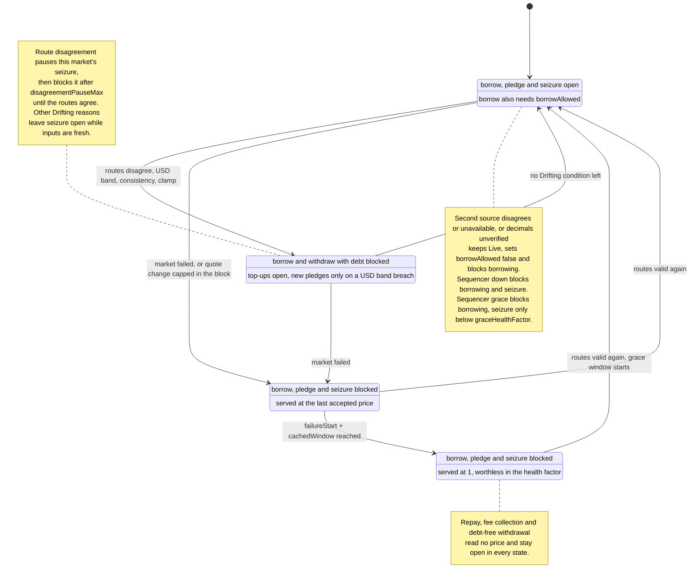

# 2.10 LPOracle, LPPriceMath and DebtOracle

> **Status:** In review · **Owner:** Avana Labs · **Last reviewed:** 2026-11-11
>
> **Requirement prefix:** `REQ-ORACLE-NNN` · **Math prefix:** `SPEC-ORC-NNN`

## Purpose

LPOracle is the price feed for one market. A market is one (chain, AMM protocol, pool, exact position shape), with one vault token and one collateral reserve on its CDP Spoke; each market has its own LPOracle proxy (`Q-321`). The LPOracle has two layers:

- **Price-state core** (AMM-neutral). Validates Chainlink prices for each of the market's `n` tokens, selects a quote per token, runs failover, agreement, freshness, second-source, sequencer and timer rules, and serves a conservative price when the market cannot be trusted. It works on price vectors `q = (q_0, …, q_{n−1})` and never on a fixed pair of tokens.
- **Pricing module** (one per AMM protocol per chain). Supplies the market's composition at an oracle price vector, the AMM consistency check and the listing checks. It is an internal library compiled into the AMM protocol's LPOracle implementation, and every market of that protocol on the chain is a proxy of that implementation. The concentrated-liquidity module used by Uniswap v3 and Aerodrome Slipstream is specified in [Concentrated-liquidity pricing](#concentrated-liquidity-pricing-uniswap-v3-and-aerodrome-slipstream); the readiness sections of the other AMM protocols state their modules.

LPOracle does two jobs:

1. **Price for Aave.** `latestAnswer()` returns the USD value of one whole vault token with 8 decimals. The CDP Spoke's AaveOracle reads it for health factor and seizure sizing. The value is unhaircut, built from validated Chainlink prices at the composition the position would hold at those prices, and never credits a stable above $1. When the market's price cannot be trusted it serves a conservative value instead: the last accepted price while Cached, the lower route of each token during a route disagreement, and 1 (the smallest positive price) once Expired (`SPEC-ORC-017`). While Live or Drifting it serves the fresh price, so liquidation sees a rally at once; the last accepted price bounds borrowing only, through the RiskModule (`REQ-RISK-026`, `REQ-RISK-059`). It never reverts except `InsufficientGas` and never returns 0.
2. **Usability for Avana.** Views report the price state (Live, Drifting, Cached, Expired), the original source timestamp of the served price and the age limits that apply to it, whether a borrow may rely on the price (`borrowAllowed`: second source, sequencer and a recent token-decimals verification), the disagreement pause and its expiry, the recovery grace window, the last accepted price and an hourly price checkpoint. The RiskModule (for the AaveAdapter and Collateralization) and LPVaultSwap enforce their gates from these views.

DebtOracle ([DebtOracle](#debtoracle)) is the price feed for one non-GHO debt asset, built on the same leg, route, failover, agreement, freshness, second-source, sequencer and timer rules. It serves the debt asset's USD price to the AaveOracle of every CDP Spoke that lends the asset, and a raised stress price once Expired (`SPEC-ORC-018`).

LPOracle is **not** responsible for:

- risk adjustment: there is no oracle haircut; all risk sits in the Spoke Collateral Factor ([2.7](07-risk-module.md)) (`Q-028`);
- debt-asset prices: GHO is priced by Aave's fixed source and every other debt asset by its DebtOracle (`Q-238`, `Q-248`);
- enforcing gates: it only reports; enforcement is in the RiskModule ([2.7](07-risk-module.md)), called by the AaveAdapter ([2.6](06-aave-adapter.md)) and Collateralization ([2.3](03-collateralization.md)), and in LPVaultSwap ([2.11](11-lpvaultswap.md));
- choosing feeds or parameters: governance sets the primary, alternate and standby routes in the MarketRegistry ([2.8](08-market-registry.md)), and feed settings, second sources, tolerances, windows, the band and the chain's sequencer feed in the ParameterStore ([2.9](09-parameter-store.md)); the only fast change is a guardian's switch to the standby route recorded at listing, made in the MarketRegistry (`Q-248`);
- custody, unwinding and fees of positions: the AMM integration ([2.2](02-lp-vault.md)) owns them; the pricing module uses the integration's composition so that pricing and unwinding agree;
- liquidation sizing, swaps and settlement ([2.11](11-lpvaultswap.md), [2.12](12-settlement-routes.md)).

## Terms

| Term | Meaning |
|---|---|
| `n` | Number of tokens of the market, `2 ≤ n ≤ MAX_POOL_TOKENS` (8), fixed at listing |
| token *i* | `i ∈ {0, …, n − 1}`, the market's tokens in the AMM protocol's pool order, read from the pool at listing |
| `d_i`, `d` | Decimals of token *i* and of the vault token; `d` is fixed at listing by `SPEC-ORC-005` |
| leg | One Chainlink aggregator, addressed through its standard Chainlink proxy |
| route | One leg (`TOKEN/USD`) or two legs multiplied (`TOKEN/X × X/USD`) giving a USD price per whole token |
| primary, alternate | The two routes in force for each token, as `MarketRegistry.activePriceRoutes(token)` returns them. The recorded primary is a direct `TOKEN/USD` feed |
| standby | A third route recorded for each token at listing under the same checks; a guardian switch puts it in place of the primary or the alternate, and the registry then returns it in that slot (`Q-248`) |
| second source | An independent price of the token from another oracle network or a time-weighted price of a deep pool, which a borrow and a withdraw-with-debt also require to agree (`SPEC-ORC-020`) |
| route version | `MarketRegistry.priceRouteVersion(token)`, a counter the registry increments on every change of the token's routes in force |
| route value `r` | A route's USD price per whole token, 8 decimals, uncapped (`SPEC-ORC-002`) |
| quote `q_i` | The uncapped route value LPOracle uses for token *i*: the primary when valid, otherwise the alternate. `q` is the quote vector |
| valuation price `v_i` | `q_i` after the stable $1 ceiling, used only for valuation. `v` is the valuation price vector |
| composition `a(u, x)` | The token amounts, in raw units, that `u` vault-token units of the market hold when the pool price equals the price implied by the price vector `x`, rounded down; supplied by the pricing module |
| `price8` | USD value of one whole vault token, 8 decimals (`SPEC-ORC-008`) |
| feed age limit | `feedMaxAge = feedHeartbeat + heartbeatMargin` of a leg (`SPEC-ORC-019`) |
| failed | At least one token has no valid route, or the configuration or the pricing module's pool read cannot be read |
| fresh price | `price8` from the current valuation prices when the market is not failed |
| served price | What `latestAnswer()` returns, chosen by state (`SPEC-ORC-017`) |
| accepted price | The last Live price stored by `poke()` (or seeded by `initialize`), with its original source timestamp and its valuation price vector; `lastAcceptedPrice()` returns it |
| checkpoint | The accepted price copied by `poke()` at most once per hour, with the block time of the copy (`priceCheckpoint()`) |
| sequencer ready | On a chain with an L2 sequencer, the uptime feed reports up and its grace period has passed (`SPEC-ORC-021`); always true on Ethereum. A borrow also needs the served price's rounds newer than the restart |
| writing call | A call to `poke()`. It is the only call that writes price, timer or latch storage |
| `now` | `block.timestamp` |

## Inputs

- **Chainlink legs** (external, read-only): `latestRoundData()`, `decimals()`, `getRoundData(roundId − 1)` for recovery evidence, and, when a round is the first of a new aggregator phase, `phaseAggregators(phaseId − 1)` and that aggregator's `latestRoundData()` (`REQ-ORACLE-089`).
- **Second sources** (external, read-only): per token, either an oracle-network aggregator's `latestRoundData()` and `decimals()`, or the pricing module's time-weighted price of a deep pool (`REQ-ORACLE-100`).
- **Sequencer-uptime feed** (external, read-only, L2 chains only): `latestRoundData()` of the chain's Chainlink L2 Sequencer Uptime feed (`REQ-ORACLE-099`).
- **The market's pool** (external, read-only, through the pricing module): for concentrated liquidity, `observe([twapWindow, 0])` for the consistency check and `slot0()` for its reentrancy-lock flag and observation cardinality only, never its price or tick; `token0()`, `token1()` and `tickSpacing()` at `initialize` and in `checkConfig`. The pool, tokens, decimals and shape are fixed at `initialize`.
- **ERC-20 tokens** (external, read-only): `decimals()` at `initialize`, in `checkConfig` and in every `poke()`. Evaluation uses the decimals stored at `initialize`: a token's decimals and its place in the pool are fixed market data, like the pool and the shape. `poke()` reads them again only to verify them against the stored values (`REQ-ORACLE-107`); a changed value is never adopted.
- **MarketRegistry** (internal, read-only): `activePriceRoutes(token)` returns the aggregator addresses of each token's primary and alternate routes in force and which slot, if any, its standby replaces; `priceRouteVersion(token)` returns the route version (`REQ-ORACLE-094`). The ParameterStore reads both for the LPOracle inside `getOracleInputs`, in the same static call; `marketOfLpOracle` and `getMarket` are read directly only by `checkConfig`.
- **ParameterStore** (internal, read-only): `getOracleInputs(address(this), tokens, withSecondSources)` returns, in one read, this market's identifier, consistency settings, band, timers and the chain's sequencer configuration, and per token its tolerance, routes in force, route version and replaced slot, each leg's pinned decimals, `minAnswer`/`maxAnswer`, `feedHeartbeat`, `heartbeatMargin` and age limits and, when asked, the second source in force with its pinned decimals and bounds ([Configuration read on every evaluation](#configuration-read-on-every-evaluation)). `checkConfig` reads `getFeed` and `feedAgreementMarginBps`.
- **Callers of `poke()`**: any address. The RiskModule pokes the account's collateral market before its borrow-side checks, Collateralization pokes the pledged market before `RiskModule.checkPledge`, LPVaultSwap pokes the collateral market of the account it liquidates, and keepers poke on a schedule.

## Outputs

- `latestAnswer()`: served price (`SPEC-ORC-017`), `int256`, 8 decimals, always ≥ 1.
- `latestRoundData()`, `decimals()`, `description()`: Chainlink-compatible views.
- `getPriceState()`: state, market and per-token reasons, served, fresh and accepted prices with their timestamps, per-token route data and route versions, the legs in use with their feed addresses, timestamps and age limits, second-source data, consistency and band data, sequencer readiness, `borrowAllowed`, timers, disagreement pause and its expiry, grace window. The pricing module's detail is in its extension view (for concentrated liquidity, `getClPriceState()`).
- `getTokenPrices()`: the valuation price vector for LPVaultSwap's recovery floor and per-leg minimum outputs.
- `lastAcceptedPrice()`: the accepted price and its source timestamp, which bounds borrowing and pledge booking in the RiskModule (`REQ-ORACLE-087`).
- `priceCheckpoint()`: the hourly checkpoint that monitoring compares the served price with for the price-drop alert (3 % in 2 hours, alert only, `Q-399`).
- `poke()`: stores accepted prices, failure and disagreement timers, the grace latch and `recoveredAt`, the route versions and the checkpoint, and emits events.

No token, ETH or approval ever moves through LPOracle.

## Storage

ERC-7201 namespace `avana.storage.LPOracle`. All fields below live in the proxy's storage.

| Variable | Type | Description | Written by |
|---|---|---|---|
| `parameterStore`, `marketRegistry` | `address` | ParameterStore and MarketRegistry proxies of this chain (canonical addresses) | `initialize` |
| `integration` | `address` | The market's AMM integration (LPVault), returned by `integration()` | `initialize` |
| `marketId` | `uint256` | MarketRegistry identifier of the market | `initialize` |
| `tokens` | `address[]` | The market's tokens in pool order, length `n` | `initialize` |
| `tokenDecimals` | `uint8[]` | Token decimals read at listing | `initialize` |
| `vaultDecimals` | `uint8` | `d` (`SPEC-ORC-005`) | `initialize` |
| `isUsdStable` | `bool[]` | Token *i* is an approved USD-pegged stable (ceiling applies) | `initialize` |
| `market` | pricing-module struct | The pool and exact shape the pricing module prices (for concentrated liquidity, in its own ERC-7201 namespace `avana.storage.LPOracleCL`: pool, `tickLower`, `tickUpper`, the pool's `tickSpacing` read at `initialize`, and the range's square-root ratios `s_a`, `s_b` computed once) | `initialize` |
| `descriptionText` | `string` | Value returned by `description()` | `initialize` |
| `accepted` | struct `{int256 answer; uint64 updatedAt; uint128[] prices}` | Last accepted price, its oldest-input source timestamp and the valuation price vector it was built from | `initialize`, `poke` |
| `acceptedBlock` | `uint64` | `block.number` of the call that stored `accepted`; the quote-change cap compares it with the current block (`REQ-ORACLE-103`) | `initialize`, `poke` |
| `lastCachedWindow` | `uint32` | `cachedWindow` read by the last writing call (or `initialize`); the Cached window of a failure whose configuration read itself fails (`SPEC-ORC-013`) | `initialize`, `poke` |
| `failedSince` | `uint64` | First failed read of the current failure episode; 0 if none recorded | `poke` |
| `disagreeSince` | `uint64` | First observation of the current route disagreement; 0 if none | `poke` |
| `expiredLatched` | `bool` | An outage reached Expired by source timestamps and no grace has started for it yet | `poke` |
| `recoveredAt` | `uint64` | Source timestamp of the first fresh update after the last outage that reached Expired; 0 if none | `poke` |
| `seen[n][2][2]` | struct `{address feed; uint80 roundId; uint64 updatedAt}` | Per token, route and leg: the aggregator and round last read by a writing call | `initialize`, `poke` |
| `routeVersion[n]` | `uint64` | Per token, the `priceRouteVersion` observed by the last writing call | `initialize`, `poke` |
| `checkpoint` | struct `{uint128 price8; uint64 at}` | The accepted price copied at most once per `CHECKPOINT_INTERVAL`, and the block time of the copy | `initialize`, `poke` |
| `lastState` | `uint8` | State observed by the last writing call (for events only) | `initialize`, `poke` |
| `lastRoute[n]` | `uint8` | Route used per token at the last writing call: None, Primary, Alternate (for events only) | `initialize`, `poke` |
| `pokeMinGas` | `uint32` | Minimum gas for `poke()` at entry (`SPEC-ORC-023`) | `initialize`, `setPokeMinGas` |
| `decimalsCheckedAt` | `uint64` | Last time every token's `decimals()` read equal to `tokenDecimals` (`REQ-ORACLE-107`) | `initialize`, `poke` |
| `decimalsInvalid` | `bool` | The last `poke()` found a token's `decimals()` unreadable or different from `tokenDecimals`; every evaluation is failed while it is set (`REQ-ORACLE-107`) | `poke` |
| `listingPrices` | `uint128[]` | The valuation price vector `initialize` computed `d` at (`SPEC-ORC-005`); `checkConfig` re-derives `d` at it and, once the MarketRegistry has registered the feed, runs its price-dependent checks at it (`REQ-ORACLE-047`, `REQ-ORACLE-050`). Each entry is at most `MAX_ROUTE_ANSWER = 10^18 < 2^128` | `initialize` |

Implementation constants: `stableCeilingUsd` (8 decimals, immutable per [1.5](../01-architecture/05-parameters.md)), `DECIMALS = 8`, `MAX_POOL_TOKENS = 8`, `POKE_MIN_GAS_FLOOR`, `POKE_MIN_GAS_CEILING`, `FEED_CALL_GAS`, `CONFIG_CALL_GAS`, `POOL_CALL_GAS`, `ORACLE_CONFIG_BASE_GAS = 150,000`, `ORACLE_CONFIG_TOKEN_GAS = 140,000` (`SPEC-ORC-023`), `MAX_QUOTE_CHANGE_BPS = 100` (`REQ-ORACLE-103`), `MAX_ROUTE_ANSWER = 10^18` ($10,000,000,000 per whole token, [1.5](../01-architecture/05-parameters.md)), `LISTING_SHOCK_FACTOR = 100`, `CHAIN_BLOCK_TIME` (seconds: 12 on Ethereum, 2 on Base; `SPEC-ORC-022`), `CHECKPOINT_INTERVAL = 3,600` seconds, `DECIMALS_CHECK_MAX_AGE = 7,200` seconds (`REQ-ORACLE-107`), `TIMELOCK` (the chain's AvanaTimelock, the only account that may hold `DEFAULT_ADMIN_ROLE` or `APPLICATION_ADMIN`).

## Configuration read on every evaluation

LPOracle reads, on every evaluation, its whole configuration in one static call, `ParameterStore.getOracleInputs(address(this), tokens, withSecondSources)` ([2.9](09-parameter-store.md)), and applies the values exactly. The store resolves the routes in force and the route versions from the MarketRegistry inside that call, so they are the registry's answers in the same block, and the call returns the words of `OracleInputsLayout`: 10 head words, then per token 37 words (tolerance, route version, replaced slot, the two routes' leg counts and four legs of 8 words) and, with second sources, 9 more. Values follow the change classes in [1.5](../01-architecture/05-parameters.md); who changes them is in [2.9](09-parameter-store.md) and, for routes, [2.8](08-market-registry.md).

| Field | Scope | Source in `getOracleInputs` | Meaning |
|---|---|---|---|
| `marketId` | market | `MarketRegistry.marketOfLpOracle(lpOracle)` | MarketRegistry market identifier of this feed's market; 0 when the feed is no market's LPOracle |
| routes in force | token, route (primary, alternate) | `MarketRegistry.activePriceRoutes(token_i)` | Leg counts and one or two aggregator proxies per route, in multiplication order; the standby already substituted into the slot it replaces |
| route version, replaced slot | token | `MarketRegistry.priceRouteVersion(token_i)`, `activePriceRoutes` | Compared with `routeVersion[i]` (`REQ-ORACLE-095`); the slot the standby replaces |
| per leg | feed | the store's feed definition of the aggregator (`getFeed`) | Pinned `decimals`, pinned `minAnswer`, `maxAnswer`, `feedHeartbeat`, `heartbeatMargin` (`feedMaxAge = feedHeartbeat + heartbeatMargin`), `borrowPriceMaxAge`, `liquidationPriceMaxAge` (`SPEC-ORC-019`) |
| `feedAgreementToleranceBps[i]` | token | store | Primary-versus-alternate tolerance; `T_i = feedAgreementToleranceBps[i]` |
| `secondSource[i]` | token | store, only with `withSecondSources` | Kind (`OracleNetwork` or `PoolTwap`), source, pool reference, maximum age or window, tolerance `S_i` in bps (`SPEC-ORC-020`), and an oracle-network source's pinned decimals and bounds; the standby second source while `onStandby[token_i]` is set (`REQ-PSTORE-029`) |
| `twapWindow`, `consistencyToleranceBps` | market | store | Consistency-check window `W` (seconds) and the tolerance; for concentrated liquidity `τ = twapToleranceTicks` of the market's configuration |
| `usdBandLow`, `usdBandHigh` | global | store | USD band as 8-decimal levels per 1 USD of value at peg (`10^8` = 1.00) |
| `cachedWindow`, `disagreementPauseMax` | global | store | Timer lengths (seconds) |
| `graceDuration` | global | store | Recovery grace length (seconds) |
| `sequencer` | chain | store | `{feed, gracePeriod}`: the chain's sequencer-uptime feed (`address(0)` on Ethereum) and `sequencerGracePeriod` (`SPEC-ORC-021`) |

The quote-change cap is the chain constant `MAX_QUOTE_CHANGE_BPS = 100` (1 %) of the implementation, the value the ParameterStore serves as `maxQuoteChangeBps` in `getOracleConfig` for every market; evaluation does not read it. `twapMinObservations` is a listing check (`SPEC-ORC-022`) and is not read either. Token decimals, the tokens in pool order, the pool and the shape are fixed at `initialize`; `checkConfig` compares them with the MarketRegistry's market record once the registry maps this feed (`REQ-ORACLE-046`), activation requires `checkConfig == 0`, and neither list can change afterwards: the registry writes a market's tokens only when it lists the market and the LPOracle has no setter. Evaluation therefore checks only that the store's `marketId` is this feed's market. A token can still change its own `decimals()` (an upgradeable token); `poke()` verifies every token's decimals against the stored values and a mismatch fails the market until a poke reads the stored values again (`REQ-ORACLE-107`). The seed evaluation of `initialize` and `checkConfig` also checks that the configuration has this market's identifier and token count; both entry points refuse such a configuration first (`MarketMismatch`, `CHECK_TOKENS`), so the seed's own check is a defensive one that no current path reaches, kept for any later initialization or upgrade flow and reviewed whenever that flow changes.

`getPriceState()` and `poke()` ask for the second sources; `latestAnswer()`, `latestRoundData()`, `getTokenPrices()`, `borrowPriceMaxAge()` and `liquidationPriceMaxAge()` do not, because second sources change none of the values those views return (`REQ-ORACLE-100`). The `routes` field of `OracleConfig` is the input format of `checkConfig`, which the MarketRegistry and ParameterStore run on a candidate configuration before it takes effect. Evaluation reads each word it applies at its fixed index after one check that the return data is a `uint256[]` of exactly the expected length, and range-checks each against its type, so a malformed return is a failed read (reason bit 1) and never a decoder revert; a configuration of another market, a route of no leg or more than two legs, or a leg with no aggregator or no feed definition (pinned decimals 0) is a failed read too. The second-source words are the exception: a second-source word beyond its type (a kind above `PoolTwap`, a source above 160 bits, an age or window above 32 bits, a tolerance above 16 bits, decimals above 8 bits) leaves that token's second source unset, so the token is unconfirmed (token bit 5) while the primary pricing, the state and every timer go on unchanged (`REQ-ORACLE-100`). The ParameterStore's setters refuse such a configuration; the LPOracle keeps the check for any store implementation behind the proxy. `checkConfig` takes the configuration as calldata and reads it field by field.

Example: a two-token market whose tokens each have a one-leg primary, a two-leg alternate and an oracle-network second source makes one configuration read of 84 words (`latestAnswer`) or 102 words (`getPriceState`, `poke`), then reads its six legs and, for `getPriceState` and `poke`, the two second sources.

## Functions

| Function | Description | Caller (role / contract) | Requirements |
|---|---|---|---|
| `initialize(InitParams)` | Takes the market from its arguments (tokens in pool order, integration, the pricing module's pool and shape); stores tokens, decimals, stable flags, shape, description, `pokeMinGas`, `d`; runs the listing checks; seeds the accepted price | Avana operators, atomically with proxy deployment, before the listing batch is scheduled (`MKT-019`) | `REQ-ORACLE-058`, `REQ-ORACLE-059` |
| `latestAnswer() → int256` | Served price, 8 decimals (`SPEC-ORC-017`) | Anyone (AaveOracle) | `REQ-ORACLE-020`, `REQ-ORACLE-085`, `REQ-ORACLE-086` |
| `decimals() → uint8` | Always 8 | Anyone (AaveOracle) | `REQ-ORACLE-040` |
| `description() → string` | Fixed description | Anyone | `REQ-ORACLE-040` |
| `latestRoundData() → (uint80, int256, uint256, uint256, uint80)` | Served price with its original timestamp | Anyone | `REQ-ORACLE-041` |
| `getPriceState() → PriceStateView` | Full state report | Anyone (RiskModule, LPVaultSwap, Lens, keepers) | `REQ-ORACLE-042` |
| `getClPriceState() → ClPriceStateView` | Concentrated-liquidity detail (concentrated-liquidity implementation only) | Anyone (Lens, keepers) | `REQ-ORACLE-104` |
| `POKE_LOGIC()`, `INIT_LOGIC()`, `LISTING_LOGIC()`, `VIEW_LOGIC()`; `MODULE_LOGIC()`, `SLOT0_WORDS()` (concentrated liquidity) | The implementation's immutable logic contracts, its pricing-module contract and its `slot0` layout | Anyone (deployment checks, monitoring) | `REQ-ORACLE-106` |
| `getTokenPrices() → (uint256[] prices, uint64 servedUpdatedAt, PriceState state)` | Valuation price per whole token, in pool order | Anyone (LPVaultSwap) | `REQ-ORACLE-044` |
| `borrowPriceMaxAge()`, `liquidationPriceMaxAge() → uint32` | Age limit of the served price for borrow and for liquidation (`SPEC-ORC-015`) | Anyone (RiskModule, LPVaultSwap, Lens) | `REQ-ORACLE-043` |
| `lastAcceptedPrice() → (uint256 price8, uint64 updatedAt)` | Accepted price and its source timestamp | Anyone (RiskModule, Lens) | `REQ-ORACLE-087` |
| `priceCheckpoint() → (uint256 price8, uint64 at)` | Hourly checkpoint of the accepted price | Anyone (RiskModule, Lens) | `REQ-ORACLE-088` |
| `poke() → PriceState` | Evaluates, stores accepted price, timers, latch, route versions and checkpoint | Anyone | `REQ-ORACLE-024` … `REQ-ORACLE-037`, `REQ-ORACLE-082`, `REQ-ORACLE-088`, `REQ-ORACLE-095` |
| `checkConfig(OracleConfig) → uint256 failedChecks` | Listing and configuration checks; 0 means all pass | Anyone (ParameterStore, MarketRegistry, deployment scripts) | `REQ-ORACLE-046` |
| `decimalsStatus() → (bool invalid, uint64 verifiedAt)` | The stored token-decimals result: whether the last `poke()` found a token's decimals changed or unreadable, and the time of the last successful verification | Anyone (RiskModule, Lens, monitoring) | `REQ-ORACLE-107` |
| `setPokeMinGas(uint32)` | Changes `pokeMinGas` within bounds | `APPLICATION_ADMIN` (the timelock, normal delay) | `REQ-ORACLE-038` |
| `grantRole(bytes32, address)` | OpenZeppelin `AccessControl` grant; reverts `AdminRoleOnlyTimelock` for an admin role and any account but `TIMELOCK` | Role admin (the timelock) | `REQ-ORACLE-097` |

## Valuation pipeline

Every evaluation (views and `poke()`) runs the same internal function in this order: read the configuration and the sequencer feed, read and validate legs, build routes, select a quote per token, check agreement, apply the ceiling, compute `price8` from the pricing module's composition, then (for the state only) the USD band, the pricing module's consistency check and, for `getPriceState()` and `poke()`, the second sources. Every external read follows the gas guard `SPEC-ORC-023`. Valuation prices one whole vault token from the market's composition at the oracle prices; it never reads positions, records or depositors, so its cost does not depend on how many accounts hold the market. Market data fixed at `initialize` is stored then and not read again from outside for valuation: the tokens, their decimals (which only `poke()` re-reads, to verify them, `REQ-ORACLE-107`) and stable flags, `d`, and the pricing module's pool and shape with the values derived from them (for concentrated liquidity the range's square-root ratios and the decimal scaling of the oracle ratio), so an evaluation computes each of them at most once.

### Legs and routes

Leg normalisation and route values are [LPPriceMath](#lppricemath) formulas `SPEC-ORC-001` and `SPEC-ORC-002`; the age limit of a leg is `SPEC-ORC-019`.

- `REQ-ORACLE-001` For each leg, LPOracle MUST call `latestRoundData()` and `decimals()` on the configured aggregator address as static calls inside `try`/`catch`, with the explicit gas of `SPEC-ORC-023`, copying at most the ABI length of the expected return data (160 bytes and 32 bytes); a revert, a shorter return or a failed decode marks the leg invalid with cause `Error`. Decimals are pinned at configuration and checked on every read, so a mismatch is invalid. (Source: Q-056, Q-079, Q-091, Q-119, Q-328)
- `REQ-ORACLE-002` A leg MUST be treated as valid only if all of these hold: `decimals()` equals the pinned decimals; `answer > minAnswer` and `answer < maxAnswer` (pinned at listing, so `answer > 0` follows); `updatedAt != 0`; `updatedAt ≤ now`; `now − updatedAt ≤ feedMaxAge`, the leg's own heartbeat plus its own margin (`SPEC-ORC-019`); and, for the leg of a one-leg route, the normalised answer (`SPEC-ORC-001`) is at least 1. The first leg of a two-leg route is quoted in its intermediate token, not in USD, so an 8-decimal normalisation of it alone tests nothing: a token worth less than `10^-8` of the intermediate would normalise to 0 while its route is worth dollars; such a leg is held to `answer > minAnswer ≥ 0` and its route to `r ≥ 1` (`REQ-ORACLE-004`). The answer is the signed `int256` Chainlink returns and LPPriceMath takes it signed: any `answer ≤ 0` or `answer ≥ 2^128` gives 0, so a negative answer is never cast to a large unsigned value. `startedAt`, `roundId` validity and `answeredInRound` are not used for validity. (Source: Q-056, Q-119, Q-191, Q-322)
- `REQ-ORACLE-003` A leg that fails only the `now − updatedAt ≤ feedMaxAge` condition MUST be classed `Stale`; a leg that fails any other condition of `REQ-ORACLE-002` MUST be classed `Invalid`; `Error` is defined in `REQ-ORACLE-001`. Only `Stale` counts as a source-timestamp failure. (Source: Q-119, Q-154)
- `REQ-ORACLE-004` A route MUST be treated as valid only if every leg is valid and `r ≥ 1`; an invalid route is `Stale` if every invalid leg is `Stale` and `r` was not the failing condition, otherwise `Invalid` or `Error`. (Source: Q-154, Q-191)

### Quote per token, failover and agreement

- `REQ-ORACLE-005` For each token *i*, LPOracle MUST select the quote as follows: if the primary route is valid, `q_i = r_primary` and `t_i = t_primary`; otherwise, if the alternate route is valid, `q_i = r_alternate` and `t_i = t_alternate`; otherwise token *i* has no valid route. (Source: Q-036, Q-056, Q-079, Q-130)
- `REQ-ORACLE-006` Failover to the alternate MUST be automatic and re-evaluated on every read: no transaction, role or stored flag is needed for it, and the market stays Live while the alternate is valid and no Drifting condition holds. When the primary becomes valid again it is used again on the next read. (Source: Q-036, Q-118, Q-130)
- `REQ-ORACLE-007` LPOracle MUST NOT have a stored switch that disables a primary route: failover is automatic (`REQ-ORACLE-006`), a primary that is fresh but wrong is caught by the agreement check (Drifting, then the disagreement pause and, if it persists, `REQ-ORACLE-084`), a guardian ends such an incident by switching the wrong route's slot to the token's standby route in the MarketRegistry, which LPOracle reads on its next evaluation (`REQ-ORACLE-094`), and permanently replacing a feed is a new price source through `MarketRegistry.setPriceSource` at the normal delay. (Source: Q-048, Q-091, Q-130, Q-208, Q-248)
- `REQ-ORACLE-008` When both routes of a token are valid, LPOracle MUST run the agreement check `SPEC-ORC-003` on the uncapped route values; if it fails, the token disagrees, the market is Drifting, and the quote is still the primary. When only one route is valid, no agreement check runs. (Source: Q-112, Q-130, Q-162, Q-177, Q-184, Q-200)
- `SPEC-ORC-003` **Agreement tolerance.** Token *i* agrees iff `|p − b| · 10^4 ≤ T_i · min(p, b)`, where `p = r_primary`, `b = r_alternate` (8 decimals, uncapped) and `T_i = feedAgreementToleranceBps[i]` (bps, the stored value from the ParameterStore). Units: bps. Rounding: none; exact integer comparison, no division, symmetric in `p` and `b`. Why: floor division would admit one more basis point than the tolerance, and the tolerance must exceed the two routes' own deviation thresholds so honest routes never disagree. Bounds: `p, b ≤ MAX_ROUTE_ANSWER = 10^18`, so `|p − b| · 10^4 ≤ 10^22` and `T · min(p, b) < 2^16 · 10^18 < 2^76`, both far inside 256 bits (MATH-UO-75e); a value of 0 or above `MAX_ROUTE_ANSWER` never agrees, so an input outside the listing bounds fails closed (the token disagrees) instead of overflowing. Example: `T = 225`, `p = 100,010,000`, `b = 99,900,000`: `110,000 × 10^4 = 1.1×10^9 ≤ 225 × 99,900,000 = 2.248×10^10`, so the token agrees; with `b = 97,500,000`: `2.51×10^10 > 2.194×10^10`, so it disagrees. Checked by: MATH-UO-24 (24b proves this form; 24a shows floor division admits `T + 1` bps), MATH-UO-23 (23a: `O ≤ 1 + T` when backups are correct), MATH-UO-60, SIM-01E. (Source: Q-112, Q-184, Q-227)

### Stable ceiling

- `SPEC-ORC-004` **Valuation price.** `v_i = min(q_i, stableCeilingUsd)` if `isUsdStable[i]`, else `v_i = q_i`. Units: 8-decimal USD per whole token. Rounding: none. Why: a stablecoin trading above $1 does not make the collateral safer, so valuation never credits the premium. Effect on value: the composition value `Σ a_i(x)·x_i` is minimised over pool prices at the oracle price (`SPEC-ORC-007`), so it is non-decreasing in every price; the ceiling therefore only lowers `price8` and is a no-op at or below $1. For a two-token full-range market an uncapped premium `x` would raise value by `√(1 + x) ≤ 1 + x/2`. Example: GHO at `q = 100,300,000` ($1.003) gives `v = 100,000,000`; USDC at `q = 99,987,000` passes through unchanged. Checked by: MATH-UO-19, MATH-UO-21, MATH-UO-52, SYM-32c, HYP-42. (Source: Q-177, Q-325)
- `REQ-ORACLE-009` LPOracle MUST use `v` (capped) for every valuation output: `price8` (`SPEC-ORC-008`), the composition (`SPEC-ORC-006`), the accepted price vector, `getTokenPrices()` and the upper bound of the USD band (`SPEC-ORC-011`). It MUST use the uncapped `q` for freshness, the agreement check, the second-source check, the consistency check and the lower bound of the USD band. The ceiling alone therefore never makes the market Drifting: a stable above peg is valued at $1 and its capped price never breaches the upper bound, so GHO markets stay Live above peg. Prices below the ceiling pass through unchanged. Checked by: MATH-UO-20, HYP-51, TEST-251. (Source: Q-177, Q-200, Q-275)
- `REQ-ORACLE-010` `isUsdStable[i]` MUST be set at `initialize` for every approved USD-pegged stable (GHO, USDC, USDT, DAI, USDS and any other listed stable); every token of a Stable LP Hub market is such a stable, so every flag is true for every launch market on Ethereum and Base. Changing a flag is a change to price computation and follows `REQ-ORACLE-079`. (Source: Q-032, Q-091, Q-177)

### Composition and the vault-token price

The vault-token unit, the composition, its lower-bound property and `price8` are [LPPriceMath](#lppricemath) formulas `SPEC-ORC-005` to `SPEC-ORC-008`; the concentrated-liquidity composition is `SPEC-ORC-006`.

- `REQ-ORACLE-011` LPOracle MUST compute `price8` with `SPEC-ORC-008` from the pricing module's composition `a(10^d, v)` at the valuation price vector only; it MUST NOT compute it from the pool's spot price or spot reserves (`slot0`, `getReserves` amounts at spot, balances), any position, `positionKey`, `tokensOwed`, fee growth, a 50/50 split or `weights × prices`. A pricing module that reads pool state for its composition (an AMM protocol with no closed form) reads only the invariant quantities its readiness section names, behind that protocol's reentrancy check. (Source: Q-028, Q-079, Q-085, Q-119, Q-321)
- `REQ-ORACLE-012` Every division and square root in the valuation path MUST round down (against the borrower) using pinned OpenZeppelin `Math.mulDiv` and `Math.sqrt`, the same library Aave V4 uses, and every token amount of the composition MUST be floored and then reduced by one raw unit (`SPEC-ORC-008`). (Source: Q-119, Q-325)
- `REQ-ORACLE-013` LPOracle MUST NOT apply any haircut, discount, premium or smoothing to `price8`; the value of a vault token depends only on the valuation price vector and the market's fixed shape, never on who holds it or on uncollected fees: `tokensOwed`, fee growth and every fee the AMM protocol keeps apart from the position are excluded, because a wash trader can raise them within one transaction. (Source: Q-011, Q-020, Q-028, Q-325)
- `REQ-ORACLE-103` Preserves: the vault-token price never exceeds the oracle value of the backing. The pricing module MUST provide, as internal functions of the AMM protocol's LPOracle implementation: `composition(units, prices) → uint256[] amounts` (raw units, rounded down; for concentrated liquidity the floored `getAmountsForLiquidity` amounts at the clamped oracle sqrt price, `SPEC-ORC-006`, from which `lpPrice` takes one raw unit off each, `SPEC-ORC-008`; the AMM integration's composition view computes the same amounts with the same math and reports them already reduced by that one raw unit, for display, and the oracle never feeds those reduced amounts into `lpPrice`, so the unit is deducted once), `poolCheck(quotes, prices, window, τ) → (readOk, locked, available, pass, deviationBps, clamped)` (one read of the pool for an evaluation: whether its reentrancy lock is held, false for an AMM protocol without one, and the consistency check with the composition's clamp), `isOwnPool(poolRef) → bool` (true when `poolRef` is the market's pool address as `bytes32(uint160(pool))` or, for an AMM protocol keyed by pool identifier, its pool identifier; `checkConfig` refuses a `PoolTwap` second source on it, `REQ-ORACLE-100`) and `listingChecks(...) → uint256 failedChecks`. The core MUST treat a reverting or malformed module read as a failure of the market (reason bit 1), a held pool lock as a failure (reason bit 17) for which `poke()` writes nothing (`REQ-ORACLE-026`), and a consistency read that is unavailable as Drifting (reason bit 5). A composition that LPPriceMath rejects is a malformed module read: `lpPrice` and `inUsdBand` return `valid = false` and `vaultDecimals` returns `found = false`, never a revert, when the arrays differ in length, `n` lies outside `[2, MAX_POOL_TOKENS]`, an amount is `≥ 2^128`, a token has more than 77 decimals, or a price lies outside `[1, MAX_ROUTE_ANSWER]`; the core then sets reason bit 1. A revert would be unusable here: LPPriceMath is compiled into the oracle, so no `try` can catch it, and a reverting `latestAnswer()` breaks `REQ-ORACLE-061`. The concentrated-liquidity module is specified in [Concentrated-liquidity pricing](#concentrated-liquidity-pricing-uniswap-v3-and-aerodrome-slipstream); the module of Uniswap v3 computes the floored amounts of [2.20](20-uniswap-v3-integration.md) `SPEC-AMM-V3-001` (oracle sqrt price clamped to the range, amounts floored; the one-raw-unit reduction is `lpPrice`'s, never applied twice), Aerodrome Slipstream reuses it ([2.21](21-aerodrome-slipstream-integration.md)), and the modules of Uniswap v2, Curve StableSwap-NG, Balancer and Uniswap v4 follow their readiness sections on [2.22](22-amm-integration-readiness.md) (`SPEC-AMM-V2-001`, `SPEC-AMM-CURVE-001`, `SPEC-AMM-BAL-001`, `SPEC-AMM-V4-001`). Quote-change cap (`REQ-AMM-CORE-014`): for every AMM protocol, when `poke()` evaluates a fair price `price8` that differs from the accepted price by more than `maxQuoteChangeBps` of the accepted price (the chain constant `MAX_QUOTE_CHANGE_BPS = 100` = 1 %, the value the ParameterStore serves as `getOracleConfig().maxQuoteChangeBps` for every market) and the accepted price was stored in the same block (`acceptedBlock == block.number`), LPOracle MUST NOT accept it: every evaluation of that block (views and `poke()`) reports the market Cached with reason bit 18 `QUOTE_CHANGE_CAPPED`, serves the accepted price with its timestamp, returns the accepted price vector from `getTokenPrices()` and age limits 0, `poke()` emits `QuoteChangeCapped(accepted, quoted)` and stores no accepted price, and a later block that still computes the new price accepts it. The cap applies only where the evaluation would otherwise be Live; a Drifting market serves its fresh price uncapped, which adds no borrowing power: Drifting blocks new borrowing and withdraw-with-debt, every borrow-side health check is held to `min(served, A)` (`REQ-RISK-059`) and every pledge is booked at `min(fresh, A)` (`REQ-RISK-026`). The test is `|price8 − accepted| × 10⁴ > maxQuoteChangeBps × accepted`, in integers with no rounding. Why: even at fair composition a fungible-share quote reads invariant inputs from the pool, and one block of swaps or donations can raise it; the cap keeps a one-block move from reaching borrowing power, and a move that persists is accepted one block later, so seizure, which Cached blocks, waits at most one block for a real move. Example: accepted price 2.10000000 USD (`210,000,000`), a quote of 2.13 USD in the same block: `3,000,000 × 10⁴ = 3·10¹⁰ > 100 × 210,000,000 = 2.1·10¹⁰`, refused; 2.11 USD (`1·10¹⁰ ≤ 2.1·10¹⁰`) is accepted. `block.number` is the chain's own block: on Ethereum the L1 block, on Base (OP Stack) the L2 block, which advances every 2 s with a strictly later timestamp, so on both chains `acceptedBlock == block.number` holds exactly for calls in the block that stored the price and the cap lasts one block. A chain whose `block.number` reports the L1 block (Arbitrum) would hold the cap for every L2 block sharing that number, which only delays acceptance, never accepts a capped price; deploying there needs an implementation that reads the chain's own block number. Checked by: MATH-AMM-V2-PRICE-02, MATH-AMM-CURVE-PRICE-02, MATH-AMM-BAL-PRICE-02. (Source: Q-321, Q-302)

### USD band

- `REQ-ORACLE-015` A USD band breach MUST make the market Drifting (reason `USD_BAND`), which blocks new borrowing and withdraw-with-debt while pledges stay open; it MUST NOT set `liquidationPaused` or start any pause, so liquidation continues while both Chainlink routes of each token are fresh and agree. The band applies to markets whose tokens are all USD-pegged stables (every Stable LP Hub market); for any other market `usdBandLow = 0` and `usdBandHigh = type(uint256).max` are the only accepted values and the test always passes. (Source: Q-176, Q-195, Q-206, Q-329)

### Served price

The fresh price, the served timestamp and the age limits are [LPPriceMath](#lppricemath) formulas `SPEC-ORC-012` and `SPEC-ORC-015`; the served price by state is `SPEC-ORC-017`; the USD band test is `SPEC-ORC-011`.

- `REQ-ORACLE-085` While the market is Expired, `latestAnswer()` and the `answer` of `latestRoundData()` and `getPriceState()` MUST be `1`: one unit of 10⁻⁸ USD per whole vault token, the smallest positive price, so Aave counts the collateral as worthless. The value never reverts and is never 0, because Aave's `getReservePrice` rejects a non-positive price; it returns to the fresh price on the first read after the market recovers. Avana never seizes an Expired market (LPVaultSwap's gate on the seized market, [2.11](11-lpvaultswap.md)), so the value 1 only lowers the account's health factor and never sizes a seizure. Checked by: TEST-219, TEST-230, PROP-074. (Source: Q-247)
- `REQ-ORACLE-086` While some token disagrees (`SPEC-ORC-016` `pauseActive ∨ disagreementExpired`) and the market is not failed, `latestAnswer()` MUST be the vault-token price built from each token's lower route, capped, taken no higher than the fresh price (`SPEC-ORC-017`: `min(lower, fresh)`), and so never above the fresh price. The accepted price does not enter it: it bounds borrowing only (`REQ-ORACLE-087`), and a disagreeing market cannot borrow. Both routes are fresh during a disagreement, so the conservative one of the two is used instead of zero; the disagreeing market itself is not seized until the routes agree (`REQ-ORACLE-022`, `REQ-ORACLE-084`). Checked by: TEST-219, TEST-230, PROP-074. (Source: Q-247)
- `REQ-ORACLE-087` `lastAcceptedPrice()` MUST return `(uint256(accepted.answer), accepted.updatedAt)` in every state, with no external call, so it never reverts. The accepted price `A` bounds borrowing only; liquidation and Aave's health factor use the served price. Its users: the RiskModule's post-action health check after a borrow, a withdraw-with-debt and a liquidity removal that leaves debt runs at `min(served, A)` (`REQ-RISK-059`); a pledge, top-up or re-credit is booked at `min(fresh, A)`, or `A` alone when there is no fresh price (`REQ-RISK-026`: `marketUsdCap`, `tokenUsdCap`, `minPledgeUsd`, the stress charge and the booking basis of a top-up's restore amount, which itself still divides by the served price, `SPEC-CAP-003`); the withdrawal's remaining-record minimum is valued at `A` (`checkRemainingRecord`, `REQ-RISK-026`); and the Lens previews the charge price and a re-credit's charge at the same `min(fresh, A)`. So a rally since the last accepted price adds no borrowing power and no cap room until `poke()` accepts it, a fall lowers the booking at once, and a stress-served price never shrinks a cap or refuses a pledge for being below the minimum value. Checked by: TEST-230, MATH-UO-76. (Source: Q-247)

## LPPriceMath

LPPriceMath is an internal library (no external calls, no storage, compiled into every LPOracle implementation and the DebtOracle) holding the pure arithmetic of the price path, so each formula maps onto one function and one verification model (`Q-240`). Functions: `normalizeAnswer` (`SPEC-ORC-001`), `routeValue` and `routeTimestamp` (`SPEC-ORC-002`), `routesAgree` (`SPEC-ORC-003`), `valuationPrice` (`SPEC-ORC-004`), `feedMaxAge` (`SPEC-ORC-019`), `vaultDecimals` (`SPEC-ORC-005`, over the module's composition), `lpPrice` (`SPEC-ORC-008`, over the module's composition), `inUsdBand` with its fixed-point product and power and `usdLevel` (`SPEC-ORC-011`), `servedTimestamp` (`SPEC-ORC-012`), `ageLimits` (`SPEC-ORC-015`), `servedPrice` (`SPEC-ORC-017`), `debtServedPrice` (`SPEC-ORC-018`), `secondSourceAgrees` (`SPEC-ORC-020`), `sequencerStatus` (`SPEC-ORC-021`), `minObservations` (`SPEC-ORC-022`), `gasForCall` and `pokeMinGasFloor` (`SPEC-ORC-023`), and `deviationBps`, the informational deviation `getPriceState()` reports (`REQ-ORACLE-042`). The constants `stableCeilingUsd` and `MAX_ROUTE_ANSWER` live in the library, so the LPOracle and the DebtOracle share one value. `SPEC-ORC-007` is the property that justifies valuing at the oracle composition. Every division and square root of a collateral price rounds down (`REQ-ORACLE-012`); the one rounding of a debt price, the stress rise, rounds up. The oracles call these functions with values they have already validated, and every function also checks its own input bounds and fails closed instead of reverting: a signed answer outside `(0, 2^128)` normalises to 0, a malformed composition or band input returns `valid = false`, a value outside the agreement bounds disagrees, a served price is at least 1, and a bound that would overflow saturates at `type(uint256).max`.

- `SPEC-ORC-001` **Leg normalisation.** For a raw answer `a` (the signed `int256` of `latestRoundData()`) with `f` decimals: `n = 0` if `a ≤ 0` or `a ≥ 2^128`; otherwise `n = a · 10^(8 − f)` if `f ≤ 8`, else `n = ⌊a / 10^(f − 8)⌋`. Units: `n` has 8 decimals. Rounding: down, against the borrower. Why: Aave's value math expects 8-decimal USD, and rounding down never overstates collateral. Bounds: the listing check `REQ-ORACLE-049` keeps the normalised minimum answer ≥ 1 and every route value ≤ `MAX_ROUTE_ANSWER`; a normalised value of 0 is a failure, never a price. Answers outside `(0, 2^128)` normalise to 0, so the function never reverts (`a · 10^8 < 2^155`) and a negative answer never becomes a large unsigned price; for `f ≥ 47`, `10^(f − 8) > 2^128 > a`, so every answer gives 0. Example: an 8-decimal USDC/USD answer `99,987,000` gives `n = 99,987,000` ($0.99987); the same price from an 18-decimal feed, `999,870,000,000,000,000`, gives `⌊a / 10^10⌋ = 99,987,000`; from a 6-decimal feed, `999,870 × 100 = 99,987,000`. Checked by: MATH-UO-15 (15b, 15c), MATH-UO-58, HYP-42. (Source: Q-015, Q-048, Q-056, Q-091, Q-191)
- `SPEC-ORC-002` **Route value and timestamp.** One leg: `r = n`. Two legs `A` (token in intermediate `X`, raw `aA`, `fA` decimals) and `B` (`X/USD`, raw `aB`, `fB` decimals): `r = mulDiv(aA, aB, 10^(fA + fB − 8))` with OpenZeppelin `Math.mulDiv` (512-bit intermediate, rounding down); listing requires `fA + fB ≥ 8`, and a pair below that has value 0, an invalid route. Route timestamp `t_r = min(updatedAt` of its legs`)` (oldest input). Units: 8-decimal USD per whole token; seconds. Why: a composed route is only as fresh as its oldest input, so the market's age is never understated. Bounds: each answer is signed and only `0 < aA, aB < 2^128` gives a route value; any other answer gives `r = 0`, an invalid route. Inside that range `aA · aB < 2^256`, so the `mulDiv` result fits 256 bits and never reverts, even at `fA + fB = 8`; the 512-bit intermediate alone would not be enough, because `mulDiv` reverts when its result needs more than 256 bits (`aA = aB = 2^200` with `fA + fB = 8`). `REQ-ORACLE-049` keeps `r ≤ MAX_ROUTE_ANSWER`. Example: USDT/ETH `aA = 333,300,000,000,000` (18 decimals, 0.0003333 ETH) and ETH/USD `aB = 300,000,000,000` (8 decimals, $3,000): `r = ⌊3.333×10^14 × 3×10^11 / 10^18⌋ = 99,990,000` ($0.9999); with leg timestamps 1,762,650,000 and 1,762,649,000, `t_r = 1,762,649,000`. Checked by: MATH-UO-14 (overflow bound), MATH-UO-48, MATH-UO-58, HYP-42. (Source: Q-056, Q-057, Q-119, Q-176)
- `SPEC-ORC-019` **Feed age limit.** For each leg: `feedMaxAge = feedHeartbeat + heartbeatMargin`, where `feedHeartbeat` is the feed's published heartbeat recorded at listing and `heartbeatMargin` is the feed's own publication margin, recorded with it in the ParameterStore feed record (`uint16` seconds, `0 < heartbeatMargin ≤ MAX_HEARTBEAT_MARGIN = 3,600`; 1,800 seconds for every launch feed on Ethereum and on Base). `liquidationPriceMaxAge = feedMaxAge`; `borrowPriceMaxAge ≤ feedMaxAge`, equal to it unless governance lowers it at the short delay during an incident. Units: seconds. Rounding: none. Why: a Chainlink feed publishes a new round when its answer moves by its deviation threshold or when its heartbeat elapses, whichever comes first, so a feed that is still operating is never older than its heartbeat plus publication delay, and while it operates its answer is within its deviation threshold of the market. A calm USD stablecoin feed therefore legitimately ages up to its 23- or 24-hour heartbeat; an age limit below the heartbeat would mark it stale for most of every day, and one above heartbeat plus margin would accept a feed that has stopped. The margin covers the time from the heartbeat to the round's inclusion on the chain. A feed that stops while appearing fresh is caught by the primary-versus-alternate agreement check for liquidation and, for a borrow, by the second source (`SPEC-ORC-020`). Example: Ethereum USDC/USD (heartbeat 82,800 s) gets `feedMaxAge = 84,600`; USDT/USD and GHO/USD (86,400 s) get 88,200; ETH/USD (3,600 s) gets 5,400; every Base USD stable feed (86,400 s) gets 88,200. A USDT/USD round published at 1,762,560,000 stays valid until 1,762,648,200 and is `Stale` from 1,762,648,201. Checked by: MATH-UO-44, MATH-UO-50, SYM-166. (Source: Q-182, Q-322)
- `SPEC-ORC-005` **Vault-token unit.** One vault-token base unit is one unit of the position measure the AMM integration credits; for concentrated liquidity it is `10^k` units of liquidity `L` of the market's exact range, with the unit exponent `k` fixed for the pool (and so for every market on it) at the pool's first binding and never changed; one whole token is `10^d` units, `10^(d + k)` liquidity. A position of liquidity `L` holds `⌊L / 10^k⌋` units; the remainder, worth less than one unit, stays with the NFT and is never credited; every unit amount the integration reports or takes (`unitsOf`, `receivePosition`, `unwind`, `composition`, `riskMetadata`, `riskStatus`) is in these units, so the LPOracle, Collateralization, the vault token and Aave see only units. **Exponent.** At the pool's first binding the integration finds the smallest `e` in `[6, 34]` whose `10^e` liquidity on the pool's reference range (the one tick spacing that holds the tick of the listing price) is worth at least $1 at the listing prices, and sets `k = max(0, e + 2 − 18)`, so `k ≤ 18` and one whole token, `10^(d + k) ≤ 10^36` liquidity, fits `uint128`; it refuses the pool (`InvalidPool`) when no `e` passes, which cannot happen for listing prices of at least $10^−8 (two 18-decimal tokens at that price find `e = 31` on one tick, `MATH-UO-77g`), and a market whose own range needs `d > 18` (a range worth less than 1/100 of the reference range per unit of liquidity, such as one tick far above the price) is refused the same way. The reference range always lies inside the usable ticks: listing prices in `[1, 10^18]` (`MAX_ROUTE_ANSWER`) and decimals in `[0, 18]` bound the raw price ratio to `[10^-36, 10^36]`, which keeps the price's tick within ±828,973. The two decades of headroom let every later market of the pool list even where its liquidity is worth down to 1/100 of the reference range's per unit (a range away from the price); a range one spacing wide is the narrowest a pool admits, so with that headroom no market of the pool needs `d > 18`. A pool whose reference range already lists at `e ≤ 16` keeps `k = 0`, units equal to liquidity: USDC/USDT on every tier, DAI/USDC and GHO/USDC on the 0.05 % tier and above; DAI/USDC and GHO/USDC on the 0.01 % tier (spacing 1) take `k = 1`, and two 18-decimal $1 tokens take `k = 5` to `7` by tier (`MATH-UO-77a`). **Decimals.** At each listing, `d` is the smallest integer in `[6, 18]` for which one whole token is worth at least $1 at the listing valuation prices: `price8(10^d) ≥ 10^8` (`SPEC-ORC-008`, over the composition of `10^d` units); listing reverts if no such `d` exists or if the composition at some candidate is malformed (`SPEC-ORC-008`). Units: decimals. Rounding: none (exact). Why: one whole token is then worth between $1 and $10 at listing for every market, whatever the range width and token decimals, which keeps Aave's 8-decimal value math well inside its range, makes caps comparable across markets, and keeps the rounding of `SPEC-ORC-008` (at most `2·v_i/10^(d_i) + 1` units per token) below `2.1×10^-6` of the price per token whose decimals are 6 or more and whose price is at most $1. The two-token full-range value `2·√(p0·p1)` per `10^((d0 + d1)/2)` liquidity is the special case of a full-range market with an even decimal sum, where `d = (d0 + d1)/2 − k`. Example: full-range DAI/USDC (18, 6) at $1 on the 0.05 % tier (`k = 0`) gives `d = 12` and a whole token worth $1.99999799; USDC/USDT (6, 6) on the range `[−10, 10]` at $0.99987 and $1 gives `d = 10` ($9.99630568), because `d = 9` would be worth $0.9996; USDC/USDT on the range `[−100, 100]` at $1 and $0.952 gives `d = 9`. Two 18-decimal $1 tokens (GHO/USDS on the 0.01 % tier, spacing 1): one tick of liquidity `10^e` is worth $1 first at `e = 23`, so `k = 7`; then `[−10, 10]` lists at `d = 15` (one whole token is `10^22` liquidity, worth about $1.00), `[−100, 100]` at `d = 14`, `[−1,000, 1,000]` at `d = 13` and the full range at `d = 11`; with `k = 0` none of the ranges narrower than about ±20,000 ticks could list, since `d` would have to exceed 18. Checked by: MATH-UO-01, MATH-UO-02, MATH-UO-51, MATH-UO-77, SYM-30a–d, SYM-167. (Source: Q-066, Q-119, Q-191, Q-325)
- `SPEC-ORC-007` **Fair composition is the minimum over pool prices.** For a price vector `x`, let `V(a) = Σ_i a_i · x_i / 10^(d_i)` be the value of holdings `a` at those prices. For every pool state the position can reach (every pool price for concentrated liquidity and constant product; every balance the invariant allows for StableSwap and weighted pools), `V(holdings at that state) ≥ V(a(u, x))`: the composition at the oracle price is the cheapest holding of the position. For a concentrated-liquidity position in range, the excess at pool sqrt price `s` over the oracle sqrt price `s_O` is exactly `L·(s − s_O)²/s` (in token1 value); for a two-token full-range position it is `L·(√x_0·P^(−1/4) − √x_1·P^(1/4))²` with `P` the pool ratio. Units: USD. Rounding: none (identity). Why: moving the pool price cannot raise the oracle value, so LPOracle never needs the pool's spot price and a pool manipulation cannot inflate collateral; and because `V(a(u, x))` is a minimum of functions linear and non-decreasing in each price, it is non-decreasing in every price, so the stable ceiling and the lower-route price of a disagreement only lower it. Example: USDC/USDT full range at $1 each, one whole unit: at the oracle ratio the position holds 1 + 1 = $2; if the pool moves to `P = 1.21`, it holds `x = 1/1.1 = 0.9091` and `y = 1.1`, worth $2.0091 at oracle prices. Checked by: AMM-A1a, AMM-A1b, AMM-B1a, AMM-C1a, AMM-C2c, SYM-22a–b, SYM-23, SYM-26, MATH-UO-09, HYP-AMM-01, TEST-266. (Source: Q-028, Q-085, Q-119, Q-321)
- `SPEC-ORC-008` **Price of one whole vault token.** With `a = composition(10^d, v)` (raw units, each floored by the pricing module): `a'_i = a_i − 1` if `a_i ≥ 1`, else `0`; `price8 = max(1, Σ_i mulDiv(a'_i, v_i, 10^(d_i)))` (each term rounding down), as `int256`. Units: 8-decimal USD per `10^d` vault-token units. Rounding: every amount floored, then one raw unit less; every term floored. Why: the floors keep each amount at or below the exact amount at the floored oracle price, and the floored oracle sqrt price can sit slightly below the true one, which shifts a fraction of a raw unit between tokens (AMM-A3e); taking one raw unit off each amount removes that excess, so the price never exceeds the exact fair value of the holdings (AMM-A3f); `max(1, ·)` keeps Aave's price positive and adds at most `10^-8` USD only when the holdings are worth less than one unit. Error: the price is below the exact fair value by at most `Σ_i (2·v_i/10^(d_i) + 1)` units, which `SPEC-ORC-005` keeps below `2.1×10^-6` of the price per token at listing for $1 tokens with 6 or more decimals. Bounds: amounts at `10^d ≤ 10^18` units stay below `2^128` and `v_i ≤ MAX_ROUTE_ANSWER = 10^18 < 2^60`, so every product `a'_i · v_i < 2^188`, the sum of at most eight terms is below `2^191`, and `price8 < 2^255` casts to `int256` (MATH-UO-75a). LPPriceMath checks these bounds instead of assuming them: the three vectors must have one length `n` with `2 ≤ n ≤ MAX_POOL_TOKENS`, every `a_i < 2^128`, every `d_i ≤ 77` and every `1 ≤ v_i ≤ MAX_ROUTE_ANSWER`; otherwise the result is `valid = false`, a malformed module read that fails the market (`REQ-ORACLE-103`), never a revert and never a silently dropped token. Consumers value `u` units as `u · price8 / 10^d` (Aave `toValue`). Example: USDC/USDT on the range `[−10, 10]`, `d = 10`, `v = (99,987,000, 100,000,000)`: the composition gives `a = (5,648,563, 4,348,479)`, so `a' = (5,648,562, 4,348,478)` and `price8 = ⌊5,648,562 × 99,987,000 / 10^6⌋ + ⌊4,348,478 × 10^8 / 10^6⌋ = 564,782,768 + 434,847,800 = 999,630,568` ($9.99630568). Full-range DAI/USDC at $1 with `d = 12`: `a = (10^18, 999,999)`, `price8 = 99,999,999 + 99,999,800 = 199,999,799`, 200 units below the closed form `√(4·10^16) − 1 = 199,999,999`. Checked by: AMM-A3a–g, MATH-UO-51, MATH-UO-14, MATH-UO-16, MATH-UO-64, MATH-UO-75, HYP-AMM-03, SYM-167. (Source: Q-020, Q-028, Q-066, Q-119, Q-191, Q-325)
- `SPEC-ORC-011` **USD band.** For a market whose tokens are all USD-pegged stables, the market is in band iff `usdBandLow^⊗n ≤ ⊗_i q_i` and `⊗_i v_i ≤ usdBandHigh^⊗n`, where `x ⊗ y = ⌊x · y / 10^8⌋` is the 8-decimal fixed-point product taken left to right in pool order and `b^⊗n` is `b` multiplied by itself that way `n` times. The lower bound is tested on the uncapped quotes and the upper bound on the capped valuation prices (`SPEC-ORC-004`), all 8 decimals, with the bands as 8-decimal levels per 1 USD of value at peg (`10^8` = 1.00). This is `usdBandLow ≤ (∏ q_i)^(1/n)` and `(∏ v_i)^(1/n) ≤ usdBandHigh` up to the floors: the geometric mean of the token prices, which for a two-token full-range position is its value divided by its value at peg. `getPriceState().usdLevel` reports that level in the same fixed point: `usdLevel = max{L : L^⊗n ≤ ⊗_i q_i}`, the largest 8-decimal level whose fixed-point power does not exceed the product of the quotes, found by binary search from `min_i q_i`, whose power is at most the product because `⊗` is non-decreasing in each argument (`(min q)^⊗n ≤ ⊗ q`), up to `max_i q_i + 1`, doubled until its power exceeds the product (needed only when the product floors to a few units, quotes near `10^-4` USD); a saturated product gives `usdLevel = type(uint256).max`. Because `L ↦ L^⊗n` is non-decreasing, `usdBandLow ≤ usdLevel` holds exactly when `usdBandLow^⊗n ≤ ⊗ q_i`: the reported level and the band test never disagree. The real-valued root `⌊(⊗q · 10^(8(n−1)))^(1/n)⌋` is not used: it ignores the floors of `L^⊗n`, so it can sit below `usdBandLow` while the market is in band (`q = (81,000,001, 10^8)`, `usdBandLow = 90,000,001`: `90,000,001^⊗2 = 81,000,001 ≤ 81,000,001`, in band, while `⌊√(81,000,001 · 10^8)⌋ = 90,000,000`), and its argument exceeds 256 bits for eight tokens near `MAX_ROUTE_ANSWER`. Units: 8-decimal level, to the power `n`. Rounding: each product floors; near $1 each floor moves a product by less than one unit of `10^-8` relative, so the test can differ from the exact geometric-mean test only within `10^-7` of a band edge (for prices far from $1 a floor error is scaled by the later factors, MATH-UO-53c). Order: `⊗` is not associative, so the products are taken in the pool's token order, which is fixed for the market; another order can move a product by one unit and flip the test exactly at an edge (`q = (95,243,313, 98,905,925, 97,089,205)` gives `91,459,272` in this order and `91,459,273` reversed, against `97,067,963^⊗3 = 91,459,273`). Inputs: the two vectors have the market's `n` entries, `2 ≤ n ≤ MAX_POOL_TOKENS`, each quote and valuation price in `[1, MAX_ROUTE_ANSWER]`; any other input gives `valid = false` (`REQ-ORACLE-103`). A product that would need 256 bits saturates at `type(uint256).max` and stays there for every later factor, so `usdBandHigh = type(uint256).max` always passes the upper bound and no input reverts. Why: when every token moves together (a common-mode error or a correlated depeg) the pool ratio and the agreement check can all look normal; the band catches the absolute level. A downward common-mode move is what the band exists for, so it is measured uncapped. An upward move of a stable cannot inflate collateral, because valuation stops at the $1 ceiling; testing the upper bound on the capped prices keeps GHO markets Live while GHO trades at a premium, when blocking borrowing would control no risk. For a market of stables, `⊗ v_i ≤ 10^8 < usdBandHigh^⊗n`, so only the lower bound can trip. Bounds: a fixed-point product of `k` values `≤ MAX_ROUTE_ANSWER = 10^18` is at most `10^(10k + 8)`, so it is exact up to six factors (`10^68 < 2^256`), while seven or eight tokens near the bound reach `10^78` to `10^88` and saturate. Saturation is defined behaviour and keeps the test exact: a saturated product is above every power that does not saturate, and `usdBandLow < 10^8` (`REQ-ORACLE-056`) has a power of at most `10^8`, so the lower bound passes exactly as it would on the exact product; a non-stable market's `usdBandHigh = type(uint256).max` has a saturated power and always passes. `usdLevel` returns `type(uint256).max` when the product saturates, without running its doubling search, which on a saturated product could double `hi` past 256 bits; on an unsaturated product the search stops below `2^129`. So `usdBandLow ≤ usdLevel` and the band test agree in every case (MATH-UO-75i–l). Example: band 90,000,000 / 102,000,000. GHO at `q0 = 104,700,000` ($1.047) with USDC at `q1 = 100,000,000`: `q0 ⊗ q1 = 104,700,000 ≥ 90,000,000 ⊗ 90,000,000 = 81,000,000` and capped `v0 ⊗ v1 = 100,000,000 ≤ 102,000,000 ⊗ 102,000,000 = 104,040,000`, so the market is in band (tested uncapped, 104,700,000 would breach the upper bound); `q = (99,987,000, 100,010,000)` gives 99,996,998 and is in band; both tokens at 89,000,000 give 79,210,000 < 81,000,000, so the market is Drifting with `USD_BAND`; a three-token pool at `(99,990,000, 100,000,000, 99,980,000)` gives 99,970,002 ≥ 72,900,000. `usdLevel` is 99,998,499 for `(99,987,000, 100,010,000)` (`99,998,499^⊗2 = 99,996,998` and `99,998,500^⊗2 = 99,997,000`), 89,000,000 for both tokens at 89,000,000, and 99,990,000 for the three-token pool. Checked by: MATH-UO-22 and SIM-03A (the common-mode errors this guard targets), MATH-UO-53, MATH-UO-61, MATH-UO-62, MATH-UO-63, MATH-UO-75, TEST-251, SYM-129, SYM-190. (Source: Q-176, Q-195, Q-206, Q-275, Q-329)
- `SPEC-ORC-012` **Fresh price and served timestamp.** If the market is not failed: `fresh = price8(v)` (`SPEC-ORC-008`) and `servedUpdatedAt = min_i t_i` (oldest input of the routes whose values are used; during a disagreement, the routes chosen by `SPEC-ORC-017`). If failed: there is no fresh price and `servedUpdatedAt = accepted.updatedAt`. The served value itself is `SPEC-ORC-017`. Units: 8 decimals, seconds. Rounding: as `SPEC-ORC-008`. Why: Aave must always have a positive price, and its age must be the age of the oldest input, never refreshed by re-reading. Bounds: `fresh ≥ 1` (`SPEC-ORC-008`); with no route timestamps at all (never the case for `n ≥ 2` tokens), `servedUpdatedAt = 0`, an age every consumer check refuses. Example: not failed, `t0 = 1,762,600,000`, `t1 = 1,762,560,000`: `fresh = 999,630,568` for the `SPEC-ORC-008` market, `servedUpdatedAt = 1,762,560,000`; if both routes of token1 then fail, `servedUpdatedAt` stays the accepted timestamp however often `poke()` runs. DebtOracle: the served timestamp is the timestamp of the route whose value it serves: the quote's route when Live; while Drifting, the route of `max(p, b)` (the alternate when `b > p`), or `accepted.updatedAt` when `A > max(p, b)` and `A` is served; `accepted.updatedAt` when failed (`SPEC-ORC-018`, `REQ-ORACLE-093`). Example: primary 0.9999 from round `T − 100`, alternate 1.03 published at `T + 50,000`, disagreeing: the DebtOracle serves 103,000,000 with `servedUpdatedAt = T + 50,000`. Checked by: HYP-42, QNT-18, MATH-UO-48, MATH-UO-66. (Source: Q-056, Q-128, Q-182, Q-247)
- `SPEC-ORC-015` **Age limits of the served price.** When the market is not failed, let `Λ` be the legs of each token's route in use: the quote route of `REQ-ORACLE-005`, or during a disagreement the route `SPEC-ORC-017` chooses for the token. For each leg `ℓ`, `b_ℓ = borrowPriceMaxAge(ℓ)`; `l_ℓ = liquidationPriceMaxAge(ℓ)` on a primary route and `l_ℓ = min(liquidationPriceMaxAge(ℓ), borrowPriceMaxAge(ℓ))` on an alternate route (`REQ-ORACLE-090`). `borrowDeadline = min over ℓ ∈ Λ of (updatedAt_ℓ + b_ℓ)`, `liquidationDeadline = min over ℓ ∈ Λ of (updatedAt_ℓ + l_ℓ)`; `borrowPriceMaxAge() = borrowDeadline − servedUpdatedAt` and `liquidationPriceMaxAge() = liquidationDeadline − servedUpdatedAt`. When the market is failed, both are 0. Units: seconds, `uint32`. Rounding: none; each `updatedAt_ℓ ≥ servedUpdatedAt`, so the subtraction never underflows. Why: the limits are set per Chainlink feed from its own heartbeat (`SPEC-ORC-019`), while consumers compare one timestamp; with these values the consumer test `now − servedUpdatedAt ≤ maxAge` holds exactly when every leg in use is within its own limit, so a slow stablecoin leg and a fast ETH/USD leg in the same market are each held to their own cadence. Example: token0 USDC on its primary USDC/USD (`feedMaxAge = 84,600`) updated at 1,762,600,000; token1 USDT, its primary stale, on its alternate USDT/ETH (`feedMaxAge = 88,200`) updated at 1,762,640,000 × ETH/USD (`feedMaxAge = 5,400`) updated at 1,762,645,000. `servedUpdatedAt = 1,762,600,000`; `liquidationDeadline = min(1,762,684,600, 1,762,728,200, 1,762,650,400) = 1,762,650,400`, so `liquidationPriceMaxAge() = 50,400`, and `borrowDeadline` is the same, so `borrowPriceMaxAge() = 50,400`: the hourly ETH/USD leg binds. With token1 back on its primary USDT/USD updated at 1,762,560,000, `servedUpdatedAt = 1,762,560,000` and both deadlines are `min(1,762,684,600, 1,762,648,200) = 1,762,648,200`, so both limits are 88,200. DebtOracle: `Λ` is the legs of the route whose value is served (`SPEC-ORC-012`), held to its borrow age when it is the alternate; when the accepted price is served, failed or Drifting below `A`, both limits are 0. Example: in the DebtOracle example of `SPEC-ORC-012`, the alternate's legs USDC/ETH (`feedMaxAge = 88,200`) and ETH/USD (`feedMaxAge = 5,400`), both published at `T + 50,000`, give both limits 5,400. Checked by: MATH-UO-46, MATH-UO-50, TEST-049, TEST-117, TEST-250, SYM-130. (Source: Q-128, Q-182, Q-196, Q-274, Q-322)
- `SPEC-ORC-017` **Served price by state.** Let `A = accepted.answer`, `fresh` as in `SPEC-ORC-012`, and, for a disagreement, `lower = price8(w)` (`SPEC-ORC-008`) with `w_i = ceil_i(min(p_i, b_i))` for a token whose primary `p_i` and alternate `b_i` are both valid and `w_i = v_i` otherwise, where `ceil_i` is the stable ceiling of `SPEC-ORC-004`. The route chosen for token *i*, whose legs and timestamp `SPEC-ORC-012` and `SPEC-ORC-015` use, is the alternate when `b_i < p_i` (uncapped) and the quote route otherwise, so a tie `p_i = b_i` keeps the primary. Then `served = 1` when Expired; `A` when Cached; `min(lower, fresh)` when the market is not failed and some token disagrees (`pauseActive ∨ disagreementExpired`, `SPEC-ORC-016`); `fresh` when Live or Drifting otherwise; and `1` in place of a result of 0. The accepted price enters only the Cached value. Units: 8-decimal USD per whole vault token. Rounding: `price8` rounds down; `min` is exact. Properties: `served ≥ 1` in every state; `served = A` when Cached; `served ≤ fresh` whenever the market is not failed and the quote-change cap does not hold it Cached (`REQ-ORACLE-103`: for that block the market serves `A`, neutral against a one-block move in either direction, and its own seizure waits); and, for any `A`, a rally never lowers the served price: with no disagreement, `fresh_new ≥ fresh_old` gives `served_new ≥ served_old` in Live and Drifting, including a move from Live to Drifting. A served price above `A` is possible while Live or Drifting; it never adds borrowing power, because the RiskModule holds every borrow-side health check to `min(served, A)` (`REQ-RISK-059`) and books every pledge at `min(fresh, A)` (`REQ-RISK-026`). The exact composition value at `w` is at most the one at `v`, because `w ≤ v` and the value is non-decreasing in every price (`SPEC-ORC-007`), but the floored integers need not be: the floored oracle sqrt price shifts a raw unit between tokens, so `price8(w)` can exceed `price8(v)` by a few units (full-range USDC/USDT, `d = 6`: `v = (97,544,839, 97,383,701)` gives the composition `(999,173, 1,000,826)` and `fresh = 194,928,113`; `w = (97,544,839, 97,383,663)` gives `(999,173, 1,000,827)` and `lower = 194,928,172`, both below the exact value 194,928,473 at `v`). The disagreement price therefore also takes `fresh` into the minimum, so the property holds in integers, not only in exact arithmetic. Why: the accepted price bounds borrowing, never liquidation. A Drifting market's Chainlink inputs are fresh and agree (a consistency, band or clamp reason), so the fresh price is the best value of the collateral; serving the older `A` after a rally would let an account the market has made healthier be liquidated at a price the market has left, while serving the fresh price after a fall makes an account liquidatable at once, as it should. So a rally after the last accepted price can never make an account liquidatable, and a drop still can. Borrowing is the side a price spike could exploit, so the RiskModule caps it at `A`. A Cached market serves `A`, which can be up to a day old, because `poke()` stores a new accepted price only when the oldest leg in use advances (`REQ-ORACLE-029`); Cached pauses this market's seizure, so that price never sizes a seizure, and it lasts at most `cachedWindow`, because valuing it lower would turn one late round into mass liquidation. During a disagreement both routes are fresh, so the lower one is used instead of zero, and this market's seizure is paused or blocked until the routes agree. The stress values therefore never size a seizure of the market they describe: LPVaultSwap seizes only a market that is not Cached, Expired or disagreeing ([2.11](11-lpvaultswap.md)). Expired serves 1, not 0, because Aave rejects a non-positive price. Example (full-range USDC/USDT, spacing 1, `d = 6`): `A = 199,980,000`, and at `v = (100,000,000, 100,000,000)` `fresh = 199,999,600`. Token0 reads 100,000,000 on both routes and token1 reads 100,000,000 on its primary and 97,500,000 on its alternate, which disagree: the composition at `w = (100,000,000, 97,500,000)` is `(987,420, 1,012,739)`, so `lower = ⌊987,419 × 10^8/10^6⌋ + ⌊1,012,738 × 97,500,000/10^6⌋ = 197,483,855` and `served = min(197,483,855, 199,999,600) = 197,483,855` ($1.97483855). If the market is Cached instead, `served = 199,980,000`; once Expired, `served = 1`. Drifting on a consistency deviation with both tokens at $1 serves `fresh = 199,999,600`, above `A`; a borrow in that state is refused by the Drifting gate, and a top-up is booked at `min(199,999,600, 199,980,000) = 199,980,000`. Checked by: MATH-UO-42, MATH-UO-59, MATH-UO-76, TEST-219, TEST-230, PROP-074, SYM-133, SYM-191. (Source: Q-128, Q-162, Q-208, Q-247, Q-325)
- `SPEC-ORC-020` **Second-source agreement.** For token *i* with quote `q_i` and second-source value `s_i` (8-decimal USD per whole token, uncapped): token *i* is confirmed iff the second source is readable and valid and `|q_i − s_i| · 10^4 ≤ S_i · min(q_i, s_i)`, with `S_i = secondSource[i].toleranceBps`, where `secondSource[i]` is the source `ParameterStore.secondSource(token_i)` returns: the token's standby second source while `onStandby[token_i]` is set, its recorded second source otherwise ([2.9](09-parameter-store.md) `REQ-PSTORE-029`, `Q-385`). An `OracleNetwork` source is valid under the leg rules `REQ-ORACLE-002` with its own pinned bounds and `secondSource[i].maxAge`; a `PoolTwap` source is `twapPrice × r_ref`, the pricing module's time-weighted price of a deep pool pairing token *i* with a reference token over `secondSource[i].twapWindow`, times the reference token's validated quote, and is invalid if the observation buffer does not cover the window (for concentrated liquidity the reference token is the market's other token, [Concentrated-liquidity pricing](#concentrated-liquidity-pricing-uniswap-v3-and-aerodrome-slipstream)). Units: bps. Rounding: none; exact integer comparison, symmetric; a quote or second-source value of 0 or above `MAX_ROUTE_ANSWER` is never confirmed, so an input outside the listing bounds blocks borrowing instead of overflowing. Why: a deviation-triggered feed is trusted for up to a day between rounds (`SPEC-ORC-019`); a borrow must not rely on a single network's answer during that time, so a source that a failure of the Chainlink network or of one aggregator cannot move must agree before new debt is taken or collateral released. The second source never gates liquidation, so a broken second source can stop borrowing but never protect an unhealthy account. Bounds: listing requires `S_i ≥` the deviation threshold of every leg of token *i*'s primary route plus the second source's own deviation threshold or TWAP lag plus `feedAgreementMarginBps`. Example: `S = 100`, `q = 100,020,000`: `s = 99,400,000` gives `620,000 × 10^4 = 6.2×10^9 ≤ 100 × 99,400,000 = 9.94×10^9`, confirmed; `s = 98,900,000` gives `1.12×10^10 > 9.89×10^9`, not confirmed, so `borrowAllowed` is false. Checked by: MATH-UO-54, MATH-UO-60, SYM-169. (Source: Q-323)
- `SPEC-ORC-021` **Sequencer gate.** On a chain whose `sequencer.feed ≠ address(0)`, read `(answer, startedAt)` from its `latestRoundData()`. `sequencerUp = (answer == 0) ∧ (startedAt ≠ 0) ∧ (startedAt ≤ now)`; `sequencerDown = (answer == 1)`; any other answer, a revert or a malformed return, including a return that is not exactly 160 bytes (the five words of `latestRoundData()`) whatever its first 160 bytes report, is `sequencerUnknown`. `sequencerGrace = sequencerUp ∧ now < startedAt + sequencerGracePeriod`; `sequencerReady = sequencerUp ∧ now ≥ startedAt + sequencerGracePeriod`. On a chain with no sequencer feed, `sequencerReady` is true and the other three are false. Units: seconds. Rounding: none. Effects: `sequencerReady` is required for `borrowAllowed`, and so, while `sequencerUp`, is a served price whose source timestamp is newer than the restart, `servedUpdatedAt > startedAt` (the restart rule; `servedUpdatedAt` is the oldest leg round in use, `SPEC-ORC-012`, so every leg needs a round published after the restart); the rule applies to the borrow gate of the LPOracle and of the DebtOracle only, never to `liquidationPaused`, seizure, repayment or any served value, and on a chain with no sequencer feed it does not exist; `sequencerDown` sets `liquidationPaused`; `sequencerGrace` makes `inGrace` true, so LPVaultSwap liquidates only accounts below `graceHealthFactor`; `sequencerUnknown` blocks borrowing only. Why: while an L2 sequencer is down only transactions forced through L1 execute, so borrowers cannot top up or repay while a forced liquidation could seize them on prices nobody could react to; after the restart, borrowers need time to act before ordinary liquidations resume, and prices sized before the outage must not admit new debt: a Chainlink round published before the restart was observed while transactions could not be sent, and a feed with a long heartbeat (86,400 s on USDC/USD) can still serve such a round after the grace period, so the grace period alone does not exclude it. A broken uptime feed must never stop liquidation, so an unreadable feed only blocks borrowing until governance replaces it. Example: Base, feed `0xBCF85224fc0756B9Fa45aA7892530B47e10b6433`, `sequencerGracePeriod = 3,600`. The sequencer goes down at 1,000,000 (`answer = 1`): seizure and borrowing stop. It restarts at 1,010,000 (`answer = 0`, `startedAt = 1,010,000`): from 1,010,000 to 1,013,599 accounts are liquidatable only below `graceHealthFactor` and borrowing stays closed; from 1,013,600 borrowing reopens on a price whose rounds are newer than 1,010,000. A USDC/USD round last published at 1,009,000 (or at 1,010,000) keeps borrowing closed at 1,013,600 while liquidation runs on it; when the feed publishes at 1,013,000 or later, borrowing reopens. Checked by: MATH-UO-55, SYM-170. (Source: Q-324)
- `SPEC-ORC-022` **Observation buffer per chain.** For a consistency check over window `W` on a pool that writes at most one observation per block, the pool's observation cardinality MUST be at least `twapMinObservations = ⌈W / CHAIN_BLOCK_TIME⌉ + 1`, with `CHAIN_BLOCK_TIME` the chain's minimum block interval; a block interval of 0 gives `type(uint256).max`, which no pool's cardinality reaches, so the listing check fails closed. Units: observations; seconds. Rounding: up. Why: `k` observations written in consecutive blocks span at least `(k − 1) · CHAIN_BLOCK_TIME` seconds, so an attacker who swaps dust in every block can only overwrite the buffer to a span of `(k − 1) · CHAIN_BLOCK_TIME ≥ W`, and `observe([W, 0])` never reverts with `OLD` for that reason; a buffer sized for 12-second blocks covers only a sixth of the window on 2-second blocks, which lets about $2 of Base gas keep the market Drifting. Example: `W = 1,800`: Ethereum (12 s) needs 151 observations; Base (2 s) needs 901; the Ethereum value on Base spans `150 × 2 = 300` seconds. Checked by: MATH-UO-56, MATH-UO-66, SYM-171. (Source: Q-326)
- `SPEC-ORC-023` **Gas guard for external reads.** Each external read `k` of an evaluation (legs, previous-phase lookups, second sources, the sequencer feed, the pool, the configuration, and the tokens and registry reads of `checkConfig`) is made with explicit gas `G_k` (`FEED_CALL_GAS = 50,000` for an aggregator or uptime-feed call, `POOL_CALL_GAS = 100,000` for a pool or pricing-module read, `CONFIG_CALL_GAS = 40,000` for a registry, store or token call of `checkConfig` and `initialize`, and `G_inputs = ORACLE_CONFIG_BASE_GAS + n · ORACLE_CONFIG_TOKEN_GAS = 150,000 + 140,000 · n` for `getOracleInputs`, which resolves the market and, per token, the routes in force and route version through the MarketRegistry, every leg's feed definition and the second source inside the store; the listing-time `getMarket` read of `checkConfig` takes `ORACLE_CONFIG_BASE_GAS`). Immediately before read `k`, LPOracle requires `gasleft() ≥ ⌈64 · G_k / 63⌉ + POST_CALL_GAS` (`POST_CALL_GAS = 5,000`) and otherwise reverts `InsufficientGas`. `POST_CALL_GAS` is the gas spent between that check and the moment the EVM applies its 63/64 rule, plus the gas the caller keeps when the read returns: the argument encoding, the cold account access the call opcode charges before forwarding (2,600 gas for an address first touched in the transaction) and the memory for the return buffer come out of it, and what is left decodes the result; a 50,000-gas feed read measured at the bound receives its full 50,000. `POKE_MIN_GAS_FLOOR ≥ max(W_poke, max_k (u_k + ⌈64 · G_k / 63⌉ + POST_CALL_GAS))`, measured on a fork of the chain on the worst-case poke of an `n`-token market (both routes of every token on two legs, every recovery lookup taken through the previous aggregator phase, every second source an oracle network, every account and slot cold): `u_k` is the gas the poke has used at read `k`'s pre-call check and `W_poke` the gas of the whole poke. Units: gas. Rounding: up. Why: the EVM forwards at most `gasleft − ⌊gasleft / 64⌋` to a call, so a caller who picks the transaction's gas limit could otherwise make a healthy feed run out of gas inside the `try`, which the oracle would read as a feed failure and a stricter state. With the check, every read receives exactly `G_k`, which is the same whatever the transaction's gas limit, so a caught failure is the feed's own; the old after-the-catch check could not tell, because a starved call still leaves 1/64 of its gas behind. The floor makes `poke()` complete at its minimum gas when every read uses its normal gas: each read `k` still finds `⌈64 · G_k / 63⌉ + POST_CALL_GAS` when it comes, even the last one with no local work after it, and the writes after the last read fit in `W_poke`; without the `POST_CALL_GAS` term a poke whose binding read comes at `u_k` would revert `InsufficientGas` at its own minimum. Each read is bounded where it happens, so a large `G_k` early in the poke (the configuration read) does not add to the gas of the reads after it. The same guard applies to every gas-limited call in Avana, including LPVaultSwap's payout transfers ([2.11](11-lpvaultswap.md) `REQ-SWAP-076`). Example: `G = 50,000` needs `gasleft() ≥ 50,794 + 5,000 = 55,794` before the call; with 55,794 the call receives `55,794 − ⌊55,794/64⌋ = 54,923 ≥ 50,000`, so its full 50,000. `getOracleInputs` costs about 34,000 gas for the market part and 90,500 per token with two two-leg routes and an oracle-network second source, cold (213,854 for 2 tokens, 757,339 for 8), within `G_inputs = 430,000` and `1,270,000`. The worst-case poke of a two-token market measured on the concentrated-liquidity implementation `LPOracleCL` with a real Uniswap v3 pool (its lock, cardinality and `observe` reads) and Chainlink-cost aggregators, including the two token-decimals reads of `REQ-ORACLE-107`: `W_poke = 861,000` (the smallest gas at the proxy at which it completes); the binding read is a previous-phase feed read at `u = 748,926`, `748,926 + 50,794 + 5,000 = 804,720`; the configuration read comes first and its term, about 460,000, is below both; the two-token implementation's `POKE_MIN_GAS_FLOOR` is 900,000, about 4 % above the measurement. This value is provisional: calibrating it on a fork benchmark with the production aggregators, tokens and ParameterStore is a launch requirement, and the deployed floor is the calibrated value when that is higher. The floor bounds the gas left at the implementation's entry check, so a transaction's gas limit must also cover the work before that point (`REQ-ORACLE-024`). A call gas so large that `64 · G` needs more than 256 bits gives `type(uint256).max`, which no transaction meets. Checked by: MATH-UO-57, MATH-UO-66, SYM-172. (Source: Q-328)

## Concentrated-liquidity pricing (Uniswap v3 and Aerodrome Slipstream)

The concentrated-liquidity pricing module serves every Uniswap v3 market on Ethereum and every Aerodrome Slipstream market on Base. Slipstream uses the same tick, sqrt-price and liquidity math as Uniswap v3; the pool reads that differ (the factory looks pools up by `tickSpacing`, `slot0()` has six fields, fees are dynamic) are in the integration pages ([2.2](02-lp-vault.md)). A market's shape is its exact range `[tickLower, tickUpper]`; a pledge requires the position's ticks to equal the market's exactly ([2.3](03-collateralization.md)).

**Implementation.** `LPOracleCL` is the LPOracle implementation of every concentrated-liquidity market of one AMM protocol on one chain, with four logic contracts, `LPOracleCLPokeLogic`, `LPOracleCLInitLogic`, `LPOracleCLListingLogic` and `LPOracleCLViewLogic` (which adds `getClPriceState()`), and one pricing-module contract, `LPOracleCLModuleLogic`, which every logic contract runs by delegatecall for each pricing hook (`REQ-ORACLE-106`). Its constructor takes `slot0Words`, 7 for Uniswap v3 and 6 for Aerodrome Slipstream, and the module contract, and reverts `MarketMismatch(0)` unless the four logic contracts report the same layout, the same chain constants and the same module contract; each logic contract checks the module contract's `MODULE_ID()`, layout and chain constants the same way. Every market of the protocol is an ERC-1967 proxy of it.

**Pool reads.** Valuation reads no pool state: the composition uses only the stored range, the token decimals, the units and the price vector (`SPEC-ORC-006`), so moving the pool's spot price cannot move it (`SPEC-ORC-007`). The module reads `slot0()` for two fields only, never the pool's price or tick: the reentrancy-lock flag `unlocked` (its last word: word 6 of 7 on Uniswap v3, word 5 of 6 on Slipstream, the layout fixed at deployment as `SLOT0_WORDS`) and the observation cardinality (word 3). A return of another length, a lock flag other than 0 or 1 or a cardinality above `uint16` is a failed read (reason bit 1). It reads `observe([W, 0])` for the consistency check, `token0()`, `token1()` and `tickSpacing()` at `initialize` and in `checkConfig`, and, for a `PoolTwap` second source, the deep pool's `token0()`, `token1()` and `observe`. Every read is a gas-guarded static call (`SPEC-ORC-023`) that copies one byte more than the expected return, so a short, long or malformed answer is a failed read, never a decoder revert.

**Market at `initialize`.** `market = abi.encode(pool, tickLower, tickUpper)`, three words, with the pool address within 160 bits and both ticks within `int24`. The pool MUST have code, its `token0()` and `token1()` MUST equal the configuration's tokens in that order, both tokens MUST have at most 18 decimals (so `p · 10^d` fits with `p ≤ MAX_ROUTE_ANSWER`, `SPEC-ORC-009`), and the range MUST be usable at the pool's `tickSpacing()` read then (aligned, ordered, inside the usable ticks); any failure reverts `MarketMismatch`. The pool, the range, the spacing and the range's square-root ratios `s_a = getSqrtRatioAtTick(tickLower)`, `s_b = getSqrtRatioAtTick(tickUpper)` are stored once.

**`PoolTwap` second source.** For token *i*, the deep pool at `poolRef` (an address-keyed pool, `bytes32(uint160(pool))`) MUST pair token *i* with the market's other token *j*, in either order. Its mean tick over `twapWindow` (the rounding of `SPEC-ORC-010`) gives the raw amount of token *j* that one whole token *i* (`10^(d_i)` raw units) buys, by Uniswap `OracleLibrary.getQuoteAtTick`; the source value is that amount valued at token *j*'s validated quote, `mulDiv(amount_j, q_j, 10^(d_j))`. The source is invalid when the pool has no code or is mispaired, its `observe` fails (including `OLD` when its buffer does not cover the window) or its mean tick lies outside `[MIN_TICK, MAX_TICK]`. The market's own pool is refused (`REQ-ORACLE-100`). Example: USDC/USDT market, token1 USDT with a 1,800 s TWAP on a deep USDT/USDC pool whose mean tick gives 999,800 raw USDC (6 decimals) for `10^6` raw USDT, USDC quoted at 99,990,000: the value is `⌊999,800 × 99,990,000 / 10^6⌋ = 99,970,002` ($0.99970002).

- `SPEC-ORC-009` **sqrtPriceX96 from two prices.** Inputs: prices `x0`, `x1` (8 decimals; uncapped `q0`, `q1` for the consistency reference, capped `v0`, `v1` for `SPEC-ORC-006`) and `d0`, `d1` in pool token order. `num = x0 · 10^d1`, `den = x1 · 10^d0`. Three branches by the raw ratio `num / den`: (a) `num < 2^64 · den`: `X = mulDiv(num, 2^192, den)` (512-bit, rounding down) and `s = Math.sqrt(X)` (rounding down); if `s < MIN_SQRT_RATIO`, `s = MIN_SQRT_RATIO` and the result is clamped. (b) `2^64 · den ≤ num < 2^128 · den`, the upper test computed as `⌊num / 2^128⌋ < den` so it cannot overflow: `Y = mulDiv(num, 2^128, den)` (rounding down) and `s = Math.sqrt(Y) · 2^32`; if `s ≥ MAX_SQRT_RATIO`, `s = MAX_SQRT_RATIO − 1` and the result is clamped. (c) `num ≥ 2^128 · den`: `s = MAX_SQRT_RATIO − 1` and the result is clamped. Result: `s ∈ [MIN_SQRT_RATIO, MAX_SQRT_RATIO)` and, except where raised to `MIN_SQRT_RATIO`, never above the exact `s* = 2^96·√(num/den)`: within 2 units below it in (a) and within `2^32` below it in (b), where `s ≥ 2^128`, a relative error below `2^−96`. `s` is non-decreasing in `num / den`; at `num = 2^64 · den` branch (b) gives `s = s* = 2^128` exactly, while (a) stays below `2^128`, so the branches join with no step beyond the rounding. A clamp happens only when `s*` lies outside `[MIN_SQRT_RATIO, MAX_SQRT_RATIO)`, beyond every tick. The computation never reverts. Units: Q64.96 square root of raw token1 per raw token0. Why: the composition and the consistency check work in the pool's own price format, so the Chainlink prices are converted, including the decimals factor `10^(d1 − d0)`, in 512-bit arithmetic without overflow or revert. The 512-bit `X` of (a) exceeds 256 bits from `num / den = 2^64` on, so (b) takes the root of `num / den · 2^128` and shifts it left by 32 bits rather than saturating: a saturated root far above a market's range values its units as all token1 at the top of the range, which for a full-range market of a 6- and an 18-decimal token is about `2 × 10^9` times their value. Bounds: with `x0, x1 ≤ MAX_ROUTE_ANSWER = 10^18` and `d0, d1 ≤ 18` (`initialize` refuses a token above 18 decimals), `num, den ≤ 10^36 < 2^120` and `2^64 · den < 2^184`; in (a) `X < 2^256` and `s < 2^128 < MAX_SQRT_RATIO`; in (b) `Y ∈ [2^192, 2^256)` and `s ∈ [2^128, 2^160)`. Example (a): DAI (`d0 = 18`) / USDC (`d1 = 6`) at $1 each: `num = 10^14`, `den = 10^26`, `s = ⌊√(2^192 · 10^-12)⌋ = 79,228,162,514,264,337,593,543` (`2^96 · 10^-6`), no clamp. Example (b): token0 of 6 decimals at $1 and token1 of 18 decimals at $0.00000005 (`x0 = 10^8`, `x1 = 5`): `num = 10^26`, `den = 5 · 10^6`, a ratio of `2 · 10^19 ≥ 2^64`; `s = ⌊√⌊10^26 · 2^128 / (5 · 10^6)⌋⌋ · 2^32 = 354,319,114,228,591,420,592,203,432,319,359,385,600`, 2,092,627,464 below `s*`, no clamp. Checked by: MATH-UO-10, MATH-UO-11, MATH-UO-12, MATH-UO-75, SYM-33a–d. (Source: Q-119, Q-191)
- `SPEC-ORC-006` **Concentrated-liquidity composition.** For `u` units at the capped price vector `v`: `s_O = SPEC-ORC-009(v0, v1)`; `s_a = TickMath.getSqrtRatioAtTick(tickLower)`, `s_b = TickMath.getSqrtRatioAtTick(tickUpper)`; the clamped price `s = min(max(s_O, s_a), s_b)`. Amounts by Uniswap `LiquidityAmounts.getAmountsForLiquidity(s, s_a, s_b, u)`, rounding down: if `s ≤ s_a`, `a0 = ⌊⌊u · 2^96 · (s_b − s_a) / s_b⌋ / s_a⌋`, `a1 = 0`; if `s ≥ s_b`, `a0 = 0`, `a1 = ⌊u · (s_b − s_a) / 2^96⌋`; otherwise `a0 = ⌊⌊u · 2^96 · (s_b − s) / s_b⌋ / s⌋`, `a1 = ⌊u · (s − s_a) / 2^96⌋`. Units: raw token units; Q64.96. Rounding: down at every step (`mulDiv`). Why: outside its range a concentrated position holds only one token; the textbook formulas `u·(1/√P − 1/√p_b)` and `u·(√P − √p_a)` evaluated at an unclamped oracle ratio give one negative and one inflated amount, and flooring the negative one at 0 overvalues a depegged market. The clamp makes the composition exactly the one-token holding. Example: USDC/USDT on `[−100, 100]` (about ±1%), `d = 9`, token1 depegs to `v1 = 95,200,000` with `v0 = 10^8`: the oracle ratio is above the range, so `s = s_b` and `a = (0, 9,999,541)`; `price8 = ⌊9,999,540 × 95,200,000 / 10^6⌋ = 951,956,208` ($9.52). Unclamped, `a1 = ⌊10^9 · (s_O − s_a)/2^96⌋ = 29,887,349` would be valued at $28.45, 2.99 times the holding. Checked by: AMM-A3a–d, AMM-A4a–e, MATH-UO-51, HYP-AMM-03, HYP-AMM-04, SYM-167, TEST-279, TEST-305. (Source: Q-017, Q-119, Q-325)
- `SPEC-ORC-010` **Consistency check (TWAP).** `tickRef = TickMath.getTickAtSqrtRatio(s_ref)`, with `s_ref` from `SPEC-ORC-009` on the uncapped quotes, unclamped by the range; `tickRef` is the exact tick or one below. `(c0, c1) = pool.observe([W, 0]).tickCumulatives`, `Δ = c1 − c0` taken modulo `2^56` as a signed `int56`, as the pool's own cumulative arithmetic wraps, `meanTick = Δ / W` truncated toward zero, then `meanTick − 1` if `Δ < 0` and `Δ mod W ≠ 0` (rounding toward −∞ as in `OracleLibrary.consult`). The check is unavailable (reason bit 5, Drifting) when `W = 0`, when the pool's observation cardinality read from `slot0()` is below `twapMinObservations` (`SPEC-ORC-022`), when `slot0()` or `observe` fails or returns malformed data, when a quote lies outside `[1, MAX_ROUTE_ANSWER]`, or when `meanTick` lies outside `[MIN_TICK, MAX_TICK]`. Pass iff `|meanTick − tickRef| ≤ τ`, with `τ = twapToleranceTicks` (the stored value of the market's configuration); `consistencyDeviationBps` reports `|meanTick − tickRef|`, since one tick is a price step of 1.0001, about 1 bp. Units: ticks, `W` seconds. Rounding: toward −∞ on both ticks. Why: the pool's time-weighted price is an independent check on Chainlink; a single mispriced token moves the implied tick, while a TWAP cannot be moved cheaply within one block. The TWAP gates the price and never feeds it. Arithmetic in `int256` after the `int56` difference, so no overflow. Example: the DAI/USDC reference above gives `tickRef = −276,325` (`log_1.0001(10^-12) = −276,324.03`, rounded down); with `W = 1,800` and `Δ = −497,384,100`, `Δ / W = −276,324.5` truncates to `−276,324` and rounds to `meanTick = −276,325`; `|0| ≤ 50` passes. Checked by: MATH-UO-12, MATH-UO-13, MATH-UO-23 (23b: one mispriced token is bounded by `√(1.0001^τ)`), SYM-33e, SIM-03A, TEST-306. (Source: Q-079, Q-113, Q-119, Q-227)
- `REQ-ORACLE-014` The consistency check MUST read only the market's own pool stored at `initialize`, in the pool's token order, through `observe()`; a failed, reverting or malformed `observe()` call (including Uniswap's `OLD` revert when cardinality does not cover `W`) MUST make the market Drifting (reason `CONSISTENCY_UNAVAILABLE`), never make a view revert. (Source: Q-056, Q-058, Q-119)
- `REQ-ORACLE-104` The concentrated-liquidity module MUST set reason `PRICE_CLAMPED` (Drifting) when `SPEC-ORC-009` clamped the sqrt price or when the clamp of `SPEC-ORC-006` changed it (the oracle ratio lies outside the market's range), and MUST report the clamp, both sqrt prices (the oracle one of `SPEC-ORC-009` and the one used after the range clamp), `meanTick`, `tickRef`, their distance, `τ`, the range and the pool's observation cardinality in `getClPriceState()`, computed by the same evaluation as `getPriceState()`; when the market is failed it reports the range, `τ` and the cardinality and every price field is 0, and when the consistency check is unavailable `meanTick`, `tickRef` and their distance are 0. Why: a stable pair whose oracle ratio leaves its range has a depegged token. The composition values that holding correctly: the range clamp of `SPEC-ORC-006` gives exactly the one-token holding, and `SPEC-ORC-009` clamps only when the exact root lies outside `[MIN_SQRT_RATIO, MAX_SQRT_RATIO)`, beyond every usable tick, where the bound clamped to the range gives the same one-token holding or, for a range ending at `MAX_TICK`, at most `⌈units / 2^96⌉` raw units of token1 less, never more. New pledges and new debt against a one-token holding at a moving price are blocked until the ratio returns, while top-ups and liquidation continue. Checked by: TEST-305, TEST-306. (Source: Q-325, Q-330)
- `REQ-ORACLE-105` At listing and on every later `checkConfig`, on-chain, the concentrated-liquidity module's `listingChecks` MUST return these bits, which the core shifts to `MODULE_CHECKS_SHIFT = 16` of the `checkConfig` bitmap: bit 0 range: the market's `tickLower` and `tickUpper` MUST each satisfy `tick % s == 0` computed on the signed `int24` values (never on a `uint24` cast, which accepts misaligned negative ticks such as −516 for spacing 10), `tickLower < tickUpper`, and both MUST lie in `[⌈MIN_TICK / s⌉ · s, ⌊MAX_TICK / s⌋ · s]`, with `s = pool.tickSpacing()` read from the pool now and equal to the spacing stored at `initialize`; bit 1 TWAP configuration: `twapWindow > 0`, the market's consistency tolerance `twapToleranceTicks ≥ twapToleranceMinTicks = 10` and `twapMinObservations == ⌈twapWindow / CHAIN_BLOCK_TIME⌉ + 1` (`REQ-ORACLE-055`, `SPEC-ORC-022`); bit 2 cardinality: the pool's observation cardinality read from `slot0()` MUST be at least that value (a failed `slot0()` read also sets it); bit 3 `observe([twapWindow, 0])` MUST succeed; bit 4 shocked ratio: with token0's price multiplied by `LISTING_SHOCK_FACTOR` and token1's divided by it, and the reverse, each shocked price kept in `[1, MAX_ROUTE_ANSWER]`, `num < 2^64 · den` MUST hold in `SPEC-ORC-009`; bit 5 `PoolTwap`: a `PoolTwap` second source MUST name an address-keyed pool with code that pairs its token with the market's other token; bit 6 rate token: `integration.rateProviders(marketId)` MUST return two zero addresses (`REQ-AMM-CORE-004`), because the module values every token at its Chainlink USD price and has no rate-feed path; while that read reverts before the integration binds the market (at `initialize`, which precedes the listing batch, while the MarketRegistry has not registered the feed) it is not counted, and from `bindMarket` on a failed or malformed read or any non-zero provider sets the bit. `price8 ≥ 10^6` at the shocked prices is the core's listing shock (`REQ-ORACLE-050`). The prices the shock bits use are the current quotes before the MarketRegistry registers the feed and the listing price vector after (`REQ-ORACLE-047`). Example: USDC/USDT on spacing 1 with `twapWindow = 1,800` on Ethereum and `twapMinObservations = 151`, a pool cardinality of 100 and a tolerance of 9 ticks returns bits 1 and 2, `(2 + 4) << 16 = 393,216` in the `checkConfig` bitmap. Checked by: AMM-A5a–c, HYP-AMM-05, MATH-UO-10, TEST-306. (Source: Q-119, Q-191, Q-325, Q-326)

## Price states

The state is computed on every read; each arrow is the condition that holds at that read.

- `REQ-ORACLE-016` LPOracle MUST report exactly one of four states with severity `Live (0) < Drifting (1) < Cached (2) < Expired (3)`, computed on every read from current feed and pool data plus the stored timers, with no hysteresis; the only stored state is the grace latch. `borrowAllowed`, the second-source result, the sequencer status and the age of the token-decimals verification are reported beside the state and never change it. (Source: Q-036, Q-056, Q-079, Q-119, Q-128, Q-129, Q-323, Q-324)
- `REQ-ORACLE-017` The market MUST be failed when any token has no valid route; when the configuration read `getOracleInputs` fails (including a failed MarketRegistry route read inside it), is malformed or returns another market or no market, a route with no leg or more than two legs, or a leg with no aggregator or no feed definition; or when a pricing-module read reverts, returns malformed data or finds the pool's reentrancy lock held. A failed market is Cached while `now < failureStart + cachedWindow` and Expired from then on (`SPEC-ORC-013`); it serves the accepted price while Cached and 1 once Expired (`SPEC-ORC-017`). (Source: Q-056, Q-079, Q-119, Q-128, Q-130, Q-183, Q-240, Q-247, Q-248, Q-321)
- `SPEC-ORC-013` **Failure start ("first failed read").** For a route that is `Stale`: `staleFrom_r = min over its Stale legs of (updatedAt + feedMaxAge) + 1`, the first second a read of it fails. For a token whose two routes are both `Stale`: `staleAt_i = max(staleFrom_primary, staleFrom_alternate)`. `S_ts = min over failed tokens with both routes Stale of staleAt_i` (undefined if none). `failureStart = min(S_ts, failedSince, now)`, ignoring undefined `S_ts` and `failedSince = 0`. Cached iff `now < failureStart + cachedWindow`, Expired otherwise; when the configuration read itself fails, the window is `lastCachedWindow`, the `cachedWindow` the last writing call (or `initialize`) read. Units: seconds, `uint64`. Rounding: none. Why: the Cached window must start when reads actually began to fail, not at the last round (feeds with long heartbeats would skip Cached) and not at the first poke after the failure (a late poke would extend it). Example: the primary USDC/USD leg (heartbeat 82,800, `feedMaxAge = 84,600`) updated at 1,000,000 is stale from 1,084,601; the alternate USDC/ETH × ETH/USD has its ETH/USD leg (heartbeat 3,600, `feedMaxAge = 5,400`) updated at 1,130,000, stale from 1,135,401; `staleAt = 1,135,401`; with `cachedWindow = 3,600` the market is Cached until 1,139,000 and Expired from 1,139,001, whenever `poke()` runs. Precision: Cached is measured from the first failed read observed since the last poke that saw the market not failed. When `S_ts` is undefined (a failure by `Invalid` or `Error`), the measured start differs from the true start by at most the keeper poke interval (`REQ-ORACLE-037`). A late reading can only report Expired earlier, never later: a `failedSince` left by an earlier failure whose recovery no poke observed is older than the new failure, and `failureStart` takes the minimum. Example: a poke at 1,000,000 records an `Error` (`failedSince = 1,000,000`); the feed recovers at 1,000,600 with no poke; a new failure starts at 1,004,000 and the poke at 1,004,100 computes `failureStart = 1,000,000`, so the market is Expired at once instead of Cached until 1,007,600. Checked by: SIM-02D (why the window starts at failure, not at the last round), SIM-02A, QNT-22, MATH-UO-44, SYM-131. (Source: Q-079, Q-154, Q-183, Q-322)
- `REQ-ORACLE-018` A market that is not failed MUST be Drifting if any of these holds: a token's routes disagree (`REQ-ORACLE-008`); the USD band fails (`SPEC-ORC-011`); the pricing module's consistency check fails or is unavailable (`SPEC-ORC-010`, `REQ-ORACLE-014`); the pricing module clamped the price (`REQ-ORACLE-104`). Otherwise it MUST be Live. (Source: Q-056, Q-057, Q-112, Q-119, Q-176, Q-191, Q-330)
- `REQ-ORACLE-019` A market whose tokens use their alternate routes MUST be Live when no Drifting condition holds; using the alternate is reported as an informational reason bit, and for liquidation the alternate is held to its borrow age (`REQ-ORACLE-090`). (Source: Q-118, Q-130, Q-274)
- `REQ-ORACLE-020` `latestAnswer()` MUST return the served price (`SPEC-ORC-017`): the fresh price when Live and when Drifting with no disagreement; the lower-route price, at most the fresh price, during a disagreement (`REQ-ORACLE-086`); the accepted price when Cached; and 1 when Expired (`REQ-ORACLE-085`). It MUST NOT revert except with `InsufficientGas` (`REQ-ORACLE-039`) and MUST NOT return a value below 1. A valid price is seeded before listing, so this holds from the first block. (Source: Q-036, Q-056, Q-119, Q-128, Q-144, Q-247)
- `REQ-ORACLE-021` Freshness MUST be exposed separately from the price: the served price keeps its original source timestamp (`servedUpdatedAt`) in every state, and reading or caching the same rounds never refreshes it. (Source: Q-056, Q-128, Q-182)

### Reason bits

`getPriceState().reasons` is the market bitmap and `tokens[i].reasons` the token bitmap. When the market is failed, market bits 2 to 6, 11, 12 and 16 are not evaluated and are 0; bit 19 is evaluated in every state.

| Market bit | Name | Effect |
|---|---|---|
| 0 | `ANY_TOKEN_NO_ROUTE` | Failed (some token's bit 0 is set) |
| 1 | `CONFIG_OR_DECIMALS_UNAVAILABLE` | Failed (configuration, feed, route, pricing-module or token-decimals read failed or changed) |
| 2 | `ANY_TOKEN_DISAGREE` | Drifting; starts the disagreement pause |
| 3 | `USD_BAND` | Drifting; never pauses liquidation and never blocks pledges (`Q-195`) |
| 4 | `CONSISTENCY_DEVIATION` | Drifting |
| 5 | `CONSISTENCY_UNAVAILABLE` | Drifting |
| 6 | `PRICE_CLAMPED` | Drifting (`REQ-ORACLE-104`) |
| 7 | `ANY_TOKEN_ON_ALTERNATE` | Informational |
| 8 | `SOURCE_TIMESTAMP_FAILURE` | Informational: `S_ts` is defined (both routes of a failed token are `Stale`) |
| 9 | `DISAGREEMENT_PAUSE` | This market's seizure paused; served at the lower routes: `REQ-ORACLE-022` is active |
| 10 | `IN_GRACE` | Informational: `REQ-ORACLE-034` is active (price recovery or sequencer restart) |
| 11 | `DISAGREEMENT_EXPIRED` | This market's seizure blocked until the routes agree: `REQ-ORACLE-084` is active |
| 12 | `ALTERNATE_PAST_BORROW_AGE` | This market's seizure blocked as if Cached (`REQ-ORACLE-090`) |
| 13 | `ANY_TOKEN_ON_STANDBY` | Informational: a standby route is in force |
| 14 | `SEQUENCER_DOWN` | This market's seizure paused and borrowing blocked while the uptime feed reports down; borrowing blocked while it is unreadable (`REQ-ORACLE-099`) |
| 15 | `SEQUENCER_GRACE` | Borrowing blocked and `inGrace` true after a sequencer restart (`REQ-ORACLE-099`) |
| 16 | `SECOND_SOURCE_DISAGREE` | Borrowing blocked: some token is not confirmed (`REQ-ORACLE-100`) |
| 17 | `POOL_REENTRANCY_LOCKED` | Failed: the pool's reentrancy lock is held (`REQ-ORACLE-103`); a `poke()` that sees it writes nothing (`REQ-ORACLE-026`) |
| 18 | `QUOTE_CHANGE_CAPPED` | Cached for this block: the fair price moved more than `maxQuoteChangeBps` from an accepted price stored in the same block (`REQ-ORACLE-103`) |
| 19 | `DECIMALS_UNVERIFIED` | Borrowing blocked: the last successful token-decimals verification is older than `DECIMALS_CHECK_MAX_AGE` (`REQ-ORACLE-107`); changes no state, price or timer |

Token bits: 0 `NO_ROUTE`, 1 `DISAGREE`, 2 `ON_ALTERNATE`, 3 `ON_STANDBY`, 4 `SECOND_SOURCE_DISAGREE`, 5 `SECOND_SOURCE_UNAVAILABLE`.

### State effects

LPOracle only reports; the RiskModule and LPVaultSwap enforce these effects. Each market has its own PositionProxy and Aave account, so a market's state decides whether that account can borrow and whether that market can be seized. The full matrix is in [3.6](../03-operations/06-emergency-operations.md).

| State or condition | New pledge | Top-up | Borrow, withdraw with debt | Seizure of this market (LPVaultSwap) | Value in Aave's health factor | Repay, fees, debt-free withdraw |
|---|---|---|---|---|---|---|
| Live, `borrowAllowed` | Allowed | Allowed | Allowed | Allowed while every input is within its liquidation age | Fresh price | Always |
| Live, a second source disagrees or is unavailable (including an out-of-range configuration word) | Allowed | Allowed | Blocked | Allowed | Fresh price | Always |
| Live, token decimals last verified more than `DECIMALS_CHECK_MAX_AGE` ago (bit 19) | Allowed | Allowed | Blocked | Allowed | Fresh price | Always |
| A token's decimals changed or unreadable at the last `poke()` (bit 1, failed: Cached, then Expired) | Blocked | Blocked | Blocked | Blocked | Accepted price, then 1 | Always |
| Drifting (USD band breach only) | Allowed | Allowed | Blocked | Allowed while both routes are fresh and agree; Aave decides HF < 1 | Fresh price | Always |
| Drifting (consistency, clamp) | Blocked | Allowed | Blocked | Allowed if Chainlink inputs are fresh; Aave decides HF < 1 | Fresh price | Always |
| Drifting, routes disagree (pause or past `disagreementPauseMax`) | Blocked | Allowed | Blocked | Blocked until the routes agree or a standby switch ends the disagreement | Lower routes, at most fresh | Always |
| Cached | Blocked | Blocked | Blocked | Blocked | Accepted price | Always |
| Expired | Blocked | Blocked | Blocked | Blocked | 1 (worthless) | Always |
| Sequencer down (any state) | As the state | As the state | Blocked | Blocked | As the state | Always |
| Sequencer grace (any state) | As the state | As the state | Blocked | As the state, and only below `graceHealthFactor` | As the state | Always |

Where a borrow is allowed, its post-action health check runs at `min(served, A)`, and every pledge and top-up is booked at `min(fresh, A)` (`REQ-ORACLE-087`), so a served price above the last accepted one never adds borrowing power.

Sources: `Q-118`, `Q-121`, `Q-128`, `Q-132`, `Q-162`, `Q-195`, `Q-206`, `Q-208`, `Q-247`, `Q-274`, `Q-323`, `Q-324`.

## Freshness, second source and sequencer

- `REQ-ORACLE-099` Preserves: no borrowing on prices nobody could react to; liquidation never stops for a broken uptime feed. On a chain with an L2 sequencer, every evaluation of the LPOracle and the DebtOracle MUST read the chain's sequencer-uptime feed from its configuration read (the LPOracle's `getOracleInputs`, the DebtOracle's `sequencer()`) with the gas guard of `SPEC-ORC-023` and apply `SPEC-ORC-021`: `borrowAllowed` requires `sequencerReady` and, while the sequencer is up, a served price from rounds newer than its restart (`servedUpdatedAt > startedAt`); while `sequencerDown`, `liquidationPaused` is true with reason `SEQUENCER_DOWN`; while `sequencerGrace`, `inGrace` is true with reason `SEQUENCER_GRACE` and `graceEndsAt = max(recoveredAt + graceDuration, startedAt + sequencerGracePeriod)`; while `sequencerUnknown`, which includes an uptime answer that is not exactly 160 bytes (the read copies at most 161 bytes, so a longer answer is seen and refused, at a cost that does not grow with its length), reason `SEQUENCER_DOWN` is set and `borrowAllowed` is false, but `liquidationPaused` is not set. The sequencer status never changes the state, the served price, the accepted price or any timer. Base's feed is `0xBCF85224fc0756B9Fa45aA7892530B47e10b6433` with `sequencerGracePeriod = 3,600` seconds; Ethereum has none. Checked by: MATH-UO-55, TEST-275. (Source: Q-324)
- `REQ-ORACLE-100` Preserves: no borrowing on a single network's frozen price. For every token, LPOracle MUST evaluate the second source of `SPEC-ORC-020` on every evaluation that reports or acts on it, `getPriceState()` and `poke()`, and report its value and deviation; `borrowAllowed = (state == Live) ∧ sequencerReady ∧ (¬sequencerUp ∨ servedUpdatedAt > startedAt) ∧ (every token is confirmed) ∧ (now − servedUpdatedAt ≤ borrowPriceMaxAge())`, with `startedAt` the uptime feed's restart time (`SPEC-ORC-021`); the restart term sets no reason bit, like the borrow-age term. The served-price views `latestAnswer()`, `latestRoundData()`, `getTokenPrices()`, `borrowPriceMaxAge()` and `liquidationPriceMaxAge()` MUST NOT read the second sources. Why this keeps every served value: a second source's result reaches only the token reason bits 4 and 5, the market reason bit 16 and `borrowAllowed`; the state is Drifting only on bits 2 to 6 and Cached or Expired only on a failure, the served price (`SPEC-ORC-017`) depends on the state, the fresh, lower and accepted prices, the served timestamp and the age limits on the routes in use (`SPEC-ORC-012`, `SPEC-ORC-015`), and none of the served views returns a reason bit or `borrowAllowed`. A second-source read never reverts the view: its failures are caught (`REQ-ORACLE-039`), and its only revert, `InsufficientGas` before the read, needs more gas than the same view without it, so a served view completes with any gas at which `getPriceState()` completes and returns `getPriceState().answer` in that block. The RiskModule allows a borrow or a withdraw-with-debt only while `borrowAllowed` is true for the account's market and for the borrowed debt reserve's DebtOracle ([2.7](07-risk-module.md)). LPVaultSwap MUST NOT read the second source, and a failed or disagreeing second source MUST NOT change the state, the served price, `liquidationPaused` or any timer. A second source MUST be independent of the token's primary and alternate routes: no shared aggregator, and for `PoolTwap` a pool that is not the market's own pool. Two independent checks refuse an own-pool `PoolTwap`: the ParameterStore when it records the source or its standby, against the pool address and pool identifier of every market holding the token ([2.9](09-parameter-store.md) `REQ-PSTORE-028`), and `checkConfig` (`REQ-ORACLE-046`), against the pricing module's own pool fixed at `initialize` (`isOwnPool`, `REQ-ORACLE-103`), so a market record that names another pool cannot let one through. `checkConfig` reads the second source in the configuration it is given, and the ParameterStore runs it on every market holding the token with the recorded source in force and again with the standby in force (`REQ-PSTORE-029`), so both are refused. The second source evaluated is the one `ParameterStore.secondSource(token)` returns on each evaluation: the standby while `onStandby[token]` is set ([2.9](09-parameter-store.md) `REQ-PSTORE-029`), so a guardian's `useStandbySecondSource(token)` takes effect on the next evaluation, writes no LPOracle state, and a return to the recorded source takes the timelock (`restoreSecondSource`). An invalid second source (a configuration word beyond its type, the kind `None`, an oracle-network source with no feed definition) and a failed one (a revert, malformed or out-of-bound data, other decimals than pinned, a round older than its `maxAge`, a `PoolTwap` whose buffer does not cover its window) leave only that token unconfirmed (token bit 5; a readable source outside its tolerance gives token bit 4); neither starts, resets or extends `failedSince`, `disagreeSince`, the latch or a grace window, and neither changes a stale or failed primary's Cached and Expired path. `latestAnswer()`, `getPriceState()` and `poke()` price the market with one primary computation from the same configuration words, so in a block `getPriceState().answer == latestAnswer()` and `poke()` stores what that computation gives. The confirmation the RiskModule enforces is reported by `getPriceState()`, which every borrow path already reads after its `poke()`, so it costs no further call: token *i* is unconfirmed when its bit 4 or 5 is set, every token is confirmed when the state is Live or Drifting and market bit 16 is 0 (second sources are not evaluated while the market is failed, when bit 16 is 0 and borrowing is blocked by the state), and `borrowAllowed` includes it. The RiskModule MUST refuse a borrow and a withdraw-with-debt on every path unless, after its `poke()`, the account's market reports `borrowAllowed` and no token with bit 4 or 5; repay, fee collection, debt-free withdrawal and liquidation never read it. Example: USDC's recorded second source stops updating, so every USDC market reports `SECOND_SOURCE_DISAGREE` and blocks borrowing while staying Live; after `useStandbySecondSource(USDC)` the next evaluation reads the USDC/USDT pool's 30-minute TWAP and confirms USDC when it agrees within its tolerance. Checked by: MATH-UO-54, MATH-UO-72, TEST-276, TEST-250, TEST-040, TEST-042, TEST-219. (Source: Q-323, Q-385)
- `REQ-ORACLE-101` Preserves: an oracle switch never stops liquidation. A market's LPOracle proxy address MUST stay the Aave price source and the vault token's `lpOracle()` for the life of the market; a new pricing model, a new AMM-protocol module or a fix is an upgrade of that proxy through the timelock (`REQ-ORACLE-078`), which keeps every view the RiskModule and LPVaultSwap read (`REQ-ORACLE-082`), never a new address. No LPOracle view reads the AaveOracle or depends on which source the AaveOracle uses, so a change of the Aave-side source by the Aave DAO changes neither the state nor `liquidationPaused`: LPVaultSwap keeps gating seizure of the market on this LPOracle's state and bounds the seizure by this LPOracle's prices ([2.11](11-lpvaultswap.md)), and the RiskModule's drift check reports the mismatch and trips a breaker that stops new activity, never liquidation ([2.7](07-risk-module.md)). The oracle-switch procedure is a joint operation: an Aave DAO payload repointing the reserve's source is submitted only together with the matching Avana timelock operation, never alone. (Source: Q-327)
- `REQ-ORACLE-102` Preserves: no caller can make a healthy feed look failed. Every external read of the LPOracle and the DebtOracle MUST follow `SPEC-ORC-023`: explicit gas `G_k`, the pre-call check `gasleft() ≥ ⌈64 · G_k / 63⌉ + POST_CALL_GAS` reverting `InsufficientGas`, and `POKE_MIN_GAS_FLOOR` derived from the measured worst-case poke. A read that fails with its full `G_k` is a failure of the source and moves the market to a stricter state; no read is ever made with less than its `G_k`, so gas starvation never commits an oracle-failure transition (`REQ-ORACLE-024`). Checked by: MATH-UO-57, TEST-042. (Source: Q-328)
- `REQ-ORACLE-107` Preserves: no borrowing or seizure at a valuation built on token decimals the token no longer reports. `initialize` stores each token's `decimals()` (`tokenDecimals`) and `decimalsCheckedAt = now`. Every `poke()` reads every token's `decimals()` with the gas guard of `SPEC-ORC-023` (`CONFIG_CALL_GAS`) and compares it with `tokenDecimals`: when all are equal it stores `decimalsCheckedAt = now` and clears `decimalsInvalid` (emitting `TokenDecimalsRestored(now)` if it was set); a failed or malformed read, a value above 255 or a different value sets `decimalsInvalid` (emitting `TokenDecimalsMismatch(token, stored, read, readable)` if it was clear), keeps `decimalsCheckedAt`, and fails that poke's evaluation with reason bit 1. While `decimalsInvalid` is set, every evaluation is failed with reason bit 1. The stored decimals are never replaced: a token whose decimals really changed keeps the market failed until governance reviews it and recovers the market by a timelock upgrade of the feed; a token that reports the stored value again recovers at the next poke. `borrowAllowed` also requires `now − decimalsCheckedAt ≤ DECIMALS_CHECK_MAX_AGE = 7,200` seconds (two keeper intervals of `REQ-ORACLE-037`), with reason bit 19 otherwise, so a stopped keeper cannot leave a change undetected for new borrowing. The effect on each action, as the RiskModule and LPVaultSwap enforce it from `getPriceState()`, is in the table below. Timers: a mismatch is a failed configuration read. The poke that finds it records `failedSince = now` (`REQ-ORACLE-027`); the market is Cached until `failedSince + cachedWindow` and Expired from then on, serving the accepted price and then 1 (`SPEC-ORC-017`); it never sets the outage latch and its recovery starts no grace window (`REQ-ORACLE-030`, `REQ-ORACLE-065`). The verification age changes no state, price or timer. Detection is delayed: an evaluation between a token's change and the next poke still prices with the stored decimals. Every Avana call that acts on the price pokes first, so the window reaches only reads that do not poke (Aave's own reads of `latestAnswer()`, the Lens) and lasts until the next poke, at most 3,600 seconds with keepers per `REQ-ORACLE-037`. Feed decimals are not stored by the LPOracle: every leg and every oracle-network second source reads `decimals()` on every evaluation and compares it with the pinned value of the configuration read (`REQ-ORACLE-002`), so a feed's change is seen at once. Example: tokens verified at 1,000; token 0 reports 18 decimals instead of 6 from 1,030; a view at 1,040 still prices with 6; the poke at 1,060 emits `TokenDecimalsMismatch(0, 6, 18, true)` and records `failedSince = 1,060`, so the market is Cached until 4,659 and Expired from 4,660; with no poke after 1,000, borrowing would be refused from 8,201 in any case. Checked by: MATH-UO-72, TEST-294. (Source: Q-405, Q-066, Q-370)

Token-decimals effects per action (`REQ-ORACLE-107`):

| Action | Mismatch or failed read found by the last `poke()` | Last verification older than 7,200 s | Between the change and the next `poke()` |
|---|---|---|---|
| Borrow | Blocked (failed: not Live) | Blocked (`borrowAllowed` false) | The RiskModule pokes first (`REQ-ORACLE-036`), so the borrow sees the mismatch |
| Withdraw with debt | Blocked | Blocked | As borrow |
| Liquidation of this market | Blocked (`liquidationPaused`: Cached, then Expired) | Allowed | LPVaultSwap pokes first, so the seizure sees the mismatch |
| Repay | Open (reads no price) | Open | Open |
| Debt-free exit | Open (reads no price) | Open | Open |

## Disagreement pause

- `REQ-ORACLE-022` The disagreement pause MUST be reported active iff some token disagrees (`REQ-ORACLE-008`) and `now < disagreeStart + disagreementPauseMax` (`SPEC-ORC-016`), where `disagreeStart = disagreeSince` (the first stored observation of the current disagreement by `poke()`, which every Avana call that acts on LPOracle state runs first, `REQ-ORACLE-036`) if it is non-zero, else `now`. While active, `getPriceState().liquidationPaused` is true and LPVaultSwap does not seize this market, which is counted at its lower routes (`REQ-ORACLE-086`). When the bound passes and the routes still disagree, `REQ-ORACLE-084` applies: this market's seizure stays blocked, borrowing stays blocked, and the market stays Drifting. Checked by: HYP-56, QNT-T18, QNT-22, SIM-01E, TEST-230. (Source: Q-162, Q-183, Q-199, Q-208, Q-247)
- `REQ-ORACLE-023` `disagreementPauseMax` MUST stay within its bound in [1.5](../01-architecture/05-parameters.md); LPOracle reads it from the ParameterStore and applies no other extension: a disagreement that clears (any writing call sees every token agreeing) ends its pause and its expiry, and a later disagreement starts a new one. (Source: Q-162, Q-183, Q-199, Q-208)
- `SPEC-ORC-016` **Pause and expiry windows.** With `D` = "some token disagrees" and `s = disagreeSince ≠ 0 ? disagreeSince : now`: `pauseActive = D ∧ now < s + disagreementPauseMax`; `disagreementExpired = D ∧ now ≥ s + disagreementPauseMax`, with the same `s`, so `D ⇒ pauseActive ∨ disagreementExpired` for every `disagreementPauseMax ≥ 0`, also in a view that reads `disagreeSince` as 0 because no poke has yet seen the episode or the route version changed since the last poke (`REQ-ORACLE-095`); `liquidationPaused = (state ∈ {Cached, Expired}) ∨ pauseActive ∨ disagreementExpired ∨ alternatePastBorrowAge ∨ sequencerDown` (`REQ-ORACLE-090`, `REQ-ORACLE-099`). `liquidationPaused` gates the seizure of this market only. Units: seconds. Rounding: none. Why: a short disagreement is usually one route lagging a fast move, and a disagreement that outlasts the bound means one route is wrong; either way the disagreeing market waits, because seizing it at a possibly wrong price over-seizes or under-seizes, and a guardian ends a lasting disagreement by switching the wrong slot to the standby route (`Q-248`). Meanwhile the market counts at its lower routes (`SPEC-ORC-017`), so the disagreement can only make the account look less healthy, while repay and top-ups stay open so borrowers can act. Example: `disagreeSince = 1,762,650,000`, `disagreementPauseMax = 3,600`: at 1,762,652,000 the pause is active; from 1,762,653,600 the disagreement is expired and this market's seizure stays blocked until a writing call sees every token agree, which clears `disagreeSince`. With `disagreementPauseMax = 0` (allowed, the bound is ≤ 3,600) and a disagreement no poke has yet seen, a view at 1,762,652,000 has `s = 1,762,652,000`, so `pauseActive` is false and `disagreementExpired` is true: the view serves the lower routes and reports `liquidationPaused = true`, as a poke would. Checked by: HYP-56, QNT-22, SIM-01E, TEST-230, MATH-UO-45. (Source: Q-162, Q-183, Q-199, Q-208, Q-247, Q-248, Q-324)

## Routes in force and standby switches

- `REQ-ORACLE-094` LPOracle MUST read, on every evaluation, each token's routes in force (`MarketRegistry.activePriceRoutes(token_i)`), its route version (`MarketRegistry.priceRouteVersion(token_i)`) and each leg's settings (the ParameterStore's feed definition) through `ParameterStore.getOracleInputs`, which reads the registry in the same static call, as one static call with the gas guard of `SPEC-ORC-023`. A standby route that `useStandbyRoute` puts in force is therefore read in the same block and under every LPOracle rule: validity, freshness, failover and the agreement check apply to it exactly as to the route it replaces. A switch writes no timer, accepted price or state of the LPOracle, and LPOracle has no function a guardian can call. Why one read: the routes, versions and feed definitions are the same values the LPOracle would read itself in the same block, and one call reads each of them once instead of twice (once inside `getOracleConfig`, once directly). Checked by: TEST-231, TEST-250. (Source: Q-248)
- `REQ-ORACLE-095` When some token's `priceRouteVersion` differs from `routeVersion[i]`, the evaluation MUST treat `disagreeSince` as 0, so a disagreement on the new routes reports the pause measured from `now`; `poke()` MUST then set `disagreeSince = now` if some token disagrees and 0 otherwise, store the new versions and emit `PriceRouteVersionObserved`. A version change MUST NOT reset or change `failedSince`, the accepted price or the checkpoint, and changes `expiredLatched` and `recoveredAt` only by starting the grace window of `REQ-ORACLE-032` (a) when the market is not failed and `expiredLatched` is set, and MUST NOT make the market Live by itself: the state comes only from evaluating the routes in force. Why: a new set of routes gets its own disagreement window, because the earlier disagreement was between other feeds; keeping `failedSince` means a switch to a route that is also stale never delays Cached or Expired, and the market returns to Live only when the routes in force pass every check. Example: a market is Cached with `failedSince = 1,762,650,000` and `cachedWindow = 3,600`; at 1,762,652,000 a guardian switches token1's primary slot to its standby. If the standby is stale too, the market stays failed and is Expired from 1,762,653,600 as before; if the standby is valid and agrees with the alternate, the market is Live at once and the next poke clears `failedSince`; if it disagrees with the alternate, the next poke sets `disagreeSince = 1,762,652,000` and the market's seizure waits until the routes agree. Checked by: TEST-231, MATH-UO-49. (Source: Q-248)

## `poke()`, timers and the grace latch

- `REQ-ORACLE-024` `poke()` MUST revert with `InsufficientGas(gasleft(), pokeMinGas)` when `gasleft() < pokeMinGas` at entry, before any external call or storage write; a reverted `poke()` changes no price, timer, latch, `recoveredAt` or token-decimals result. Every read inside it follows the pre-call check of `SPEC-ORC-023`. `pokeMinGas` is measured as the gas left at this check, after the proxy's dispatch and the 1/64 its delegatecall keeps, so a transaction's gas limit must also cover everything before that point (the caller's own work, the call and the proxy): a poke sent directly needs about 915,000 gas for `pokeMinGas = 900,000`. Gas starvation never commits an oracle-failure transition: a poke given too little gas reverts at the entry check, at a read's pre-call check or out of gas, and stores nothing; a poke that completes gave every read its full `G_k`, so it records the same failure, timers and decimals result as with any larger limit. Checked by: HYP-37, MATH-UO-57, TEST-042. (Source: Q-056, Q-076, Q-119, Q-154, Q-328)
- `REQ-ORACLE-025` `poke()` MUST be permissionless, MUST NOT take the Avana lock, and MUST make only static calls (to legs and their previous-phase aggregators, second sources, the sequencer feed, the pool, the tokens, the MarketRegistry and the ParameterStore), so it cannot be reentered and any address may run it, including an Avana contract that holds the lock. (Source: Q-056, Q-119, Q-148, Q-240, Q-248)
- `REQ-ORACLE-026` `poke()` MUST evaluate the market with the same code and in the same block as `getPriceState()`, except that it verifies the token decimals by reading them instead of using the stored result (`REQ-ORACLE-107`), then apply the token-decimals write of `REQ-ORACLE-107`, `REQ-ORACLE-095`, `REQ-ORACLE-027` through `REQ-ORACLE-035` and `REQ-ORACLE-088` in that order and return the state. Exception: when the evaluation finds the market's pool reentrancy lock held (reason bit 17 `POOL_REENTRANCY_LOCKED`, `REQ-ORACLE-103`), which happens only when `poke()` is called from inside a swap, flash, mint, burn or collect callback of that pool, `poke()` MUST write nothing at all (no `failedSince`, `disagreeSince`, latch, `recoveredAt`, accepted price, `acceptedBlock`, `seen` rounds, route versions, token-decimals result, checkpoint, `lastCachedWindow`, `lastState` or `lastRoute`) and emit no event, and MUST return the failed state of that evaluation. Why: such a poke learns nothing about the feeds, and if it wrote, a contract holding the lock could start a Cached window or clear a disagreement timer at a moment of its choosing. Example: a market Live with `disagreeSince = 0`, poked from inside a flash callback of its pool while one token's routes disagree, returns Cached and leaves `disagreeSince = 0`; the next poke outside the callback sets `disagreeSince = now`. Checked by: TEST-306. (Source: Q-056, Q-119, Q-129, Q-241, Q-248)
- `REQ-ORACLE-027` If the market is failed and `failedSince == 0`, `poke()` MUST set `failedSince = min(S_ts, now)` (`SPEC-ORC-013` with `failedSince` ignored); if the market is not failed it MUST set `failedSince = 0`. A poke that finds the pool's reentrancy lock held writes no timer at all, whatever else it finds (`REQ-ORACLE-026`), so no caller can start or clear the failure or disagreement timer from inside a pool callback. (Source: Q-183)
- `REQ-ORACLE-028` If some token disagrees and `disagreeSince == 0`, `poke()` MUST set `disagreeSince = now`; if no token disagrees (or the market is failed) it MUST set `disagreeSince = 0`. A change of route version restarts `disagreeSince` at the poke that observes it (`REQ-ORACLE-095`). (Source: Q-162, Q-183, Q-199, Q-248)
- `REQ-ORACLE-029` `poke()` MUST store `accepted = {price8, min_i t_i, v}` only when the state is Live and `min_i t_i > accepted.updatedAt`; in every other case the accepted price and its timestamp stay unchanged, so caching the same rounds never refreshes the timestamp. Each stored observation is a validated Live one, newer than the last. (Source: Q-056, Q-119, Q-182)
- `REQ-ORACLE-030` `poke()` MUST set `expiredLatched = true` only when the source timestamps show Expired: some failed token has both routes `Stale` and `now ≥ staleAt_i + cachedWindow` (`SPEC-ORC-013`). A caught error (`Error`, `Invalid`), a failed ParameterStore, pricing-module or decimals read, a sequencer status, a gas shortfall or a value of `failedSince` MUST NOT set it. (Source: Q-129, Q-154, Q-324)
- `REQ-ORACLE-031` `poke()` MUST record, for every leg whose read returned decodable data (valid, `Stale` or `Invalid`), its aggregator address, `roundId` and `updatedAt` in `seen`; legs with `Error` keep their previous `seen` values. A `seen` entry whose aggregator differs from the leg in force (after a route change) is no record of that leg. (Source: Q-154, Q-248, Q-272)
- `SPEC-ORC-014` **Recovery evidence from source timestamps.** Evaluated by `poke()` for each token *i* when the market is not failed. For each leg `ℓ` whose `seen.feed` is its aggregator, with `roundId ≠ seen.roundId` and `updatedAt − seen.updatedAt > feedMaxAge`, read `prev = getRoundData(roundId − 1).updatedAt` (static call, `try`/`catch`); the lookup is unusable if it reverts, returns `updatedAt = 0`, or `prev ≥ updatedAt`. Phase rule (`REQ-ORACLE-089`): a proxy `roundId` is `phaseId · 2^64 + aggregatorRoundId` with `phaseId = uint16(roundId >> 64)`; when `uint64(roundId) == 1`, the round is the first of a new aggregator phase and `roundId − 1` names no round, so `prev` is instead the `updatedAt` of `latestRoundData()` on `phaseAggregators(phaseId − 1)`, read through the leg's proxy, the last round of the previous phase; if that read is unusable (`phaseId ≤ 1`, a zero address, a revert, `updatedAt = 0` or `prev ≥ updatedAt`), `prev = seen.updatedAt`, the last round the oracle itself recorded for the leg. The leg's last gap is `G_ℓ = [prev + feedMaxAge + 1, updatedAt)` (empty if the start ≥ the end); legs not looked up have no gap. A currently valid route's stale interval `S_r` is the union of its legs' gaps if they overlap, else the gap with the later end; a currently `Stale` route has `S_r = [staleFrom_r, now]`; a currently `Invalid` or `Error` route, or a route with an unusable lookup, gives token *i* no evidence. Token *i*'s both-stale interval is `B_i = S_primary ∩ S_alternate` with end `E_i`. The outage reached Expired by timestamps iff some `B_i` has length `≥ cachedWindow` and `E_i > recoveredAt`. Then `recoveredAt_new = max over tokens with non-empty B_i and E_i > recoveredAt of E_i`, capped at `now`. Units: seconds. Rounding: none. Precision: only the latest gap of each leg is examined. Why: an outage can start and end between two pokes; reconstructing it from Chainlink's own round timestamps starts the grace window even when no keeper observed the Expired state, and no caller can fake it. Example: the primary USDC/USD leg (`feedMaxAge = 84,600`) has its previous round at 1,000,000 and its current round at 1,200,000, so `S_primary = [1,084,601, 1,200,000)`; the alternate's ETH/USD leg (`feedMaxAge = 5,400`) has its previous round at 1,128,800 and its current one at 1,190,000, gap `[1,134,201, 1,190,000)`; `B = [1,134,201, 1,190,000)` lasts 55,799 s ≥ `cachedWindow = 3,600`, so `recoveredAt = 1,190,000` and, with `graceDuration = 1,800`, `graceEndsAt = 1,191,800`. Phase example: if the primary leg's current round is `5 · 2^64 + 1`, `phaseAggregators(4).latestRoundData()` gives `prev = 1,000,000` and the same gap; if that read reverts and `seen.updatedAt = 996,400`, the gap is `[1,081,001, 1,200,000)`, which starts earlier and only lengthens the measured outage, and `B` is unchanged. Why the fallback: proxy round IDs restart with each aggregator upgrade, so without it an outage that ended on an upgrade would give no evidence and open no grace window; the stored timestamp is a source timestamp the oracle recorded, never a caught error, and is never later than the true previous round. Checked by: QNT-24, QNT-T12, HYP-50, SIM-02E, TEST-220, MATH-UO-47, SYM-132. (Source: Q-129, Q-154, Q-272, Q-322)
- `REQ-ORACLE-032` When the market is not failed, `poke()` MUST start a grace window if `expiredLatched` is true or `SPEC-ORC-014` shows an outage that reached Expired. It sets `recoveredAt` as follows, clears `expiredLatched` and emits `GraceStarted`: (a) when this poke observed a route-version change (`REQ-ORACLE-095`) while `expiredLatched` was set, `recoveredAt = now`; (b) otherwise `recoveredAt_new` from `SPEC-ORC-014` when it shows an outage; (c) otherwise, when the latch is set but no interval is determinable, `recoveredAt = min(max over every leg ℓ in use of updatedAt_ℓ, now)`, the newest input of the fresh price, never after `block.timestamp`. The window must start no earlier than the recovery. A route timestamp is the oldest leg of its route (`SPEC-ORC-002`), so on a two-leg route it can predate the recovered leg's new round by a whole heartbeat of the other leg, and the older token's timestamp can predate it likewise; either would end the window before it began. A standby that a guardian switches in has no `seen` record of its own (`REQ-ORACLE-031`), so its rounds give no evidence of when the market recovered; the recovery is the switch itself, which the poke observes as the version change. Example (one-leg routes): latch set, token0's leg at `1,762,650,000`, token1's leg at `1,762,646,400`, `now = 1,762,650,100`: `recoveredAt = 1,762,650,000` and, with `graceDuration = 1,800`, grace lasts until 1,762,651,800; from `1,762,646,400` it would have ended at 1,762,648,200, before the poke. Example (two-leg route): token1 recovers by a new USDT/ETH round at 1,762,700,000 while its ETH/USD leg is from 1,762,697,000 and token0's leg is from 1,762,696,500; at `now = 1,762,700,060`, `recoveredAt = 1,762,700,000` and grace lasts until 1,762,701,800. Example (standby switch): the latch is set, a guardian switches token1's primary slot to its standby at 1,762,700,000, the standby's round is from 1,762,697,000 and token0's leg from 1,762,698,000; the keeper's poke at 1,762,700,012 observes the version change, so `recoveredAt = 1,762,700,012` and grace lasts until 1,762,701,812. Checked by: TEST-252, SYM-135. (Source: Q-088, Q-129, Q-154, Q-248, Q-264)
- `REQ-ORACLE-033` Each outage MUST start at most one grace window: an interval ending at or before the stored `recoveredAt` never starts another, and `expiredLatched` is cleared when a grace starts. A new grace requires a new outage that reaches Expired by source timestamps, or a sequencer restart (`REQ-ORACLE-099`), which opens its own window without writing storage. (Source: Q-154, Q-324)
- `REQ-ORACLE-034` `inGrace` MUST be reported true iff (`recoveredAt ≠ 0` and `recoveredAt ≤ now < recoveredAt + graceDuration`) or `sequencerGrace` (`SPEC-ORC-021`), with `graceDuration` read live from the ParameterStore; `graceEndsAt` is the later end of the windows that apply. During it LPVaultSwap applies `graceHealthFactor` to the account of this market ([2.11](11-lpvaultswap.md)). Checked by: HYP-50, QNT-24, SIM-02E, MATH-UO-55. (Source: Q-088, Q-129, Q-154, Q-240, Q-324)
- `REQ-ORACLE-035` `poke()` MUST emit `PriceStateChanged` when the state differs from `lastState`, `RouteChanged` when a token's route differs from `lastRoute`, `PriceRouteVersionObserved` when a token's route version differs from `routeVersion[i]`, the timer, latch, grace and checkpoint events of [Events](#events) for each write it makes, then update `lastState` and `lastRoute`. Each contract emits its own events within one atomic user or keeper action. (Source: Q-076, Q-241, Q-248)
- `REQ-ORACLE-036` The callers that act on LPOracle state MUST call `poke()` on each LPOracle they rely on before reading it, so the first observation of a disagreement or failure and the grace latch are stored by every successful Avana action: the RiskModule on the account's collateral market before its borrow and withdraw-with-debt checks, Collateralization on the pledged market before `RiskModule.checkPledge`, and LPVaultSwap on the collateral market of the account it liquidates ([2.11](11-lpvaultswap.md)). The AaveAdapter reads no LPOracle itself. Repay, fee collection and debt-free withdrawal MUST NOT read LPOracle or depend on `poke()`. (Source: Q-051, Q-129, Q-199, Q-209, Q-229)
- `REQ-ORACLE-037` Keepers MUST call `poke()` on every market's LPOracle and every DebtOracle at least once per `CHECKPOINT_INTERVAL` (3,600 seconds) and at least once per heartbeat of the fastest leg in force, whichever is shorter, and SHOULD call it in every block in which `getPriceState()` reports a state other than Live, so failure and disagreement timers start at the first observation, and in the block after every standby switch, restore or sequencer status change. (Source: Q-119, Q-183, Q-199, Q-248, Q-322)
- `REQ-ORACLE-038` `setPokeMinGas(g)` MUST revert with `PokeMinGasOutOfBounds` unless `POKE_MIN_GAS_FLOOR ≤ g ≤ POKE_MIN_GAS_CEILING`; the floor is derived by `SPEC-ORC-023` from the measured worst-case poke on a fork of the chain and the 63/64 forwarding rule (900,000 for a two-token implementation, provisional until the fork calibration that launch requires), and the ceiling keeps the liquidation pre-step affordable. It emits `PokeMinGasUpdated`. (Source: Q-119, Q-139, Q-154, Q-328)
- `REQ-ORACLE-088` `priceCheckpoint()` MUST return `(checkpoint.price8, checkpoint.at)`. `initialize` MUST set the checkpoint to the seeded price and `block.timestamp`; `poke()`, after `REQ-ORACLE-029` (so a price accepted in the same call is the one copied), MUST set `checkpoint = {accepted.answer, now}` when `now ≥ checkpoint.at + CHECKPOINT_INTERVAL` (3,600 seconds), and at no other time; no other function writes it. Preserves: the checkpoint is always an accepted price (Live and validated), never a stress-served one, and no caller can move it except by pokes at least an hour apart, each copying a price the oracle already accepted; so the price-drop alert, which compares the served price with a checkpoint taken within the last two hours, measures a real fall in the market's price. The price drop is an alert only, never an on-chain trip (`Q-399`): a market whose price falls stays open to borrowing within its health-factor limits, because the oracle and stablecoin-band checks already block new borrowing on a price that cannot be trusted, and an on-chain trip on a fast fall would stop borrowers from adding collateral or repaying on the same terms they use every day. Monitoring reads `priceCheckpoint()` and alerts the guardians, who can freeze new activity at their discretion ([2.7](07-risk-module.md)). Example: checkpoint `(199,980,000, 1,762,650,000)`; a poke at 1,762,652,000 leaves it; a poke at 1,762,653,700 with accepted price 199,950,000 sets `(199,950,000, 1,762,653,700)`; a served price of 193,900,000 before 1,762,660,900 is 3.03 % below it (`193,900,000 × 10^4 < 199,950,000 × 9,700`) and raises the 300 bps price-drop alert. Checked by: TEST-219, SYM-135. (Source: Q-241, Q-399)
- `REQ-ORACLE-089` When a leg's current round is the first of a new aggregator phase (`uint64(roundId) == 1`), the recovery-evidence lookup of `SPEC-ORC-014` MUST read the last round of the previous phase through the leg's proxy, `phaseAggregators(phaseId − 1).latestRoundData()` (static calls inside `try`/`catch`, with the gas guard of `SPEC-ORC-023`); if that read is unusable, the leg's gap MUST start from the `updatedAt` the oracle stored in `seen` for that leg. The fallback only lengthens the measured gap, and a caught error never starts a grace window by itself (`REQ-ORACLE-065`). DebtOracle legs follow the same rule. Checked by: TEST-220. (Source: Q-129, Q-154, Q-272)

## Views and freshness exposure

- `REQ-ORACLE-039` In any read path (views and `poke()`), LPOracle MUST make every external read with the explicit gas and the pre-call check of `SPEC-ORC-023`, so a caller cannot starve an inner call to force a stricter state; `InsufficientGas` is the only revert any view may produce. Any caught failure of a read that received its full gas moves the market to a stricter state. (Source: Q-056, Q-119, Q-328)
- `REQ-ORACLE-040` `decimals()` MUST return 8 for the life of the proxy, matching Aave's 8-decimal USD format, and `description()` MUST return the fixed text stored at `initialize`. (Source: Q-056, Q-066, Q-119)
- `REQ-ORACLE-041` `latestRoundData()` MUST return `answer = served`, `updatedAt = startedAt = servedUpdatedAt` (the oldest input source timestamp), and `roundId = answeredInRound = uint80(servedUpdatedAt)`. (Source: Q-056, Q-119, Q-182)
- `REQ-ORACLE-042` `getPriceState()` MUST return a `PriceStateView` computed by the same code as `latestAnswer()` in the same block, with `answer == latestAnswer()`; fields: `state`; `reasons`; `answer`; `servedUpdatedAt`; `servedAge = now − servedUpdatedAt`; `tokens[]`, one entry per token in pool order with: token reasons, route used (None, Primary, Alternate), `q_i`, `v_i`, `t_i`, primary and alternate route values and ages (`type(uint64).max` when unreadable), agreement deviation `⌊|p − b| · 10^4 / min(p, b)⌋` bps (informational; `type(uint256).max` when either value is 0 or when `|p − b| · 10^4` would need more than 256 bits, so an `Invalid` route's unbounded value never makes the view revert), the stored tolerance `T_i`, the second-source value and deviation, the slot its standby replaces (`RouteSlot`), its route version, and per leg of the route in use: `aggregator`, `updatedAt`, `borrowPriceMaxAge`, `liquidationPriceMaxAge`; `consistencyDeviationBps` and `consistencyToleranceBps`; `usdLevel` (`SPEC-ORC-011`: `max{L : L^⊗n ≤ ⊗_i q_i}`, 0 when the quotes are malformed); `sequencerReady`; `failureStart`, `cachedUntil = failureStart + cachedWindow`; `disagreeSince`, `disagreementPauseActive`, `disagreementExpired`; `liquidationPaused` (`SPEC-ORC-016`); `borrowAllowed` (`REQ-ORACLE-100`); `recoveredAt`, `graceEndsAt`, `inGrace`; `borrowPriceMaxAge`, `liquidationPriceMaxAge` (`SPEC-ORC-015`); `freshAnswer` (0 when failed), `acceptedAnswer` and `acceptedUpdatedAt`. (Source: Q-119, Q-128, Q-162, Q-182, Q-208, Q-240, Q-247, Q-248, Q-321, Q-323, Q-324)
- `REQ-ORACLE-043` `borrowPriceMaxAge()` and `liquidationPriceMaxAge()` MUST return the `SPEC-ORC-015` values; LPOracle does not enforce them. The RiskModule compares `now − servedUpdatedAt` with `borrowPriceMaxAge()` for borrow and withdraw-with-debt (also part of `borrowAllowed`), and LPVaultSwap compares it with `liquidationPriceMaxAge()`. If the market is failed or the ParameterStore read fails both return 0, which makes every age check fail closed. (Source: Q-128, Q-182, Q-229)
- `REQ-ORACLE-090` While a token's route in use is its alternate, LPOracle MUST hold every leg of that alternate to its `borrowPriceMaxAge` for liquidation: the leg's liquidation limit in `SPEC-ORC-015` is `min(liquidationPriceMaxAge, borrowPriceMaxAge)`, and while some such leg is older than its `borrowPriceMaxAge`, `getPriceState()` reports `liquidationPaused = true` with reason `ALTERNATE_PAST_BORROW_AGE`, so LPVaultSwap treats the market as Cached for its seizure. The state, the served price and the borrow gate are unchanged. Under `SPEC-ORC-019` the two limits of a feed are equal unless governance has lowered the feed's `borrowPriceMaxAge` at the short delay; the rule then lets governance stop seizure on a serving alternate it distrusts without touching the primary. Example: with the routes of the `SPEC-ORC-015` example, governance lowers USDT/ETH's `borrowPriceMaxAge` to 21,600 during an incident; at 1,762,661,601 the USDT/ETH leg (updated at 1,762,640,000) is 21,601 seconds old: the bit is set and the market cannot be seized until USDT/ETH updates or the USDT primary recovers, while it stays Live and counts at its fresh price in the account's health factor. Checked by: TEST-250, MATH-UO-46, SYM-135. (Source: Q-274, Q-322)
- `REQ-ORACLE-044` `getTokenPrices()` MUST return `(v, servedUpdatedAt, state)`: the capped valuation price vector of the fresh evaluation when the market is not failed, else `accepted.prices` (also while the quote-change cap holds the market Cached, `REQ-ORACLE-103`). LPVaultSwap uses them for the recovery floor and on-chain minimum outputs; `price8(v)` is the fresh price when not failed and the accepted price when failed, so the served price is at most `price8(v)` in every state and equal to it when Live or Cached (`SPEC-ORC-017`). (Source: Q-034, Q-062, Q-133, Q-177, Q-247, Q-321)
- `REQ-ORACLE-045` Every view MUST return the same result for every caller in the same block; no output depends on `msg.sender`, `tx.origin` or calldata other than function arguments. (Source: Q-056, Q-128)

## Listing and configuration requirements

`checkConfig(OracleConfig)` returns a bitmap of failed checks; 0 means every on-chain check passes. `initialize` requires 0, and the ParameterStore and MarketRegistry MUST require 0 before any oracle configuration for this market takes effect ([2.9](09-parameter-store.md), [2.8](08-market-registry.md)). Off-chain items are part of the listing package ([3.8](../03-operations/08-market-lifecycle.md)).

- `REQ-ORACLE-046` `checkConfig` MUST check, on-chain, every rule from `REQ-ORACLE-047` to `REQ-ORACLE-056` and `REQ-ORACLE-105` that is marked on-chain, plus `maxQuoteChangeBps > 0`, a sequencer feed that is non-zero exactly on a chain with an L2 sequencer, a second source for every token with a kind, a source and an age or window, no `PoolTwap` second source whose pool reference is the market's own pool (the pricing module's `isOwnPool`, `REQ-ORACLE-100`), and, once the MarketRegistry maps this feed to a market (`marketOfLpOracle`), that market carrying this feed, this integration, these tokens in this order and the vault-token decimals `d`; plus the pricing module's `listingChecks` (its bits shifted to `MODULE_CHECKS_SHIFT = 16`), using the pool's own token order and tick spacing and the tokens' `decimals()`. Prices enter `checkConfig` in two phases. Before the MarketRegistry registers the feed (`marketOfLpOracle(address(this)) == 0`: at `initialize` and in `listCollateralMarket`'s seed check), every token MUST have a valid route now (`CHECK_QUOTES`, bit 11), and the listing shock (`REQ-ORACLE-050`) and the module's price-dependent checks run at the current quotes. Once registered they run at the listing price vector stored by `initialize` (`listingPrices`, `REQ-ORACLE-047`), and a failed quote read does not fail `checkConfig`: every configuration check (legs, bounds, tolerances, second sources, band, sequencer, the market record, the module's range, TWAP, cardinality, observation, pairing and rate-token checks) still runs, but a price move or another market's feed outage no longer changes the answer. Why: `checkConfig` gates the ParameterStore's `SCOPE_ALL` setters, `setSecondSource`, the guardian's `useStandbySecondSource` and `MarketRegistry.setPriceSource`; if it read current prices, a rally beyond the listing shock or an outage of one token's feeds would block exactly the configuration changes an incident needs, including the standby switch that answers the outage, while the listing shock is a property of the market's shape and decimals, which the listing vector already proved. Checked by: TEST-219. (Source: Q-091, Q-184, Q-191, Q-321)
- `REQ-ORACLE-047` On-chain: `2 ≤ n ≤ MAX_POOL_TOKENS` and the vault-token decimals `d` MUST be the value of `SPEC-ORC-005` at the listing valuation prices, equal to the vault token's decimals. `initialize` computes `d` at the valuation price vector of the configured routes at that block (reverting `ConfigCheckFailed(CHECK_QUOTES)` when a token has no valid route) and stores that vector as `listingPrices` (`uint128[]`, each entry at most `MAX_ROUTE_ANSWER < 2^128`); every later `checkConfig` re-derives `d` from `listingPrices`, never from current prices, so a price move after listing can never change `d` or fail the check (`CHECK_VAULT_DECIMALS`, bit 7). Example: full-range DAI/USDC listed at $1 each stores `listingPrices = (100,000,000, 100,000,000)` and `d = 12`; if DAI later trades at $0.10, a re-derivation at current prices would give 13 and refuse every configuration change, while the stored vector still gives 12. (Source: Q-066, Q-119, Q-191, Q-325)
- `REQ-ORACLE-048` On-chain: token order and decimals MUST be read from the pool and tokens, never from the listing name, and stored per market at listing; the pricing module's shape checks MUST pass (for concentrated liquidity, `REQ-ORACLE-105`; the tick spacing is read from the pool). Checked by: MATH-UO-04, MATH-UO-13. (Source: Q-119, Q-191, Q-325)
- `REQ-ORACLE-049` On-chain: for every leg, the pinned `decimals` MUST equal `decimals()` read at listing; the pinned `minAnswer` MUST equal `aggregator().minAnswer()`, which MUST be positive, with a normalised value of at least 1 for a leg quoted in USD (the leg of a one-leg route and the second leg of a two-leg route; the first leg of a two-leg route is quoted in its intermediate token and is held to its route's value instead, `REQ-ORACLE-002`); the pinned `maxAnswer` MUST be `min(aggregator().maxAnswer(), maxAnswerCap)`, where `maxAnswerCap` is the cap recorded in the feed definition at listing, and it reaches the oracle saturated into the feed record's `int128` (`REQ-CONFIG-072`), so it is below `2^128` and every answer that passes it normalises (`SPEC-ORC-001`); every route's value at its legs' pinned `minAnswer + 1` MUST be ≥ 1 (normalised minimum ≥ 1); every route's value at its legs' pinned `maxAnswer` MUST be ≤ `MAX_ROUTE_ANSWER`; two-leg routes MUST have `fA + fB ≥ 8`. Chainlink stores its bounds as `int192`. An aggregator whose own `maxAnswer` already keeps every route value within `MAX_ROUTE_ANSWER` is listed with no cap (`maxAnswerCap` at its largest value). An aggregator deployed with sentinel bounds that disable its circuit breaker (for example `maxAnswer = 2^176 − 1`) would fail the route-value check at its own bound, so its listing records a `maxAnswerCap` at which every route value through the leg stays within `MAX_ROUTE_ANSWER`: the pinned bound is then Avana's own circuit breaker, never wider than the aggregator's, an answer at or above it is `Invalid`, and the leg fails closed instead of serving a value the price math is not bounded for. Example: an 8-decimal stable `TOKEN/USD` feed with `maxAnswer = 2^176 − 1` is listed with `maxAnswerCap = 10^18` (route value `10^18`, $10,000,000,000, at the bound); an answer of `2 × 10^18` is `Invalid`. `MAX_ROUTE_ANSWER = 10^18` sits far above every listable token, so WBTC near $100,000 (`10^13`) lists and ETH above $10,000 stays valid instead of going Expired, and still keeps every product of the price path inside 256 bits (`SPEC-ORC-008`, `SPEC-ORC-009`, `SPEC-ORC-011`, MATH-UO-75). With launch prices near $1–$10 per whole vault token, the headroom in Aave's value math stays above `10^20`. Checked by: MATH-UO-14, MATH-UO-15. (Source: Q-066, Q-091, Q-119, Q-191)
- `REQ-ORACLE-050` On-chain: with every price moved by `LISTING_SHOCK_FACTOR = 100` in each direction (each token up with the others down, and the reverse) from its reference, which is the current quote before the MarketRegistry registers the feed and the stored `listingPrices` entry after (`REQ-ORACLE-046`, `REQ-ORACLE-047`), each shocked quote kept within `[1, MAX_ROUTE_ANSWER]`, the range `lpPrice` accepts, the pricing module's composition MUST not revert and `price8 ≥ 10^6` MUST hold (`SPEC-ORC-008`), so the one-raw-unit deduction stays below `10^-4` of the price even at the shocked prices. The raised price `q · 100 ≤ 10^20` is computed before it is clamped to `MAX_ROUTE_ANSWER`, so it cannot overflow. Checked by: MATH-UO-10, MATH-UO-51, MATH-UO-75. (Source: Q-017, Q-119, Q-191, Q-325)
- `REQ-ORACLE-051` On-chain: a token's primary and alternate routes MUST share no aggregator; no two tokens' alternate routes MUST share an aggregator (no shared intermediate feed); and no token's second source MUST share an aggregator with any of its routes. Checked by: MATH-UO-22. (Source: Q-079, Q-176, Q-323)
- `REQ-ORACLE-052` Off-chain: each primary MUST be the token's direct `TOKEN/USD` Chainlink feed through its standard Chainlink proxy on that chain (GHO's capped at $1 per Q-057), and no alternate route may assume a peg (for example pricing USDT as USDT/USDC × $1). Standard Chainlink proxies are used on Ethereum and Base. (Source: Q-057, Q-079, Q-112, Q-119, Q-130)
- `REQ-ORACLE-053` On-chain: `feedAgreementToleranceBps[i]` MUST be at least the sum of the `feedDeviationThresholdBps` of every leg on token *i*'s primary and alternate routes plus `feedAgreementMarginBps`, and `secondSource[i].toleranceBps` MUST be at least the sum of the primary legs' deviation thresholds, the second source's own deviation threshold or TWAP lag allowance, and `feedAgreementMarginBps`; these are hard lower bounds for every later change too. Checked by: SIM-01E. (Source: Q-184, Q-323)
- `REQ-ORACLE-054` On-chain, in the MarketRegistry's route checks ([2.8](08-market-registry.md)) and the ParameterStore's `setFeed` ([2.9](09-parameter-store.md)): every leg's `feedHeartbeat` MUST be the heartbeat the feed's operator publishes for that chain, recorded in the listing operation, with `0 < feedHeartbeat ≤ 86,400` seconds; every feed's `feedMaxAge` and `liquidationPriceMaxAge` MUST equal `feedHeartbeat + heartbeatMargin` (`SPEC-ORC-019`), and its `borrowPriceMaxAge` MUST be at most that value. There is no separate heartbeat ceiling for a primary leg: a primary with a 24-hour heartbeat is listable, because the second source (`REQ-ORACLE-100`) and the agreement check bound what its age can hide. Units: seconds. Example: Ethereum USDC/USD 82,800 → 84,600; Ethereum USDT/USD and GHO/USD 86,400 → 88,200; DAI/USD 3,600 → 5,400; Base USDC/USD 86,400 → 88,200. A feed definition with `feedMaxAge = 4,200` for USDC/USD is refused. Checked by: TEST-250, TEST-276, MATH-UO-50, SYM-166. (Source: Q-182, Q-196, Q-274, Q-322)
- `REQ-ORACLE-055` On-chain: `twapWindow > 0` and `twapToleranceTicks ≥ twapToleranceMinTicks` (10 ticks; the launch τ of 50 ticks passes, 9 would fail); `twapMinObservations = ⌈twapWindow / CHAIN_BLOCK_TIME⌉ + 1` (`SPEC-ORC-022`: 151 on Ethereum, 901 on Base for `W = 1,800`); at listing Avana calls `pool.increaseObservationCardinalityNext(twapMinObservations)`, split over several transactions when the per-transaction gas limit requires it, pays its gas, and `checkConfig` requires the pool's cardinality to reach `twapMinObservations` and `observe([twapWindow, 0])` to succeed. Off-chain: `τ` is at least the pool fee in ticks plus every token's feed deviation threshold plus the expected TWAP lag, backed by a backtest of Drifting frequency over past stress periods. Checked by: MATH-UO-56. (Source: Q-015, Q-058, Q-113, Q-119, Q-139, Q-210, Q-326)
- `REQ-ORACLE-056` On-chain: for a market whose tokens are all USD-pegged stables, `usdBandLow < 10^8 < usdBandHigh` (8-decimal levels, `10^8` = 1.00); for any other market `usdBandLow = 0` and `usdBandHigh = type(uint256).max`. (Source: Q-176, Q-329)
- `REQ-ORACLE-057` Off-chain: listing MUST show `(1 − CF)` larger than the feed deviation threshold plus heartbeat drift, minimum pool liquidity within a stated price band backed by a per-pool manipulation-cost study, and, for every token, a second source whose history over past stress periods stayed within its tolerance of the primary. (Source: Q-058, Q-113, Q-119, Q-323)
- `REQ-ORACLE-058` `initialize` MUST run once, in the same transaction as the proxy deployment, which Avana operators make before the listing batch is scheduled (`MKT-019`), when the MarketRegistry does not yet hold the market and the batch's `listToken` and `setFeed` may not have run. It therefore MUST take the market's identity from its arguments: the tokens in pool order are the configuration's `tokens[i].token`, distinct and non-zero, each token's decimals are read from the token, the integration and the pricing module's market (pool and exact shape, which the module MUST check against the pool's own answers, including its token order) come from `InitParams`; a mismatch reverts `MarketMismatch`. It MUST compute `d` by `SPEC-ORC-005` at the listing valuation prices of the configuration's routes, store the fields of [Storage](#storage) with `decimalsCheckedAt = now`, `seen` for every leg of the configured routes and `routeVersion` from the MarketRegistry (0 for a token not yet listed), set `pokeMinGas` within the bounds of `REQ-ORACLE-038`, grant `DEFAULT_ADMIN_ROLE` and `APPLICATION_ADMIN` only to `TIMELOCK` (reverting `AdminRoleOnlyTimelock` if the `timelock` argument is another address), and revert unless `checkConfig` returns 0 for the configuration in its arguments, whose routes are the routes the listing records. The MarketRegistry's `listCollateralMarket` then requires the feed's `marketId()` and `integration()` to match, and from registration on `checkConfig` requires the registered market to carry this feed, this integration, these tokens in this order and `d` (`REQ-ORACLE-046`). (Source: Q-043, Q-119, Q-128, Q-248, Q-259, Q-321)
- `REQ-ORACLE-059` `initialize` MUST revert unless the evaluation of the configuration in its arguments is Live (the pipeline of every later evaluation, with the configured routes and their pinned legs as the routes in force and the configuration's tolerances, band, timers and sequencer; second sources never change the state, so the seed does not read them and `checkConfig` checks them), and MUST store that price as `accepted` with its original timestamp and its valuation price vector and as the checkpoint with `block.timestamp`, and emit `PriceSeeded` and `PriceCheckpointed`; the listing sequence then sets the CDP Spoke reserve's price source to this proxy, whose `AaveOracle.setReserveSource` requires `decimals() == 8` and `latestAnswer() > 0`. (Source: Q-114, Q-128)

## Permissions

| Function | Who may call | How granted or revoked |
|---|---|---|
| `latestAnswer`, `decimals`, `description`, `latestRoundData`, `getPriceState`, `getClPriceState`, `getTokenPrices`, `lastAcceptedPrice`, `priceCheckpoint`, `borrowPriceMaxAge`, `liquidationPriceMaxAge`, `checkConfig` | Anyone | Not restricted |
| `poke` | Anyone | Not restricted |
| `initialize` | The deployer, once, atomically with deployment | `initializer`; the implementation constructor calls `_disableInitializers()` |
| `setPokeMinGas` | `APPLICATION_ADMIN` (OpenZeppelin `AccessControl`), held only by the chain's Avana timelock | Executed after the normal delay (5 days); a queued call is cancellable by any `CANCELLER_ROLE` holder |
| Upgrade (`upgradeToAndCall`, UUPS) | `APPLICATION_ADMIN` through `_authorizeUpgrade` | Normal delay; cancellable by any `CANCELLER_ROLE` holder while queued; role changes are cancellable only by `DAO_CANCELLER_ROLE` |
| `grantRole`, `revokeRole` (OpenZeppelin `AccessControl`) | The role's admin, `DEFAULT_ADMIN_ROLE`, held only by the timelock | A grant of `DEFAULT_ADMIN_ROLE` or `APPLICATION_ADMIN` to any account other than `TIMELOCK` reverts `AdminRoleOnlyTimelock` (`REQ-ORACLE-097`) |

Roles and the timelock are defined in [2.15](15-governance-and-timelock.md). Governance of the configuration that LPOracle reads is in [2.9](09-parameter-store.md) (feed settings, second sources, tolerances, windows, band, age limits, the sequencer feed) and [2.8](08-market-registry.md) (routes, and the guardian's standby switch). No guardian holds an LPOracle or DebtOracle function.

## Dependencies

| Dependency | Type (internal / external) | Calls made | Why |
|---|---|---|---|
| ParameterStore ([2.9](09-parameter-store.md)) | Internal | `getOracleInputs(address(this), tokens, withSecondSources)` on every evaluation (static, `try`/`catch`); `getFeed(aggregator)` and `feedAgreementMarginBps()` in `checkConfig` | Tolerances, second sources, consistency settings, windows, band, sequencer; routes in force and route versions read from the MarketRegistry in the same call; per-leg pinned values and age limits |
| MarketRegistry ([2.8](08-market-registry.md)) | Internal | Through the ParameterStore's `getOracleInputs`: `marketOfLpOracle`, `activePriceRoutes(token)` and `priceRouteVersion(token)` per token; directly: `priceRouteVersion(token)` at `initialize`, `marketOfLpOracle` and `getMarket(marketId)` in `checkConfig` (static, `try`/`catch`) | Routes in force, standby switches, market identity and shape |
| Chainlink proxies (each leg) | External | `latestRoundData()`, `decimals()`, `getRoundData(roundId − 1)`, `phaseAggregators(phaseId − 1)` and that aggregator's `latestRoundData()` (static, `try`/`catch`); `aggregator().minAnswer()`, `maxAnswer()` at listing only | Prices, timestamps, validity, recovery evidence across phase changes |
| Second sources | External | Oracle-network aggregator `latestRoundData()`, `decimals()`, or the pricing module's TWAP read of a deep pool (static, `try`/`catch`) | Borrow confirmation |
| Chainlink L2 Sequencer Uptime feed (L2 chains) | External | `latestRoundData()` (static, `try`/`catch`) | Sequencer gate |
| The market's pool (through the pricing module) | External | Concentrated liquidity: `observe([W, 0])` (static, `try`/`catch`); `token0()`, `token1()`, `tickSpacing()` at listing; `increaseObservationCardinalityNext` at listing by Avana's deployer | Consistency check, token order, listing checks |
| The market's tokens | External | `decimals()` (static, `try`/`catch`) | Decimals pinned at listing and checked on every evaluation |
| LPPriceMath (internal library), the pricing module and OpenZeppelin `Math` (pinned) | Library | `mulDiv`, `sqrt` (rounding down) | Valuation ([LPPriceMath](#lppricemath)) |
| Uniswap `TickMath` and `LiquidityAmounts` (ported to Solidity 0.8, pinned; concentrated-liquidity module) | Library | `getSqrtRatioAtTick`, `getTickAtSqrtRatio`, `getAmountsForLiquidity`, `MIN_SQRT_RATIO`, `MAX_SQRT_RATIO` | Composition, reference tick |
| Avana timelock of the chain ([2.15](15-governance-and-timelock.md)) | Internal | Holds `APPLICATION_ADMIN` | Governance of `setPokeMinGas` and upgrades |
| Consumers: AaveOracle (CDP Spoke), RiskModule, Collateralization, LPVaultSwap, Lens, keepers | Internal / external | Call LPOracle views; the RiskModule, Collateralization, LPVaultSwap and keepers also call `poke()` | Pricing and gates |

## Events

| Event | Emitted when | Fields |
|---|---|---|
| `PriceSeeded` | `initialize` stores the first accepted price | `int256 answer, uint64 updatedAt, uint256[] prices` |
| `PriceAccepted` | `poke()` stores a new accepted price (`REQ-ORACLE-029`) | `int256 answer, uint64 updatedAt, uint256[] prices` |
| `PriceStateChanged` | `poke()` observes a state different from `lastState` | `PriceState previous, PriceState current, uint256 reasons, uint64 servedUpdatedAt` |
| `RouteChanged` | `poke()` observes a token's route used differ from `lastRoute` | `uint8 token, uint8 previousRoute, uint8 currentRoute` |
| `FailureRecorded` | `poke()` sets `failedSince` | `uint64 failedSince, uint256 reasons` |
| `FailureCleared` | `poke()` resets a non-zero `failedSince` to 0 | `uint64 failedSince, uint64 clearedAt` |
| `DisagreementRecorded` | `poke()` sets `disagreeSince` | `uint64 since, uint256[] primary, uint256[] alternate` |
| `DisagreementCleared` | `poke()` resets a non-zero `disagreeSince` to 0 | `uint64 since, uint64 clearedAt` |
| `OutageExpiredLatched` | `poke()` sets `expiredLatched` (`REQ-ORACLE-030`) | `uint8 token, uint64 staleAt, uint64 observedAt` |
| `GraceStarted` | `poke()` starts a grace window (`REQ-ORACLE-032`) | `uint64 recoveredAt, uint64 graceEndsAt, bool fromLatch` |
| `PriceCheckpointed` | `initialize` or `poke()` sets the checkpoint (`REQ-ORACLE-088`) | `uint256 price8, uint64 at` |
| `PriceRouteVersionObserved` | `poke()` observes a token's route version differ from `routeVersion[i]` (`REQ-ORACLE-095`) | `uint8 token, uint64 previous, uint64 current` |
| `QuoteChangeCapped` | `poke()` refuses a fair price under the quote-change cap (`REQ-ORACLE-103`) | `int256 accepted, int256 quoted` |
| `PokeMinGasUpdated` | `setPokeMinGas` succeeds | `uint32 previous, uint32 current` |
| `TokenDecimalsMismatch` | `poke()` finds a token's `decimals()` unreadable or different from `tokenDecimals` while `decimalsInvalid` was clear (`REQ-ORACLE-107`) | `uint8 token, uint8 stored, uint8 read, bool readable` |
| `TokenDecimalsRestored` | `poke()` reads every stored decimals value again while `decimalsInvalid` was set (`REQ-ORACLE-107`) | `uint64 verifiedAt` |
| `Initialized`, `Upgraded`, `RoleGranted`, `RoleRevoked` | OpenZeppelin initializer, ERC-1967 upgrade and `AccessControl` | Standard |

Errors: `InsufficientGas(uint256 gasLeft, uint256 required)`, `ConfigCheckFailed(uint256 failedChecks)`, `NotLive(uint8 state, uint256 reasons)`, `PokeMinGasOutOfBounds(uint32 value)`, `MarketMismatch(uint256 marketId)` (a malformed market in the arguments of `initialize`, `REQ-ORACLE-058`), `AdminRoleOnlyTimelock(bytes32 role, address account)`.

## Restrictions

- `REQ-ORACLE-060` LPOracle MUST NOT return a value ≤ 0 from `latestAnswer()` or `latestRoundData()` in any state, including Expired and right after an upgrade. Checked by: MATH-UO-15, MATH-UO-51, HYP-42. (Source: Q-036, Q-056, Q-128)
- `REQ-ORACLE-061` `latestAnswer()`, `latestRoundData()`, `decimals()`, `description()`, `getPriceState()`, `getTokenPrices()`, `borrowPriceMaxAge()` and `liquidationPriceMaxAge()` MUST NOT revert for any feed, second source, sequencer feed, pool, token or configuration behaviour (revert, malformed data, extreme value, `OLD`, zero, negative, a held reentrancy lock); the only permitted revert is `InsufficientGas`. (Source: Q-056, Q-085, Q-119, Q-128, Q-144)
- `REQ-ORACLE-062` LPOracle MUST NOT have any function that sets, overrides or extends the accepted price, its timestamp, `failedSince`, `disagreeSince`, `expiredLatched`, `recoveredAt`, `routeVersion`, `decimalsCheckedAt`, `decimalsInvalid` or the checkpoint other than `initialize` and `poke()` as specified, and no function at all that sets `tokenDecimals` after `initialize`; no role can push a price, and a standby switch acts only through the routes the MarketRegistry returns. (Source: Q-079, Q-091, Q-128, Q-241, Q-248)
- `REQ-ORACLE-063` The valuation and state paths MUST NOT read a pool's spot price or spot balances for valuation (`slot0`, `balanceOf`, spot reserves), any position record, `positionKey`, `tokensOwed`, fee growth or token balances; the pool is read only through the pricing module's consistency read, the invariant quantities its readiness section names, and the listing-time getters. (Source: Q-079, Q-085, Q-119, Q-321)
- `REQ-ORACLE-064` LPOracle MUST NOT hold or receive tokens or ETH (no `payable` function, no `receive`), grant approvals, or make any non-static external call outside `initialize`; no Avana contract holds balances or non-zero allowances between transactions. (Source: Q-064, Q-075, Q-119, Q-124)
- `REQ-ORACLE-065` LPOracle MUST NOT set `expiredLatched` or `recoveredAt` from a caught error, a failed configuration read, a gas shortfall, a sequencer status or any input other than Chainlink source timestamps and, for `recoveredAt` only, the poke's observation of a route-version change while `expiredLatched` is set (`REQ-ORACLE-032` (a)). A version change comes only from a MarketRegistry route operation, so no caller can use it to start a grace window, and it starts one only after an outage that already reached Expired by source timestamps. (Source: Q-154, Q-248, Q-324)
- `REQ-ORACLE-066` LPOracle MUST NOT refresh `accepted.updatedAt` or `servedUpdatedAt` by reading, caching or re-serving the same rounds; timestamps are always the Chainlink `updatedAt` values. (Source: Q-182)
- `REQ-ORACLE-082` The `poke()` selector, its empty argument list and its `PriceState` return MUST stay unchanged across upgrades, because the immutable Collateralization calls it for life before every pledge check; `getPriceState()` MUST keep every field the RiskModule, LPVaultSwap, the Lens and keepers read, so an LPOracle upgrade never needs a coordinated change to them. (Source: Q-209, Q-226, Q-240, Q-327)
- `REQ-ORACLE-083` LPOracle MUST apply the `feedAgreementToleranceBps`, second-source tolerances and `twapToleranceTicks` returned by `getOracleInputs` exactly in `SPEC-ORC-003`, `SPEC-ORC-020` and `SPEC-ORC-010`, read on every evaluation (second-source tolerances on every evaluation that reads the second sources, `REQ-ORACLE-100`); no other contract or role can widen or narrow them for this feed, and a failed configuration read marks the market failed (reason bit 1). (Source: Q-227, Q-228, Q-240, Q-323)
- `REQ-ORACLE-084` When some token still disagrees after `disagreementPauseMax` (`SPEC-ORC-016` `disagreementExpired`), LPOracle MUST report `liquidationPaused = true` with reason `DISAGREEMENT_EXPIRED`, and LPVaultSwap does not seize this market until a writing call sees every token agree; a change of route version (a standby switch, its cancellation, a restore or a new price source) restarts the disagreement window (`REQ-ORACLE-095`) but never clears the disagreement by itself. The market is counted at its lower routes (`REQ-ORACLE-086`). Repay, fee collection and debt-free withdrawal stay open, top-ups stay open as in Drifting, and borrowing stays blocked. No grace window follows a disagreement, because top-ups and repay stayed open throughout it. Checked by: QNT-22, SIM-01E, TEST-230. (Source: Q-162, Q-199, Q-208, Q-247, Q-248)
- `REQ-ORACLE-097` The LPOracle and every DebtOracle MUST override `_grantRole` to revert `AdminRoleOnlyTimelock(role, account)` when `role` is `DEFAULT_ADMIN_ROLE` or `APPLICATION_ADMIN` and `account != TIMELOCK`, where `TIMELOCK` is an implementation constant naming the chain's AvanaTimelock. A role grant is an operation only the Aave DAO can cancel; if it could hand admin power to another address, that address could upgrade the oracle at once with no delay and no canceller, and an upgraded oracle can serve any price to Aave. Moving to a new timelock is an upgrade to an implementation whose `TIMELOCK` names it, at the normal delay and cancellable by every canceller. Checked by: TEST-242, PROP-070. (Source: Q-259)

## Failure Conditions

| ID | Condition | Behavior (revert / pause / fallback) |
|---|---|---|
| `REQ-ORACLE-067` | A token's primary leg reverts, returns malformed data, a wrong `decimals()`, an answer at or beyond its pinned bounds, a zero or future `updatedAt`, a normalised 0, or is older than its `feedMaxAge` (Source: Q-056, Q-130, Q-191, Q-322) | Fallback: the alternate route supplies the quote; Live if the alternate is valid and no Drifting condition holds; no agreement check |
| `REQ-ORACLE-068` | Both routes of a token are invalid (Source: Q-079, Q-183) | Fallback: serve the accepted price with its original timestamp while Cached (until `failureStart + cachedWindow`), then 1 once Expired (`SPEC-ORC-017`); consumers block borrowing for the account and seizure of this market |
| `REQ-ORACLE-069` | The configuration read `getOracleInputs` fails (including a failed MarketRegistry route read inside it) or is malformed, or a pricing-module read fails or finds the pool lock held, or the last `poke()` found a token's `decimals()` unreadable or different from the stored value (`REQ-ORACLE-107`); a second-source word beyond its type is not a failure (`REQ-ORACLE-100`) (Source: Q-056, Q-119, Q-240, Q-248, Q-321) | Fallback: market failed (Cached, then Expired); age limits read as 0; grace latch not armed; a `poke()` that finds the pool lock held writes nothing (`REQ-ORACLE-026`) |
| `REQ-ORACLE-070` | Both routes valid and outside `T_i` (Source: Q-112, Q-162, Q-208) | Pause: Drifting; this market's seizure paused for at most `disagreementPauseMax`, then blocked while the disagreement lasts (`REQ-ORACLE-084`); served at the lower routes (`REQ-ORACLE-086`); borrowing blocked while Drifting |
| `REQ-ORACLE-071` | The consistency read fails, or the consistency check fails (concentrated liquidity: `|meanTick − tickRef| > τ`) (Source: Q-056, Q-079, Q-119, Q-247) | Drifting; served at the fresh Chainlink price (`SPEC-ORC-017`); borrowing blocked, and every borrow-side check held to the accepted price (`REQ-ORACLE-087`) |
| `REQ-ORACLE-072` | `num ≥ 2^64 · den` or `s < MIN_SQRT_RATIO` in `SPEC-ORC-009`, or the oracle ratio lies outside the market's range (Source: Q-191, Q-330) | Drifting with `PRICE_CLAMPED`; no revert; the composition is the clamped one-token holding |
| `REQ-ORACLE-073` | `⊗ q_i < usdBandLow^⊗n` or `⊗ v_i > usdBandHigh^⊗n` (`SPEC-ORC-011`) (Source: Q-176, Q-195, Q-275, Q-329) | Drifting with `USD_BAND`; borrow and withdraw-with-debt blocked, pledges and liquidation continue |
| `REQ-ORACLE-074` | `gasleft() < pokeMinGas` at `poke()` entry, or below the pre-call bound of `SPEC-ORC-023` before any read (Source: Q-119, Q-154, Q-328) | The call reverts with `InsufficientGas`; no state change |
| `REQ-ORACLE-075` | `getRoundData(roundId − 1)` reverts or returns unusable data during `SPEC-ORC-014`, or, on the first round of a phase, both the previous-phase read and the stored `seen` timestamp are unusable (Source: Q-154, Q-272) | That token gives no recovery evidence; grace starts only through `expiredLatched`. On the first round of a phase with a usable `seen` timestamp, the gap starts from it (`REQ-ORACLE-089`) |
| `REQ-ORACLE-076` | `checkConfig` non-zero or evaluation not Live at `initialize` (Source: Q-128, Q-191) | `initialize` reverts with `ConfigCheckFailed` or `NotLive`; the market cannot be listed |
| `REQ-ORACLE-077` | A new oracle configuration fails `checkConfig` (Source: Q-184, Q-191) | The ParameterStore or MarketRegistry reverts the change ([2.9](09-parameter-store.md), [2.8](08-market-registry.md)) |

## Upgrade rules

- `REQ-ORACLE-078` LPOracle MUST be deployed behind an ERC-1967 proxy using the UUPS pattern, whose `_authorizeUpgrade` requires `APPLICATION_ADMIN`, held only by the chain's Avana timelock (no Ownable owner, no ProxyAdmin), so every upgrade waits the normal delay and can be cancelled while queued. The proxy address is the Aave price source for life (`REQ-ORACLE-101`); replacing it on the Spoke is an Aave DAO action taken only as part of the joint oracle-switch operation. (Source: Q-091, Q-114, Q-226, Q-228, Q-327)
- `REQ-ORACLE-079` New price sources (any new aggregator, route composition, second source, sequencer feed or consistency pool) and any change to price computation (formulas, the pricing module, validity rules, the ceiling, stable flags, state rules) MUST take effect only through a timelock operation at the normal delay; only the automatic failover to the pre-approved alternate route (`REQ-ORACLE-006`) and a guardian's switch to the standby route recorded at listing ([2.8](08-market-registry.md)) take effect without waiting a delay, and a tolerance tightening or a `borrowPriceMaxAge` reduction takes the short delay ([2.9](09-parameter-store.md)). (Source: Q-091, Q-130, Q-227, Q-228, Q-248, Q-322)
- `REQ-ORACLE-080` Implementations MUST use ERC-7201 storage, call `_disableInitializers()` in their constructor, run any `reinitializer(n)` atomically in `upgradeToAndCall`, and keep `accepted`, `failedSince`, `disagreeSince`, `expiredLatched`, `recoveredAt`, `seen`, `routeVersion`, `checkpoint`, `tokenDecimals`, `decimalsCheckedAt` and `decimalsInvalid` intact (a reinitializer that stores reviewed decimals after a token's change is the recovery path of `REQ-ORACLE-107`); storage layout is diffed in CI and only deployed, source-verified implementations are used. (Source: Q-043, Q-119, Q-241, Q-248)
- `REQ-ORACLE-106` Each AMM protocol's LPOracle implementation MUST be a proxy target holding the roles, the upgrade, `setPokeMinGas`, the stored getters (`lastAcceptedPrice`, `priceCheckpoint`, `description`, identity), the first part of `initialize` (roles, and the market stored from its arguments) and the `pokeMinGas` entry check of `poke()`, plus four immutable logic contracts compiled with the same pricing module and run by delegatecall in the proxy's storage: the view logic (`latestAnswer`, `latestRoundData`, `getPriceState`, `getTokenPrices`, `borrowPriceMaxAge`, `liquidationPriceMaxAge`), the poke logic (`poke()` after the `pokeMinGas` entry check), the initialization logic (the rest of `initialize`: `d`, the listing prices, `checkConfig == 0`, the seed evaluation and the seeded prices) and the listing logic (`checkConfig`); an implementation whose initialization and listing code fit one contract names the same contract for both (`INIT_LOGIC() == LISTING_LOGIC()`). The concentrated-liquidity implementation `LPOracleCL` uses separate ones: its initialization logic asks the proxy's own `checkConfig` by a static call, so the listing checks are deployed once; and its pricing module is one further immutable contract, `LPOracleCLModuleLogic`, which the poke, initialization, listing and view logic contracts run by delegatecall in the proxy's storage for every pricing hook (each logic contract carries only the hook calls). Every logic contract and the module contract fix their addresses in immutables at construction: the implementation requires every logic contract to report its chain constants (`logicConfig`), its `slot0` layout (`SLOT0_WORDS`, 7 on Uniswap v3, 6 on Slipstream) and the same `MODULE_LOGIC()`, and each logic contract requires the module contract's `MODULE_ID()`, layout and chain constants, so the pricing code of a deployed implementation changes only by an upgrade (`REQ-ORACLE-078`); the module contract refuses a call that is not delegated (`NotDelegated`). Each pool read inside the module keeps its own gas guard (`SPEC-ORC-023`), since a delegatecall forwards the caller's gas. Why: with every evaluation rule in each logic contract, the concentrated-liquidity module (tick tables, pool reads and listing checks) would put the poke, listing and view logic above EIP-170 (24,576 bytes) at the 200 optimizer runs they are compiled with; the module contract and the split keep each contract inside EIP-170 with the 1,024-byte margin of the size check. Each view of the implementation runs its own calldata in its logic contract (`checkConfig` in the listing logic, every other evaluation view in the view logic) by one delegatecall in the feed's storage and ends the call with the logic's return data, re-raising its revert data, or `InsufficientGas` when it ran out of gas with no revert data. Only view entry points are forwarded, a logic contract's view bodies write nothing and make only static calls, and a static caller (an AaveOracle) keeps the whole frame static, so the views write nothing whatever the call type; there is no entry point that runs arbitrary calldata in a logic contract. The writing and listing entry points of a logic contract revert `NotDelegated` outside a feed proxy. Why one hop: a static call to the feed's own router followed by a second delegatecall adds a call frame, a second proxy dispatch and an encode and decode of the return data to every Aave price read; one delegatecall keeps the same code path, storage and read-only guarantee. The implementation constructor requires each logic contract's `logicConfig()` to equal the hash of its own chain constants (`TIMELOCK`, `CHAIN_BLOCK_TIME`, `POKE_MIN_GAS_FLOOR`, `POKE_MIN_GAS_CEILING`, the sequencer flag), so a logic contract is part of the implementation and changes only with an upgrade at the normal delay. Why: the evaluation, the writing call and the listing checks with a pricing module do not fit the 24,576-byte code limit in one contract (about 49 KB together for the base with a trivial module at 10,000 optimizer runs); at 200 runs the base with a trivial module measures 15.0 KB (implementation), 20.3 KB (views), 23.0 KB (poke) and 22.3 KB (listing), so each AMM protocol's pricing module must fit the remaining margin of each piece. (Source: Q-240, Q-321)
- `REQ-ORACLE-081` After every upgrade, `decimals()` MUST return 8 and `latestAnswer()` MUST be ≥ 1 in the same transaction (checked by the reinitializer and by the Lens); an upgrade that fails either reverts. (Source: Q-056, Q-066, Q-119)

## DebtOracle

DebtOracle is the price feed for one non-GHO debt asset on one chain. Each such asset has exactly one DebtOracle proxy per chain, and it is the AaveOracle price source of that asset's reserve on every CDP Spoke of the chain that lends the asset. GHO keeps Aave's fixed source and has no DebtOracle. The asset is a listed token of the MarketRegistry, so its primary, alternate and standby routes are recorded and checked exactly like a pool token's ([2.8](08-market-registry.md)), and the DebtOracle evaluates them with the LPOracle's leg, route, failover, agreement, freshness, second-source, sequencer and timer rules. It has no pool, no consistency check, no USD band and no stable ceiling: a debt asset trading above $1 is priced above $1, which can only raise debt and lower health factors.

Every function of the DebtOracle preserves these properties:

- **Solvency (S).** Debt is priced from two Chainlink routes with automatic failover and a standby route. A debt price that cannot be trusted is never below the accepted price (`SPEC-ORC-018`), so a failing debt price can only lower health factors, and it never admits new debt, because borrowing requires `borrowAllowed`.
- **No repayment or seizure at a stress price.** LPVaultSwap repays a debt reserve in a liquidation only while its DebtOracle is Live, not `liquidationPaused` and within its liquidation age (`REQ-ORACLE-093`).
- **Always a price.** `latestAnswer()` is at least 1 and never reverts except `InsufficientGas`, in every state and after every upgrade, because Aave's `getReservePrice` rejects a non-positive price and a reverting source would block every action on the Spoke.
- **Exits never depend on it.** Repay, fee collection and debt-free withdrawal never read or poke a DebtOracle.

### Storage

ERC-7201 namespace `avana.storage.DebtOracle`. All fields below live in the proxy's storage.

| Variable | Type | Description | Written by |
|---|---|---|---|
| `asset`, `marketRegistry`, `parameterStore` | `address` | The debt asset and the chain's canonical MarketRegistry and ParameterStore proxies, fixed for life; returned by `ASSET()`, `MARKET_REGISTRY()`, `PARAMETER_STORE()` | `initialize` |
| `descriptionText` | `string` | Value returned by `description()` | `initialize` |
| `accepted` | struct `{uint128 price8; uint64 updatedAt}` | Last accepted price of one whole token (8-decimal USD) and the source timestamp of its route | `initialize`, `poke` |
| `failedSince`, `disagreeSince`, `expiredLatched`, `recoveredAt` | `uint64`, `uint64`, `bool`, `uint64` | Failure timer, disagreement timer, grace latch and recovery time, as in the LPOracle | `poke` |
| `seen[2][2]` | struct `{address feed; uint80 roundId; uint64 updatedAt}` | Per route and leg: the aggregator and round last read by a writing call | `initialize`, `poke` |
| `routeVersion` | `uint64` | `priceRouteVersion(asset)` observed by the last writing call | `initialize`, `poke` |
| `lastState`, `lastRoute` | `uint8` | State and route used at the last writing call (for events only) | `initialize`, `poke` |
| `pokeMinGas` | `uint32` | Minimum gas for `poke()` at entry (`SPEC-ORC-023`) | `initialize`, `setPokeMinGas` |
| `lastCachedWindow` | `uint32` | `cachedWindow` read by the last writing call (or `initialize`); the Cached window of a failure whose `cachedWindow` read itself fails | `initialize`, `poke` |
| `lastStressRiseBps` | `uint16` | `debtStressRiseBps(asset)` read by the last writing call (or `initialize`), at most 5,000; the stress rise of an evaluation whose `debtStressRiseBps` read itself fails | `initialize`, `poke` |

Implementation constants: `DECIMALS = 8`, `FEED_CALL_GAS`, `CONFIG_CALL_GAS`, `POST_CALL_GAS`, `MAX_ROUTE_ANSWER` (the LPOracle's values), `POKE_MIN_GAS_FLOOR`, `POKE_MIN_GAS_CEILING` and `TIMELOCK`. The DebtOracle makes no pool read, so its largest read is a feed read and `POKE_MIN_GAS_FLOOR = W_poke + ⌈64 · FEED_CALL_GAS / 63⌉ + POST_CALL_GAS` (`SPEC-ORC-023`), with `W_poke` the worst-case gas of a full DebtOracle poke: two-leg primary and alternate routes, every recovery lookup taken through the phase rule, the second source and the sequencer feed read.

### Configuration read on every evaluation

| Value | Source | Use |
|---|---|---|
| Routes in force and the replaced slot | `MarketRegistry.activePriceRoutes(asset)` | Primary and alternate legs |
| Route version | `MarketRegistry.priceRouteVersion(asset)` | `REQ-ORACLE-095` |
| Token record | `MarketRegistry.getToken(asset)` | The asset is listed; otherwise the asset is failed |
| Per leg | `ParameterStore.getFeed(aggregator)` | Pinned decimals, `minAnswer`, `maxAnswer`, `feedHeartbeat`, `feedMaxAge`, age limits (`SPEC-ORC-019`) |
| `T`, second source | `ParameterStore.feedAgreementToleranceBps(asset)`, `ParameterStore.secondSource(asset)` | Agreement test `SPEC-ORC-003`; borrow confirmation `SPEC-ORC-020` |
| Timers | `ParameterStore.cachedWindow()`, `disagreementPauseMax()`, `graceDuration()` | `SPEC-ORC-013`, `SPEC-ORC-016`, `REQ-ORACLE-034` |
| Sequencer | `ParameterStore.sequencer()` | `SPEC-ORC-021` |
| `δ` | `ParameterStore.debtStressRiseBps(asset)` | Stress rise of `SPEC-ORC-018`, read into `[100, 5,000]` bps whatever the store returns |

### Functions

| Function | Description | Caller (role / contract) | Requirements |
|---|---|---|---|
| `initialize(DebtOracleInitParams)` | Stores the asset, registry, store, description and `pokeMinGas`; seeds the accepted price | Deployer (`enableDebtReserve`), atomically with proxy deployment | `REQ-ORACLE-091` |
| `latestAnswer() → int256` | Served debt price, 8 decimals (`SPEC-ORC-018`) | Anyone (AaveOracle) | `REQ-ORACLE-093` |
| `decimals() → uint8`, `description() → string` | 8; fixed text | Anyone (AaveOracle, MarketRegistry) | `REQ-ORACLE-091` |
| `latestRoundData() → (uint80, int256, uint256, uint256, uint80)` | Served price with its source timestamp | Anyone | `REQ-ORACLE-093` |
| `getPriceState() → DebtPriceView` | Full state report | Anyone (RiskModule, LPVaultSwap, Lens, keepers) | `REQ-ORACLE-093` |
| `lastAcceptedPrice() → (uint256 price8, uint64 updatedAt)` | Accepted price and its source timestamp | Anyone (Lens, RiskModule) | `REQ-ORACLE-093` |
| `borrowPriceMaxAge()`, `liquidationPriceMaxAge() → uint32` | Age limits of the served price (`SPEC-ORC-015`) | Anyone (RiskModule, LPVaultSwap, Lens) | `REQ-ORACLE-093` |
| `poke() → PriceState` | Evaluates and stores the accepted price, timers, latch and route version | Anyone | `REQ-ORACLE-092`, `REQ-ORACLE-096` |
| `setPokeMinGas(uint32)` | Changes `pokeMinGas` within bounds | `APPLICATION_ADMIN` (the timelock, normal delay) | `REQ-ORACLE-098` |
| `ASSET()`, `MARKET_REGISTRY()`, `PARAMETER_STORE()`, `TIMELOCK()`, `pokeMinGas()` | Identity and settings | Anyone (MarketRegistry at `enableDebtReserve`, keepers) | `REQ-ORACLE-091` |

### Rules

- `REQ-ORACLE-091` Preserves: always a price; the price source cannot be swapped without the Aave DAO. Each non-GHO debt asset MUST have exactly one DebtOracle per chain, an ERC-1967 proxy using the UUPS pattern whose `_authorizeUpgrade` requires `APPLICATION_ADMIN`, held only by `TIMELOCK`; `REQ-ORACLE-078`, `REQ-ORACLE-079`, `REQ-ORACLE-097` and `REQ-ORACLE-101` apply to it as to the LPOracle. Its upgrade rules are those of `REQ-ORACLE-080` and `REQ-ORACLE-081` with its own fields: every implementation uses the ERC-7201 namespace `avana.storage.DebtOracle`, calls `_disableInitializers()` in its constructor, runs any `reinitializer(n)` atomically in `upgradeToAndCall`, and keeps `asset`, `marketRegistry`, `parameterStore`, `accepted`, `failedSince`, `disagreeSince`, `expiredLatched`, `recoveredAt`, `seen`, `routeVersion`, `pokeMinGas`, `lastCachedWindow` and `lastStressRiseBps` intact (the DebtOracle has no `checkpoint`); the storage layout is diffed in CI. An upgrade needs a reinitializer only when the new implementation adds a field, and every such reinitializer checks in the same transaction that `decimals()` returns 8 and `latestAnswer()` is at least 1, reverting otherwise; an upgrade without one changes no stored field, and the Lens and the keepers' code check confirm both values after it executes. `initialize` MUST run once, in the same transaction as the proxy deployment; MUST fix `asset`, `marketRegistry` and `parameterStore` for life; MUST revert `NotDebtAsset(asset)` unless `MarketRegistry.getToken(asset)` is listed and `activePriceRoutes(asset)` returns a primary and an alternate route of one or two legs each; MUST revert `PokeMinGasOutOfBounds` outside the bounds of `REQ-ORACLE-038` and `NotLive` unless the evaluation is Live; and MUST store that price as `accepted`, record `seen` and `routeVersion`, and emit `DebtPriceSeeded`. `decimals()` MUST return 8 for life. GHO and any other asset with a fixed Aave source has no DebtOracle: the MarketRegistry enables its reserve with `fixedPrice = true` and Aave's fixed source and never reads a DebtOracle for it ([2.8](08-market-registry.md) `REQ-MREG-008`); the token record carries no fixed-price flag, so the DebtOracle checks only that the asset is listed. The DebtOracle is the AaveOracle source of the asset's reserve on every CDP Spoke of the chain that lends the asset: `MarketRegistry.enableDebtReserve` requires `ASSET() == asset`, `MARKET_REGISTRY()` and `PARAMETER_STORE()` equal to the canonical proxies and `decimals() == 8` ([2.8](08-market-registry.md)), the RiskModule's drift check compares the Spoke's oracle source with it ([2.7](07-risk-module.md)), and keepers add its implementation slot to their code check. Checked by: TEST-224, TEST-231. (Source: Q-219, Q-226, Q-238, Q-248, Q-259)
- `REQ-ORACLE-092` Preserves: S; always a price. The DebtOracle MUST evaluate its asset with the LPOracle's rules applied to one token: legs, routes, quote and failover (`REQ-ORACLE-001` to `REQ-ORACLE-006`, `SPEC-ORC-001`, `SPEC-ORC-002`, `SPEC-ORC-019`); the agreement check `SPEC-ORC-003` with `T = feedAgreementToleranceBps(asset)` (`REQ-ORACLE-008`); failure on any failed read of [its configuration](#configuration-read-on-every-evaluation-1) (`REQ-ORACLE-017`; there is no pool and no token-decimals read); Cached and Expired from the failure start (`SPEC-ORC-013`); the disagreement pause and expiry (`REQ-ORACLE-022`, `REQ-ORACLE-023`, `SPEC-ORC-016`); `poke()`, its timers, the accepted price, the latch, `seen`, recovery evidence, the phase rule and grace (`REQ-ORACLE-024` to `REQ-ORACLE-034`, `SPEC-ORC-014`, `REQ-ORACLE-089`); the routes in force and version changes (`REQ-ORACLE-094`, `REQ-ORACLE-095`); the alternate held to its borrow age (`REQ-ORACLE-090`); the sequencer gate (`REQ-ORACLE-099`); the second source and `borrowAllowed` (`REQ-ORACLE-100`); and the gas guard (`REQ-ORACLE-102`). With one token and no pool, five details are fixed for the DebtOracle. (1) Every read copies at most its ABI length into memory, and a word that does not fit its ABI type, or a leg `updatedAt` of `2^64` or more, is a failed decode: `Error` for a leg, a failed read for the configuration. (2) A route value above `MAX_ROUTE_ANSWER` is `Invalid`: the listing already keeps every route at or below it (`REQ-ORACLE-049`), and the bound keeps `accepted.price8` inside `uint128` and the Expired product of `SPEC-ORC-018` inside 256 bits. (3) The second source is an `OracleNetwork` aggregator whose pinned decimals, `minAnswer` and `maxAnswer` come from `getFeed(source)` and whose age limit is `secondSource(asset).maxAge`; a `PoolTwap` or unset source, a source without a feed definition, or a failed `secondSource` or `getFeed` read leaves the asset unconfirmed (bit 19), because the DebtOracle has no pricing module to read a time-weighted price, so a debt asset's second source and its standby are listed as `OracleNetwork` sources. (4) A failed `sequencer()` read is `sequencerUnknown`; neither it nor a second-source failure fails the asset. (5) A failed `cachedWindow` read fails the asset and its Cached window is `lastCachedWindow`, the `cachedWindow` the last writing call (or `initialize`) read, as in the LPOracle (`SPEC-ORC-013`), so a broken store read never jumps the asset to its stress price; a failed `debtStressRiseBps` read fails the asset too and its stress rise is `lastStressRiseBps`, the value the last writing call read, so a broken store never makes the Expired price less conservative than configured, and a read above 5,000 bps is taken as 5,000 (`SPEC-ORC-018`). Example: with `δ = 500` read by the last poke and `A = 99,990,000`, an Expired asset whose `debtStressRiseBps` read reverts serves `⌈99,990,000 × 10,500 / 10⁴⌉ = 104,989,500`, not the 100,989,900 a 100 bps reading would give. Example: USDC with primary USDC/USD and alternate USDC/ETH × ETH/USD, `T = 225`: primary at 99,990,000 and alternate at 100,050,000 agree (`60,000 × 10^4 = 6×10^8 ≤ 225 × 99,990,000`), so the asset is Live at 99,990,000; with the primary stale it fails over to the alternate and stays Live at 100,050,000 with bit 9 set; with both routes fresh again and the second source reading 98,800,000 and `S = 100`, the asset is Live at 99,990,000 but `borrowAllowed` is false (`1.19×10^10 > 9.88×10^9`). The state is Live when the asset is not failed and no disagreement holds, Drifting while the two routes disagree, and Cached or Expired when failed. `poke()` stores `accepted = {q, t}` only when Live and `t > accepted.updatedAt`, where `q` is the uncapped quote and `t` its route timestamp. During a grace window LPVaultSwap applies `graceHealthFactor` to every account with debt in the asset ([2.11](11-lpvaultswap.md)). Checked by: TEST-219, TEST-220, TEST-231. (Source: Q-129, Q-154, Q-248, Q-272, Q-274, Q-322, Q-323, Q-324, Q-328)
- `REQ-ORACLE-093` Preserves: S; no repayment or seizure at a stress price; always a price. `latestAnswer()` and the `answer` of `latestRoundData()` and `getPriceState()` MUST be the served debt price of `SPEC-ORC-018`, at least 1, never capped, and never reverting except `InsufficientGas`; `latestRoundData()` returns `updatedAt = startedAt = servedUpdatedAt` and `roundId = answeredInRound = uint80(servedUpdatedAt)`, where `servedUpdatedAt` is the timestamp of the route whose value is served (`SPEC-ORC-012`): the quote's route when Live; while Drifting the route of `max(p, b)`, or `accepted.updatedAt` when `A` is served; `accepted.updatedAt` when failed. `lastAcceptedPrice()` MUST return `(accepted.price8, accepted.updatedAt)`. `borrowPriceMaxAge()` and `liquidationPriceMaxAge()` MUST return the `SPEC-ORC-015` values for the served route, 0 when the accepted price is served (failed, or Drifting below `A`), and `getPriceState()` reports the legs of that route. `getPriceState()` MUST return a `DebtPriceView` computed by the same code in the same block, with `liquidationPaused = (state ≠ Live) ∨ alternatePastBorrowAge ∨ sequencerDown` and `borrowAllowed` as in `REQ-ORACLE-100`. The RiskModule allows borrowing and withdraw-with-debt for an account with debt in the asset only while `borrowAllowed` is true ([2.7](07-risk-module.md)); LPVaultSwap repays the asset's reserve in a liquidation only while `liquidationPaused` is false and `now − servedUpdatedAt ≤ liquidationPriceMaxAge()`, else it reverts `DebtPriceStale(debtReserveId)` ([2.11](11-lpvaultswap.md)). Checked by: TEST-219, TEST-226, TEST-230, PROP-074. (Source: Q-238, Q-247, Q-248, Q-274, Q-323, Q-324)
- `SPEC-ORC-018` **Served debt price by state.** Let `A = accepted.price8`, `q` the fresh quote (`REQ-ORACLE-005`), `p` and `b` the primary and alternate route values, and `δ = debtStressRiseBps(asset)` in basis points, `100 ≤ δ ≤ 5,000`. Then `served = q` when Live; `max(p, b, A)` while the routes disagree (Drifting); `A` when Cached; `⌈A × (10^4 + δ) / 10^4⌉` when Expired. Units: 8-decimal USD per whole token of the debt asset; `δ` in bps. Rounding: the stress rise rounds up, against the borrower; `max` is exact; no stable ceiling. The route values `q`, `p` and `b` come from the shared leg and route formulas (`SPEC-ORC-001`, `SPEC-ORC-002`), which round down: for a direct `TOKEN/USD` feed with `f ≤ 8` (every launch debt feed) the value is exact, and for a feed with `f > 8` or a two-leg route it is below the exact price by less than one unit of `10^-8` USD per whole token, at most `10^-8` of the price of an asset worth $1 or more. Avana keeps that floor rather than a separate rounding-up variant for debt: the bias is far below every feed's deviation threshold and the agreement tolerance, and one formula for every leg keeps the validity rules, the agreement check and the second-source check identical for collateral and debt. The DebtOracle reads `δ` into `[100, 5,000]` itself, whatever the ParameterStore returns: a value below 100 is read as 100 and one above 5,000 as 5,000, and a failed read uses the value the last writing call read (`REQ-ORACLE-092`); a product that would need 256 bits saturates at `type(uint256).max`, so the Expired price is always above `A` and the function never reverts. Properties: `served ≥ 1`; `served ≥ A` whenever the state is not Live; the Expired value never exceeds `1.5 × A + 1`, by the oracle's own clamp, not only by the ParameterStore's setter bound; and `A ≤ MAX_ROUTE_ANSWER = 10^18` keeps the product inside 256 bits and the served price at most `1.5 · 10^18 + 1`, which fits `int256` (MATH-UO-75h). Example of the clamp: a store answering 65,535 bps for `A = 99,990,000` serves `⌈99,990,000 × 15,000 / 10⁴⌉ = 149,985,000`, not 755,274,465. Why: debt that cannot be priced must only make an account easier to liquidate, never harder, so it counts at no less than its last accepted price. During a disagreement both routes are fresh, so the higher one is used. Cached keeps `A` for at most `cachedWindow`, because raising it at once would turn one late round into mass liquidation of accounts holding the debt. Once Expired, the debt counts at its last accepted price raised by the asset's stress rise, the largest rise of the asset over the 48-hour incident window that the cap-sizing guidance of `SPEC-CAP-007` assumes (`δ_a`), so a stale debt is valued at the top of its plausible range. Debt is never capped at $1, because the $1 ceiling exists to stop collateral being overvalued, and a debt asset above peg is a real liability. Example: USDC with `A = 99,990,000` ($0.9999) and `δ = 500`: once Expired, `served = ⌈99,990,000 × 10,500 / 10,000⌉ = 104,989,500` ($1.049895), so an account's 10,000 USDC of debt counts as $10,498.95 instead of $9,999 in Aave's health factor; with `δ = 200` it is `101,989,800`; with `A = 99,987,001` and `δ = 500`, `99,987,001 × 1.05 = 104,986,351.05` rounds up to `104,986,352`. With the routes at `p = 99,990,000` and `b = 100,300,000` disagreeing and `A = 99,995,000`, `served = 100,300,000`; Cached serves `99,995,000`. Checked by: MATH-UO-43, MATH-UO-48, MATH-UO-65, TEST-219, TEST-230, PROP-074, SYM-134. (Source: Q-238, Q-247, Q-248)
- `REQ-ORACLE-096` The callers that act on a DebtOracle's state MUST call its `poke()` before reading it, so the first observation of a failure or disagreement and the grace latch are stored by every successful Avana action: the RiskModule pokes the DebtOracle of every non-GHO debt reserve the account holds, and of the reserve it borrows, before its borrow and withdraw-with-debt checks; LPVaultSwap pokes the DebtOracle of the reserve it repays, whose state alone gates the repayment (`INV-030`, [2.11](11-lpvaultswap.md) `REQ-SWAP-091`); the account's other debt reserves enter its health factor at their served prices, which a failing debt price only raises, and the first observation of a failure there is stored by the next RiskModule or keeper poke. Keepers poke every DebtOracle per `REQ-ORACLE-037`. Repay, fee collection and debt-free withdrawal MUST NOT read a DebtOracle or depend on `poke()`. (Source: Q-129, Q-199, Q-247, Q-248)
- `REQ-ORACLE-098` Preserves: always a price; no role can choose a price. The DebtOracle MUST make only static calls (to its legs and their previous-phase aggregators, its second source, the sequencer feed, the MarketRegistry and the ParameterStore), each with the gas guard of `SPEC-ORC-023`, take no lock, hold or receive no token or ETH, and grant no approval; MUST NOT have any function that sets, overrides or extends the accepted price, its timestamp, a timer, the latch, `recoveredAt` or `routeVersion` other than `initialize` and `poke()`; and every view MUST return the same result for every caller in the same block. `setPokeMinGas(g)` MUST revert `PokeMinGasOutOfBounds` unless `POKE_MIN_GAS_FLOOR ≤ g ≤ POKE_MIN_GAS_CEILING`, require `APPLICATION_ADMIN` (the timelock, normal delay) and emit `PokeMinGasUpdated`. (Source: Q-056, Q-119, Q-128, Q-248, Q-328)

### Reason bits

`DebtPriceView.reasons` uses these bits: 0 `NO_ROUTE` (failed), 2 `CONFIG_UNAVAILABLE` (failed: a registry, feed, tolerance, timer or stress-rise read failed or did not decode, the asset is not a listed token, or a route in force has no leg or more than two legs, or a leg has no feed definition), 3 `DISAGREE` (Drifting), 9 `ON_ALTERNATE`, 11 `SOURCE_TIMESTAMP_FAILURE`, 12 `DISAGREEMENT_PAUSE`, 13 `IN_GRACE`, 14 `DISAGREEMENT_EXPIRED`, 15 `ALTERNATE_PAST_BORROW_AGE`, 16 `ON_STANDBY`, 17 `SEQUENCER_DOWN`, 18 `SEQUENCER_GRACE`, 19 `SECOND_SOURCE_DISAGREE`. Bits 3, 14, 15 and 19 are 0 when the asset is failed.

### Events and errors

| Event | Emitted when | Fields |
|---|---|---|
| `DebtPriceSeeded` | `initialize` stores the first accepted price | `uint256 price8, uint64 updatedAt` |
| `DebtPriceAccepted` | `poke()` stores a new accepted price | `uint256 price8, uint64 updatedAt, RouteSlot source` |
| `DebtPriceStateChanged` | `poke()` observes a state different from `lastState` | `PriceState previous, PriceState current, uint256 reasons` |
| `DebtRouteChanged` | `poke()` observes the route in use differ from `lastRoute` | `RouteSlot previous, RouteSlot current` |
| `DebtFailureRecorded`, `DebtFailureCleared` | `poke()` sets or clears `failedSince` | `uint64 failedSince, uint256 reasons` / `uint64 failedSince, uint64 clearedAt` |
| `DebtDisagreementRecorded`, `DebtDisagreementCleared` | `poke()` sets or clears `disagreeSince` | `uint64 since, uint256 primary, uint256 alternate` / `uint64 since, uint64 clearedAt` |
| `DebtOutageExpiredLatched` | `poke()` sets `expiredLatched` | `uint64 staleAt, uint64 observedAt` |
| `DebtGraceStarted` | `poke()` starts a grace window | `uint64 recoveredAt, uint64 graceEndsAt, bool fromLatch` |
| `DebtRouteVersionObserved` | `poke()` observes a new route version | `uint64 previous, uint64 current` |
| `PokeMinGasUpdated` | `setPokeMinGas` succeeds | `uint32 previous, uint32 current` |
| `Initialized`, `Upgraded`, `RoleGranted`, `RoleRevoked` | OpenZeppelin initializer, ERC-1967 upgrade and `AccessControl` | Standard |

Errors: `InsufficientGas(uint256 gasLeft, uint256 required)`, `NotLive(uint8 state, uint256 reasons)`, `NotDebtAsset(address asset)`, `PokeMinGasOutOfBounds(uint32 value)`, `AdminRoleOnlyTimelock(bytes32 role, address account)`.

### Dependencies

| Dependency | Type (internal / external) | Calls made | Why |
|---|---|---|---|
| MarketRegistry ([2.8](08-market-registry.md)) | Internal | `activePriceRoutes(asset)`, `priceRouteVersion(asset)`, `getToken(asset)` (static, `try`/`catch`) | Routes in force, standby switches, listing |
| ParameterStore ([2.9](09-parameter-store.md)) | Internal | `getFeed`, `feedAgreementToleranceBps(asset)`, `secondSource(asset)`, `sequencer()`, `cachedWindow`, `disagreementPauseMax`, `graceDuration`, `debtStressRiseBps(asset)` (static, `try`/`catch`) | Feed settings, tolerance, second source, sequencer, timers, stress rise |
| Chainlink proxies (each leg), second source, sequencer feed | External | `latestRoundData()`, `decimals()`, `getRoundData(roundId − 1)`, `phaseAggregators(phaseId − 1)` (static, `try`/`catch`) | Prices, timestamps, recovery evidence, borrow confirmation, sequencer gate |
| LPPriceMath (internal library) | Library | `normalizeAnswer`, `routeValue`, `routeTimestamp`, `routesAgree`, `feedMaxAge`, `ageLimits`, `debtServedPrice`, `secondSourceAgrees`, `sequencerStatus`, `gasForCall` | Shared arithmetic |
| Avana timelock of the chain ([2.15](15-governance-and-timelock.md)) | Internal | Holds `APPLICATION_ADMIN` | `setPokeMinGas` and upgrades |
| Consumers: AaveOracle (every CDP Spoke lending the asset), RiskModule, LPVaultSwap, Lens, keepers | Internal / external | Views; the RiskModule, LPVaultSwap and keepers also call `poke()` | Pricing and gates |

## Invariants preserved

LPOracle and DebtOracle help keep these global invariants of [4.1](../04-security/01-global-invariants.md): Aave always has a positive price for every vault-token reserve and every non-GHO debt reserve; the vault-token price never exceeds the oracle value of the backing it represents, whatever the AMM protocol, the range or the pool price; no borrowing happens on a stale price, an unconfirmed price or while the chain's sequencer is down or in its grace period; no market is seized and no debt reserve repaid by liquidation on a stale or disagreeing price of its own; a price that cannot be trusted only makes an account easier to liquidate, with collateral served at its accepted price while Cached, at most its fresh price while not failed, and 1 once Expired, and debt at least at its accepted price (`INV-087`); a rally after the last accepted price never makes an account liquidatable, and borrowing is held to the accepted price; no oracle switch, broken second source or broken uptime feed stops liquidation; and repay, fee collection and debt-free withdrawal never depend on either oracle's state.
