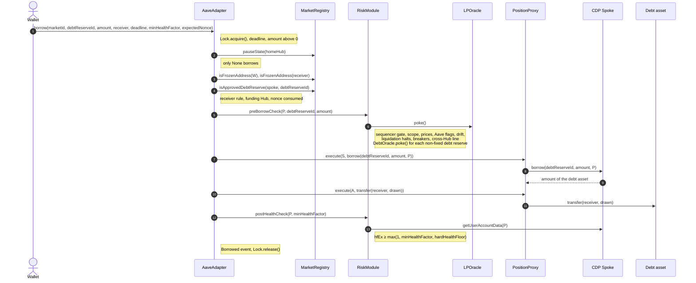

# 3.2 Borrow (FLOW-002)

> **Status:** In review · **Owner:** Avana Labs · **Last reviewed:** 2026-11-12
>
> **Step prefix:** `BOR-NNN`

The borrower draws an approved debt asset on the Aave V4 account that holds one market's collateral. Every wallet has one PositionProxy per (CDP Spoke, market), so each market is its own Aave account with its own health factor and nothing is cross-collateralized: a wallet that uses two markets has two proxies and borrows against each separately (`Q-223`, `Q-349`). The call goes wallet → AaveAdapter → the wallet's PositionProxy for that Spoke and market → CDP Spoke. The proxy is a logic-free immutable account that executes only the Adapter's calls; every check lives in the Adapter and the RiskModule.

Any asset the CDP Spoke lists as a debt reserve can be borrowed: the Aave DAO decides which, and on a Stable LP Hub they are stable debt assets it approves (for example GHO, USDC, USDT), each listed the same way. Each asset's borrow rate follows its kinked utilization curve ([2.1](../02-contracts/01-avana-hub-and-spokes.md) `SPEC-HUB-007`). Each debt reserve records its funding Hub and asset; the draw is bounded by the Aave `drawCap` of that (Hub, asset, Spoke), which is the credit line. At launch every debt reserve is funded by the Spoke's home Hub. Cross-Hub credit lines are fully specified below but off at launch (`Q-358`).

The Adapter applies the call bounds (deadline, nonce, receiver, debt-reserve approval, pause state of the home and funding Hubs, the chain's sequencer gate, address freeze). The RiskModule applies every risk gate over the account's market and every debt reserve of the account, including the circuit breakers and the drift check of the standard-Spoke settings, then the health factor after the Spoke call with rescue units valued at zero (`Q-229`, `Q-234`, `Q-241`, `Q-242`, `Q-253`, `Q-352`, `Q-357`). Avana enforces no opening health floor above Aave's 1.00: the Lens recommends a borrow at HF 1.10 next to the protocol maximum at HF 1.00, and a market may carry an optional hard floor, off by default (`Q-398`).

Adapter behavior belongs to [2.6 Aave Adapter][2.6]; the gates to [2.7 Risk Module][2.7]; the proxy to [2.5 Position Proxy and Proxy Manager][2.5]; the cap budgets to [2.3 Collateralization][2.3]; the pause state, debt-reserve records and credit-line registry to [2.8 Market Registry][2.8]; parameter values to [2.9 Parameter Store][2.9]; price state to [2.10 LP Oracle][2.10]; the lock to [2.16 Lock][2.16]; Aave behavior to [2.1 Avana Hub and Spokes][2.1]. Parameters are named as in [1.5][1.5].

## Objective

Draw exactly `amount` of the chosen debt asset against the account's collateral in one market and deliver it to the receiver the wallet signed, leaving the account's rescue-excluded health factor `hfEx` at or above `max(1, minHealthFactor, hardHealthFloor(m))`, where `minHealthFactor` is the wallet's own bound and `hardHealthFloor(m)` the market's optional hard floor, 0 (off) by default (`Q-398`), and the draw inside the credit line of the reserve's funding Hub (`Q-018`, `Q-075`, `Q-105`, `Q-229`, `Q-233`, `Q-253`, `Q-398`).

## Initiator

Any wallet, acting only on its own account: the Adapter resolves the proxy as `proxyOf[msg.sender][marketId]`, so a wallet can never borrow through another wallet's proxy. The proxy accepts calls only from the chain's AaveAdapter; the wallet never calls it directly (`Q-107`, `Q-223`, `Q-349`).

## Inputs

| Input | Type | Description | Validation |
|---|---|---|---|
| `marketId` | `uint256` | The market `m`; with the caller it names the account (`proxyOf[W][m]`), and its vault token `VT = AD.accountOf(P).vaultToken` gives the CDP Spoke `S = VT.spoke()` | Has a vault token, and the wallet has a proxy for it (`BOR-002`); `S` approved in the MarketRegistry (`BOR-006`) |
| `debtReserveId` | `uint256` | The debt reserve to borrow (GHO, USDC, USDT, WETH or another approved asset) | Enabled for `S` in the MarketRegistry (`BOR-005`), with an open credit line at its funding Hub (`BOR-019`) |
| `amount` | `uint256` | Amount in the asset's base units (18 decimals for GHO and WETH, 6 for USDC and USDT); the app shows two amounts from `Lens.previewBorrowMax(W, m, debtReserveId, deadline)` ([2.17] `REQ-LENS-035`): the recommended borrow, sized to a rescue-excluded health factor of 1.10, and the protocol maximum, sized to Aave's 1.00 times the accrual margin `(1 + rate × (deadline − now)) × 1.005`, so a maximum borrow that lands before the deadline still passes `BOR-011` after interest accrues (`Q-398`). Example: $100,000 of collateral at a 70% CF gives a recommended borrow of `70,000 / 1.10 = $63,636` and a maximum of $70,000 before the margin | `amount > 0` (`BOR-003`); any positive amount, with no minimum debt (`BOR-020`) |
| `receiver` | `address` | Recipient of the borrowed asset; the app defaults it to the wallet | Not refused by the receiver rule of [2.6] `REQ-PROXY-017` (`BOR-005`); not a frozen address (`BOR-016`) |
| `deadline` | `uint256` | Last valid `block.timestamp`, in seconds on every chain | `block.timestamp ≤ deadline` (`BOR-003`) |
| `minHealthFactor` | `uint256` | Caller's minimum health factor after the borrow, WAD | Checked after the Spoke call (`BOR-011`); 0 means no extra bound |
| `expectedNonce` | `uint256` | The proxy's `borrowNonce` the wallet read on-chain when preparing | Must equal `AaveAdapter.borrowNonce(proxy)` (`BOR-004`) |

Returns `drawn`. Borrowing power belongs to the one market's account: the market's collateral, and only it, backs every debt reserve of that proxy (`Q-081`, `Q-234`). There is no total-debt bound argument: `amount` and the single-use nonce already fix what one signed call can add (`Q-106`).

## Preconditions

- The wallet has a proxy for market `m`, created by a pledge ([3.1 Deposit][3.1]), with collateral supplied (`Q-224`, `Q-225`).
- The borrow nonce was read on-chain when the call was prepared; the app keeps one pending borrow per proxy (`Q-106`, `Q-149`).
- The debt reserve was enabled by `enableDebtReserve` through the chain's Timelock ([3.8 Market Lifecycle][3.8]): funding Hub and asset recorded, credit line and swap routes from every pool token of the Spoke's markets into the asset checked.

## Execution Steps

In exact execution order. `W` is the wallet, `m` the `marketId` argument, `VT = AD.accountOf(P).vaultToken` the market's vault token, `S = VT.spoke()` the CDP Spoke, `HD` the Spoke's home Hub, `P = proxyOf[W][m]`, `AD` the AaveAdapter, `RM` the RiskModule, `MR` the MarketRegistry, `CO` Collateralization, `O` the market's LPOracle. For the borrowed reserve `r = debtReserveId`, `HF_r` is its funding Hub (equal to `HD` at launch) and `A` its asset. The account's **collateral scope** is the one reserve of `VT` on `S`; its **debt scope** is every reserve `S` reports as borrowed by `P`, plus `r`. `DO_r` is the DebtOracle of a debt reserve whose price is not fixed (every asset except GHO, whose Aave source is the fixed $1 source).

| Step | Action | Contract (msg.sender) | Notes |
|---|---|---|---|
| `BOR-001` | `W` calls `AD.borrow(m, debtReserveId, amount, receiver, deadline, minHealthFactor, expectedNonce)` | AaveAdapter (`W`) | The entry point acquires the protocol lock; `Lock.acquire` reverts with `LockHeld(holder)` if it is held. The Lock has two members on each chain, the AaveAdapter and LPVaultSwap, so every CDP Spoke and market on the chain uses the same lock. Owned by [2.6], [2.16]. (Source: Q-148, Q-223) |
| `BOR-003` | Check the deadline and the amount | `AD` | `block.timestamp ≤ deadline` (`DeadlineExpired(deadline)`); `amount > 0` (`ZeroAmount()`). The deadline is in seconds, so it means the same on Ethereum (12 s blocks) and Base (2 s blocks). Avana has no minimum debt (`BOR-020`). (Source: Q-075, Q-357, Q-381) |
| `BOR-015` | Check the pause state of the home Hub | `AD` → `MR.pauseState(HD)` (view) | `Frozen` → `ApplicationFrozen()`; `Paused`, with either reason (`General` or `MintPathSuspect`), → `ApplicationPaused()`. Pause states are keyed by Hub: a pause of the Stable LP Hub on Base stops borrowing on that Hub's Spokes on Base only. Borrowing is new risk and runs only in `None`. The funding Hub's state is checked in `BOR-019`. (Source: Q-227, Q-252) |
| `BOR-018` | Check the chain's sequencer gate | `AD` → `RM.preBorrowCheck` → `RiskModuleBorrowLogic.preCheck` → `ParameterStore.sequencer()` → the chain's sequencer-uptime feed (view) | The RiskModule's `preCheck` runs this gate first, before any oracle poke or other gate, for a borrow and for a withdraw-with-debt (`preWithdrawCheck`) alike. `Down` → `SequencerDown()`; `Grace`, the `sequencerGraceSeconds` (3,600 s) after a restart, → `SequencerGrace(restartedAt)`. On Base the feed is `0xBCF85224fc0756B9Fa45aA7892530B47e10b6433` (answer 0 = up, 1 = down; `startedAt` = time of the last status change). Ethereum has no sequencer, so its gate is always `Up`. During an outage only transactions forced in from L1 execute, at prices that may not have updated, and borrowers had no access while prices moved; no new debt is drawn until the grace window has passed. (Source: Q-357) |
| `BOR-016` | Check the address freeze | `AD` → `MR.isFrozenAddress(W)`, `MR.isFrozenAddress(receiver)` (views) | The wallet first, then `receiver`: a frozen one → `AddressIsFrozen(account)` naming it. The freeze list is per chain and every Hub's gates read it. A frozen address can neither draw new debt nor receive a borrow drawn by another wallet. Its repay, debt-free withdrawal, rescue top-ups and the liquidation of its positions are never checked ([2.6] `REQ-ADAPTER-082`). Checked by TEST-229, PROP-071. (Source: Q-242) |
| `BOR-002` | Resolve the account | `AD` → its own binding `accountOf(P)`, `VT.spoke()` (views) | `VT = AD.accountOf(P).vaultToken` is non-zero (`UnknownMarket(m)`) and `S = VT.spoke()`; `P = proxyOf[W][m]`; zero → `NoProxy(W, m)`. The wallet never names its proxy. The binding `(W, S, m) → P` was fixed by CREATE2 at the first pledge and never changes; there is no proxy version to check. (Source: Q-107, Q-223, Q-225, Q-349) |
| `BOR-005` | Validate the debt reserve and the receiver | `AD` → `MR.isApprovedDebtReserve(S, r)`, `MR.getDebtReserve(S, r)`, the MarketRegistry's directory views `getHubs()`, `getSpokes()` and `integrationOf` (each integration's LPVault) and its address views `COLLATERALIZATION()`, `LP_VAULT_SWAP()`, `PAYOUT_ESCROW()`, `flashSource()`, `TIMELOCK()`, `PARAMETER_STORE()`, `RISK_MODULE()`, `PROXY_MANAGER()`, `VAULT_TOKEN_FACTORY.isVaultToken(receiver)`, `walletOf(receiver)`, `IHub(HF_r).isSpokeListed`, `IHub(HF_r).isUnderlyingListed` (views) | `MR.isApprovedDebtReserve(S, r)` (`UnknownDebtReserve(S, r)`); the record gives the funding Hub `HF_r` and asset `A`. `receiver` is not refused by [2.6] `REQ-PROXY-017`: not `address(0)`, a registered proxy, the AaveAdapter, Collateralization, any LPVault, LPVaultSwap, the PayoutEscrow (payout escrow), the flash source, any Hub the chain's MarketRegistry lists, any approved CDP Spoke, a Spoke listed on `HF_r` for `A` (the Lend Spoke, that (Hub, asset)'s Avana Umbrella (Coverage Spoke), Avana's protocol safety module named after Aave's Umbrella, `Q-402`), a token listed on `HF_r` (the debt asset itself, every vault token), the Timelock, the MarketRegistry, the ParameterStore, the RiskModule or the ProxyManager (`InvalidReceiver(receiver)`). The Avana addresses are read from the MarketRegistry's existing directory and address views and the VaultTokenFactory, so a Spoke, Hub or vault token added later is refused without an Adapter upgrade. Swap-route contracts and LPOracles are refused by the app from the bundled manifest. (Source: Q-105, Q-169, Q-211, Q-233) |
| `BOR-019` | Funding Hub and credit line | `AD` → `MR.pauseState(HF_r)`, `MR.crossHubLineCap(HF_r, A, S)`, `MR.crossHubLineTotal(HF_r, A)`, `MR.creditLine(HF_r, A)` (views) | When `HF_r == HD` (every reserve at launch), the line is the Aave `drawCap` of (`HD`, `A`, `S`) and nothing more is read. When `HF_r != HD` (a cross-Hub credit line, off at launch): the funding Hub's pause state must be `None` (`FundingHubPaused(HF_r)`), because a pause of the funding Hub stops every line it funds; the line must be open in the funding Hub's registry entry, `crossHubLineCap(HF_r, A, S) > 0`, which the funding Hub's own governance sets and which is at most that (Hub, asset)'s first-loss coverage (`CreditLineClosed(HF_r, A, S)`); and the registry's sum of lines over every drawing Spoke on every Hub, `crossHubLineTotal(HF_r, A)`, must not exceed the funding Hub's recorded `line` from `creditLine(HF_r, A)` (`CreditLineExceeded(HF_r, A)`). The registry is one per chain and sums lines per (funding Hub, asset), so two Hubs cannot each grant a line the funding Hub never agreed to. Aave enforces the `drawCap` itself at `BOR-008`. (Source: Q-233, Q-353) |
| `BOR-004` | Check and consume the nonce | `AD` | After every other call bound: `expectedNonce == borrowNonce[P]` (`BadNonce(borrowNonce[P], expectedNonce)`), then `borrowNonce[P] += 1`, before any RiskModule or proxy call. A revert later in the call restores the nonce. One nonce sequence per proxy covers every asset. Checked by HYP-15, QNT-21. (Source: Q-106, Q-229) |
| `BOR-006` | Account scope, poke and prices | `AD` → `RM.preBorrowCheck(P, r, amount)`; `RM` → MR and Spoke views, `O.poke()`, `O.getPriceState()`, AaveOracle `getReserveSource`, `DO_r'.poke()`, `DO_r'.getPriceState()` for each non-fixed debt reserve `r'` in scope | `RM` runs the checks in the order of [2.7] (Borrow-side checks). First: `S` approved (`UnknownSpoke`); the collateral scope read from `S` is exactly the reserve of `VT` (`UnknownCollateral(reserveId)`), so no other asset backs this account; the market is `Active` or `Offboarding`; every debt reserve in scope approved and matching its recorded definition, funding Hub included (`ConfigDrift(0, BorrowedUnapprovedReserve)`, `ConfigDrift(0, DebtReserveMismatch)`). Then `RM` pokes `O` and every `DO_r'`, so a disagreement or failure first seen by this borrow starts its window on time (`Q-199`). Then the market is Live and every debt reserve in scope is unpaused, on its recorded price source and, unless its source is fixed, priced by a DebtOracle that is Live. Freshness is per feed: each input's age is at most `borrowPriceMaxAge(feed) = getFeed(feed).feedHeartbeat + heartbeatMargin`, with `feedHeartbeat` the feed's own published heartbeat recorded at listing and `heartbeatMargin = 1,800` s for the publication delay after each heartbeat (`PriceTooOld(feed, age)`, `DebtPriceTooOld(r', source, age)`). A Chainlink stablecoin feed with a 24 h heartbeat (86,400 s on both chains) is fresh for 88,200 s; a 3,600 s feed for 5,400 s. Because a 24 h feed can stay silent for a day while it is inside its deviation threshold, a borrow also requires the independent second source of each price (a TWAP of a deep pool, or a second oracle network) to agree with the served price within that source's `secondSource.toleranceBps` (`borrowAllowed`, [2.10] `REQ-ORACLE-100`, `SPEC-PROXY-002`). A disagreeing second source leaves the price state Live and changes nothing for liquidation; a guardian can switch the token to its standby second source at once ([3.6] `EMG-106`). A stale or disagreeing USDC price therefore blocks a GHO borrow on an account that also owes USDC, while liquidation of that account is gated only by the reserves it seizes and repays (`Q-247`). Owned by [2.7], [2.10]. Checked by QNT-18, HYP-14, TEST-250. (Source: Q-081, Q-128, Q-182, Q-199, Q-229, Q-233, Q-234, Q-237, Q-238, Q-247, Q-248, Q-274, Q-357) |
| `BOR-007` | Remaining borrow gates | `RM` → MR, ParameterStore, LPVaultSwap, Spoke and Hub views | Then, in order: the market's reserve not paused on Aave (`AaveReservePaused`); the market not `Offboarding` (`MarketOffboarding`) and its reserve not frozen on Aave (`ReserveFrozen`); no drift (`ConfigDrift(m, reason)`): the Spoke implementation equal to the approved standard Aave V4 Spoke, the Spoke active and not halted on `HD` and on every funding Hub in scope (`SpokeHalted`, `Q-351`), the debt-reserve set, and the standard-Spoke settings that keep liquidation exclusive to LPVaultSwap (`Q-352`): `receiveSharesEnabled = false` and `borrowable = false` on the vault-token reserve, `liquidationFee = 0`, `reinvestmentController = address(0)` on the vault-token asset, the vault-token asset listed on no other Spoke with `drawCap = 0` everywhere, and no position-manager approval on `P`; no drift in Aave's risk configuration of the reserve: a dynamic key's collateral factor above the market's expected factor (`CollateralFactorAboveExpected`), a liquidation bonus outside its bound (`⌈maxLB × CF / 10⁴⌉ ≥ 10⁴` or the minimum bonus below `minLiquidationBonus`, `BonusBoundViolated`) or a target health factor other than `aaveTargetHealthFactor` (`LiquidationConfigChanged`) ([2.7] `REQ-RISK-069`); Hub shares == assets for `VT` (`HubSharesNotEqualAssets`); liquidation not halted for the market (no active committed operator in the chain's LPVaultSwap registry, `activeKeeperCount() == 0` ([2.7] `REQ-RISK-071`): `LiquidationHalted`), and every debt reserve in scope has a usable swap route from each of the market's `n` pool tokens into its asset (`DebtLiquidationHalted(r')`); in-kind settlement does not exist (`Q-401`). New borrowing halts only when 0 active committed operators remain on the chain; `keeperFloor` is 1 (`Q-400`). The registry gates no liquidation: `liquidate` stays open to every address that is not frozen, so the halt protects only against new debt that no party is bound to clear (`Q-404`). A short or paused Aave V3 Pool does not halt liquidation: a liquidation takes no flash loan, and a caller whose flash liquidation helper cannot borrow funds `debtToCover` from its own balance (`Q-358`, `Q-404`). Owned by [2.7]. Checked by HYP-14, QNT-19, TEST-249. (Source: Q-081, Q-118, Q-203, Q-213, Q-220, Q-227, Q-229, Q-235, Q-237, Q-242, Q-270, Q-351, Q-352, Q-400, Q-401, Q-404) |
| `BOR-017` | Circuit breakers (`Q-399`) | `RM` (inside `preBorrowCheck`) → `MR.marketBreaker(m)`, vault-token supply, the integration's risk status (`LV.riskStatus(m, twapWindow)`: range status and pool share), Avana's credited liquidity in the pool across every Spoke and market of the chain, issuer probes of the pool tokens and the debt asset, `MR.debtBreaker(S, r)`, the Avana Umbrella of (`HF_r`, `A`) and the Hub deficit (views) | The market breaker of `m`: a latched reason (manual guardian trip, including the route freeze of P-04, or `CONFIG_DRIFT` from `BOR-007`'s drift reasons) or a condition that holds now: pool share (`SPEC-BRK-002`: Avana's combined credited liquidity in the pool, across all borrowers and Spokes on the chain, above `poolShareMaxBpsOf(poolKey)` (default 10,000 bps, off; a per-pool cap only where its listing sets one, `Q-403`; merged with the former `breakerPoolShareBps`) of the pool's time-weighted liquidity reported by the integration), pool depth (`POOL_DEPTH`, the pool's liquidity over `twapWindow` below the market's listing minimum, `Q-350`) or issuer (`SPEC-BRK-003`: a pool token's probe reports paused or a non-zero fee rate, or reverts) → `BreakerTripped(m, reasons)`. Oracle and stablecoin band breaches block the borrow earlier, at `BOR-006`. A price drop (3% in 2 hours), a seizure surge (above 20% of a market in 1 hour) and route failures (3 in 1 hour) are monitoring alerts, not on-chain trip conditions. The debt breaker of `r`: a latched reason or a condition (`SPEC-BRK-004`: the asset's outstanding Hub deficit on `S` above `breakerDeficitMax` (10,000 GHO for GHO; a per-reserve materiality set at listing for other assets), the Avana Umbrella of (`HF_r`, `A`) below its minimum or reverting, or the debt asset's issuer probe) → `DebtBreakerTripped(S, r, reasons)`. A deficit freeze stays until authorized reopening (timelock or guardian, [2.15]); a temporary price or depth gate clears after 30 minutes of healthy observations (provisional launch setting). `reasons` is the bitmask of every reason that holds. A tripped debt breaker on another reserve the account owes does not block this borrow: it blocks borrowing that reserve and withdraw-with-debt. Breakers stop new debt at once and never stop liquidation, repay, top-ups or debt-free withdrawal; one actor cannot move any trigger within one transaction. Example (market A's pool listed with an illustrative per-pool cap of 1,000 bps): Avana's credited liquidity in market A's pool is $10.4M of $100M time-weighted liquidity, 1,040 bps > 1,000, so every borrow on market A reverts with `BreakerTripped(A, POOL_SHARE)` until the share is back at or under 10%. Owned by [2.7] `REQ-RISK-065`. Checked by TEST-228. (Source: Q-102, Q-241, Q-350, Q-352, Q-399) |
| `BOR-020` | No minimum debt | None | No call. Avana has no minimum debt on any chain: a borrow of any positive amount that passes the other steps succeeds, whatever the account's total debt after it (`Q-381`). A small debt does not need a profitable liquidation. Avana's own keepers liquidate every account below HF 1 and pay their own gas, and `liquidate` is open to any address that is not frozen, directly or through the public flash liquidation helper ([3.5 Liquidation][3.5] `LIQ-087`, `Q-404`). Aave's dust rule makes a partial liquidation that would leave a small remainder close it in full. The gas of one liquidation is bounded by the 16-record limit per account and market ([2.3] `TooManyRecords`), not by the debt size: `G = 1.31M + 0.24M × 16 = 5.15M ≤ 16,777,216`, the per-transaction gas limit. Repay, withdraw and liquidation read no debt minimum either. (Source: Q-153, Q-381, Q-404) |
| `BOR-021` | No idle-charge step (`Q-396`) | None | No call. The idle-collateral mechanism does not exist: there is no `admitIdleCharge`, `releaseIdle`, `Idle` cap bucket, `idleUsdCap`, `idleBookingSeconds` or `IDLE_UTILIZATION_BPS`, and every account's charge stays in the market's `Regular` budget (or the `Slice` for rescue units) from pledge to release. A non-borrowing LP that fills a market's cap (AMMN-FLOW-16) is an accepted risk, handled by the caps set at listing and by monitoring of cap use. Example: wallet `Z` pledged $50,000 into market A 10 days ago and owes 50 GHO; its $50,000 stays booked in `Regular`, and a borrow of 10,000 GHO by `Z` needs no cap room because borrowing books no new charge. (Source: Q-354, Q-384, Q-396) |
| `BOR-008` | Draw from the Spoke | `AD` → `P.execute(S, borrow(r, amount, P))` (`P` at `S`); `AD` reads `A.balanceOf(P)` before and after | `P` borrows as its own position owner (`onBehalfOf == P`, no position manager, [2.1] `REQ-HUB-026`). Aave checks the reserve is in the Spoke's set, not paused or frozen and borrowable; `HF_r.draw` checks the Spoke is active and not halted, the `drawCap` of (`HF_r`, `A`, `S`) including its reported deficit, and Hub liquidity, and sends `A` from `HF_r` to `P`; Aave refreshes the account's dynamic configuration keys and risk premium and requires HF ≥ 1. (Source: Q-032, Q-116, Q-119, Q-172, Q-233, Q-237) |
| `BOR-009` | Measure the draw | `AD` | `drawn` = `P`'s balance change of `A` across the Spoke call; `drawn == amount` (`BalanceDeltaMismatch()` otherwise, `SPEC-PROXY-004`). (Source: Q-064, Q-124) |
| `BOR-013` | Deliver the asset | `AD` → `P.execute(A, transfer(receiver, drawn))` | Exactly the measured draw, with the `SafeERC20` return check done by the Adapter on the forwarded result; `P`'s balance of `A` ends equal to its start, so nothing stays in the proxy and nothing passes through the Adapter. (Source: Q-064, Q-075, Q-105, Q-124) |
| `BOR-010` | Verify the draw | `AD` | `P`'s balance of `A` is back at its value before `BOR-008` and `receiver` gained `drawn`; otherwise `UnitsMismatch(amount, drawn)`. (Source: Q-124, Q-223) |
| `BOR-011` | Health check | `AD` → `RM.postHealthCheck(P, minHealthFactor)` → `S.getUserAccountData(P)` (view) | `hfEx ≥ max(1e18, minHealthFactor, hardHealthFloor(m))`, inclusive, WAD, read after the Spoke call (`SPEC-PROXY-001`). `hardHealthFloor(m)` is the market's optional hard health floor, 0 (off) by default and set only if stress tests justify it; there is no `minOpeningHealthFactor` and no `PROXY_HEALTH_FACTOR_FLOOR` (`Q-398`). `hf` is Aave's health factor of `P`, whose only collateral is market `m` (`SPEC-PROXY-006`); `hfEx = hf − ⌈E × WAD × RAY / totalDebtValueRay⌉`, saturating at 0, is the same health factor with the account's rescue units valued at 0, where `E = ⌈rescueUnits × price8 × CF × 10¹⁸ / (10^d × 10⁴)⌉` in Aave value units at the prices Aave serves (`SPEC-CF-005`, [2.7] `REQ-RISK-068`). Rescue units are collateral admitted through the cap slice or a rescue exemption ([3.1 Deposit][3.1]); Aave counts them in full, but they never support new debt. Why the floor is 1.00: Aave's own borrow check already requires HF ≥ 1, and a higher on-chain floor would refuse borrows Aave accepts without protecting solvency, which the liquidation path guarantees; the Lens's recommended borrow at HF 1.10 guides users instead. A failure (`HealthFactorTooLow(hfEx, required)`) undoes the whole call, including the transfer of `BOR-013`. Checked by HYP-13, HYP-54, QNT-20, MATH-AR-06, TEST-236, PROP-067. (Source: Q-018, Q-119, Q-161, Q-229, Q-253, Q-398) |
| `BOR-012` | No total-debt bound | `AD` | No call. The debt after the borrow is the debt before plus `amount`, rounded up by Aave (`BOR-POST-002`); the signed `amount`, `minHealthFactor` and single-use nonce bound what one call can add. (Source: Q-106) |
| `BOR-023` | Speed limits | `AD` → `RM.preBorrowCheck(P, r, amount)`, after every other gate of `BOR-006` and `BOR-007` | The borrow must fit the market's borrow-speed window, charged `⌈amount × price8(r) / 10^dec⌉` 8-decimal USD, and the borrow-speed window of the reserve's (funding Hub, asset), charged `amount` ([2.7] `REQ-RISK-092`, `SPEC-CAP-011`, `SPEC-CAP-012`); otherwise `BorrowSpeedExceeded(m, availableUsd, moreAt)` or `DebtSpeedExceeded(hub, asset, available, moreAt)`, and nothing is charged. When both fit, the RiskModule adds the charges, which stop counting between one and two windows (6 to 12 hours at launch) later. A repay, a withdrawal or a liquidation never meets a window (`REQ-RISK-094`). (Source: Q-411) |
| `BOR-014` | Event and unlock | `AD` | Emits `Borrowed(W, m, r, receiver, drawn, nonce, hf)` with the consumed nonce; releases the lock. (Source: Q-076, Q-148) |

### Borrow availability by state

`BOR-015` to `BOR-021` give these outcomes. The most restrictive state over the account's market and every debt reserve of the account applies; the wallet's other markets, held by other proxies, never gate this borrow (`Q-081`, `Q-234`). Repay, debt-free withdrawal and partial removal, `repayAllAndWithdraw`, fee collection, zero-credit release, pending settlement and liquidation are never blocked by any Avana pause, breaker or freeze ([3.3 Repay][3.3], [3.4 Withdraw][3.4]).

| State | Borrow |
|---|---|
| Home Hub `None`, sequencer `Up`, market Live and fresh with its second source agreeing, every debt reserve fresh, no breaker tripped, wallet and receiver not frozen | Allowed |
| Home Hub `Frozen` | Refused (`ApplicationFrozen`, `Q-227`) |
| Home Hub `Paused(General)` or `Paused(MintPathSuspect)` | Refused (`ApplicationPaused`, `Q-227`, `Q-252`) |
| Another Hub on the chain paused | Allowed |
| Funding Hub of a cross-Hub reserve paused, its line closed, or the registry sum above its total | Refused (`FundingHubPaused`, `CreditLineClosed`, `CreditLineExceeded`); no such reserve exists at launch |
| Sequencer `Down` (Base) | Refused (`SequencerDown`, `Q-357`) |
| Sequencer in `Grace` (Base, 3,600 s after restart) | Refused (`SequencerGrace`, `Q-357`) |
| The wallet or the receiver is a frozen address | Refused (`AddressIsFrozen`, `Q-242`) |
| The market breaker tripped (pool share above the pool's listed cap, pool depth, issuer, config drift, manual guardian trip including the route freeze) | Refused (`BreakerTripped`, `Q-241`, `Q-350`, `Q-352`, `Q-399`) |
| Price drop of 3% in 2 hours, collateral seized above 20% of the market in 1 hour, or 3 route failures in 1 hour, with no guardian trip | Allowed: monitoring alerts only (`Q-399`) |
| The debt breaker of the borrowed reserve tripped (including an outstanding GHO deficit above 10,000 GHO on the Spoke) | Refused (`DebtBreakerTripped`, `Q-102`, `Q-241`, `Q-399`) |
| The debt breaker of another debt reserve of the account tripped | Allowed |
| Drifting, Cached or Expired, including persistent route disagreement (`Q-208`), a USD-band breach (`Q-195`) and a Live market whose second source is outside its `secondSource.toleranceBps` (`borrowAllowed = false`; a guardian can switch to the standby second source with `ParameterStore.useStandbySecondSource(token)` at once, `EMG-106`) | Refused (`SecondSourceDisagrees(token)` for a Live market whose second source disagrees, `Q-385`) |
| Any input older than `feedHeartbeat + 1,800` s, a non-fixed debt reserve whose DebtOracle is not Live or is older than that, or a debt reserve on a price source other than the recorded one | Refused (`PriceTooOld`, `DebtPriceTooOld`, `UnexpectedDebtPriceSource`, `Q-238`, `Q-248`, `Q-274`) |
| Any positive amount, however small, with every other gate passing | Allowed: there is no minimum debt (`Q-381`) |
| Borrow by an account with a low utilisation, with or without debt | Allowed: no idle bucket exists and borrowing books no cap charge (`Q-396`) |
| `hf` meets 1.00 but `hfEx` does not, because rescue units are valued at 0 | Refused (`HealthFactorTooLow`, `Q-253`) |
| The market `Offboarding` | Refused (`MarketOffboarding`) |
| Aave vault-token reserve of the market frozen | Refused (`ReserveFrozen`, `Q-203`) |
| Aave vault-token reserve paused, or any debt reserve of the account paused | Refused (`AaveReservePaused`, `DebtReservePaused`) |
| Another market of the same wallet frozen, paused or in breach | Allowed: that market is another account |
| Borrowed reserve frozen on Aave, `drawCap` of (`HF_r`, `A`, `S`) exhausted | Refused by Aave |
| The Hub halts the CDP Spoke, or the Spoke is inactive | Refused (`ConfigDrift(m, SpokeHalted)`, `Q-351`) |
| Standard-Spoke setting drifted (`receiveSharesEnabled`, `liquidationFee`, `reinvestmentController`, the vault-token asset on another Spoke, a position-manager approval on `P`), Spoke implementation changed, collateral factor above expected, bonus out of bound, target health factor changed, Hub shares ≠ assets | Refused (`ConfigDrift`, `HubSharesNotEqualAssets`, `Q-270`, `Q-352`) |
| No active committed operator on the chain (one is enough, `keeperFloor = 1`; liquidation stays open to every caller) | Refused (`LiquidationHalted`, `Q-242`, `Q-400`, `Q-404`) |
| A debt reserve of the account with no usable swap route from some pool token of the market | Refused (`DebtLiquidationHalted`; no in-kind path exists, `Q-401`) |
| Aave V3 Pool short or paused for the debt asset (it serves only repay with collateral and flash liquidation helpers), one swap route unavailable while another can settle, the Avana Umbrella of another (Hub, asset) below its minimum | Allowed |

## Contract Interactions

| Caller → callee.function() | Step | msg.sender at callee | Tokens moved |
|---|---|---|---|
| `W` → `AD.borrow(m, debtReserveId, amount, receiver, deadline, minHealthFactor, expectedNonce)` | `BOR-001` | `W` | None |
| `AD` → `Lock.acquire()` / `Lock.release()` | `BOR-001`, `BOR-014` | `AD` | None |
| `AD` → `MR.pauseState(HD)`, `ParameterStore.sequencer()` → sequencer-uptime feed `latestRoundData()` | `BOR-015`, `BOR-018` | `AD`; `MR` | None |
| `AD` → `MR.isFrozenAddress(W)`, `MR.isFrozenAddress(receiver)`, `AD.accountOf(P).vaultToken`, `VT.spoke()`, `MR.isApprovedDebtReserve`, `MR.getDebtReserve`, the MarketRegistry directory and address views, `VAULT_TOKEN_FACTORY.isVaultToken(receiver)`, `walletOf(receiver)`, Hub `isSpokeListed` / `isUnderlyingListed` | `BOR-016`, `BOR-002`, `BOR-005` | `AD` | None |
| `AD` → `MR.pauseState(HF_r)`, `MR.crossHubLineCap`, `MR.crossHubLineTotal`, `MR.creditLine` (cross-Hub reserves only) | `BOR-019` | `AD` | None |
| `AD` → `RM.preBorrowCheck(P, r, amount)` → `O.poke()` and `DO_r'.poke()` per non-fixed debt reserve, then LPOracle (including the second source), AaveOracle, DebtOracle, MarketRegistry (`marketBreaker`, `debtBreaker`), ParameterStore, LPVaultSwap (`activeKeeperCount`), LPVault `riskStatus`, Spoke, Hub, Avana Umbrella and issuer-probe views | `BOR-006`, `BOR-007`, `BOR-017`, `BOR-020` | `AD`, then `RM` | None |
| `AD` → `P.execute(S, borrow(r, amount, P))` → `S.borrow` → `HF_r.draw(assetId, amount, P)` | `BOR-008` | `AD`; `P` at `S`; `S` at `HF_r` | `A` `HF_r` → `P`, `amount` |
| `AD` → `P.execute(A, transfer(receiver, drawn))` | `BOR-013` | `AD`; `P` at `A` | `A` `P` → `receiver`, `amount` |
| `AD` → `RM.postHealthCheck(P, minHealthFactor)` → `S.getUserAccountData(P)` | `BOR-011` | `AD`, then `RM` | None |

## State Changes

| Contract | Step | Storage / balance | Before → After |
|---|---|---|---|
| AaveAdapter | `BOR-004` | `borrowNonce[P]` | n → n + 1 |
| LPOracle, DebtOracle (each non-fixed debt reserve in scope) | `BOR-006` | `disagreeSince`, `failedSince`, accepted price | Updated by `poke()` per [2.10] |
| Collateralization | `BOR-021` | None: a borrow changes no cap counter (`Q-396`) | unchanged |
| RiskModule | `BOR-023` | Market window `marketBorrow[m]` (USD) and debt window `debtBorrow[(hub, asset)]` (asset units) | after the rollover, `curr → curr + charge` in each |
| CDP Spoke | `BOR-008` | `P`'s drawn shares in `r`, borrowing flag, risk premium, dynamic configuration keys | d → d + shares for `amount`; keys and premium refreshed |
| Funding Hub `HF_r` | `BOR-008` | `S`'s drawn amount and premium for `A`; Hub liquidity of `A` | Increase by `amount` and the premium change; liquidity − `amount` |
| Asset `A` | `BOR-008`, `BOR-013` | `balanceOf(P)`, `balanceOf(receiver)` | p, x → p, x + `amount` (net 0 for `P`) |

## External Calls

Trust boundaries are defined in [1.3 Trust Boundaries][1.3] and [4.3 External Dependencies][4.3].

| External contract | Step | Function | Trust assumption |
|---|---|---|---|
| AaveAdapter (Avana, one per chain, upgradeable through the chain's Timelock, trusted for custody) | `BOR-001`…`BOR-021` | Entry point | Reviewed implementation; blast radius in [2.6] (`Q-223`) |
| PositionProxy (Avana, logic-free, immutable) | `BOR-008`, `BOR-013` | `execute` | Forwards only the Adapter's calls; has no version and no upgrade (`Q-349`) |
| RiskModule (Avana, upgradeable) | `BOR-006`, `BOR-007`, `BOR-017`, `BOR-020`, `BOR-011` | `preBorrowCheck`, `postHealthCheck` | Gates only; a faulty RiskModule can approve a borrow down to Aave's HF ≥ 1 within the `drawCap`, or block borrowing (`Q-229`) |
| LPOracle (Avana, upgradeable) | `BOR-006` | `poke`, `getPriceState` | Never reverts on a bad feed; exposes source timestamps and the second-source comparison; `poke()` cannot re-enter (`Q-128`, `Q-209`) |
| DebtOracle (Avana, per chain, upgradeable; Aave's price source for each non-fixed debt reserve) | `BOR-006` | `poke`, `getPriceState` | Never reverts on a bad feed; serves Chainlink source timestamps; `poke()` cannot re-enter (`Q-238`, `Q-248`) |
| Chainlink sequencer-uptime feed (Base) | `BOR-018` | `latestRoundData` | Trusted for up/down status and the time of the last change; a reverting read counts as `Down` (`Q-357`) |
| LPVault of the market's AMM protocol (Avana, immutable) | `BOR-017` | `riskMetadata` | Read only: range status and pool share for the breakers |
| Pool tokens and debt asset (issuer probes), Avana Umbrella (Coverage Spoke) | `BOR-017` | `paused()` or `basisPointsRate()` with a fixed gas limit; `isBelowMinimum()` | A revert or a malformed answer counts as tripped, so a failing probe stops new debt rather than allowing it (`Q-241`) |
| Aave V4 CDP Spoke (standard Spoke) and funding Hub (Aave DAO) | `BOR-007`, `BOR-008`, `BOR-011`, `BOR-020` | Views, `borrow`, `getUserAccountData`, `getUserTotalDebt` | Trusted accounting and HF; pause, freeze, halt and caps can block the borrow |
| Debt asset (GHO, USDC, USDT, WETH) | `BOR-008`, `BOR-013` | `transfer` | Standard ERC-20, no fee on transfer, checked at listing; an issuer blocklist on `P` or `receiver` can block the borrow (`Q-233`) |

## Events

In emission order.

| Contract | Step | Event |
|---|---|---|
| LPOracle, DebtOracle | `BOR-006` | LPOracle `PriceStateChanged`, `DisagreementRecorded` or `GraceStarted`; DebtOracle `DebtPriceStateChanged`, `DebtFailureRecorded`, `DebtDisagreementRecorded` or `DebtGraceStarted`; each only when `poke()` changes stored state ([2.10]) |
| Funding Hub, asset `A` | `BOR-008` | Hub rate update events, `A` `Transfer(HF_r, P, amount)`, Hub `Draw(assetId, S, drawnShares, amount)` in upstream order |
| Spoke, Hub | `BOR-008` | `RefreshAllUserDynamicConfig(P)`; when the premium changes, Hub `RefreshPremium`, Spoke `RefreshPremiumDebt` and `UpdateUserRiskPremium(P, riskPremium)`; then Spoke `Borrow(r, P, P, drawnShares, amount)` |
| Asset `A` | `BOR-013` | `Transfer(P, receiver, amount)` |
| AaveAdapter | `BOR-014` | `Borrowed(W, m, r, receiver, drawn, nonce, hf)` |

## Failure Conditions

Every failure reverts the whole transaction, including the nonce increment, every `poke()` write and the transfer of `BOR-013`. Avana gate errors are declared on the owning contract page. Upstream errors pass through unchanged, Avana custom errors are used only for Avana's own gates, and `packages/protocol` ships the upstream error ABIs (`Q-119`).

| ID | Step | Condition | Result |
|---|---|---|---|
| `BOR-F-001` | `BOR-001` | Lock already held | `LockHeld(holder)` from the Lock ([2.16]) (Source: Q-148) |
| `BOR-F-002` | `BOR-002` | `m` has no vault token in the VaultTokenFactory, or `W` has no proxy for market `m` | `UnknownMarket(m)` or `NoProxy(W, m)` (Source: Q-223, Q-349) |
| `BOR-F-003` | `BOR-003` | `block.timestamp > deadline` | `DeadlineExpired(deadline)` (Source: Q-075) |
| `BOR-F-004` | `BOR-004` | `expectedNonce != borrowNonce[P]` | `BadNonce(borrowNonce, expectedNonce)`; nonce unchanged (Source: Q-106) |
| `BOR-F-005` | `BOR-003`, `BOR-005` | `amount == 0`, or `r` not approved for `S` | `ZeroAmount()` or `UnknownDebtReserve(S, r)` (Source: Q-075, Q-233) |
| `BOR-F-006` | `BOR-005` | Receiver refused | `InvalidReceiver(receiver)` (Source: Q-064, Q-105, Q-233) |
| `BOR-F-007` | `BOR-006` | The market not Live (or Live with a second source outside its `secondSource.toleranceBps`, so `borrowAllowed = false`), any input older than `feedHeartbeat + 1,800` s, a non-fixed debt reserve's DebtOracle not Live or older than that, or a debt price source other than the recorded one | `PriceNotLive(marketId, state)`, `SecondSourceDisagrees(token)` (Live market, second source outside tolerance or unreadable), `PriceTooOld(feed, age)`, `DebtPriceTooOld(debtReserveId, source, age)` or `UnexpectedDebtPriceSource(debtReserveId, source)` ([2.7]) (Source: Q-128, Q-182, Q-238, Q-248, Q-274, Q-357, Q-385) |
| `BOR-F-008` | `BOR-006`, `BOR-007` | Another RiskModule gate fails | The RiskModule's error ([2.7]): `UnknownSpoke(spoke)`, `LiquidationHalted(marketId)`, `DebtLiquidationHalted(debtReserveId)`, `UnknownCollateral(reserveId)`, `ConfigDrift(marketId, reason)` or `HubSharesNotEqualAssets(marketId)` (Source: Q-080, Q-081, Q-103, Q-213, Q-227, Q-229, Q-235, Q-242) |
| `BOR-F-009` | `BOR-006`, `BOR-007`, `BOR-011` | An oracle `poke()` or the RiskModule reverts for any other reason (including `InsufficientGas`) | The revert propagates unchanged (Source: Q-209, Q-229) |
| `BOR-F-010` | `BOR-008` | Aave rejects the borrow | `ReservePaused`, `ReserveFrozen`, `ReserveNotBorrowable`, `SpokeNotActive`, `SpokeHalted`, `DrawCapExceeded`, `InsufficientLiquidity`, `HealthFactorBelowThreshold` or `InvalidPremiumChange` passes through (Source: Q-116, Q-118, Q-119, Q-140) |
| `BOR-F-011` | `BOR-009`, `BOR-010` | Asset received differs from `amount`, or `P` keeps a balance | `BalanceDeltaMismatch()` or `UnitsMismatch(amount, drawn)` from the Adapter (Source: Q-124) |
| `BOR-F-012` | `BOR-011` | Rescue-excluded HF after the borrow below 1.00 | `HealthFactorTooLow(hfEx, required)` with `required = max(1e18, minHealthFactor, hardHealthFloor(m))`; there is no `PROXY_HEALTH_FACTOR_FLOOR` (Source: Q-161, Q-229, Q-253, Q-398) |
| `BOR-F-013` | `BOR-011` | Rescue-excluded HF after the borrow below `minHealthFactor` | `HealthFactorTooLow(hfEx, required)` (Source: Q-075, Q-253) |
| `BOR-F-014` | `BOR-011` | Rescue-excluded HF after the borrow below the market's optional hard floor `hardHealthFloor(m)`, when governance has set one (off by default; `minOpeningHealthFactor` no longer exists) | `HealthFactorTooLow(hfEx, required)` (Source: Q-018, Q-229, Q-253, Q-398) |
| `BOR-F-015` | `BOR-006`, `BOR-007` | The market's reserve paused on Aave, or a debt reserve of the account paused | `AaveReservePaused(reserveId)` or `DebtReservePaused(debtReserveId)` ([2.7]); a paused reserve stops liquidation of the account, so new debt is refused before Aave is called (Source: Q-118, Q-202, Q-209) |
| `BOR-F-016` | `BOR-013` | Transfer to `receiver` fails (for example an issuer blocklist) | The token's error passes through (Source: Q-119, Q-233) |
| `BOR-F-017` | `BOR-007` | The market's vault-token reserve frozen on Aave | `ReserveFrozen(reserveId)` ([2.7]) (Source: Q-203) |
| `BOR-F-018` | `BOR-015` | Home Hub `Frozen`, or `Paused` with reason `General` or `MintPathSuspect` | `ApplicationFrozen()` or `ApplicationPaused()` (Source: Q-227, Q-252) |
| `BOR-F-019` | `BOR-007` | The market `Offboarding` | `MarketOffboarding(marketId)` (Source: Q-227, Q-355) |
| `BOR-F-020` | `BOR-016` | The wallet or `receiver` is a frozen address | `AddressIsFrozen(account)`, the wallet checked first (Source: Q-242) |
| `BOR-F-021` | `BOR-017` | The market breaker is tripped | `BreakerTripped(marketId, reasons)` ([2.7] `REQ-RISK-065`) (Source: Q-241, Q-350, Q-352) |
| `BOR-F-022` | `BOR-017` | The debt breaker of `r` on `S` is tripped | `DebtBreakerTripped(spoke, debtReserveId, reasons)` ([2.7] `REQ-RISK-065`) (Source: Q-102, Q-241) |
| `BOR-F-023` | `BOR-011` | `hf` meets `required` but `hfEx` does not, because the account's rescue units are valued at 0 | `HealthFactorTooLow(hfEx, required)` (Source: Q-253) |
| `BOR-F-024` | `BOR-007` | The reserve's Aave risk configuration drifted: collateral factor above the expected factor, liquidation bonus out of bound, or target health factor changed | `ConfigDrift(marketId, CollateralFactorAboveExpected)`, `ConfigDrift(marketId, BonusBoundViolated)` or `ConfigDrift(marketId, LiquidationConfigChanged)` ([2.7] `REQ-RISK-069`) (Source: Q-270) |
| `BOR-F-025` | `BOR-018` | Sequencer gate `Down` or in `Grace` | `SequencerDown()` or `SequencerGrace(restartedAt)` (Source: Q-357) |
| `BOR-F-026` | `BOR-019` | Cross-Hub reserve whose funding Hub is paused, whose line is closed, or whose registry sum exceeds the funding Hub's total | `FundingHubPaused(hub)`, `CreditLineClosed(hub, asset, spoke)` or `CreditLineExceeded(hub, asset)` (Source: Q-353) |
| `BOR-F-027` | `BOR-020` | None: `BOR-020` refuses no amount, because there is no minimum debt; a zero `amount` fails earlier at `BOR-003` | No error (Source: Q-381) |
| `BOR-F-028` | `BOR-021` | None: with no idle bucket a borrow never needs cap room, so no borrow fails for cap reasons (`Q-396`) | No failure (Source: Q-354, Q-384, Q-396) |
| `BOR-F-030` | `BOR-023` | The market's borrow-speed window or the (funding Hub, asset) window has less room than the borrow's charge, or the scope has no speed parameters | `BorrowSpeedExceeded(m, availableUsd, moreAt)` or `DebtSpeedExceeded(hub, asset, available, moreAt)` (Source: Q-411) |
| `BOR-F-029` | `BOR-007` | The Spoke is halted or inactive on its Hub, or a standard-Spoke setting drifted (`receiveSharesEnabled`, `liquidationFee`, `reinvestmentController`, the vault-token asset on another Spoke, a position-manager approval on `P`) | `ConfigDrift(marketId, SpokeHalted)` or `ConfigDrift(marketId, reason)` naming the setting; the market breaker latches `CONFIG_DRIFT` (Source: Q-351, Q-352) |

## Worked Example

Launch parameters: no opening health floor above Aave's 1.00 (`hardHealthFloor(m) = 0`, `Q-398`), Lens recommendation at HF 1.10, `heartbeatMargin = 1,800` s. Ethereum: the Uniswap v3 Stable CDP Spoke `S` approves `r_GHO` (GHO, 18 decimals, fixed $1.00 source) and `r_USDC` (USDC, 6 decimals, priced by its DebtOracle on the Chainlink USDC/USD feed, heartbeat 82,800 s, reading $0.9999, with a deep-pool TWAP as second source), both funded by the Ethereum Stable LP Hub. `W` holds record #7 in market A (Uniswap v3 USDC/USDT 0.01%, exact range): 25,000 whole vault tokens at $2.00, collateral $50,000, `CF_A = 3,120`, so the CF-weighted collateral is `B = $15,600`. No debt; `borrowNonce = 4`; `W`'s charge of $50,000 sits in `Regular`.

**Borrowing a non-GHO asset.**

| Call | Checks | Result |
|---|---|---|
| `borrow(m_A, r_USDC, 10,000,000,000, W, t+600, 1.50e18, 4)`; inputs of market A 1,200 s and 1,500 s old, USDC/USD round 80,000 s old, second source $1.0004 | `BOR-006`: market A Live; USDC fresh (`80,000 ≤ 82,800 + 1,800 = 84,600`); agreement `|0.9999 − 1.0004| × 10⁴ = 5 ≤ 100 × 0.9999 = 99.99` with the second source's `toleranceBps = 100` (at least the two sources' deviation thresholds, 25 + 25 bps, plus the 50 bps margin). Debt value `10,000,000,000 × 99,990,000 × 10^12 = 9.999×10^29` ($9,999); `hf = floor(15,600 / 9,999 × 10^18) = 1,560,156,015,601,560,156 ≥ 1.50e18` | 10,000 USDC go Hub → `P` → `W`; `borrowNonce = 5`; `Borrowed(W, m_A, r_USDC, W, 10,000,000,000, 4, 1,560,156,015,601,560,156)` |
| Same call while the USDC/USD round is 84,500 s old (the daily round not yet published) | `BOR-006`: 84,500 ≤ 84,600 and the second source agrees | Succeeds as above |
| Same call while the USDC/USD round is 84,700 s old | `BOR-006` | Reverts with `DebtPriceTooOld(r_USDC, USDC DebtOracle, 84,700)` |
| Same call while the second source reads $1.0120 | `|0.9999 − 1.0120| × 10⁴ = 121 > 99.99` | Reverts with `SecondSourceDisagrees(USDC)` while the market stays Live: a 24 h feed that has stopped tracking cannot open debt (`Q-385`) |
| `borrow(m_A, r_USDC, 1,500,000, W, t+600, 0, 4)`, a 1.5 USDC borrow | `BOR-020`: no minimum. Debt value $1.49985; `hf = floor(15,600 / 1.49985 × 10^18) = 10,401,040,104,010,401,040,104` | Succeeds: 1.5 USDC go to `W` and `borrowNonce = 5`. If the account later falls below HF 1, Avana's keepers liquidate it and pay the gas (`Q-381`) |
| `borrow(m_A, r_USDC, 14,500,000,000, W, t+600, 1.10e18, 4)`, with the wallet's own `minHealthFactor` at 1.10 | Debt value $14,498.55; `hf = 1,075,969,665,932,110,452` below the wallet's 1.10e18 | Reverts at `BOR-011` with `HealthFactorTooLow(1,075,969,665,932,110,452, 1.10e18)`; the same call with `minHealthFactor = 0` succeeds, because 1.0760 ≥ 1.00 |
| Same call with `receiver` = the USDC token | `BOR-005` | Reverts with `InvalidReceiver(USDC)`; nonce unchanged |

The protocol maximum leaves `hf = 1.00`: `15,600 / 0.9999 = 15,601.5601`, so 15,601.56 USDC (rounded down; 15,601.57 reverts). The Lens's recommended borrow leaves `hf = 1.10`: `15,600 / 1.10 / 0.9999 = 14,183.2365`, so 14,183.23 USDC (`Q-398`).

**Two markets, two accounts.** `W` also pledged record #12 in market B (Uniswap v3 GHO/USDC, exact range, $30,000, `CF_B = 3,000`) on the same Spoke; it lives in a second proxy `P_B = proxyOf[W][m_B]` with CF-weighted collateral $9,000.

| Call | Checks | Result |
|---|---|---|
| `borrow(m_A, r_GHO, 8,000e18, W, t+600, 0, 4)` on `P_A` | Scope: market A only; GHO fixed price | `hf_A = floor(15,600 / 8,000 × 10^18) = 1.95e18`; market B is not counted |
| `borrow(m_B, r_USDC, 5,000,000,000, W, t+600, 0, 0)` on `P_B` (its own nonce sequence) | Scope: market B only; debt value $4,999.50 | `hf_B = floor(9,000 / 4,999.50 × 10^18) = 1,800,180,018,001,800,180` |
| `borrow(m_A, r_GHO, 1,000e18, W, t+600, 0, 5)` after Aave froze market B's reserve | Market A's gates only | Succeeds: a frozen or stale market B blocks borrowing on `P_B` only, and a liquidation of `P_B` never seizes market A |

**Rescue units, the "max" borrow, breakers and the freeze.** Another wallet `V` has GHO debt 10,000 and CF-weighted collateral $12,000 in market A, so Aave's `hf = 1.2000`. $1,000 of that collateral is rescue units from an earlier slice top-up, so `E = $312` and `hfEx = (12,000 − 312) / 10,000 = 1.1688`. The GHO rate is 5.00%.

| Call | Checks | Result |
|---|---|---|
| `borrow(m_A, r_GHO, 2,000e18, V, t+600, 0, n)`, borrowing to Aave `hf = 1.00` | `BOR-011`: `hf = 12,000 / 12,000 = 1.0000`, `hfEx = 11,688 / 12,000 = 0.974` | Reverts with `HealthFactorTooLow(0.974e18, 1e18)`: the slice cannot be borrowed against |
| `borrow(m_A, r_GHO, 1,688e18, V, t+600, 0, n)` | `hfEx = 11,688 / 11,688 = 1.0000 ≥ 1`; Aave `hf = 1.0267` | Succeeds; 11,688 is the largest debt `hfEx` allows |
| App amounts: `Lens.previewBorrowMax(V, m_A, r_GHO, t+600)` | Recommended: `11,688 / 1.10 = 10,625.45`; maximum: margin `(1 + 0.05 × 600 / 31,536,000) × 1.005 = 1.0050010`, `11,688 / 1.0050010 = 11,629.84` | Returns a recommended 625.45 GHO and a maximum of about 1,629.84 GHO; the maximum passes `BOR-011` at any block up to the deadline (`Q-398`) |
| `borrow(m_A, r_GHO, 500e18, V, t+600, 0, n)` while market A's price fell from $2.0000 to $1.9399 in 50 minutes (3.0%) | `BOR-017`: a price drop is a monitoring alert, not a trip (`Q-399`) | Succeeds if every other gate passes; monitoring alerts on the 3% drop |
| Same call while Avana's credited liquidity in market A's pool, over every Spoke on Ethereum, is 1,040 bps of the pool, listed with an illustrative per-pool cap of 1,000 bps | `BOR-017` pool share: `1,040 > 1,000` | Reverts with `BreakerTripped(A, POOL_SHARE)`; `V` can still repay, top up as a rescue and be liquidated |
| Same call after the Aave DAO set `receiveSharesEnabled = true` on market A's reserve | `BOR-007` drift | Reverts with `ConfigDrift(A, ReceiveSharesEnabled)`; the breaker latches `CONFIG_DRIFT`; liquidation continues because the vault token's transfer rule still sends seized units only to LPVaultSwap (`Q-352`, playbook P-14) |
| `borrow(m_A, r_GHO, 500e18, X, t+600, 0, n)` with `X` frozen by the Emergency Guardian | `BOR-016` | Reverts with `AddressIsFrozen(X)` |
| Any borrow while the Ethereum Stable LP Hub is `Paused(MintPathSuspect)` or `Paused(General)` | `BOR-015` | Reverts with `ApplicationPaused()` |

**No idle bucket (`Q-396`).** Wallet `Z` pledged $50,000 into market A 10 days ago and owes 50 GHO. Its $50,000 charge stays in `Regular`; a borrow of 10,000 GHO books no charge and needs no cap room. A non-borrowing LP holding cap room is an accepted risk, bounded by the market's cap set at listing and watched by monitoring.

**Base (Aerodrome Slipstream Stable CDP Spoke).** The same account on Base, market USDC/USDT on Slipstream with an exact range, debt reserve `r_USDC` funded by the Base Stable LP Hub; the Base USDC/USD feed also has an 86,400 s heartbeat, so its limit is 88,200 s. Base has no minimum debt either, so a 40 USDC borrow from a debt-free account with $15,600 of CF-weighted collateral succeeds with `hf = floor(15,600 / 39.996 × 10^18) = 390,039,003,900,390,039,003` (`Q-381`). A borrow 1,800 s after a sequencer restart reverts with `SequencerGrace(restartedAt)` (grace 3,600 s); at 3,601 s it runs. While the sequencer feed reports down, a borrow forced in through L1 reverts with `SequencerDown()`. A `deadline` of `t + 600` covers 300 Base blocks and 50 Ethereum blocks: the window is set in seconds on both.

**Walkthrough.**

- `BOR-022` Aerodrome Slipstream on Base (Carol, USDC debt). Setup: Carol's proxy `P` in market 3 from [3.1 Deposit][3.1] `DEP-029` holds 10,000 whole vault tokens at $2.00, collateral $20,000, CF-weighted $6,240, no debt and `borrowNonce = 0`. The debt reserve `r_USDC` is funded by the Base Stable LP Hub's USDC credit line and priced by the USDC DebtOracle at $0.9999, with an 86,400 s Base USDC/USD feed (fresh until `86,400 + 1,800 = 88,200` s) and a second source that agrees. The USDC borrow rate is 6.00%. The Hub's state is `None` and the sequencer gate is `Up`.
  1. Carol's app calls `Lens.previewBorrowMax(Carol, 3, r_USDC, now + 600)` ([2.17](../02-contracts/17-lens.md)): the recommended borrow is `6,240 / 1.10 / 0.9999 = 5,673.29` USDC and the maximum, with margin `(1 + 0.06 × 600 / 31,536,000) × 1.005 = 1.0050011`, is `6,240 / 1.0050011 / 0.9999 = 6,209.56` USDC (`Q-398`). `Lens.getDebtPriceState(S, r_USDC)` shows the USDC/USD round 30,000 s old.
  2. Carol chooses 5,000 USDC and calls `AaveAdapter.borrow(3, r_USDC, 5,000,000,000, Carol, now + 600, 1.20e18, 0)` ([2.6](../02-contracts/06-aave-adapter.md)). The Adapter takes the Lock and checks the deadline (300 Base blocks) and `amount > 0`; there is no minimum debt (`BOR-020`).
  3. The Adapter reads the Hub's pause state (`None`), the sequencer gate (`Up`, no restart in the last 3,600 s), the freeze list for Carol and the receiver, the account `P`, the reserve and its credit line, then consumes nonce 0.
  4. `RiskModule.preBorrowCheck(P, r_USDC, 5,000,000,000)` ([2.7](../02-contracts/07-risk-module.md)) pokes market 3's LPOracle ([2.10](../02-contracts/10-lp-oracle.md)) and the USDC DebtOracle: both Live, 30,000 ≤ 88,200 s, no drift, no breaker tripped.
  5. No cap step runs: Carol's $20,000 charge has been in `Regular` since her pledge, and a borrow books no charge (`BOR-021`, `Q-396`).
  6. The proxy ([2.5](../02-contracts/05-position-proxy-and-proxy-manager.md)) calls `Spoke.borrow(r_USDC, 5,000,000,000, P)`; the Base Stable LP Hub draws 5,000 USDC to `P`, and the Adapter has `P` forward exactly 5,000 USDC to Carol. Events: Hub `Draw`, Spoke `Borrow`, USDC `Transfer(P, Carol, 5,000,000,000)`.
  7. `RiskModule.postHealthCheck(P, 1.20e18)`: debt value `5,000 × 0.9999 = $4,999.50`, `hf = ⌊6,240 / 4,999.50 × 10^18⌋ = 1,248,124,812,481,248,124`, above `max(1.00, 1.20)`; no market hard floor is set.
  8. Event `Borrowed(Carol, 3, r_USDC, Carol, 5,000,000,000, 0, 1,248,124,812,481,248,124)`; `borrowNonce = 1`; the Lock is released. The app shows debt 5,000 USDC and health factor 1.2481.
  9. Variants: 5,700 USDC gives `hf = 6,240 / 5,699.43 = 1.0948` and reverts `HealthFactorTooLow(1,094,846,326,737,936,951, 1.20e18)` against Carol's own `minHealthFactor`; with `minHealthFactor = 0` it succeeds; 1 USDC succeeds with no minimum (`Q-381`); a USDC/USD round 88,300 s old reverts `DebtPriceTooOld`; 1,800 s after a sequencer restart the borrow reverts `SequencerGrace(restartedAt)`, and with the feed down it reverts `SequencerDown()`.

  Checked by: MATH-AR-33, MATH-AR-37; arithmetic re-computed.

### Speed limits in the app

- `BOR-024` — The app reads `Lens.getBorrowSpeed(m, r)` ([2.17] `REQ-LENS-061`) with the health-based previews and offers at most `availableNow`, the smaller of the market window's room converted at the reserve's price (rounded down) and the (Hub, asset) window's room, beside the health-based maximum. When a window binds it shows "Available to borrow now: X. More from HH:MM: Y" from `moreAt` and `moreAmount`; a wallet that asks for more gets `BorrowSpeedExceeded` or `DebtSpeedExceeded` with the same two figures in the revert. The wait is never longer than two windows (12 hours at launch), and at launch values a window binds only when a market's borrowing grows by more than a quarter of its Spoke's debt (at least $250,000, at most $2,500,000) within six hours. A borrow larger than a market's `borrowMaxUsd` waits for the large-borrow path: a timelock operation loosening that market's limit at the normal delay ([2.7] `REQ-RISK-096`). Example: with the window at $600,000 of $850,000, Carol sees "Available to borrow now: 250,000 USDC" (at $0.9999, `⌊250,000e8 × 10^6 / 99,990,000⌋ = 250,025,002,500` base units, so 250,025.0025 USDC) and the time the first $600,000 frees. (Source: Q-411)

## Postconditions

- `BOR-POST-001` — `receiver` holds exactly `amount` more of the asset and neither `P` nor the Adapter holds any of it; `P` has no allowance outstanding. Checked by HYP-15. (Source: Q-064, Q-075, Q-105, Q-124)
- `BOR-POST-002` — `P`'s debt in `debtReserveId` rose by at least `amount` (Aave rounds debt up), using Aave V4's premium algorithm exactly; the Lens and app read the on-chain value or an exact port tested against the Spoke. Checked by HYP-47. (Source: Q-116, Q-119)
- `BOR-POST-003` — HF of `P` on the CDP Spoke, over the market's collateral and every debt reserve of `P`, ≥ `max(1, minHealthFactor, hardHealthFloor(m))` with `hardHealthFloor(m) = 0` unless governance set one (`Q-398`); under a faulty RiskModule HF ≥ 1 still holds by Aave's own check. Checked by HYP-13, HYP-54, QNT-20. (Source: Q-018, Q-161, Q-229)
- `BOR-POST-004` — `borrowNonce[P]` rose by exactly 1; a second call with the same `expectedNonce` cannot succeed, whatever asset it names. Checked by QNT-21. (Source: Q-106)
- `BOR-POST-005` — At the borrow, the home Hub was in `None`, the sequencer gate was `Up`, the market was Active, Live with its second source agreeing, inside the USD band and not frozen or paused on Aave, and every debt reserve of the account was approved, unpaused and, unless its source is fixed, priced by a Live DebtOracle within `feedHeartbeat + 1,800` s. Checked by HYP-14, QNT-18, QNT-19. (Source: Q-081, Q-128, Q-182, Q-195, Q-203, Q-227, Q-238, Q-248, Q-357)
- `BOR-POST-006` — No vault token, position, record or credited amount changed; Collateralization is not called (`Q-396`). (Source: Q-224, Q-354)
- `BOR-POST-007` — The debt of every other reserve of `P` is unchanged by the borrow; only Aave's premium refresh may change the premium accrued on them. No other proxy of the wallet changed. (Source: Q-234, Q-349)
- `BOR-POST-008` — The account's rescue-excluded health factor `hfEx` (`SPEC-CF-005`) is at least `max(1, minHealthFactor, hardHealthFloor(m))`, so no rescue unit supports any of the new debt; Aave's `hf ≥ hfEx` then meets the same floor. Checked by TEST-236, PROP-067. (Source: Q-253)
- `BOR-POST-009` — At the borrow, the home Hub was not `Paused` for either reason, neither the wallet nor the receiver was a frozen address, the market had no tripped market breaker and the borrowed reserve had no tripped debt breaker. Checked by TEST-228, TEST-229. (Source: Q-241, Q-242, Q-252)
- `BOR-POST-010` — No borrow was refused for the size of the account's debt: a positive amount that passed every other step succeeded on every chain, whatever the account's total debt after it; the only size-related refusal is the speed limit of `BOR-023`, which depends on how much the market and the (funding Hub, asset) took in the window, never on the account. (Source: Q-381, Q-411)
- `BOR-POST-011` — The account's booked charge is in `Regular` after any borrow, and `marketUsd[VT][Regular] ≤ marketUsdCap[m]` holds after the move. (Source: Q-354)
- `BOR-POST-012` — The draw came from the reserve's recorded funding Hub; for a cross-Hub reserve, the funding Hub was in `None` and the registry's sum of lines for (funding Hub, asset) was within its recorded total. (Source: Q-353)

## Related

- Invariants this flow must preserve ([4.1 Global Invariants][4.1]): only the Adapter makes a proxy act; borrows only on the caller's own account; each market is its own account and nothing is cross-collateralized; HF floor after every borrow, with rescue units excluded; no Avana pause, breaker or freeze blocks an exit or a liquidation; one borrow per nonce; every account-level gate covers the account's market and every debt reserve; draws in each asset within the `drawCap` of (funding Hub, asset, Spoke); no Avana contract keeps a debt asset or an allowance between transactions.
- Attack scenarios ([4.2][4.2]): replayed or duplicated borrow intents, a faulty RiskModule approving unsafe borrows, a hostile Adapter upgrade, borrowing against a stale, drifted or frozen market, a 24 h feed silent while the price moves, a borrow forced in through L1 during a sequencer outage, a stale debt feed, a receiver set to a protocol contract, a slice re-leverage loop, griefing a breaker to stop borrowing, an exploit contract borrowing through a frozen or fresh receiver, debt-free pledges filling the borrowers' cap budget, a dust debt below a keeper's gas cost, which Avana's own keepers liquidate at Avana's cost (`Q-381`).
- Decisions: `Q-018`, `Q-075`, `Q-081`, `Q-102`, `Q-105`, `Q-106`, `Q-119`, `Q-128`, `Q-153`, `Q-161`, `Q-169`, `Q-182`, `Q-195`, `Q-199`, `Q-203`, `Q-208`, `Q-220`, `Q-223`, `Q-227`, `Q-229`, `Q-233`, `Q-234`, `Q-238`, `Q-241`, `Q-242`, `Q-247`, `Q-248`, `Q-252`, `Q-253`, `Q-268`, `Q-270`, `Q-274`, `Q-349`, `Q-350`, `Q-351`, `Q-352`, `Q-353`, `Q-354`, `Q-357`, `Q-358`, `Q-381` in [4.4][4.4].
- Playbooks ([3.6 Emergency Operations][3.6]): P-14 Spoke-setting drift, P-16 Aave halt of a CDP Spoke, P-17 sequencer outage.
- Related flows: [3.1 Deposit][3.1], [3.3 Repay][3.3], [3.5 Liquidation][3.5], [3.8 Market Lifecycle][3.8].

[1.3]: ../01-architecture/03-trust-boundaries.md
[1.5]: ../01-architecture/05-parameters.md
[2.1]: ../02-contracts/01-avana-hub-and-spokes.md
[2.3]: ../02-contracts/03-collateralization.md
[2.5]: ../02-contracts/05-position-proxy-and-proxy-manager.md
[2.6]: ../02-contracts/06-aave-adapter.md
[2.7]: ../02-contracts/07-risk-module.md
[2.8]: ../02-contracts/08-market-registry.md
[2.9]: ../02-contracts/09-parameter-store.md
[2.10]: ../02-contracts/10-lp-oracle.md
[2.16]: ../02-contracts/16-lock.md
[2.17]: ../02-contracts/17-lens.md
[3.1]: 01-deposit.md
[3.3]: 03-repay.md
[3.4]: 04-withdraw.md
[3.5]: 05-liquidation.md
[3.6]: 06-emergency-operations.md
[3.8]: 08-market-lifecycle.md
[4.1]: ../04-security/01-global-invariants.md
[4.2]: ../04-security/02-attack-scenarios.md
[4.3]: ../04-security/03-external-dependencies.md
[4.4]: ../04-security/04-design-decisions.md
