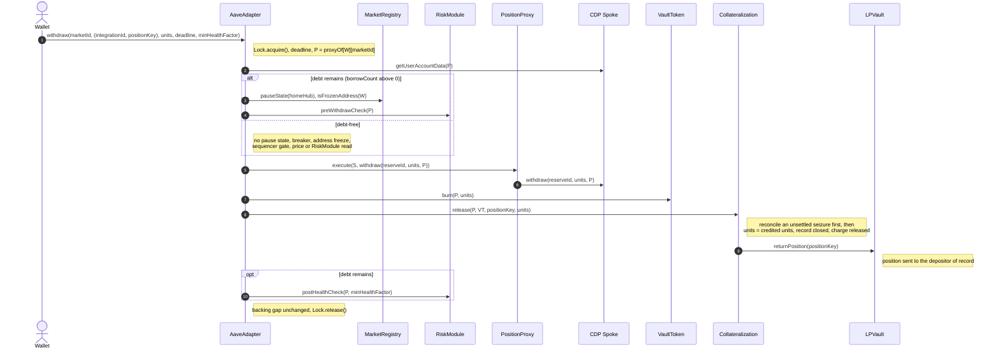

# 3.4 Withdraw (FLOW-004)

> **Status:** In review · **Owner:** Avana Labs · **Last reviewed:** 2026-11-10
>
> **Step prefix:** `WDR-NNN`

Withdrawal returns one whole pledged position, identified by its `positionKey` within the market's AMM integration, with the fees the AMM protocol keeps with the position and any liquidity donated to it, to the depositor of record; or, on path E, unwinds part of its units while the position stays pledged. For Uniswap v3 (Ethereum) and Aerodrome Slipstream (Base) the position is an NFT: `positionKey = bytes32(tokenId)` on Uniswap v3, and `bytes32((uint256(generation) << 248) | tokenId)` on Slipstream, whose LPVault decodes the generation from the key's high byte and the `tokenId` from its low 248 bits ([2.19] `SPEC-AMM-CORE-002`). Every amount the flow moves out of a pool is an n-token array in the order of the market's `tokens[0..n−1]`. Each wallet has one PositionProxy per (CDP Spoke, market), so an account holds exactly one collateral reserve: the market's vault-token reserve. The flow has five paths:

- **A. Standard withdrawal** (record has credited units): wallet → AaveAdapter → PositionProxy → CDP Spoke; the Adapter burns the withdrawn units from the proxy and Collateralization releases the record and has the market's LPVault return the position (`Q-223`, `Q-224`). The account is debt-free when Aave reports `borrowCount == 0` for the proxy; then no pause state, circuit breaker, address freeze, sequencer gate, price, MarketRegistry view or RiskModule check is read. With debt, `Paused` (either reason) refuses it, a frozen wallet cannot make it, and the RiskModule gates, the sequencer gate, the circuit breakers and the rescue-excluded health-factor floor apply (`Q-227`, `Q-229`, `Q-241`, `Q-242`, `Q-253`, `Q-260`, `Q-357`).
- **B. Zero-credit release** (no credited units remain): depositor → AaveAdapter → Collateralization under the Adapter's Lock, no Spoke withdrawal, no debt check, no pause state, breaker or price read (`Q-134`, `Q-223`, `Q-377`).
- **C. Repay-all and withdraw**: path A preceded, in the same call, by a repay-all of every debt reserve the wallet names, each refunding its unused cap, then a check that Aave reports `borrowCount == 0`, so the withdrawal runs on the debt-free branch. It exists because a withdrawal with debt can be refused (prices not Live, `Paused`, a breaker, a freeze, the sequencer gate) while a debt-free one cannot (`Q-029`, `Q-234`, `Q-260`, `Q-269`).
- **D. Reconcile on exit**: runs inside Collateralization during paths A, B and E whenever the proxy's Aave supply in the market is below its credited units, which happens only if a seizure was never settled (`Q-201`).
- **E. Partial removal**: wallet → AaveAdapter → PositionProxy → CDP Spoke, for `0 < units <` the record's credited units; the Adapter burns `units`, Collateralization debits the record, which stays open, and the LPVault unwinds exactly `units` from the position and pays the n token amounts to the depositor of record, each at least its minimum; the position stays in custody. Debt-free it is ungated like path A; with debt it is a withdraw-with-debt and the record left behind must be worth at least `minPledgeUsd` (`Q-254`). Liquidity later added to the position through the AMM protocol is credited by `AaveAdapter.recredit`, a deposit-side flow of [3.1 Deposit][3.1].

Every exit here (debt-free withdrawal and removal, `repayAllAndWithdraw`, zero-credit release, pending settlement) reads no pause state, circuit breaker, address freeze or MarketRegistry view, so none can block it; liquidation is likewise never blocked by them (`Q-241`, `Q-242`, `Q-260`). The PositionProxy is a logic-free immutable account that only forwards the AaveAdapter's calls, so no exit depends on proxy code: a fault in exit logic is fixed by an Adapter upgrade through the chain's Timelock, which every proxy uses at once (`Q-349`). The exits Avana cannot keep open are those Aave itself blocks: a pause of the vault-token reserve, a Hub halt or deactivation of the CDP Spoke (`Q-351`, playbook P-16).

Adapter steps belong to [2.6 Aave Adapter][2.6]; the proxy's Spoke calls to [2.5 Position Proxy and Proxy Manager][2.5]; release, records and reconcile to [2.3 Collateralization][2.3]; custody and unwind to [2.2 LP Vault][2.2] and the AMM integration of the market; the gates and the exit charge to [2.7 Risk Module][2.7] (`SPEC-CAP-004`); the pause state and market status to [2.8 Market Registry][2.8]; price state and the sequencer gate to [2.10 LP Oracle][2.10]; vault tokens to [2.4 Vault Tokens][2.4]; the lock to [2.16 Lock][2.16]; Aave behavior to [2.1 Avana Hub and Spokes][2.1]. Parameters are named as in [1.5][1.5].

Path A, standard withdrawal:

## Objective

Close one backing record: remove exactly its credited units from the proxy's Spoke position, burn them, release the record's exposure charge from the budget part the account is booked in, and return the position to the depositor of record, without letting an account with debt fall below `max(1, minHealthFactor, hardHealthFloor(m))`, and without leaving any vault token unbacked when an earlier seizure was not settled (`Q-018`, `Q-066`, `Q-067`, `Q-105`, `Q-158`, `Q-201`, `Q-224`, `Q-229`, `Q-354`). Path E instead reduces one record by `units` and pays the unwound token amounts to the depositor of record, under the same floors when debt remains and with the record left behind worth at least `minPledgeUsd` (`Q-253`, `Q-254`).

## Initiator

- Paths A, C and E: the wallet whose proxy holds the record, which is always the record's depositor; the Adapter resolves `proxyOf[msg.sender][marketId]`, and Collateralization checks the record belongs to that proxy (`Q-107`, `Q-223`).
- Path B: only the depositor of record, calling the AaveAdapter's `releaseZeroCredit`, which passes the caller to Collateralization as the depositor (`Q-134`, `Q-377`).
- Path D: no separate initiator; it runs inside A, B and E.

Nobody else, including governance, keepers or the stray-position return, can move a position that has a record (`Q-104`, `Q-134`).

## Inputs

| Input | Type | Description | Validation |
|---|---|---|---|
| `marketId` | `uint256` | The record's market `m`; its vault token `VT = AD.accountOf(P).vaultToken` gives the CDP Spoke `S = VT.spoke()` (every path) | Has a vault token and the wallet has a proxy for it (`WDR-002`, `WDR-004`, `WDR-031`); the record's own market (`WDR-014`, `WDR-037`) |
| `integrationId` | `uint32` | The market's AMM integration; with `positionKey` it names the position | Equals `VT.integrationId()` (`IntegrationMismatch`) |
| `positionKey` | `bytes32` | The pledged position within the market's AMM integration | Record open and belonging to the caller's proxy (`WDR-014`) or to the caller as depositor (`WDR-020`) |
| `units` | `uint256` (`uint128` on path E) | Exact backing units to withdraw (paths A, C), read from `Collateralization.previewRelease(VT, positionKey)`, which applies path D to the current Aave supply; or units to remove (path E) | Greater than 0 (`WDR-004`, `WDR-031`); equal to the record's credited units after reconcile on paths A and C (`WDR-014`); below them on path E (`WDR-037`) |
| `minAmounts` | `uint256[n]` | Least amount of each market token the unwind must return (path E), in each token's base units | Length `n` (`LengthMismatch`); checked by the AMM integration's unwind (`WDR-037`) |
| `deadline` | `uint256` | Last valid `block.timestamp` (paths A, C, E) | `block.timestamp ≤ deadline` (`WDR-003`, `WDR-031`) |
| `minHealthFactor` | `uint256` | Caller's minimum HF after the withdrawal or removal, WAD (paths A, E) | Applies only when debt remains (`WDR-011`, `WDR-035`); 0 means no extra bound |
| `debtReserveIds`, `maxRepaySpends` | `uint256[]` | Debt reserves to repay in full and the cap for each (path C), in each debt asset's base units; the app sets each cap, and its approval, to `Lens.quoteRepayAll(W, marketId, r, deadline)` | Equal lengths (`WDR-024`); Aave reports `borrowCount == 0` afterwards |

Path B takes `marketId`, the position (`integrationId`, `positionKey`) and `deadline`: it moves no value at a price and releases only the depositor's own position; the deadline only bounds when the transaction may land (`Q-134`).

## Preconditions

- The position has an open record created by [3.1 Deposit][3.1].
- Path A or C: the record has credited units greater than 0 after reconcile. Path B: the record has 0 credited units after reconcile, normally after a full seizure ([3.5 Liquidation][3.5]). Path E: the record has more than `units` credited units after reconcile.

### Record states

Record life cycle owned by [2.3].

| From | To | Flow |
|---|---|---|
| None | Active, credited `L > 0` | [3.1 Deposit][3.1] |
| Active, credited `c > 0` | Active, credited `c' < c` (possibly 0) | [3.5 Liquidation][3.5] |
| Active, credited `c > 0` | Active, credited `c' < c` (possibly 0) | Path D, reconcile on exit (`Q-201`) |
| Active, credited `c > 0` | Active, credited `c − units` with `0 < units < c` | Path E (`Q-254`) |
| Active, credited `c > 0` | Released and deleted | Path A or C |
| Active, credited 0 | Released and deleted | Path B |

The record is deleted on release and leaves no state; a later pledge of the same `positionKey` writes every field fresh (`Q-119`). An account holds at most `MAX_RECORDS_PER_ACCOUNT_MARKET` (16) records, so every walk of its list in this flow is bounded.

## Execution Steps

In exact execution order. `W` is the wallet, `m` the `marketId` argument, `VT = AD.accountOf(P).vaultToken` the market's vault token, `S = VT.spoke()` the CDP Spoke, `P = proxyOf[W][m]`, `HD = VT.hub()` the Spoke's home Hub (holding the vault-token asset), `AD` the AaveAdapter, `CO` Collateralization, `LV` the LPVault of the market's AMM protocol on this chain, `I` the market's AMM integration, `RM` the RiskModule, `MR` the MarketRegistry, `F` the VaultTokenFactory (`AD.VAULT_TOKEN_FACTORY`), `O` the market's LPOracle, `DO_r` the DebtOracle of non-GHO debt reserve `r`, `HF_r` the funding Hub of `r`, `reserveId = S.getReserveId(HD, HD.getAssetId(VT))` the vault-token reserve, derived at call time from the vault token's immutables and the Spoke (`INV-017`). The account's **collateral scope** is the single reserve `reserveId`; its **debt scope** is every reserve `S` reports as borrowed by `P`.

### Path A — standard withdrawal

| Step | Action | Contract (msg.sender) | Notes |
|---|---|---|---|
| `WDR-001` | `W` calls `AD.withdraw(m, (integrationId, positionKey), units, deadline, minHealthFactor)` | AaveAdapter (`W`) | The entry point acquires the protocol lock; `Lock.acquire` reverts with `LockHeld(holder)` if it is held. The Lock's only members are the AaveAdapter and LPVaultSwap, so every Spoke and market of the chain uses the same Lock. Owned by [2.6], [2.16]. (Source: Q-148, Q-223) |
| `WDR-003` | Check the deadline | `AD` | `block.timestamp ≤ deadline`. Deadlines are timestamps, never block numbers, so the 2 s Base blocks and 12 s Ethereum blocks need no different setting: a 600 s deadline is 300 Base blocks or 50 Ethereum blocks. (Source: Q-075, Q-357) |
| `WDR-002` | Resolve the account | `AD` | `P = proxyOf[W][m]`; zero → `NoProxy(W, m)`. The binding `(W, S, m) → P` is fixed at the proxy's CREATE2 deployment and never changes; there is no proxy version to check (`Q-349`). (Source: Q-107, Q-223, Q-349) |
| `WDR-004` | Validate inputs | `AD` → its own binding `accountOf(P)`, `VT.spoke()`, `VT.hub()`, `HD.getAssetId(VT)`, `S.getReserveId` (views) | `units > 0` (a zero-credit record uses path B); `VT = AD.accountOf(P).vaultToken` is non-zero and `S = VT.spoke()` (`UnknownMarket(m)`); `reserveId` derived from `VT`'s immutables and `S`. No MarketRegistry view is read: the factory and the token are immutable, so a faulty registry can neither block the exit nor pass off a foreign token ([2.6] `REQ-PROXY-033`, `REQ-ADAPTER-068`). The record itself is checked inside Collateralization (`WDR-014`). Checked by TEST-243. (Source: Q-067, Q-075, Q-134, Q-223, Q-260) |
| `WDR-005` | Read the debt | `AD` → `S.getUserAccountData(P)` (view) | Debt-free ⇔ `borrowCount == 0` ([2.5] `REQ-PROXY-034`). Aave's own borrow count covers every reserve the account owes, whichever Hub funds it, whatever any registry lists, so a MarketRegistry that lists no debt reserves cannot make an indebted account look debt-free and skip the health floor. With `borrowCount == 0` the flow skips `WDR-006`, `WDR-007` and `WDR-011` and reads no pause state, circuit breaker, address freeze, sequencer gate, price, MarketRegistry view or RiskModule function. Checked by TEST-243, PROP-066. (Source: Q-029, Q-128, Q-234, Q-237, Q-260) |
| `WDR-006` | With debt only: pause state and address freeze | `AD` → `MR.pauseState(HD)`, `MR.isFrozenAddress(W)` (views) | The pause state is the home Hub's entry in the chain's MarketRegistry. `Paused`, with reason `General` or `MintPathSuspect`, → `ApplicationPaused()`; `Frozen` allows withdraw-with-debt with every check; `W` frozen → `AddressIsFrozen(W)`. A frozen wallet can still leave through path C or after repaying. Checked by TEST-229. (Source: Q-227, Q-242, Q-252) |
| `WDR-007` | With debt only: RiskModule pre-check | `AD` → `RM.preWithdrawCheck(P)`; `RM` → sequencer-uptime feed (Base), `O.poke()`, `DO_r.poke()` per non-GHO debt reserve, then LPOracle, AaveOracle, DebtOracle, second-source, MarketRegistry (including breakers), ParameterStore, LPVaultSwap (`activeKeeperCount`), Spoke, Hub, Avana Umbrella (Coverage Spoke) and issuer-probe views | The gates of `preBorrowCheck` except the `Offboarding` and Aave-frozen refusals ([2.7] `REQ-ADAPTER-025`): (a) the chain's sequencer gate is `Up` (`SequencerDown` while the feed reports down, `SequencerGrace` for `sequencerGraceSeconds` after a restart; always `Up` on Ethereum) (`WDR-040`); (b) the market is Live, with every collateral input within its own feed's `feedHeartbeat + heartbeatMargin` (`WDR-041`) and the independent second source agreeing within its `secondSource.toleranceBps` (else `borrowAllowed = false` while the state stays Live, and the RiskModule refuses with `SecondSourceDisagrees(token)`, `Q-385`; for a market that is not Live, `PriceNotLive(marketId, state)`); (c) every debt reserve on its recorded source and unpaused and, unless GHO, priced by a DebtOracle that is Live, within its own feed age and agreeing with its second source; (d) the vault-token reserve not paused on Aave; (e) no liquidation halt (no unfrozen approved keeper on the chain, `keeperFloor = 1` (`Q-400`), or a pool token with no usable swap route to a debt asset the account owes; in-kind settlement does not exist, `Q-401`); (f) no drift, including the collateral-factor, bonus and target-health-factor reasons of [2.7] `REQ-RISK-069`, the standard-Spoke settings (`receiveSharesEnabled = false`, `liquidationFee = 0`, no reinvestment controller, `Q-352`) and `SpokeHalted` (`Q-351`); (g) Hub shares == assets; (h) the circuit breakers of `Q-399`: the market breaker (`BreakerTripped(marketId, reasons)`: pool share above 10%, `CONFIG_DRIFT`, `POOL_DEPTH`, issuer, manual) and the debt breaker of every debt reserve the account owes (`DebtBreakerTripped(S, r, reasons)`) ([2.7] `REQ-RISK-065`). Withdraw-with-debt is closed whenever liquidation of the account cannot run or a breaker stops new exposure, because collateral that leaves an indebted account can no longer be seized. Owned by [2.7]. Checked by QNT-18, TEST-228, TEST-249, TEST-250. (Source: Q-081, Q-128, Q-189, Q-195, Q-199, Q-203, Q-229, Q-234, Q-238, Q-241, Q-242, Q-248, Q-270, Q-274, Q-351, Q-352, Q-357, Q-399, Q-400, Q-401) |
| `WDR-008` | Withdraw from the Spoke | `AD` → `P.execute(S, withdraw(reserveId, units, P))`; `P` → `S.withdraw(reserveId, units, P)` (`P`) | `P` executes the Adapter's call and nothing else (`OnlyAdapter`). The Adapter records `P`'s `VT` balance first (the proxy has no logic). Aave checks the reserve is not paused (a frozen reserve still allows it); `HD.remove` checks the Spoke is active and not halted and sends `units` of `VT` from `HD` to `P`, a transfer the vault token's rule allows (home Hub to a registered proxy of the market); the Adapter then burns those units from `P` in the same call; if the account has debt, Aave requires HF ≥ 1. A debt-free withdrawal works in every price state. A Hub halt or deactivation of `S`, or a pause of the vault-token reserve, makes this step revert on Aave's side; Avana's containment uses the reserve freeze and `drawCap = 0` instead, which leave it open (`WDR-042`, playbook P-16). (Source: Q-029, Q-118, Q-128, Q-140, Q-349, Q-351) |
| `WDR-009` | Measure the withdrawal | `AD` | Aave's returned amount equals `units` and `P`'s `VT` balance rose by exactly `units` (`SPEC-PROXY-005`); the Adapter reads both balances, since the proxy holds no logic. (Source: Q-075, Q-124, Q-349) |
| `WDR-010` | Collateral cleanup | `AD` → `S.getUserSuppliedShares`, `S.getReserveConfig`, `S.getUserAccountData` (views); `P` → `S.setUsingAsCollateral(reserveId, false, P)` | Only when the account has no debt on any reserve and `P`'s supplied shares in `reserveId` are 0 and the reserve is not paused: the Adapter has `P` disable it as collateral and emits `CollateralDisabled(P, reserveId)`. With debt, an emptied reserve stays enabled at a zero balance until the account is debt-free. (Source: Q-119, Q-193, Q-225) |
| `WDR-012` | Burn the withdrawn units | `AD` → `VT.burn(P, units)` | The Adapter is the only burner and burns from the proxy without an allowance; `P`'s `VT` balance returns to its value before `WDR-008`. (Source: Q-224) |
| `WDR-013` | Hand over to Collateralization | `AD` → `CO.release(P, VT, positionKey, units)` (`AD`) | Accepted only from the Adapter while it holds the Lock. Owned by [2.3]. (Source: Q-148, Q-224) |
| `WDR-014` | Record checks, reconcile, units check | `CO` | An open record exists for `(I, positionKey)` (`RecordNotFound`), belongs to `P` (`NotRecordProxy`) and to `VT` (`InvalidVaultToken`). Then path D runs (`WDR-025` to `WDR-029`) with `inFlight = units`. Then `units ==` the record's credited units after reconcile (`UnitsMismatch`); the whole position is released, never part of it. Collateralization reads no health factor, debt, price state or pause state: the Adapter and Aave have applied their checks. (Source: Q-067, Q-201, Q-223, Q-224) |
| `WDR-015` | Close the record and release the charge | `CO` | Effects before the position moves: exit charge per `SPEC-CAP-004` with `u_b = units`, `u_a = 0`, so `release` equals the record's current charge. The release leaves the market's buckets (`WDR-044`): `Slice` first, then `Regular`; the token counter of each market token `tokens[i]` (`i = 0..n−1`) and the depositor counter each drop by `release`, all saturating; `totalCredited[VT] −= units`; `accountCredited[P][VT] −= units`; the record is unlinked from `P`'s seizure list, the later entries keeping their order, and deleted. No RiskModule call. Checked by HYP-10, MATH-UO-29. (Source: Q-055, Q-157, Q-158, Q-174, Q-194, Q-354) |
| `WDR-016` | Return the position | `CO` → `LV.returnPosition(positionKey)` | The LPVault's integration `return` sends the position to its depositor of record and clears its custody entry. For Uniswap v3 and Slipstream it is `NFPM.transferFrom(LV, W, tokenId)` (no receiver hook; a Slipstream NFT returns unstaked, as it was pledged). It neither collects nor unwinds: fees the AMM protocol keeps with the position and donated liquidity travel with it. (Source: Q-009, Q-067, Q-105, Q-144) |
| `WDR-017` | Events | `CO`, `LV` | `CO` emits `CollateralReleased(recordId, positionKey, W, P, VT, units)` before it closes the record and calls `returnPosition`; `LV` then emits `PositionReturned(integrationId, positionKey, W)`, and `CO` returns. (Source: Q-076) |
| `WDR-011` | With debt only: health check | `AD` → `RM.postHealthCheck(P, minHealthFactor)` → `S.getUserAccountData(P)` (view) | `hfEx ≥ max(1, minHealthFactor, hardHealthFloor(m))`, inclusive, WAD, with `hardHealthFloor(m)` the market's optional hard floor, 0 (off) by default (`Q-398`), read after the Spoke call and after Collateralization's debit (`WDR-013` to `WDR-017`), over the account's collateral reserve and every debt reserve (`SPEC-PROXY-001`, `SPEC-PROXY-006`), where `hfEx` is Aave's health factor with the account's rescue units valued at 0 (`SPEC-CF-005`, [2.7] `REQ-RISK-068`), compared held to the LPOracle's accepted price `A` (`hfB = ⌊hfEx × A / served⌋` when `A` is below the served price, else `hfEx`), so a rally since the last accepted price releases no collateral that the accepted price would not; otherwise `HealthFactorTooLow(hfB, required)`. Withdrawing a record whose units are not rescue units therefore cannot lean on rescue collateral, and a withdrawn rescue record's units, which leave with it, are not subtracted a second time. In an `Offboarding` market the liquidation threshold Aave applies is the ramped one (`Q-355`), so the check uses it. Checked by HYP-20, QNT-T19, TEST-236, PROP-067. (Source: Q-018, Q-161, Q-229, Q-253, Q-355, Q-398) |
| `WDR-018` | Adapter post-checks, event, unlock | `AD` | One-sided backing check with the gap preserved ([2.6] `REQ-ADAPTER-069`, `SPEC-PROXY-008`): `VT.totalSupply() ≤ CO.getTotalCredited(VT) + CO.getPending(VT).units`, and the gap `totalCredited + pending.units − totalSupply` read now equals `gapBefore`, read before the Spoke withdrawal of `WDR-008` and the burn of `WDR-012` (`BackingMismatch(totalSupply, totalCredited, pendingUnits)` otherwise). A gap left by an earlier unsettled `burnSeized` therefore never blocks a withdrawal, while every vault token in circulation stays backed. Emits `CollateralWithdrawn(W, m, integrationId, positionKey, units, hasDebt, hf)` with `hf` from `WDR-011`, or `type(uint256).max` on the debt-free branch; releases the lock. Checked by TEST-241, PROP-065. (Source: Q-076, Q-148, Q-224, Q-257) |

### Path B — zero-credit release

| Step | Action | Contract (msg.sender) | Notes |
|---|---|---|---|
| `WDR-019` | `W` calls `AD.releaseZeroCredit(m, (integrationId, positionKey), deadline)`; `AD` → `CO.releaseZeroCredit(W, VT, positionKey)` | AaveAdapter (`W`), then Collateralization (`AD`) | The Adapter acquires the Lock (`LockHeld(holder)` otherwise), passes the caller as depositor and reads no pause state, breaker, freeze, sequencer state or price ([2.6] `REQ-ADAPTER-097`); Collateralization accepts the call only from the Adapter holding the Lock, because every Collateralization entry point that moves value is reachable only through the two Lock members. Owned by [2.3], [2.6]. (Source: Q-134, Q-148, Q-223) |
| `WDR-020` | Check the record, reconcile, check credit | `CO` | An open record exists for `(I, positionKey)` in `VT`; the depositor the Adapter passed (its caller) `==` record depositor (`NotDepositor`). Then path D runs with `inFlight = 0`, so a record whose units were seized without settlement can still be released. Then credited units are 0. No Spoke withdrawal, no debt check, no gate; available in every Avana and Aave state, every sequencer state and in a `Closed` market. Checked by HYP-18, QNT-T15. (Source: Q-134, Q-201, Q-223, Q-355) |
| `WDR-021` | Close the record | `CO` | Any remaining charge is released from the account's budget part (0 once the last unit has exited, by `SPEC-CAP-004`); the record is unlinked if still linked and deleted. (Source: Q-134, Q-158, Q-174, Q-194, Q-354) |
| `WDR-022` | Return the position | `CO` → `LV.returnPosition(positionKey)` | Position LPVault → `W`, with its fees and any donated liquidity. (Source: Q-061, Q-105, Q-134, Q-144) |
| `WDR-023` | Events | `CO`, `LV` | `CollateralReleased(recordId, positionKey, W, P, VT, 0)`, then `PositionReturned(integrationId, positionKey, W)`. (Source: Q-076, Q-148) |

### Path C — repay-all and withdraw

| Step | Action | Contract (msg.sender) | Notes |
|---|---|---|---|
| `WDR-024` | `W` calls `AD.repayAllAndWithdraw(m, (integrationId, positionKey), units, debtReserveIds, maxRepaySpends, deadline)` | AaveAdapter (`W`) | One lock acquisition for the whole call. Arrays of equal length (`LengthMismatch` otherwise). Runs `WDR-003`, `WDR-002`, then for each listed reserve `REP-012` and `REP-004` to `REP-010` of [3.3 Repay][3.3] with `repayAll = true` and `W` as payer and borrower: each pulls its `maxRepaySpend` of that reserve's debt asset, repays the live debt on the reserve's funding Hub and refunds the unused part to `W` in the same call (a reserve already at zero repays nothing). Then, if `S.getUserAccountData(P).borrowCount > 0`, it reverts with `DebtRemaining(r, d)`, `r` the first reserve in `[0, S.getReserveCount())` the Spoke reports borrowed by `P` and `d` its debt; then `WDR-004` to `WDR-018` on the debt-free branch, with `minHealthFactor` unused. It reads no pause state, circuit breaker, address freeze, sequencer gate, price or MarketRegistry view and calls no RiskModule function, so it works in `Frozen`, `Paused` (either reason), under any breaker, for a frozen wallet, and during a Base sequencer `Grace` window. Emits the events of both flows; any failure reverts all of it. Owned by [2.6] `REQ-ADAPTER-071`, `REQ-ADAPTER-085`. Checked by TEST-243, TEST-248. (Source: Q-029, Q-180, Q-209, Q-212, Q-227, Q-234, Q-241, Q-242, Q-260, Q-269, Q-357) |

### Path D — reconcile on exit

Runs inside Collateralization at `WDR-014` (path A or C, `inFlight = units`), `WDR-020` (path B, `inFlight = 0`) and `WDR-037` (path E, `inFlight = units`); `settleSeizure` runs the same reconcile before a liquidation debit ([3.5][3.5]).

| Step | Action | Contract (msg.sender) | Notes |
|---|---|---|---|
| `WDR-025` | Read the account's Aave-side holding | `CO` → `S.getUserSuppliedShares(reserveId, P)` (view) | `held = suppliedShares + inFlight`. On path A the proxy has already withdrawn `units` and the Adapter has burned them, so they still count as the account's holding for this check. Credited units, supplied shares and assets are 1:1 for vault tokens only while the home Hub's added assets equal its added shares for `VT`; while they differ, path D is skipped, so a record with an unreconciled shortfall cannot be released until they are equal again ([2.3] `REQ-VAULT-130`, `REQ-VAULT-143`). (Source: Q-103, Q-189, Q-201) |
| `WDR-026` | Compute the missing units | `CO` | `missing = accountCredited[P][VT] > held ? accountCredited[P][VT] − held : 0`. Supply can only fall below credit when vault tokens left the account through a seizure whose `settleSeizure` never ran. With `missing == 0` (every normal exit) path D ends here with no write. (Source: Q-201) |
| `WDR-027` | Debit records in list order from the head | `CO` | Walk `P`'s list for `VT` from the head in its stored order (largest credited first at insertion; a partial change does not reorder; at most 16 records), `take_r = min(credited_r, remaining)`, until `missing` is covered; release exposure per `SPEC-CAP-004` from the account's budget part. A record debited to 0 stays open, so its depositor can still collect fees and use path B. (Source: Q-174, Q-194, Q-201, Q-354) |
| `WDR-028` | Move the units into pending settlement | `CO` → the integration's pool-lock check (view); `CO` → `LV.unwind(positionKey, take_r, minAmounts = [0, …, 0], CO)` per debited record | Requires the pool not inside its own callback, by the integration's lock check (Uniswap v3: `slot0.unlocked`; Slipstream: the `unlocked` field of its six-field `slot0`; Curve and Balancer: the pool's reentrancy lock) (`PoolLocked`). The LPVault unwinds exactly `take_r` units and returns the n token amounts `a_r[0..n−1]`, principal only where the AMM protocol separates fees (fees stay with the position). Then `pending[VT].units += missing`, `pending[VT].amounts[i] += Σ_r a_r[i]` for each token `i`, `totalCredited[VT] −= missing`, `accountCredited[P][VT] −= missing`. Zero minimums are safe here because nothing is paid out: the amounts are valued at oracle prices with a floor only when the pending balance is settled (`WDR-030`). The seized vault tokens are still in circulation, backed by the tokens in `pending[VT]`: `VT.totalSupply() = totalCredited[VT] + pending[VT].units`. (Source: Q-061, Q-066, Q-201, Q-224) |
| `WDR-029` | Events, then continue | `CO` | One `RecordDebited` per debited record and `SeizureReconciled(P, VT, missing, amounts[])`; control returns to `WDR-014`, `WDR-020` or `WDR-037`. (Source: Q-076, Q-201) |
| `WDR-030` | Settle the pending balance (separate transaction) | Any caller → `LPVaultSwap.settlePending(marketId, debtReserveId)`; LPVaultSwap → `AD.burnSeized(m, VT, u)`; LPVaultSwap → `CO.settlePending(VT, u)` | `u = min(VT held by LPVaultSwap, pending.units)`; the Adapter burns `u` from LPVaultSwap; Collateralization checks `totalSupply + u ≤ totalCredited + pending.units` (one-sided, so an earlier unsettled burn does not block it) and sends `⌊pending.amounts[i] × u / pending.units⌋` of each token `i` to LPVaultSwap (the exact remainder when `u` is the whole balance) and reduces `pending[VT]`. Rounding down keeps every remaining pending unit backed. LPVaultSwap converts the tokens over the market's swap routes into the asset of the market's settlement debt reserve and funds that reserve's Coverage Spoke on its funding Hub ([3.9] `DEF-015`); the borrower and the caller receive nothing from it. Owned by [2.3], [2.11]. (Source: Q-201, Q-211, Q-224, Q-236, Q-257, Q-358) |

### Path E — partial removal

The call preserves: the backing gap (the burn equals the record debit); the position's live units fall by exactly `units` and stay at least its credited units; the unwound tokens go only to the depositor of record; with debt, the RiskModule pre-checks, the sequencer gate and the rescue-excluded health floor, as for any withdraw-with-debt; debt-free, no gate (`Q-254`, `Q-257`).

| Step | Action | Contract (msg.sender) | Notes |
|---|---|---|---|
| `WDR-031` | `W` calls `AD.removeLiquidity(m, (integrationId, positionKey), units, minAmounts, deadline, minHealthFactor)` | AaveAdapter (`W`) | Acquires the protocol lock (`LockHeld(holder)` if held); `block.timestamp ≤ deadline` (`DeadlineExpired`); `units > 0` (`ZeroAmount()`); `minAmounts.length == n` (`LengthMismatch`); `P = proxyOf[W][m]` (`NoProxy(W, m)`); `VT` checked against the VaultTokenFactory and `S` and `reserveId` derived as in `WDR-004`, with no MarketRegistry read. `W` is the depositor of record of every record its proxy holds, since a pledge always credits the pledging wallet's own proxy. Owned by [2.6] `REQ-ADAPTER-078`, [2.16]. Checked by TEST-237. (Source: Q-148, Q-254, Q-260) |
| `WDR-032` | Read the debt | `AD` → `S.getUserAccountData(P)` (view) | Debt-free ⇔ `borrowCount == 0`, as `WDR-005`. Debt-free, the flow skips `WDR-033`, `WDR-035` and `WDR-038` and reads no pause state, circuit breaker, address freeze, sequencer gate, price or MarketRegistry view. (Source: Q-254, Q-260) |
| `WDR-033` | With debt only: pause, freeze, pre-check | `AD` → `MR.pauseState(HD)`, `MR.isFrozenAddress(W)`, `RM.preWithdrawCheck(P)` | `Paused` (either reason) → `ApplicationPaused()`; `W` frozen → `AddressIsFrozen(W)`; then every gate of `WDR-007`, the sequencer gate and circuit breakers included. A removal with debt takes collateral out of an indebted account exactly as a withdrawal does, so it runs the same gates. Checked by TEST-228, TEST-229. (Source: Q-227, Q-241, Q-242, Q-252, Q-254, Q-357) |
| `WDR-034` | Withdraw from the Spoke | `AD` reads `gapBefore = CO.getTotalCredited(VT) + CO.getPending(VT).units − VT.totalSupply()`; `AD` → `P.execute(S, withdraw(reserveId, units, P))`; `P` → `S.withdraw(reserveId, units, P)` | As `WDR-008` and `WDR-009`: Aave returns `units` and `P`'s `VT` balance rises by exactly `units`; with debt Aave requires HF ≥ 1. No collateral cleanup: the reserve keeps supplied shares. (Source: Q-124, Q-254, Q-257) |
| `WDR-036` | Burn the removed units | `AD` → `VT.burn(P, units)` | `P`'s `VT` balance returns to its value before `WDR-034`. (Source: Q-224, Q-254) |
| `WDR-037` | Partial release | `AD` → `CO.releasePartial(P, VT, positionKey, units, minAmounts)`; `CO` → `LV.releaseToDepositor(positionKey, units, minAmounts)` | Collateralization: the record of `(I, positionKey)` is open and belongs to `P` and `VT`; path D runs with `inFlight = units`; then `0 < units < credited` (`PartialRemovalTooLarge(units, credited)`: removing every credited unit is a withdrawal through path A); the record is debited by `units` and stays open; its charge releases `charge(u_b) − charge(u_a)` per `SPEC-CAP-004` from its `U0`, `C0` basis, from the account's budget part (slice first when booked in `Regular`); its rescue units become `min(rescueUnits, credited)`. The LPVault has the integration remove exactly `units` and pay each token amount `amounts[i] ≥ minAmounts[i]` to the depositor of record, measured by balance delta (`BelowMinimum(i, received, minimum)` otherwise). Where the AMM protocol separates fees (Uniswap v3, Slipstream, Uniswap v4) only the principal of the removed units is paid and the fees stay owed to the position; where fees are rolled into the position (Uniswap v2, Curve, Balancer) the removed units carry their share of accrued fees, because the AMM protocol cannot separate them. The position stays in custody. Returns `(remaining, amounts[])`. A moved pool price can only cost the depositor, who sets the minimums; the remaining collateral is valued at oracle prices. Owned by [2.3] `REQ-COLL-014`, [2.2] `REQ-VAULT-161`. Checked by TEST-237. (Source: Q-061, Q-201, Q-253, Q-254, Q-271, Q-354) |
| `WDR-038` | With debt only: remaining record minimum | `AD` → `RM.checkRemainingRecord(marketId, remaining)` (view) | `mulDiv(remaining, price8, 10^d, Floor) ≥ minPledgeUsd[m]` in 8-decimal USD, with `price8` the LPOracle's last accepted price per whole vault token (`lastAcceptedPrice()`) and `d` the token's decimals; otherwise `RecordBelowMinPledge(remainingUsd, minPledgeUsd)` ([2.7] `REQ-RISK-070`). Rounding down is against the caller. While the account owes debt, a record must stay worth seizing: a dust record left behind costs a keeper more gas than its seizure recovers, which is why `minPledgeUsd` is set per chain from liquidation gas. Debt-free, any remainder is allowed, because nothing can be seized from it. Checked by TEST-237. (Source: Q-230, Q-254, Q-277) |
| `WDR-035` | With debt only: health check | `AD` → `RM.postHealthCheck(P, minHealthFactor)` | `hfB ≥ max(1, minHealthFactor, hardHealthFloor(m))` as `WDR-011` (`hfEx` held to the accepted price), read after `WDR-037` debited the record and capped its rescue units at the credited units left (`HealthFactorTooLow(hfB, required)`). Checked by TEST-236, PROP-067. (Source: Q-229, Q-253, Q-254) |
| `WDR-039` | Post-checks, event, unlock | `AD` | Backing check as `WDR-018` against `gapBefore` (`BackingMismatch`); emits `CollateralReduced(W, m, integrationId, positionKey, units, amounts[], withDebt, hf)` with `hf` from `WDR-035`, or `type(uint256).max` debt-free; releases the lock; returns `amounts[]`. Checked by TEST-241, PROP-065. (Source: Q-076, Q-254, Q-257) |

### Gates, chains and market states

- `WDR-040` **Sequencer gate.** On every withdraw-with-debt (paths A and E with debt), the RiskModule reads the chain's sequencer-uptime feed before any price (Base: `0xBCF85224fc0756B9Fa45aA7892530B47e10b6433`; Ethereum has none and is always `Up`). The gate is `Down` while the feed's answer is 1, `Grace` while `block.timestamp − startedAt < sequencerGraceSeconds` (3,600 s) after the answer returns to 0, and `Up` otherwise; `Down` reverts `SequencerDown()` and `Grace` reverts `SequencerGrace(endsAt)`. Debt-free exits, path B, path C and pending settlement's custody side read no gate. Why: during an outage only transactions forced in from L1 execute, on prices that may be stale; after the restart borrowers need time to repay or add collateral before collateral can leave an indebted account. Example (Base): the sequencer restarts at `t = 1,000,000`; at `t = 1,002,000` a withdraw-with-debt reverts `SequencerGrace(1,003,600)`, the same position's `repayAllAndWithdraw` succeeds, and from `t = 1,003,600` the withdraw-with-debt runs with every other gate. Checked by TEST-250. (Source: Q-357)
- `WDR-041` **Feed freshness and second source.** Each collateral and debt input of a withdraw-with-debt is fresh while `block.timestamp − updatedAt ≤ getFeed(feed).feedHeartbeat + heartbeatMargin` (seconds, integers, no rounding; `heartbeatMargin` = 1,800 s), with `feedHeartbeat` the feed's own published heartbeat recorded at listing; and the independent second source (a TWAP of a deep pool, or a second oracle network) must agree with the served price: `|p − b| × 10⁴ ≤ secondSource.toleranceBps × min(p, b)` (8-decimal USD, exact integer comparison). Why: Chainlink stablecoin feeds publish only on a 0.25–0.3 % deviation or every 82,800–86,400 s, so a fixed 3,600 s limit would close withdraw-with-debt most of the day, while a feed silent for up to 24 h is only trusted for collateral leaving an indebted account if a second source confirms it. Example: USDC/USD with an 86,400 s heartbeat is fresh up to 88,200 s; at age 80,000 s with `p = 100,020,000`, a second source `b = 99,950,000` and `secondSource.toleranceBps = 60`: `70,000 × 10⁴ = 7 × 10⁸ ≤ 60 × 99,950,000 = 5.997 × 10⁹`, so the input passes; a DAI/USD leg with a 3,600 s heartbeat is fresh up to 5,400 s. The same rule holds on Ethereum and Base; only the recorded heartbeats differ. Checked by MATH-AR-59, QNT-54, HYP-42. (Source: Q-274, Q-357)
- `WDR-042` **Aave-side halts.** A Hub `haltSpoke` or `deactivateSpoke` of `S`, or an Aave pause of the vault-token reserve, makes `HD.remove` revert, so paths A, C and E stop for every account of every market on `S`; path B, which makes no Spoke call, stays open. Avana's listing agreement with the Aave DAO uses the vault-token reserve freeze and `drawCap = 0` for containment, which leave every withdrawal open; the RiskModule reports a halt as drift reason `SpokeHalted`, monitoring alarms within one block, and playbook P-16 asks the Aave Guardian to lift the halt or convert it to freeze plus `drawCap = 0`. (Source: Q-140, Q-351)
- `WDR-043` **Offboarding and Closed markets.** In `Offboarding` every withdrawal runs as in an active market, against the reserve's current liquidation threshold, which the Aave DAO lowers once, to the target `MarketRegistry.windDownState(m).targetLtBps`, after the published notice (`Q-355`, `MKT-059`), so withdraw-with-debt needs more remaining collateral after that drop. Once `closeMarket(m)` has run (the market's total debt is 0), the market is `Closed`: no account in it can hold debt, its LPOracle and swap routes are released, and every remaining position is withdrawable by its depositor forever through path A (debt-free branch, no price read) or path B. (Source: Q-355)
- `WDR-044` **Budget part on exit.** A pledge books its charge into the market's buckets, the regular part into `marketUsd[VT][Regular]` and the slice part into `marketUsd[VT][Slice]`; Collateralization keeps no per-account budget counter, and there is no `Idle` budget (`Q-396`). Every exit (paths A, B, D and E) releases its `SPEC-CAP-004` amount from the market's `Slice` bucket first, up to that bucket's balance, then from `Regular`. Units: USD with 8 decimals; saturating subtraction. Example: a debt-free account holding $50,000 of charge, all regular, withdraws its position; `Regular` falls from $4,200,000 to $4,150,000, and both pool-token counters and the depositor counter fall by $50,000. Checked by HYP-10. (Source: Q-354, Q-396)

### Withdrawal availability by state

For withdraw-with-debt the most restrictive state over the account's market and every debt reserve it owes applies (`Q-081`, `Q-234`). Path E follows the path A column for its debt state; with debt it also needs the remaining record worth at least `minPledgeUsd` (`WDR-038`). "Zero debt" means Aave reports `borrowCount == 0` (`Q-260`).

| State | Withdraw or remove, zero debt (A, C, E) | Withdraw or remove with debt (A, E) | Zero-credit release (B) |
|---|---|---|---|
| Home Hub's application state `None` | Allowed | Allowed | Allowed |
| Application `Frozen` | Allowed | Allowed (every RiskModule check) | Allowed |
| Application `Paused(General)` or `Paused(MintPathSuspect)` | Allowed | Refused (`ApplicationPaused`, `Q-227`, `Q-252`) | Allowed |
| The wallet is a frozen address | Allowed (`Q-242`) | Refused (`AddressIsFrozen`) | Allowed |
| The market breaker (including `CONFIG_DRIFT`, `POOL_DEPTH`), or the debt breaker of any debt reserve the account owes, tripped | Allowed (`Q-241`) | Refused (`BreakerTripped`, `DebtBreakerTripped`) | Allowed |
| Base sequencer `Down` | Allowed once included | Refused (`SequencerDown`, `Q-357`) | Allowed once included |
| Base sequencer `Grace` (first 3,600 s after restart) | Allowed | Refused (`SequencerGrace`, `Q-357`) | Allowed |
| MarketRegistry faulty (no debt reserves listed, wrong market views) | Allowed (`Q-260`) | Still gated: the debt decision comes from Aave | Allowed |
| An earlier `burnSeized` left unsettled (backing gap) | Allowed, gap preserved (`Q-257`) | Allowed, gap preserved | Allowed |
| Drifting, Cached or Expired, including persistent second-source disagreement and a USD-band breach | Allowed | Refused | Allowed |
| A collateral or debt input older than `feedHeartbeat + heartbeatMargin` (88,200 s for a 24 h stablecoin feed), or the second source outside its `secondSource.toleranceBps` | Allowed | Refused (`PriceTooOld`, `DebtPriceTooOld`, `SecondSourceDisagrees`, `Q-357`, `Q-385`) | Allowed |
| `hf` meets the floor but `hfEx` does not, because rescue units are valued at 0 | Allowed | Refused (`HealthFactorTooLow`, `Q-253`) | Allowed |
| Market `Offboarding` (one threshold drop after the notice); Aave vault-token reserve frozen | Allowed | Allowed, against the current threshold (`Q-355`) | Allowed |
| Market `Closed` | Allowed forever, no price read (`Q-355`) | Not reachable: a `Closed` market has no debt | Allowed |
| Aave configuration drift (collateral factor, bonus, target health factor, `receiveSharesEnabled`, `liquidationFee`, reinvestment controller), Hub shares ≠ assets | Allowed | Refused (`Q-270`, `Q-352`) | Allowed |
| No unfrozen approved keeper on the chain; a pool token with no usable swap route to an owed debt asset | Allowed | Refused (`LiquidationHalted`, `DebtLiquidationHalted`) | Allowed |
| A debt reserve of the account paused on Aave | Allowed | Refused (`DebtReservePaused`) | Allowed |
| Aave vault-token reserve of the market paused | Refused by Aave (playbook P-16) | Refused by Aave | Allowed |
| Hub halts or deactivates the CDP Spoke | Refused by Aave (`Q-140`, `Q-351`, playbook P-16) | Refused by Aave | Allowed |
| Unsettled seizure in the market (Aave supply below credited units) | Allowed after reconcile | Allowed after reconcile | Allowed after reconcile (`Q-201`) |

No Avana pause, breaker or freeze reaches pending settlement (`WDR-030`) or liquidation in any row.

## Contract Interactions

| Caller → callee.function() | Step | msg.sender at callee | Tokens moved |
|---|---|---|---|
| `W` → `AD.withdraw(m, (integrationId, positionKey), units, deadline, minHealthFactor)` | `WDR-001` | `W` | None |
| `AD` → `Lock.acquire()` / `Lock.release()` | `WDR-001`, `WDR-018` | `AD` | None |
| `AD` → its own binding `accountOf(P)`, `VT.spoke()`, `VT.hub()`, `HD.getAssetId(VT)`, `S.getReserveId` | `WDR-004`, `WDR-031` | `AD` | None |
| `AD` → `S.getUserAccountData(P)`; with debt only `MR.pauseState(HD)`, `MR.isFrozenAddress(W)` | `WDR-005`, `WDR-006`, `WDR-032`, `WDR-033` | `AD` | None |
| `AD` → `RM.preWithdrawCheck(P)`, `RM.postHealthCheck(P, minHealthFactor)` (with debt only); `RM` → sequencer-uptime feed, oracles and second sources | `WDR-007`, `WDR-011`, `WDR-033`, `WDR-035`, `WDR-040`, `WDR-041` | `AD`, then `RM` | None |
| `AD` → `P.execute(S, withdraw(reserveId, units, P))` → `S.withdraw(reserveId, units, P)` → `HD.remove(assetId, units, P)` → `VT.transfer(P, units)` | `WDR-008` | `AD`; `P` at `S`; `S` at `HD`; `HD` at `VT` | `VT` `HD` → `P`, `units` |
| `AD` → `P` → `S.setUsingAsCollateral(reserveId, false, P)` (debt-free, emptied reserve only) | `WDR-010` | `AD`; `P` | None |
| `AD` → `VT.burn(P, units)` | `WDR-012` | `AD` | `VT` `P` → burned, `units` |
| `AD` → `CO.release(P, VT, positionKey, units)` | `WDR-013` | `AD` | None |
| `CO` → `S.getUserSuppliedShares(reserveId, P)` | `WDR-025` | `CO` | None |
| `CO` → `LV.unwind(positionKey, take_r, [0…0], CO)` (only when `missing > 0`) | `WDR-028` | `CO` | Each token `i`: pool → `CO` (pending), `Σa[i]` |
| `CO` → `LV.returnPosition(positionKey)` → integration transfer (Uniswap v3 and Slipstream: `NFPM.transferFrom(LV, W, tokenId)`) | `WDR-016`, `WDR-022` | `CO`; `LV` at the AMM protocol | Position `LV` → `W` |
| `W` → `AD.releaseZeroCredit(m, (integrationId, positionKey), deadline)` → `CO.releaseZeroCredit(W, VT, positionKey)` | `WDR-019` | `W`; `AD` | None |
| `W` → `AD.repayAllAndWithdraw(m, (integrationId, positionKey), units, debtReserveIds, maxRepaySpends, deadline)` | `WDR-024` | `W` | As in [3.3] per reserve (pull `maxRepaySpend`, refund the unused part), then path A |
| `W` → `AD.removeLiquidity(m, (integrationId, positionKey), units, minAmounts, deadline, minHealthFactor)` | `WDR-031` | `W` | None |
| `AD` → `P.execute(S, withdraw(reserveId, units, P))` → `S.withdraw` → `HD.remove`; `AD` → `VT.burn(P, units)` | `WDR-034`, `WDR-036` | `AD`; `P` at `S`; `S` at `HD` | `VT` `HD` → `P` → burned, `units` |
| `AD` → `CO.releasePartial(P, VT, positionKey, units, minAmounts)` → `LV.releaseToDepositor(positionKey, units, minAmounts)` → AMM protocol removal | `WDR-037` | `AD`; `CO`; `LV` at the AMM protocol | Each token `i`: pool → depositor of record, `amounts[i]` |
| `AD` → `RM.checkRemainingRecord(marketId, remaining)` (with debt only) | `WDR-038` | `AD` | None |
| Any caller → `LPVaultSwap.settlePending(marketId, debtReserveId)`; LPVaultSwap → `AD.burnSeized(m, VT, u)`, `CO.settlePending(VT, u)` (separate transaction) | `WDR-030` | Caller; LPVaultSwap | `VT` LPVaultSwap → burned, `u`; pending tokens → LPVaultSwap → swap routes; settlement debt asset → its Avana Umbrella (Coverage Spoke) |

## State Changes

| Contract | Step | Storage / balance | Before → After |
|---|---|---|---|
| CDP Spoke | `WDR-008` | `P`'s supplied shares in the reserve | s → s − `units` |
| Home Hub | `WDR-008` | `S`'s added shares for the `VT` asset; Hub `VT` balance | Decrease by `units` (shares == assets) |
| `VT` | `WDR-008`, `WDR-012` | `balanceOf(HD)`, `balanceOf(P)`, `totalSupply` | h, 0, Σ → h − `units`, 0, Σ − `units` |
| Collateralization | `WDR-027`, `WDR-028` | Debited records' credited units; `pending[VT]` (`units`, `amounts[0..n−1]`); `totalCredited[VT]`; `accountCredited[P][VT]` (only when `missing > 0`) | credited − take; pending + (`missing`, `Σa[i]`); T − `missing`; A − `missing` |
| Collateralization | `WDR-015`, `WDR-021` | Record of `(I, positionKey)`; `P`'s list for the market; the market's `Slice` and `Regular` buckets, token counters of all n tokens, depositor counter; `totalCredited[VT]`; `accountCredited[P][VT]` | Deleted; n → n − 1, order kept; − `release` (saturating); T − `units`; A − `units` |
| CDP Spoke, Home Hub, `VT` | `WDR-034`, `WDR-036` | `P`'s supplied shares; Hub `VT` balance; `VT.totalSupply` | − `units` each |
| Collateralization | `WDR-037` | Record credited units and rescue units; `P`'s list order; the account's budget part and counters; `totalCredited[VT]`; `accountCredited[P][VT]` | c → c − `units` (record open); rescue `min(rescue, c − units)`; list order unchanged (the record keeps its place); − `charge(c) − charge(c − units)`; T − `units`; A − `units` |
| LPVault, AMM protocol | `WDR-037` | Position's live units | − `units`; separated fees unchanged; position stays with the LPVault |
| LPVault, AMM protocol | `WDR-016`, `WDR-022` | Custody entry of `positionKey`; position owner | `W` → none; LPVault → `W` |
| CDP Spoke | `WDR-010` | `P`'s collateral flag for the emptied reserve | On → off, only at 0 supplied shares and no debt |

## External Calls

Trust boundaries are defined in [1.3 Trust Boundaries][1.3] and [4.3 External Dependencies][4.3].

| External contract | Step | Function | Trust assumption |
|---|---|---|---|
| AaveAdapter (Avana, upgradeable through the chain's Timelock, trusted for custody) | `WDR-001`…`WDR-018`, `WDR-024`, `WDR-031`…`WDR-039` | Entry points, burn | Reviewed implementation behind the timelock (`Q-223`); all exit logic lives here, so a fix reaches every proxy at once (`Q-349`) |
| PositionProxy (Avana, logic-free, immutable, CREATE2 per (wallet, Spoke, market)) | `WDR-008`, `WDR-010`, `WDR-034` | Forwards the Adapter's Spoke calls | Executes only calls from the chain's AaveAdapter; holds no logic, version or upgrade path (`Q-349`) |
| VaultTokenFactory, vault token (Avana, immutable) | `WDR-004`, `WDR-031` | `marketKey`, `spoke`, `hub` (read through the Adapter's binding `accountOf`) | Fixed bindings; the exit's token check needs no upgradeable contract (`Q-260`) |
| MarketRegistry (Avana, upgradeable) | `WDR-006`, `WDR-007`, `WDR-033`, `WDR-038` | `pauseState`, `isFrozenAddress`, breaker and market views | Read only when debt remains; a faulty one can block withdraw-with-debt, never a debt-free exit (`Q-260`) |
| RiskModule, LPOracle, DebtOracle (Avana, upgradeable) | `WDR-007`, `WDR-011`, `WDR-033`, `WDR-035`, `WDR-038` | `preWithdrawCheck`, `postHealthCheck`, `checkRemainingRecord`, `poke`, `getPriceState`, `lastAcceptedPrice` | Called only when debt remains; a faulty one can block withdraw-with-debt or approve it down to Aave's HF ≥ 1, never a debt-free withdrawal or removal (`Q-229`) |
| Sequencer-uptime feed (Chainlink, Base only) | `WDR-007`, `WDR-033`, `WDR-040` | `latestRoundData` | Read only when debt remains; a reverting or malformed answer counts as `Down` |
| Collateralization, LPVault, vault token, Lock (Avana, immutable) | `WDR-012`…`WDR-030` | As listed | Fixed code; the position goes only to its depositor of record |
| Aave V4 CDP Spoke (standard) and Hub (Aave DAO) | `WDR-005`, `WDR-008`, `WDR-010`, `WDR-011`, `WDR-025` | Views, `withdraw`, `setUsingAsCollateral` | Trusted accounting; a vault-token reserve pause or a Hub halt or deactivation blocks paths A, C and E (`Q-351`) |
| AMM protocol position manager and pool (Uniswap v3 NFPM on Ethereum; Slipstream NFPM on Base, unstaked NFTs only) | `WDR-016`, `WDR-022`, `WDR-028`, `WDR-037` | Integration `return` and `unwind` (v3 and Slipstream: `transferFrom`, `decreaseLiquidity`, `collect`) | Trusted for the listed integration; no callback; path E's `minAmounts` bound what a moved pool price can cost the depositor |

## Events

In emission order (path A; path B emits only the reconcile, AMM protocol, LPVault and Collateralization events).

| Contract | Step | Event |
|---|---|---|
| LPOracle, DebtOracle | `WDR-007` | LPOracle `PriceStateChanged`, `DisagreementRecorded` or `GraceStarted`; DebtOracle `DebtPriceStateChanged`, `DebtFailureRecorded`, `DebtDisagreementRecorded` or `DebtGraceStarted`; each only when `poke()` changes stored state (with debt only) |
| Home Hub, `VT`, Spoke | `WDR-008` | Hub rate update events, `VT` `Transfer(HD, P, units)`, Hub `Remove(assetId, S, shares, units)`; with debt, Spoke `RefreshAllUserDynamicConfig(P)` and premium events when the premium changes; Spoke `Withdraw(reserveId, P, P, shares, units)` in upstream order |
| Spoke, AaveAdapter | `WDR-010` | `SetUsingAsCollateral(reserveId, P, P, false)` and `CollateralDisabled(P, reserveId)` (debt-free emptied reserve only) |
| `VT` | `WDR-012` | `Transfer(P, 0, units)` |
| AMM protocol, LPVault, Collateralization | `WDR-028`, `WDR-029` | Only when `missing > 0`: the AMM protocol's removal events (v3 and Slipstream: pool `Burn`, NFPM `DecreaseLiquidity`, pool `Collect`, NFPM `Collect`), LPVault `PositionUnwound(integrationId, positionKey, units, amounts[])` per debited record; `RecordDebited` per record, then `SeizureReconciled(P, VT, missing, amounts[])` |
| Collateralization | `WDR-017`, `WDR-023` | `CollateralReleased(recordId, positionKey, W, P, VT, unitsBurned)` |
| AMM protocol, LPVault | `WDR-016`, `WDR-022` | v3 and Slipstream: `Approval(LV, 0, tokenId)`, `Transfer(LV, W, tokenId)`; LPVault `PositionReturned(integrationId, positionKey, W)` |
| AaveAdapter | `WDR-018` | `CollateralWithdrawn(W, m, integrationId, positionKey, units, withDebt, healthFactorAfter)`; path C emits one `Repaid` per reserve that moved funds first |
| Home Hub, `VT`, Spoke, AMM protocol, LPVault, Collateralization, AaveAdapter | `WDR-034` to `WDR-039` | Path E: the Spoke withdrawal events as `WDR-008`; `VT` `Transfer(P, 0, units)`; reconcile events when `missing > 0`; the AMM protocol's removal events; LPVault `PositionUnwound(integrationId, positionKey, units, amounts[])` with recipient the depositor; Collateralization `RecordReduced(recordId, units, release)`; AaveAdapter `CollateralReduced(W, m, integrationId, positionKey, units, amounts[], withDebt, healthFactorAfter)` |

## Failure Conditions

Every failure reverts the whole transaction; the record, counters, pending balance, tokens and position stay as they were. Avana gate errors are declared on the owning contract page. Upstream errors pass through unchanged and `packages/protocol` ships the upstream error ABIs (`Q-119`).

| ID | Step | Condition | Result |
|---|---|---|---|
| `WDR-F-001` | `WDR-001`, `WDR-019`, `WDR-024` | Lock already held | `LockHeld(holder)` from the Lock ([2.16]) (Source: Q-148) |
| `WDR-F-002` | `WDR-002` | `W` has no proxy for market `m` | `NoProxy(W, m)` (Source: Q-223) |
| `WDR-F-003` | `WDR-003` | `block.timestamp > deadline` | `DeadlineExpired(deadline)` (Source: Q-075) |
| `WDR-F-004` | `WDR-004` | `AD.accountOf(P).vaultToken` is zero | `UnknownMarket(m)` (Source: Q-067, Q-075, Q-260) |
| `WDR-F-005` | `WDR-014` | `units` differs from the record's credited units after reconcile | `UnitsMismatch` from Collateralization ([2.3]) (Source: Q-075, Q-201) |
| `WDR-F-006` | `WDR-004` | `units == 0` | `ZeroAmount()`; a zero-credit record is released through path B (Source: Q-134) |
| `WDR-F-007` | `WDR-007` | Debt remains and the market is not Live, an input is older than `feedHeartbeat + heartbeatMargin`, a non-GHO debt reserve's DebtOracle is not Live or stale, a second source disagrees, or a debt price source is unexpected | `PriceNotLive`, `SecondSourceDisagrees(token)` (second source), `PriceTooOld`, `DebtPriceTooOld` or `UnexpectedDebtPriceSource` from the RiskModule ([2.7]) (Source: Q-128, Q-182, Q-238, Q-248, Q-274, Q-357, Q-385) |
| `WDR-F-008` | `WDR-007` | Debt remains and another gate fails | The RiskModule's error ([2.7]): `UnknownSpoke`, `LiquidationHalted` (including no unfrozen approved keeper), `DebtLiquidationHalted`, `UnknownCollateral`, `ConfigDrift` (including `CollateralFactorAboveExpected`, `BonusBoundViolated`, `LiquidationConfigChanged`, `ReceiveSharesEnabled`, `LiquidationFeeNonZero`, `ReinvestmentControllerSet`, `SpokeHalted`), `HubSharesNotEqualAssets`, `AaveReservePaused` or `DebtReservePaused` (Source: Q-189, Q-213, Q-227, Q-229, Q-235, Q-242, Q-270, Q-351, Q-352) |
| `WDR-F-009` | `WDR-007`, `WDR-011` | An LPOracle `poke()` or the RiskModule reverts for any other reason (debt remains) | The revert propagates; with zero debt neither is called (Source: Q-209, Q-229) |
| `WDR-F-010` | `WDR-008` | Aave rejects the withdrawal | `ReservePaused`, `SpokeNotActive`, `SpokeHalted`, `InsufficientLiquidity` or `HealthFactorBelowThreshold` passes through; a halt or pause is handled by playbook P-16 (Source: Q-118, Q-119, Q-140, Q-351) |
| `WDR-F-011` | `WDR-009` | Vault tokens received by `P` differ from `units` | `UnitsMismatch()` from the Adapter's balance check (Source: Q-124, Q-349) |
| `WDR-F-012` | `WDR-011` | Debt remains and the rescue-excluded HF below 1.00 or `minHealthFactor` (`PROXY_HEALTH_FACTOR_FLOOR` no longer exists, `Q-398`) | `HealthFactorTooLow(hfEx, required)` from the RiskModule (Source: Q-075, Q-161, Q-229, Q-253) |
| `WDR-F-013` | `WDR-011` | Debt remains and the rescue-excluded HF below the market's optional hard floor `hardHealthFloor(m)`, when governance set one (off by default; `minOpeningHealthFactor` no longer exists) | `HealthFactorTooLow(hfEx, required)` from the RiskModule (Source: Q-018, Q-229, Q-253, Q-398) |
| `WDR-F-014` | `WDR-014` | `release` called by anyone but the Adapter or without the Lock, for a `positionKey` with no open record, or for a record of another proxy or market | `NotAdapter`, `LockNotHeld`, `RecordNotFound` or `NotRecordProxy` from Collateralization ([2.3]) (Source: Q-148, Q-224) |
| `WDR-F-015` | `WDR-020` | No open record, caller not the depositor of record, or credited units not 0 after reconcile | `RecordNotFound`, `NotDepositor` or `RecordHasCredit` (Source: Q-134, Q-201) |
| `WDR-F-016` | `WDR-018` | Vault-token supply above credited plus pending units, or the gap `totalCredited + pending.units − totalSupply` differs from `gapBefore` | `BackingMismatch(totalSupply, totalCredited, pendingUnits)` (Source: Q-224, Q-257) |
| `WDR-F-017` | `WDR-024` | Any failure of a repay step ([3.3] `REP-F-001` to `REP-F-011`) or of path A | The whole call reverts (Source: Q-029, Q-119) |
| `WDR-F-018` | `WDR-028` | `missing > 0` and the pool is inside its own callback by the integration's lock check | `PoolLocked` (Source: Q-144, Q-201) |
| `WDR-F-019` | `WDR-014` | `VT` is not the record's vault token | `InvalidVaultToken` from Collateralization ([2.3] `REQ-VAULT-068`); the burn of `WDR-012` is undone (Source: Q-075, Q-224) |
| `WDR-F-020` | `WDR-006` | Debt remains and the home Hub's application state is `Paused` with reason `General` or `MintPathSuspect` | `ApplicationPaused()` (Source: Q-227, Q-252) |
| `WDR-F-021` | `WDR-024` | Aave reports `borrowCount > 0` after the repay steps, or the arrays differ in length | `DebtRemaining(r, d)` for the first reserve the Spoke reports borrowed, or `LengthMismatch()` (Source: Q-234, Q-260) |
| `WDR-F-022` | `WDR-006`, `WDR-033` | Debt remains and the wallet is a frozen address | `AddressIsFrozen(W)` (Source: Q-242) |
| `WDR-F-023` | `WDR-007`, `WDR-033` | Debt remains and the market breaker or the debt breaker of a debt reserve the account owes is tripped | `BreakerTripped(marketId, reasons)` or `DebtBreakerTripped(spoke, r, reasons)` from the RiskModule (Source: Q-241) |
| `WDR-F-024` | `WDR-011`, `WDR-035` | Debt remains and `hf` meets `required` but `hfEx` does not, because rescue units are valued at 0 | `HealthFactorTooLow(hfEx, required)` (Source: Q-253) |
| `WDR-F-025` | `WDR-031`, `WDR-034`, `WDR-036` | Path E: lock held, deadline passed, `units == 0`, `minAmounts.length != n`, no proxy, `m` has no vault token in the factory, or Aave rejects the withdrawal | `LockHeld(holder)`, `DeadlineExpired(deadline)`, `ZeroAmount()`, `LengthMismatch()`, `NoProxy(W, m)`, `UnknownMarket(m)`, or Aave's error as `WDR-F-010` (Source: Q-075, Q-148, Q-254, Q-260) |
| `WDR-F-026` | `WDR-033`, `WDR-035` | Path E with debt: `Paused`, frozen wallet, a RiskModule gate, sequencer gate or breaker, or the health floor fails | As `WDR-F-007`, `WDR-F-008`, `WDR-F-012`, `WDR-F-013`, `WDR-F-020`, `WDR-F-022`, `WDR-F-023`, `WDR-F-031` (Source: Q-241, Q-242, Q-253, Q-254, Q-357) |
| `WDR-F-027` | `WDR-037` | `units ≥` the record's credited units after reconcile; no open record, or a record of another proxy or market | `PartialRemovalTooLarge(units, credited)`; `RecordNotFound`, `NotRecordProxy` or `InvalidVaultToken` from Collateralization ([2.3]) (Source: Q-201, Q-254) |
| `WDR-F-028` | `WDR-037` | The unwind returns less than `minAmounts[i]` of some token `i` | `BelowMinimum(i, received, minimum)` from the LPVault, or the AMM protocol's own slippage error; nothing moves (Source: Q-254) |
| `WDR-F-029` | `WDR-038` | Debt remains and the record left behind is worth less than `minPledgeUsd` | `RecordBelowMinPledge(remainingUsd, minPledgeUsd)` from the RiskModule (Source: Q-254) |
| `WDR-F-030` | `WDR-039` | Path E backing check fails | `BackingMismatch(totalSupply, totalCredited, pendingUnits)` (Source: Q-254, Q-257) |
| `WDR-F-031` | `WDR-007`, `WDR-033`, `WDR-040` | Debt remains and the chain's sequencer gate is `Down` or in `Grace` | `SequencerDown()` or `SequencerGrace(endsAt)` from the RiskModule; debt-free exits are unaffected (Source: Q-357) |

## Worked Example

Ethereum market A: Uniswap v3 USDC/USDT 0.01 % pool on the CDP Spoke "Uniswap v3 Stable", exact range `[tickLower, tickUpper]` fixed at listing, `n = 2`, `tokens = [USDC, USDT]`, both 6 decimals, vault token `d = 6`, $2.00 per whole vault token, `CF_A = 3,120`, no opening health floor above 1.00 (`hardHealthFloor(m_A) = 0`, `Q-398`), as in the [3.1 Deposit][3.1] example. `P = proxyOf[W][m_A]` holds two records, both booked in `Regular`, and the market's slice counter is $0. `key7 = bytes32(uint256(7))` is the position of NFT #7.

| Record | Credited units | Value | Original units `U0` | Original charge `C0` |
|---|---|---|---|---|
| `key7` | 25,000,000,000 | $50,000 | 25,000,000,000 | $50,000.00000000 |
| `key9` | 10,000,000,000 | $20,000 | 10,000,000,000 | $20,000.00000000 |

`accountCredited[P][VT_A] = 35,000,000,000`.

**With debt (path A).** Debt 14,000 GHO (Ethereum Stable LP Hub); collateral $70,000; CF-weighted $21,840; HF 1.56. USDC/USD and USDT/USD have 86,400 s heartbeats; both last updated 50,000 s ago (fresh until 88,200 s) and agree with their second sources.

| Call | Checks | Result |
|---|---|---|
| `withdraw(m_A, (I, key9), 10,000,000,000, t+600, 1.10e18)`, market Live, application `None` | Collateral after $50,000, CF-weighted $15,600, `hf = 15,600 / 14,000 = 1.1143` ≥ 1.10 | Succeeds. 10,000,000,000 units burned from `P`; `release` = $20,000 leaves `Regular`, the USDC and USDT counters and the depositor counter; NFT #9 returned with its fees |
| `withdraw(m_A, (I, key7), 25,000,000,000, t+600, 0)` | Collateral after $20,000, CF-weighted $6,240, HF 0.4457 | Aave reverts at `WDR-008` with `HealthFactorBelowThreshold` |
| The first call while the application is `Paused(General)`, while `W` is frozen, or while market A's pool-share breaker is tripped (Avana above 10% of the pool) | `WDR-006`, `WDR-007` | The call reverts with `ApplicationPaused()`, `AddressIsFrozen(W)` or `BreakerTripped(A, POOL_SHARE)`; `repayAllAndWithdraw(m_A, (I, key9), 10,000,000,000, [r_GHO], [14,100e18], t+600)` succeeds in each of these states, pulling 14,100 GHO and refunding 100 GHO, assuming 14,000 GHO of live debt, in the same call |

**Base, same account shape (path A with debt).** Base market B: Slipstream USDC/USDT stable market on the CDP Spoke "Aerodrome Slipstream Stable", same values. The sequencer restarted 1,200 s ago: `withdraw` reverts `SequencerGrace(restart + 3,600)`; `repayAllAndWithdraw` succeeds at once. 2,400 s later the gate is `Up` and the withdrawal succeeds with the numbers above.

**Two debt reserves (path C).** The [3.2 Borrow][3.2] account on market B' of the Ethereum Spoke owes `8,032,876,712,328,767,123,288` GHO wei and `5,024,657,535` USDC base units after 30 days, both funded by the Ethereum Stable LP Hub; `P' = proxyOf[W][m_B]`.

| Call | Result |
|---|---|
| `repayAllAndWithdraw(m_B, (I, key12), 15×10^15, [r_GHO], [8,040e18], t+600)` | GHO repaid, then Aave reports `borrowCount = 1` and the first borrowed reserve is USDC: the call reverts with `DebtRemaining(r_USDC, 5,024,657,535)`; nothing moves |
| `repayAllAndWithdraw(m_B, (I, key12), 15×10^15, [r_GHO, r_USDC], [8,040e18, 5,030e6], t+600)` | Both reserves repaid by `W`: 8,040 GHO pulled and `7,123,287,671,232,876,712` wei refunded, 5,030,000,000 USDC base units pulled and 5,342,465 refunded; `borrowCount = 0`; 15×10^15 units of `VT_B` burned from `P'`; NFT #12 to `W`; market B's reserve disabled as collateral for `P'` (`CollateralDisabled`); `P` in market A is a separate account and is untouched; `CollateralWithdrawn(W, m_B, I, key12, 15×10^15, false, type(uint256).max)` |

**Partial record (path A, zero debt).** A liquidation earlier seized 5,000,000,000 units from `key7`, leaving 20,000,000,000 credited and a current charge of `ceil(50,000 × 20 / 25) = $40,000`. Withdrawing `key7` with `units = 20,000,000,000` releases `$40,000`; the $10,000 released at the seizure plus the $40,000 released now equal the original $50,000 exactly.

**Reconcile on exit (path D inside path A).** A faulty LPVaultSwap implementation seized 12,000,000,000 units from `P` on Aave and never called `settleSeizure`; the seized vault tokens sit in LPVaultSwap. `P`'s supplied shares are 23,000,000,000 while `accountCredited = 35,000,000,000`. The borrower, with no debt, withdraws `key9`; `previewRelease(VT_A, key9)` returns 10,000,000,000, because `key7` is at the head of the list and absorbs the whole shortfall.

| Step | Computation | Result |
|---|---|---|
| At `WDR-008`, `WDR-012` | `S.withdraw(reserveId, 10,000,000,000, P)`; burn from `P` | Supplied shares 13,000,000,000 |
| At `WDR-025`, `WDR-026` | `held = 13,000,000,000 + 10,000,000,000`; `missing = 35,000,000,000 − 23,000,000,000` | `missing = 12,000,000,000` |
| At `WDR-027` | Head `key7`: `take = min(25,000,000,000, 12,000,000,000)` | `key7` credited 13,000,000,000; charge `ceil(50,000 × 13 / 25) = $26,000`, so $24,000 released |
| At `WDR-028` | `LV.unwind(key7, 12,000,000,000, [0, 0], CO)` returns `[11,998,500,187, 12,001,500,000]` | `pending[VT_A] = {units 12,000,000,000; amounts [11,998.500187 USDC, 12,001.5 USDT]}`; `totalCredited −= 12,000,000,000`; `accountCredited = 23,000,000,000` |
| At `WDR-014` to `WDR-018` | `key9` credited 10,000,000,000 `== units` | $20,000 released; NFT #9 to `W`; `accountCredited = 13,000,000,000 =` supplied shares; backing equality holds |

Afterwards `VT_A.totalSupply() = totalCredited + pending.units`: the 12,000,000,000 vault tokens in LPVaultSwap are backed by the tokens in `pending[VT_A]`. A later `settlePending` while LPVaultSwap holds half of them burns 6,000,000,000 through `AD.burnSeized` and has Collateralization pay `⌊11,998,500,187 × 6 / 12⌋ = 5,999,250,093` USDC units and `⌊12,001,500,000 × 6 / 12⌋ = 6,000,750,000` USDT units to LPVaultSwap, which converts them over the market's swap routes into GHO, the market's settlement debt reserve, and funds the Ethereum Stable LP Hub's GHO Coverage Spoke.

**Partial removal (path E).** Wallet `Z` holds records `key21` (50,000,000,000 units, pledged at $2.00, `U0 = 50,000,000,000`, `C0 = $100,000`) and `key22` (40,000,000,000 units) in market A, now served at $1.9999 (`price8 = 199,990,000`), owes 10,000 GHO and has no rescue units, so `hfEx = hf`. Collateral is `90,000,000,000 × 1.9999 / 10⁶ = $179,991`, CF-weighted $56,157.19, HF 5.6157; `minPledgeUsd = $10`.

| Call | Checks | Result |
|---|---|---|
| `removeLiquidity(m_A, (I, key21), 50,000,000,000, [0, 0], t+600, 0)` | `WDR-037`: `units` equals the credited units | The call reverts with `PartialRemovalTooLarge(50,000,000,000, 50,000,000,000)`; a whole-record exit uses `withdraw` |
| `removeLiquidity(m_A, (I, key21), 49,996,000,000, minAmounts, t+600, 1.50e18)` | `WDR-035`: collateral left `40,004,000,000 × 1.9999 / 10⁶ = $80,003.9996`, `hfEx = 24,961.25 / 10,000 = 2.4961`, passes. `WDR-038`: `mulDiv(4,000,000, 199,990,000, 10⁶) = 799,960,000` ($7.9996) | The call reverts with `RecordBelowMinPledge(799,960,000, 1,000,000,000)`; nothing moves |
| `removeLiquidity(m_A, (I, key21), 49,994,999,000, minAmounts, t+600, 1.50e18)` | Remaining 5,001,000 units: `mulDiv(5,001,000, 199,990,000, 10⁶) = 1,000,149,990` ($10.0015) ≥ $10; `hfEx = 2.4962` | Succeeds. 49,994,999,000 units burned from `P`; `key21` keeps 5,001,000 credited units and its fees, still in custody; its charge falls to `⌈100,000 × 5,001,000 / 50,000,000,000⌉ = $10.002`, releasing $99,989.998 from `Regular`; the LPVault unwinds 49,994,999,000 units and pays `amounts`, about $99,985 of USDC and USDT, each at least its minimum, to `Z`; `CollateralReduced(Z, m_A, I, key21, 49,994,999,000, amounts, true, hf)` |
| The 49,996,000,000 removal after `Z` repaid all its debt (`borrowCount = 0`) | `WDR-032`: debt-free, no pause, breaker, freeze, sequencer, price or minimum read | Succeeds; `key21` keeps 4,000,000 credited units ($7.9996), allowed because the account has no debt for them to secure |
| The 49,994,999,000 removal while the application is `Paused(MintPathSuspect)` | `WDR-033` | The call reverts with `ApplicationPaused()`; the same removal debt-free succeeds |
| The 49,994,999,000 removal after a pool trade moved the price so that the unwind returns less USDC than `minAmounts[0]` | `WDR-037` | `BelowMinimum(0, received, minAmounts[0])` reverts the call; nothing moves |

Liquidity `Z` later adds to NFT #21 through Uniswap `increaseLiquidity` is not collateral until `Z` calls `AaveAdapter.recredit` ([3.1 Deposit][3.1]).

**Walkthrough.**

- `WDR-045` Aerodrome Slipstream on Base (Carol, withdraw with USDC debt). Setup: Carol's account in market 3 of [3.1 Deposit][3.1] `DEP-029` and [3.2 Borrow][3.2] `BOR-022`, after she pledged, on the day of her borrow, a second unstaked NFT `keyB` with `L = 2,500,000,000` ($5,000) as a top-up: two of her 16 records, collateral $25,000, CF-weighted $7,800, debt 5,000 USDC valued at $4,999.50, health factor `7,800 / 4,999.50 = 1.5602`. Both pool-token feeds last published 30,000 s ago (fresh until 88,200 s); the Hub's state is `None` and the sequencer gate is `Up`.
  1. Carol's app reads `Lens.getAccount(Carol, 3)` and `Lens.getPriceState(3)` ([2.17](../02-contracts/17-lens.md)): both records, health factor 1.5602, market Live, sequencer `Up`. Removing `keyB` leaves CF-weighted $6,240 and health factor 1.2481, which the app shows before Carol signs.
  2. Carol calls `AaveAdapter.withdraw(3, (integrationId, keyB), 2,500,000,000, now + 600, 1.20e18)` ([2.6](../02-contracts/06-aave-adapter.md)). The Adapter takes the Lock, checks the deadline (300 Base blocks) and resolves `P`.
  3. `Spoke.getUserAccountData(P)` shows `borrowCount = 1`, so the with-debt gates run: pause state `None`, Carol not frozen, then `RiskModule.preWithdrawCheck(P)` ([2.7](../02-contracts/07-risk-module.md)) reads the sequencer gate (`Up`), pokes the LPOracle ([2.10](../02-contracts/10-lp-oracle.md)) and the USDC DebtOracle, and finds both Live and no breaker tripped.
  4. The proxy ([2.5](../02-contracts/05-position-proxy-and-proxy-manager.md)) calls `Spoke.withdraw(reserveId, 2,500,000,000, P)`; Aave's own check passes and 2,500,000,000 vault-token units return to `P`. The Adapter burns them with `VT.burn(P, 2,500,000,000)` ([2.4](../02-contracts/04-vault-tokens.md)).
  5. `Collateralization.release(P, VT, keyB, 2,500,000,000)` ([2.3](../02-contracts/03-collateralization.md)) closes the record and releases its $5,000 charge from `Regular` and from the USDC, USDT and depositor counters.
  6. `LPVault.returnPosition(keyB)` ([2.21](../02-contracts/21-aerodrome-slipstream-integration.md)) sends the NFT back to Carol through the Slipstream NFPM with every fee it has accrued. Events: `PositionReturned(integrationId, keyB, Carol)`, `CollateralReleased(recordId, keyB, Carol, P, VT, 2,500,000,000)`.
  7. `RiskModule.postHealthCheck(P, 1.20e18)`: `hf = ⌊6,240 / 4,999.50 × 10^18⌋ = 1,248,124,812,481,248,124`, above `max(1.00, 1.20)`.
  8. The Adapter checks the market's backing gap is unchanged, emits `CollateralWithdrawn(Carol, 3, integrationId, keyB, 2,500,000,000, true, 1,248,124,812,481,248,124)` and releases the Lock. The app shows one record, collateral $20,000 and health factor 1.2481.
  9. Variants: withdrawing the first record (10,000,000,000 units) instead leaves CF-weighted $1,560 and health factor 0.3120, and Aave reverts with `HealthFactorBelowThreshold`. 1,200 s after a sequencer restart, `withdraw` reverts `SequencerGrace(restart + 3,600)`, while `repayAllAndWithdraw(3, (integrationId, keyB), 2,500,000,000, [r_USDC], [cap], now + 600)` repays the USDC debt ([3.3 Repay][3.3]) and returns the NFT at once, because a debt-free exit reads no gate.

  Checked by: SYM-138, MATH-AR-33; arithmetic re-computed.

## Postconditions

- `WDR-POST-001` — The position is owned by the depositor of record and by no other address; it carries the fees the AMM protocol keeps with it and any donated liquidity, and its units were reduced only by units reconciled under `Q-201`. Checked by HYP-19, QNT-35. (Source: Q-009, Q-067, Q-105, Q-134, Q-201)
- `WDR-POST-002` — The record is deleted and no longer appears in the proxy's list; the remaining records keep their stored order. (Source: Q-119, Q-194)
- `WDR-POST-003` — The market's vault-token supply and the home Hub's vault-token balance both fell by exactly `units` (0 on path B); units reconciled under `Q-201` moved from credited backing to the pending-settlement balance; supply is at most credited plus pending units and the gap between them is what it was before the call; `P`, the Adapter, Collateralization and the LPVault hold no vault tokens from this call. Checked by QNT-03, QNT-06, HYP-44, TEST-241, PROP-065. (Source: Q-066, Q-124, Q-201, Q-224, Q-257)
- `WDR-POST-004` — Every exposure counter of the account's budget part, every token counter of the market's n tokens and the depositor counter fell by exactly the record's remaining charge (plus the charge released by any reconcile debit), never below 0; a `Regular` booking released slice first; the RiskModule was not called for the release. Checked by HYP-10. (Source: Q-157, Q-158, Q-174, Q-209, Q-354)
- `WDR-POST-005` — If Aave reported `borrowCount == 0`, no pause state, circuit breaker, address freeze, sequencer gate, price, MarketRegistry view or RiskModule function was read, and the flow (paths A, C and E) succeeded unless Aave paused the withdrawn vault-token reserve or halted or deactivated the Spoke. Checked by HYP-18, QNT-15, TEST-243, PROP-066. (Source: Q-029, Q-118, Q-140, Q-227, Q-241, Q-242, Q-260, Q-351)
- `WDR-POST-006` — If debt remains, the rescue-excluded health factor held to the accepted price `hfB ≥ max(1, minHealthFactor, hardHealthFloor(m))` (`SPEC-CF-005`) over the account's collateral reserve and every debt reserve; the home Hub's application was not `Paused` for either reason; the wallet was not frozen; the sequencer gate was `Up`; every price input was within its feed's `feedHeartbeat + heartbeatMargin` and agreed with its second source; no market breaker and no debt breaker of an owed reserve was tripped; liquidation was not halted for the account at the call. Checked by HYP-20, QNT-20, QNT-T19, TEST-228, TEST-229, PROP-067. (Source: Q-018, Q-161, Q-227, Q-229, Q-241, Q-242, Q-252, Q-253, Q-357)
- `WDR-POST-007` — The vault-token reserve is disabled as collateral for `P` only when `P`'s supplied shares in it are 0, it is not paused and the account has no debt. (Source: Q-119, Q-193, Q-225)
- `WDR-POST-008` — After path A, `accountCredited[P][VT]` equals `P`'s supplied shares in the reserve; after path B it is at most that value; no unsettled seizure is left charged to a released record. (Source: Q-201)
- `WDR-POST-009` — After path C, Aave reports `borrowCount == 0` for the account, each named reserve was repaid by the calling wallet within its own cap on its funding Hub, and each cap's unused part was refunded to the wallet in the same call. Checked by TEST-248. (Source: Q-180, Q-234, Q-260, Q-269)
- `WDR-POST-010` — After path E, the record is still open with `credited − units > 0` credited units; the position's live units fell by exactly `units` and are at least its credited units; `P`'s supplied shares and the vault-token supply each fell by exactly `units`; the market's backing gap is unchanged. Checked by TEST-237, TEST-241, PROP-065. (Source: Q-254, Q-257)
- `WDR-POST-011` — After path E, the token amounts unwound went only to the depositor of record, each at least its `minAmounts[i]`, and the position, with its separated fees where the AMM protocol separates them, stayed in the LPVault. Checked by TEST-237. (Source: Q-061, Q-254)
- `WDR-POST-012` — After path E with debt, `hfEx` met the floor of `WDR-POST-006` and the record left behind is worth at least `minPledgeUsd` at the LPOracle's last accepted price; debt-free, no gate was read and any remainder is allowed. Checked by TEST-237, PROP-067. (Source: Q-253, Q-254)
- `WDR-POST-013` — After path E, the exposure counters fell by exactly `charge(c) − charge(c − units)` of the record's basis, from the account's budget part, never below 0, and the record's rescue units are at most its credited units. Checked by TEST-237. (Source: Q-157, Q-253, Q-254, Q-354)
- `WDR-POST-014` — In a `Closed` market every remaining position is returned to its depositor on request with no price, pause, breaker or sequencer read, and no account in the market holds debt. (Source: Q-355)
- `WDR-POST-015` — No step of any path depended on PositionProxy code beyond forwarding the Adapter's call; the binding `(W, S, m) → P` is unchanged. (Source: Q-349)

## Related

- Invariants this flow must preserve ([4.1 Global Invariants][4.1]): vault-token supply is at most credited backing plus pending-settlement backing, and every call keeps the gap; the home Hub's vault-token balance equals Spoke-supplied units; positions with a record, and the tokens of a partial removal, move only to their depositor; debt-free withdrawal and removal, `repayAllAndWithdraw` and zero-credit release are available in every pause state, under every breaker and freeze, in every sequencer state and with any MarketRegistry, unless Aave blocks them; rescue units never support debt; withdraw-with-debt is closed whenever liquidation of the account is halted; exposure counters never underflow and leave no residue after a record's last exit.
- Attack scenarios ([4.2][4.2]): withdrawing someone else's position, a hostile Adapter upgrade, a faulty RiskModule or pause blocking exits, dust donations blocking withdrawal, governance taking a zero-credit position, partial-exit counter drift, a faulty LPVaultSwap leaving seized vault tokens unbacked, closing an account with one debt reserve still open, a hostile MarketRegistry listing no debt reserves, a dust record left behind an indebted account, a sandwich around a partial removal, withdrawing on stale prices forced in from L1 during a sequencer outage.
- Playbooks P-16 (Aave halt of a CDP Spoke) and P-17 (sequencer outage) in [3.6 Emergency Operations][3.6].
- Decisions: `Q-018`, `Q-029`, `Q-061`, `Q-067`, `Q-075`, `Q-081`, `Q-105`, `Q-118`, `Q-119`, `Q-128`, `Q-134`, `Q-140`, `Q-157`, `Q-158`, `Q-161`, `Q-174`, `Q-182`, `Q-189`, `Q-194`, `Q-195`, `Q-201`, `Q-203`, `Q-208`, `Q-209`, `Q-211`, `Q-223`, `Q-224`, `Q-227`, `Q-229`, `Q-230`, `Q-234`, `Q-241`, `Q-242`, `Q-248`, `Q-252`, `Q-253`, `Q-254`, `Q-257`, `Q-260`, `Q-269`, `Q-270`, `Q-271`, `Q-274`, `Q-277`, `Q-349`, `Q-351`, `Q-352`, `Q-354`, `Q-355`, `Q-357`, `Q-358` in [4.4][4.4].
- Related flows: [3.1 Deposit][3.1], [3.3 Repay][3.3], [3.5 Liquidation][3.5], [3.7 Collect Fees][3.7], [3.9 Deficit Coverage][3.9].

[1.3]: ../01-architecture/03-trust-boundaries.md
[1.5]: ../01-architecture/05-parameters.md
[2.1]: ../02-contracts/01-avana-hub-and-spokes.md
[2.2]: ../02-contracts/02-lp-vault.md
[2.3]: ../02-contracts/03-collateralization.md
[2.4]: ../02-contracts/04-vault-tokens.md
[2.5]: ../02-contracts/05-position-proxy-and-proxy-manager.md
[2.6]: ../02-contracts/06-aave-adapter.md
[2.7]: ../02-contracts/07-risk-module.md
[2.8]: ../02-contracts/08-market-registry.md
[2.10]: ../02-contracts/10-lp-oracle.md
[2.11]: ../02-contracts/11-lpvaultswap.md
[2.16]: ../02-contracts/16-lock.md
[2.19]: ../02-contracts/19-amm-integration-interface.md
[3.1]: 01-deposit.md
[3.2]: 02-borrow.md
[3.3]: 03-repay.md
[3.5]: 05-liquidation.md
[3.6]: 06-emergency-operations.md
[3.7]: 07-collect-fees.md
[3.9]: 09-deficit-coverage.md
[4.1]: ../04-security/01-global-invariants.md
[4.2]: ../04-security/02-attack-scenarios.md
[4.3]: ../04-security/03-external-dependencies.md
[4.4]: ../04-security/04-design-decisions.md
