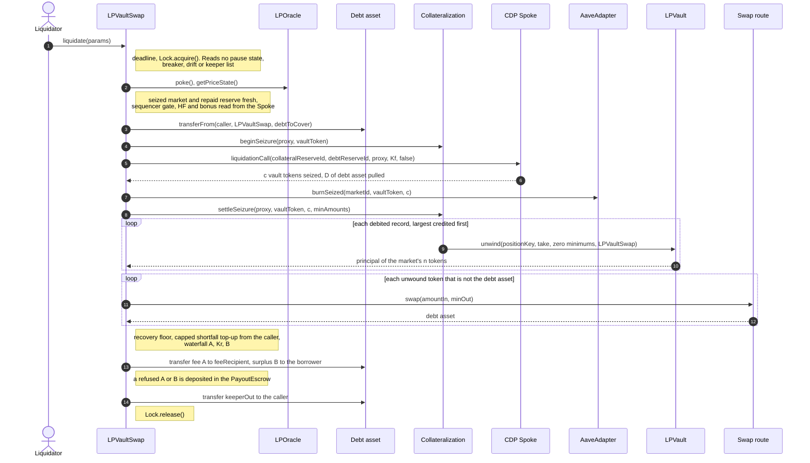

# 3.5 Liquidation (FLOW-005)

> **Status:** In review · **Owner:** Avana Labs · **Last reviewed:** 2026-11-10
>
> **Step prefix:** `LIQ-NNN` · failures `LIQ-F-NNN` · postconditions `LIQ-POST-NNN`

There is one liquidation route on every chain: **partial seizure through LPVaultSwap, settled in the debt asset that was repaid** (`Q-358`). There is one entry point, `LPVaultSwap.liquidate(params)`, open to any address once Aave allows the liquidation (health factor below 1), with either route mode. LPVaultSwap, one per chain and scoped by Hub inside:

1. pulls up to `debtToCover` of the debt asset from the caller, measured by balance delta; it takes no flash loan itself;
2. calls Aave's standard `Spoke.liquidationCall` on the CDP Spoke with `receiveShares = false`; Aave sizes the repayment and the seizure and sends the seized vault tokens to LPVaultSwap;
3. has the AaveAdapter burn exactly the seized units (`burnSeized`), Collateralization debit them from the account's records, and the market's LPVault unwind them into the market's `n` tokens;
4. swaps each token that is not the debt asset into the debt asset over the market's swap routes, each leg under an oracle-derived `minOut`;
5. pays out in the debt asset: Avana's 20% fee, the borrower's surplus, and the rest to the caller, including the funding Aave did not use.

A caller that holds no debt asset uses the public flash liquidation helper, an immutable periphery contract anyone can use: it flash-borrows the debt asset from the chain's Aave V3 Pool, calls `liquidate`, and repays the Pool from the caller's payout ([Flash-funded calls](#flash-funded-calls)). The keeper list is a registry of committed operators who liquidate every account below health factor 1; it gates no call ([One entry point and committed operators](#one-entry-point-and-committed-operators)).

The borrower keeps the rest of its position and all of its fees. GHO appears only when the debt is GHO. Whole-position settlement does not exist, because Aave sizes every seizure itself and an Avana-sized close would reimplement its liquidation math (`Q-060`). The PositionProxy is a logic-free immutable account and carries no settlement authority (`Q-349`).

Each wallet has one PositionProxy per (CDP Spoke, market), so each Aave account holds exactly one collateral reserve, the market's vault token, and possibly several debt reserves. A falling price in one market never liquidates an account in another market.

Liquidation is never paused by the application pause switch, a circuit breaker or a configuration drift: LPVaultSwap does not read the MarketRegistry's `PauseState`, pause reason, breakers or drift reasons (`LIQ-002`, `Q-352`). It is stopped only by stale prices of the seized market or the repaid reserve (`LIQ-006`, `LIQ-073`), the chain's sequencer gate (`LIQ-086`, `Q-357`) and Aave-side halts (`LIQ-088`, `Q-351`).

Contract rules are defined in [2.3 Collateralization](../02-contracts/03-collateralization.md), [2.2 LP Vault](../02-contracts/02-lp-vault.md), [2.4 Vault Tokens](../02-contracts/04-vault-tokens.md), [2.6 Aave Adapter](../02-contracts/06-aave-adapter.md), [2.11 LPVaultSwap](../02-contracts/11-lpvaultswap.md), [2.12 Settlement Routes](../02-contracts/12-settlement-routes.md), [2.10 LP Oracle](../02-contracts/10-lp-oracle.md), [2.8 Market Registry](../02-contracts/08-market-registry.md), [2.9 Parameter Store](../02-contracts/09-parameter-store.md), [2.15 Governance and Timelock](../02-contracts/15-governance-and-timelock.md), [2.16 Lock](../02-contracts/16-lock.md), [2.17 Lens](../02-contracts/17-lens.md) and [2.18 PayoutEscrow](../02-contracts/18-payout-escrow.md) (the payout escrow, `Q-401`). The flash source used by `deleverage`, the AMM integration interface and the per-chain settings are on the flash-source, AMM-integration and chain pages. Parameters are named as in [1.5 Protocol Parameters](../01-architecture/05-parameters.md). Emergency states and playbooks are in [FLOW-006](06-emergency-operations.md); deficit coverage is in [FLOW-009](09-deficit-coverage.md).

## Notation

The symbols follow [2.11 LPVaultSwap](../02-contracts/11-lpvaultswap.md#notation). Every settlement amount is in the repaid debt asset's base units (`dd` decimals: 6 for USDC and USDT, 18 for GHO and WETH). Prices are 8-decimal USD. Bps use 10,000 = 100 %. `⌊·⌋` rounds down and `⌈·⌉` rounds up. `W` is the borrower's wallet, `S` the CDP Spoke, `HD` its home Hub, `VT` the market's vault token, `m` the market, `P` the PositionProxy, `LV` the LPVault of the market's AMM protocol, `H` the flash liquidation helper, and `n` the market's token count. The helper's loan `F` and premium `φ` appear only in the helper's own steps; no liquidation formula of LPVaultSwap contains them.

| Symbol | Meaning | Unit |
|---|---|---|
| `r` | Debt reserve repaid by the call; `HF_r` its funding Hub | reserve ID |
| `X` | `debtToCover` | debt-asset base units |
| `Kf` | Caller funding: debt asset LPVaultSwap received from `msg.sender`, measured by balance delta; `0 < Kf ≤ X`, and `Kf = X` for a debt asset without a transfer fee | debt-asset base units |
| `D` | Debt asset Aave pulled in `liquidationCall` | debt-asset base units |
| `c` | Vault-token units LPVaultSwap received in `liquidationCall` | vault-token base units |
| `b`, `lf`, `bNet` | Aave liquidation bonus, liquidation fee (0 by the listing settings), net bonus | bps |
| `Pc`, `Pdebt`, `dv` | Vault-token and debt-asset prices served to Aave; vault-token decimals | USD 8 dp; — |
| `aᵢ`, `pᵢ`, `dᵢ` | Amount of token `i` the unwind returned; the 8-decimal leg price the LPOracle used; token decimals | token base units; USD 8 dp; — |
| `s`, `sLeg` | Effective slippage; per-leg slippage | bps |
| `U` | One raw token unit of each unwound leg, valued in the debt asset | debt-asset base units |
| `minOut` | Recovery floor | debt-asset base units |
| `R`, `R'` | Debt asset recovered from the seized collateral; `R` plus the caller's shortfall top-up | debt-asset base units |
| `V` | Oracle value of the seized units | debt-asset base units |
| `G` | Oracle gain `max(0, V − D)` | debt-asset base units |
| `Y` | Realized surplus `max(0, R' − D)` | debt-asset base units |
| `A`, `Kr`, `B` | Avana fee, caller reward, borrower surplus; `A + Kr + B = Y` | debt-asset base units |
| `take_j` | Units debited from record `j` | vault-token base units |
| `keeperOut` | Caller's payout `Kf + R' − D − A − B`: the funding Aave did not use, the recovered principal `D` and the reward `Kr` | debt-asset base units |
| `g` | Settlement gap `max(0, D + A + B − Kf − R)` ([2.13](../02-contracts/13-settlement-budget.md) `SPEC-SET-001`); never above the floor gap `max(0, minOut − R)`, because `Kf ≥ D` | debt-asset base units |

## Objective

Restore an unhealthy account (health factor below 1 on a CDP Spoke) by repaying part or all of one of its debt reserves, removing exactly the matching units of the market's AMM position from that account's records, converting the `n` unwound tokens into the debt asset, and paying Avana's share, the borrower's surplus and the caller, all in the debt asset. When the account's collateral is exhausted, Aave records the remaining debt of every debt reserve as a deficit in that reserve's asset on its funding Hub. No vault-token movement and no deficit report happens outside LPVaultSwap.

## Initiator

One entry point, `LPVaultSwap.liquidate`, open to any address that is not frozen, with both route modes (`PrimaryThenBackup` and `BackupOnly`). There is no keeper check and no second entry point ([One entry point and committed operators](#one-entry-point-and-committed-operators)). Callers are:

- committed operators: Avana's keeper on each chain at launch (primary instances and a standby on separate infrastructure, gas paid by Avana, `Q-381`), and any operator later added to the registry through the timelock, such as Aave Labs or a risk provider. Each commits to liquidate every account below HF 1, including unprofitable ones;
- any other address, funding the call itself or through the public flash liquidation helper ([Flash-funded calls](#flash-funded-calls)).

`msg.sender` at LPVaultSwap is the caller: it funds the call, and its payout goes to `msg.sender`. Through a helper, `msg.sender` is the helper. The CDP Spoke is a standard Aave V4 Spoke whose `liquidationCall` anyone may call, but a call from any address other than LPVaultSwap reverts on the vault token's transfer rule when Aave tries to send it the seized collateral ([Foreign liquidationCall](#foreign-liquidationcall), `Q-352`). The full access model, including how the Aave DAO liquidates, is in [Liquidation access](#liquidation-access).

## Inputs

`LPVaultSwap.liquidate(LiquidationParams params)`: one account, one collateral market and one debt reserve per call. `Lens.previewLiquidation(proxy, debtReserveId, deadline)` returns a `LiquidationParams` that can be sent unchanged (`Q-232`). The caller funds `debtToCover`; how it obtains the debt asset (its own balance, the public helper's flash loan or its own helper) is outside LPVaultSwap.

| Input | Type | Description | Validation |
|---|---|---|---|
| `proxy` | `address` | The borrower's PositionProxy (the Aave account for one market) | `vaultToken.isValidProxy(proxy)` for the market's vault token |
| `marketId` | `uint256`, MarketRegistry market identifier | The collateral market to seize from | Known in the MarketRegistry and matching the vault token; `Registered`, `Active` and `Offboarding` markets accepted |
| `debtReserveId` | `uint256` | The debt reserve to repay | Enabled for the Spoke in the MarketRegistry by `enableDebtReserve`, with a funding Hub and an Avana Umbrella (Coverage Spoke) recorded; each Coverage Spoke is also called Avana Umbrella, Avana's protocol safety module, named after Aave's Umbrella whose design inspired it (`Q-402`) |
| `debtToCover` | `uint256`, debt-asset base units | `X`, the most debt asset LPVaultSwap pulls from the caller and Aave may use; Aave's bound in `liquidationCall` is the amount received, `Kf ≤ X` | `> 0`, `≤ type(uint128).max`; a bound, never an exact-match value |
| `routeMode` | `enum RouteMode { PrimaryThenBackup, BackupOnly }` | Swap into the debt asset on the primary route with backup fallback, or on the backup only. In-kind settlement does not exist (`Q-401`) | Either mode, for every caller |
| `deadline` | `uint256`, seconds | Last valid `block.timestamp` | `block.timestamp ≤ deadline`, checked first (`LIQ-011a`); measured in seconds on every chain (120 s is 10 Ethereum blocks and 60 Base blocks) |
| `minPayout` | `uint256`, debt-asset base units | Smallest `keeperOut` the caller accepts; `keeperOut` includes the returned funding, so `minPayout` is the funding plus the smallest net payout accepted | `keeperOut ≥ minPayout` after the waterfall (`LIQ-031a`) |
| `minAmounts` | `uint256[]`, raw token units | The caller's least raw amount of each market token the unwind must return, market token order; empty means 0 for every token. It can only make the call revert | Empty or one entry per market token (`InvalidAmount`) |
| `maxShortfall` | `uint256`, debt-asset base units | Most of the caller's own debt asset the call may pull, beyond `Kf`, to cover recovery below the floor (`LIQ-076`) | `≤ type(uint128).max` |

## Preconditions

- `LIQ-001` `liquidate` MUST NOT check the caller against the keeper list: any address may call it, and the only caller check is the address freeze (`LIQ-080`). The keeper list held on LPVaultSwap (`isApprovedKeeper`, one per chain covering every Hub) is the registry of committed operators, changed only by timelock operations of the chain (`LIQ-065`); it is read for `keeperFloor`, the borrowing halt of `LIQ-063` and monitoring, never to admit or refuse a liquidation. `settlePending` has no caller check either (`LIQ-058`). Why: every check that protects Avana and the borrower (health factor, price gates, Hub share check, recovery floor, per-leg minimums, fee, surplus) runs on every call, so restricting the caller adds no protection and could only leave an account unliquidated. (Source: Q-053, Q-082, Q-147, Q-155, Q-213, Q-228, Q-242)
- `LIQ-002` Liquidation MUST NOT depend on the application pause state, any circuit breaker or any configuration-drift reason: LPVaultSwap never reads `MarketRegistry.pauseState()`, the pause reason, a breaker or a drift reason, so `liquidate` and `settlePending` run in None, Frozen, `Paused(General)` and `Paused(MintPathSuspect)`, with any market, debt or `POOL_DEPTH` breaker tripped and with any Spoke setting drifted (`Q-352`). Frozen, Paused, the breakers and drift stop new-account pledges, borrowing and withdraw-with-debt in the AaveAdapter and RiskModule; they stop no path that reduces risk. Why: a liquidation that cannot run lets an unhealthy account's loss grow toward a deficit while repay and debt-free withdrawal stay open anyway. A fault in LPVaultSwap is bounded instead by Aave's own eligibility and sizing and Collateralization's share-drop and supply-drop checks, and fixed by a timelocked upgrade; LPVaultSwap holds no budget it could spend, because every repayment is funded by the caller (`Q-397`). Example: the Emergency Guardian sets `Paused(MintPathSuspect)` on the Ethereum Stable LP Hub at 14:00 after an alert on another market; at 14:05 a keeper liquidates an account at HF 0.97 exactly as in None. (Source: Q-227, Q-051, Q-118, Q-241, Q-252, Q-352)
- `LIQ-003` The account's health factor on the CDP Spoke MUST be below 1: LPVaultSwap reverts with `NotLiquidatable` if `Spoke.getUserAccountData(proxy).healthFactor ≥ 1e18`, and Aave enforces the same inside `liquidationCall` (`HealthFactorNotBelowThreshold`). LPVaultSwap MUST NOT reimplement Aave's account or liquidation math: Aave sizes the seizure inside the call, and LPVaultSwap only reads `getUserAccountData` and `getLiquidationBonus` for the gates and bounds in `LIQ-006`, `LIQ-007` and `LIQ-014`. Keepers and the Lens preview a liquidation from the deployed Spoke's views and Aave's formulas at the pinned `LiquidationLogic`; the preview is differentially fuzzed against fork execution and never used on-chain. (Source: Q-060, Q-116, Q-119, Q-128, Q-232)
- `LIQ-004` `marketId` MUST be a MarketRegistry market listed by `listCollateralMarket` on the account's CDP Spoke, whose collateral reserve's underlying is the market's vault token on the Spoke's home Hub; LPVaultSwap checks these with view reads on every call and reverts with `UnknownMarket` otherwise. A market in `Offboarding` status, in its wind-down ramp, or whose Aave reserve is frozen MUST remain liquidatable, because offboarding and a freeze stop new risk and must never trap existing debt (`Q-355`). (Source: Q-068, Q-075, Q-118, Q-119, Q-227, Q-355)
- `LIQ-005` `proxy` MUST be a valid proxy of the market's vault token (`isValidProxy`, written by the AaveAdapter when it first supplies the proxy into the market); LPVaultSwap reverts with `UnknownProxy` otherwise. The proxy's binding `(W, S, m)` never changes, so the records, seizure list and rescue units it keys are never re-keyed (`Q-349`). (Source: Q-224, Q-225, Q-349)
- `LIQ-006` Collateral price gate for the seized market (`Q-247`): LPVaultSwap MUST revert with `StalePrice` unless, for market `m`, (a) the price comes from `m`'s LPOracle, (b) `m`'s price state is neither Cached nor Expired, (c) every input the served price uses is at most its own `liquidationPriceMaxAge = feedHeartbeat + heartbeatMargin` old (1,800 s margin), and (d) no feed disagreement blocks `m`. Freshness follows each feed's own heartbeat (`Q-357`). A Chainlink USD stablecoin feed with an 86,400 s heartbeat is fresh for 88,200 s, so an answer published 23 hours ago (82,800 s) passes; a 3,600 s feed is fresh for 5,400 s. Why: a feed publishes on its deviation trigger or after its heartbeat, so an age up to the heartbeat is normal, and a fixed 3,600 s bound would stop every 24 h stablecoin market for most of the day. A feed disagreement exists while a token's primary and alternate routes are both fresh and disagree beyond `feedAgreementToleranceBps`; it starts at the time stored by the first `poke()` or successful Avana call that observed it (`Q-199`). Liquidation of `m` pauses from that time until `disagreementPauseMax` after it; if the routes still disagree at that bound, `m` is treated as Expired for liquidation until the routes agree again, a standby route is switched in or governance approves a fix (`Q-208`, `Q-248`). A market that is Drifting only because of its TWAP guard, an `observe()` failure, a wide-bound breach or a USD-band breach, with both routes of each token fresh and agreeing, does not block liquidation: Aave decides eligibility and sizes the seizure at the served price. Stress rule: once `m` is Expired its collateral counts as 0 (the LPOracle serves one unit of 10⁻⁸ USD per whole vault token, because the AaveOracle rejects 0), so the account's health factor falls and the account cannot be seized until the price is fresh again; debt prices follow `LIQ-073`. Example: an account in Expired market 7 holding $20,000 of vault tokens and owing 6,400 GHO has HF ≈ 0 and a call naming market 7 reverts with `StalePrice` until a fresh price or a standby route arrives; the keeper then liquidates at the fresh price. Checked by: TEST-226, TEST-230. (Source: Q-128, Q-162, Q-176, Q-182, Q-183, Q-195, Q-199, Q-208, Q-234, Q-247, Q-248, Q-274, Q-357)
- `LIQ-007` Recovery grace: if the seized market satisfies `recoveredAt ≤ block.timestamp < recoveredAt + graceDuration` (the first fresh update after an Expired outage, one window per outage), LPVaultSwap MUST revert with `GraceHealthFactor` unless the account's health factor from `Spoke.getUserAccountData(proxy)` is below `graceHealthFactor`. The chain's sequencer grace (`LIQ-086`) applies the same threshold after a sequencer restart. (Source: Q-088, Q-128, Q-129, Q-154, Q-357)
- `LIQ-008` The home Hub's added shares MUST equal its added assets for the seized market's vault-token asset (`Hub.getAddedShares(assetId) == Hub.getAddedAssets(assetId)`); otherwise liquidation of that market stops with `SharesNotEqualAssets` and monitoring raises the alarm in [FLOW-006](06-emergency-operations.md). Collateralization enforces the same check at `beginSeizure` (`LIQ-016`), because the debit check equates Aave's shares-to-liquidate with vault-token units only while shares equal assets. With `reinvestmentController = address(0)` on the vault-token asset (`Q-352`) the equality holds unless the Hub itself is faulty. (Source: Q-181, Q-189, Q-352)
- `LIQ-009` Mode admissibility: in `PrimaryThenBackup` and `BackupOnly` modes, a swap route of `marketId` from a token to the debt asset is usable only while `MarketRegistry.getRoute(marketId, token, debtAsset, kind)` reports it usable (Active, not disabled); every caller may choose either mode. There is no `InKind` mode (`Q-401`): a market whose routes cannot settle is handled by the caller's shortfall top-up, a standby or replaced route, and the route freeze of playbook P-04. A token equal to the debt asset needs no route. (Source: Q-084, Q-133, Q-151, Q-163, Q-213, Q-216, Q-227, Q-358)
- `LIQ-010` Aave-side conditions are not re-checked by Avana: a paused collateral or debt reserve (`ReservePaused`), a halted Spoke on the home or funding Hub (`SpokeHalted`), a deactivated Spoke and an empty collateral position (`ReserveNotSupplied`) MUST surface as the unchanged upstream error; LPVaultSwap uses Avana custom errors only for its own gates, and `packages/protocol` ships the upstream error ABIs. A frozen reserve does not block `liquidationCall` with `receiveShares = false`. An Aave halt or pause is containment Avana cannot override; `LIQ-088` and playbook P-16 cover it (`Q-351`). (Source: Q-118, Q-119, Q-140, Q-192, Q-202, Q-351)
- `LIQ-073` Debt price gate for the repaid reserve (`Q-247`, `Q-248`): for `r`, LPVaultSwap MUST revert with `DebtPriceStale(r)` unless `r` is GHO (Aave's fixed $1 source always passes) or the reserve's AaveOracle source is the DebtOracle the MarketRegistry records and that DebtOracle, which LPVaultSwap does not poke, evaluates Live (primary or alternate route serving) with every input within its own `liquidationPriceMaxAge` (`feedHeartbeat + heartbeatMargin`, 1,800 s margin, as in `LIQ-006`). Stress rule for the account's other debt reserves: they are not gated; their DebtOracles serve the accepted price while Live or Cached, the higher of the two route answers (never below the accepted price) during a disagreement and, once Expired, the accepted price raised by `debtStressRiseBps` (`SPEC-ORC-018`). A failing debt price therefore only lowers the health factor, and no debt is ever repaid at a stress price. Example: USDC accepted at 0.99990000 and Expired, with `debtStressRiseBps = 500`, counts at `⌈99,990,000 × 10,500 / 10,000⌉ = 104,989,500` (1.04989500 USD) while the account is liquidated against its GHO debt; a call repaying USDC waits for a fresh USDC price. Checked by: TEST-226, TEST-230. (Source: Q-238, Q-234, Q-182, Q-247, Q-248, Q-274, Q-357)
- `LIQ-074` `debtReserveId` MUST be enabled for the Spoke in the MarketRegistry (`enableDebtReserve`) and borrowable on the Spoke; otherwise LPVaultSwap reverts with `UnknownDebtReserve(debtReserveId)`. LPVaultSwap reads from the MarketRegistry the reserve's asset, decimals, funding Hub `HF_r`, price source, Coverage Spoke for `(HF_r, asset)`, `floorRoundingAllowance[r]` and the market's swap routes into that asset. The debt reserve may be any asset; GHO is one case among them. (Source: Q-233, Q-235, Q-237, Q-358)

## Execution Steps

In exact execution order. LPVaultSwap takes no flash loan in `liquidate`: every step runs directly in the call. A flash-funded liquidation wraps the whole call inside the helper's flash callback ([Flash-funded calls](#flash-funded-calls)), and LPVaultSwap runs the same steps with the helper as caller. Every amount below is measured as a before/after balance delta within the call, never as an absolute balance (`Q-124`). No step before the unwind (`LIQ-023`) touches the market's pool: Aave's calls do not, and a swap route never uses the pool being unwound.

| Step | Action | Contract | Notes |
|---|---|---|---|
| `LIQ-011a` | Check the deadline: LPVaultSwap reverts with `DeadlineExpired(deadline)` if `block.timestamp > params.deadline`, before the lock and before any external call. | LPVaultSwap | A transaction left pending, for example after a fallback from private submission to the public mempool, cannot execute later at a price and bonus its caller never saw. The LPVault's internal unwind keeps `deadline: block.timestamp` (`LIQ-023`) because this outer deadline already bounds the call. (Source: Q-216, Q-131) |
| `LIQ-011` | Any address calls `LPVaultSwap.liquidate(params)`, directly or through a flash liquidation helper; after `LIQ-011a` LPVaultSwap acquires the chain's protocol lock (`LockHeld(holder)` if held), then checks the amount (`InvalidAmount` unless `0 < X ≤ type(uint128).max`), `LIQ-080`, `LIQ-005`, `LIQ-074` and `LIQ-009`. There is no keeper check (`LIQ-001`) and the pause state is not read (`LIQ-002`). | LPVaultSwap, Lock | `msg.sender` = the caller. The lock's only members are the AaveAdapter and LPVaultSwap; it is held until `LIQ-034`, and inner calls into Collateralization and the LPVault are accepted only while a member holds it and only from the fixed callers, so a Spoke or market listed later needs no Lock change. One account per call; keepers batch with separate transactions. Front-run tolerance (`Q-345`): caller inputs are bounds, and LPVaultSwap measures `Kf`, `D` and `c` by balance delta, so a 1-wei repay or a repay that leaves the debt just under Aave's dust threshold changes the amounts, not the outcome. Keepers size `debtToCover` as a full close quoted by the Lens as `⌈total × (10⁴ + LENS_DUST_MARGIN_BPS) / 10⁴⌉`, or at least `LENS_DUST_MARGIN_BPS` below the dust boundary, set `minPayout` to the funding plus the previewed net payout less at least 1 % of that net payout, `minPayout ≤ X + ⌊0.99 × (keeperOut_preview − X)⌋`, and submit through private order flow on Ethereum. Example: a whole debt of 1,950 USDC with a 500 bps margin gives `debtToCover = 2,047.5` USDC; after a 1-wei repay lands first, Aave pulls 1,949.999999 USDC and the 97.500001 USDC it did not pull returns to the caller inside `keeperOut`. (Source: Q-075, Q-119, Q-148, Q-213, Q-227, Q-345, Q-358) |
| `LIQ-012` | Resolve the market and the debt reserve from the MarketRegistry: CDP Spoke `S`, home Hub `HD`, `collateralReserveId`, vault token, AMM integration `integrationId` and its LPVault `LV`, pool, exact range or shape, vault-token `assetId`, the market's `n` tokens and its swap routes into the debt asset; the debt reserve's asset, decimals, funding Hub `HF_r`, price source and Coverage Spoke; check `LIQ-004`. | LPVaultSwap → MarketRegistry, ParameterStore, Spoke (views) | The market key is `(chainId, spoke, reserveId)`; the MarketRegistry maps market ↔ (AMM protocol, pool, exact shape) ↔ vault token ↔ `(HD, assetId)` one-to-one. Collateralization re-derives its own targets from the vault token's immutables (`LIQ-016`). (Source: Q-075, Q-076, Q-119, Q-126, Q-233, Q-358) |
| `LIQ-013` | Call `poke()` then `getPriceState()` on the market's LPOracle and `poke()` on the repaid reserve's DebtOracle; apply `LIQ-003`, `LIQ-006`, `LIQ-007`, `LIQ-008` and `LIQ-073`. | LPVaultSwap → LPOracle, DebtOracle, Spoke, Hub, AaveOracle | `poke()` is the permissionless cache write keepers also run on every feed update; it stores each feed's answer, `updatedAt` and round ID, requires at least `pokeMinGas`, and never moves a market to Expired from a caught error. A gas-starved `poke()` of the market or the repaid reserve reverts the whole liquidation. The account has one collateral market, so no other LPOracle is poked. (Source: Q-056, Q-119, Q-128, Q-129, Q-154, Q-162, Q-182, Q-199, Q-238, Q-247) |
| `LIQ-086` | Sequencer gate (`Q-357`): read the chain's gate from its sequencer-uptime feed through the LPOracle. `Down`: revert `SequencerDown`. `Grace` (restart until `restartedAt + sequencerGraceSeconds`): revert `SequencerGrace` unless `HF < graceHealthFactor`. `Up`: continue. Ethereum has no sequencer feed and is always `Up`. | LPVaultSwap → LPOracle (view) | See [Sequencer gate](#sequencer-gate). (Source: Q-357) |
| `LIQ-014` | Read `HF = Spoke.getUserAccountData(proxy).healthFactor`, the bonus `b = Spoke.getLiquidationBonus(collateralReserveId, proxy, HF)` and the liquidation fee `lf` of the proxy's dynamic config key for `collateralReserveId`; compute `bNet` per `LIQ-027`; read `Pdebt`. | LPVaultSwap → Spoke, AaveOracle (views) | The bonus is read in the same call and block as `liquidationCall`, so it equals the bonus Aave applies. The listing payload sets `liquidationFee = 0` on every Avana collateral reserve and the drift check enforces it (`Q-352`); the net form keeps the formula defined for any value the Spoke reports; a non-zero fee is drift and never a supported setting. (Source: Q-068, Q-159, Q-190, Q-222, Q-352) |
| `LIQ-082` | No pool spot gate (`Q-350`, [2.11](../02-contracts/11-lpvaultswap.md) `REQ-SWAP-025`): LPVaultSwap reads no pool spot price and compares none with the oracle reference. A moved pool price never reverts the liquidation and never switches its route mode: the call runs in the mode its caller set. The unwind runs at zero per-token minimums (`LIQ-023`), each swap leg at its oracle-derived `minOutᵢ` (`LIQ-075`), and in routed modes the recovery floor of `LIQ-030` compares what the unwound tokens recover with their oracle value `V`. | LPVaultSwap | See [Unwind at any pool price](#unwind-at-any-pool-price). (Source: Q-350) |
| `LIQ-015` | Fund: pull up to `X` of the debt asset from `msg.sender` and measure `Kf` by balance delta (`LIQ-035`). LPVaultSwap calls no flash source and measures no flash loan. | LPVaultSwap | Callers always fund in the debt asset. A flash loan, if any, is taken by the caller's helper before this call and repaid after it ([Flash-funded calls](#flash-funded-calls)). (Source: Q-063, Q-119, Q-213, Q-358) |
| `LIQ-070` | Hold the debt asset: LPVaultSwap requires `0 < Kf ≤ X` (`FundingMismatch`) and uses `Kf` as Aave's bound. There is no buy leg: the caller provides the debt asset itself. | LPVaultSwap | Aave pulls the debt asset from the liquidator, so LPVaultSwap must hold it before calling. Funding in the debt asset directly removes the second swap and its slippage, which the earlier GHO-funded design paid for every non-GHO debt (`Q-358`). (Source: Q-235, Q-358) |
| `LIQ-016` | LPVaultSwap calls `Collateralization.beginSeizure(proxy, vaultToken)`. Collateralization checks the lock is held by LPVaultSwap and `msg.sender` is LPVaultSwap, requires `vaultToken.isValidProxy(proxy)`, checks Hub shares == assets for the vault-token asset, and stores in transient storage `proxy`, `vaultToken`, `reserveId`, `sharesBefore = Spoke.getUserSuppliedShares(reserveId, proxy)` and `supplyBefore = vaultToken.totalSupply()`. | LPVaultSwap → Collateralization | Collateralization reads the Spoke, Hub, reserve ID and vault token only from the vault token's immutables and takes no snapshot value from the caller. (Source: Q-125, Q-126, Q-148, Q-160, Q-165, Q-189, Q-224, Q-240) |
| `LIQ-017` | Record LPVaultSwap's vault-token and debt-asset balances; approve the Spoke for exactly `Kf` of the debt asset; call `Spoke.liquidationCall(collateralReserveId, r, proxy, Kf, false)`; then reset the approval to 0. | LPVaultSwap → Spoke → Hubs | The standard Spoke validates (not self-liquidation, amount > 0, reserves not paused, collateral supplied and enabled, debt drawn in `r`, HF < 1), sizes repayment against `aaveTargetHealthFactor` with its dynamic bonus and dust rule, pulls `D ≤ Kf` of the debt asset from LPVaultSwap to `HF_r`, calls `HD.remove(assetId, c, LPVaultSwap)`, which transfers `c` vault tokens Hub → LPVaultSwap (accepted by the vault token's transfer rule), and reports deficits if `LIQ-049` applies. `receiveShares = false` is the only value LPVaultSwap sends, and `receiveSharesEnabled = false` on the reserve makes `true` revert for everyone (`Q-352`). (Source: Q-060, Q-063, Q-116, Q-119, Q-185, Q-222, Q-352) |
| `LIQ-018` | Measure `D` = debt asset spent and `c` = vault tokens received (deltas). If `c = 0`, LPVaultSwap reverts with `NothingSeized`, so it never repays debt without seizing collateral. | LPVaultSwap | `D` and `c` are never taken from Aave's return values or events. A deficit reported in the call is visible in the funding Hub's `ReportDeficit` event of the same transaction. (Source: Q-124, Q-127, Q-144) |
| `LIQ-071` | Unused debt asset: the `Kf − D` Aave did not pull stays in LPVaultSwap. It is not swapped: it returns to the caller inside `keeperOut`. | LPVaultSwap | Oversizing `X` costs the caller nothing at LPVaultSwap. A helper that flash-borrowed the unused part pays the premium on it from the caller's share ([Flash-funded calls](#flash-funded-calls)). (Source: Q-190, Q-358) |
| `LIQ-019` | Record LPVaultSwap's balance of each of the `n` tokens and of the debt asset; the debt-asset balance recorded here opens the recovery window of `R`. | LPVaultSwap | Caller funds and the unused debt asset are outside the window. When the debt asset is one of the market's tokens, its unwound amount enters `R` in full (`LIQ-029`). (Source: Q-085, Q-124, Q-358) |
| `LIQ-072` | LPVaultSwap calls `AaveAdapter.burnSeized(marketId, vaultToken, c)`; the AaveAdapter checks the caller is LPVaultSwap and LPVaultSwap holds the lock, and burns `c` vault tokens from LPVaultSwap's balance (`SeizedUnitsBurned`). | LPVaultSwap → AaveAdapter → VaultToken | The AaveAdapter is the vault token's only burner; LPVaultSwap never transfers vault tokens. (Source: Q-224) |
| `LIQ-020` | LPVaultSwap calls `Collateralization.settleSeizure(proxy, vaultToken, c, params.minAmounts)` (an empty array means 0 for every token). Collateralization checks: the lock is held and `msg.sender` is LPVaultSwap; an active snapshot exists for exactly this `proxy` and `vaultToken` (`SeizureMismatch`); the pool is not inside a callback, by the AMM integration's lock check (`PoolLocked`); `sharesBefore − Spoke.getUserSuppliedShares(reserveId, proxy) == c` (`DebitMismatch`); `supplyBefore − vaultToken.totalSupply() == c` (`SupplyDropMismatch`). Before debiting `c` it reconciles any earlier unsettled seizure of this proxy (`LIQ-057`). | Collateralization | Collateralization is the only contract that decides which records are debited. The integration's lock check reads Uniswap v3 `slot0().unlocked` with the v3 layout and Slipstream's `slot0()` with its own six-field layout, so a reentrant pool state is never priced into the unwind. (Source: Q-085, Q-125, Q-128, Q-144, Q-160, Q-165, Q-189, Q-201, Q-224) |
| `LIQ-021` | Collateralization subtracts `c` from `totalCredited[vaultToken]` and from the account's credited units, so the backing gap `totalCredited + pending.units − totalSupply` is again what it was before the burn of `LIQ-072` (0 in a market with no orphan burn). | Collateralization | The burn of `LIQ-072` and this debit are checked against each other in `LIQ-020`. (Source: Q-165, Q-224, Q-257) |
| `LIQ-022` | Collateralization debits `c` units from the proxy's records, walking its seizure list (largest credited first at insertion, ties by lowest record ID) from the head: each record is debited `take_j = min(credited_j, remaining)` until `remaining = 0`; it stops at the first record that covers the remainder, so only debited records are touched and at most one record (the last touched) is partially debited. If the walk ends with `remaining > 0` it reverts with `InsufficientCredit`. A record reduced to 0 credited units stays open for its depositor and is unlinked from the list. An account holds at most `MAX_RECORDS_PER_ACCOUNT_MARKET` = 16 records (AMMN-GAS-01), so the walk touches at most 16. | Collateralization | Every record of a market has the market's exact range or shape (pledge requires an exact match), so units are interchangeable and the order has no economic effect. The 16-record bound keeps the liquidation of the largest account inside one transaction on every chain: Aave's dust rule can force a whole-debt liquidation, and liquidation gas grows as `G(n) = 1,310,000 + 240,000 × n` for `n` records (1,550,000 for one record), so `G(16) = 1.31M + 0.24M × 16 = 5.15M ≤ 16,777,216`, the per-transaction gas limit; 65 records would need `1,310,000 + 240,000 × 65 = 16,910,000`, above it (`Q-381`). Checked by: MATH-ST-42, MATH-ST-43, MATH-ST-44, MATH-ST-45, HYP-27, HYP-45, QNT-10. (Source: Q-108, Q-134, Q-170, Q-194, Q-381) |
| `LIQ-023` | For each debited record, Collateralization calls `LV.unwind(positionKey_j, take_j, minAmounts = [0, …, 0], LPVaultSwap)`, which removes exactly `take_j` units of the position and sends the principal `amounts[0..n−1]` to LPVaultSwap. For Uniswap v3 and Slipstream the LPVault calls the NFT manager's `decreaseLiquidity({tokenId, liquidity: take_j, amount0Min: 0, amount1Min: 0, deadline: block.timestamp})` and then `collect` capped at the principal that removal returned. | Collateralization → LPVault → AMM protocol | Zero per-token minimums on the unwind: fair composition is the minimum of the holding's oracle value over all pool prices ([2.10](../02-contracts/10-lp-oracle.md) `SPEC-ORC-007`), so removing the liquidity at any pool spot returns tokens worth at least their fair value at oracle prices (`LIQ-082`); each swap leg's oracle-derived `minOutᵢ` (`LIQ-075`) bounds what they convert to, and the floor (`LIQ-030`) bounds the total. Collection is capped at the principal, so fees owed to the position stay with it for the depositor (AMM protocols that roll fees into the position credit only principal units, per their integration). Checked by: MATH-ST-32, MATH-ST-33, MATH-ST-34, MATH-ST-35, HYP-28, QNT-11. (Source: Q-061, Q-085, Q-131, Q-240, Q-350) |
| `LIQ-024` | For each debited record, Collateralization releases exposure on the fixed basis: `remainingUnits = credited_before − take_j`; `remainingCharge = ⌈originalUsdCharge × remainingUnits / originalUnits⌉` (USD, 8 decimals, rounded up); `capReleased = currentUsdCharge − remainingCharge`, subtracted from the market's bucket (`Regular` or `Slice`; the idle bucket no longer exists, `Q-396`), the per-token counters of each of the `n` tokens and the depositor counter, all keyed by the home Hub, with saturating arithmetic that never reverts; a record at 0 units releases exactly its remaining charge. The RiskModule is never called. Example: a record pledged at `originalUnits = 600,000,000` with `originalUsdCharge = 1,200.00000000` USD, debited `take_j = 200,000,000`, keeps `remainingCharge = ⌈1,200e8 × 400e6 / 600e6⌉ = 800.00000000` USD and releases 400 USD of cap. | Collateralization | Because the charge depends only on the remaining units, any split of exits releases the same total. Units are the vault-token base units actually removed (`take_j < 2^120`); `originalUsdCharge × remainingUnits < 2^248`. Checked by: MATH-UO-25, MATH-UO-26, MATH-UO-27, MATH-UO-29, HYP-10. (Source: Q-055, Q-157, Q-158, Q-174, Q-354, Q-396) |
| `LIQ-025` | Collateralization clears the snapshot and emits `RecordDebited(recordId, integrationId, positionKey, proxy, vaultToken, unitsDebited, creditedAfter, amounts, capReleased)` per debited record and `SeizureSettled(proxy, vaultToken, units, amounts, recordsDebited)`. | Collateralization | `amounts` is the n-token array. (Source: Q-076, Q-165) |
| `LIQ-026` | LPVaultSwap measures `aᵢ` = each token received across `settleSeizure` (deltas, `i = 0 … n−1`). | LPVaultSwap | Amounts actually received are used for conversion and checks; uncollected fees never enter them. (Source: Q-061, Q-124) |
| `LIQ-027` | Compute the recovery floor in the debt asset. Net bonus `bNet = 10,000 + ⌊(b − 10,000) × (10,000 − lf) / 10,000⌋` bps. Effective slippage `s = min(slippageAllowanceBps, ⌊10,000 × (bNet − 10,000) / bNet⌋)`; the formula carries no flash-premium or transfer-fee term, because LPVaultSwap takes no flash loan. Oracle value `V = ⌊c × Pc × 10^dd / (10^dv × Pdebt)⌋` with `Pc = AaveOracle.getReservePrice(collateralReserveId)` and `Pdebt` read in the same call. One raw unit per leg `U = Σᵢ ⌈pᵢ × 10^dd / (10^dᵢ × Pdebt)⌉` (a leg in the debt asset counts 1). Floor `minOut = max(0, ⌈V × (10,000 − s) / 10,000⌉ − U − floorRoundingAllowance[r])`. Leg slippage `sLeg` per `LIQ-076` and leg minimums per `LIQ-075`. | LPVaultSwap | See [Recovery floor](#recovery-floor). Checked by: MATH-ST-01, MATH-ST-04, MATH-ST-06, MATH-ST-07, MATH-ST-09, MATH-ST-10, MATH-ST-11, MATH-ST-12, MATH-ST-13, SYM-40, SYM-41, SYM-44, HYP-29, HYP-38, HYP-53, PROP-059. (Source: Q-085, Q-127, Q-135, Q-159, Q-190, Q-191, Q-198, Q-358) |
| `LIQ-028` | Take `routeMode` as the caller set it (no pool price switches it, `LIQ-082`): `PrimaryThenBackup` and `BackupOnly` both continue at `LIQ-029`, for every caller. Every liquidation is routed; there is no in-kind branch (`Q-401`). | LPVaultSwap | (Source: Q-084, Q-213, Q-350, Q-401) |
| `LIQ-029` | Routed swap (`LIQ-044`): for each token `i` that is not the debt asset with `aᵢ > 0` and is not a dust leg (`LIQ-090`), approve the chosen swap route for exactly `aᵢ`, call `Route.swap(aᵢ, minOutᵢ)` (`LIQ-075`; the route pulls `aᵢ`, returns the debt asset to LPVaultSwap and reverts with `MinOutNotMet` below `minOutᵢ`), and reset the approval to 0 whether the call succeeded or reverted. A leg already in the debt asset needs no swap. Measure `R` = debt asset received between the balance recorded in `LIQ-019` and the end of conversion. Input or intermediate tokens a route returns unconverted count as 0 toward `R`; each non-zero residue goes to `msg.sender` (`ResidueReturned`). | LPVaultSwap → swap route → AMM pools or PSM | A route never uses the pool being unwound, and any pool callback LPVaultSwap receives is accepted only from the pool fixed in the route, so a route cannot reenter the market's own pool. Caller funds, the unused debt asset, the shortfall top-up and payouts are outside the window of `R`, so prefunding cannot raise it. Checked by: MATH-ST-01, MATH-ST-02, MATH-ST-03, TEST-232. (Source: Q-045, Q-062, Q-085, Q-119, Q-124, Q-144, Q-151, Q-217, Q-250, Q-273, Q-358) |
| `LIQ-030` | Compute the settlement gap `g = max(0, D + A + B − Kf − R)` and `shortfall = max(0, minOut − R, g)`; revert with `RecoveryBelowFloor` if `minOut − R` exceeds `maxShortfall` (and, defensively, with `InsufficientProceeds` if `g` does); otherwise pull `shortfall` from `msg.sender` when positive (`LIQ-076`), so `R' = R + shortfall ≥ minOut`. `Kf ≥ D` always holds, because Aave pulled `D` out of the caller's funding, so `g ≤ max(0, minOut − R)` and `shortfall = max(0, minOut − R)`: no settlement gap against `D` exists at LPVaultSwap (`LIQ-041`, `Q-397`). | LPVaultSwap | The floor is checked on `R` alone, so unused caller funds cannot hide a poor recovery; only an explicit, capped top-up closes the gap, counted outside `R`. Floor failures are logged by monitoring from the reverted calls and feed the route-failure alert, never an on-chain counter (`LIQ-078`, `Q-399`). Checked by: QNT-27, SIM-06C, SIM-08B, TEST-233. (Source: Q-085, Q-131, Q-251, Q-350, Q-397, Q-399) |
| `LIQ-031` | Waterfall in the debt asset (`Q-358`): `G = max(0, V − D)`; `Y = max(0, R' − D)`; `A = min(⌊G × avanaFeeShareBps / 10,000⌋, Y)`; `Kr = min(Y − A, G − A)`; `B = Y − A − Kr`; caller payout `keeperOut = Kf + R' − D − A − B`, with no budget term because the SettlementBudget no longer exists and no flash term because LPVaultSwap takes no flash loan (`LIQ-041`, `Q-397`); LPVaultSwap reverts with `InsufficientProceeds` if `Kf + R' < D + A + B`, which `Kf ≥ D` rules out (`LIQ-043`). | LPVaultSwap | See [Payout waterfall](#payout-waterfall). Checked by: MATH-ST-14, MATH-ST-15, MATH-ST-16, MATH-ST-17, MATH-ST-19, MATH-ST-20, SYM-46, SYM-49, HYP-30, QNT-26, TEST-240, TEST-246. (Source: Q-097, Q-124, Q-135, Q-190, Q-213, Q-231, Q-251, Q-256, Q-267, Q-358, Q-397) |
| `LIQ-031a` | Minimum payout: LPVaultSwap reverts with `PayoutTooLow(keeperOut, minPayout)` if `keeperOut < params.minPayout`. | LPVaultSwap | `minPayout` only adds a revert; it changes no amount, route or recipient, and `minOut` stays computed from the oracle alone. The floor protects Avana and the borrower; this check protects the caller. Example: the `LIQ-060` caller funds 9,800 USDC and sets `minPayout = 9,909` USDC (9,800 of funding plus a net 109 USDC, more than 1 % below the previewed net 110.8); the liquidation pays `keeperOut = 9,910.8` USDC and succeeds. Had the routes returned `R = 9,935` USDC, then `Y = 135`, `A = 39.2` (unchanged, `Q-256`), `Kr = 95.8`, `keeperOut = 9,800 + 95.8 = 9,895.8`, and the call reverts with `PayoutTooLow(9,895,800,000, 9,909,000,000)`. (Source: Q-216, Q-097, Q-190, Q-256) |
| `LIQ-032` | Pay out in this order, all in the debt asset: transfer `A` to `feeRecipient` (skipped when 0; `InvalidFeeRecipient` if `feeRecipient = address(0)`), then deliver `B` to the borrower (`LIQ-085`), and last transfer `keeperOut` to `msg.sender` (skipped when 0) (`Q-337`). A failed transfer of `A` (a revert, `false`, or gas exhaustion, for example after an issuer blocklists `feeRecipient`) never reverts the liquidation: LPVaultSwap deposits `A` in the payout escrow (`PayoutEscrow`, `Q-401`) credited to `feeRecipient`, which claims it later (playbook P-21, `EMG-105`). The same holds for `B` to the borrower: both use the gas-limited delivery of [2.11](../02-contracts/11-lpvaultswap.md) `REQ-SWAP-076`, and only a revert of the escrow deposit itself reverts the call (`Q-389`). The caller's payout `keeperOut`, which includes its returned funding, is paid directly to `msg.sender` or the whole call reverts; it is never escrowed. The formulas carry no transfer-fee term: a debt asset is enabled only while its transfer fee is zero, and a fee switched on later trips the debt breaker of its reserves (playbook P-20), while Aave V4's Hub refuses the fee-reduced repayment inside `liquidationCall` (`InsufficientTransferred`), so no liquidation of that debt settles until the fee returns to 0 ([2.11](../02-contracts/11-lpvaultswap.md) `REQ-SWAP-123`). | LPVaultSwap → debt asset | Why the caller's payout is never escrowed: a flash-funded caller repays its loan from it in the same transaction, so an escrowed payout would leave the loan unpaid and the call reverts anyway; a direct revert is the honest outcome, and the caller, who chose `msg.sender`, controls whether it can receive the debt asset. No recipient is taken from calldata, and there is no sweep and no accumulated balance. Every zero-amount transfer is skipped, not attempted, because some tokens revert on zero transfers (`Q-217`). (Source: Q-097, Q-119, Q-124, Q-213, Q-217, Q-358, Q-389, Q-390) |
| `LIQ-033` | Emit `LiquidationSettled(caller, proxy, marketId, {debtReserveId, debtAsset, debtRepaid D, unitsSeized c, amountsOut, recovered R, minOut, effectiveSlippageBps s, bonusBps bNet, callerFunds Kf, surplus Y, avanaFee A, keeperReward Kr, borrowerSurplus B, keeperOut, minPayout, routeMode, routesUsed, shortfall})`. | LPVaultSwap | The per-record debits are in Collateralization's `RecordDebited` events and any deficit is in the funding Hub's `ReportDeficit` event of the same transaction. (Source: Q-076, Q-213, Q-216, Q-251, Q-358) |
| `LIQ-034` | Release the lock. LPVaultSwap's net balance change in the call is 0 for the debt asset, the vault token and each of the `n` tokens, and every allowance it granted is 0; any dust or stranded vault tokens already present are ignored (stranded units are handled by `settlePending`, `LIQ-058`). | LPVaultSwap, Lock | Checked by: HYP-25, HYP-52, MATH-ST-15. (Source: Q-097, Q-124, Q-148, Q-201) |

### Recovery floor

The floor of `LIQ-027` is computed in the debt asset, so the same rule serves GHO, USDC, WETH or any other debt reserve.

- **Units and rounding.** `V`, `U`, `minOut` and `floorRoundingAllowance[r]` are debt-asset base units. `V` rounds down and the slippage term rounds up, both against the caller; each `U` term rounds up; the subtraction saturates at 0.
- **Why this shape.** `s` solves `bNet × (1 − s) ≥ 1`, so the slippage term alone recovers the debt repaid, up to one vault unit and 1 base unit. AMM protocols round each removal down by less than one raw unit per leg and swap routes truncate their output, so `U` and `floorRoundingAllowance[r]` let dust liquidations settle (`Q-198`); any amount they leave `R'` below `D` comes out of the caller's payout, because the caller funded `D` (`LIQ-041`, `Q-397`). There is no buy-leg term, because the caller funds in the debt asset (`Q-358`), and no flash-premium term, because a helper's premium is the helper's cost.
- **Fee share at the bonus cap (best effort).** When `slippageAllowanceBps` is at or above the bonus cap `⌊10,000 × (bNet − 10,000) / bNet⌋`, `s` sits at that cap and `minOut` falls to about `D`, so a caller that routes the recovery down to the floor leaves `Y ≈ 0` and Avana's fee `A = min(⌊G × avanaFeeShareBps / 10⁴⌋, Y) ≈ 0`. Avana accepts this: the floor protects the debt repaid and the borrower, and the fee share is taken from what is realized.
- **Overflow.** `c < 2^120`, `Pc < 2^64` (listing bound), `10^dd ≤ 10^18`; the numerator is below 2^244 and is computed with `Math.mulDiv`.
- **Per-chain parameters.** `floorRoundingAllowance[r]` is set per debt reserve at `enableDebtReserve`: 1 whole token for a USD stablecoin debt (`1,000,000` for USDC, `10^18` for GHO) and `0.0005 WETH` for WETH debt.
- **Example (Ethereum, USDC debt).** `c = 4,998,000,000`, `Pc = 2.00000000`, `dv = 6`, `dd = 6`, `Pdebt = 1.00000000`, `bNet = 10,200`: `s = min(100, ⌊10,000 × 200 / 10,200⌋) = min(100, 196) = 100`; `V = ⌊4,998,000,000 × 2e8 × 10^6 / (10^6 × 1e8)⌋ = 9,996,000,000` (9,996 USDC); with USDC at 1.00000000 and USDT at 0.99980000, `U = ⌈1⌉ + ⌈0.9998⌉ = 2`; `minOut = ⌈9,996,000,000 × 9,900 / 10,000⌉ − 2 − 1,000,000 = 9,895,039,998` (9,895.039998 USDC).
- **Example (bonus cap binds).** The same seizure in a market listed with `slippageAllowanceBps = 300`: `s = min(300, 196) = 196`; slippage term `⌈9,996,000,000 × 9,804 / 10,000⌉ = 9,800,078,400`; `minOut = 9,800,078,400 − 2 − 1,000,000 = 9,799,078,398` (9,799.078398 USDC), below `D = 9,800` USDC. Routes returning exactly `minOut` give `Y = 0` and `A = 0` although `G = 196` USDC, and the caller's payout is `Kf − 0.921602` USDC.

Checked by: MATH-ST-01, MATH-ST-06, MATH-ST-07, SYM-40, SYM-41, HYP-29, HYP-53.

### Payout waterfall

`LIQ-031` splits the realized surplus `Y` in a fixed order (`Q-358`):

1. **Avana's fee** `A = min(⌊G × avanaFeeShareBps / 10,000⌋, Y)` with the oracle gain `G = max(0, V − D)` and `avanaFeeShareBps = 2,000`. It is 20% of the oracle value the seizure gained, so a caller's routing cannot lower it while the realized gain covers it (`Q-256`); it never exceeds `Y`, so it never makes a liquidation revert by itself. It is best-effort when `s` sits at the bonus cap ([Recovery floor](#recovery-floor)). Avana charges no fee on borrow interest (`Q-231`).
2. **Caller reward** `Kr = min(Y − A, G − A)`: the oracle-value bonus net of Avana's fee, capped by what was realized. `A ≤ G` (the fee is a fraction of it), so `Kr ≥ 0`.
3. **Borrower surplus** `B = Y − A − Kr`: recovery above the seized collateral's oracle value, paid in the debt asset to the account's wallet (`LIQ-085`). It is non-zero only when the swap routes beat the oracle price, so a positive price move during settlement goes back to the borrower, not to the caller.

Then:

- **Identity.** `A + Kr + B = Y` exactly; `A` rounds down, so the rounding dust stays with the borrower.
- **Caller payout.** `keeperOut = Kf + R' − D − A − B`. When `R' ≥ D` it equals `Kf + Kr`: the whole funding back (the unused `Kf − D` and the recovered principal `D`) plus the reward. When `R' < D` it is `Kf − (D − R')`: the caller bears the difference. The caller's net result is `keeperOut − Kf − shortfall`.
- **Conservation in the debt asset.** `Kf + R + shortfall = D + A + B + keeperOut`. Every term is below 2^129.
- **Who pays what.** A caller that oversizes `X` gets the unused debt asset back inside `keeperOut`, unswapped (`LIQ-071`). A flash loan's premium, and any premium on an oversized loan, are paid by the helper from the caller's share, never by Avana's fee or the borrower surplus. No protocol balance pays any part (`Q-190`, `Q-397`).
- **Example (Ethereum, USDC debt, from `LIQ-060`).** `Kf = D = 9,800`, `V = 9,996`, routes return `R = 9,950` USDC: `G = 196`; `Y = 150`; `A = min(⌊196 × 0.2⌋, 150) = 39.2`; `Kr = min(110.8, 156.8) = 110.8`; `B = 0`; `keeperOut = 9,800 + 9,950 − 9,800 − 39.2 − 0 = 9,910.8 = Kf + Kr`, and conservation holds: `9,800 + 9,950 + 0 = 9,800 + 39.2 + 0 + 9,910.8 = 19,750`. With `R = 10,010` USDC instead: `Y = 210`, `A = 39.2`, `Kr = min(170.8, 156.8) = 156.8`, `B = 14.0` USDC to the borrower, `keeperOut = 9,956.8`.

Checked by: MATH-ST-14, MATH-ST-15, MATH-ST-16, MATH-ST-19, SYM-46, SYM-49, HYP-30, QNT-26, TEST-240.

### Unwind at any pool price

- **Rule (`LIQ-082`).** Avana has no pool spot gate (`Q-350`, [2.11](../02-contracts/11-lpvaultswap.md) `REQ-SWAP-025`). LPVaultSwap never reads the market pool's spot price and never compares it with the oracle reference, so a moved pool price never reverts a liquidation and never switches its mode. The seizure unwind:
  - removes the seized units with zero per-token minimums (`LIQ-023`);
  - measures the tokens received and, in routed modes, checks their value at oracle prices through the recovery floor (`LIQ-027`, `LIQ-030`) after conversion;
  - converts each token at its per-leg oracle `minOutᵢ` (`LIQ-075`).
- **Why.** Fair composition is the minimum of the holding's oracle value over all spot prices ([2.10](../02-contracts/10-lp-oracle.md) `SPEC-ORC-007`): for a concentrated-liquidity position in range the excess at pool sqrt price `s` over the oracle sqrt price `s_O` is `L·(s − s_O)²/s` in token1 value, never negative. Removing the liquidity at any spot therefore returns tokens worth at least `V` at oracle prices, so moving the pool cannot push the unwound mix below what the floor priced in. What a pushed pool can still distort is a swap, and every swap leg carries its own oracle minimum. A spot gate would add nothing to that protection and would let anyone, the borrower included, keep an underwater account alive by pushing the spot before each attempt, which in a thin pool is cheap and repeatable.
- **Floor failures.** A routed call that misses its recovery floor reverts with `RecoveryBelowFloor` (`LIQ-030`), whatever the pool's spot. The keeper answers with a capped top-up (`LIQ-076`) or an arbitrage bundle. Repeated failures raise the route-failure alert (3 in 1 hour), and the guardian freezes new borrowing only once the approved routes are confirmed unable to settle valid liquidations at the required size (`LIQ-078`, P-04, `Q-399`).
- **Pool depth.** A `POOL_DEPTH` gate trips when the pool's in-range liquidity over `twapWindow` falls below the market's listing depth minimum; it stops new activity and never liquidation (`LIQ-002`), and clears after 30 minutes of healthy observations (provisional launch setting, `Q-399`).
- **Example (Ethereum).** A full-range USDC/USDT position worth $10,000 at oracle prices of $1.00 each holds about 5,000 of each token at the oracle ratio (`L = 5,000`). An attacker swaps the pool to 2 USDT per USDC; the same position now holds `5,000 / √2 = 3,535.53` USDC and `5,000 × √2 = 7,071.07` USDT, worth $10,606.60 at oracle prices, above $10,000. A flash-funded keeper call seizes and unwinds it at that pool price; the USDT leg must still return at least its `minOutᵢ` at oracle prices, the floor is computed from `V = 10,000`, and the liquidation settles in the same call. A keeper that also swaps the pool back in its bundle keeps the attacker's loss as arbitrage profit.
- **Base.** Slipstream markets follow the same rule. The integration reads Slipstream's own six-field `slot0()` only for the pool lock check of `LIQ-020`, never for a price.

Checked by: TEST-232, AMM-A1a. (Source: Q-350)

### Sequencer gate

- **Rule (`LIQ-086`).** Each L2 chain has a sequencer-uptime feed (Base `0xBCF85224fc0756B9Fa45aA7892530B47e10b6433`) read by the LPOracle and DebtOracle; Ethereum has none and its gate is always `Up` (`Q-357`). The gate states are:
  - `Down` (feed answer 1): `liquidate` and `settlePending` revert with `SequencerDown`. Only transactions forced in from L1 execute during an outage, against prices no one could update, and borrowers had no access to repay or top up.
  - `Grace` (answer 0 and `block.timestamp < startedAt + sequencerGraceSeconds`, launch 3,600 s): a liquidation passes only if `HF < graceHealthFactor` (0.95), else it reverts with `SequencerGrace`. `settlePending` runs.
  - `Up`: no restriction.
- **Why.** After a restart, prices jump to where the market moved during the outage. Accounts that fell deep below 1 must still be liquidated at once; accounts just below 1 get an hour to repay or top up, which are open in `Grace`.
- **Example.** The Base sequencer restarts at 10:00:00 and the feed reports `startedAt = 10:00:00`. At 10:20 a keeper calls for Carol's account at HF 0.9997: it reverts `SequencerGrace`. Dave's account at HF 0.93 is liquidated at 10:20. Carol's account, still at 0.9997 at 11:00:02 (the first Base block after the grace window), is liquidated then.

Checked by: TEST-226. (Source: Q-357)

### Caller funding

- `LIQ-035` LPVaultSwap calls `debtAsset.transferFrom(msg.sender, LPVaultSwap, X)` before any other transfer and measures what arrived, `Kf`, as its own balance delta; it reverts with `FundingMismatch` unless `0 < Kf ≤ X`. For a debt asset without a transfer fee `Kf = X`. The caller is LPVaultSwap's only source of the debt asset: `liquidate` takes no flash loan and measures none. Aave pulls `D ≤ Kf`; the `Kf − D` it did not use returns to the caller inside `keeperOut`, with the recovered principal, in the same transaction (`LIQ-031`). The caller funds the previewed amount (the whole debt with the Lens margin when Aave's dust rule raises the repayment). Example: a call with `debtToCover = 2,047.5` USDC pulls 2,047.5 USDC; Aave uses `D = 1,950` USDC, and the 97.5 USDC left returns inside `keeperOut`. (Source: Q-063, Q-119, Q-127, Q-144, Q-190, Q-213, Q-217, Q-358, Q-397)

### Flash-funded calls

The flash liquidation helper is a periphery contract, outside the core: public, immutable, with no owner, and holding no funds or allowances between transactions. One public instance per chain borrows every debt asset, GHO included, from that chain's Aave V3 Pool (Ethereum Core Pool; Base Pool `0xA238Dd80C259a72e81d7e4664a9801593F98d1c5`), and anyone can use it ([2.11](../02-contracts/11-lpvaultswap.md#flash-liquidation-helper) `REQ-HELPER-015`). Operators may run their own helper, the operator variant bound to their signer and a funding Safe that pays inventory and receives payouts, with every call's net cost to the Safe bounded by `MAX_TOP_UP_BPS` of the debt it repaid (`REQ-HELPER-011`). LPVaultSwap treats a helper like any other caller: `msg.sender` is the helper, which funds the call and receives `keeperOut`. The core flash source (`MarketRegistry.flashSource()`) serves only `deleverage` (`LIQ-081`). In the steps below `F` is the helper's loan, `φ` the Pool's premium on it and the lender the Pool, the helper's only lender.

- `LIQ-083` Source rule. `liquidate` calls no flash source, and LPVaultSwap cannot see where its caller's funds come from. The public helper borrows only from the Aave V3 Pool fixed at its deployment, which is never an Aave V4 Hub, so a helper-funded liquidation never repays a Hub with that Hub's own liquidity in the same call. The core flash source keeps its `FlashSourceIsHub` check for `deleverage`. (Source: Q-358)
- `LIQ-036` Loan request. The caller gives the helper `params` (passed to `liquidate` unchanged), the flash amount `F ≤ X`, a maximum premium `maxPremium` and a top-up bound (0 for a call expected to recover more than it borrows). The helper first pulls `X − F + maxShortfall` from its payer when positive: the inventory and the budget for a `LIQ-030` floor shortfall, whose unused part returns in the payout. It then borrows `F`, GHO included: `Pool.flashLoan(helper, [asset], [F], [0], helper, data, 0)`. The Pool lends only while the reserve is active, not paused and flash-enabled and its idle liquidity covers `F`. The premium `φ` is 0 once Aave grants the helper `FLASH_BORROWER`, otherwise the Pool's premium (5 bps at launch), read live and held to `maxFlashFeeBps` before the loan; `flashLoan` is used, not `flashLoanSimple`, because only `flashLoan` waives the premium for `FLASH_BORROWER`. Example: `F = 2,000` USDC at 5 bps gives `φ = 1` USDC; with `maxPremium = 1` USDC the loan proceeds, and at 6 bps (`φ = 1.2` USDC) the helper reverts before LPVaultSwap is called. Every failure here reverts before any state change, and the caller resubmits with its own funds or a smaller `F` (playbook P-15). (Source: Q-045, Q-063, Q-119, Q-135, Q-358)
- `LIQ-037` Bound context. Before calling the Pool, the helper records a single-use context in transient storage: the lender (the Pool), itself as initiator, the asset, `F`, `maxPremium`, `maxTopUp`, the hash of `params`, its payer and its payout recipient (the caller for the public helper, the funding Safe for an operator's), with an active flag set and a used flag clear (`REQ-HELPER-004`). (Source: Q-045, Q-063, Q-358)
- `LIQ-084` Callback. `helper.executeOperation(assets, amounts, premiums, initiator, data)`, the helper's only lender callback, MUST revert unless `msg.sender` is the Pool and the context's lender, `initiator` is the helper, `assets`, `amounts` and `premiums` each have length 1, the asset and amount equal the context's, the data hash matches, and the context is active and unused (`InvalidFlashCallback`); with `PremiumTooHigh` if the premium exceeds `maxPremium`; and with `FlashFeeTooHigh` unless `premium × 10⁴ ≤ maxFlashFeeBps × F` (`REQ-HELPER-005`). It marks the context used before any external call, so a second callback in the same transaction fails. It then approves LPVaultSwap for exactly `X + maxShortfall`, calls `LPVaultSwap.liquidate(params)` and resets the allowance to 0. (Source: Q-045, Q-358)
- `LIQ-038` Liquidation inside the callback. LPVaultSwap runs `LIQ-011a` to `LIQ-034` exactly as for any caller: it checks that the helper is not frozen, pulls `Kf` and any floor shortfall from the helper, and pays `keeperOut` directly to the helper or reverts. No check or formula of LPVaultSwap depends on the loan. (Source: Q-045, Q-119, Q-148, Q-358)
- `LIQ-039` Repayment. When `liquidate` returns, the helper measures `keeperOut` as the rise of its own balance across the call plus what LPVaultSwap pulled, read as the allowance it consumed (`X + shortfall`); the allowance left is the unused shortfall budget `u`, still in the helper (`REQ-HELPER-006`). If `keeperOut + u < F + φ`, it pulls the difference from its payer up to the top-up bound (`maxTopUp`, and for an operator's helper also `MAX_TOP_UP_BPS` of the debt repaid) and reverts beyond it, which reverts the whole liquidation (`REQ-HELPER-007`). It approves the lender for exactly `F + φ` and returns; the lender pulls `F + φ`. The premium on a loan larger than the debt Aave used is paid from the caller's share, never by Avana's fee or the borrower surplus. Example: the dust case of `LIQ-062`. (Source: Q-060, Q-063, Q-119, Q-190, Q-397)
- `LIQ-040` Caller payout. After the loan returns, the helper computes the payout as the rise of its debt-asset balance over the whole call, `keeperOut + u + topUp − F − φ`, reverts below the caller's `minPayout`, and for an operator's helper reverts if the Safe's net outlay exceeds `MAX_TOP_UP_BPS` of the debt repaid (`REQ-HELPER-011`); it sends the payout and every market token it received to its caller (the public helper) or to its funding Safe (an operator's helper), withdraws any lender allowance left and ends holding exactly what it held before the call (`REQ-HELPER-008`). It pays only after the loan returns, so nothing leaves the helper while the loan is open. Example (`LIQ-069`): `keeperOut = 2,020.8` USDC reaches the helper, it repays `1,950 + 0.975 = 1,950.975` USDC and pays its caller 69.825 USDC. (Source: Q-063, Q-097, Q-358)

### Settlement gap (no settlement budget)

The SettlementBudget contract does not exist (`Q-397`). Aave V4's dust rule can raise the repayment needed to finish a liquidation to the account's whole debt in the reserve, so the caller sizes `debtToCover` for that amount up front from the Lens preview; Aave pulls only what it needs.

- `LIQ-041` No settlement gap at LPVaultSwap. Aave pulls `D` out of the caller's funding, so `Kf ≥ D`, and since `A + B ≤ Y = max(0, R' − D)`, `keeperOut = Kf + R' − D − A − B ≥ 0` for every `R' ≥ 0`, and the gap `g = max(0, D + A + B − Kf − R)` of `LIQ-030` never exceeds the floor gap `max(0, minOut − R)`. A recovery below `D` is therefore not a gap LPVaultSwap must close: it is the caller's loss `max(0, D − R')`, taken from `keeperOut`. The recovery floor `minOut` is allowed to sit up to `U + floorRoundingAllowance[r]` below `V × (1 − s)` so dust liquidations settle (`Q-198`), and that slack can leave `R` a few base units under `D`; the caller that chose the liquidation's size and funding bears it, and no pool of protocol funds exists that dust waves could drain. Example (Ethereum, USDC debt, the dust case of `LIQ-060`): `D = 780,000`, `R = 770,000`, `minOut = 0`, the caller funds `Kf = 780,000`: `shortfall = 0`, `Y = 0`, `A = Kr = B = 0` and `keeperOut = 780,000 + 770,000 − 780,000 = 770,000` (0.77 USDC), a 0.01 USDC loss the caller accepts with `minPayout ≤ 770,000`; the deficit, if any, is recorded. Checked by: MATH-ST-15, QNT-26, TEST-246. (Source: Q-117, Q-127, Q-190, Q-198, Q-213, Q-251, Q-397)
- `LIQ-042` The settlement budget's former role (rounding gaps) is filled by the caller (`Q-397`): every caller settles the same way, so a liquidation whose seizure is at least one unit settles whenever the caller accepts its payout, and the call that exhausts the last collateral can record its deficit. For any recovery at or above the floor, the caller's loss `D − R'` is at most one vault unit's value plus `U + floorRoundingAllowance[r]` plus `(2 + ⌈drawnIndex / RAY⌉)` debt-asset base units. Avana's keeper holds enough of each chain's debt assets to fund the whole repayment and that loss, and through a helper it sets a top-up bound that covers it. (Source: Q-127, Q-144, Q-190, Q-198, Q-213, Q-251, Q-397)
- `LIQ-043` After the shortfall top-up, LPVaultSwap MUST hold the debt asset to pay `A`, `B` and `keeperOut`: `Kf + R' ≥ D + A + B`; otherwise it reverts with `InsufficientProceeds`, and the whole transaction reverts, including the seizure, the burn, the record debits and any deficit report. The inequality holds by construction (`LIQ-041`); the check guards against a faulty balance measurement. (Source: Q-117, Q-190, Q-251, Q-358, Q-397)

### Routes

- `LIQ-044` Each market has, for each of its tokens and each enabled debt asset that differ, a primary and a backup swap route held as route records in the MarketRegistry (`getRoute(marketId, token, debtAsset, kind)`), both held to the same recovery floor (`LIQ-027`, `LIQ-030`). `enableDebtReserve` refuses a debt reserve until every token of every market on the Spoke has both routes into its asset, each passing `routeDepthThreshold` within `slippageAllowanceBps` at full one-sidedness of the market's range (a bounded range unwinds into one token when the price leaves it), so routes exist for stable, correlated and volatile tokens alike (AMMN-FLOW-14). In `PrimaryThenBackup` mode LPVaultSwap calls the primary inside `try/catch` if it is usable (`LIQ-009`); if the primary is not usable or reverts, it resets the primary approval to 0, emits `RouteFailed(marketId, token, route, errorSelector)` for a revert and calls the backup if it is usable. In `BackupOnly` mode it calls only the backup. If no usable route converts a token, the call reverts with `NoRouteAvailable`. A route failure never changes how the call settles; in-kind settlement does not exist (`Q-401`). The backup never passes through the primary's pool or facility, so one failure cannot disable both. A GHO Stability Module is never a primary route: the live USDC GSM holds almost no USDC. Route addition and change (`MarketRegistry.setRoute`) are timelock operations of the chain at the normal delay (5 days); disabling (`disableRoute`) and restoring an approved route (`restoreRoute`) run at the short delay (12 hours); an operation that only restores routes can be cancelled only by the Aave governance executor (`DAO_CANCELLER_ROLE`). Checked by: SIM-06A, SIM-01B. (Source: Q-062, Q-084, Q-151, Q-163, Q-187, Q-213, Q-228, Q-263, Q-358)

### In-kind settlement removed and payout delivery

- `LIQ-045` In-kind settlement does not exist (`Q-401`): there is no `InKind` route mode, no `enableInKind`, `autoEnableInKind`, `disableInKind` or in-kind window, and no `inKindAutoDelay`, `inKindAutoTrigger` or `inKindExpiry`. Every liquidation converts the unwound tokens into the debt asset over the market's swap routes. A market whose routes cannot settle a valid liquidation at the required size is handled by the caller's shortfall top-up (`LIQ-076`), the standby or replaced route (`LIQ-044`) and, once the routes are confirmed unable to settle, the guardian's freeze of new borrowing (P-04, `Q-399`). Why: a keeper-funded repayment that takes the recovered tokens needs its own valuation, cap and governance trigger, and none of them is needed while the routes, caller top-ups and route replacement settle every liquidation. (Source: Q-084, Q-133, Q-213, Q-401)
- `LIQ-046` The in-kind valuation `SPEC-LIQ-012` no longer applies (`Q-401`). The only oracle valuations of seized tokens are `V` and the per-leg values `Vlegᵢ` of the recovery floor (`LIQ-027`, `LIQ-075`). (Source: Q-401)
- `LIQ-047` The in-kind split `SPEC-LIQ-013` no longer applies (`Q-401`): every seized token is swapped or, as a dust leg, sent whole to the caller (`LIQ-090`), and the borrower's share of a liquidation is the debt-asset surplus `B` (`LIQ-085`). (Source: Q-401)
- `LIQ-048` Payout escrow (`Q-401`, `Q-389`). The PayoutEscrow has one job: holding a payout a token refused. LPVaultSwap pays `A` to `feeRecipient` and `B` to the borrower with the delivery of [2.11](../02-contracts/11-lpvaultswap.md) `REQ-SWAP-076`, and a dust leg (`LIQ-090`) to `msg.sender` the same way; a transfer that reverts, returns `false` or runs out of gas is deposited in the escrow credited to its recipient and never reverts the liquidation. The caller's payout `keeperOut` is the exception: it is paid directly to `msg.sender` or the call reverts (`LIQ-032`). Zero amounts are skipped. (Source: Q-214, Q-217, Q-389, Q-401)
- `LIQ-048a` Gas-limited delivery to the borrower (`REQ-SWAP-076`). Before delivering `B > 0`: LPVaultSwap reverts with `InsufficientGas(gasleft(), required)` unless `gasleft() ≥ required = ⌈PAYOUT_TRANSFER_GAS × 64 / 63⌉ + 10,000`; it then calls `debtAsset.transfer(borrower, B)` as a low-level call forwarding exactly `PAYOUT_TRANSFER_GAS` (100,000 gas) and copying at most 32 bytes of return data. The amount is delivered only if the call did not revert and returned no data or `true`. Otherwise LPVaultSwap approves the escrow for exactly `B`, calls `PayoutEscrow.deposit(debtAsset, borrower, B)` and resets the allowance; the liquidation continues. A revert of the escrow deposit reverts the liquidation. The borrower later calls `PayoutEscrow.claim(token, recipient)` ([2.18](../02-contracts/18-payout-escrow.md)). Why: a borrower whose address the debt asset's issuer blocks, or a contract wallet that rejects it, would otherwise make every liquidation of its own account revert; the gas limit keeps a token from consuming the gas the rest of the liquidation needs, and the headroom check stops a caller from starving the call to push a deliverable surplus into the escrow. Gas bound: each attempt costs at most `PAYOUT_TRANSFER_GAS` plus about 2,700 gas. Example: `required = 101,588 + 10,000 = 111,588` gas; with the borrower's wallet on USDC's blocklist, a surplus `B = 14,000,000` (14 USDC) goes to the escrow credited to the wallet. (Source: Q-214, Q-217, Q-401)

### Borrower surplus delivery

- `LIQ-085` When `B > 0`, LPVaultSwap delivers `B` of the debt asset to the borrower `W = AaveAdapter.walletOf(proxy)` per `LIQ-048a`: the gas headroom check (`InsufficientGas`), a low-level `transfer` forwarding `PAYOUT_TRANSFER_GAS`, and on revert, `false` or gas exhaustion a deposit into the payout escrow credited to `W`. It emits `BorrowerSurplusPaid(proxy, W, debtAsset, B, escrowed)`. Why: the surplus belongs to the borrower, and a wallet that cannot receive the debt asset must not block its own liquidation. Example: in the `R = 10,010` USDC case of the [Payout waterfall](#payout-waterfall), `B = 14,000,000` (14 USDC) reaches Alice's wallet in the same transaction. (Source: Q-214, Q-358)

### One entry point and committed operators

- `LIQ-061` `liquidate(params)` MAY be called by any address that is not frozen, whenever Aave allows the liquidation (`HF < 1`), with `PrimaryThenBackup` or `BackupOnly`; `liquidatePermissionless` does not exist. Every check runs on every call, whoever the caller: the health factor (`LIQ-003`), the LPOracle `poke()` and the price, grace and sequencer gates (`LIQ-006`, `LIQ-007`, `LIQ-073`, `LIQ-086`), the Hub share check (`LIQ-008`), the recovery floor `minOut` with the per-leg minimums (`LIQ-027`, `LIQ-075`), Avana's fee share and the borrower surplus (`LIQ-031`), the deadline (`LIQ-011a`), `minPayout` (`LIQ-031a`) and the address freeze on the caller (`LIQ-080`). Why: these checks fix everything a caller could exploit (oracle recovery floor, fixed routes, payout to `msg.sender`), so restricting the caller protects nothing; `BackupOnly` only selects an approved route held to the same floor and leg minimums. One path also means one set of code, tests and monitoring. Example: an address with no registration, holding 9,800 USDC, calls `liquidate` on the `LIQ-060` account with `debtToCover = 9,800` USDC, `routeMode = BackupOnly`, `deadline` 120 s ahead and `minPayout = 9,909` USDC; the backup route returns the same 4,952 USDC for the USDT leg, so `R = 9,950` USDC, `A = 39.2` USDC goes to `feeRecipient`, and the caller receives `keeperOut = 9,910.8` USDC, a net 110.8 USDC. (Source: Q-213, Q-063, Q-097, Q-190, Q-242, Q-251, Q-256, Q-358, Q-404)
- `LIQ-062` Every caller settles the same way (`Q-397`): LPVaultSwap pulls `Kf` from `msg.sender`, draws on no protocol balance, the gap `g` of `LIQ-030` adds nothing beyond the floor gap, and conservation `Kf + R + shortfall = D + A + B + keeperOut` holds. A flash-funded caller covers any payout below its loan through the helper's top-up bound (`LIQ-039`). Example: the `LIQ-060` dust case through the public helper with `X = F = 780,000`, `φ = 0` and a top-up bound of 20,000: LPVaultSwap pays `keeperOut = 770,000` to the helper, which pulls 10,000 from its caller, repays the Pool 780,000 and pays its caller `770,000 + 10,000 − 780,000 = 0`; the caller's net result is −0.01 USDC. With a top-up bound of 0 the helper reverts, the whole liquidation reverts, and the caller resubmits from its own funds (`LIQ-041`). (Source: Q-213, Q-117, Q-127, Q-190, Q-215, Q-397)
- `LIQ-063` The RiskModule treats zero active committed operators on the chain (`activeKeeperCount() == 0`, counting registered operators that are not frozen) as a liquidation halt for new borrowing and withdraw-with-debt on every CDP Spoke of the chain (`LiquidationHalted`, [FLOW-006](06-emergency-operations.md)), because no party is then committed to liquidate accounts whose bonus does not cover the gas. Liquidation itself never halts: `liquidate` stays open to every address. One active committed operator is enough (`Q-400`): `keeperFloor` is 1 per chain (Avana's keeper at launch) and `MAX_KEEPERS` is 32. The RiskModule does the same for a debt reserve when some market token has no usable swap route into its asset (`DebtLiquidationHalted`). Repay, fee collection and debt-free withdrawal stay open. The standby keeper of each chain holds that chain's debt assets before `activateMarket` (AMMN-FLOW-25). Example: Ethereum has two committed operators, Avana's keeper K1 and a risk provider K2; removing K2 leaves one and borrowing continues; a removal of K1 then reverts because 0 < `keeperFloor`. If K1's key is compromised, a guardian freezes it at once (a freeze is never blocked by the floor); with zero active committed operators left, new borrowing on every CDP Spoke of Ethereum halts while `liquidate` stays open to every address, until a replacement is registered. (Source: Q-213, Q-229, Q-242, Q-358, Q-400)

### Liquidation access

Every liquidation of an Avana account has the same shape: caller (optionally through a flash liquidation helper that wraps the call in an Aave V3 flash loan) → `LPVaultSwap.liquidate` → caller funding pull → `Spoke.liquidationCall` with LPVaultSwap as liquidator → Hubs → `AaveAdapter.burnSeized` → Collateralization debit → LPVault unwind → swap routes → payouts. Any address that is not frozen may be the caller, with the same powers; no pause switch decides whether it runs.

- `LIQ-064` Exclusivity on a standard Spoke (`Q-352`). The CDP Spoke is a standard, unmodified Aave V4 Spoke: its `liquidationCall(collateralReserveId, debtReserveId, user, debtToCover, receiveShares)` has no caller restriction. Exclusivity comes from the vault token's transfer rule, which accepts only a registered proxy → home Hub (supply), home Hub → registered proxy (withdrawal, after which the AaveAdapter burns the units from the proxy in the same call; 2.4 `REQ-VTOKEN-006`) and home Hub → LPVaultSwap (seizure), and rejects any other recipient, zero amounts included. There is no Hub → AaveAdapter transfer, and a registered proxy never calls `liquidationCall` because the Adapter's call builder has no such selector (2.5 `REQ-PROXY-008`). Aave delivers seized collateral with a Hub → liquidator transfer inside `Hub.remove`, so a liquidation by any address other than LPVaultSwap reverts on that transfer. Every other way vault tokens could leave the Hub is closed by the listing settings, which the RiskModule's drift check enforces on every new-account pledge, borrow and withdraw-with-debt and monitoring checks every block:
  - `receiveSharesEnabled = false` on every Avana collateral reserve, so `receiveShares = true` reverts with `CannotReceiveShares` for every caller;
  - `liquidationFee = 0`, with no alternative receiver (a fee pays Hub shares with no token transfer);
  - `reinvestmentController = address(0)` on the vault-token asset;
  - `borrowable = false` on the vault-token reserve;
  - the vault-token asset listed on no other Spoke, with `drawCap = 0` on it everywhere;
  - no position-manager approval on any proxy (proxies hold no logic to grant one).

  Drift in any setting trips the market breaker `CONFIG_DRIFT` and playbook P-14: new-account pledges, borrows and withdraw-with-debt stop; liquidation, repay, top-ups, debt-free withdraw and fee collection continue. An LPVaultSwap upgrade keeps the same proxy address, so it stays the only allowed seizure recipient. (Source: Q-116, Q-213, Q-222, Q-224, Q-352)
- `LIQ-065` Committed operators. The keeper list held on the chain's LPVaultSwap for every Hub is a registry of committed operators: each registered operator commits to liquidate every account below HF 1 on its chains, whatever the account's size, including accounts whose bonus does not cover the gas. At launch the only committed operator on each chain is Avana's keeper; others, such as Aave Labs or a risk provider, are added through the timelock at the normal delay. The registry gates no call (`LIQ-001`): it feeds `keeperFloor`, the borrowing halt of `LIQ-063` and monitoring, which tracks how fast each account below HF 1 is liquidated. Its setters require `APPLICATION_ADMIN`, held only by the chain's Timelock. `LPVaultSwap.addKeeper(operator)` is proposed by the chain's governance multisig and executable after the normal delay (5 days); because it restores liquidation capacity, only the Aave governance executor (`DAO_CANCELLER_ROLE`) can cancel it (`Q-263`), and it reverts for a frozen address. `LPVaultSwap.removeKeeper(operator)` runs at the short delay (12 hours) and reverts if fewer than `keeperFloor` (1) active committed operators would remain on the chain; at most `MAX_KEEPERS` (32) operators are registered (`Q-400`). Avana names its keeper's address per chain, funds it with that chain's debt assets and pays its gas (`Q-381`); the standby keeper takes over when the primaries stall (`EMG-059`). Example: the Ethereum governance multisig schedules `addKeeper(0x3b9f…e210)` for a risk provider on 2 March at 12:00 UTC; it becomes executable on 7 March at 12:00 UTC, and from the block it executes in, the operator counts toward `keeperFloor` and is monitored against its commitment. Its `liquidate` calls were accepted before that block too, like anyone's. (Source: Q-053, Q-082, Q-139, Q-147, Q-155, Q-222, Q-228, Q-242, Q-263, Q-400)
- `LIQ-066` Any caller. `LPVaultSwap.liquidate` is open to any address with no role, registration or agreement (`LIQ-061`, `Q-213`). It can liquidate any account below HF 1 against any enabled debt reserve in either route mode, funded with its own debt asset, through the public flash liquidation helper or through its own helper, and receives `keeperOut`. It can also call `settlePending`, which pays nothing. The pause state applies to neither call. (Source: Q-213, Q-222, Q-227)
- `LIQ-067` Aave DAO liquidations. The Aave DAO liquidates Avana accounts through LPVaultSwap like anyone else: through `liquidate` from its executor or any address it controls, at once and with no Avana action, directly or through the public flash liquidation helper. It can also have a committed operator it chooses, such as Aave Labs or a risk provider, registered per `LIQ-065`. A direct `liquidationCall` by the DAO reverts on the vault token's transfer rule like any other (`LIQ-055`). Turning on `receiveSharesEnabled` or a liquidation fee paid elsewhere would let a third party take shares Avana can never settle; it trips the drift check at once, and the listing payload agreement commits the Aave DAO to keep the settings while Avana debt exists (`Q-352`). (Source: Q-213, Q-222, Q-224, Q-352)

### Shortfalls, per-leg minimums, monitoring and freezes

- `LIQ-075` Per-leg minimum (`REQ-SWAP-100`, `SPEC-LIQ-018`): every route call of `LIQ-029` is `swap(aᵢ, minOutᵢ)` with `minOutᵢ = max(1, ⌈Vlegᵢ × (10,000 − sLeg) / 10,000⌉ − Ulegᵢ − ⌊floorRoundingAllowance[r] / k⌋)` debt-asset base units, `Vlegᵢ = ⌊aᵢ × pᵢ × 10^dd / (10^dᵢ × Pdebt)⌋` the leg's value at the LPOracle's capped leg price, `Ulegᵢ` one raw unit of the token in the debt asset and `k` the number of legs swapped; a dust leg (`LIQ-090`) is not swapped and is not counted in `k`. The backup gets the same minimum, and a route below it reverts with `MinOutNotMet`. No swap of a liquidation runs without an oracle-derived limit. Example: a 4,998 USDT leg (`aᵢ = 4,998,000,000`) at 0.99980000 into USDC, `sLeg = 100`, one leg swapped, allowance 1 USDC: `Vleg = 4,997,000,400`, `minOut = 4,947,030,396 − 1 − 1,000,000 = 4,946,030,395` (4,946.030395 USDC). Checked by: TEST-232, PROP-068. (Source: Q-250)
- `LIQ-090` Dust legs (`REQ-SWAP-121`): a released token `i` that is not the debt asset, with `aᵢ > 0` and `Vlegᵢ ≤ Ulegᵢ` (worth at most about one raw unit of the debt asset at the capped leg price), is not swapped. LPVaultSwap transfers it whole to `msg.sender` (to the borrower's wallet in `deleverage`) and counts it as 0 toward `R`; if no other token needs a swap, no route is called. Why: every route can return 0 for such a leg, which is below the smallest `minOutᵢ` of 1, so the call would revert with `NoRouteAvailable` on every attempt, including the shortfall probe, and the account would stay unliquidated. The skipped leg's floor term `⌈Vlegᵢ × (10,000 − s) / 10,000⌉ − Ulegᵢ` is at most 0, so `minRec` is unchanged in effect. Example: USDC debt at $0.70 and a DAI leg of 7,349,976,535,931 wei with DAI at $0.05000016: `Vlegᵢ = 0`, `Ulegᵢ = 1`; the caller receives the 0.000007349976535931 DAI, `R = 0` and `minRec = 0`, and a caller-funded call repays the dust debt. Checked by: MATH-ST-111, HYP-36. (Source: Q-250, Q-251)
- `LIQ-076` Caller shortfall top-up (`REQ-SWAP-101`, `SPEC-LIQ-019`): a caller that sets `maxShortfall > 0` and approves that much of the debt asset lets every leg run at `sLeg = min(9,999, s + min(maxShortfallBps, ⌊maxShortfall × 10,000 / V⌋))`; after `LIQ-029` LPVaultSwap computes `shortfall = max(0, minOut − R)`, reverts with `RecoveryBelowFloor` if it exceeds `maxShortfall`, pulls it from `msg.sender` otherwise, and `LIQ-031` uses `R' = R + shortfall`. Avana's fee does not fall with it, and `B = 0` whenever a shortfall is paid (`R' = minOut ≤ V`, so `Y ≤ G` and `B = max(0, Y − G) = 0`). Example: `V = 12,422.6` USDC, `s = 100`, `maxShortfall = 200` USDC: legs at 260 bps, routes return 12,174 USDC, 123.373998 USDC is pulled and the liquidation settles at full size. Checked by: TEST-233. (Source: Q-251, Q-397)
- `LIQ-077` Keeper sizing and floor failures (`Q-395`). Avana's keepers liquidate whatever Aave allows per call: `debtToCover` is the Lens's previewed Aave amount (the amount to `aaveTargetHealthFactor`, or the whole debt in the reserve when Aave's dust rule applies), with no protocol or keeper minimum size. A keeper answers a `RecoveryBelowFloor` with a shortfall top-up from Avana's keeper funds or an arbitrage bundle, never with repeated halving, whose gas would exceed the debt each call repays. The shortfall top-up keeps the recovery floor, so it serves solvency; Avana's keepers pay their gas themselves (`Q-381`). LPVaultSwap enforces no minimum size on `liquidate`. Example: an account owing 320 USDC whose preview returns a whole-debt close of 336 USDC (dust rule, 500 bps Lens margin) is liquidated in one call of `debtToCover = 336` USDC. (Source: Q-251, Q-350, Q-395)
- `LIQ-078` Floor failures and route failures are monitored, not counted on-chain (`Q-399`, `Q-401`). There is no `reportRecoveryShortfall`, no `probeLiquidation` and no `shortfallSince` state. A reverted call cannot persist a count, and an on-chain failure counter could be fed by a caller to trip it. Avana's monitoring records each `RouteFailed` event of a completed call and each `RecoveryBelowFloor` or `NoRouteAvailable` revert its keepers or the public mempool show, and raises the route-failure alert at 3 failures in 1 hour on a market. The guardian freezes new borrowing on the market (`tripMarketBreaker`) only when the approved routes are confirmed unable to settle valid liquidations at the required size; liquidation, repay and debt-free exits stay open, and route replacement follows P-04. Checked by: TEST-234. (Source: Q-251, Q-350, Q-399, Q-401)
- `LIQ-079` No breaker report (`Q-399`). LPVaultSwap writes no breaker state after a liquidation or `settlePending`: the seizure-surge and route-failure breakers were removed as on-chain trip conditions and are monitoring alerts (collateral seized above 20% of a market in 1 hour; 3 route failures in 1 hour), computed off-chain from `LiquidationSettled`, `RouteFailed` and Collateralization's `SeizureSettled` events. The deficit freeze is read by the RiskModule from the funding Hub's deficit at each new borrow (`Q-399`, [FLOW-009](09-deficit-coverage.md)), so it needs no report either. LPVaultSwap reads no breaker. Example: three liquidations seize 21% of market 1's credited units between 14:00 and 14:40; monitoring alerts at the third, and no on-chain state changes. Checked by: TEST-228. (Source: Q-241, Q-399)
- `LIQ-080` Frozen caller (`REQ-SWAP-105`): `liquidate` reverts with `AddressIsFrozen(msg.sender)` for a caller the chain's freeze list holds, checked after `LIQ-011a`. The freeze binds `msg.sender` only: a frozen address that calls through the public flash liquidation helper reaches LPVaultSwap as the helper, so the freeze does not stop it, and the public helper is in the protected set of `freezeAddress` (`REQ-MREG-020`), because a freeze of it would stop every caller that uses it. A freeze therefore stops an address's direct calls and removes a frozen committed operator from `keeperFloor`; it cannot stop an address from liquidating. A frozen wallet's own accounts are liquidated like any other, and keeper floors count active (unfrozen) committed operators only (`REQ-SWAP-107`). Checked by: TEST-229. (Source: Q-242)
- `LIQ-081` Repay with collateral, partial removal and re-credit use the same custody path without liquidating. The AaveAdapter's `repayWithCollateral` holds the lock and calls `LPVaultSwap.deleverage`, which applies the price gates of `LIQ-006` and `LIQ-073` and the sequencer gate, reads no pool spot (`LIQ-082`), sizes the repayment from the oracle value of the units (`SPEC-LIQ-020`, which keeps its flash-premium and transfer-fee terms), flash-borrows the debt asset through the core flash source (`MarketRegistry.flashSource()`, which forwards to LPVaultSwap only what the Pool delivered) and repays first, unwinds and swaps the units at the per-leg minimums of `LIQ-075` with `sLeg = slippageAllowanceBps`, and sends what is left to the borrower's wallet. It pays no bonus or Avana fee and writes no breaker state; it runs under `Paused(General)` when it only reduces debt (`Q-356`); the flow is in [3.3 Repay](03-repay.md). Partial removal and re-credit ([3.4 Withdraw](04-withdraw.md), [3.1 Deposit](01-deposit.md)) never touch a seizure in progress, because all three need the lock LPVaultSwap holds. Checked by: TEST-239. (Source: Q-255, Q-356, Q-358)
- `LIQ-087` Every account is liquidated, whatever its size, and no liquidation depends on a keeper's profit (`Q-381`). Avana has no minimum debt on any chain. The committed operators (Avana's keeper at launch) liquidate every account below HF 1 on every chain, including accounts whose bonus does not cover the gas, and Avana pays its keeper's gas as its own cost. `liquidate` (`LIQ-061`) stays open to every other address as well. What the protocol bounds is the gas of one call, so that the largest account always fits in one transaction:
  - **Formula.** A flash-funded liquidation that touches `n` records uses `G(n) = 1,310,000 + 240,000 × n` gas, measured on a fork of each chain. An account holds at most 16 records per market (`LIQ-022`), so the largest liquidation uses `G(16) = 1.31M + 0.24M × 16 = 5.15M ≤ 16,777,216`, the per-transaction gas limit.
  - **Per chain.** [1.5](../01-architecture/05-parameters.md) `SPEC-CHAIN-001` states each chain's gas model in gas units: execution gas on Ethereum; execution gas plus the L1 data fee of each transaction on Base. That model sizes the record cap and sets Avana's keeper gas budget per chain. The gas price is an input to that budget only; no protocol rule reads it.
  - **Example (Base).** An account owing 40 USDC with one record falls below HF 1. Its liquidation uses `G(1) = 1,550,000` gas. With a 2 % bonus, a 0.3 % swap cost and Avana's 20 % share, the keeper's reward is `Kr = Y − A = (40 × 1.02 × 0.997 − 40) − 0.2 × (40 × 1.02 − 40) = 0.6776 − 0.16 = 0.5176` USDC. Avana's keeper liquidates the account whether or not that covers the gas at the current gas price. The same account with 16 records uses 5,150,000 gas, still one transaction.
  - **Why.** A profit-seeking keeper skips a debt whose bonus is below its gas, and an account nobody liquidates drifts toward a deficit. Avana removes that dependency by running the keepers itself and paying their gas, instead of refusing small borrows (AMMN-GAS-02).

  (Source: Q-381)
- `LIQ-088` Aave-side halts (`Q-351`). A Hub `haltSpoke` or deactivation of the CDP Spoke on its home Hub or on a funding Hub, or an Aave pause of the vault-token or debt reserve, makes `liquidationCall` revert upstream (`SpokeHalted`, `SpokeNotActive`, `ReservePaused`), because the Hub refuses `restore` and `remove`. Avana cannot override it. The listing payload agreement commits the Aave DAO to contain a CDP Spoke with the vault-token reserve freeze and `drawCap = 0` first, which leave liquidation open, and to halt or pause only a faulty Spoke. The RiskModule's drift check reports `SpokeHalted`, monitoring alarms within one block, and playbook P-16 runs: keepers prepare every liquidation below HF 1 from the halt's start prices, the Guardian asks the Aave Guardian to lift the halt or convert it to freeze plus `drawCap = 0`, and keepers submit the prepared liquidations in health-factor order in the first block after the lift. Keeper playbook (`Q-346`): on the drift alarm each keeper (1) stops sending calls for the halted market, which would only revert upstream; (2) re-runs `Lens.previewLiquidation` for every account of the market at each new block and keeps the signed calls current, with the helper's flash amount checked against the Aave V3 Pool's idle liquidity and the keeper's own funds ready for the rest; (3) after the unpause, submits them in ascending health-factor order, one account per transaction, through private order flow on Ethereum. The Aave-side halt is the only stop of liquidation outside Avana's control; the "liquidation is never paused" rule binds Avana's own switches. (Source: Q-140, Q-202, Q-346, Q-351)

### Deficit when last collateral is exhausted

- `LIQ-049` Aave reports a deficit inside `liquidationCall` only when the call empties the account's collateral position and debt remains. Each account holds one collateral reserve, so this is the seized market's position. Aave then calls `reportDeficit` for every borrowed reserve of the account, each on its funding Hub `HF_r` and in that reserve's asset, which moves the account's remaining drawn debt and premium into the CDP Spoke's `deficitRay` for that asset and zeroes the account's debt; otherwise it refreshes the account's risk premium. Avana accepts Aave V4's behaviour unchanged: the Coverage Spoke of each affected (Hub, asset) eliminates its deficit within `deficitCoverageWindow`, never with another asset's or another Hub's coverage, and monitoring alerts on any non-zero `deficitRay` ([FLOW-009](09-deficit-coverage.md), playbook P-18 when coverage is short). (Source: Q-070, Q-101, Q-119, Q-236, Q-353)
- `LIQ-050` A call that reports a deficit is settled like any other: the seized units are burned, debited, unwound and swapped, and the recovery floor and funding checks apply; if either fails the whole transaction reverts, deficit report included. The amount is read from the funding Hub's `ReportDeficit` event and `Hub.getSpokeDeficitRay`; `LiquidationSettled` carries no deficit field. (Source: Q-076, Q-117, Q-142, Q-236)
- `LIQ-051` After full seizure every record of the account stays open with 0 credited units; the depositor can collect fees where the AMM protocol separates them and take the position back with `AaveAdapter.releaseZeroCredit(m, (integrationId, positionKey), deadline)` (which calls `Collateralization.releaseZeroCredit(W, VT, positionKey)`), which makes no debt check and no Spoke call; no one else can touch it, and the stray-position return cannot take it. A record at 0 units cannot be re-credited (`NothingToRecredit`); the depositor withdraws and pledges again. Keepers skip accounts with zero collateral, because the Spoke has already reported their deficit. (Source: Q-030, Q-104, Q-119, Q-134, Q-240)

### Multi-debt sequencing

- `LIQ-052` One call liquidates one account in its one collateral market against one debt reserve. An account with several debt reserves is liquidated by successive calls, in the order the keeper chooses; the CDP Spoke's `spokeUserReservesLimit` bounds the reserves per account. Avana's keepers continue until the account's health factor is at least 1 (Aave then rejects further calls) or a deficit has been recorded. A wallet using two markets has two accounts, and one market's price never makes the other liquidatable. Checked by: HYP-49, QNT-36. (Source: Q-119, Q-193, Q-234)
- `LIQ-053` Between calls the price gates of `LIQ-006` and `LIQ-073` are re-evaluated for the market and the debt reserve each call names. A market that is Cached, Expired, inside a feed-disagreement pause or treated as Expired after a persistent disagreement cannot be seized, and a debt reserve whose DebtOracle is not Live cannot be repaid, until their own prices are fresh or a standby route is switched in; the account's other debt reserves are repaid meanwhile, so a failing debt price delays only the calls that repay it. (Source: Q-128, Q-162, Q-208, Q-234, Q-247, Q-248)
- `LIQ-054` Keepers size `debtToCover` per call so the record walk and the unwind fit within the block gas they budget, and a helper's flash amount within the Aave V3 Pool's idle liquidity; because Collateralization touches only the records it debits, a smaller `debtToCover` always yields a cheaper call. Keepers set `debtToCover` to the previewed Aave amount, so the unused debt asset is small. On Base, a keeper sizes each block's flash loans to the Base Pool's idle debt asset and spreads larger liquidations over successive 2 s blocks. (Source: Q-194, Q-232, Q-358)

### Foreign liquidationCall

- `LIQ-055` A third party (any address other than LPVaultSwap) that calls `Spoke.liquidationCall` on an Avana account cannot take collateral:
  - with `receiveShares = true`, the Spoke reverts with `CannotReceiveShares` because `receiveSharesEnabled = false`;
  - with `receiveShares = false` and a seizure of at least one unit, the Hub's transfer of vault tokens to the caller reverts with the vault token's `UnauthorizedTransfer(hub, caller)`, and the whole call reverts;
  - a call sized so its seizure rounds to 0 units moves no collateral and with `liquidationFee = 0` no fee shares, so it only repays the caller's own debt asset for the borrower, a donation that leaves the records unchanged.

  Example: an attacker contract holding 1 USDC calls `liquidationCall(vaultReserveId, usdcReserveId, proxy, 1,000,000, false)` on an account at HF 0.98; Aave sizes a seizure of 510,000 units and the Hub's `VT.transfer(attacker, 510,000)` reverts with `UnauthorizedTransfer(hub, attacker)`, so the account's debt, supplied shares and records are unchanged. (Source: Q-116, Q-144, Q-222, Q-352)
- `LIQ-056` Every `LiquidationCall` event on a CDP Spoke that seized vault tokens therefore has `liquidator == LPVaultSwap` and `receiveShares == false`. Ponder attributes Spoke events only to proxies from the ProxyManager's `ProxyDeployed` and the AaveAdapter's `UserProxyCreated`, and does not rely on the liquidator field. The deployment proof is "no vault-token movement and no deficit report except via LPVaultSwap", and it includes a fork test of a foreign `liquidationCall` for every reserve-flag combination and a zero-unit seizure. Checked by: QNT-09, QNT-23. (Source: Q-116, Q-119, Q-144, Q-222, Q-225, Q-352)

### Reconcile and pending settlement

- `LIQ-057` Reconcile on exit. Inside `settleSeizure`, before debiting `c`, Collateralization computes the shortfall `u = accountCredited[proxy][vaultToken] − sharesBefore` (credited units of the proxy's open records minus the supplied shares snapshotted at `beginSeizure`). If `u > 0`, an earlier seizure took those shares on Aave without Collateralization debiting them (an LPVaultSwap implementation that seized and never settled). Collateralization then treats the `u` units as seized: it debits them from the records in list order from the head (`LIQ-022`), releases exposure (`LIQ-024`), subtracts `u` from `accountCredited` and `totalCredited`, has the LPVault unwind exactly that many units per record to Collateralization itself (`LV.unwind(positionKey_j, take_j, [0, …, 0], Collateralization)`), adds `u` and the returned n-token amounts to `pending[vaultToken]`, and emits `SeizureReconciled(proxy, vaultToken, u, amounts)`; only then does it debit `c`. Why: without it the records would keep claiming units that no longer exist on Aave, so the borrower's withdrawal would fail its units check and the account's remaining positions would be stranded; the pending balance keeps the `u` outstanding vault tokens backed by real pool tokens. Example: records of 600,000,000 and 400,000,000 credited units (`accountCredited = 1,000,000,000`); an unsettled seizure took 300,000,000 shares, so `sharesBefore = 700,000,000`; an honest liquidation seizes `c = 200,000,000`. Reconcile debits `u = 300,000,000` from the head record (600,000,000 → 300,000,000) and moves its tokens to `pending`; the debit of `c` then takes the head record to 100,000,000. After the call `accountCredited = 500,000,000 = sharesAfter`, and the vault token's supply of 800,000,000 equals `totalCredited` 500,000,000 plus `pending.units` 300,000,000. The borrower's next withdrawal runs the same reconcile inside `release` ([FLOW-004](04-withdraw.md)). Checked by: QNT-03, QNT-07, QNT-10, QNT-37, QNT-T09. (Source: Q-194, Q-201, Q-240)
- `LIQ-058` Pending settlement. Vault tokens an unsettled seizure left at LPVaultSwap's fixed address are settled by a separate call, `LPVaultSwap.settlePending(marketId, debtReserveId)`, open to any address and never inside `liquidate`; the pause state is not read. Pending units carry no record of the debt they repaid, so each market names a settlement debt reserve `settlementReserve(m)` at `listCollateralMarket` (the market's first enabled debt reserve; changeable at the normal delay), and the recovered value goes to the Coverage Spoke of that reserve's (funding Hub, asset) (`Q-358`). Before acquiring the lock, LPVaultSwap requires a known market (`UnknownMarket`), a non-zero `feeRecipient` (`InvalidFeeRecipient`) and a free lock (`LockHeld(holder)`), then reads `p = Collateralization.getPending(vaultToken).units` and its own balance `h` of the vault token and computes `x = min(h, p)`, reverting with `NothingPending` if `x = 0`. Under the lock it:
  1. reads the sequencer gate (`SequencerDown` while `Down`), pokes the market's LPOracle and requires the price gate of `LIQ-006` (b) to (d) (`StalePrice`);
  2. calls `AaveAdapter.burnSeized(marketId, vaultToken, x)` and then `Collateralization.settlePending(vaultToken, x)`, which checks `totalSupply + x ≤ totalCredited + pending.units` (`Q-257`), reduces `pending`, transfers the n tokens it holds for the `x` units to LPVaultSwap and emits `PendingSettled`; `aᵢ` are the deltas;
  3. swaps each token that is not the settlement asset over the market's routes as in `PrimaryThenBackup` mode (`NoRouteAvailable` if none converts); no breaker or freeze is read;
  4. measures `R` and requires `R ≥ minPending` (`RecoveryBelowFloor`), where `minPending = max(0, ⌈V_P × (10,000 − s_P) / 10,000⌉ − U − floorRoundingAllowance[r])` with `s_P = min(slippageAllowanceBps, 30)`, each leg also at its minimum for `sLeg = s_P` (`LIQ-075`), and `V_P` the oracle value of the `aᵢ` in the settlement asset (`SPEC-LIQ-014`);
  5. if `R > 0`, approves the Coverage Spoke of `(HF_r, asset)` for exactly `R`, calls its `fund(R)` and resets the allowance ([FLOW-009](09-deficit-coverage.md) `DEF-015`);
  6. sends any unconverted route residue to `feeRecipient`, counted as zero toward `R`; a failed transfer deposits the residue in the PayoutEscrow credited to `feeRecipient` instead of reverting (`EMG-105`);
  7. releases the lock and emits `PendingSettlementForwarded(marketId, asset, coverageSpoke, R)`.

  Why no waterfall: the unsettled seizure already repaid debt and the reconcile already debited the borrower's records, so nothing in the waterfall is owed; the released tokens are value the incident removed, and the Avana Umbrella (Coverage Spoke) is the layer that absorbs that incident's losses (`Q-211`). The caller receives nothing and the floor stops it routing the tokens through a pool it has moved. Taking `x` from the held balance is safe because it is capped at the pending units: a donation of vault tokens cannot release more than the pending balance holds. Example (Ethereum, settlement reserve GHO): continuing `LIQ-057`, `h = p = x = 300,000,000`; `settlePending` burns them and releases 299,999,999 raw units each of USDC and USDT. With USDC at 1.00000000, USDT at 0.99980000, `V_P = 299.999999 + 299.9399990002 = 599.9399980002` GHO; `s_P = min(100, 30) = 30`; the slippage term is `⌈599.9399980002 × 9,970 / 10,000⌉ = 598.1401780061994` GHO, `U = 0.0000019998` GHO and `minPending = 597.1401760063994` GHO. The swap routes return 599.9 GHO, which funds the GHO Coverage Spoke of the Ethereum Stable LP Hub. Checked by: QNT-03, QNT-37, QNT-T09, SYM-40, MATH-ST-01, TEST-232. (Source: Q-085, Q-124, Q-148, Q-198, Q-201, Q-211, Q-224, Q-227, Q-236, Q-241, Q-242, Q-250, Q-257, Q-357, Q-358)
- `LIQ-059` A pending balance never blocks a liquidation: `settleSeizure` reconciles before it debits the current seizure, the reconciled tokens are never paid to LPVaultSwap inside `liquidate` (so `aᵢ` and `R` measure only the `c` units of the current seizure), and `settlePending` is a separate call. If LPVaultSwap no longer holds the stranded units, or `settlePending` reverts (price or sequencer gate, no usable route, floor, or the Coverage Spoke refusing `fund`), the pending tokens stay in custody and keep backing the outstanding units, which only allowed recipients can hold, and any address repeats the call later. The value it recovers is never paid to the caller, `feeRecipient` or the borrower: it goes only to the Coverage Spoke of the market's settlement reserve. Checked by: QNT-15, QNT-37. (Source: Q-201, Q-211, Q-224, Q-236, Q-358)

### Worked examples

- `LIQ-060` Core math, Ethereum, USDC debt. Market 1 is a USDC/USDT 0.01% Uniswap v3 market with an exact range on the "Uniswap v3 Stable" CDP Spoke of the Ethereum Stable LP Hub (`d0 = d1 = 6`, `dv = 6`; the LPOracle serves `Pc = 2.00000000` per whole vault token). The debt reserve is USDC (`dd = 6`, `Pdebt = 1.00000000`, `floorRoundingAllowance = 1,000,000`), with `slippageAllowanceBps = 100` and `avanaFeeShareBps = 2,000`. The account is just below HF 1; Aave's bonus is `b = 10,200` with `lf = 0`, so `bNet = 10,200`. The caller sets `debtToCover = 9,800,000,000` (9,800 USDC) and LPVaultSwap receives `Kf = 9,800,000,000`.
  - Seizure: Aave repays `D = 9,800` USDC and seizes `9,800 × 1.02 / 2.00 = 4,998` vault tokens: `c = 4,998,000,000`.
  - Unwind: the pool sits at tick 3 and the oracle at tick 2; no spot check applies (`LIQ-082`), and the unwound tokens are worth at least `V` at oracle prices.
  - Floor ([Recovery floor](#recovery-floor)): `s = 100`, `V = 9,996,000,000`, `U = 2`, `minOut = 9,895,039,998`.
  - Unwind and swap: the LPVault returns about 4,998 USDC and 4,998 USDT; the USDC leg needs no swap (4,998,000,000 enters `R`), the USDT leg's primary route returns 4,952,000,000 USDC ≥ its `minOut` of 4,946,030,395; `R = 9,950,000,000`.
  - Waterfall: `G = 196` USDC; `Y = 150`; `A = 39.2`; `Kr = 110.8`; `B = 0`; `keeperOut = 9,800 + 9,950 − 9,800 − 39.2 − 0 = 9,910.8` USDC, the 9,800 funded plus 110.8. Conservation: 19,750 in (`Kf + R`) = 9,800 + 39.2 + 9,910.8 out (`D + A + keeperOut`).
  - Through the public helper with `F = 9,800` USDC and `φ = 0` (the helper holds `FLASH_BORROWER`): the helper receives 9,910.8 USDC, repays the Pool 9,800 USDC and pays its caller 110.8 USDC.
  - Dust case (`Q-198`): the account's last 397,800 units (0.3978 vault token) are seized for `D = 780,000` (0.78 USDC) with `Kf = 780,000`. `V = 795,600`, slippage term `⌈795,600 × 0.99⌉ = 787,644`, `minOut = max(0, 787,644 − 2 − 1,000,000) = 0`. A route returns `R = 770,000`; `shortfall = 0`, `Y = 0`, `A = Kr = B = 0` and `keeperOut = 780,000 + 770,000 − 780,000 = 770,000`, so the caller bears 10,000 (0.01 USDC) (`LIQ-041`, `Q-397`). Without the allowance the floor of 787,644 would revert the call, and the deficit it records would never be reported.

  Checked by: MATH-ST-06, MATH-ST-15, SYM-40, HYP-29, HYP-53, QNT-T25, TEST-240. (Source: Q-085, Q-159, Q-190, Q-196, Q-198, Q-256, Q-358, Q-397)

- `LIQ-068` End-to-end, Ethereum, GHO debt: who calls whom. Same market 1; GHO is debt reserve 0, drawn by the CDP Spoke from the Stable LP Hub's GHO credit line, with Aave's fixed $1 price and `floorRoundingAllowance = 10^18`. The vault-token reserve is reserve 1, with `CF = 2,812` bps, `maxLiquidationBonus = 10,500`, `liquidationBonusFactor = 4,000`, `healthFactorForMaxBonus = 0.90`, `targetHealthFactor = 1.10` (`SPEC-HUB-001`, `SPEC-HUB-005`). Alice's proxy `P` (bound to Alice's wallet, the Spoke and market 1) holds 141,232 vault tokens (282,464 USD) and owes 79,452.85 GHO. The public flash liquidation helper `H` holds `FLASH_BORROWER` on the Ethereum Core Pool.
  1. A USDT move takes `P`'s health factor to `282,464 × 0.2812 / 79,452.85 ≈ 0.9997`. Avana's keeper K1 calls `Lens.previewLiquidation(P, 0, now + 120)`: bonus `10,200`, debt to target `(1.10 × 79,452.85 − 79,428.88) / (1.10 − 1.02 × 0.2812) ≈ 9,800.2` GHO, so `debtToCover = 9,800e18`, and a previewed `keeperOut` of 9,910.8 GHO. The Pool's idle GHO covers 9,800 GHO, so K1 flash-funds the whole amount through `H`.
  2. K1 → `H` with `params = {proxy: P, marketId: 1, debtReserveId: 0, debtToCover: 9,800e18, routeMode: PrimaryThenBackup, deadline: now + 120, minPayout: 9,909e18, maxShortfall: 0}`, `F = 9,800e18`, `maxPremium = 0` and a top-up bound of 0 [K1]. `H` records its single-use context and calls `Pool.flashLoan(H, [GHO], [9,800e18], [0], H, data, 0)` [H]; the Pool sends 9,800 GHO to `H` and calls `H.executeOperation` [Pool]; `H` checks the Pool, the initiator, the asset, the amount, the premium `0 ≤ maxPremium` and the context, approves LPVaultSwap for 9,800 GHO and calls `LPVaultSwap.liquidate(params)` [H].
  3. LPVaultSwap checks the deadline, takes the Lock, checks that `H` is not frozen, `9,800e18 > 0`, `P` is a valid proxy of market 1's vault token and reserve 0 is enabled. There is no keeper check, and it does not read the pause state.
  4. LPVaultSwap → MarketRegistry views; → market 1's LPOracle `poke()` and `getPriceState()` (Live; USDC/USD and USDT/USD answers 20 h and 3 h old, within 88,200 s); sequencer gate `Up` (Ethereum); → `Spoke.getUserAccountData(P)` (HF `0.9997e18`), `getLiquidationBonus` (10,200), `lf = 0`; → `Hub.getAddedShares` and `getAddedAssets` (equal).
  5. LPVaultSwap → `GHO.transferFrom(H, LPVaultSwap, 9,800e18)` [LPVaultSwap]; its balance rises by `Kf = 9,800` GHO.
  6. LPVaultSwap → `Collateralization.beginSeizure(P, VT)` (`sharesBefore = 141,232,000,000`).
  7. LPVaultSwap → `GHO.approve(Spoke, 9,800e18)`; → `Spoke.liquidationCall(1, 0, P, 9,800e18, false)` [LPVaultSwap]. Aave restores `D = 9,800` GHO to the Hub and seizes 4,998 vault tokens: Hub → `VT.transfer(LPVaultSwap, 4,998,000,000)` [Hub], which the transfer rule accepts. No deficit.
  8. LPVaultSwap → `AaveAdapter.burnSeized(m, VT, c)`, which burns exactly the 4,998,000,000 seized units; → `Collateralization.settleSeizure(P, VT, c, [0, 0])`; Collateralization checks share drop = supply drop = `c`, debits `P`'s largest record and calls `LV.unwind(positionKey, 4,998,000,000, [0, 0], LPVaultSwap)` [Collateralization]; the Uniswap v3 LPVault removes that liquidity and collects only the principal, about 4,998 USDC and 4,998 USDT, to LPVaultSwap.
  9. Floor in GHO: `U = 10^12 + 999,800,000,000`, `minOut = 9,895.0399980002` GHO. The USDC→GHO and USDT→GHO primary routes (fixed DEX pools) return 4,976 and 4,974 GHO: `R = 9,950` GHO.
  10. Waterfall: `G = 196`, `Y = 150`, `A = 39.2`, `Kr = 110.8`, `B = 0`, `keeperOut = 9,800 + 9,950 − 9,800 − 39.2 = 9,910.8` GHO ≥ `minPayout`; LPVaultSwap → `GHO.transfer(feeRecipient, 39.2e18)` and `GHO.transfer(H, 9,910.8e18)`, paid directly or the call reverts; `LiquidationSettled`; Lock released; `liquidate` returns.
  11. `H` measures `keeperOut = 9,910.8` GHO ≥ `F + φ = 9,800` GHO, approves the Pool for 9,800 GHO and returns `true`; the Pool pulls 9,800 GHO. After `flashLoan` returns, `H` sends 110.8 GHO to K1.
  12. After the transaction `P` holds 136,234 vault tokens (272,468 USD) against 69,652.85 GHO, health factor `272,468 × 0.2812 / 69,652.85 = 1.09999`; Alice keeps the rest of her position and all of its fees. Had K1 called `Spoke.liquidationCall` itself, the Hub's vault-token transfer to K1 would have reverted with `UnauthorizedTransfer(hub, K1)`.

  Checked by: SYM-12, MATH-ST-06, MATH-ST-15, SYM-40. (Source: Q-060, Q-063, Q-085, Q-097, Q-185, Q-190, Q-213, Q-222, Q-224, Q-251, Q-256, Q-352, Q-358)

- `LIQ-069` End-to-end, Ethereum, USDC debt, with no buy leg and a flash premium paid by the helper. Market `m` is a USDC/USDT market on the Uniswap v3 Stable CDP Spoke whose vault token has 18 decimals and is served at `Pc = 2.10000000`. USDC is debt reserve 2, funded by the Stable LP Hub's USDC credit line and priced through the USDC DebtOracle at `Pdebt = 1.00000000`, with `floorRoundingAllowance = 10⁶` (1 USDC) and `s = 100`. The public helper `H` does not yet hold `FLASH_BORROWER` on the Ethereum Pool, so its loan carries the Pool's 5 bps premium. The application is Frozen at the time, which stops new-account pledges and borrowing but not this liquidation. Bob's proxy `Q` is below health factor 1 and Aave's bonus for it is `bNet = 10,500`; the Lens previews a repayment of 1,950 USDC and `keeperOut = 2,020.8` USDC, a net 70.8 USDC.
  1. K1 → `H` with `params = {proxy: Q, marketId: m, debtReserveId: 2, debtToCover: 1,950e6, routeMode: PrimaryThenBackup, deadline: now + 120, minPayout: 2,019e6, maxShortfall: 0}`, `F = 1,950e6`, `maxPremium = 975,000` and a top-up bound of 0, through private order flow; `minPayout` is the funding plus a net 69 USDC, more than 1 % below the previewed net 70.8 (`LIQ-011`).
  2. Flash (`LIQ-036`): the Pool's idle USDC covers 1,950 USDC and the premium is `1,950 × 5 / 10⁴ = 0.975` USDC (`φ = 975,000 ≤ maxPremium`); `H`'s callback checks pass and it calls `liquidate`.
  3. Gates as in `LIQ-068`, plus the debt price: LPVaultSwap pokes only the market's LPOracle and requires the USDC DebtOracle to be Live, which it is (`LIQ-073`).
  4. LPVaultSwap pulls `Kf = 1,950` USDC from `H` (`LIQ-035`). `Spoke.liquidationCall(vaultTokenReserveId, 2, Q, 1,950e6, false)`: Aave pulls `D = 1,950` USDC to the Hub and seizes `c = 1,950 × 1.05 / 2.10 = 975` vault tokens (`975·10¹⁸` units); the Hub sends them to LPVaultSwap. LPVaultSwap's USDC balance is back to its starting value when the recovery window opens (`LIQ-019`).
  5. `burnSeized`, debit and unwind: the principal of 975 vault tokens reaches LPVaultSwap. The USDC leg enters `R` directly (1,030.25 USDC) and the USDT→USDC primary route returns 1,010.05 USDC: `R = 2,040,300,000`.
  6. Floor: `V = mulDiv(975·10¹⁸ × 210,000,000, 10⁶, 10¹⁸ × 100,000,000) = 2,047,500,000`; `U = 2`; slippage term `⌈2,047,500,000 × 9,900 / 10⁴⌉ = 2,027,025,000`; `minRec = 2,027,025,000 − 2 − 1,000,000 = 2,026,024,998` (2,026.024998 USDC) `≤ R`, so no shortfall is pulled.
  7. Waterfall: `Y = 2,040.3 − 1,950 = 90.3` USDC; `G = 2,047.5 − 1,950 = 97.5`; `A = min(⌊97.5 × 0.2⌋, 90.3) = 19.5`; `Kr = min(90.3, 97.5) − 19.5 = 70.8`; `B = 0`; `keeperOut = 1,950 + 2,040.3 − 1,950 − 19.5 − 0 = 2,020.8` USDC ≥ `minPayout`. Payout order: `A = 19.5` to `feeRecipient`, `B = 0` to Bob, `keeperOut = 2,020.8` to `H`. USDC conservation: in `1,950 + 2,040.3 = 3,990.3` = out `1,950 + 19.5 + 0 + 2,020.8`.
  8. `H` repays the Pool `1,950 + 0.975 = 1,950.975` USDC and, after `flashLoan` returns, pays K1 `2,020.8 − 1,950.975 = 69.825` USDC (`Kr − φ`).
  9. Variants. Routes returning `R = 2,052` USDC give `Y = 102 > G`, so `Kr = 78`, `B = 4.5` USDC goes to Bob's wallet and `keeperOut = 2,028`. A caller that sandwiched its own routes down to `R = 2,027` USDC (above `minRec`) still pays `A = 19.5`, because `Y = 77 ≥ 19.5`. Routes returning 2,035 USDC give `keeperOut = 1,950 + 65.5 = 2,015.5 < 2,019` and the call reverts with `PayoutTooLow`. No GHO moves at any point.

  Checked by: MATH-ST-96, MATH-ST-97, MATH-ST-101, SYM-40, TEST-197, TEST-198. (Source: Q-227, Q-233, Q-234, Q-238, Q-097, Q-196, Q-248, Q-251, Q-256, Q-337, Q-345, Q-358)

- `LIQ-089` End-to-end, Base, Slipstream, USDC debt, helper premium and sequencer grace. Market 3 is a USDC/USDT Slipstream market (tick spacing 1, exact range, unstaked position) on the "Aerodrome Slipstream Stable" CDP Spoke of the Base Stable LP Hub, with `Pc = 2.00000000`; the debt reserve is USDC, funded by the Base Stable LP Hub. On Base the public helper's `FLASH_BORROWER` role is pending, so its loans carry the Base Pool's 5 bps premium.
  1. The Base sequencer restarts at 10:00:00 (`startedAt`). At 10:20:00 Carol's account is at HF 0.9997 and owes 20,000 USDC; a keeper call reverts with `SequencerGrace` because `0.9997 ≥ graceHealthFactor = 0.95`. The USDC/USD feed last published 21 hours earlier (75,600 s ≤ 88,200 s), so the price is fresh.
  2. At 11:00:02, the first 2 s Base block after the grace window, K2 calls the public helper with `params = {proxy: C, marketId: 3, debtReserveId: usdc, debtToCover: 2,000e6, routeMode: PrimaryThenBackup, deadline: now + 120, minPayout: 2,025e6, maxShortfall: 0}`, `F = 2,000e6` and `maxPremium = 1,000,000`; 120 s is 60 Base blocks.
  3. The Base Pool's idle USDC is well above 2,000 USDC; the loan arrives with `φ = 1,000,000` (1 USDC) `≤ maxPremium`, the helper calls `liquidate`, and LPVaultSwap pulls `Kf = 2,000` USDC from it.
  4. Aave repays `D = 2,000` USDC and seizes `c = 1,020,000,000` (1,020 vault tokens). The Slipstream LPVault reads the pool through Slipstream's own `slot0()` layout for the lock check, then unwinds about 1,020 USDC and 1,020 USDT.
  5. Floor: `s = min(100, ⌊10⁴ × 200 / 10,200⌋) = 100`, `V = 2,040,000,000`, `minOut = 2,019,600,000 − 2 − 1,000,000 = 2,018,599,998`. The USDT→USDC route returns 1,018,500,000; `R = 2,038,500,000`.
  6. Waterfall: `Y = 2,038.5 − 2,000 = 38.5` USDC; `G = 40`; `A = min(⌊40 × 0.2⌋, 38.5) = 8`; `Kr = min(38.5, 40) − 8 = 30.5`; `B = 0`; `keeperOut = 2,000 + 2,038.5 − 2,000 − 8 − 0 = 2,030.5` USDC ≥ `minPayout`. Conservation: 4,038.5 in = 2,000 + 8 + 2,030.5 out. The helper repays the Pool 2,001 USDC and pays K2 29.5 USDC.

  Checked by: MATH-ST-06, MATH-ST-15, SYM-40, TEST-226. (Source: Q-357, Q-358)

## Contract Interactions

Caller → callee, in order (`msg.sender` at the callee in brackets):

- Any address → `LPVaultSwap.liquidate` [caller]; LPVaultSwap → Lock acquire/release [LPVaultSwap]. Flash-funded: operator → helper `H` [operator]; `H` → `asset.transferFrom(operator, H, X − F)` when `F < X` [H]; `H` → `Pool.flashLoan(H, [asset], [F], [0], H, data, 0)` [H]; Pool → `asset.transfer(H, F)`, `H.executeOperation(...)` [Pool]; `H` → `asset.approve(LPVaultSwap, X)`, `LPVaultSwap.liquidate(params)` [H]; after it returns, `H` → `asset.transferFrom(operator, H, topUp)` when needed, `asset.approve(Pool, F + φ)` [H]; Pool → `asset.transferFrom(H, aToken, F + φ)` [Pool]; after `flashLoan` returns, `H` → `asset.transfer(operator or bound recipient, rest)` [H].
- LPVaultSwap → MarketRegistry `isFrozenAddress(msg.sender)` and market, debt-reserve and route views; → ParameterStore views; → vault token `isValidProxy`; → the market's LPOracle `poke()`, `getPriceState()` and sequencer gate; → the repaid reserve's DebtOracle `poke()` and price views; → `Spoke.getUserSuppliedShares`, `getUserTotalDebt`, `getUserAccountData`, `getLiquidationBonus`, `getUserPosition`, `getDynamicReserveConfig`, `getUserReserveStatus`, `getReserveCount`; → `HD.getAddedShares`, `getAddedAssets`; → `AaveOracle.getReservePrice`, `getReserveSource`.
- Caller funding: LPVaultSwap → `debtAsset.transferFrom(caller, LPVaultSwap, X)` [LPVaultSwap], measured as `Kf` by balance delta. LPVaultSwap makes no flash-source call in `liquidate`.
- LPVaultSwap → `Collateralization.beginSeizure(proxy, VT)` [LPVaultSwap]; Collateralization → `VT.isValidProxy`, `totalSupply`, `Spoke.getUserSuppliedShares`, `HD.getAddedShares`, `HD.getAddedAssets` [Collateralization].
- LPVaultSwap → `debtAsset.approve(Spoke, Kf)`; → `Spoke.liquidationCall(collateralReserveId, r, proxy, Kf, false)` [LPVaultSwap]; Spoke → `debtAsset.transferFrom(LPVaultSwap, HF_r, D)`, `HF_r.restore`, `HD.remove(assetId, c, LPVaultSwap)`, `HF_r.reportDeficit` [Spoke]; `HD` → `VT.transfer(LPVaultSwap, c)` [Hub].
- LPVaultSwap → `AaveAdapter.burnSeized(m, VT, c)` [LPVaultSwap]; AaveAdapter → `VT.burn(LPVaultSwap, c)` [AaveAdapter]. LPVaultSwap → `Collateralization.settleSeizure(proxy, VT, c, [0, …, 0])` [LPVaultSwap]; Collateralization → `LV` lock check, `LV.unwind(positionKey_j, take_j, [0, …, 0], LPVaultSwap)` and, for a reconcile, `LV.unwind(…, Collateralization)` [Collateralization]; LPVault → the AMM protocol's removal and principal-capped collection (Uniswap v3 and Slipstream: `decreaseLiquidity`, `collect`) [LPVault].
- Routed modes: LPVaultSwap → `token.approve(route, aᵢ)`; → `Route.swap(aᵢ, minOutᵢ)` [LPVaultSwap]; route → its fixed AMM pools or PSM [route]. Shortfall top-up: LPVaultSwap → `debtAsset.transferFrom(caller, LPVaultSwap, shortfall)`. No settlement-budget call exists (`Q-397`).
- No breaker or shortfall report: LPVaultSwap makes no call to the MarketRegistry after the payouts (`LIQ-078`, `LIQ-079`, `Q-399`).
- Payouts: LPVaultSwap → `debtAsset.transfer(feeRecipient, A)` (on failure `approve(PayoutEscrow, A)`, `PayoutEscrow.deposit(debtAsset, feeRecipient, A)`), gas-limited `debtAsset.transfer(W, B)` (on failure `approve(PayoutEscrow, B)`, `PayoutEscrow.deposit(debtAsset, W, B)`), `debtAsset.transfer(caller, keeperOut)` (each skipped when 0; a failed transfer of `keeperOut` reverts the call, never escrowed) [LPVaultSwap]; PayoutEscrow → `token.transferFrom(LPVaultSwap, PayoutEscrow, amount)` [PayoutEscrow].
- Pending settlement (separate call): any address → `LPVaultSwap.settlePending(marketId, debtReserveId)` [caller]; LPVaultSwap → `Collateralization.getPending` (before the lock), Lock acquire, LPOracle sequencer gate, `poke()` and price views, `AaveAdapter.burnSeized(m, VT, x)`, `Collateralization.settlePending(VT, x)` [LPVaultSwap]; Collateralization → token `transfer(LPVaultSwap, …)` of the pending tokens, each skipped when 0 [Collateralization]; LPVaultSwap → token `approve(route, aᵢ)`, `Route.swap(aᵢ, minOutᵢ)`; → `asset.approve(CoverageSpoke(HF_r, asset), R)`, `CoverageSpoke.fund(R)` [LPVaultSwap]; Coverage Spoke → `asset.safeTransferFrom(LPVaultSwap, HF_r, R)`, `HF_r.add` [Coverage Spoke]; LPVaultSwap → route residue `transfer(feeRecipient, …)`.

## State Changes

| Contract | Storage / balance | Before → After | Step |
|---|---|---|---|
| CDP Spoke / funding Hub `HF_r` (debt reserve `r`) | Account drawn shares and premium in `r`; the Hub's liquidity | debt → debt − D (or 0 with deficit); liquidity + D | `LIQ-017` |
| Funding Hub of each borrowed asset | CDP Spoke and asset `deficitRay` | + reported deficit per debt reserve when `LIQ-049` applies | `LIQ-017` |
| CDP Spoke / home Hub `HD` (vault token) | Proxy supplied shares; Hub added shares and assets | − c each | `LIQ-017` |
| Vault token | Total supply; LPVaultSwap balance | supply − c (− x in `settlePending`); LPVaultSwap 0 → c → 0 | `LIQ-072`, `LIQ-058` |
| Collateralization | Seizure snapshot (transient) | set at `beginSeizure`, cleared in `settleSeizure` | `LIQ-016`, `LIQ-025` |
| Collateralization | Debited records' credited units; seizure list; `accountCredited`; `totalCredited` | − take_j each, Σ take_j = c (+ u reconciled); zero-credit records unlinked | `LIQ-021`, `LIQ-022`, `LIQ-057` |
| Collateralization | `pending[VT]` (units, n-token amounts) | + u and the reconciled tokens; − x and the released tokens | `LIQ-057`, `LIQ-058` |
| Collateralization | Exposure counters keyed by Hub (market bucket, each token, depositor, slice); record charges | − capReleased (saturating) | `LIQ-024` |
| LPVault / AMM pool | Units of each debited position; fees owed to it | − take_j; fees unchanged | `LIQ-023`, `LIQ-057` |
| LPOracle, DebtOracle | Cached price, grace latch, disagreement start | Updated by `poke()` only with validated data | `LIQ-013` |
| Aave V3 Pool (flash-funded calls only, through the helper; every debt asset, GHO included) | aToken balance of the debt asset | − F, then + F + φ in the same transaction | `LIQ-036`, `LIQ-039` |
| MarketRegistry | None: a liquidation writes no breaker or in-kind state (`Q-399`, `Q-401`) | unchanged | `LIQ-078`, `LIQ-079` |
| PayoutEscrow (payout escrow) | Token balance; `claimable[token][recipient]`, `totalClaimable[token]` | + `A`, `B` or a dust leg that could not be delivered; never `keeperOut` | `LIQ-048`, `LIQ-048a`, `LIQ-085` |
| LPVaultSwap, helper `H` | Every token balance | Net 0 within `liquidate`; − x vault tokens and no other change in `settlePending`; `H` ends holding what it held before the call, with no allowance, and its single-use context is consumed | `LIQ-034`, `LIQ-040`, `LIQ-058` |
| Coverage Spoke of `(HF_r, asset)` / `HF_r` | Coverage Spoke added shares | + shares for `R` in `settlePending` | `LIQ-058` |
| Lock | Lock state | free → held by LPVaultSwap → free | `LIQ-011`, `LIQ-034` |

## External Calls

Trust assumptions for each external dependency are in [4.3 External Dependencies](../04-security/03-external-dependencies.md).

| External contract | Function | Step | Trust assumption |
|---|---|---|---|
| Aave V4 CDP Spoke (standard, unmodified) | `liquidationCall`, `getUserAccountData`, `getLiquidationBonus`, `getUserSuppliedShares`, `getUserTotalDebt`, `getUserPosition`, `getDynamicReserveConfig`, `getUserReserveStatus`, `getReserveCount` | `LIQ-013` to `LIQ-020` | Canonical Aave V4 at the pin; `liquidationCall` is open to anyone, and exclusivity rests on the vault token's transfer rule plus the listing settings the drift check enforces (`LIQ-064`); a halt or pause is Aave-side containment (`LIQ-088`) |
| Aave V4 Hubs (home and funding) | `getAddedShares`, `getAddedAssets` (views); `remove`, `restore`, `reportDeficit` via the Spoke | `LIQ-013` to `LIQ-020` | As above; each debt reserve's funding Hub as recorded in the MarketRegistry |
| Aave V3 Pool (Ethereum Core, Base), through the flash liquidation helper only | `flashLoan`, reserve configuration, ACL `isFlashBorrower`, `FLASHLOAN_PREMIUM_TOTAL` | `LIQ-036` to `LIQ-040`, `LIQ-083`, `LIQ-084` | Called by the helper for every debt asset, GHO included, its only lender (`REQ-HELPER-015`), never by LPVaultSwap in `liquidate`; pulls exactly `F + φ`; premium waived for `FLASH_BORROWER` in `flashLoan`; freeze does not stop flash loans, while pause, `flashLoanEnabled = false`, a premium rise or drained liquidity do, each answered by a caller funding from its own balance (P-15) |
| AaveOracle, Chainlink feeds and sequencer-uptime feeds | `getReservePrice`, `getReserveSource`; `latestRoundData` through the LPOracle and DebtOracle | `LIQ-006`, `LIQ-027`, `LIQ-073`, `LIQ-086` | Each feed fresh within its own heartbeat plus `heartbeatMargin` (1,800 s); the Base sequencer feed reports outages and restart time |
| Debt assets (GHO, USDC, USDT, WETH and any enabled asset) | `transfer`, `transferFrom`, `approve` | throughout | Standard ERC-20; an issuer blocklist on LPVaultSwap or a proxy is an accepted external risk; a blocklisted borrower, fee recipient or caller is handled by the payout escrow (`PayoutEscrow`) |
| Pool tokens of the market | `transfer` of a dust leg to the caller | `LIQ-090`, `LIQ-048` | Listed tokens; a token may block the caller's address, which sends the leg to the payout escrow |
| AMM protocol position manager and pool (Uniswap v3 NFT manager on Ethereum, Slipstream NFT manager on Base) | Removal, principal-capped collection, `slot0` through the integration's own layout | `LIQ-020`, `LIQ-023`, `LIQ-057`, `LIQ-082` | The canonical contracts recorded per AMM integration and chain |
| Swap-route pools and PSMs | Route legs | `LIQ-029`, `LIQ-058` | Per-route assumptions in [2.12](../02-contracts/12-settlement-routes.md); a GSM is never a primary route |

## Events

| Contract | Event | Step |
|---|---|---|
| LPOracle, DebtOracle | `PriceStateChanged(previous, current, reasons, servedUpdatedAt)` (when `poke()` changes state), `DisagreementRecorded` | `LIQ-013` |
| Aave V3 Pool (flash-funded calls) | `FlashLoan(target, initiator, asset, amount, interestRateMode, premium, referralCode)`, with the helper as target and initiator | `LIQ-036` |
| CDP Spoke | `LiquidationCall` | `LIQ-017` |
| Funding Hub | `ReportDeficit` (deficit case, per debt reserve) | `LIQ-017` |
| Vault token | `Transfer(HD, LPVaultSwap, c)`, `Transfer(LPVaultSwap, 0, c)` | `LIQ-017`, `LIQ-072` |
| AaveAdapter | `SeizedUnitsBurned(VT, units)` | `LIQ-072`, `LIQ-058` |
| AMM protocol | Removal and collection events per debited position (Uniswap v3 and Slipstream: `DecreaseLiquidity`, `Collect`) | `LIQ-023`, `LIQ-057` |
| Collateralization | `RecordDebited` per record, `SeizureSettled`; `SeizureReconciled`; `PendingSettled` | `LIQ-025`, `LIQ-057`, `LIQ-058` |
| PayoutEscrow (payout escrow) | `RemainderEscrowed(token, recipient, amount)` | `LIQ-048`, `LIQ-048a`, `LIQ-085` |
| LPVaultSwap | `LiquidationSettled`; `BorrowerSurplusPaid`; `RouteFailed`; `ResidueReturned`; `PendingSettlementForwarded` (`RouteFailed` and `LiquidationSettled` feed the monitoring alerts of `LIQ-078` and `LIQ-079`) | `LIQ-029`, `LIQ-033`, `LIQ-044`, `LIQ-058`, `LIQ-078`, `LIQ-079`, `LIQ-085` |
| Avana Umbrella (Coverage Spoke) | `ReserveFunded` (pending-settlement proceeds) | `LIQ-058` |

## Failure Conditions

Every failure reverts the whole transaction: the helper's flash loan if any, seizure, burn, record debits, reconcile, deficit report, shortfall top-up and payouts. No row depends on the application pause state, a breaker or a drift reason.

| ID | Step | Condition | Result |
|---|---|---|---|
| `LIQ-F-001` | `LIQ-011` | Caller of `liquidate` not in the committed-operator registry | No failure: `liquidate` has no keeper check (`LIQ-001`). (Source: Q-053, Q-155, Q-213) |
| `LIQ-F-002` | `LIQ-011` | Application `PauseState` Frozen or Paused (either reason), a market, debt or `POOL_DEPTH` breaker tripped, a Spoke setting drifted, or the borrower's wallet frozen | No failure: the liquidation proceeds (`LIQ-002`). (Source: Q-227, Q-241, Q-242, Q-252, Q-352) |
| `LIQ-F-003` | `LIQ-011` | `debtToCover = 0` or above `type(uint128).max` | reverts with `InvalidAmount`. (Source: Q-063, Q-119, Q-358) |
| `LIQ-F-004` | `LIQ-011` | Lock already held (re-entry) | reverts with `LockHeld(holder)`. (Source: Q-148) |
| `LIQ-F-005` | `LIQ-011` | `proxy` not a valid proxy of the market's vault token | reverts with `UnknownProxy`. (Source: Q-224) |
| `LIQ-F-006` | `LIQ-012` | Market unknown in the MarketRegistry, or reserve underlyings mismatch | reverts with `UnknownMarket`. (Source: Q-068, Q-075, Q-119) |
| `LIQ-F-007` | `LIQ-013` | The market's price from an unknown source, Cached or Expired, any input older than its `feedHeartbeat + heartbeatMargin` (1,800 s margin), inside a feed-disagreement pause, or treated as Expired after a persistent disagreement | reverts with `StalePrice`. (Source: Q-128, Q-162, Q-182, Q-199, Q-208, Q-247, Q-357) |
| `LIQ-F-008` | `LIQ-013` | Inside a recovery grace window and `HF ≥ graceHealthFactor` | reverts with `GraceHealthFactor`. (Source: Q-088, Q-154) |
| `LIQ-F-009` | `LIQ-013`, `LIQ-016` | Home Hub shares ≠ assets for the vault-token asset | reverts with `SharesNotEqualAssets`; alarm per FLOW-006. (Source: Q-189) |
| `LIQ-F-010` | `LIQ-011`, `LIQ-029` | No usable route converts a token | reverts with `NoRouteAvailable`; there is no in-kind mode to fall back to (`Q-401`), so the keeper waits for a standby or replaced route (P-04). (Source: Q-151, Q-163, Q-216, Q-227, Q-401) |
| `LIQ-F-011` | `LIQ-036` | Helper loan whose premium exceeds the caller's `maxPremium` | The helper reverts before calling LPVaultSwap; nothing changes, and the caller resubmits from its own funds or with a higher `maxPremium`. (Source: Q-135, Q-358) |
| `LIQ-F-012` | `LIQ-084` | The helper's `executeOperation` not from the Pool recorded as the context's lender, a wrong initiator, more than one asset, an asset, amount or data hash other than the context's, a premium above `maxPremium` or `maxFlashFeeBps`, or no active unused context | The helper reverts, and with it the loan. (Source: Q-045, Q-358) |
| `LIQ-F-013` | `LIQ-017` | Upstream Aave check fails (HF ≥ 1, paused collateral or debt reserve, halted or inactive Spoke, self-liquidation, no supply, no debt in `r`, dust rule with insufficient `debtToCover`) | Upstream error passes through unchanged; a halt or pause follows `LIQ-088` and playbook P-16. (Source: Q-116, Q-119, Q-351) |
| `LIQ-F-014` | `LIQ-020`, `LIQ-072` | Share drop ≠ `c`, supply drop ≠ `c`, no matching snapshot, wrong caller, lock not held, or the pool inside a callback | reverts with `DebitMismatch`, `SupplyDropMismatch`, `SeizureMismatch`, `NotLPVaultSwap`, `LockNotHeld` or `PoolLocked`. (Source: Q-125, Q-160, Q-165, Q-224) |
| `LIQ-F-015` | `LIQ-022` | Proxy's credited units (after reconcile) < `c` | reverts with `InsufficientCredit`. (Source: Q-108, Q-160) |
| `LIQ-F-016` | `LIQ-029` | Backup route reverts in `BackupOnly` mode, or both routes revert in `PrimaryThenBackup` mode | reverts with `NoRouteAvailable`; a primary revert alone emits `RouteFailed` and falls back. (Source: Q-084, Q-151) |
| `LIQ-F-017` | `LIQ-030` | `R < minOut` with `maxShortfall = 0` | reverts with `RecoveryBelowFloor`; a larger gap than `maxShortfall` is `LIQ-F-040`. (Source: Q-085, Q-251) |
| `LIQ-F-018` | `LIQ-041` | Recovery `R'` below the debt repaid `D` | No failure at LPVaultSwap: `keeperOut = Kf − (D − R')`, and the caller's `minPayout` decides whether it accepts that; a helper covers its loan from its top-up bound or reverts (`LIQ-039`). No budget draw exists (`Q-397`). (Source: Q-127, Q-190, Q-397) |
| `LIQ-F-019` | `LIQ-043` | `Kf + R' < D + A + B` (ruled out by `Kf ≥ D`; a guard against a faulty measurement) | reverts with `InsufficientProceeds`. (Source: Q-117, Q-190, Q-358, Q-397) |
| `LIQ-F-020` | `LIQ-035`, `LIQ-070`, `LIQ-076` | The caller's transfer fails, the amount received is 0 or above `X`, or the shortfall received differs from the shortfall | reverts in the token or with `FundingMismatch`. (Source: Q-063, Q-124, Q-358) |
| `LIQ-F-021` | `LIQ-032`, `LIQ-048`, `LIQ-048a` | The payout escrow deposit itself reverts, or the transfer of `keeperOut` to the caller fails | reverts; the account stays liquidatable. A transfer of `A` to `feeRecipient` or `B` to the borrower that fails does not revert: the amount goes to the payout escrow (`PayoutEscrow`) credited to that recipient (`REQ-SWAP-076`); `keeperOut` is never escrowed. (Source: Q-214, Q-389, Q-401) |
| `LIQ-F-022` | `LIQ-018` | `c = 0` | reverts with `NothingSeized`. (Source: Q-127, Q-144) |
| `LIQ-F-023` | `LIQ-013` | `HF ≥ 1e18` | reverts with `NotLiquidatable`. (Source: Q-116) |
| `LIQ-F-024` | `LIQ-032` | `feeRecipient = address(0)` | reverts with `InvalidFeeRecipient`. (Source: Q-097) |
| `LIQ-F-025` | `LIQ-058` | `settlePending` with the lock held, for an unknown market, with `feeRecipient = address(0)`, with nothing stranded or pending, or with `totalSupply + x > totalCredited + pending.units` | reverts with `LockHeld(holder)`, `UnknownMarket`, `InvalidFeeRecipient`, `NothingPending` or Collateralization's error. (Source: Q-124, Q-201, Q-224, Q-257) |
| `LIQ-F-026` | `LIQ-058` | `settlePending` while the market's price fails the gate, the sequencer is `Down`, a token has no usable route, `R < minPending`, or the Coverage Spoke's `fund` reverts | reverts with `StalePrice`, `SequencerDown`, `NoRouteAvailable`, `RecoveryBelowFloor` or the Coverage Spoke's or Hub's error; the vault tokens stay at LPVaultSwap and the tokens in the pending balance. (Source: Q-085, Q-201, Q-211, Q-357) |
| `LIQ-F-027` | `LIQ-011a` | `block.timestamp > deadline` | reverts with `DeadlineExpired(deadline)`; nothing moves. (Source: Q-216) |
| `LIQ-F-028` | `LIQ-031a` | `keeperOut < minPayout` | reverts with `PayoutTooLow(keeperOut, minPayout)`. (Source: Q-216) |
| `LIQ-F-029` | `LIQ-039` | A flash-funded call whose `keeperOut`, unused shortfall budget and allowed top-up together are below `F + φ`; or an operator helper's loan above `⌈D × 1.05⌉` or net Safe outlay above `MAX_TOP_UP_BPS` of `D` | The helper reverts (`TopUpExceeded`, `FlashAmountAboveNeed`, `OutlayExceeded`), so the whole liquidation reverts; the caller retries with a larger top-up bound, a smaller loan or from its own funds. (Source: Q-213, Q-397, Q-404) |
| `LIQ-F-030` | `LIQ-080` | A frozen address calls through the public flash liquidation helper | No failure: LPVaultSwap sees the helper as `msg.sender`, so the freeze does not apply. (Source: Q-213, Q-242) |
| `LIQ-F-031` | `LIQ-048a`, `LIQ-085` | `gasleft()` below `⌈PAYOUT_TRANSFER_GAS × 64 / 63⌉ + 10,000` before a borrower surplus transfer | reverts with `InsufficientGas(gasLeft, required)`; the caller retries with more gas. (Source: Q-214, Q-358) |
| `LIQ-F-032` | `LIQ-064` | A Spoke setting drifts (`receiveSharesEnabled`, `liquidationFee` to another receiver, a reinvestment controller, the vault-token asset on another Spoke or borrowable) | No liquidation failure: LPVaultSwap's liquidations continue; the drift check trips `CONFIG_DRIFT`, new activity stops and playbook P-14 runs. (Source: Q-222, Q-352) |
| `LIQ-F-033` | `LIQ-011` | `debtReserveId` not enabled for the Spoke | reverts with `UnknownDebtReserve(debtReserveId)`. (Source: Q-235, Q-237) |
| `LIQ-F-034` | `LIQ-013` | The repaid debt reserve priced by an unrecorded source, or its DebtOracle not Live or older than its `feedHeartbeat + heartbeatMargin` (1,800 s margin) | reverts with `DebtPriceStale(reserveId)`; liquidation against the account's other debt reserves continues. (Source: Q-234, Q-238, Q-247, Q-248) |
| `LIQ-F-035` | `LIQ-083` | The core flash source's lender is the CDP Spoke's home Hub or the reserve's funding Hub | No effect on liquidation: `liquidate` calls no flash source; `deleverage` reverts with `FlashSourceIsHub` and the Timelock replaces the source. (Source: Q-358) |
| `LIQ-F-036` | `LIQ-036` | Idle debt asset in the Aave V3 Pool, GHO included, below the helper's `F` | The helper reverts `InsufficientFlashLiquidity` before any state change; the caller resubmits with a smaller `F` and the rest from its own funds (P-15). (Source: Q-358) |
| `LIQ-F-037` | `LIQ-036` | The Pool reserve of the debt asset inactive, paused or with flash loans disabled | The helper's loan fails before any state change; the caller resubmits from its own funds (P-15). (Source: Q-358) |
| `LIQ-F-038` | `LIQ-080` | Caller of `liquidate` frozen | reverts with `AddressIsFrozen(caller)`. (Source: Q-242) |
| `LIQ-F-039` | `LIQ-075` | A route returns less than its leg minimum | The route reverts with `MinOutNotMet`; the backup is tried; `NoRouteAvailable` if neither converts. (Source: Q-250) |
| `LIQ-F-040` | `LIQ-030`, `LIQ-076` | `minOut − R > maxShortfall`, or the shortfall pull fails | reverts with `RecoveryBelowFloor`, or in the token or with `FundingMismatch`. (Source: Q-251) |
| `LIQ-F-041` | `LIQ-085` | The borrower-surplus transfer to `W` reverts, returns `false` or exhausts its gas | No failure: `B` is deposited in the payout escrow for `W`; a revert of the escrow deposit reverts the liquidation. (Source: Q-214, Q-358) |
| `LIQ-F-042` | `LIQ-079` | None: no breaker report exists, so no gas headroom for it is required (`Q-399`) | No failure. (Source: Q-241, Q-399) |
| `LIQ-F-043` | `LIQ-078` | Repeated `RecoveryBelowFloor` or `NoRouteAvailable` reverts on a market | Each call reverts as in `LIQ-F-017` or `LIQ-F-016`; nothing is recorded on-chain (no shortfall report exists, `Q-401`); monitoring raises the route-failure alert at 3 in 1 hour (`Q-399`). (Source: Q-251, Q-399, Q-401) |
| `LIQ-F-044` | `LIQ-082` | Pool spot at any distance from the oracle reference, in any mode | does not revert and does not switch the mode: the unwind runs at zero per-token minimums, every leg at its `minOutᵢ` (`LIQ-075`) and, in routed modes, the recovery floor applies as usual; only a leg below its `minOutᵢ` (`MinOutNotMet`) or a recovery below the floor (`RecoveryBelowFloor`, `LIQ-030`) reverts, as at any other pool price. (Source: Q-350) |
| `LIQ-F-045` | `LIQ-086` | Sequencer gate `Down` | reverts with `SequencerDown`. (Source: Q-357) |
| `LIQ-F-046` | `LIQ-086` | Sequencer gate `Grace` and `HF ≥ graceHealthFactor` | reverts with `SequencerGrace`. (Source: Q-357) |
| `LIQ-F-047` | `LIQ-055` | A third party's `liquidationCall` with `receiveShares = true`, or one that would seize at least one unit to the third party | reverts with `CannotReceiveShares` or the vault token's `UnauthorizedTransfer(hub, caller)`; the account is unchanged. (Source: Q-352) |

## Postconditions

- `LIQ-POST-001` Each market's vault-token total supply is at most the sum of its records' credited units plus its pending units (`Q-201`), with the gap unchanged by the call (`Q-257`); and each record's live position units are at least its credited units (see [4.1 Global Invariants](../04-security/01-global-invariants.md)). Checked by: QNT-03, QNT-05, HYP-01, HYP-02. (Source: Q-066, Q-201, Q-224, Q-257)
- `LIQ-POST-002` Vault tokens received by LPVaultSwap = burned by the AaveAdapter = vault-token supply drop = proxy share drop on the Spoke = units debited from the proxy's records = units removed from those positions; for every proxy, its Spoke supplied shares equal the sum of its records' credited units after any reconcile (`Q-201`). Checked by: MATH-ST-37, HYP-05, HYP-26, QNT-07, QNT-10. (Source: Q-125, Q-160, Q-165, Q-189, Q-201, Q-224)
- `LIQ-POST-003` No depositor fees were taken: every debited position's owed fees are unchanged and remain collectable by the depositor of record. Checked by: HYP-28, QNT-11. (Source: Q-061, Q-134)
- `LIQ-POST-004` `R' = R + shortfall ≥ minOut` with `shortfall ≤ maxShortfall`, `A` went to `feeRecipient`, `B` to the borrower or the payout escrow, and `keeperOut ≥ minPayout` was paid directly to the caller; the debt asset is conserved (`Kf + R + shortfall = D + A + B + keeperOut`). Checked by: MATH-ST-15, QNT-26, QNT-27, HYP-24, TEST-233. (Source: Q-060, Q-085, Q-097, Q-190, Q-213, Q-216, Q-251, Q-358, Q-397)
- `LIQ-POST-005` No protocol balance paid any part of the settlement: Aave's repayment came from the caller's funding, and any recovery below `D` reduced only the caller's payout (`Q-397`). Checked by: QNT-28, HYP-10, TEST-246. (Source: Q-127, Q-190, Q-213, Q-397)
- `LIQ-POST-006` After a liquidation that leaves collateral and is not limited by the dust rule or the collateral cap, the account's health factor is at least `aaveTargetHealthFactor`; otherwise the dust rule took all debt or all collateral. This is a postcondition of the call, not an invariant across time (`Q-018`). Checked by: MATH-AR-10, HYP-35, SYM-17. (Source: Q-018, Q-060, Q-119, Q-185)
- `LIQ-POST-007` A deficit was recorded only if the account has no collateral left on the CDP Spoke, and then its debt is 0 in every debt reserve. Checked by: HYP-32, MATH-AR-29. (Source: Q-070, Q-101, Q-236)
- `LIQ-POST-008` The seized value is at most the debt repaid × bonus plus one vault unit at the served price. Checked by: HYP-34, MATH-AR-12. (Source: Q-060, Q-116)
- `LIQ-POST-009` LPVaultSwap ends the call with no net balance change in any token, the LPVault holds no pool tokens and Collateralization holds none other than the pending balance, no allowance granted in the call is non-zero, and the lock is free. Checked by: HYP-25, HYP-52, MATH-ST-15. (Source: Q-119, Q-124, Q-148, Q-201, Q-358)
- `LIQ-POST-010` No vault-token movement and no deficit report happened except through LPVaultSwap. Checked by: QNT-09, QNT-T06, HYP-12. (Source: Q-116, Q-144, Q-352)
- `LIQ-POST-011` Every liquidation that repaid debt seized at least one vault-token unit. Checked by: QNT-29. (Source: Q-127, Q-144)
- `LIQ-POST-012` Every payout of `A` or `B` that its token refused was credited to its recipient in the payout escrow (`PayoutEscrow`), and the escrow's balance of that token rose by exactly the amount credited; `keeperOut` was paid directly to the caller, never escrowed; no liquidation paid seized tokens in kind (`Q-401`). (Source: Q-214, Q-389, Q-401)
- `LIQ-POST-013` The call executed no later than `deadline`, and no zero-amount transfer was attempted. (Source: Q-216, Q-217)
- `LIQ-POST-014` The debt asset was obtained only from the caller, never bought with another asset and never flash-borrowed by LPVaultSwap: LPVaultSwap received `Kf ≤ X` before `liquidationCall`, `D` of it was repaid and `Kf − D` returned inside `keeperOut`, so its debt-asset balance is unchanged. Checked by: PROP-059, TEST-197. (Source: Q-358)
- `LIQ-POST-015` Every swap of the call ran with an oracle-derived limit: each leg with `minOutᵢ ≥ 1`, and in routed modes the recovery floor held, wherever the pool's spot sat. Checked by: TEST-232, PROP-068. (Source: Q-250, Q-350)
- `LIQ-POST-016` `A = min(⌊G × avanaFeeShareBps / 10,000⌋, Y)` with `G = max(0, V − D)`, `Kr = min(Y − A, G − A)`, `B = Y − A − Kr ≥ 0` and `A + Kr + B = Y`; any shortfall the caller paid was counted in `R'` and not in `R`, and `B = 0` whenever a shortfall was paid; no protocol balance paid a shortfall (`Q-397`). Checked by: TEST-233, TEST-240, PROP-069. (Source: Q-251, Q-256, Q-358, Q-397)
- `LIQ-POST-017` The liquidation wrote no breaker state, and no breaker, pause reason, drift reason or freeze of the borrower was read (`Q-399`). Checked by: TEST-228, PROP-066. (Source: Q-241, Q-242, Q-352, Q-399)
- `LIQ-POST-018` No liquidation ran while the chain's sequencer gate was `Down`, and none during `Grace` for an account with `HF ≥ graceHealthFactor`. (Source: Q-357)
- `LIQ-POST-019` No liquidation reverted or changed its route mode because of the pool's spot price, and every unwind ran at zero per-token minimums. (Source: Q-350)
- `LIQ-POST-020` LPVaultSwap took no flash loan and called no flash source in `liquidate`; in a flash-funded call the helper borrowed from the Aave V3 Pool, never a Hub, within the caller's `maxPremium`, and repaid `F + φ` in the same transaction before paying its caller. (Source: Q-358)

## Related

- Invariants: backing equality, per-proxy ledger equality, allowed vault-token recipients and conservation in [4.1 Global Invariants](../04-security/01-global-invariants.md).
- Attacks: third-party seizure through `liquidationCall` or `receiveShares`, hostile LPVaultSwap debit or unsettled seizure, route sandwich against the recovery floor, pool-spot manipulation before the unwind, over-sized `debtToCover`, a flash helper loan that is short, paused or repriced, a frozen address calling through the public helper, debt-asset price rally, stale debt feed shielding an account, a borrower blocking its own liquidation through a token blocklist (handled by the payout escrow), a stale pending liquidation (handled by `deadline` and `minPayout`), dust gaps paid by the caller rather than a protocol budget (`Q-397`), liquidation right after a sequencer restart, dust accounts whose bonus is below the gas (liquidated by Avana's keepers at Avana's cost, `LIQ-087`), in [4.2 Attack Scenarios](../04-security/02-attack-scenarios.md).
- Playbooks in [FLOW-006](06-emergency-operations.md): P-14 Spoke-setting drift, P-15 flash liquidity short or paused, P-16 Aave halt of a CDP Spoke, P-17 sequencer outage, P-18 uncovered deficit, P-04 route failure.
- Decisions: `Q-018`, `Q-030`, `Q-045`, `Q-053`, `Q-056`, `Q-060`–`Q-063`, `Q-068`, `Q-075`, `Q-076`, `Q-084`, `Q-085`, `Q-097`, `Q-108`, `Q-116`, `Q-117`, `Q-119`, `Q-124`–`Q-135`, `Q-144`, `Q-154`–`Q-167`, `Q-170`, `Q-182`, `Q-189`, `Q-190`, `Q-192`–`Q-196`, `Q-198`, `Q-199`, `Q-201`, `Q-202`, `Q-208`, `Q-211`, `Q-213`–`Q-217`, `Q-222`–`Q-238`, `Q-241`, `Q-242`, `Q-247`, `Q-248`, `Q-250`, `Q-251`, `Q-252`, `Q-255`, `Q-256`, `Q-257`, `Q-261`, `Q-263`, `Q-267`, `Q-271`, `Q-273`, `Q-274`, `Q-349`, `Q-350`, `Q-351`, `Q-352`, `Q-353`, `Q-355`, `Q-356`, `Q-357`, `Q-358`, `Q-381`, `Q-395`, `Q-396`, `Q-397`, `Q-399`, `Q-400`, `Q-401`, `Q-402`.
