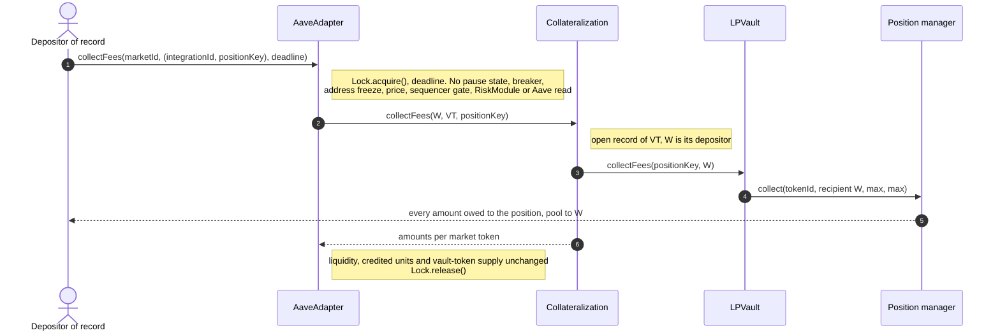

# 3.7 Collect Fees (FLOW-007)

> **Status:** In review · **Owner:** Avana Labs · **Last reviewed:** 2026-11-10
>
> **Step prefix:** `FEE-NNN`

The depositor of record collects the trading fees of a pledged position while the LPVault of its AMM protocol holds it. The flow exists only where the AMM protocol keeps fees apart from the position's liquidity (`capabilities().feeMode == FeeMode.Separate`): Uniswap v3 and Aerodrome Slipstream (unstaked NFTs), whose position contract records `tokensOwed` per token, and Uniswap v4. Where fees roll into the position (Uniswap v2, Curve, Balancer), the AMM integration reports `capabilities().feeMode == FeeMode.RolledIn`, `collectFees` reverts `FeesNotSeparable` before any state changes, and the fees stay in the position: its unit count is unchanged and each unit is worth more, which the LPOracle's composition values and the depositor receives on withdrawal.

The call goes wallet → AaveAdapter → Collateralization → LPVault → position contract. The Lock has exactly two members, the AaveAdapter and LPVaultSwap, and every LPVault entry point that moves value is reachable only through them, so fee collection runs under the Adapter's lock. It never changes the position's liquidity, the vault-token supply, the record's credited units or the account's health factor, and it reads no pause state or reason, circuit breaker, address freeze, price state, sequencer gate, RiskModule, MarketRegistry, ParameterStore, LPOracle, PositionProxy or Aave state, so none of them can hold a depositor's fees (`Q-011`, `Q-030`, `Q-223`, `Q-241`, `Q-242`, `Q-357`).

Fee collection belongs to [2.2 LP Vault][2.2] and the AMM integration interface page (`collectFees` and `capabilities().feeMode`); the entry point to [2.6 Aave Adapter][2.6]; the record it relates to to [2.3 Collateralization][2.3]; the lock to [2.16 Lock][2.16].

## Objective

Send all amounts owed to a pledged position, as an n-token array, from the pool to the depositor of record, at any time while the record exists. For v3 and Slipstream these are `tokensOwed` of each token after the position contract updates the position's fee growth: accrued fees, plus any principal already owed when the position was pledged (`Q-009`, `Q-030`, `Q-105`, `Q-218`).

### Principal owed at pledge

- `FEE-007` A position pledged with non-zero owed amounts (principal left by a `decreaseLiquidity` the owner made before pledging without a matching `collect`, plus uncollected fees) brings them into custody without credit: Collateralization credits only the position's units at pledge ([3.1 Deposit][3.1] `DEP-009`), and the LPOracle never values owed amounts. `collectFees` pays all owed amounts, that principal included, to the depositor of record, because the depositor removed it before pledging and owns it. A liquidation, reconcile, partial removal or repay with collateral collects only the principal its own removal returned, inside one LPVault `removeUnits` or `releaseUnits` call that removes exactly `x` units and pays only the principal of that removal (`LIQ-023`), so principal owed before the pledge stays owed to the depositor. No Avana computation derives fees as collected minus removed, so owed principal is never counted as fees or as proceeds. Example (Ethereum, Uniswap v3): a position is pledged with `liquidity = 25,000,000,000` and owed amounts `[5,000,000, 0]` (5 USDC removed earlier and never collected); the record credits 25,000,000,000 units and mints nothing for the 5 USDC. Thirty days later the owed amounts are `[46,250,000, 39,870,000]` (the 5 USDC plus 41.25 USDC and 39.87 USDT of fees), and `collectFees` pays all of it. (Source: Q-218, Q-011, Q-061, Q-224, Q-254, Q-255)

### Partial removal, re-credit and repay with collateral

- `FEE-008` A partial removal, a re-credit and a repay with collateral leave the position's fee claim intact: the partial removal and the deleverage release collect only the principal their own removal returned, capped per token at the amounts the removal returned, inside one LPVault `releaseUnits` or `removeUnits` call under the lock, and a re-credit changes credited units, not owed amounts. Fees accrued before and after these calls stay owed to the position and `collectFees` pays them to the depositor of record; a release that closes the record returns the position with every fee still owed, which the depositor then collects directly from the AMM protocol. Example: alice removes 1,000,000,000 of position 42's 5,000,000,000 credited units while `[12,400,000, 11,900,000]` of fees are owed; the removal pays her about 1,000 USDC and 1,000 USDT of principal, and a `collectFees` for position 42 afterwards still pays the 12.40 USDC and 11.90 USDT. For an AMM protocol with rolled-in fees, a partial removal of `x` units pays the fees embedded in those `x` units with the principal, and the remaining units keep theirs. (Source: Q-030, Q-061, Q-254, Q-255)

### Depositor window

- Collection through Avana is available from the end of the pledge ([3.1 Deposit][3.1]) until the position is returned by a withdrawal, a zero-credit release ([3.4 Withdraw][3.4]) or a repay with collateral that uses every credited unit ([3.3 Repay][3.3]), that is while `depositorOf[positionKey]` is set, including while the record has 0 credited units after a full seizure or a reconcile on exit (`Q-134`, `Q-201`).
- Before the pledge and after the release the depositor owns the position and collects directly from the AMM protocol; that is outside Avana.
- `collectFees` shares the protocol lock with liquidation and every other value-moving flow, and the LPVault's `unwind` and `releaseToDepositor` run a removal and its principal-only payout back to back in one call, so a collection can never run between them, and liquidation never takes fees (`Q-061`, `Q-134`, `Q-148`).

## Initiator

Only the depositor of record of the position (`LPVault.depositorOf(positionKey)`), calling the chain's AaveAdapter. No role is required. The PositionProxy is not involved: fees are not collateral and never pass through the account (`Q-030`, `Q-223`).

## Inputs

| Input | Type | Description | Validation |
|---|---|---|---|
| `marketId` | `uint256` | The market `m`; its vault token `VT = AD.accountOf(P).vaultToken` names the CDP Spoke and the AMM integration | Has a vault token; its integration separates fees (`FEE-002`) |
| `integrationId` | `uint32` | The market's AMM integration | Equals `VT.integrationId()` (`IntegrationMismatch`, `FEE-002`) |
| `positionKey` | `bytes32` | The pledged position (`bytes32(tokenId)` for Uniswap v3; `bytes32((uint256(generation) << 248) | tokenId)` for Slipstream) | In LPVault custody for a record of `VT`; caller is its depositor (`FEE-002`) |
| `deadline` | `uint256` | Last valid `block.timestamp` | `block.timestamp ≤ deadline` (`DeadlineExpired`) |

Returns `amounts[]`, one entry per market token in the market's token order; any entry may be 0. There is no recipient argument: fees always go to the depositor of record, so neither a caller nor a faulty Adapter can redirect them (`Q-105`).

## Preconditions

- The position is in LPVault custody for an open Collateralization record of `VT`, so `depositorOf[positionKey]` is set (`Q-134`, `Q-224`).
- The market's AMM integration separates fees (`capabilities().feeMode == FeeMode.Separate`).

## Execution Steps

In exact execution order. `W` is the calling wallet and must be the depositor of record (`depositorOf[positionKey]`), `m` the `marketId` argument, `VT = AD.accountOf(P).vaultToken` the market's vault token, `S = VT.spoke()` the CDP Spoke, `I` its AMM integration (`VT.integrationId()`), `LV` the LPVault of that AMM protocol on this chain (`VT.integration()`), `n` the market's token count, `AD` the AaveAdapter, `CO` Collateralization.

| Step | Action | Contract (msg.sender) | Notes |
|---|---|---|---|
| `FEE-001` | `W` calls `AD.collectFees(m, (integrationId, positionKey), deadline)` | AaveAdapter (`W`) | The outer entry point acquires the protocol lock; `Lock.acquire` reverts with `LockHeld(holder)` if it is held. `block.timestamp ≤ deadline` (`DeadlineExpired`). The Adapter's fee path reads no MarketRegistry pause state or reason, circuit breaker, address freeze, price state, sequencer gate, RiskModule, ParameterStore, LPOracle, PositionProxy or Aave state, so collection is open in None, Frozen and `Paused` with either reason, under every breaker, during a sequencer outage or grace window, and for a frozen wallet. Owned by [2.6], [2.16]. (Source: Q-030, Q-148, Q-223, Q-227, Q-241, Q-242, Q-252, Q-357) |
| `FEE-002` | Check the market, custody and the caller | AaveAdapter → its own binding `accountOf(P)`, `VT.integrationId()`, `VT.integration()`; `CO.collectFees(W, VT, positionKey)` → `LV.depositorOf(positionKey)`, `LV.capabilities()` | The Adapter requires `VT` non-zero (`UnknownMarket(m)`) and `VT.integrationId() == integrationId` (`IntegrationMismatch`). `CO` requires `msg.sender == ADAPTER` and the lock held (`NotAdapter`, `LockNotHeld`), validates `VT` from its immutables as in [3.1] `DEP-006` (`InvalidVaultToken`), requires `LV.capabilities()` (`FeesNotSeparable`), an open record of `VT` for `(integrationId, positionKey)` with `depositorOf[positionKey] != address(0)` (`NotInCustody`; the record's credited units may be 0), and `W == depositorOf[positionKey]` (`NotDepositor`). Owned by [2.3], [2.6]. (Source: Q-030, Q-067, Q-134, Q-224) |
| `FEE-003` | Pool lock left to the pool | None | The LPVault reads no pool reentrancy lock for this call. If the pool is inside a swap or flash callback in the same transaction, its own reentrancy lock makes the position contract's pool calls in `FEE-004` revert, so a collection never runs inside a pool callback. (Source: Q-144, Q-224) |
| `FEE-004` | Collect to the depositor | Collateralization → `LV.collectFees(positionKey, W)` → for v3 and Slipstream `NFPM.collect({tokenId, recipient: depositorOf[positionKey], amount0Max: type(uint128).max, amount1Max: type(uint128).max})` (LPVault) | `LV` requires `msg.sender == COLLATERALIZATION` and the lock held. For v3 and Slipstream, if the position's liquidity is above 0 the NFPM first calls `pool.burn(tickLower, tickUpper, 0)` to update fees owed; it then calls `pool.collect` with the depositor of record as recipient, so each token goes from the pool to `W` directly and never sits in the LPVault. For Slipstream, an unstaked position's fees are already net of the pool's `unstakedFee` share, which the pool sends to the gauge; Avana neither adds nor deducts anything. Only the LPVault calls the position contract's removal and collect functions, no per-position `approve` or `setApprovalForAll` is ever granted, and swap routes receive pool tokens only after the LPVault unwound units for LPVaultSwap in a liquidation or a repay with collateral. Listing excludes fee-on-transfer and rebasing tokens; if an issuer later switches on a transfer fee (USDT's `basisPointsRate`), `W` receives the returned amounts less that fee, nothing in Avana depends on the amount, and the issuer breaker stops new exposure to the token's markets ([2.7]); there is no ERC-20 rescue. Returns `amounts[]`, the amounts the pool sent, in the market's token order. (Source: Q-011, Q-030, Q-058, Q-061, Q-105, Q-119, Q-241, Q-271) |
| `FEE-005` | Liquidity unchanged by construction | LPVault | No further call. The collect cannot change liquidity, and `collectFees` makes no other state-changing call on the position contract, mints nothing and burns nothing, so the position's units, the record's credited units and the vault-token supply are unchanged. Checked by HYP-21, HYP-28. (Source: Q-011, Q-061) |
| `FEE-006` | Event and unlock | LPVault; AaveAdapter | The LPVault emits `FeesCollected(positionKey, W, amounts)` with the amounts the pool returned; the Adapter releases the lock and returns `amounts`. Indexers join the record through Collateralization's `recordIdOf(integrationId, positionKey)` and key positions by `(chainId, integrationId, positionKey)`. (Source: Q-076, Q-148, Q-224) |

### Availability by state

The steps above give these outcomes.

| State | Collect fees |
|---|---|
| AMM protocol with rolled-in fees (Uniswap v2, Curve, Balancer) | Refused (`FeesNotSeparable`); fees stay in the position and are paid with its units on withdrawal |
| Application state None, Frozen, or `Paused` with reason `General` or `MintPathSuspect`, on any Hub | Allowed (`Q-227`, `Q-252`) |
| Any circuit breaker tripped, latched or manual, on the position's market or any debt reserve, including `CONFIG_DRIFT` and `POOL_DEPTH` | Allowed (`Q-241`, `Q-350`, `Q-352`) |
| Depositor `W` address-frozen | Allowed (`Q-242`) |
| Sequencer gate `Down` or `Grace` (Base) | Allowed; while `Down` only transactions forced in from L1 execute (`Q-357`) |
| Pool token with a transfer fee switched on after listing | Allowed; `W` receives the amounts less the token's fee (`Q-271`) |
| Every price state, including feeds past their heartbeat, USD band breach, grace window | Allowed |
| Market `Offboarding`, `Closed` or not active, liquidation halt, config drift, Hub shares ≠ assets | Allowed (`Q-355`) |
| Every Aave reserve pause or freeze (vault-token or debt reserve), Hub halts the Spoke, credit line exhausted, flash source short or paused | Allowed (`Q-140`, `Q-351`) |
| Any RiskModule, MarketRegistry or ParameterStore implementation, including one that reverts on every call | Allowed (`Q-223`) |
| AaveAdapter implementation that reverts on `collectFees` | Refused until the chain's Timelock replaces the implementation; fees stay owed to the position and nothing is lost |
| Any health factor, including HF < 1 and an account being liquidated in another transaction | Allowed |
| Record at 0 credited units, or reduced by a partial removal or a repay with collateral | Allowed (`Q-134`, `Q-254`, `Q-255`) |
| Pool broken or a pool token paused | Allowed unless the pool or token itself reverts (`Q-227`) |
| Depositor blocklisted by a pool token | The token transfer reverts; fees stay owed to the position and leave with it when it is returned. Blocklisting is an accepted external risk; a pool whose tokens block Avana's settlement is contained by the Aave reserve freeze and market offboarding (`Q-119`, `Q-227`) |

## Contract Interactions

| Caller → callee.function() | Step | msg.sender at callee | Tokens moved |
|---|---|---|---|
| `W` → `AD.collectFees(m, (integrationId, positionKey), deadline)` | `FEE-001` | `W` | None |
| AaveAdapter → `Lock.acquire()` / `Lock.release()` | `FEE-001`, `FEE-006` | AaveAdapter | None |
| AaveAdapter → its own binding `accountOf(P)`, `VT.integrationId()`, `VT.integration()`; `CO.collectFees(W, VT, positionKey)` | `FEE-002` | AaveAdapter | None |
| Collateralization → `LV.depositorOf(positionKey)`, `LV.capabilities()` | `FEE-002` | Collateralization | None |
| Collateralization → `LV.collectFees(positionKey, W)` → `NFPM.collect(...)` → `pool.burn(…, 0)`; `pool.collect(W, …)` (v3 and Slipstream) | `FEE-004` | Collateralization; LPVault at the NFPM; NFPM at the pool | Each pool token, pool → `W`, `amounts[i]` |

## State Changes

| Contract | Step | Storage / balance | Before → After |
|---|---|---|---|
| Lock | `FEE-001`, `FEE-006` | Lock holder (transient) | Free → AaveAdapter → free |
| Position contract (NFPM) | `FEE-004` | Position's owed amounts per token, fee-growth checkpoints | Owed plus newly accrued fees → owed minus collected (0 when collecting all) |
| Pool | `FEE-004` | Owed amounts for the range; pool token balances | Reduced by `amounts[i]` per token |
| Pool tokens | `FEE-004` | `balanceOf(W)` | `bᵢ` → `bᵢ + amounts[i]` for each `i < n` |
| LPVault, Collateralization, vault token, Aave | None | `depositorOf`, record, credited units, counters, pending balance, supply, debt, HF | Unchanged |

## External Calls

Trust boundaries are defined in [1.3 Trust Boundaries][1.3] and [4.3 External Dependencies][4.3].

| External contract | Step | Function | Trust assumption |
|---|---|---|---|
| AaveAdapter (Avana, upgradeable behind the chain's Timelock) | `FEE-001`, `FEE-002` | `collectFees` | Reviewed implementation, trusted as for every custody path (`Q-223`); it reads no pause, breaker, freeze, price or Aave state for this call |
| Collateralization, LPVault, Lock (Avana, immutable) | `FEE-002`…`FEE-006` | As listed | Fixed code; the fees go only to the depositor of record |
| AMM protocol position contract (Uniswap v3 NFPM; the Slipstream NFPM generation recorded for the market) | `FEE-004` | `collect` | Trusted to pay only amounts owed when no liquidity is removed |
| AMM pool | `FEE-004` | `burn(…, 0)`, `collect` (called by the position contract) | Can revert if broken or inside its own callback; then the call reverts and fees stay owed |
| Pool tokens | `FEE-004` | `transfer` from the pool to `W` | Listing excludes fee-on-transfer, rebasing and hook tokens; a fee switched on later reduces what `W` receives without a revert; issuer pause or blocklist can make the transfer revert |
| RiskModule, MarketRegistry, ParameterStore, LPOracle, PositionProxy and Aave | None | None | Not called: they cannot block fee collection (`Q-140`, `Q-223`) |

## Events

In emission order.

| Contract | Step | Event |
|---|---|---|
| Pool | `FEE-004` | `Burn(NFPM, tickLower, tickUpper, 0, 0, 0)` (only when liquidity > 0), then `Collect(NFPM, W, tickLower, tickUpper, …)` with the amount of each token |
| Pool tokens | `FEE-004` | `Transfer(pool, W, amounts[i])` for each non-zero `amounts[i]` |
| Position contract (NFPM) | `FEE-004` | `Collect(tokenId, W, …)` |
| LPVault | `FEE-006` | `FeesCollected(positionKey, W, amounts)` |

## Failure Conditions

Every failure reverts the whole transaction; fees stay owed to the position. Upstream errors pass through unchanged, Avana custom errors are used only for Avana's own checks, and `packages/protocol` ships the upstream error ABIs (`Q-119`).

| ID | Step | Condition | Result |
|---|---|---|---|
| `FEE-F-001` | `FEE-001` | Lock already held, or deadline passed | Reverts with `LockHeld(holder)` ([2.16]) or `DeadlineExpired` ([2.6]) (Source: Q-148) |
| `FEE-F-002` | `FEE-002` | The position is not in LPVault custody for an open record of `VT`, `VT.spoke() != S`, or `VT` fails Collateralization's vault-token check | Reverts with `NotInCustody`, `UnknownMarket` or `InvalidVaultToken` (Source: Q-134, Q-224) |
| `FEE-F-003` | `FEE-002` | `msg.sender` at the Adapter is not `depositorOf[positionKey]` | Reverts with `NotDepositor` (Source: Q-030, Q-105) |
| `FEE-F-004` | `FEE-004` | The pool reverts in `burn` or `collect` (broken pool) | Pool or position-contract error passes through (Source: Q-227) |
| `FEE-F-005` | `FEE-004` | A pool token transfer to `W` reverts (pause, blocklist) | Token error passes through (Source: Q-119, Q-227) |
| `FEE-F-006` | `FEE-004` | A callee tries to re-enter any Avana entry point during the collect | The inner call reverts with `LockHeld(holder)`, which reverts the collection; listed tokens have no transfer hooks (Source: Q-058, Q-148) |
| `FEE-F-007` | `FEE-003`, `FEE-004` | The pool is inside its own swap or flash callback in the same transaction | The pool's reentrancy lock reverts `burn` or `collect`; the error passes through and fees stay owed (Source: Q-144, Q-224) |
| `FEE-F-008` | `FEE-002` | The market's AMM integration rolls fees into the position (`capabilities().feeMode == FeeMode.RolledIn`) | Reverts with `FeesNotSeparable`; the fees stay in the position's units |
| `FEE-F-009` | `FEE-002`, `FEE-004` | An inner call arrives from the wrong caller or without the expected lock holder (a faulty Adapter implementation) | Collateralization reverts with `NotAdapter` or `LockNotHeld`, the LPVault with `NotCollateralization` or `LockNotHeld` (Source: Q-148, Q-224) |

## Worked Example

**Ethereum, Uniswap v3.** The new-account position of the [3.1 Deposit][3.1] example, here `positionKey = bytes32(uint256(7))`: USDC/USDT 0.01% pool, exact range `[−887,272, 887,272]`, liquidity 25,000,000,000 (about $50,000), credited 25,000,000,000. Thirty days after the pledge the position's owed amounts are `[41,250,000, 39,870,000]` (6 decimals) once `pool.burn(…, 0)` has brought its fee growth up to date. `W` calls `AD.collectFees(m, (integrationId, positionKey), now + 600)`.

| Quantity | Before | After `collectFees` |
|---|---|---|
| `W`'s USDC, USDT | b0, b1 | b0 + 41.25 USDC, b1 + 39.87 USDT |
| Owed amounts | `[41,250,000, 39,870,000]` | `[0, 0]` |
| Position liquidity, credited units | 25,000,000,000, 25,000,000,000 | Unchanged |
| `VT.totalSupply()`, exposure counters, account HF | Σ, counters, HF | Unchanged |
| Event | — | `FeesCollected(positionKey, W, [41,250,000, 39,870,000])` |

The $81.12 collected over 30 days on $50,000 is `81.12 / 50,000 × 365 / 30 ≈ 1.97%` a year, and none of it was ever collateral: the LPOracle values the position's units only, so collecting fees cannot move the account's health factor (`Q-028`). The same call made after a liquidation removed all of position 7's liquidity still pays the fees owed, because the LPVault's `removeUnits` pays only the principal its removal returned. It also succeeds while the Stable LP Hub is `Paused` with either reason, while a breaker is tripped and while `W` is address-frozen: the call reads none of them.

**Base, Aerodrome Slipstream.** An unstaked position in a Slipstream stable pool on Base accrues fees net of the pool's `unstakedFee` share. Four hours after a sequencer outage began, while the gate is still `Down`, `W` submits `collectFees` through the L1 forced-inclusion path; it executes when included, because the fee path reads no sequencer gate, and pays the owed amount of each token to `W`. A borrow in the same transaction batch would revert `SequencerDown`.

**Rolled-in fees.** For a Uniswap v2 market, `collectFees` reverts `FeesNotSeparable`. A v2 position of 1,000 LP tokens priced at $2.000 each at pledge is worth $2,010 thirty days later at unchanged token prices, because the reserves behind each LP token grew by the fees; the record still credits 1,000 units, the LPOracle's composition values each at $2.010, and the depositor receives the fees with the units on withdrawal.

**Walkthrough.**

- `FEE-009` Aerodrome Slipstream on Base (Carol, fees during a sequencer outage). Setup: Carol's first record in market 3 ([3.1 Deposit][3.1] `DEP-029`), an unstaked Slipstream NFT with `L = 10,000,000,000` (about $20,000), pledged 30 days ago. The owed amounts, net of the pool's `unstakedFee` share, are `[16,500,000, 15,950,000]`: 16.50 USDC and 15.95 USDT. Carol owes 5,024.657535 USDC on the account ([3.3 Repay][3.3] `REP-024`, before her repay) and its health factor is 1.2420. The Base sequencer has been down for 4 hours, so the sequencer gate is `Down`.
  1. Carol's app simulates `AaveAdapter.collectFees` for the position and shows 16.50 USDC and 15.95 USDT to collect.
  2. Carol submits `AaveAdapter.collectFees(3, (integrationId, positionKey), now + 600)` ([2.6](../02-contracts/06-aave-adapter.md)) through the OP Stack L1 forced-inclusion path. When it is included, the Adapter takes the Lock and checks the deadline; it reads no pause state, breaker, freeze, oracle or sequencer gate.
  3. `Collateralization.collectFees(Carol, VT, positionKey)` ([2.3](../02-contracts/03-collateralization.md)) checks the record is open, the NFT is in custody and Carol is its depositor of record (`NotDepositor` for any other caller).
  4. `LPVault.collectFees(positionKey, Carol)` ([2.21](../02-contracts/21-aerodrome-slipstream-integration.md)) calls the Slipstream NFPM's `collect` with Carol as recipient: the pool pays 16.50 USDC and 15.95 USDT to Carol.
  5. The NFT's liquidity, the record's 10,000,000,000 credited units, the vault-token supply, the cap counters, Carol's debt and her health factor of 1.2420 are unchanged.
  6. Event `FeesCollected(positionKey, Carol, [16,500,000, 15,950,000])`; the Lock is released. The app shows the two amounts in Carol's wallet.
  7. The $32.45 collected over 30 days on $20,000 is `32.45 / 20,000 × 365 / 30 ≈ 1.97%` a year; none of it was collateral, because the LPOracle values units only.
  8. Variants: a borrow forced in through L1 in the same outage reverts `SequencerDown()`; the same call succeeds while the Base Stable LP Hub is `Paused(MintPathSuspect)`, while a breaker of market 3 is tripped and while Carol's address is frozen (`FEE-POST-003`).

  Checked by: MATH-ST-33, MATH-ST-35, HYP-21; arithmetic re-computed.

## Postconditions

- `FEE-POST-001` — The depositor of record received exactly the amounts owed to the position at the call (fees, plus any principal already owed at pledge, `FEE-007`), one amount per market token, and nothing else; the LPVault holds no pool tokens from this call. Checked by HYP-21, HYP-48, QNT-11. (Source: Q-011, Q-030, Q-061, Q-105, Q-218)
- `FEE-POST-002` — The position's units, the record's credited units, the vault-token supply, the exposure counters, the account's debt and its health factor are unchanged. Checked by HYP-21. (Source: Q-011, Q-028)
- `FEE-POST-003` — For an AMM protocol that separates fees, the flow succeeded in every application pause state (None, Frozen, `Paused` with either reason), every circuit-breaker state, every sequencer-gate state, for a frozen depositor, every price state, every market status, every Aave state and under any implementation of the RiskModule, MarketRegistry and ParameterStore, unless the pool or a pool token reverted (including the pool's own reentrancy lock). Checked by HYP-21, QNT-16, TEST-228, TEST-229. (Source: Q-140, Q-227, Q-223, Q-241, Q-242, Q-252, Q-357)
- `FEE-POST-004` — The position stays in LPVault custody with `depositorOf[positionKey] == W`, and its Collateralization record stays open. (Source: Q-030, Q-134, Q-224)
- `FEE-POST-005` — For an AMM protocol whose fees roll into the position, no state changed and no token moved. (Source: Q-028)

## Related

- Invariants this flow must preserve ([4.1 Global Invariants][4.1]): fees go only to the depositor of record; fee collection never changes units or vault-token supply; fee collection is always open to the depositor where the AMM protocol separates fees, whatever the pause state, breakers, sequencer gate or address freeze; liquidation, partial removal and repay with collateral never take separated fees.
- Attack scenarios ([4.2][4.2]): a third party redirecting fees, a collection interleaved with a liquidation's unwind to take principal, valuation counting uncollected fees (the LPOracle values units only, `Q-028`).
- Decisions: `Q-009`, `Q-011`, `Q-028`, `Q-030`, `Q-058`, `Q-061`, `Q-105`, `Q-119`, `Q-134`, `Q-140`, `Q-144`, `Q-148`, `Q-201`, `Q-218`, `Q-223`, `Q-224`, `Q-227`, `Q-241`, `Q-242`, `Q-252`, `Q-254`, `Q-255`, `Q-271`, `Q-350`, `Q-351`, `Q-352`, `Q-355`, `Q-357` in [4.4][4.4].
- Related flows: [3.1 Deposit][3.1], [3.4 Withdraw][3.4], [3.5 Liquidation][3.5].

[1.3]: ../01-architecture/03-trust-boundaries.md
[2.2]: ../02-contracts/02-lp-vault.md
[2.3]: ../02-contracts/03-collateralization.md
[2.6]: ../02-contracts/06-aave-adapter.md
[2.7]: ../02-contracts/07-risk-module.md
[2.16]: ../02-contracts/16-lock.md
[3.1]: 01-deposit.md
[3.3]: 03-repay.md
[3.4]: 04-withdraw.md
[3.5]: 05-liquidation.md
[4.1]: ../04-security/01-global-invariants.md
[4.2]: ../04-security/02-attack-scenarios.md
[4.3]: ../04-security/03-external-dependencies.md
[4.4]: ../04-security/04-design-decisions.md
