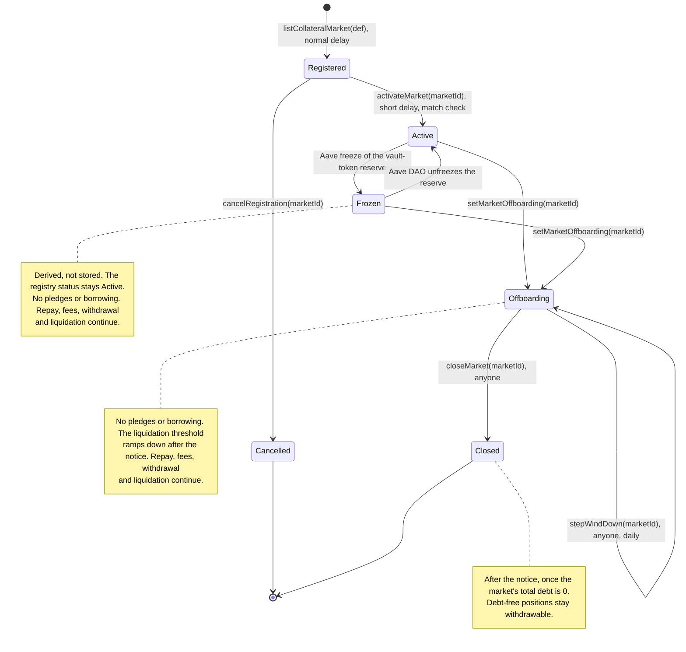

# 3.8 Market Lifecycle (FLOW-008)

> **Status:** In review · **Owner:** Avana Labs · **Last reviewed:** 2026-11-10
>
> **Step prefix:** `MKT-NNN` · failures `MKT-F-NNN` · postconditions `MKT-POST-NNN`

A market is one (chain, AMM protocol, pool, exact position shape) = one vault token = one collateral reserve on one CDP Spoke, keyed `(chainId, spoke, reserveId)`; for concentrated liquidity (Uniswap v3, Aerodrome Slipstream) the shape is the exact `[tickLower, tickUpper]` range, and only positions with exactly that range are pledgeable. A CDP Spoke is one standard, unmodified Aave V4 Spoke per (chain, Hub, AMM protocol, risk tier), for example "Uniswap v3 Stable" on Ethereum and "Aerodrome Slipstream Stable" on Base, and lists several markets. The lifecycle runs from the three timelocked deployment operations (`deployCdpSpoke`, `listCollateralMarket`, `enableDebtReserve`, `MKT-055` to `MKT-057`) and their listing rules (eligibility per AMM protocol, decimals, feeds with each feed's own heartbeat and a second source, standby routes, issuer probes, swap routes into each debt asset, the Aave DAO payload with the standard-Spoke settings, and the activation match check), through parameter changes by delay class and the standard-Spoke drift check (`MKT-058`), to Aave-side freeze, offboarding and a wind-down that ends in `Closed` (`MKT-059` to `MKT-061`); a market never moves to another CDP Spoke. Debt reserves have a lifecycle of their own on the CDP Spoke (`MKT-044` to `MKT-046`, `MKT-057`), each recording its funding Hub, each non-GHO reserve priced by its own DebtOracle. Every operation runs on one chain through that chain's AvanaTimelock; Ethereum and Base differ in the values of `MKT-062`. Contract rules are in [2.4 Vault Tokens](../02-contracts/04-vault-tokens.md), [2.7 Risk Module](../02-contracts/07-risk-module.md), [2.8 Market Registry](../02-contracts/08-market-registry.md), [2.9 Parameter Store](../02-contracts/09-parameter-store.md), [2.10 LP Oracle](../02-contracts/10-lp-oracle.md), [2.15 Governance and Timelock](../02-contracts/15-governance-and-timelock.md) and the AMM integration interface page with its integration pages. Parameters are named as in [1.5](../01-architecture/05-parameters.md).

## Objective

Bring a pool and position shape into Avana only after it has passed every listing rule of its AMM protocol, a five-day public review enforced on-chain by the chain's AvanaTimelock, and a check that the Aave configuration, including the three standard-Spoke settings, matches what Avana expects; change its parameters only through the delay class each parameter belongs to; and take it out of service through a wind-down that ends, without any force-close power over a borrower who keeps a healthy position until the ramp.

## Initiator

| Actor | Role in the lifecycle |
|---|---|
| Governance multisig (one 4-of-7 Safe per chain, `PROPOSER_ROLE`) | Schedules the deployment operations `deployCdpSpoke`, `listCollateralMarket` and `enableDebtReserve`, and every listing, registration, route, price-source, parameter and status change on the AvanaTimelock at the delay its class requires (`MKT-027` to `MKT-030`); schedules activation and cancellation of a registration at the short delay; follows the risk-parameter change process (`MKT-053`); cancels queued operations |
| Anyone (public execution) | Executes a ready operation after its delay and before `GRACE_PERIOD` (14 days) ends |
| Aave V4 risk service providers | Publish the listing package with the cap-sizing calculation; set caps, `minPledgeUsd` and pool risk factors in the listing package and payload |
| Aave DAO | Deploys each CDP Spoke as a standard Aave V4 Spoke and executes the listing payload (Hub asset, Spoke reserve, caps, the standard-Spoke settings `receiveSharesEnabled = false`, `liquidationFee = 0` and no reinvestment controller, debt reserves, Avana Umbrella (Coverage Spoke) instances per (Hub, asset), the `FLASH_BORROWER` role on the chain's Aave V3 Pool); on Base it acts through Aave's cross-chain governance path; collateral-factor changes by AIP in the order of `MKT-052`; freezes and unfreezes Aave reserves; through the Aave governance executor holds `PROPOSER_ROLE` as the second proposer ([2.15](../02-contracts/15-governance-and-timelock.md) `REQ-ACCESS-160`), cancels any queued Avana operation, alone cancels role-change operations and restoring operations (`REQ-ACCESS-156`), and undoes a guardian's standby switch at once (`cancelStandbySwitch`) |
| Emergency Guardian (3-of-5 Safe), Aave Protocol Guardian | Cancel queued operations outside the DAO-only sets (`CANCELLER_ROLE`); switch a token to its listed standby route at once (`useStandbyRoute`, `REQ-ACCESS-159`); trip a market or debt breaker (`REQ-ACCESS-158`); the Aave Protocol Guardian freezes a market's vault-token reserve on Aave (one-way `freezeReserve`) |
| Avana operators | Run the deployment operations' off-chain parts: deploy the market's LPOracle and, for a new non-GHO debt asset, its DebtOracle; seed prices, pay for observation cardinality sized for the chain's block time (`MKT-062`), run the listing fork checks and the live-config check |

## Inputs

| Input | Type | Description | Validation |
|---|---|---|---|
| `pool`, `integrationId`, shape | `address` or `bytes32` pool id, `bytes32`, encoded shape | The market's pool in its AMM protocol (address-keyed or id-keyed), the AMM integration, and the exact position shape (`[tickLower, tickUpper]` for concentrated liquidity, whole pool otherwise) | Pool derived from the integration's pinned factory (Slipstream: looked up by `tickSpacing`); shape aligned with signed tick math; one market per (Spoke, pool, shape) |
| `tokens[0..n−1]`, `decimals[0..n−1]` | `address[]`, `uint8[]` | Pool tokens and their decimals | Read on-chain at registration; vault-token decimals per the integration's unit rule (`MKT-007`) |
| Feeds | per token: primary, alternate and standby Chainlink route, with each leg's published heartbeat (the feed definition's `feedHeartbeat`) | USD price sources | `MKT-005`, `MKT-006`, `MKT-047` |
| Issuer probe | per token: `IssuerProbe` (`None`, `PausedFlag`, `UsdtFeeRate`, `UsdtFeeRateAndPaused`), chosen per chain (USDT on Ethereum `UsdtFeeRateAndPaused`, USDT on Base `None`) | Issuer-action breaker input | `MKT-048` |
| TWAP and tolerance settings | `twapWindow`, `consistencyToleranceBps`, `feedAgreementToleranceBps`, `usdBandLow`, `usdBandHigh` | Price-state guards | `MKT-008` |
| Routes | primary and backup swap route per pool token into each approved debt asset, each with a depth threshold in that asset; the backup never trades through the market's own pool | Conversion to the debt asset (Q-358) | `MKT-015` |
| Liquidation settings | `slippageAllowanceBps`, `slippageAllowanceMinBps` (per market, set at registration); in-kind settlement and its trigger do not exist (`Q-401`) | Recovery-floor inputs and their liveness floor | `MKT-011`, `MKT-049`, `MKT-050` |
| Caps | `marketUsdCap`, `tokenUsdCap`, `depositorUsdCap`, `poolShareMaxBps`, `topUpSliceUsd`, `stressFloorUsd` | Exposure limits | `MKT-013`, `MKT-014` |
| `minPledgeUsd` | `uint256`, USD with 8 decimals | Smallest value one pledge may add | `MKT-043` |
| Aave settings | CF, `maxLiquidationBonus`, `collateralRisk`, Hub `addCap` | Spoke reserve and Hub asset configuration | `MKT-010` to `MKT-014` |
| Debt reserve (per approved debt asset) | `DebtReserveDef` (reserve ID, asset, decimals, funding Hub, Hub asset ID, price source = the asset's DebtOracle for a non-GHO asset, Avana Umbrella (Coverage Spoke) of (funding Hub, asset), Avana's protocol safety module named after Aave's Umbrella, `Q-402`), the asset's primary, alternate and standby price routes, `debtStressRiseBps`, `breakerDeficitMax` (10,000 GHO for GHO, a per-reserve materiality for other assets, `Q-399`) | Borrowable asset on the CDP Spoke | `MKT-044`, `MKT-054`, `MKT-057` |

## Lifecycle states

- `MKT-001` A market is in exactly one state. The MarketRegistry stores **Registered** (stored, not usable; no pledges), **Active**, **Offboarding**, **Cancelled** (set by `cancelRegistration` for a Registered market that will not go live) and **Closed**; **Frozen** is derived: Active with the Aave freeze of the vault-token reserve set; Avana keeps no market freeze of its own (`Q-227`). A market is never deleted, because its vault token stays bound to its Spoke and pool and its debt-free positions stay withdrawable. The application pause state of the market's Hub ([FLOW-006](06-emergency-operations.md)), with its pause reason, applies on top of the market's own state, and on an L2 so does the sequencer gate. Circuit breakers are not lifecycle states: a market breaker or a debt breaker stops new activity in the market or debt reserve it covers while the market stays Active; a temporary price or depth gate clears after 30 minutes of healthy observations (provisional launch setting), and a deficit or security freeze needs authorized reopening (`Q-399`). (Source: Q-052, Q-110, Q-227, Q-241, Q-355, Q-399)
- `MKT-002` Transitions: Registered → Active by `activateMarket` (`MKT-026`); a Registered market that will not go live is ended by `cancelRegistration` and never becomes Active; Active → Frozen by the Aave freeze of the vault-token reserve (`MKT-037`); Frozen → Active when the Aave DAO unfreezes it; Active or Frozen → Offboarding by `setMarketOffboarding` with the Aave freeze and notice (`MKT-038`); Offboarding → Closed by `closeMarket(marketId)`, callable by anyone once the market's total debt over all its accounts is 0 (`MKT-060`). Offboarding and Closed are final: no MarketRegistry function returns such a market to Active (`MKT-041`). (Source: Q-052, Q-110, Q-227, Q-228, Q-355)

## Listing rules

- `MKT-003` Pool and shape: a pool created by the AMM integration's pinned factory (Uniswap v3: the canonical factory, looked up by fee; Slipstream: the factory of the NPM generation the integration pins, looked up by `tickSpacing`, unstaked positions only, so a gauge-staked NFT is refused), with a standard tick spacing, large enough to pass `MKT-009`; the market fixes the exact shape, and a pledge requires an exact match (`AMMN-RT-01`): for concentrated liquidity `tickLower` and `tickUpper` equal the market's, aligned with signed division toward negative infinity. Without the exact match a $10,000 narrow-range position would be credited at the market's per-unit value, about ×979 too high. At most one market per (CDP Spoke, pool, shape), enforced by the token factory's registry keyed by Spoke and market key, so the same pool and shape can be relisted on a new CDP Spoke (`MKT-061`). Uniswap v2, Curve StableSwap-NG, Balancer and Uniswap v4 markets list only after their readiness guards (`MKT-064`). (Source: Q-001, Q-017, Q-032, Q-058, Q-119, Q-191, Q-355)
- `MKT-004` Tokens: each pool token has a Chainlink USD feed (or a feed pair) and a primary and backup swap route into every debt asset the Spoke lends, proven deep at stress size (`MKT-015`); fee-on-transfer, rebasing, hook and false-returning tokens are excluded, because the LPVault, Collateralization and LPVaultSwap account by received balances and forward every token in the same call; native ETH is held as WETH, and a rate token (an LST) is priced through its rate feed times the underlying feed by the integration's rate-token hook; USDC and USDT are accepted issuer-upgradeable exceptions with monitoring and an issuer probe (`MKT-048`), and USDT's fee rate must be 0 at listing. Every amount Avana receives is measured by balance delta, so a USDT fee switched on after listing lets the seizure, swap and payout of USDT as a pool token complete at the reduced amounts while the issuer breaker stops new exposure to the token; for USDT as a debt asset, Aave V4's Hub refuses every fee-reduced repayment (`InsufficientTransferred`), so liquidation and repay of USDT debt wait until the fee returns to 0 ([2.11](../02-contracts/11-lpvaultswap.md) `REQ-SWAP-123`). Blocklisting of LPVaultSwap, an LPVault or Collateralization by an issuer is an accepted external risk handled by the token-issuer playbook ([FLOW-006 `EMG-085`](06-emergency-operations.md)) and relisting through P-19. (Source: Q-033, Q-119, Q-171, Q-241, Q-271, Q-358)
- `MKT-005` Feeds: each token has a primary route, an alternate route on an independent source (a second oracle network or a TWAP of a deep pool other than the market's own) and a standby route (`MKT-047`). Each leg's heartbeat is read from that feed's own configuration and recorded as `feedHeartbeat`; there is no fixed heartbeat ceiling, because Chainlink's stablecoin USD feeds on Ethereum and Base publish every 82,800–86,400 s and move only on deviation. `setFeed` writes `feedMaxAge = liquidationPriceMaxAge = feedHeartbeat + heartbeatMargin` (margin 1,800 s on Ethereum and Base, [2.10](../02-contracts/10-lp-oracle.md) `SPEC-ORC-019`), a leg is fresh while `age ≤ feedMaxAge`, and its `borrowPriceMaxAge` is at most that bound (equal at listing, lowered at the short delay, raised at the normal delay up to it); borrow and withdraw-with-debt additionally require the alternate source to agree with the primary within `feedAgreementToleranceBps`, so a long silent period of a 24 h feed is covered by a live independent check. Example: there is no cap on the sum; USDC/USD on Ethereum (heartbeat 82,800 s) gets `borrowPriceMaxAge = 82,800 + 1,800 = 84,600` s and USDT/USD (heartbeat 86,400 s) gets `86,400 + 1,800 = 88,200` s; a USDC/USD answer 20 h (72,000 s) old is fresh, and a borrow proceeds only if the second source reads within the tolerance, for instance primary $0.99990000 and second source $0.99970000 differ by 2 bps, within a 175 bps tolerance. Each token's second source (a second oracle network, or a TWAP of a deep pool other than the market's own) is recorded with its own `maxAge`, `twapWindow` and `toleranceBps` in the listing batch. Liquidation keeps its stress rules: collateral counts as 0 from Expired and a stale debt price is served at its stress price. Checked by: SYM-139a, TEST-250. (Source: Q-057, Q-079, Q-119, Q-130, Q-176, Q-182, Q-248, Q-274, Q-357)
- `MKT-006` Feed guards: normalised `minAnswer ≥ 1`; each raw answer stays below 2^64 under a 100× shock; each feed's decimals, `minAnswer` and `maxAnswer` are read on-chain at registration and pinned, and a decimals mismatch on any later read makes the answer invalid; an answer at or beyond a bound is invalid; the market feed reports `decimals() == 8`, `description()` and `latestRoundData()` with the oldest input `updatedAt`, checked by the Lens after every upgrade. (Source: Q-048, Q-056, Q-091, Q-119, Q-191)
- `MKT-007` Vault-token units and decimals follow the AMM integration's unit rule: one base unit of the vault token is one unit of credited position (liquidity for concentrated liquidity, LP shares for whole-pool protocols), `d` is fixed in the token at deployment, `6 ≤ d ≤ 18`, and the LPOracle values a whole token as `Σ amountᵢ(oracle price vector) × priceᵢ` from the integration's composition, floored and then reduced by 1 raw unit per token; for concentrated liquidity the oracle ratio is clamped to the market's range before the amounts are computed. `d` is the smallest integer in `[6, 18]` for which one whole vault token, `10^d` units valued by the integration's composition at the listing's reference prices, is worth at least $1 ([2.4](../02-contracts/04-vault-tokens.md) `SPEC-UNIT-001`, [2.10](../02-contracts/10-lp-oracle.md) `SPEC-ORC-005`); the listing fails if even `d = 18` is worth less, and activation requires the whole-token price to lie in `[$0.50, $20.00]`. Examples: full-range USDC/USDT gives `d = 6` (one whole token about $2.00); full-range DAI/USDC gives `d = 12`; USDC/USDT on `[−10, 10]` gives `d = 10` and on `[−100, 100]` gives `d = 9`. Checked by: MATH-UO-01, MATH-UO-02, SYM-30. (Source: Q-066, Q-119, Q-191)
- `MKT-008` Guards: `feedAgreementToleranceBps` is at least the primary plus the alternate deviation thresholds plus `feedAgreementMarginBps`, enforced as a hard lower bound; `consistencyToleranceBps` (read in ticks for concentrated liquidity) is at least the pool's live fee (read from the pool, since Slipstream fees can be dynamic) plus both feeds' deviation thresholds plus the expected TWAP lag and is backtested over past stress periods before it is set; the pool's observation cardinality covers `twapWindow` at the chain's block time: `twapMinObservations = ⌈twapWindow / CHAIN_BLOCK_TIME⌉ + 1` per market, 151 observations on Ethereum (12 s) and 901 on Base (2 s) for 1,800 s ([2.10](../02-contracts/10-lp-oracle.md) `SPEC-ORC-022`); operators may grow the cardinality over several transactions before scheduling, because each `increaseObservationCardinalityNext` call pays for its own slots; and every AMM protocol has a per-block quote-change cap, paid for by Avana at listing and checked by the RiskModule; the TWAP pool is the market's own pool, fixed at listing. Checked by: MATH-UO-24. (Source: Q-015, Q-058, Q-113, Q-119, Q-184)
- `MKT-009` Listing margin: `(1 − CF)` exceeds the feed deviation threshold plus heartbeat drift, and the pool's liquidity within the studied price range is at least the minimum set by a per-pool manipulation-cost study, which is a listing criterion. (Source: Q-058, Q-113, Q-119)
- `MKT-010` Collateral factor: `CF = ⌊min(CFᵢ) × poolRiskFactor⌋` in bps over the market's n tokens, with each `CFᵢ` the token's Aave V4 Core Hub collateral factor (`tokenCollateralFactorBps`), an explicit `ghoLegCollateralFactorBps` for a GHO leg, or, for a token without a Core Hub factor (a governance token or a tokenized stock), a factor set by the Aave V4 risk service providers in the listing package; `poolRiskFactor` is set within its 0.40 ceiling; CF is never 0 on any dynamic key while debt exists except as the end state of the wind-down ramp (`MKT-059`), and a pre-proposal fork check asserts `maxLiquidationBonus.percentMulUp(CF) < 100_00`, so a full liquidation never seizes more than the collateral. Example: `CF0 = CF1 = 7,800` bps and `poolRiskFactor = 0.40` give `CF = 3,120` bps (31.2 %), a recommended LTV of 28.4 % at the Lens's HF 1.10 and a maximum of 31.2 % at HF 1.00 (no opening floor, `Q-398`); with `maxLiquidationBonus = 10,500`, `10,500 × 3,120 / 10,000 = 3,276 < 10,000`. Checked by: MATH-AR-01. (Source: Q-092, Q-119, Q-143, Q-186, Q-188, Q-197, Q-398)
- `MKT-011` Liquidation settings: the CDP Spoke's target health factor is `aaveTargetHealthFactor`; the bonus just below HF 1 is at least `minLiquidationBonus` and covers gas, swap cost and Avana's share, asserted by a fork check; `slippageAllowanceBps` is set at or above the per-market `slippageAllowanceMinBps` (the route fee plus price impact at listing) so that, at the minimum bonus, the effective slippage of [FLOW-005 `LIQ-027`](05-liquidation.md) is positive and each route recovers the floor at the market's stress size. Route fees and the flash premium are cost terms the bonus must cover: route fees are taken before the recovered debt asset is measured and are covered by the slippage allowance. Example: with `minLiquidationBonus = 200` bps, no flash fee and `slippageAllowanceBps = 100`, the effective slippage is `min(100, ⌊10,000 × 200 / 10,200⌋) = 100` bps, and a route must return at least 99 % of the seized oracle value minus the rounding terms. Checked by: MATH-ST-13, SYM-44, SIM-08B. (Source: Q-127, Q-139, Q-159, Q-179, Q-185, Q-190, Q-209)
- `MKT-012` Collateral risk: the reserve's `collateralRisk ≤ riskPremiumThreshold − 1` bps; if the new market's risk exceeds that, the CDP Spoke's `riskPremiumThreshold` is raised to the new top risk + 1 bps first, and it is never lowered while debt exists. Checked by: MATH-AR-21, MATH-AR-23. (Source: Q-111, Q-141, Q-178)
- `MKT-013` Caps: `marketUsdCap`, `tokenUsdCap` and `depositorUsdCap` are set by the Aave V4 risk service providers in the listing package and scheduled in the listing batch; each market's debt exposure is at most the lowest of the launch credit-line allocation, what LPVaultSwap can unwind and settle under stress, and what the funded First-Loss Reserve of each debt asset can cover. Caps satisfy the pause-loss bound over the 48-hour incident window of `Q-192`, the longest liquidation stop caps are sized for (an Aave-side reserve pause, which the listing AIP asks the DAO to lift within 48 hours, or an LPOracle price-state pause; Avana's own pause state never stops liquidation): per account, the loss over the window is at most `debt × max(0, (1 + g)(1 + u) − h0 × (1 − dLP) / (CF × LB))`, with `g` the debt asset's interest over the window, `u` the debt asset's worst historic price rise against USD over the window plus margin (`u = 0` for GHO, which Aave prices at a fixed 1 USD), `h0 = pauseLossStartHealthFactor` (0.95, the health factor at which keeper lag is assumed to start), `dLP` the pool's worst historic LP drop over the window plus margin and `LB` the liquidation bonus; caps ≤ reserve ÷ loss factor, per debt asset against that asset's First-Loss Reserve. The bound is shaped this way because a liquidation stop or keeper lag lets an account fall from `h0` while its debt accrues and, for a non-GHO debt, grows in USD, and the reserve must cover what the remaining collateral at the bonus cannot. Example (GHO debt): `g = 0.0005` (about 9 % a year over 48 hours), `u = 0`, `dLP = 0.70` (one leg depegging to 0.09, since LP value scales with √x), `CF = 0.312`, `LB = 1.05`: loss factor `= 1.0005 − 0.95 × 0.30 / 0.3276 = 0.1305`, so an illustrative 400,000 GHO reserve supports at most about 3,064,000 GHO of debt exposed to that token (the reserve minimum itself is set in the funding ARFC with the Aave service providers, `Q-391`). Token-shock losses are summed across every exposed pool and CDP Spoke on the Hub (each account once); caps are also stress-tested against a depeg, a correlated crash and a debt-asset rally, including the flash source's idle debt-asset liquidity and swap-route depth into each debt asset, and the throughput limits are published. `topUpSliceUsd` applies per market and `poolShareMaxBps` per pool: the 10 % chain default, which the listing package may lower for the market's pool through `tightenPoolShareMaxBpsOf(marketId, value)` (`Q-383`). Caps also satisfy the tail term for one pool token going to zero ([2.7](../02-contracts/07-risk-module.md) `SPEC-CAP-007`): for every non-GHO pool token `t` and debt asset `a`, `min((tokenUsdCap[t] + Σ_{m∋t} topUpSliceUsd[m]) × CF_t, Σ drawCap_a) ≤ firstLossReserveMinimum[a]`, with `CF_t` the largest collateral factor of a market holding `t`, because a token that fails completely takes every position holding it close to zero within hours, which the 48-hour term does not see for stable pools, and the debt those positions can carry before liquidation is at most their booked value times `CF_t` (health factor 1). Example (illustrative reserve): at `CF_t = 0.312`, a 400,000 GHO reserve covers `400,000 / 0.312 = $1,282,051` of token cap less the token's slices. Both terms are guidance for the Aave DAO and its risk service providers, who own caps and reserve minimums; Avana enforces neither on-chain, and the Lens reports the cap-based tail coverage (`getTailCoverage(asset)`, `REQ-LENS-034`). Checked by: MATH-AR-30, SIM-02B, TEST-225. (Source: Q-084, Q-119, Q-150, Q-186, Q-192, Q-197, Q-234, Q-236, Q-249, Q-391)
- `MKT-014` Hub `addCap` for the vault-token asset, in whole tokens: `addCap ≥ ⌈(marketUsdCap + topUpSliceUsd) / stressFloorUsd⌉` (USD over USD per whole token, rounded up), adjusted for any bounded difference between Hub supply accounting and recorded backing; every pledge and top-up is charged for cap purposes at a price of at least `stressFloorUsd`, so a falling LP price cannot let more tokens in than the Hub cap admits. Values are below 2^120 whole tokens. Example: `marketUsdCap = 2,000,000` USD, `topUpSliceUsd = 200,000` USD (10 %), `stressFloorUsd = 1.00` give `addCap ≥ 2,200,000` whole tokens. Checked by: MATH-UO-03, MATH-UO-28. (Source: Q-150, Q-175, Q-196)
- `MKT-015` Swap routes: per pool token and per debt asset the Spoke lends, a primary and a backup swap route into that debt asset, each with a published depth threshold in the debt asset's units; for stablecoins these are fixed Uniswap, Slipstream, Curve or aggregator routes (a GSM is never a primary route: the live USDC GSM holds about $0.03), and for Correlated and Volatile tokens direct routes to the debt asset (for example WETH → USDC), so no liquidation passes through GHO unless the debt is GHO. No route trades through the market's own pool ([2.12](../02-contracts/12-settlement-routes.md) `REQ-ROUTE-043`), because every seizure removes Avana's liquidity from that pool, so in a crash each liquidation would make the next one fail; `setRoute` refuses such a route and the listing fork check verifies every hop. The route stress test runs at full one-sidedness of the market's range (a concentrated range unwinds into one token after a depeg), since a one-sided unwind of a narrow range understates slippage (4.76% modelled against 9.09% actual). The flash source lends the debt asset itself, so there is no buy leg. Every leg runs with the oracle-derived minimum output LPVaultSwap passes. Checked by: TEST-252. (Source: Q-062, Q-084, Q-085, Q-128, Q-144, Q-187, Q-235, Q-250, Q-273, Q-358)
- `MKT-016` Each market is listed on exactly one CDP Spoke, verified at listing and by the live-config check. Each wallet gets one PositionProxy per (CDP Spoke, market), so every market has its own Aave account and health factor and nothing is cross-collateralized; an account holds at most 16 records per market (`MAX_RECORDS_PER_ACCOUNT_MARKET`), so one liquidation never needs more gas than a block allows. (Source: Q-003, Q-017, Q-119, Q-193, Q-234)
- `MKT-017` Before scheduling, the Aave V4 risk service providers publish the listing package: numeric thresholds for `MKT-003` to `MKT-015` and `MKT-043` with their evidence (pool age, TVL, depth, feed heartbeat and deviation, stress slippage, manipulation-cost study, τ backtest, a per-market shock table for the market's exact range, built from the integration's composition with the oracle ratio clamped to the range, and the cap stress test including the flash source's idle debt-asset liquidity on the chain and swap-route depth at full one-sidedness), and the calibration method, recalibrated on a fixed schedule and whenever pool depth falls below the calibrated level. (Source: Q-017, Q-058, Q-113, Q-119, Q-230)

## Listing steps

In order. A listing carries one normal-delay (5-day) timelock operation, on registration (`Q-114`, `Q-228`); activation follows as a short-delay (12-hour) operation, because it only completes a registration that has already waited the normal delay and it reverts unless every on-chain match check against the executed Aave payload passes.

| Step | Action | Contract | Notes |
|---|---|---|---|
| `MKT-018` | The governance multisig schedules on the chain's AvanaTimelock, with `scheduleBatch` at the normal delay (5 days), the `listCollateralMarket` batch (`MKT-056`), to execute together in this order: on the first market of a CDP Spoke, the `deployCdpSpoke` registration (`MKT-055`): `MarketRegistry.approveSpokeCodeHash(h)` when the implementation's hash is new, `MarketRegistry.deployCdpSpoke(def)`, `ParameterStore.setLiquidationExpectations(spoke, targetHealthFactor, minLiquidationBonusBps)` (1.10e18 and 200 bps, Avana's recommended guidance for the listing AIP, which the Aave DAO decides (`Q-393`); activation and the drift check compare these with Aave's live values) and `enableDebtReserve(spoke, def)` for its first debt reserve (`MKT-057`), which read the CDP Spoke and that reserve on Aave and so need the first-listing part of the Aave payload (`MKT-023`) executed before the batch executes; for any new pool token `ParameterStore.setFeed` for its new feeds, `setTokenCollateralFactorBps`, `setFeedAgreementToleranceBps` and `MarketRegistry.listToken` with the token's primary, alternate and standby routes and `issuerProbe` (each leg's heartbeat comes from its `setFeed` definition) (`MKT-047`, `MKT-048`); `VaultTokenFactory.deployVaultToken(...)` (skipped when the pool's token already exists from a cancelled registration, `MKT-051`), whose symbol is `avLP-<marketId>` and whose name is the market's full description, `Avana LP <chain> <AMM> <token0>/<token1> <fee tier> <range> market <marketId>` ([2.4](../02-contracts/04-vault-tokens.md) `REQ-VTOKEN-050`), checked by the listing review before the batch is scheduled because the factory checks only their lengths and both are fixed for life; `MarketRegistry.listCollateralMarket(def)` with every input above, where `def.integrationData` carries the integration's listing valuation prices of the two pool tokens (8 decimals), from which the LPVault's `bindMarket` derives the vault-token decimals `d` (`SPEC-UNIT-001`): `abi.encode(uint256 price0, uint256 price1)` for Uniswap v3 and `abi.encode(uint256 generation, uint256 price0, uint256 price1)` for Aerodrome Slipstream, whose `generation` (0 to 3) selects the position manager and factory pair the pool must belong to; any other length or an unknown generation reverts the listing (`InvalidPool`); `ParameterStore.setInitialMarketParams` (every per-market parameter, including `minPledgeUsd` at launch $10, `MKT-043`), `setInitialMarketCaps`, `setInitialTokenCap`, the route depth thresholds, and `MarketRegistry.setRoute(marketId, token, asset, kind, route)` for the primary and backup route of every pool token that is not the debt asset, into each enabled debt asset; no in-kind trigger is set, because in-kind settlement does not exist (`MKT-050`, `Q-401`). `listCollateralMarket` requires every pool token listed and the Spoke deployed with a debt reserve, which is why those calls come first. Scheduling is public and starts the five-day review; any canceller can cancel the batch, except that a batch whose every call is in the DAO-only cancel set can be cancelled only by `DAO_CANCELLER_ROLE` ([2.15](../02-contracts/15-governance-and-timelock.md) `REQ-ACCESS-156`); a listing batch always contains other calls and keeps the ordinary rule. `activateMarket` is not in the batch. | AvanaTimelock | New listings, new price sources and new routes all take the normal delay; the timelock reverts `DelayBelowRequired` for a shorter delay. (Source: Q-091, Q-114, Q-136, Q-151, Q-206, Q-228, Q-230, Q-248, Q-251, Q-263, Q-265) |
| `MKT-019` | Before scheduling, Avana operators deploy the market's LPOracle (a UUPS proxy whose `_authorizeUpgrade` requires `APPLICATION_ADMIN`, held by the timelock), initialised in its deployment transaction with the timelock (which receives both admin roles), the pool, the integration's pricing library, the exact shape, the stable flags, the description, `pokeMinGas`, the oracle configuration (primary and alternate routes, guard settings), the ParameterStore and the MarketRegistry; `initialize` reverts unless that configuration gives a Live price and seeds it as the first accepted price. They also raise the pool's observation cardinality so it covers `twapWindow` at the chain's block time (`MKT-008`). | LPOracle, Uniswap pool | The oracle's address is an argument of `deployVaultToken` and `listCollateralMarket`, so it exists before the batch is scheduled; it has no effect until the market is registered and set as the Spoke price source. (Source: Q-049, Q-079, Q-119, Q-226) |
| `MKT-020` | After the delay, anyone executes the batch; `deployVaultToken` runs in the same execution as `listCollateralMarket`, with `marketId = marketCount + 1` for a pool that has no vault token (a pool whose token survives a cancelled registration reuses that token's `marketId`, `MKT-051`): the factory (caller `TIMELOCK` only) checks that the pool key and the shape are canonical for the integration (the keying and shape kind recorded at `registerIntegration`), deploys the token with CREATE3 (salt = `keccak256(abi.encode(spoke, marketKey))`, the market key hashing chain, integration, pool key and shape) and immutables `marketKey`, `integrationId`, `integration` (the registered LPVault), `hub`, `spoke` (the CDP Spoke), `marketId`, `lpOracle` (the market feed's fixed proxy address), `adapter`, `lpVaultSwap`, `collateralization` and `decimals = d`, records it in `tokenOf(spoke, marketKey)`, and emits `VaultTokenDeployed(vaultToken, marketId, spoke, bindings, pool, poolId, shape)`; it reverts with `TokenExistsForMarket` for a second token on the same (Spoke, market key). | VaultTokenFactory | The token has no owner, setter, pause or upgrade; its immutables are exposed for the manifest checks. Collateralization takes every pledge's market ID and LPOracle from them, so they must be right from the first block; if another market took the ID first, the deployment reverts with the registration and the listing is re-proposed ([2.4](../02-contracts/04-vault-tokens.md) `REQ-VTOKEN-038`). (Source: Q-066, Q-068, Q-119, Q-120, Q-224) |
| `MKT-021` | `listCollateralMarket` executes: the MarketRegistry stores the market as Registered, reads the decimals of each of the `n` tokens, feed decimals and min/max answers on-chain, checks every part of `MKT-003` to `MKT-008` that is checkable on-chain (pool from the integration's pinned factory, standard spacing, shape aligned and stored, every token has a configured feed and second source, `d` matches the integration's unit rule at the listing prices in `def.integrationData` and the token, feed decimals, tolerance lower bound, cardinality), checks that the vault token's `marketId()` and `lpOracle()` equal the ID it assigns and the registered LPOracle, checks that each token's legs have heartbeats recorded from their own feed configuration and that its standby route passes the checks of the slot it can replace (`MKT-047`), and records routes, standby routes and issuer probes; the ParameterStore records guards, liquidation settings including `slippageAllowanceMinBps`, caps and `minPledgeUsd` in the same execution. Pool, tokens, vault token, decimals and CDP Spoke are immutable after registration; there is no settlement-mode field because Aave sizes every seizure. | MarketRegistry, ParameterStore | Emits `MarketRegistered`. (Source: Q-057, Q-060, Q-066, Q-091, Q-119, Q-191, Q-209, Q-240, Q-248, Q-274) |
| `MKT-022` | After registration, Avana operators call `poke()` on the market's LPOracle, which now evaluates with the configuration it reads from the ParameterStore, and confirm it holds a valid positive price in state Live. | LPOracle | A valid price must exist before the Spoke reads the feed; `initialize` seeded the first one (`MKT-019`). (Source: Q-128) |
| `MKT-023` | The Aave DAO executes the listing payload, in order: on the first market of a CDP Spoke, and before the Avana batch executes because `deployCdpSpoke` and `enableDebtReserve` read the result, deploy and register the CDP Spoke as a standard, unmodified Aave V4 Spoke with its AaveOracle, list its debt reserves (GHO with Aave's fixed source; other assets with their DebtOracle), grant the chain's flash source the `FLASH_BORROWER` role in the Aave V3 ACLManager, register the Coverage Spoke of each (funding Hub, asset) with `drawCap = 0` and `addCap = MAX_ALLOWED_SPOKE_CAP` ([2.14](../02-contracts/14-first-loss-reserve.md) `REQ-FLR-007`), grant `COVERAGE_ROLE` to Avana's Emergency Guardian multisig and the Aave Protocol Guardian multisig, funded to its `firstLossReserveMinimum` before any drawCap on that asset rises above 0, and give the Aave Protocol Guardian one-way `freezeReserve` / `pauseReserve` on the SpokeConfigurator (never `updateFrozen`, `updatePaused` or the domain-admin role); raise the Spoke's `riskPremiumThreshold` if `MKT-012` requires; `HubConfigurator.addAssetWithDecimals(hub, vaultToken, d, feeReceiver, 0, irStrategy, irData)` with the fee receiver an Aave treasury address and `liquidityFee = 0`; set the fee receiver's `addCap` and `drawCap` to 0; `HubConfigurator.addSpoke(hub, cdpSpoke, assetId, {addCap per MKT-014, drawCap: 0, active: true, halted: false})`; leave `reinvestmentController = address(0)` on the vault-token asset; `SpokeConfigurator.addReserve(spoke, hub, assetId, lpOracleFeed, {paused: false, frozen: false, borrowable: false, receiveSharesEnabled: false, collateralRisk}, {collateralFactor: CF, maxLiquidationBonus, liquidationFee: 0})`. The three standard-Spoke settings (`receiveSharesEnabled = false`, `liquidationFee = 0` or a fee receiver equal to Avana's, no reinvestment controller) are what the drift check of `MKT-058` enforces afterwards. The listing AIP states the containment order for a CDP Spoke (freeze, `drawCap = 0`, Avana's pause; never `haltSpoke` or `pauseReserve` while debt exists unless the Spoke itself is faulty, Q-351) and asks the DAO to pause Avana reserves only for exploits and to unpause within the 48-hour incident window. | Aave Hub, Spoke, configurators, AaveOracle, Aave V3 ACLManager | `AaveOracle.setReserveSource` requires the feed's `decimals() == 8`. A post-execution fork check asserts every value, including all reserve flags. (Source: Q-043, Q-045, Q-064, Q-068, Q-116, Q-119, Q-192, Q-197, Q-202, Q-222, Q-236, Q-237, Q-238, Q-351, Q-352, Q-358) |
| `MKT-024` | Avana operators run the off-chain live-config check (bytecode of the Hub and CDP Spoke implementations by the method of [2.1](../02-contracts/01-avana-hub-and-spokes.md) `REQ-HUB-100`, the CDP Spoke's implementation and approved debt reserves with their funding Hubs, reserve flags including liquidation fee 0, `receiveSharesEnabled` off, not borrowable, no reinvestment controller, no position manager on any proxy, collateral and debt price sources, caps, role snapshot of the timelock and every upgradeable Avana contract) against the payload result, using the JSON-Schema manifest approved by the governance multisig signers and rerun on a schedule and on every governance event; activation is scheduled only after it passes, and the on-chain checks of `MKT-026` reject a mismatched payload in any case. Direct liquidation of Avana collateral by anyone but LPVaultSwap fails on the seizure transfer, because the vault token admits only these balance changes: a mint by the AaveAdapter to a registered proxy of the market, a supply from that proxy to the home Hub, a withdrawal from the home Hub to that proxy, a seizure from the home Hub to LPVaultSwap, and a burn by the AaveAdapter from a proxy or from LPVaultSwap (`Q-222`, Q-352); the reserve flags and the vault token's recipient restriction are further layers. The listing fork checks also assert that every standby route returns a fresh answer that agrees with the route it would replace, that each issuer probe returns untripped, that no route hop touches the market's own pool, and that each non-GHO debt reserve's Aave price source is its DebtOracle in state Live. A registration that will not go live is ended with `MarketRegistry.cancelRegistration(marketId)` in a short-delay operation; the cancelled `marketId` stays reserved for its pool (`MKT-051`). | Off-chain | (Source: Q-043, Q-068, Q-114, Q-119, Q-222, Q-228, Q-241, Q-248, Q-265, Q-273) |
| `MKT-025` | Keepers add the market to their watch lists in observe-only mode before activation executes. | Keeper | (Source: Q-043) |
| `MKT-026` | The governance multisig schedules `MarketRegistry.activateMarket(marketId)` at the short delay (12 hours) and anyone executes it; it reverts with `ActivationCheckFailed` unless the market is Registered and: the CDP Spoke's implementation equals the one recorded by `deployCdpSpoke` and its debt reserves equal the MarketRegistry's approved set with their funding Hubs; the three standard-Spoke settings hold (`MKT-058`); each approved debt reserve's Aave oracle source equals the recorded one; the Hub lists the vault token with decimals `d` on the token's immutable Hub; the CDP Spoke has a reserve for `(hub, assetId)` whose underlying is the vault token, decimals `d`, `borrowable = false`, `receiveSharesEnabled = false`, `paused = false`, `frozen = false`, `liquidationFee = 0` and CF > 0 on the current dynamic key; the AaveOracle price source of that reserve is the market's LPOracle feed and its state is Live; the asset is listed only on its CDP Spoke and its fee receiver, every Spoke's `drawCap` on it is 0 and its drawn shares are 0; the fee receiver's `addCap` is 0; `collateralRisk ≤ riskPremiumThreshold − 1` bps; Hub added shares equal added assets; both swap routes of every pool token into every approved debt asset are registered and usable; the liquidation liveness inequality of `MKT-049` holds for every market on the Spoke against every approved debt reserve (else `LivenessBound`); the drift check finds none of its reasons, including a dynamic key's collateral factor above `expectedCollateralFactorBps(m)`, `⌈maxLiquidationBonus × CF / 10⁴⌉ ≥ 10⁴`, a minimum bonus below `minLiquidationBonus` and a target health factor different from `aaveTargetHealthFactor`. It then records the Hub `assetId` and Spoke `reserveId`, sets the market Active and emits `MarketActivated`. Markets are created inactive so that no user action can reach a market whose Aave side has not been verified. The short delay suffices: the market's definition already waited the normal delay at registration, the Aave side is the DAO's executed payload, and activation succeeds only when the two match, so it cannot introduce anything the public review did not see; the 12 hours give the cancellers a window to stop activation if the executed payload looks wrong off-chain. | MarketRegistry | Collateralization, the Adapter and the proxies derive their targets from immutable sources and the MarketRegistry ([2.3](../02-contracts/03-collateralization.md), [2.5](../02-contracts/05-position-proxy-and-proxy-manager.md)). (Source: Q-066, Q-068, Q-080, Q-114, Q-119, Q-128, Q-172, Q-178, Q-181, Q-189, Q-222, Q-228, Q-237, Q-238, Q-261, Q-270) |

## Parameter changes by delay class

- `MKT-027` Tighten (short delay, 12 hours): the ParameterStore setters `tightenSlippageAllowanceBps(marketId, value)`, `tightenMarketUsdCap(marketId, value)`, `tightenTokenUsdCap(hub, token, value)`, `tightenDepositorUsdCap(hub, value)`, `tightenPoolShareMaxBps(value)`, `tightenPoolShareMaxBpsOf(marketId, value)` (lowering the market's pool below the chain default, `Q-383`), `tightenTopUpSliceUsd(marketId, value)`, `tightenFloorRoundingAllowance(asset, value)` (lowering it), `tightenBorrowPriceMaxAge(feed, value)`, `tightenConsistencyToleranceBps(marketId, value)`, `tightenFeedAgreementToleranceBps(token, value)`, `tightenPoolRiskFactor(marketId, value)`, `tightenMinPledgeUsd(marketId, value)` (raising it), `tightenRouteDepthThreshold(marketId, token, debtAsset, kind, depthThreshold)` (raising it), `tightenMaxFlashFeeBps(value)` (lowering it), the breaker setter in its sensitive direction (`tightenBreakerDeficitMax(hub, asset, value)` lowering; the pool-share gate is `tightenPoolShareMaxBps`, and the price-drop, seizure and route-failure thresholds are monitoring settings, not on-chain parameters, `Q-399`), `tightenMaxShortfallBps(value)` (lowering it), `tightenDebtStressRiseBps(asset, value)` (raising it), `tightenHardHealthFloor(marketId, value)` (raising the optional per-market hard health floor, which is 0 = off by default, `Q-398`) and `tightenGateRecoverySeconds(value)` (raising the healthy-observation window a temporary gate needs before it clears, `Q-399`); `MarketRegistry.disableRoute`, `restoreRoute` (previously approved routes only), `setMarketOffboarding`, `activateMarket`, `cancelRegistration`, and the new-activity stops `freeze(hub)`, `pause(hub, reason)`, `freezeAddress`, `tripMarketBreaker`, `tripDebtBreaker` and `useStandbyRoute`; `LPVaultSwap.removeKeeper` down to `keeperFloor` (1, `Q-400`). The SettlementBudget and in-kind setters no longer exist (`Q-397`, `Q-401`). These are the pairs of the AvanaTimelock's immutable `SHORT_ELIGIBLE` set ([2.15](../02-contracts/15-governance-and-timelock.md) `REQ-ACCESS-155`): `setShortDelaySelector` can disable an entry but never adds a selector outside it, so no upgrade, listing or loosening can ever take the short delay. An operation takes the short delay only when every call in it is on this list. Each two-direction parameter has separate tighten and loosen selectors, and the tighten selector reverts unless the new value is strictly safer and inside its hard bounds and the liquidation-liveness bounds (`slippageAllowanceMinBps`, `consistencyToleranceMinBps`, the feed tolerance's listing lower bound). `usdBandLow`/`usdBandHigh`, `graceDuration` and `graceHealthFactor` are Normal in both directions: they have no tighten selector and change only through their structural setters at the normal delay (`MKT-029`), because each one moves the price state or the grace window in a way that can be safer for one account and less safe for another. No parameter changes without a delay; immediate containment is the guardians' application freeze or pause, address freeze, breaker trip and standby switch ([FLOW-006](06-emergency-operations.md), [2.15](../02-contracts/15-governance-and-timelock.md) `REQ-ACCESS-157` to `REQ-ACCESS-159`, `REQ-ACCESS-162`), each of which only stops new activity or replaces a route with one reviewed at listing. (Source: Q-015, Q-072, Q-114, Q-119, Q-139, Q-198, Q-206, Q-228, Q-230, Q-241, Q-242, Q-246, Q-248, Q-251, Q-261, Q-262)
- `MKT-028` Loosen (normal delay, 5 days, cancellable by any canceller): the loosening direction of every parameter in `MKT-027` whose loosen setter is on the ParameterStore (`loosen*`), including lowering `minPledgeUsd`, the breaker thresholds in their less sensitive direction, raising `maxShortfallBps` and lowering `debtStressRiseBps`; `avanaFeeShareBps` and `feeRecipient` in either direction; adding a keeper (`LPVaultSwap.addKeeper`, DAO-only cancel); `unfreezeAddress` (DAO-only cancel, [2.15](../02-contracts/15-governance-and-timelock.md) `REQ-ACCESS-157`); `restorePriceRoute` after a standby switch (`REQ-ACCESS-159`). Each loosening is bounded in size and spacing by the ParameterStore (`MKT-053`). Unfreezing an Aave vault-token reserve is an Aave DAO action; lifting the application freeze or pause is `unfreeze()` or `unpause()` by the pause guardian (immediate) or a normal-delay operation ([FLOW-006 `EMG-042`](06-emergency-operations.md)); a latched or manual breaker is reset by the pause guardian at once, by `APPLICATION_ADMIN` at the normal delay, or by the end of its cooldown (`REQ-ACCESS-158`). (Source: Q-048, Q-155, Q-227, Q-228, Q-230, Q-241, Q-242, Q-246, Q-248, Q-263)
- `MKT-029` Structural (normal delay, 5 days, cancellable by any canceller): upgrades of every UUPS contract (`upgradeToAndCall`, `APPLICATION_ADMIN`), including the AaveAdapter and LPVaultSwap, whose logic every PositionProxy uses at once; PositionProxies are logic-free and immutable, with no implementation setter or upgrade path (Q-349), and the LPVaults, Collateralization and vault tokens are immutable; the replacement of the chain's flash-source implementation (`setFlashSource`, never the Hub of a Spoke it serves, Q-358); new deployments and listings (`deployCdpSpoke`, `listCollateralMarket`, `enableDebtReserve`, vault-token deployment, a re-approval of a CDP Spoke implementation with `approveSpokeCodeHash` and `deployCdpSpoke`, `removeDebtReserve`, `listToken`, `setFeed`, initial caps and `minPledgeUsd`); new price sources (`setPriceSource`) and changes to price computation, including `cachedWindow`, `disagreementPauseMax`, `twapWindow`, `liquidationPriceMaxAge`, `feedMaxAge`, `pokeMinGas`, `feedAgreementMarginBps`, and the structural setters (`set*`) of `borrowPriceMaxAge`, `consistencyToleranceBps`, `feedAgreementToleranceBps`, `poolRiskFactor`, `usdBandLow`/`usdBandHigh`, `graceDuration` and `graceHealthFactor`; adding or changing a swap route (`setRoute`); `maxFlashFeeBps`, `stressFloorUsd`, `slippageAllowanceMinBps`, `tokenCollateralFactorBps`, the expected Aave liquidation configuration (`setLiquidationExpectations`, which must follow any Aave change to the target health factor or bonus curve before new borrowing on the Spoke resumes), each standby route (set only through `setPriceSource`, `MKT-047`), the DebtOracle's `setPokeMinGas`; the stray-position return (`AaveAdapter.returnStrayPosition`, which reaches the LPVault's `returnStray` through Collateralization), each one timelock call with no in-contract timer (`Q-209`); `AvanaTimelock.setNormalDelay` (bounded to `[MIN_NORMAL_DELAY, MAX_DELAY]`, 4 to 5 days, `REQ-ACCESS-154`), `setShortDelaySelector` (enabling only pairs in `SHORT_ELIGIBLE`) and `togglePublicExecution` (self-calls). Role grants and revocations on any Avana contract or on the timelock are normal-delay role-change operations, cancellable only by `DAO_CANCELLER_ROLE`, and no grant can give `DEFAULT_ADMIN_ROLE` or `APPLICATION_ADMIN` to any account but the AvanaTimelock ([2.15](../02-contracts/15-governance-and-timelock.md) `REQ-ACCESS-153`). Tolerances tighten at the short delay and loosen only at the normal delay, so a widened price guard always gets the full public review. (Source: Q-091, Q-104, Q-114, Q-151, Q-155, Q-167, Q-206, Q-209, Q-225, Q-226, Q-228, Q-248, Q-251, Q-259, Q-261, Q-262)
- `MKT-030` Immutable: the timelock constants `SHORT_DELAY` (12 hours), `MIN_NORMAL_DELAY` (4 days), `MAX_DELAY` (5 days) and `GRACE_PERIOD` (14 days), the `SHORT_ELIGIBLE` set and the DAO-only cancel selector set; the implementation constants `ISSUER_PROBE_GAS` (30,000), `MAX_ADDRESS_FREEZES_PER_DAY` (20), `RESCUE_MIN_PLEDGE_USD` ($10), `MAX_RECORDS_PER_ACCOUNT_MARKET` (16) and `LENS_DUST_MARGIN_BPS` (500), each changed only by an upgrade at the normal delay; `stableCeilingUsd`; `keeperFloor` (1) and `MAX_KEEPERS` (32) (`Q-400`); the Avana Umbrellas' (Coverage Spokes') `RESERVE_WITHDRAWAL_DELAY` (= `reserveWithdrawalDelay`); the global liveness bounds `graceHealthFactorMin`, `graceDurationMax` and `twapToleranceMinTicks`; the ProxyManager and every PositionProxy (no upgrade path); the PayoutEscrow's (payout escrow's) depositor and lock addresses; per market the pool, tokens, vault token, decimals and CDP Spoke; on the Aave side the CDP Spoke's implementation, which is the standard Aave V4 Spoke. `payoutTransferGas` (the gas forwarded to a payout transfer) is an implementation constant of LPVaultSwap, changed only by an upgrade at the normal delay; there is no `PROXY_HEALTH_FACTOR_FLOOR` (`Q-398`). Pool, tokens, vault token, decimals and Spoke and reserve IDs are fixed so that no governance action can repoint existing backing; the delay floor and the two selector sets are fixed so that no operation can later shorten the borrower's exit window or move an upgrade onto the short delay. (Source: Q-049, Q-066, Q-092, Q-101, Q-119, Q-139, Q-209, Q-214, Q-228, Q-229, Q-237, Q-241, Q-242, Q-252, Q-262, Q-263, Q-267, Q-268)
- `MKT-031` Aave governance (outside the AvanaTimelock): collateral factors (cuts by AIP, no risk steward, ordered with the Avana side per `MKT-052`), `poolRiskFactor` as an input to the CF, `maxLiquidationBonus`, `collateralRisk`, `riskPremiumThreshold`, `aaveTargetHealthFactor`, `minLiquidationBonus`, Hub `addCap`, CDP Spoke drawCaps per (Hub, asset, Spoke), the credit line of each (Hub, asset, Spoke) as its `drawCap`, the CDP Spoke deployment and its AaveOracle, the three standard-Spoke settings, the `FLASH_BORROWER` role on each chain's Aave V3 Pool, each Coverage Spoke's `firstLossReserveMinimum`, `spokeUserReservesLimit`, Spoke halts and deactivations, used per the containment order of Q-351. (Source: Q-092, Q-095, Q-143, Q-193, Q-197, Q-233, Q-236, Q-237)
- `MKT-032` A collateral-risk increase on a vault-token reserve executes only after the CDP Spoke's `riskPremiumThreshold` has been raised to the new top risk + 1 bps; the threshold is never lowered while debt exists. (Source: Q-141, Q-178)
- `MKT-033` A switch to the pre-approved alternate Chainlink route is automatic inside the feed and needs no governance action. A switch of a token's primary or alternate slot to its listed standby route (`MarketRegistry.useStandbyRoute(token, slot)`) is immediate for `APPLICATION_PAUSE_GUARDIAN` (the Emergency Guardian and the Aave Protocol Guardian) and a short-delay operation for `APPLICATION_ADMIN` that only `DAO_CANCELLER_ROLE` can cancel; the Aave governance executor undoes a guardian's switch at once with `cancelStandbySwitch(token)`; switching back is `restorePriceRoute(token)` at the normal delay ([2.15](../02-contracts/15-governance-and-timelock.md) `REQ-ACCESS-159`). A switch increments the token's `priceRouteVersion`, so at its next `poke` each oracle reading the token restarts its disagreement timer, keeps its failure timer and evaluates afresh; a switch never forces Live. Any other price-source change, including a new standby route, is Structural (`setPriceSource`). The guardian can therefore end a feed outage in minutes but only onto a route that passed the listing checks, never onto a price of its choosing. (Source: Q-091, Q-130, Q-248)
- `MKT-034` Routes: adding or changing a swap route is Structural (normal delay); disabling one is a short-delay operation (`disableRoute`) and lasts until a later operation changes it; restoring a previously approved route is a short-delay operation (`restoreRoute`), which reverts `NotPreviouslyApproved` for any other route and, when it is the only kind of call in its operation, can be cancelled only by `DAO_CANCELLER_ROLE` ([2.15](../02-contracts/15-governance-and-timelock.md) `REQ-ACCESS-156`), so a compromised canceller cannot keep a market unliquidatable by cancelling every repair. A route failing at run time needs no action, because LPVaultSwap falls back to the backup inside each call; repeated primary failures latch the market's route-failure breaker. (Source: Q-062, Q-151, Q-228, Q-235, Q-241, Q-263)
- `MKT-035` Keepers: adding a keeper (`LPVaultSwap.addKeeper`) is a normal-delay operation that only `DAO_CANCELLER_ROLE` can cancel when it is the only kind of call in its operation, and reverts for a frozen address; removing one (`removeKeeper`) is a short-delay operation that reverts with `KeeperFloor` below `keeperFloor` (1) active keepers, with at most `MAX_KEEPERS` (32) approved (`Q-400`), counting approved keepers that are not frozen. A guardian can freeze a misbehaving keeper's address at once, the last active one included: `freezeAddress` checks no keeper floor (`REQ-MREG-021`), and while 0 active keepers remain new borrowing halts on the chain and `liquidate` stays open to every address that is not frozen. (Source: Q-139, Q-155, Q-228, Q-242, Q-263, Q-400)
- `MKT-036` Every scheduled operation can be cancelled before it executes: any `CANCELLER_ROLE` holder (governance multisig, Emergency Guardian, Aave Protocol Guardian, Aave governance executor) cancels any operation except a role-change operation and a restoring operation (every call in the DAO-only cancel set: `restoreRoute`, `useStandbyRoute`, `addKeeper`, `unfreezeAddress`), which only the Aave governance executor (`DAO_CANCELLER_ROLE`) cancels ([2.15](../02-contracts/15-governance-and-timelock.md) `REQ-ACCESS-156`); an operation that mixes such calls with any other call keeps the ordinary rule, so a proposer cannot hide another call behind a restoring one. Both the governance multisig and the Aave governance executor hold `PROPOSER_ROLE` (`REQ-ACCESS-160`). A ready operation is executable by anyone from `readyAt` until `readyAt + GRACE_PERIOD` (14 days); after that it reverts `OperationExpired` and can only be cleaned up and re-proposed. (Source: Q-089, Q-136, Q-206, Q-228, Q-245, Q-263)

## Freeze

- `MKT-037` Freezing a market is the Aave freeze of its vault-token reserve (`SpokeConfigurator.freezeReserve`, one-way for the Aave Protocol Guardian, or the Aave DAO), which moves an Active market to Frozen immediately; only the Aave DAO unfreezes it (`updateFrozen`). The RiskModule reads the flag and rejects pledges into the market and borrows by accounts holding it. Avana keeps no market freeze of its own; a freeze of the whole application is the pause state of [FLOW-006 `EMG-039`](06-emergency-operations.md), a stop of new activity in one market is its market breaker (`tripMarketBreaker`, [FLOW-006 `EMG-068`](06-emergency-operations.md)), and a freeze of one wallet is the address freeze ([FLOW-006 `EMG-070`](06-emergency-operations.md)). Mechanics and effects are in [FLOW-006 `EMG-050`](06-emergency-operations.md). (Source: Q-118, Q-203, Q-227, Q-241, Q-242)

## Offboarding

- `MKT-038` Offboarding starts with `MarketRegistry.setMarketOffboarding(marketId)` in a short-delay operation, the Aave freeze of the vault-token reserve and a public notice of at least `offboardNoticeSeconds` (≥ `normalDelay`, 5 days). The status blocks new pledges and borrowing against the market (`MarketOffboarding`); repay, fee collection, withdrawals and liquidation continue. (Source: Q-052, Q-119, Q-227, Q-228, Q-355)
- `MKT-039` After the notice the wind-down ramp of `MKT-059` lowers the market's liquidation threshold through Aave dynamic config updates that edit the reserve's existing keys (`updateDynamicReserveConfig`), so every position sees each step at once; the steps are pre-approved in the Aave payload that accepts the offboarding, so the ramp needs no further AIP; Avana makes no third-party refresh call, and risk premiums are refreshed only by the Aave DAO's position-updater payloads. (Source: Q-052, Q-110, Q-119, Q-143, Q-145, Q-355)
- `MKT-040` Avana has no force-close power over a healthy account: repay, fee collection, withdrawal with and without debt and liquidation stay open, and the ramp ends the wind-down by making every remaining borrower repay or become liquidatable at the final threshold. The market's feed, swap routes and keeper duty stay in service until `closeMarket` (`MKT-060`). (Source: Q-052, Q-118, Q-119, Q-227, Q-355)
- `MKT-041` After `closeMarket` the market is `Closed`: it stays registered, its remaining debt-free positions are withdrawable by their depositors forever with no price read, its zero-credit records remain releasable, and its vault token stays bound to its Spoke and pool. Offboarding and Closed are final: no MarketRegistry function returns the market to Active, and no second vault token can be deployed for the same (Spoke, pool, shape). The same pool and shape can be listed again only on another CDP Spoke as a new market (`MKT-061`), through the full five-day review, so a market whose backing has run off cannot be reopened by a short-delay activation. (Source: Q-032, Q-068, Q-119, Q-134, Q-227, Q-355)

## Reclassification

- `MKT-042` A market cannot move to another CDP Spoke: its vault token is bound to its Spoke, and its Hub asset is listed only on that Spoke. A change of tier for a pool is a new listing on the CDP Spoke of the target tier and the offboarding of the old market; users move by repaying, withdrawing (debt-free withdrawal works in every price and pause state) and re-pledging, each wallet getting a new PositionProxy for the new (Spoke, market). (Source: Q-003, Q-017, Q-029, Q-032, Q-052, Q-119, Q-172, Q-225, Q-239)

## Minimum pledge value

- `MKT-043` Each market's `minPledgeUsd` (USD, 8 decimals) is set in the listing batch as the `minPledgeUsd` field of `ParameterStore.setInitialMarketParams(marketId, params)`, at the launch value of $10 (`10e8`) within the bounds `[0, 100_000e8]`; raising it is a short-delay change (`tightenMinPledgeUsd`) and lowering it a normal-delay change (`loosenMinPledgeUsd`). `RiskModule.checkPledge` values each pledge, new account and top-up alike, as `pledgeUsd = mulDiv(L, price8, 10^d, Floor)` (credited units `L` in base units of the vault token, `price8` the LPOracle's last accepted price per whole token in USD with 8 decimals from `lastAcceptedPrice()`, rounded down so the check never overstates a pledge) and reverts `BelowMinPledge(pledgeUsd, minPledgeUsd)` when `pledgeUsd < minPledgeUsd`; exits never read it. A rescue top-up (an indebted account below the rescue target HF 1.10, booked charge at most the restore amount) needs only `min(minPledgeUsd, RESCUE_MIN_PLEDGE_USD)` with `RESCUE_MIN_PLEDGE_USD = 10e8`, so raising the market floor never stops a borrower adding collateral to avoid liquidation; a partial removal with debt must leave a record worth at least `minPledgeUsd` ([2.7](../02-contracts/07-risk-module.md) `REQ-RISK-070`). The floor exists because every record costs liquidation gas when seized: it stops an account being built from many dust NFTs that cost more to liquidate than they are worth, without limiting how many positions a real LP can bring. It stays $10. Avana has no minimum debt (`Q-381`): small debts are handled by Avana's own keepers, which liquidate every account and pay their gas, by the 16-record cap, which keeps the largest liquidation within one transaction, and by Aave's dust rule, whose gap the caller pays (`MKT-054`); and with liquidation gated per seized reserve a dust position no longer shields a large one. Example: a USDC/USDT position (`d = 6`) at `price8 = 200,000,000` ($2.00 per whole token) with `L = 5,000,000` gives `pledgeUsd = ⌊5,000,000 × 200,000,000 / 10^6⌋ = 1,000,000,000` ($10.00), which meets the floor exactly and passes; `L = 4,999,999` gives `999,999,800` and reverts. Checked by: TEST-235. (Source: Q-194, Q-230, Q-247, Q-252, Q-254, Q-277)

## Debt reserves

- `MKT-044` Listing a debt reserve of any asset (GHO, USDC, USDT, WETH) is the `enableDebtReserve` operation (`MKT-057`). For a non-GHO asset it starts with Avana operators deploying the asset's DebtOracle, a UUPS proxy initialised in its deployment transaction with `initialize(timelock, asset, marketRegistry, parameterStore)`, which shares LPPriceMath's leg normalization and has no stable ceiling. The Aave payload lists the reserve on the standard CDP Spoke with its DebtOracle as the Aave price source (GHO keeps Aave's fixed source), registers the Coverage Spoke of the (funding Hub, asset) funded to its minimum if it does not exist, and provides funding by Lend Spoke supply or a source-Hub `drawCap`, with the CDP Spoke's `drawCap` on the asset still 0; it executes before the Avana batch, because `enableDebtReserve` reads the reserve, its price source and the Coverage Spoke on Aave. The Avana listing is one normal-delay batch with the same shape as `MKT-018`, in this order: `MarketRegistry.listToken` for the asset with its primary, alternate and standby price routes and `issuerProbe` (`MKT-005`, `MKT-047`, `MKT-048`); `ParameterStore.tightenDebtStressRiseBps(asset, δ_a)`, which writes the first `debtStressRiseBps` from 0 as the asset's stress rise δ_a of the cap-sizing rule (bounds [100, 5,000] bps; `enableDebtReserve` requires at least 100); `MarketRegistry.enableDebtReserve(spoke, def)` recording the reserve ID, asset, decimals, funding Hub, Hub asset ID, the DebtOracle as `priceSource` and the Coverage Spoke; `setRoute` for the primary and backup swap route of every pool token of every market on the Spoke into the asset; `loosenBreakerDeficitMax(asset, v)`, which writes the first `breakerDeficitMax` (10,000 GHO for GHO; a per-reserve materiality for other assets, at most `firstLossReserveMinimum`, `Q-399`); and the swap-route depth thresholds in the asset's units; no settlement-budget cap is set (`MKT-054`, `Q-397`). The CDP Spoke's `drawCap` on the asset rises above 0 only after the Coverage Spoke is funded and the batch has executed. The reserve becomes live only when its funding, caps, price source and its swap routes and the flash source's idle liquidity of the asset have passed stress validation; until then the drift check treats any difference between the Spoke's set and the MarketRegistry's set as drift. The DebtOracle replaces a single Chainlink source so that one stale debt feed no longer stops borrowing and liquidation for every account holding that debt: it fails over between two routes, has Cached and Expired states and a standby route, and once Expired serves its last accepted price raised by `debtStressRiseBps` so that stale debt only ever counts higher. Keepers add the DebtOracle's implementation slot to their code check. Checked by: TEST-231, TEST-245. (Source: Q-233, Q-235, Q-236, Q-237, Q-238, Q-241, Q-248, Q-261, Q-267)
- `MKT-045` Removing a debt reserve is `MarketRegistry.removeDebtReserve(spoke, reserveId)` in a normal-delay operation, which reverts `DebtReserveInUse` while any debt is drawn on it; no budget cap needs clearing, because the SettlementBudget does not exist (`Q-397`); the Aave DAO first sets its `drawCap` to 0 and freezes it, so borrowers repay over time while repay and liquidation of that reserve stay open. (Source: Q-233, Q-237)
- `MKT-046` A DAO upgrade of a CDP Spoke's implementation is drift until the chain's timelock re-approves it at the normal delay (`approveSpokeCodeHash` for the new implementation's hash, then `deployCdpSpoke(def)` with the new implementation, `MKT-055`); meanwhile new-account pledges, borrowing and withdraw-with-debt on that Spoke stop and repay, debt-free withdrawals, fee collection and liquidation continue ([FLOW-006 `EMG-053`](06-emergency-operations.md)). The same holds for an Aave risk-configuration change that breaks Avana's sizing assumptions: a dynamic key's collateral factor above `expectedCollateralFactorBps(m)` (`CollateralFactorAboveExpected`), `⌈maxLiquidationBonus × CF / 10⁴⌉ ≥ 10⁴` or a minimum bonus below `minLiquidationBonus` (`BonusBoundViolated`), a target health factor different from `aaveTargetHealthFactor` (`LiquidationConfigChanged`), a drifted standard-Spoke setting (`MKT-058`) or a halted Spoke (`SpokeHalted`, Q-351); top-ups, exits and liquidation are unaffected by drift, and a halt is Aave-side containment (P-16). (Source: Q-080, Q-172, Q-237, Q-238, Q-270, Q-351, Q-352)

## Price routes, probes and liquidation liveness

- `MKT-047` Standby routes: every listed token (pool token or non-GHO debt asset) records, beside its primary and alternate routes, a standby route set in the listing operation and changed only by `setPriceSource` at the normal delay, which sets all three routes together. The standby passes every listing check of the slot it can replace: feed decimals, normalised `minAnswer`/`maxAnswer` guards (`MKT-006`), a heartbeat recorded from each leg's own feed configuration, and no intermediate feed shared with the route that stays active beside it. After a switch (`MKT-033`) the LPOracle and the DebtOracle read `activePriceRoutes(token)`, so the agreement check then compares the standby with the other active route and a standby that disagrees or is stale leaves the market Cached or disagreeing. The standby exists because a market's own seizures wait while its feed has failed or its routes disagree, and a normal-delay fix would make that wait at least five days, far past the 48-hour window caps are sized for; pre-approving the standby under the same checks lets a guardian end the outage in minutes without choosing an unreviewed price. Checked by: TEST-231. (Source: Q-248, Q-274)
- `MKT-048` Issuer probe: every listed token records `issuerProbe`: `PausedFlag` for a token whose issuer can pause transfers (`paused()`), `UsdtFeeRate` for a token whose issuer can switch on a transfer fee (`basisPointsRate()`), `UsdtFeeRateAndPaused` for a token with both (`paused()` and `basisPointsRate()`, tripped when either read trips), `None` otherwise. The kind is chosen per chain from the listing fork check of that chain's token: USDT on Ethereum answers both views and is listed `UsdtFeeRateAndPaused`; USDT on Base is listed `None`. The RiskModule makes each read with a static call limited to `ISSUER_PROBE_GAS` (30,000); a `true` pause flag, a non-zero fee rate, a revert or a malformed return counts as tripped and trips the ISSUER condition breaker of every market holding the token and of every debt reserve of that asset. The listing fork check requires the probe to return untripped. Recording the probe at listing lets an issuer action stop new exposure to the token at once, while settlement of the token as a pool token keeps working at the amounts that actually arrive (a fee on a debt asset blocks its repayments inside Aave V4 instead, [2.11](../02-contracts/11-lpvaultswap.md) `REQ-SWAP-123`). Checked by: TEST-221, TEST-228. (Source: Q-241, Q-271)
- `MKT-049` Liquidation liveness: `MarketRegistry.enableDebtReserve`, `activateMarket` and every change to `slippageAllowanceMinBps` or `maxFlashFeeBps` revert `LivenessBound` unless, for every market on the Spoke and every approved debt reserve, `minLB × (10⁴ − slippageAllowanceMinBps) ≥ 10⁴ × (10⁴ + maxFlashFeeBps)`, all terms in bps, `minLB` the minimum liquidation bonus multiplier (10⁴ plus `minLiquidationBonus`), exact integer arithmetic with no rounding. It is shaped this way because the seized collateral, after the swap legs' slippage, must repay the flash-borrowed debt plus its premium; with the debt asset flash-borrowed directly there is one swap leg per pool token and no buy leg (Q-358). Example: `minLiquidationBonus = 200` bps (`minLB = 10,200`), `slippageAllowanceMinBps = 50` and `maxFlashFeeBps = 5` give `10,200 × 9,950 = 101,490,000 ≥ 10⁴ × 10,005 = 100,050,000`, which passes; the largest slippage floor that passes is 191 bps (`10,200 × 9,809 = 100,051,800`), and 192 gives `100,041,600 < 100,050,000` and reverts. Checked by: TEST-245. (Source: Q-261, Q-358)
- `MKT-050` No in-kind trigger (`Q-401`): in-kind settlement, `setInKindAutoTrigger`, `autoEnableInKind`, `enableInKind`, `inKindAutoDelay` and `inKindExpiry` do not exist, so the listing batch sets no trigger. A market whose swap routes fail is handled by keepers with the shortfall top-up, the route-failure alert (3 in 1 hour), a guardian's freeze of new borrowing once the approved routes are confirmed unable to settle valid liquidations at the required size, and route restoration or replacement ([FLOW-006](06-emergency-operations.md) P-04, `Q-399`). Why: each listed market carries two independent swap routes per pool token, each tested at listing for full one-sidedness of the market's range, and a keeper-funded in-kind path would need its own valuation, governance trigger and expiry. Example: a crash runs market 1's USDT routes below the oracle; keepers pay the floor miss with the shortfall top-up (up to `maxShortfallBps`, 10%) and the market keeps settling while route depth recovers. Checked by: TEST-234. (Source: Q-251, Q-263, Q-399, Q-401)
- `MKT-051` Relisting after a cancelled registration: `cancelRegistration(marketId)` keeps the cancelled `marketId` reserved for its pool. A later `listCollateralMarket` for a pool whose vault token already exists in the VaultTokenFactory reuses the `marketId` that token carries and requires the token's `lpOracle()` to equal the new registration's LPOracle ([2.8](../02-contracts/08-market-registry.md) `REQ-MREG-030`); the listing batch then omits `deployVaultToken`. A pool without a token gets `marketCount + 1`. A pool maps to at most one market that is not cancelled. The rule exists because the factory's pool slot is write-once and each vault token carries its market ID as an immutable, so a fresh ID after a cancellation would leave the pool with a token no new market could accept and a factory that refuses a second token. Checked by: TEST-252. (Source: Q-265)
- `MKT-052` Collateral-factor changes are ordered across the two governance systems so that Avana never opens loans on a factor larger than its caps and margins assume. For a cut, the governance multisig first tightens `poolRiskFactor` at the short delay, so `expectedCollateralFactorBps(m)` falls below Aave's live factor and the drift check (`CollateralFactorAboveExpected`, `MKT-046`) stops new borrowing at once; the Aave payload then lowers the factor, which clears the drift. For a raise, the Avana change at the normal delay executes first and the Aave payload follows; until it does, Aave's factor is below the expected one, which is not drift. Example: cutting `poolRiskFactor` from 0.40 to 0.35 with `CF0 = CF1 = 7,800` moves the expected factor from 3,120 to 2,730 bps; between the two executions the live 3,120 > 2,730 stops new borrowing in the market, and liquidation and exits continue. Checked by: TEST-249. (Source: Q-246, Q-270)
- `MKT-053` Risk-parameter changes follow one process ([governance/README](../../governance/README.md), [2.15](../02-contracts/15-governance-and-timelock.md) `REQ-ACCESS-161`, `SPEC-GOV-011`): the risk service providers publish the change with its cap-sizing calculation; the governance Safe builds the operation under the signing standard; it is scheduled with `delay ≥ requiredDelay`, the short delay only when every call is a tightening on the short-delay list, so one loosening call makes the whole batch wait the normal delay; monitoring alerts on `CallScheduled` and any canceller may cancel; anyone executes it from ready time until `GRACE_PERIOD` ends, and each setter re-checks its bounds at execution; the live-configuration check and the Lens cap headroom confirm the result. The ParameterStore bounds each loosening ([2.9](../02-contracts/09-parameter-store.md) `REQ-PSTORE-017`): any USD cap to at most 1.5 times its current value, `slippageAllowanceBps` up by at most 25 bps, and at most one loosening of each parameter key per `normalDelay` (`LoosenStepTooLarge(key)`, `LoosenTooSoon(key, nextAt)`); tightening is bounded only by the hard and liveness bounds so that it stays fast in an incident. Each change can look safe on its own while risk accumulates through many small loosenings; bounding and spacing them keeps every step reviewable and gives borrowers and cancellers the full window for each. Example: from `marketUsdCap = 2,000,000` USD and `slippageAllowanceBps = 100`, one loosening can reach at most 3,000,000 USD and 125 bps; the next loosening of the same key is accepted no earlier than 432,000 seconds after the first executed. Checked by: TEST-225. (Source: Q-246)
- `MKT-054` No SettlementBudget (`Q-397`): no budget, per-call cap, market window or asset window is set at listing, and `settlementBudgetPerCallCapMax` and `assetWindowCapMax` do not exist. Aave V4's dust rule can raise the repayment needed to finish a liquidation, so the caller (Avana's keeper) sizes `debtToCover` and its funding for that amount up front from the Lens preview, accounting for the exact flash principal and premium, and pays any rounding gap at final settlement through the shortfall top-up ([FLOW-005](05-liquidation.md) `LIQ-041`). Each chain's keepers hold a debt-asset float for these gaps, sized at listing from the market's expected dust liquidations. Why: a protocol budget had to be capped per market and per asset so one market's dust wave or a permissionless caller could not drain it, and those caps could still leave a draw-needing liquidation to become a deficit (`AMMN-RT-13`); paying the gap from the caller's own funds removes both the drain and the cap. Example: on Ethereum a dust seizure recovers `R = 770,000` (0.77 USDC) against `D = 780,000`; the keeper's call carries `maxShortfall = 20,000` and pays the 0.01 USDC gap. Avana's keepers pay their own gas (`Q-381`). Checked by: MATH-ST-15, TEST-246. (Source: Q-249, Q-267, Q-277, Q-343, Q-397)

## Deployment operations

- `MKT-055` `deployCdpSpoke(def)`, a normal-delay timelock operation on the chain: after the Aave payload has deployed a standard, unmodified Aave V4 Spoke and its AaveOracle and registered it on `hub` (`MKT-023`), the batch first runs `approveSpokeCodeHash(h)` for the code hash `h` of the Spoke's implementation unless it is already approved (each Aave V4 Spoke implementation embeds its own oracle, reserve limit and EIP-712 domain cache, so each deployment has its own hash), then records the Spoke in the MarketRegistry with its home Hub, AMM integration, risk tier, implementation and AaveOracle (`deployCdpSpoke(def)`, `SpokeDef{hub, integrationId, riskTier, implementation, aaveOracle}`; the Spoke is read from `aaveOracle.spoke()`), and sets its expected liquidation configuration (`setLiquidationExpectations`). It reverts with `InvalidSpoke(spoke)` unless the oracle names a Spoke whose `ORACLE()` is that oracle with 8 decimals, the Spoke proxy's EIP-1967 implementation (read through `extSload`) is `def.implementation` with an approved code hash, the Hub is one of the chain's recorded Avana Hubs (Stable LP, Correlated LP, Volatile LP) with tier `def.riskTier`, the integration is registered with its LPVault, no CDP Spoke is recorded for (hub, integrationId, riskTier), and the RiskModule's Spoke-wide standard-Spoke check passes. For a Spoke already recorded, the same call is the re-approval after an Aave DAO implementation upgrade: Hub, integration, tier and oracle must equal the recorded ones and only the implementation changes. One CDP Spoke per (chain, Hub, AMM protocol, risk tier): at launch "Uniswap v3 Stable" on the Ethereum Stable LP Hub and "Aerodrome Slipstream Stable" on the Base Stable LP Hub. The Lock is not touched: its only members are the AaveAdapter and LPVaultSwap, and every LPVault and Collateralization entry point that moves value is reachable only through them, so a new Spoke or market never needs a Lock redeploy. (Source: Q-114, Q-228)
- `MKT-056` `listCollateralMarket(def)`, the listing batch of `MKT-018` to `MKT-021` at the normal delay, followed by `activateMarket` at the short delay (`MKT-026`): its batch deploys the VaultToken through the VaultTokenFactory (`deployVaultToken`, which calls no integration) and uses the LPOracle deployed in `MKT-019`; `listCollateralMarket` binds the market in the AMM integration's LPVault (`bindMarket`, called by the MarketRegistry, [2.19](../02-contracts/19-amm-integration-interface.md)) and checks the token's market key, integration, bindings and `tokenOf(spoke, marketKey)` against the market, sets the exact range or shape that every pledge must match, records feeds, second sources, standby routes, issuer probes, swap routes into every debt asset the Spoke lends, caps and `minPledgeUsd`, and wires the Aave reserve through the payload. Caps that are Hub-wide (token, depositor and pool share) are booked in the one per-chain ledger keyed by Hub, so a new Spoke never multiplies them. (Source: Q-114, Q-228)
- `MKT-057` `enableDebtReserve(spoke, def)`, a normal-delay operation: records the reserve's asset and funding Hub, checks that the CDP Spoke's drawCap on the (funding Hub, asset) fits the credit line and that the summed drawCaps of every Spoke drawing that (funding Hub, asset) are covered (`Σ drawCap × coverageRatioBps ≤ coverageBalance × 10⁴`, Q-353), checks that every market on the Spoke has a primary and backup swap route of each pool token into the asset and that the liveness inequality of `MKT-049` holds, checks that the chain's flash source can lend the asset (role granted, reserve flash-enabled, premium ≤ `maxFlashFeeBps`), and enables borrowing; borrows of the reserve have no minimum debt (`Q-381`). A cross-Hub line (funding Hub ≠ home Hub) is specified but off at launch: it needs the funding Hub's own coverage check, the registry's sum per (funding Hub, asset), and stops when the funding Hub is paused. Example (illustrative values; `coverageRatioBps` and `firstLossReserveMinimum` are set in the funding ARFC with the Aave service providers, 20% being only a guide, `Q-391`): on the Ethereum Stable LP Hub, GHO coverage of $2,000,000 at `coverageRatioBps = 2,000` admits a credit line, and so summed drawCaps, up to `2,000,000 × 10⁴ / 2,000 = $10,000,000`; with the line recorded at $10,000,000, a third Spoke asking for $4,000,000 when two already hold $7,000,000 reverts `CreditLineExceeded` (11,000,000 > 10,000,000), and a line recorded above $10,000,000 reverts `CoverageBelowRatio`. Checked by: MATH-AR-29, MATH-AR-30. (Source: Q-233, Q-237, Q-353, Q-358, Q-391)

## Standard-Spoke settings and drift check

- `MKT-058` Every CDP Spoke is a standard Aave V4 Spoke, and the listing AIP sets on every Avana collateral reserve, and the RiskModule's drift check enforces on every new-account pledge, borrow and withdraw-with-debt: `receiveSharesEnabled = false`; `liquidationFee = 0`, with no alternative (Aave pays a fee as Hub shares with no token transfer, which the vault token cannot refuse and no one can ever withdraw, [2.4](../02-contracts/04-vault-tokens.md) `REQ-VTOKEN-025`); no reinvestment controller on the vault-token asset; `borrowable = false`; the vault-token asset listed on no other Spoke and with `drawCap = 0` everywhere; no position manager approved on any registered proxy. A drift trips the market's CONFIG_DRIFT breaker, which stops new activity, never liquidation. Seizure stays exclusive even during drift, because the vault token admits a transfer from the home Hub only to a registered proxy of the market (withdrawal) or to LPVaultSwap (seizure); a foreign `liquidationCall` with `receiveShares = false` reverts on the transfer whenever it seizes at least one unit (a dust call whose seizure rounds to zero shares moves no token and takes nothing). Playbook P-14 ([FLOW-006 `EMG-097`](06-emergency-operations.md)). (Source: Q-222, Q-352)

## Wind-down and closure

- `MKT-059` Wind-down ramp: after the offboarding notice, `MarketRegistry.stepWindDown(marketId)`, callable by anyone at most once per `windDownStepSeconds` (1 day), lowers the market's liquidation threshold by Aave dynamic config update from its listed value `LT₀` to `windDownFinalLtBps` over `windDownRampSeconds` (30 days): `LT(t) = LT₀ − ⌊(LT₀ − LT_final) × min(t, T) / T⌋` bps, `t` seconds since the ramp started, rounded down in the threshold's favour of liquidation. It is linear so each borrower sees a predictable daily cut of about 1/30 of the gap and can repay in time. The final threshold is not 0, because a threshold of 0 would make every borrower liquidatable in one block; `windDownFinalLtBps` is 5,000 bps of `LT₀`. Example: `LT₀ = 3,400` bps gives `LT_final = 1,700` bps; on day 12, `LT = 3,400 − ⌊1,700 × 12 / 30⌋ = 2,720` bps. An account with $10,000 collateral and $2,000 debt has HF `10,000 × 0.272 / 2,000 = 1.36` on day 12 and `10,000 × 0.17 / 2,000 = 0.85` at the end, so it repays or is liquidated. Checked by: MATH-AR-01. (Source: Q-355)
- `MKT-060` Closure: when the market is `Offboarding`, its offboarding notice has passed (`block.timestamp ≥ offboardedAt + 5 days`) and its total debt over all its accounts is 0, anyone calls `MarketRegistry.closeMarket(marketId)`, which reverts `MarketNotOffboarding`, `WindDownStepTooEarly(notBefore)` or `MarketHasDebt` otherwise; the market moves to `Closed`, emits `MarketClosed`, and releases its LPOracle duty, swap routes and keeper duty. Debt-free positions stay in custody until their depositors withdraw them; a debt-free withdrawal reads no price. (Source: Q-355)
- `MKT-061` Ledger or vault bug: a fault in an immutable LPVault or in Collateralization is handled by playbook P-19 ([FLOW-006 `EMG-102`](06-emergency-operations.md)): pause new activity, let users repay and withdraw, offboard the affected markets, deploy the fixed contract and a new CDP Spoke (`deployCdpSpoke`), and relist each pool and shape on it (`listCollateralMarket`); the factory keys tokens by (Spoke, market key), so the relisting is allowed. (Source: Q-355)

## Per-chain differences

- `MKT-062` Each chain has its own AvanaTimelock, governance Safe, Guardian Safe, MarketRegistry, ParameterStore and keeper set, and the values below. Every time window is set in seconds, never in blocks.

| Value | Ethereum | Base | Why |
|---|---|---|---|
| Block time | 12 s | 2 s | `twapMinObservations` for `twapWindow = 1,800` s is 151 on Ethereum and 901 on Base (`MKT-008`) |
| Sequencer gate | None (always `Up`) | Uptime feed `0xBCF85224fc0756B9Fa45aA7892530B47e10b6433`, `sequencerGraceSeconds = 3,600` | No liquidation while borrowers cannot reach the chain (Q-357) |
| Stablecoin feeds | USDC/USD heartbeat 82,800 s, USDT/USD and GHO/USD 86,400 s | USD stablecoin feeds heartbeat 86,400 s | Freshness `feedHeartbeat + heartbeatMargin` (1,800 s on both): 84,600 s and 88,200 s on Ethereum, 88,200 s on Base, with a second source for borrow (`MKT-005`) |
| AMM integration | Uniswap v3 | Aerodrome Slipstream (unstaked only) | `MKT-003` |
| Flash source | Aave V3 Core Pool `flashLoan` | Aave V3 Base Pool `0xA238Dd80C259a72e81d7e4664a9801593F98d1c5` `flashLoan` | Q-358 |
| Liquidation gas model | Execution gas `G(n) = 1,310,000 + 240,000 × n` for `n` records | The same execution gas plus the L1 data fee of each transaction | [1.5](../01-architecture/05-parameters.md) `SPEC-CHAIN-001`: sizes the 16-record cap, `G(16) = 5.15M ≤ 16,777,216`, and Avana's keeper gas budget. There is no minimum debt on either chain; Avana's keepers liquidate every account and pay the gas (`Q-381`, AMMN-GAS-02) |
| Aave governance path | Direct | Cross-chain governance with bridge delivery time ([2.15](../02-contracts/15-governance-and-timelock.md) `REQ-ACCESS-173`) | Aave-side playbook steps take longer on Base |

(Source: Q-357, Q-358, Q-381)

## Aave-side containment

- `MKT-063` Containment of a CDP Spoke uses, in order: the vault-token reserve freeze, `drawCap = 0` on every debt asset for the Spoke, and Avana's own pause and breakers; `haltSpoke`, `deactivateSpoke` and `pauseReserve` stop repay, debt-free withdrawal and liquidation of every market on the Spoke and are used only when the Spoke itself is faulty. The listing AIP records this order; a halt raises drift reason `SpokeHalted` and playbook P-16 applies ([FLOW-006 `EMG-099`](06-emergency-operations.md)). (Source: Q-140, Q-351)

## Listing guards per AMM protocol

- `MKT-064` A market of an AMM protocol beyond the launch two lists only after its integration passes these guards in the listing fork check and on-chain at `listCollateralMarket`: Uniswap v2 values from `getReserves`, never `balanceOf`, with effective supply including pending `feeTo` liquidity; Curve StableSwap-NG and Balancer value at the minimum token price and check the pool's reentrancy lock on every read (Curve has no closed form, so its composition hook returns `exact = false` and the LPOracle values at the minimum price); Uniswap v4 requires the pool's hook to be on the allowlist, with no remove-liquidity hooks and no deltas; every AMM protocol has a per-block quote-change cap. Fees rolled into the position (v2, Curve, Balancer) accrue to the position's units and are not collectable separately. (Source: Q-191)

## Oracle switch

- `MKT-065` Joint oracle switch (`AMMN-FLOW-20`). A market's LPOracle proxy address stays the Aave price source of its collateral reserve and the vault token's `lpOracle()` for the life of the market; a new pricing model or a fix is an upgrade of that proxy at the normal delay ([2.10](../02-contracts/10-lp-oracle.md) `REQ-ORACLE-101`). When the price source of a collateral or debt reserve must change on Aave's side, the change is a pair: the Aave payload that calls `AaveOracle.setReserveSource` executes only together with the matching AvanaTimelock operation (for a debt reserve, `setPriceSource` and the `DebtReserveDef` update in `enableDebtReserve`), scheduled first so both wait their full review, and the listing AIP commits the Aave DAO to send no source change without it. While the two sides differ, the RiskModule reports the mismatch (`UnexpectedDebtPriceSource(r, source)` for a debt reserve, `ConfigDrift(m, reason)` for a collateral reserve) and new pledges, borrows and withdraw-with-debt stop; liquidation continues, gated on the market's own LPOracle state and bounded by its prices, so no oracle switch stops liquidation. Example: the Aave payload points the USDC debt reserve at a new source one block before the paired Avana operation executes; in that block a USDC borrow reverts `UnexpectedDebtPriceSource(r_USDC, source)`, while a keeper's liquidation of a market-A account at HF 0.98 still settles at market A's LPOracle price. (Source: Q-327)

## Worked Example

- `MKT-066` Walkthrough, Aerodrome Slipstream on Base (market 3, Carol, USDC debt): from the first CDP Spoke to relisting. Setup: the Base Stable LP Hub has no CDP Spoke yet; market 3 is the USDC/USDT Slipstream pool with tick spacing 1 and the exact range the listing package fixes, `CF = 3,120` bps; GHO is the first debt reserve, with a GHO Coverage Spoke funded to 24,000 GHO; Base blocks are 2 s.
  1. Avana operators deploy market 3's LPOracle ([2.10](../02-contracts/10-lp-oracle.md)); `initialize` seeds a Live price of $2.00 per whole vault token. They raise the pool's observation cardinality to `⌈1,800 / 2⌉ + 1 = 901`.
  2. Day 0: the governance multisig calls `AvanaTimelock.scheduleBatch` ([2.15](../02-contracts/15-governance-and-timelock.md)) at the normal delay, 432,000 s (5 days), with `MarketRegistry.approveSpokeCodeHash(h)` when the implementation's hash is new, `MarketRegistry.deployCdpSpoke(def)`, `ParameterStore.setLiquidationExpectations(S, 1.10e18, 200)`, `enableDebtReserve(S, ghoDef)`, `VaultTokenFactory.deployVaultToken(...)`, `listCollateralMarket(def)` and `setInitialMarketParams(3, …)` with `minPledgeUsd = 10e8`. Event `CallScheduled`; `M-22` pages and the calldata is public for the review.
  3. During the delay the Aave DAO's Base executor runs the listing payload: the standard "Aerodrome Slipstream Stable" Spoke `S` with its AaveOracle, the GHO debt reserve, the vault-token reserve with `receiveSharesEnabled = false`, `liquidationFee = 0` and `borrowable = false`, and the GHO Coverage Spoke funded to 24,000 GHO.
  4. Day 5: anyone executes the batch. `deployCdpSpoke` records `S` (`SpokeApproved`); `enableDebtReserve` checks the coverage bound for a 120,000 GHO drawCap, `120,000 × 10^18 × 2,000 = 2.4 × 10^26 ≤ 24,000 × 10^18 × 10⁴ = 2.4 × 10^26`, and emits `CreditLineRecorded` and `DebtReserveApproved`; the factory emits `VaultTokenDeployed(pool, VT, 3, hub, S, lpOracle, 6)`; `listCollateralMarket` emits `MarketRegistered` ([2.8](../02-contracts/08-market-registry.md)). Market 3 is Registered: a pledge reverts.
  5. Operators call `LPOracle.poke()` (Live, `PriceStateChanged`) and run the live-config check against the manifest; keepers watch market 3 in observe-only mode.
  6. The governance multisig schedules `MarketRegistry.activateMarket(3)` at the short delay (43,200 s, 12 h); anyone executes it on day 5.5. Every match check passes and `MarketActivated` is emitted; a mismatch would revert `ActivationCheckFailed(3, check)`.
  7. First pledge: Carol pledges a $20,000 Slipstream position through `AaveAdapter.pledge` ([2.6](../02-contracts/06-aave-adapter.md)) as in [FLOW-001](01-deposit.md) `DEP-029`: record 1 of 16, event `CollateralAdded`; `Lens.getAccount(Carol, 3)` ([2.17](../02-contracts/17-lens.md)) shows $20,000 of collateral.
  8. Second debt reserve: a normal-delay `enableDebtReserve(S, usdcDef)` names a USDC Coverage Spoke funded to 50,000 USDC. A 250,000 USDC drawCap passes, `250,000 × 10^6 × 2,000 = 5 × 10^14 ≤ 50,000 × 10^6 × 10⁴`; a 300,000 USDC drawCap (`6 × 10^14`) reverts `CoverageBelowRatio(hub, USDC, required, funded)`. Carol then borrows 5,000 USDC; there is no minimum debt (`Q-381`). Her HF is `20,000 × 0.3120 / 5,000 = 1.248`.
  9. Offboarding: the governance multisig schedules `setMarketOffboarding(3)` at the short delay and the Aave Protocol Guardian freezes the vault-token reserve; event `MarketOffboarding`. A new pledge or borrow reverts `MarketOffboarding`; repay, fee collection, withdrawals and liquidation stay open. The app shows the notice end, 432,000 s later.
  10. Wind-down: after the notice anyone calls `MarketRegistry.stepWindDown(3)` once a day. `LT(t) = 3,120 − ⌊1,560 × min(t, 30) / 30⌋` bps, ending at 1,560 bps (`windDownFinalLtBps = 5,000` of `LT₀`). On day 11 the threshold is 2,548 bps and Carol's HF is 1.0192; on day 12 it is 2,496 bps and her HF would be 0.9984, so she repays her 5,000 USDC on day 11 with `AaveAdapter.repay` and withdraws her position debt-free.
  11. Closure: while any account owes debt, `closeMarket(3)` reverts `MarketHasDebt`. Once every account has repaid or been liquidated, anyone calls it; event `MarketClosed`. Debt-free positions left in market 3 stay withdrawable with no price read.
  12. Relisting: market 3 never returns to Active. If the pool must come back, for example after the LPVault fix of P-19 ([FLOW-006](06-emergency-operations.md) `EMG-102`), a new CDP Spoke is recorded with `deployCdpSpoke` and the same pool and range are listed on it with `listCollateralMarket` through the full five-day review; the factory keys the vault token by (Spoke, market key), so a new token and a new `marketId` result. Carol pledges again into a new proxy for the new (Spoke, market).

  Checked by: MATH-AR-01, MATH-AR-29, MATH-AR-30; arithmetic re-computed.

## Contract Interactions

- Governance multisig → `AvanaTimelock.scheduleBatch` (normal delay) → anyone → `executeBatch` → `VaultTokenFactory.deployVaultToken`, `MarketRegistry.deployCdpSpoke`, `listToken`, `listCollateralMarket`, `setRoute`, `enableDebtReserve`, `ParameterStore.setFeed`, `setSecondSource`, `setTokenCollateralFactorBps`, `setFeedAgreementToleranceBps`, `setInitialMarketParams`, `setInitialMarketCaps`, `setInitialTokenCap`, route depth thresholds [AvanaTimelock, `APPLICATION_ADMIN`; `TIMELOCK` for the factory].
- Governance multisig → `AvanaTimelock.schedule` (short delay) → anyone → `MarketRegistry.activateMarket(marketId)`, `cancelRegistration(marketId)`, `setMarketOffboarding(marketId)`, tighten setters [AvanaTimelock].
- Cancellers → `AvanaTimelock.cancel(id)` [caller; `DAO_CANCELLER_ROLE` for role-change and restoring operations].
- Emergency Guardian, Aave Protocol Guardian → `MarketRegistry.useStandbyRoute(token, slot)` [`APPLICATION_PAUSE_GUARDIAN`, immediate]; Aave governance executor → `cancelStandbySwitch(token)` [`AAVE_GOVERNANCE_EXECUTOR` immutable, immediate]; governance multisig → `restorePriceRoute(token)`, `maxFlashFeeBps` and `slippageAllowanceMinBps` changes [normal delay].
- MarketRegistry, at `enableDebtReserve` and `activateMarket`, and the ParameterStore at a change of `slippageAllowanceMinBps` or `maxFlashFeeBps` → the liveness test of `MKT-049` (`liquidationLivenessHolds`) over every market of the Spoke.
- Operators → LPOracle and DebtOracle deployment and `poke()`; → `pool.increaseObservationCardinalityNext`.
- MarketRegistry → the AMM integration's pinned factory and pool views, token `decimals()`, Chainlink `decimals()` / bounds; at activation → Hub `getAssetId`, `getAssetUnderlyingAndDecimals`, `getSpokeCount`, `getSpokeConfig`, `getAddedShares`, `getAddedAssets`, `getAssetDrawnShares`; Spoke `getReserveId`, `getReserve`, `getReserveConfig`, `getDynamicReserveConfig`, reserve `receiveSharesEnabled`, `liquidationFee`, Hub `reinvestmentController`, Spoke `halted`, position-manager approvals of proxies; AaveOracle `getReserveSource`; LPOracle `getPriceState()`; RiskModule drift check.
- Aave DAO executor → HubConfigurator, SpokeConfigurator, Aave V3 ACLManager, Coverage Spoke registration.

## State Changes

| Contract | Storage | Change | Step |
|---|---|---|---|
| VaultTokenFactory | `tokenOf(spoke, marketKey)` | Set once per (CDP Spoke, market key) | `MKT-020` |
| MarketRegistry | Market record and `status`; debt-reserve records; swap-route records | Registered → Active → Offboarding; debt reserves approved or removed | `MKT-021`, `MKT-026`, `MKT-038`, `MKT-044`, `MKT-045` |
| ParameterStore | Caps, `minPledgeUsd`, guards, liquidation settings, `debtStressRiseBps`, breaker thresholds, `lastLoosenedAt` | Set at listing; tightened or loosened by delay class within the loosening steps | `MKT-021`, `MKT-027` to `MKT-029`, `MKT-043`, `MKT-049`, `MKT-053` |
| MarketRegistry | Token price routes (primary, alternate, standby), `issuerProbe`, active route slot, reserved `marketId` of a cancelled registration | Set at listing; switched by the standby rules; trigger set or cleared | `MKT-033`, `MKT-047`, `MKT-048`, `MKT-050`, `MKT-051` |
| DebtOracle | Accepted price, state | Initialised and seeded at debt-reserve listing | `MKT-044` |
| AvanaTimelock | Queued operations | Scheduled, cancelled, executed or expired | `MKT-018`, `MKT-026`, `MKT-036` |
| LPOracle | Cached price | Seeded | `MKT-022` |
| Aave Hub / Spoke | Asset, Spoke config, reserve, dynamic config, reserve `frozen` | Added; frozen; CF edited during offboarding | `MKT-023`, `MKT-037` to `MKT-039` |

## External Calls

Trust assumptions are in [4.3 External Dependencies](../04-security/03-external-dependencies.md).

| External contract | Function | Step |
|---|---|---|
| AMM protocol factory and pool (Uniswap v3 on Ethereum, Slipstream on Base) | `getPool` (by fee or by `tickSpacing`), `tickSpacing`, `increaseObservationCardinalityNext` | `MKT-019`, `MKT-021` |
| Chainlink feeds | `decimals`, `latestRoundData`, aggregator bounds | `MKT-021`, `MKT-022` |
| Aave HubConfigurator / SpokeConfigurator / ACLManager | Listing payload functions; `freezeReserve`, `updateFrozen`, `updateDynamicReserveConfig` | `MKT-023`, `MKT-037` to `MKT-039`, `MKT-044` |
| Aave Hub, Spoke, AaveOracle | Views | `MKT-026` |

## Events

| Contract | Event | Step |
|---|---|---|
| AvanaTimelock | `CallScheduled`, `CallExecuted`, `Cancelled` | `MKT-018`, `MKT-026`, `MKT-036` |
| VaultTokenFactory | `VaultTokenDeployed(vaultToken, marketId, spoke, bindings, pool, poolId, shape)` | `MKT-020` |
| MarketRegistry | `MarketRegistered`, `MarketActivated`, `MarketOffboarding`, `MarketClosed`, `SpokeApproved`, `DebtReserveApproved`, `DebtReserveRemoved`, `RouteDisabled`, `RouteRestored`, `StandbyRouteActivated`, `StandbySwitchCancelled`, `PriceRouteRestored` | `MKT-021`, `MKT-026`, `MKT-033`, `MKT-034`, `MKT-038`, `MKT-044`, `MKT-045`, `MKT-050` |
| ParameterStore | `ParameterTightened`, `ParameterLoosened`, `ParameterSet`, `CapTightened`, `CapLoosened`, `MinPledgeUsdSet` | `MKT-021`, `MKT-027` to `MKT-029`, `MKT-043`, `MKT-049`, `MKT-053` |
| LPOracle | `PriceStateChanged` | `MKT-022` |
| DebtOracle | `DebtPriceAccepted`, `DebtPriceStateChanged` | `MKT-044` |
| Aave Hub / Spoke | `AddAsset`, `AddSpoke`, `AddReserve`, `UpdateReserveConfig`, dynamic-config events | `MKT-023`, `MKT-039` |

## Failure Conditions

| ID | Step | Condition | Result |
|---|---|---|---|
| `MKT-F-001` | `MKT-020` | A token already exists for the (CDP Spoke, market key), or the pool key or shape is not canonical for the integration | Reverts with `TokenExistsForMarket`, `ZeroAddress` or `InvalidShape`. (Source: Q-068, Q-119) |
| `MKT-F-002` | `MKT-021` | Pool not from the integration's pinned factory, non-standard tick spacing, `d` not the smallest value of `SPEC-UNIT-001` or outside 6–18, feed decimals mismatch, a token without a configured feed, tolerance below its lower bound, cardinality too small | Reverts with the failing check's error; the whole batch reverts and the listing must be re-proposed with the full normal delay. (Source: Q-057, Q-114, Q-184, Q-191) |
| `MKT-F-003` | `MKT-026` | Any activation check fails | Reverts with `ActivationCheckFailed`; the market stays Registered. (Source: Q-068, Q-119) |
| `MKT-F-004` | `MKT-018`, `MKT-036` | Operation scheduled with a delay below `requiredDelay`, executed before it is ready, or executed after `readyAt + GRACE_PERIOD` | Reverts with `DelayBelowRequired`, the TimelockController's unexpected-state error, or `OperationExpired`. (Source: Q-228) |
| `MKT-F-007` | `MKT-020`, `MKT-021` | The vault token's `marketId()` or `lpOracle()` differs from the ID `listCollateralMarket` assigns or the registered LPOracle (for example another market registered first) | The deployment reverts together with the registration; `tokenOf(spoke, marketKey)` stays empty and the listing is re-proposed. (Source: Q-114, Q-126) |
| `MKT-F-008` | `MKT-026` | `activateMarket`, `cancelRegistration` or `setMarketOffboarding` called by any address other than the timelock | Reverts with the AccessControl error: only the timelock holds `APPLICATION_ADMIN`. (Source: Q-114, Q-228) |
| `MKT-F-005` | `MKT-027` | Tighten call not strictly safer or outside hard or liveness bounds | Reverts with `NotStricter`, `OutOfBounds` or `LivenessBound`. (Source: Q-119, Q-139) |
| `MKT-F-006` | `MKT-026` | Pledge into a Registered (not Active) or Offboarding market | Reverts in the RiskModule with `MarketNotActive` or `MarketOffboarding`. (Source: Q-068, Q-119, Q-227) |
| `MKT-F-009` | `MKT-043` | A pledge or top-up worth less than `minPledgeUsd` | `RiskModule.checkPledge` reverts with `BelowMinPledge(pledgeUsd, minPledgeUsd)`. (Source: Q-230) |
| `MKT-F-010` | `MKT-045` | `removeDebtReserve` while debt is drawn on the reserve | Reverts with `DebtReserveInUse(spoke, reserveId)`. (Source: Q-233) |
| `MKT-F-011` | `MKT-005`, `MKT-021`, `MKT-047` | A primary-route leg without a recorded heartbeat, a `feedMaxAge` other than `feedHeartbeat + heartbeatMargin`, a token without a second source, or a standby route that fails a check of the slot it can replace (decimals, answer guards, primary heartbeat, a feed shared with the other active route) | `listToken` or `setPriceSource` reverts with the failing check's error; the whole batch reverts and is re-proposed at the normal delay. (Source: Q-248, Q-274) |
| `MKT-F-012` | `MKT-049` | The liveness inequality fails for any market on the Spoke at `enableDebtReserve`, `activateMarket`, or a change of `slippageAllowanceMinBps` or `maxFlashFeeBps` | Reverts with `LivenessBound`. (Source: Q-261) |
| `MKT-F-013` | `MKT-050` | None: no shortfall report or in-kind trigger exists (`Q-401`) | No failure; repeated floor misses raise the route-failure alert and follow P-04. (Source: Q-251, Q-399, Q-401) |
| `MKT-F-014` | `MKT-051` | Relisting a pool whose surviving vault token's `lpOracle()` differs from the new registration's LPOracle | `listCollateralMarket` reverts with `VaultTokenMismatch`; the batch reverts and the listing is re-proposed with the token's LPOracle. (Source: Q-265) |
| `MKT-F-015` | `MKT-053` | A loosening larger than its step, or a second loosening of the same key within `normalDelay` of the last | Reverts with `LoosenStepTooLarge(key)` or `LoosenTooSoon(key, nextAt)`; the whole operation reverts. (Source: Q-246) |
| `MKT-F-016` | `MKT-015` | A primary or backup swap route with a hop through the market's own pool | `setRoute` reverts; the listing batch reverts. (Source: Q-273) |
| `MKT-F-017` | `MKT-027`, `MKT-029` | `setShortDelaySelector(target, selector, true)` for a pair outside `SHORT_ELIGIBLE`; `setNormalDelay` outside `[MIN_NORMAL_DELAY, MAX_DELAY]` | Reverts with `InvalidShortDelaySelector(target, selector)` or `DelayOutOfBounds`. (Source: Q-262) |
| `MKT-F-018` | `MKT-033` | `useStandbyRoute` for a token with no standby or with one already active; `cancelStandbySwitch` or `restorePriceRoute` with none active; a slot of `None` | Reverts with `NoStandbyRoute(token)`, `StandbyAlreadyActive(token)`, `StandbyNotActive(token)` or `InvalidRouteSlot()`. A switch to a stale or disagreeing standby succeeds but the market stays Cached or disagreeing until it agrees. (Source: Q-248) |
| `MKT-F-019` | `MKT-054` | `SettlementBudget` caps with a non-zero per-call cap below `2 × floorRoundingAllowance(spoke, r)`, or market windows summing above the asset window | The setter reverts with `CapBelowRoundingAllowance` or `MarketWindowsExceedAsset`. (Source: Q-267) |
| `MKT-F-020` | `MKT-055` | `deployCdpSpoke` with an oracle that names no Spoke or another oracle, an implementation that is not in the proxy's slot or whose code hash is not approved, an unrecorded Hub or a tier other than the Hub's, an unregistered integration, a duplicate (hub, integrationId, riskTier), a re-approval that changes the recorded Hub, integration, tier or oracle, or a failed standard-Spoke check | Reverts with `InvalidSpoke(spoke)` (`InvalidSpoke(address(0))` when the oracle names no Spoke). (Source: Q-228, Q-281) |
| `MKT-F-021` | `MKT-057` | `enableDebtReserve` or a drawCap raise that breaks the coverage bound, a pool token without two swap routes into the asset, the liveness inequality, or a flash source that cannot lend the asset | `enableDebtReserve` reverts with `CreditLineExceeded(hub, asset, sum, line)` or `CoverageBelowRatio(hub, asset, required, funded)` (coverage bound), `LivenessBound(spoke, marketId, reserveId)` (a missing primary or backup route, or the liveness inequality) or `InvalidDebtReserve("flash")` (flash source). A drawCap raise read by `syncDrawCap` is recorded, and every cross-Hub borrow on that line then reverts with `CreditLineExceeded` or `CoverageBelowRatio` until the line or its coverage is raised ([2.8](../02-contracts/08-market-registry.md) `REQ-CONFIG-081`). (Source: Q-353, Q-358) |
| `MKT-F-022` | `MKT-059`, `MKT-060` | `stepWindDown` before the step spacing or outside `Offboarding`; `closeMarket` outside `Offboarding`, before the offboarding notice has passed or while any account of the market has debt | Reverts with `WindDownStepTooEarly`, `MarketNotOffboarding` or `MarketHasDebt`. (Source: Q-355) |
| `MKT-F-023` | `MKT-003`, `MKT-056` | A listing whose pool is not from the integration's pinned factory, whose shape is not aligned, or whose AMM protocol's readiness guards fail | Reverts with `ListingCheckFailed("pool")`, `ListingCheckFailed("shape")` or `ListingCheckFailed(check)` naming the failed guard. (Source: Q-191) |

## Postconditions

- `MKT-POST-001` An Active market's Aave configuration matches the activation checks of `MKT-026` at activation time; drift afterwards is handled by [FLOW-006 `EMG-053`](06-emergency-operations.md). (Source: Q-068, Q-080, Q-119)
- `MKT-POST-002` No market became Active less than the normal delay (5 days) plus the short delay (12 hours) after its registration batch was publicly scheduled, and none became Active while its Aave configuration failed the activation match check. (Source: Q-114, Q-228)
- `MKT-POST-003` Each (CDP Spoke, pool, shape) has at most one vault token and one market, and each market is on exactly one CDP Spoke. (Source: Q-017, Q-068, Q-119)
- `MKT-POST-004` Offboarding never sets CF to 0 while debt exists and never forces a borrower to close. (Source: Q-048, Q-052, Q-110, Q-119)
- `MKT-POST-005` No CDP Spoke `drawCap` on a debt asset rose above 0 before that asset's Coverage Spoke was funded to its `firstLossReserveMinimum`, and every approved debt reserve in the MarketRegistry is in the CDP Spoke's `APPROVED_DEBT_RESERVES`. (Source: Q-236, Q-237)
- `MKT-POST-006` Every listed token has a primary route whose legs each carry their own published heartbeat with `feedMaxAge = feedHeartbeat + heartbeatMargin`, a second source, an alternate route and a standby route that passed the checks of the slot it can replace; no listed route trades through its market's own pool. (Source: Q-248, Q-273, Q-274)
- `MKT-POST-007` Every non-GHO debt reserve's Aave price source is its DebtOracle, and the liveness inequality of `MKT-049` held for every market on the Spoke when the reserve was enabled, at every market activation and at every change of `slippageAllowanceMinBps` or `maxFlashFeeBps`. (Source: Q-248, Q-261)
- `MKT-POST-008` A pool maps to at most one market that is not cancelled, and a cancelled registration's `marketId` is reused only by the same pool. (Source: Q-265)
- `MKT-POST-009` Every executed short-delay operation consisted only of `SHORT_ELIGIBLE` calls; no loosening exceeded its step or followed the previous loosening of the same key by less than `normalDelay`; `normalDelay` stayed within `[MIN_NORMAL_DELAY, MAX_DELAY]`. (Source: Q-246, Q-262)

- `MKT-POST-010` Every market reaches `Closed` once its debt is 0 after offboarding, and the ramp makes every remaining borrower repay or become liquidatable within `windDownRampSeconds` of the notice's end. (Source: Q-355)
- `MKT-POST-011` Adding a CDP Spoke or market never changes the Lock's members and never multiplies a Hub-wide cap. (Source: Q-228)
- `MKT-POST-012` Every debt reserve is enabled only with its funding Hub recorded, the coverage bound met, two swap routes per pool token into its asset and a flash source able to lend it. (Source: Q-353, Q-358)

## Related

- Invariants on backing and allowed holders in [4.1 Global Invariants](../04-security/01-global-invariants.md); listing-time manipulation, configuration-drift and timelock-timing attacks in [4.2 Attack Scenarios](../04-security/02-attack-scenarios.md).
- Decisions: `Q-001`, `Q-003`, `Q-015`, `Q-017`, `Q-020`, `Q-029`, `Q-032`, `Q-043`, `Q-045`, `Q-048`, `Q-049`, `Q-052`, `Q-056`–`Q-058`, `Q-060`, `Q-062`–`Q-064`, `Q-066`, `Q-068`, `Q-072`, `Q-075`, `Q-079`, `Q-080`, `Q-084`, `Q-085`, `Q-089`, `Q-091`, `Q-092`, `Q-095`, `Q-101`, `Q-104`, `Q-110`, `Q-111`, `Q-113`, `Q-114`, `Q-116`, `Q-118`–`Q-120`, `Q-126`–`Q-128`, `Q-130`, `Q-134`–`Q-136`, `Q-139`, `Q-141`, `Q-143`–`Q-145`, `Q-150`, `Q-151`, `Q-155`, `Q-159`, `Q-167`, `Q-172`, `Q-175`–`Q-179`, `Q-181`, `Q-182`, `Q-184`–`Q-194`, `Q-196`–`Q-198`, `Q-202`, `Q-203`, `Q-206`, `Q-209`, `Q-214`, `Q-222`, `Q-224`–`Q-230`, `Q-233`–`Q-240`, `Q-241`–`Q-243`, `Q-245`–`Q-252`, `Q-261`–`Q-263`, `Q-265`, `Q-267`, `Q-270`, `Q-271`, `Q-273`, `Q-274`, `Q-277`, `Q-381`.
