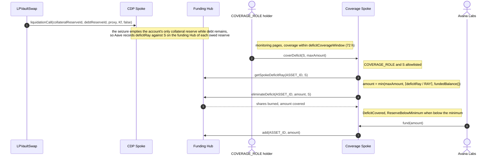

# 3.9 Deficit Coverage (FLOW-009)

> **Status:** In review · **Owner:** Avana Labs · **Last reviewed:** 2026-11-10
>
> **Step prefix:** `DEF-NNN` · failures `DEF-F-NNN` · postconditions `DEF-POST-NNN`

A deficit is debt that Aave writes off an account when liquidation has exhausted its collateral. Each account is one PositionProxy per (wallet, CDP Spoke, market), so it holds exactly one collateral reserve, and a deficit arises when the seizure empties that reserve while debt remains. Aave records the deficit on the **funding Hub** of each debt reserve the account still owes, against the CDP Spoke, in that reserve's own asset. The Avana First-Loss Reserve of that **(chain, funding Hub, debt asset)**, held as prefunded shares in a DAO-controlled, Avana-funded **Avana Umbrella (Coverage Spoke)** registered on the same `(Hub, asset)`, burns those shares to eliminate it. A deficit is never covered with another asset's, another Hub's or another chain's reserve (`Q-236`). The Coverage Spoke contract is specified in [2.14 First-Loss Reserve](../02-contracts/14-first-loss-reserve.md); how a deficit arises is in [FLOW-005](05-liquidation.md). Parameters are named as in [1.5 Protocol Parameters](../01-architecture/05-parameters.md).

At launch each chain (Ethereum and Base) has one Stable LP Hub, GHO is the first borrowable asset on each, and so each chain has one GHO Avana Umbrella (Coverage Spoke) on its Stable LP Hub. Each Coverage Spoke is also called Avana Umbrella: Avana's protocol safety module, named after Aave's Umbrella, whose design inspired it (`Q-402`). Every further debt asset enabled with `enableDebtReserve` gets its own Coverage Spoke on its funding Hub before its `drawCap` rises above 0. Cross-Hub credit lines are fully specified here (`DEF-020`) and off at launch.

## Objective

Record bad debt exactly where Aave records it, cover it promptly and only from reserve capital Avana has funded in the same asset on the same funding Hub and chain (plus the value recovered from pending settlements of markets whose settlement debt reserve draws that asset from that Hub), only for approved Avana CDP Spokes and never beyond either the recorded deficit or the funded balance; bound every credit line by the coverage behind it, keep each reserve at its minimum, and state who bears a loss beyond the reserve and when (`Q-353`).

## Initiator

| Actor | Role |
|---|---|
| Aave CDP Spoke (inside `liquidationCall` from LPVaultSwap) | Reports the deficit to the funding Hub of each debt reserve the account owes |
| `COVERAGE_ROLE` holder (designated by the Aave DAO in its AccessManager on each chain; on Base, the Aave DAO's Base executor) | Calls `coverDeficit` on the Coverage Spoke of the deficit's (Hub, asset) |
| Coverage Spoke (one per covered `(chain, Hub, asset)`) | Calls `Hub.eliminateDeficit` on its own asset as itself; holds the Hub's `HUB_DEFICIT_ELIMINATOR_ROLE` |
| Avana Labs | Funds and tops up each reserve in its asset with `CoverageSpoke.fund` |
| LPVaultSwap (inside `settlePending`, callable by anyone) | Adds the value recovered from a pending-settlement balance, in the asset of the market's settlement debt reserve, to that reserve's Coverage Spoke with `fund` (`DEF-015`) |
| Aave DAO (`RESERVE_ADMIN_ROLE`) | Controls each Coverage Spoke's allowlist, minimum and withdrawals; realizes an uncovered deficit against supplier shares (`DEF-014`) |
| Emergency Guardian of the chain | Runs playbook P-18 when a deficit exceeds its reserve (`DEF-014`, [FLOW-006](06-emergency-operations.md)) |

## Inputs

| Input | Type | Description | Validation |
|---|---|---|---|
| Coverage Spoke | `address` | The instance whose `HUB()`, `ASSET()` and `ASSET_ID()` match the deficit's funding Hub and asset | Named in the chain's MarketRegistry `DebtReserveDef.coverageSpoke` for the debt reserve (`DEF-016`) |
| `borrowSpoke` | `address` | CDP Spoke whose deficit is covered | On that Coverage Spoke's DAO-set allowlist (`allowedBorrowSpoke`) |
| `maxAmount` | `uint256`, asset base units | Most of the deficit to eliminate in this call | The call covers `min(maxAmount, ⌈deficitRay / RAY⌉, fundedBalance())` and reverts if that is 0 |

## Preconditions

- `DEF-001` A deficit exists only after Aave's `liquidationCall` on an Avana account emptied the account's single collateral reserve (the vault-token reserve of its market) while debt remained. It is reported only through LPVaultSwap: CDP Spokes are standard, unmodified Aave V4 Spokes, and the vault token accepts a transfer out of the Hub only to a registered proxy (withdrawal, after which the AaveAdapter burns the units from the proxy; 2.4 `REQ-VTOKEN-006`) or to LPVaultSwap (seizure), and a proxy never calls `liquidationCall`, so any other caller's `liquidationCall` reverts on the seizure transfer and records nothing (`Q-352`). The drift check keeps the Aave settings that could move vault tokens elsewhere (`receiveSharesEnabled = false`, `liquidationFee = 0`, no reinvestment controller) as listed; drift stops new activity, never liquidation. Liquidation, and so deficit reporting, runs in every application pause state, under every circuit breaker and whatever addresses are frozen (`Q-227`, `Q-241`, `Q-242`); on Base it does not run while the sequencer gate is `Down` and runs during `Grace` only for accounts below `graceHealthFactor`, so no deficit is recorded from prices that borrowers could not react to (`Q-357`). An Aave halt of the CDP Spoke or a pause of its vault-token reserve stops liquidation and so also stops new deficits on that Spoke until it is lifted (playbook P-16, `Q-351`). (Source: Q-070, Q-116, Q-144, Q-222, Q-227, Q-241, Q-242, Q-351, Q-352, Q-357)
- `DEF-002` For each covered `(chain, Hub, asset)`, the Coverage Spoke is a registered Spoke on that asset with `drawCap = 0`, holds added shares of that asset funded by Avana Labs, is controlled by the Aave DAO on that chain, holds `HUB_DEFICIT_ELIMINATOR_ROLE` in that Hub's AccessManager, and is the only Spoke that calls `eliminateDeficit` for Avana CDP Spokes on that asset. Its funds are part of the Hub's liquidity of that asset; the shares are earmarked for deficits of approved Avana CDP Spokes that draw the asset from that Hub, whatever their home Hub, and any yield on them follows the Hub's configuration of the asset. At launch the instances are GHO on the Ethereum Stable LP Hub and GHO on the Base Stable LP Hub; each chain's instance is sized and funded against that chain's caps only. (Source: Q-070, Q-101, Q-142, Q-236, Q-239, Q-353)

## Execution Steps

`S` is the CDP Spoke, `r` a debt reserve on `S` with funding Hub `HF_r` and asset `a_r`, `CS(h, a)` the Coverage Spoke of `(h, a)` on the chain.

| Step | Action | Contract | Notes |
|---|---|---|---|
| `DEF-003` | Inside `liquidationCall`, `S` calls `HF_r.reportDeficit(assetId, drawnAmount, premiumDelta)` for every debt reserve `r` the account still owes; that Hub removes the account's drawn shares and premium, adds `drawnShares × drawnIndex + restoredPremiumRay` to both the asset's and `S`'s `deficitRay`, updates the drawn rate and emits `ReportDeficit`; the account's debt in that reserve becomes 0. | CDP Spoke → funding Hub(s) | One liquidation can record deficits in several assets, and on several Hubs once cross-Hub lines are on, when the account owed several debt reserves. Only borrowing fails at the drawCap: the deficit stays counted in `S`'s total owed on that (Hub, asset), so it uses drawCap headroom until eliminated, and the UI shows available credit per reserve as drawCap minus total owed including premium and deficit. Indexers read each amount from the Hub's `ReportDeficit` event in the liquidation transaction; LPVaultSwap's `LiquidationSettled` carries no deficit field ([FLOW-005](05-liquidation.md)). Checked by: HYP-08, HYP-32. (Source: Q-070, Q-076, Q-101, Q-119, Q-234) |
| `DEF-004` | Monitoring alerts on any non-zero `Hub.getSpokeDeficitRay(assetId, S)` on any Hub and asset of the chain (warn at once, page when a deficit is still uncovered after 24 hours) and the chain's `COVERAGE_ROLE` holder covers it within `deficitCoverageWindow` (72 hours). | Off-chain | Avana accepts Aave V4's deficit behaviour unchanged and commits to eliminating any reported deficit within this fixed window; the 24-hour page leaves two days for the responder. On Base the window includes the delivery time of Aave cross-chain governance to the Base executor, so the Base runbook starts the coverage call at the first page. (Source: Q-101, Q-119, Q-244) |
| `DEF-005` | The `COVERAGE_ROLE` holder calls `coverDeficit(S, maxAmount)` on `CS(HF_r, a_r)`. The Coverage Spoke reverts with `AccessManagedUnauthorized` unless the caller holds `COVERAGE_ROLE`, with `SpokeNotAllowlisted` unless `S` is on its allowlist, and with `NothingToCover` if `S`'s `deficitRay` on its `ASSET_ID` is 0. It then computes `amount = min(maxAmount, ⌈deficitRay / RAY⌉, fundedBalance())` (`SPEC-FLR-001`), reverting with `NothingToCover` if it is 0. | Coverage Spoke | The allowlist is needed because the Hub accepts any `spoke` argument from a Spoke holding the role. The three-way minimum bounds what a delegated caller can spend: never more than it asked for, never more than Aave recorded as lost, never more than the reserve holds. A call on another asset's or another Hub's instance finds no deficit on its own `(Hub, ASSET_ID)` and reverts with `NothingToCover`, so coverage cannot cross assets or Hubs. Checked by: MATH-ST-50. (Source: Q-101, Q-142, Q-190, Q-236) |
| `DEF-006` | The Coverage Spoke calls `Hub.eliminateDeficit(ASSET_ID, amount, S)` (`msg.sender` = Coverage Spoke). The Hub accrues, takes `deficitAmountRay = amount × RAY` if `amount < ⌈deficitRay / RAY⌉`, else the whole `deficitRay`; requires the Coverage Spoke to be active and the amount positive; burns `shares = ⌈⌈deficitAmountRay / RAY⌉ × (Sh + 10^6) / (A + 10^6)⌉` (rounded up; `A`, `Sh` the asset's added assets and shares) from the Coverage Spoke's added shares and the asset's total; reduces the asset's and `S`'s `deficitRay` by `deficitAmountRay`; emits `EliminateDeficit(assetId, coverageSpoke, S, shares, deficitAmountRay)`. The Coverage Spoke adds the amount covered to `totalCovered`, emits `DeficitCovered`, and emits `ReserveBelowMinimum` if `fundedBalance() < firstLossReserveMinimum` afterwards. | Coverage Spoke → Hub | Units: `amount` in asset base units, `deficitRay` in base units × 10^27, shares in Hub share units. Coverage never exceeds the recorded deficit, pays less than one base unit above it, and never exceeds the funded balance; burned shares round up, so other suppliers' share price does not fall. Works while `S` is halted on the Hub (`Q-351`). All values fit `uint200` (deficit) and `uint120` (shares). Example (Ethereum, GHO, 18 decimals): a recorded deficit of 475.3 GHO (`deficitRay = 475.3 × 10^45`), `maxAmount = 1,000` GHO and an illustrative funded balance of 400,000 GHO give `amount = 475.3` GHO; with `A = 2,050,000` GHO and `Sh = 2,000,000` shares, the Hub burns `⌈475.3e18 × (2,000,000e18 + 10⁶) / (2,050,000e18 + 10⁶)⌉ = 463.707317073170731713` shares and the deficit falls to 0. With a funded balance of only 300 GHO the call covers 300 GHO and 175.3 GHO stays recorded (`DEF-014`). Example (Base, USDC, 6 decimals, once USDC is enabled there): a deficit of 1,204.511009 USDC (`deficitRay = 1,204,511,009 × 10^27`) against a 50,000 USDC instance is covered in one call of `amount = 1,204,511,009` base units. Checked by: MATH-ST-46, MATH-ST-47, MATH-ST-48, MATH-ST-49, HYP-33, QNT-30. (Source: Q-101, Q-140, Q-142, Q-190) |
| `DEF-007` | The `COVERAGE_ROLE` holder repeats `DEF-005` and `DEF-006` on each affected `(Hub, asset)`'s Coverage Spoke until every `deficitRay` of `S` is 0 or the instance's funded balance is exhausted; an exhausted instance starts playbook P-18 (`DEF-014`). | `COVERAGE_ROLE` holder | (Source: Q-101, Q-236, Q-353) |

## Limits

- `DEF-008` Each Coverage Spoke covers only recorded deficits in its own asset on its own Hub, of CDP Spokes on its DAO-set allowlist, through `eliminateDeficit`, up to its funded balance (`fundedBalance()`, equal to `Hub.getSpokeAddedAssets(assetId, coverageSpoke)`). It never covers in-transaction settlement shortfalls, which the liquidation's caller pays through its own funds and the shortfall top-up (the SettlementBudget does not exist, `Q-397`), and never another asset's, Hub's or chain's deficit. (Source: Q-071, Q-101, Q-117, Q-127, Q-142, Q-190, Q-236, Q-397)
- `DEF-009` A Coverage Spoke has zero draw capacity, and its funds leave only by deficit elimination or by a withdrawal the Aave DAO makes with `requestWithdrawal` and `executeWithdrawal` (`RESERVE_ADMIN_ROLE`) after the immutable `RESERVE_WITHDRAWAL_DELAY` (= `reserveWithdrawalDelay`, 14 days); changing the delay means deploying a new Coverage Spoke. Unused capital returns to Avana Labs only after every credit line on that `(Hub, asset)` is closed and all its debt and deficits are resolved. A withdrawal that would leave the funded balance below the coverage bound of `DEF-019` stops new draws on that `(Hub, asset)` the same way a coverage call does. (Source: Q-101, Q-142, Q-167, Q-236, Q-353)
- `DEF-010` Each allowlist is set by the Aave DAO on that chain (`setAllowedBorrowSpoke`, `RESERVE_ADMIN_ROLE`); adding a CDP Spoke to it is an Aave governance action outside the chain's Avana Timelock and is a step of `enableDebtReserve` (`DEF-016`); removing one stops coverage for that Spoke on that `(Hub, asset)` immediately. (Source: Q-190, Q-228)

## Reserve funding, top-ups and alerts

- `DEF-011` Avana Labs prefunds each Coverage Spoke with at least its `firstLossReserveMinimum` in its asset before the `drawCap` of any CDP Spoke on that `(Hub, asset)` is raised above 0, by calling `fund(amount)`, which pulls the asset straight to the Hub and calls `Hub.add` so it is credited as Coverage Spoke shares (event `ReserveFunded`). It tops the reserve back up to the minimum after coverage draws it down; Avana's committed fee share counts toward the minimum once received in that asset. The funded balance must also satisfy the coverage bound of `DEF-019` for every drawCap on that `(Hub, asset)`. `firstLossReserveMinimum`, `coverageRatioBps` and each chain's GHO credit line are set in the funding ARFC with the Aave service providers, not fixed by Avana; each draw cap stays at most that chain's flash liquidity and swap-route depth (`Q-391`, `Q-392`). Example (illustrative): at a guide ratio of 20%, a 2,000,000 GHO line on the Ethereum Stable LP Hub needs a minimum of `2,000,000 × 2,000 / 10⁴ = 400,000` GHO. (Source: Q-101, Q-142, Q-236, Q-353, Q-391, Q-392)
- `DEF-015` Pending-settlement proceeds. When anyone calls `LPVaultSwap.settlePending(marketId, debtReserveId)` to clear vault tokens left by a seizure that was never settled ([3.4 Withdraw](04-withdraw.md) path D, [FLOW-005](05-liquidation.md)), Collateralization pays LPVaultSwap the n pool tokens of the pending balance; LPVaultSwap converts each to the asset `a_s` of the market's **settlement debt reserve** `r_s` (the debt reserve recorded for the market at `listCollateralMarket`, the first debt reserve enabled on its CDP Spoke: GHO at launch on both chains) over the market's swap routes, passes each route its oracle-derived minimum (`SPEC-LIQ-018` with `s = min(slippageAllowanceBps, 30)`), requires the amount recovered `R` (base units of `a_s`) to reach the oracle floor `minPending` (`SPEC-LIQ-014` on [2.11](../02-contracts/11-lpvaultswap.md), in `a_s`), approves `CS(HF_{r_s}, a_s)` for exactly `R` and calls `fund(R)`. The Coverage Spoke moves the asset straight to the Hub and credits the added shares (event `ReserveFunded` with `funder` = LPVaultSwap), giving LPVaultSwap and the caller no claim. It runs in every application pause state, under every breaker and for any caller, frozen or not; on Base it needs the sequencer `Up` or in `Grace` because the per-leg minimums read fresh prices. Why: such a seizure already repaid the borrower's debt and the losses the incident causes fall on the First-Loss Reserve, so the value recovered from it belongs there; a pending balance arises only when settlement never ran, so which reserve's seizure created it is not known on-chain, and the market's settlement debt reserve names one funded instance in advance; no caller, borrower or Avana Labs gains from triggering the call. If `fund` reverts (Coverage Spoke inactive or halted, `firstLossReserveAddCap` reached), the whole `settlePending` reverts and the pending balance keeps backing the outstanding vault tokens until the call is repeated. The per-leg minimum at no more than 30 bps bounds what a searcher can take by sandwiching this public call. Units: pending amounts in each token's base units; `V_P`, `minPending` and `R` in base units of `a_s`; rounding of the floor is up and of each leg's minimum down, both against the caller. Example (Ethereum, Uniswap v3 USDC/USDT market, settlement reserve GHO): 300,000,000 pending units released as `amounts = [299,999,999, 299,999,999]` (USDC at $1.00, USDT at $0.9998) have `V_P = 599.9399980002` GHO; with `slippageAllowanceBps = 100` the call uses `s = 30`, so the floor is `⌈599.9399980002 × 0.997⌉ − 0.000002 − 1 ≈ 597.140176` GHO; the routes convert to `R = 599.9` GHO, above it, and the Ethereum GHO instance's `fundedBalance()` rises from an illustrative 400,000 to 400,599.9 GHO, less at most 1 wei of Hub share rounding. Checked by: QNT-03, QNT-37, QNT-T09, TEST-232. (Source: Q-101, Q-142, Q-201, Q-211, Q-227, Q-236, Q-250, Q-357, Q-358)
- `DEF-012` Monitoring alerts on `ReserveBelowMinimum` from any instance on any chain, on each Coverage Spoke's balance (warn below 150 % of its minimum, page below 100 %), when a recorded deficit exceeds its instance's funded balance (playbook P-18), when the coverage bound of `DEF-019` fails for any `(Hub, asset)`, and when a deficit stays uncovered past 24 hours (page) or `deficitCoverageWindow`. A reserve below its minimum, or a credit line it no longer covers, is a monitoring alert and no on-chain gate (`Q-399` removed the coverage breaker); for a cross-Hub line the borrow gate of `DEF-019` still refuses new debt while the line is uncovered. The alert goes to the chain's Emergency Guardian or the Aave Protocol Guardian, who decide whether to freeze the application (`MarketRegistry.freeze`, immediate), and to the Aave DAO, which decides whether to freeze the affected debt reserve ([FLOW-006](06-emergency-operations.md)); Avana Labs tops the reserve up. A freeze or a breaker stops new pledges or borrowing; liquidation, repay and debt-free withdrawal continue. (Source: Q-102, Q-118, Q-119, Q-227, Q-244, Q-241, Q-353)
- `DEF-013` Caps are sized so that each `(Hub, asset)` reserve covers the modelled losses in that asset: debt exposure in the asset is summed over every CDP Spoke that draws it from that Hub, on every home Hub of the chain; token-shock losses are summed across every exposed market and Spoke; a debt-asset price rise over the 48-hour incident window is included; and caps satisfy both the incident term `SPEC-FLR-004` and the tail term `SPEC-FLR-005` (one pool token going to zero, slices included), per `(Hub, debt asset)` and per chain ([FLOW-008](08-market-lifecycle.md)). These are Aave DAO and service-provider values with no on-chain enforcement beyond the coverage bound of `DEF-019`; `Lens.getTailCoverage(asset)` reports the cap-based ratio and monitoring the live ratio from current debt (warn below 150 %, page below 100 %). Checked by: MATH-AR-29, MATH-AR-30, SIM-02B, TEST-216. (Source: Q-186, Q-192, Q-234, Q-236, Q-249)
- `DEF-016` `enableDebtReserve` (timelock, normal delay) for any debt asset, GHO included, deploys or reuses the Coverage Spoke registered on the reserve's `(fundingHub, hubAssetId)`, records it in `DebtReserveDef.coverageSpoke`, checks that its `HUB()`, `ASSET_ID()` and `ASSET()` equal the reserve's funding Hub, asset ID and asset, has the Aave DAO allowlist the CDP Spoke on it, has Avana Labs fund it to its minimum, and checks the credit line of `DEF-019` with the new reserve's drawCap included in its sum, all before the reserve's `drawCap` rises above 0 (`REQ-FLR-039`). Why: a debt reserve whose deficits have no funded same-asset reserve on the funding Hub would leave that asset's suppliers carrying the first loss. Example: enabling USDC as debt reserve 2 on the Ethereum CDP Spoke "Uniswap v3 Stable", the Aave payload registers a USDC Coverage Spoke on the Ethereum Stable LP Hub's USDC asset with `drawCap = 0` and allowlists the Spoke; Avana Labs calls `fund` with the USDC minimum of 50,000 USDC; `enableDebtReserve` then accepts the reserve under a recorded USDC line of at most 250,000 USDC, so its drawCap is at most 250,000 USDC (`DEF-019` at an illustrative `coverageRatioBps = 2,000`; the minimum and ratio come from the funding ARFC, `Q-391`), and only the next payload raises the reserve's `drawCap`. (Source: Q-233, Q-236, Q-353)
- `DEF-017` A liquidation that records deficits in two assets is covered by two coverage calls, each on its own `(Hub, asset)`'s Coverage Spoke; a shortfall in one asset's reserve stays recorded in that asset and is never made up from another asset's reserve. Example: an account on the Ethereum CDP Spoke "Uniswap v3 Stable" owing 120 GHO and 0.05 WETH after its collateral is seized records both deficits; the `COVERAGE_ROLE` holder calls `coverDeficit(S, 120e18)` on the GHO instance and `coverDeficit(S, 0.05e18)` on the WETH instance; if the WETH instance held only 0.03 WETH, 0.02 WETH stays recorded, playbook P-18 runs for WETH, and the GHO instance's balance is untouched by it. (Source: Q-234, Q-236, Q-353)
- `DEF-018` Deficit breaker (`Q-399`). For every debt reserve `(S, r)` of asset `a` funded by Hub `h`, the RiskModule's `preBorrowCheck` and `preWithdrawCheck` refuse borrowing `r` and withdraw-with-debt by accounts with debt in `r` with `DebtBreakerTripped(S, r, reasons)` while any debt reason holds: `DEFICIT`, when the outstanding deficit of `a` on `h` recorded against `S` exceeds `breakerDeficitMax[a]` (10,000 GHO for GHO; a per-reserve materiality set at listing for other assets, bounded by `firstLossReserveMinimum`) (`SPEC-BRK-004`); `ISSUER` on `a` (`SPEC-BRK-003`); or a `MANUAL` trip by a guardian or the timelock (`tripDebtBreaker`). There is no coverage breaker: a Coverage Spoke below its minimum (`isBelowMinimum()`) and a credit line it no longer covers are monitoring alerts (`DEF-012`), after which a guardian may trip the debt breaker manually; for a cross-Hub reserve the borrow gate of `DEF-019` also refuses new debt while the line is uncovered. `DEFICIT` freezes new borrowing on that debt reserve automatically and latches: it stays tripped after coverage until authorized reopening by the pause guardian (`resetDebtBreaker`) or the timelock at the normal delay ([2.15](../02-contracts/15-governance-and-timelock.md)), so the root cause is reviewed before borrowing resumes. Monitoring alerts on every new deficit, whatever its size. Repay, debt-free withdrawal, top-ups, liquidation, `settlePending` and coverage never read these reasons, and borrowing of other assets continues. `Lens.getDebtBreakerStatus(S, r)` reports them. Why: a deficit above the materiality means a loss in that asset has already reached the Hub's suppliers; stopping only new debt in that asset keeps every risk-reducing action open, and 10,000 GHO keeps small dust deficits, which the Avana Umbrella covers within `deficitCoverageWindow` (72 h), from freezing a market. Example (illustrative reserve of 400,000 GHO): a liquidation records a 12,500 GHO deficit on the Ethereum "Uniswap v3 Stable" Spoke; `12,500 > 10,000`, so GHO borrows there revert with `DebtBreakerTripped(S, ghoReserveId, DEFICIT)`; the `COVERAGE_ROLE` holder covers 12,500 GHO, leaving the reserve at 387,500 GHO, below its minimum, which pages monitoring until Avana Labs funds it back; `DEFICIT` stays latched until the pause guardian resets it after the review; USDC borrowing was never affected. A 1,250 GHO deficit trips nothing on-chain and is covered within 72 hours after the alert. Checked by: TEST-228. (Source: Q-241, Q-102, Q-236, Q-353, Q-399)
- `DEF-019` Coverage bound on credit lines. For each `(chain, funding Hub h, asset a)`, the MarketRegistry's credit-line registry keeps the line `L` that `recordCreditLine` recorded and `ΣD(h, a)`, the sum of the drawCaps `D_j` (whole tokens, Aave units) of every CDP Spoke with an enabled reserve drawing `a` from `h`, on every home Hub (2.8 `REQ-CONFIG-081`). With `dec_a` the asset's decimals and `F` the Coverage Spoke's `fundedBalance()` in base units, it requires **`ΣD(h, a) ≤ L`** and **`L × 10^dec_a × coverageRatioBps ≤ F × 10⁴`** in `recordCreditLine` and in `enableDebtReserve` (`CreditLineExceeded(h, a, sum, line)`, `CoverageBelowRatio(h, a, required, funded)`). Coverage is tested on the line, which bounds the sum, so a covered line covers every drawer together. Because Aave governance sets drawCaps on the Hub directly, `syncDrawCap` (anyone) records a Spoke's live drawCap and the new sum whatever the line and the coverage, so a raise is never hidden; and because a coverage call or a withdrawal can lower `F`, the registry serves `creditLineCoverage(h, a)` = (`required = ⌈L × 10^dec_a × coverageRatioBps / 10⁴⌉`, `funded = F`). For a cross-Hub reserve, `preBorrowCheck` reverts `CreditLineExceeded` while `ΣD > L` and `CoverageBelowRatio` while `required > funded` (2.7 `REQ-RISK-082`); a same-Hub reserve is bounded by its drawCaps on its own Hub, and a coverage shortfall after recording is a monitoring alert (`DEF-012`), never an automatic debt breaker. Units: both sides are exact integers in base units × bps, computed in `uint256` with no rounding (a line too large for 256 bits requires `2^256 − 1` and fails closed); `F` is the floored `SPEC-FLR-002` value, so the check is never looser than the real balance. `coverageRatioBps` is set in the funding ARFC with the Aave service providers; 2,000 (coverage at least 20 % of the summed caps) is an illustrative guide (`Q-391`). Why: a deficit beyond the reserve falls on the Hub's suppliers first-come (`DEF-014`); keeping the reserve at a fixed share of the most that can be drawn makes that case require losses above that share (20 % in the illustrative guide) of all drawn debt at once, beyond the incident and tail terms of `DEF-013`. Example (Ethereum, GHO, illustrative values): a 2,000,000 GHO line covers drawCaps of 1,200,000 GHO ("Uniswap v3 Stable") and 800,000 GHO (a second stable CDP Spoke), and `2,000,000 × 10^18 × 2,000 = 4 × 10^27 ≤ 400,000 × 10^18 × 10⁴ = 4 × 10^27` holds exactly at a 400,000 GHO minimum, which is `coverageRatioBps` × the line; raising the first drawCap to 1,250,000 GHO needs the line raised to 2,050,000 GHO first, and `recordCreditLine` for that line needs `F ≥ 410,000` GHO, so it reverts `CoverageBelowRatio` until Avana Labs funds 10,000 GHO more. On Base the GHO line is set in the funding ARFC and is at most the Base Pool's flash liquidity and swap-route depth for GHO (`Q-392`); the same inequality then fixes the Base minimum, which must also exceed the Base incident term. Checked by: MATH-AR-29, MATH-AR-30, MATH-CAP-10. (Source: Q-236, Q-353, Q-391, Q-392)
- `DEF-020` Cross-Hub credit lines (off at launch). A debt reserve whose funding Hub differs from its CDP Spoke's home Hub is a cross-Hub credit line. The funding Hub owns the cap: `enableDebtReserve` for such a reserve requires the funding Hub's governance consent recorded in that Hub's MarketRegistry entry, registers the line in the one credit-line registry per `(funding Hub, asset)` on the chain, and checks both `DEF-019` (the line's drawCap counts in `ΣD(h, a)`) and `crossHubLineCap(h, a, S) ≤ fundedBalance()` of `CS(h, a)` (`REQ-FLR-043`), so every cross-Hub draw is backed one-for-one by the funding Hub's first-loss capital. A pause of the funding Hub (`Paused` on that Hub's MarketRegistry entry) or `crossHubLinesEnabled = false` stops new draws on the line; repay, liquidation and coverage continue. Deficits of the line are recorded on the funding Hub and covered by `CS(h, a)` (`REQ-FLR-042`), never by the home Hub's instance. At launch `crossHubLinesEnabled` is false on Ethereum and Base and no cross-Hub reserve exists. Example: a Volatile LP CDP Spoke drawing USDC from the Stable LP Hub with a 200,000 USDC drawCap requires `CS(Stable, USDC)` to hold at least 200,000 USDC for the cross-Hub cap, and the Stable Hub's registry sum, now including those 200,000 USDC, still to satisfy `DEF-019`. (Source: Q-236, Q-353)
- `DEF-021` Exposure publication. The Lens reports, per `(chain, Hub, asset)`: each drawing Spoke and its home Hub, drawCap, drawn debt, recorded deficit, `fundedBalance()` of the Coverage Spoke, the coverage bound of `DEF-019`, and `uncoveredDeficit(h, a) = max(0, Σ_S ⌈deficitRay_S / RAY⌉ − fundedBalance())` in base units, rounded up against the reserve. Lend Spoke suppliers read their exposure and any uncovered loss from it before they withdraw (`Q-353`). (Source: Q-353)
- `DEF-022` Chain specifics. Each chain has its own Hubs, Coverage Spokes, `COVERAGE_ROLE` holder, Guardian set and Timelock; nothing in this flow crosses chains. Ethereum: 12 s blocks, no sequencer gate. Base: 2 s blocks; the sequencer gate (`Q-357`) stops liquidation while `Down` and limits it during `Grace`, so deficits are recorded only from accounts below `graceHealthFactor` in the first `sequencerGraceSeconds` (3,600 s) after a restart; coverage, funding and the Lend Spoke loss rule read no price and run in every sequencer state once transactions are included; Aave governance reaches the Base executor through cross-chain delivery, whose time counts inside `deficitCoverageWindow`. A 24 h stablecoin feed heartbeat (86,400 s, fresh for 88,200 s) changes nothing here: coverage and the bound of `DEF-019` use base-unit amounts, never prices. (Source: Q-236, Q-357)

## Losses beyond the reserve

- `DEF-014` A deficit larger than its instance's funded balance stays recorded on the funding Hub as the CDP Spoke's `deficitRay` on that asset and keeps counting against its drawCap there. It is a loss of that Hub asset's suppliers, pro rata to their shares, including suppliers through the chain's Lend Spoke. Aave's share accounting counts the deficit inside the asset's assets until it is realized, so a supplier who withdraws before realization would leave at full value; Avana removes that information advantage and bounds the window (`Q-353`): the moment `uncoveredDeficit(h, a) > 0` (`DEF-021`) the chain's Emergency Guardian runs playbook P-18: it sets `drawCap = 0` on `(h, a)` for every drawing Spoke through the Aave Guardian, raises the `UncoveredDeficit(hub, asset, amount)` alarm, and asks the Aave DAO to realize the uncovered amount against supplier shares, the Aave governance action that reduces the asset's total assets. Until realization the Lend Spoke stays open and the Lens publishes the deficit-adjusted share price `priceAdj = (A − uncovered) / Sh` (base units per share, rounded down against the withdrawer), so every lender sees the loss. The only on-chain coverage layer is the Coverage Spokes; Avana claims no coverage from committed fee income, Aave's own Umbrella or DAO layers; the Avana Umbrella is the Coverage Spokes themselves. A later top-up of the instance by Avana Labs or the DAO lets the `COVERAGE_ROLE` holder eliminate the remainder before realization, which then removes the loss. Example (Ethereum, GHO, illustrative values): `A = 2,000,000` GHO, `Sh = 1,950,000` shares, a deficit of 130,000 GHO against an instance holding 100,000 GHO (earlier coverage drew it below a 400,000 GHO minimum) leaves `uncovered = 30,000` GHO after coverage; the Lens shows `priceAdj = (2,000,000 − 100,000 − 30,000) / (1,950,000 − 97,500) ≈ 1.00944` GHO per share against an unadjusted `1.02564` GHO; a lender holding 18,525 shares (1 % of the remaining shares) carries 300 GHO of the loss once it is realized. Checked by: QNT-31, HYP-08. (Source: Q-101, Q-119, Q-236, Q-353)

## Worked Example

- `DEF-023` Walkthrough, Uniswap v3 on Ethereum (Dan, GHO debt): a deficit reported and covered. Setup: market 1, the USDC/USDT 0.01% market on the "Uniswap v3 Stable" CDP Spoke `S` of the Ethereum Stable LP Hub, `CF = 2,812` bps, `maxLiquidationBonus = 10,500`. Dan's proxy holds 20,000 vault tokens at $2.00 (40,000 USD) and owes 10,000 GHO: HF `40,000 × 0.2812 / 10,000 = 1.1248`. The GHO Avana Umbrella `CS(Stable, GHO)` holds an illustrative 400,000 GHO (its minimum, set in the funding ARFC); the Hub's GHO has `A = 2,050,000` GHO and `Sh = 2,000,000` shares; GHO drawCaps on the Hub sum to 2,000,000 GHO under a recorded 2,000,000 GHO line (`DEF-019`).
  1. USDT collapses within minutes. Both USDT routes agree, and the LPOracle ([2.10](../02-contracts/10-lp-oracle.md)) serves `Pc = 0.50`: Dan's collateral is worth 10,000 USD and his HF is `10,000 × 0.2812 / 10,000 = 0.2812`. USDT leaves the stablecoin band ($0.90–$1.02), so the oracle and peg checks block new borrowing and withdraw-with-debt in market 1; the 50% price drop also raises the price-drop alert (monitoring only, `Q-399`); liquidation continues.
  2. Avana's keeper calls `Lens.previewLiquidation(P, 0, now + 120)` ([2.17](../02-contracts/17-lens.md)): the bonus is the maximum 10,500, the whole debt is to be covered, and the collateral covers only `10,000 / 1.05 = 9,523.809523809523809523` GHO, so the preview flags a deficit.
  3. The keeper calls `LPVaultSwap.liquidate` ([2.11](../02-contracts/11-lpvaultswap.md)) with `debtToCover = 10,000` GHO of its own, so `Kf = 10,000` GHO (`Q-404`). Inside it, `Spoke.liquidationCall` seizes all 20,000 vault tokens, restores 9,523.809523809523809523 GHO, and, because Dan's only collateral reserve is now empty, calls `Hub.reportDeficit` for the remaining `10,000 − 9,523.809523809523809523 = 476.190476190476190477` GHO (`DEF-003`). Event `ReportDeficit`; Dan's debt is 0.
  4. The unwind and routes return `R = 9,950` GHO, above `minOut = 9,900 − 1 GHO − 2 base units = 9,898.999999999999999998` GHO. Waterfall: `G = V − D = 10,000 − 9,523.809523809523809523 = 476.190476190476190477`; `Y = 9,950 − 9,523.809523809523809523 = 426.190476190476190477`; `A = min(⌊476.190476190476190477 × 0.2⌋, Y) = 95.238095238095238095` GHO to `feeRecipient`; `Kr = min(Y − A, G − A) = 330.952380952380952382` GHO; `B = 0`; `keeperOut = Kf + R − D − A − B = 10,000 + 330.952380952380952382 = 10,330.952380952380952382` GHO to the keeper, which includes the 476.190476190476190477 GHO of its funding Aave did not pull; event `LiquidationSettled`.
  5. Monitoring reads `Hub.getSpokeDeficitRay(GHO, S)` > 0 and warns at once. The deficit is below `breakerDeficitMax` (10,000 GHO, `Q-399`), so `Lens.getDebtBreakerStatus(S, 0)` shows no DEFICIT reason and GHO borrowing on other markets continues.
  6. Within the 72-hour `deficitCoverageWindow`, the `COVERAGE_ROLE` holder calls `CS(Stable, GHO).coverDeficit(S, 1,000e18)` ([2.14](../02-contracts/14-first-loss-reserve.md)): `amount = min(1,000, 476.190476190476190477, 400,000) = 476.190476190476190477` GHO.
  7. The Coverage Spoke calls `Hub.eliminateDeficit(GHO, amount, S)`; the Hub burns `⌈476.190476190476190477e18 × (2,000,000e18 + 10⁶) / (2,050,000e18 + 10⁶)⌉ = 464.576074332171893154` shares from the Coverage Spoke. Events `EliminateDeficit` and `DeficitCovered`; `S`'s deficit is 0.
  8. The reserve now holds about 399,523.81 GHO, below its illustrative 400,000 GHO minimum: event `ReserveBelowMinimum`, and monitoring pages (`M-13`, `DEF-012`). The 2,000,000 GHO line at 2,000 bps now reports `required = 400,000` GHO above `funded`, so a cross-Hub GHO borrow on that line would revert `CoverageBelowRatio`; `S` draws GHO from its own Hub, so its GHO borrows continue unless a guardian trips the debt breaker manually. Repay, liquidation and debt-free withdrawal run; USDC borrowing is unaffected.
  9. Avana Labs calls `CS(Stable, GHO).fund(477e18)`; event `ReserveFunded`. The reserve is back above its minimum and the line is covered again, with no reset call; only a DEFICIT latch or a manual trip would need authorized reopening (`DEF-018`).

  Checked by: MATH-ST-46, MATH-ST-47, MATH-ST-49, HYP-33, QNT-30, MATH-AR-29, MATH-AR-30; arithmetic re-computed.

## Contract Interactions

- CDP Spoke → `Hub.reportDeficit` [CDP Spoke] on the funding Hub of each owed debt reserve, inside `liquidationCall` called by LPVaultSwap.
- `COVERAGE_ROLE` holder → `CS(h, a).coverDeficit(S, maxAmount)` [holder]; Coverage Spoke → `Hub.eliminateDeficit(ASSET_ID, amount, S)` [Coverage Spoke].
- Avana Labs → `CS(h, a).fund(amount)` [Avana Labs]; Coverage Spoke → `ASSET.safeTransferFrom(Avana Labs, Hub, amount)`, `Hub.add(ASSET_ID, amount)` [Coverage Spoke].
- LPVaultSwap → `CS(HF_{r_s}, a_s).fund(R)` [LPVaultSwap], inside `settlePending`; Coverage Spoke → `a_s.safeTransferFrom(LPVaultSwap, Hub, R)`, `Hub.add(assetId, R)` [Coverage Spoke].
- Timelock → `MarketRegistry.enableDebtReserve(...)` and drawCap records → credit-line registry check of `DEF-019` and `DEF-020` (view of `CS(h, a).fundedBalance()`).
- Monitoring → `Hub.getSpokeDeficitRay`, `Hub.getSpokeAddedAssets`, `CoverageSpoke.fundedBalance`, `isBelowMinimum` (views, every instance on every chain).
- RiskModule → the Hub deficit view inside `preBorrowCheck`, `preWithdrawCheck` and `pokeBreakers` (`DEF-018`); `MarketRegistry.creditLine` and `creditLineCoverage` inside `preBorrowCheck` for a cross-Hub reserve only (`DEF-019`).
- Lens → `CS(h, a).fundedBalance()`, `firstLossReserveMinimum()`, Hub deficit and share views for `getTailCoverage(asset)` and the exposure view of `DEF-021`.

## State Changes

| Contract | Storage | Before → After | Step |
|---|---|---|---|
| Funding Hub (each owed asset) | Asset and CDP Spoke `deficitRay` | + reported amount; − eliminated amount | `DEF-003`, `DEF-006` |
| Funding Hub (instance's asset) | Asset and Coverage Spoke added shares | − shares burned | `DEF-006` |
| CDP Spoke | Account drawn shares and premium in each debt reserve | → 0 | `DEF-003` |
| Funding Hub (instance's asset) | Coverage Spoke added shares | + shares on funding | `DEF-011`, `DEF-015` |
| Coverage Spoke | `totalFunded`, `totalCovered` | + funded; + covered | `DEF-006`, `DEF-011`, `DEF-015` |
| MarketRegistry (credit-line registry) | `ΣD(h, a)`, cross-Hub line entries | + drawCap on enable or raise; − on lowering | `DEF-016`, `DEF-019`, `DEF-020` |
| Funding Hub (after P-18 realization by the Aave DAO) | Asset added assets | − uncovered amount | `DEF-014` |

## External Calls

Trust assumptions are in [4.3 External Dependencies](../04-security/03-external-dependencies.md).

| External contract | Function | Step |
|---|---|---|
| Aave V4 Hub (each funding Hub on each chain) | `reportDeficit` (from the Spoke), `eliminateDeficit`, `add`, deficit and share views | `DEF-003` to `DEF-011`, `DEF-019` |
| Aave AccessManager (Hub authority) | `HUB_DEFICIT_ELIMINATOR_ROLE` check on `eliminateDeficit` | `DEF-006` |
| Aave DAO AccessManager (Coverage Spoke authority, per chain) | `COVERAGE_ROLE`, `RESERVE_ADMIN_ROLE` checks | `DEF-005`, `DEF-009`, `DEF-010` |
| Base sequencer-uptime feed (`0xBCF85224fc0756B9Fa45aA7892530B47e10b6433`) | Read by the liquidation and pending-settlement price gates only | `DEF-001`, `DEF-015`, `DEF-022` |

## Events

| Contract | Event | Step |
|---|---|---|
| Hub | `ReportDeficit(assetId, spoke, drawnShares, premiumDelta, deficitAmountRay)` | `DEF-003` |
| Hub | `EliminateDeficit(assetId, callerSpoke, spoke, shares, deficitAmountRay)` | `DEF-006` |
| Coverage Spoke | `DeficitCovered`, `ReserveBelowMinimum` | `DEF-006` |
| Coverage Spoke | `ReserveFunded` | `DEF-011`, `DEF-015` |
| MarketRegistry | `CreditLineRecorded(hub, asset, spoke, drawCap, sum)` | `DEF-016`, `DEF-019`, `DEF-020` |
| Monitoring (off-chain alarm) | `UncoveredDeficit(hub, asset, amount)` | `DEF-014` |

## Failure Conditions

| ID | Step | Condition | Result |
|---|---|---|---|
| `DEF-F-001` | `DEF-005` | Caller lacks `COVERAGE_ROLE` | The call reverts with `AccessManagedUnauthorized`. (Source: Q-101) |
| `DEF-F-002` | `DEF-005` | `S` not on the instance's allowlist | The call reverts with `SpokeNotAllowlisted`; no state change. (Source: Q-190) |
| `DEF-F-003` | `DEF-005` | `S` has no deficit on the instance's `(Hub, asset)` (including a call on another asset's or Hub's instance), or the computed amount is 0 (`maxAmount = 0` or empty reserve) | The call reverts with `NothingToCover`. (Source: Q-101, Q-236) |
| `DEF-F-004` | `DEF-006` | Funded balance below the deficit | Covers the funded balance only; the remainder stays recorded in that asset (`DEF-014`), `ReserveBelowMinimum` is emitted and playbook P-18 starts. (Source: Q-101, Q-102, Q-142, Q-353) |
| `DEF-F-005` | `DEF-006` | Coverage Spoke inactive on its asset, or lacks `HUB_DEFICIT_ELIMINATOR_ROLE` | The call reverts with `SpokeNotActive` / AccessManager error. (Source: Q-142) |
| `DEF-F-006` | `DEF-003` | The liquidation that would report the deficit fails its recovery floor, its caller funding or minimum payout, a flash liquidation helper's repayment, or its sequencer gate | The whole transaction reverts and no deficit is recorded. (Source: Q-117, Q-357, Q-358, Q-404) |
| `DEF-F-007` | `DEF-018`, `DEF-019` | A borrow of the asset, or a withdraw-with-debt by an account with debt in it, while its Hub deficit on that Spoke exceeds `breakerDeficitMax` (10,000 GHO for GHO), the DEFICIT latch has not been reset, `ISSUER` holds or a manual debt breaker is tripped; or a cross-Hub borrow while the line's draw-cap sum exceeds the line or its Coverage Spoke no longer covers it | The call reverts with `DebtBreakerTripped(spoke, debtReserveId, reasons)`, or for the cross-Hub line `CreditLineExceeded` or `CoverageBelowRatio`; repay, debt-free withdrawal, top-ups and liquidation continue. A Coverage Spoke below its minimum alone reverts nothing. (Source: Q-241, Q-312, Q-353, Q-399) |
| `DEF-F-008` | `DEF-016`, `DEF-019` | `enableDebtReserve` or a recorded drawCap raise would break `Σ D × 10^dec × coverageRatioBps ≤ F × 10⁴` | The call reverts with `CoverageBelowRatio(hub, asset, required, funded)`; no cap changes. (Source: Q-353) |
| `DEF-F-009` | `DEF-016` | The named Coverage Spoke's `HUB()`, `ASSET_ID()` or `ASSET()` differs from the reserve's funding Hub, asset ID or asset, or it holds less than its minimum | `enableDebtReserve` reverts with `CoverageSpokeMismatch` or `CoverageNotFunded`; the reserve stays disabled. (Source: Q-236) |
| `DEF-F-010` | `DEF-020` | A cross-Hub reserve while `crossHubLinesEnabled` is false, without the funding Hub's consent, or with `crossHubLineCap(h, a, S) > fundedBalance()` | `enableDebtReserve` reverts with `CrossHubLinesDisabled`, `FundingHubConsentMissing` or `CrossHubCapAboveCoverage`. (Source: Q-353) |

## Postconditions

- `DEF-POST-001` Coverage never exceeds the covered Spoke's recorded deficit in the instance's asset nor the instance's funded balance, never touches another asset, Hub or chain, and each reserve balance equals funded minus covered minus withdrawn (plus any Hub yield on its shares). Checked by: QNT-30, MATH-ST-46, MATH-ST-47. (Source: Q-101, Q-142, Q-236)
- `DEF-POST-002` Only Coverage Spoke shares of the deficit's `(Hub, asset)` are burned to cover it; other suppliers' share price does not fall. Checked by: HYP-33, MATH-ST-49. (Source: Q-070, Q-142, Q-236)
- `DEF-POST-003` Hub accounting stays consistent per asset: liquidity + drawn + deficit = credit line + interest + reserve. Checked by: QNT-31, HYP-08. (Source: Q-095, Q-101)
- `DEF-POST-004` After every `enableDebtReserve` and recorded drawCap raise, `Σ_j D_j × 10^dec_a × coverageRatioBps ≤ fundedBalance() × 10⁴` holds for the `(Hub, asset)` touched; while it fails, no new draw of that asset from that Hub succeeds. Checked by: MATH-AR-29, MATH-AR-30. (Source: Q-353)
- `DEF-POST-005` Pending-settlement proceeds reach only the Coverage Spoke of the market's settlement debt reserve's `(funding Hub, asset)`, in that asset. Checked by: TEST-232. (Source: Q-211, Q-236, Q-358)

## Related

- Invariants on Hub accounting, backing and per-asset coverage in [4.1 Global Invariants](../04-security/01-global-invariants.md); the coverage-scope attack (Hub accepting any covered Spoke), per-asset reserve exhaustion, the cross-asset coverage attempt and first-come lender exits in [4.2 Attack Scenarios](../04-security/02-attack-scenarios.md).
- Playbooks P-16 (Aave halt of a CDP Spoke) and P-18 (uncovered deficit) in [FLOW-006](06-emergency-operations.md).
- Decisions: `Q-070`, `Q-071`, `Q-076`, `Q-095`, `Q-101`, `Q-102`, `Q-116`–`Q-119`, `Q-127`, `Q-140`, `Q-142`, `Q-144`, `Q-167`, `Q-186`, `Q-190`, `Q-192`, `Q-201`, `Q-211`, `Q-222`, `Q-227`, `Q-233`–`Q-236`, `Q-239`, `Q-241`, `Q-242`, `Q-244`, `Q-249`, `Q-250`, `Q-351`, `Q-352`, `Q-353`, `Q-357`, `Q-358`.
